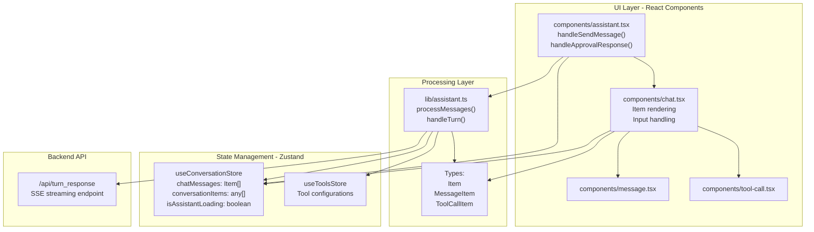
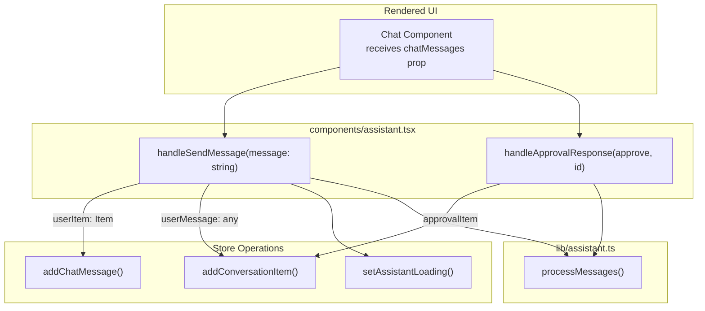
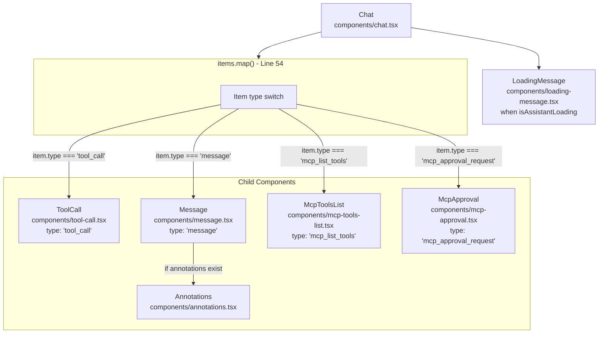
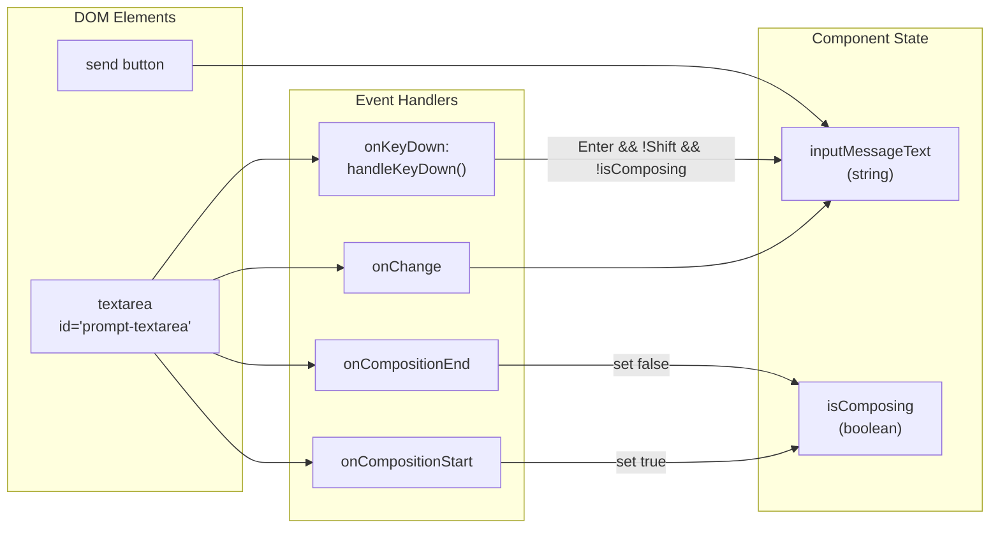
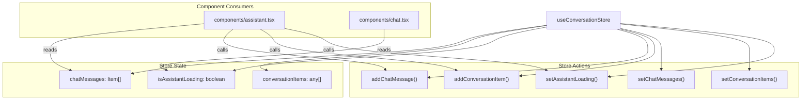

<!-- source: DeepWiki mcp.deepwiki.com · repo openai/openai-responses-starter-app · page 4 Core Components · fetched 2026-10-26 -->

# Core Components

<details>
<summary>Relevant source files</summary>

The following files were used as context for generating this wiki page:

- [components/assistant.tsx](components/assistant.tsx)
- [components/chat.tsx](components/chat.tsx)
- [components/loading-message.tsx](components/loading-message.tsx)
- [components/message.tsx](components/message.tsx)
- [stores/useConversationStore.ts](stores/useConversationStore.ts)

</details>


The core components comprise the essential UI and logic modules that power the conversation interface. These components orchestrate the flow from user input through AI processing to rendered output, coordinating between the frontend, state management layer, and backend APIs.

This page provides an overview of the core component architecture. For detailed information on specific components, see:
- [Assistant Processing Logic](#4.1) - Deep dive into `lib/assistant.ts`
- [Chat Interface](#4.2) - Details on the `Chat` component
- [State Management](#4.3) - Zustand store documentation

Related systems documented elsewhere:
- [Tool System](#5) - Tool configuration, execution, and visualization
- [API Endpoints](#6) - Backend route handlers

## Component Architecture Overview

The core system consists of three primary layers:

| Layer | Primary Components | Responsibility |
|-------|-------------------|----------------|
| **UI Layer** | `components/assistant.tsx`<br/>`components/chat.tsx`<br/>`components/message.tsx`<br/>`components/tool-call.tsx` | User interaction, message rendering, visual presentation |
| **Processing Layer** | `lib/assistant.ts` | Message processing, API communication, event handling |
| **State Layer** | `stores/useConversationStore.ts`<br/>`stores/useToolsStore.ts` | Global state management, data persistence |

**Title:** Core Component Architecture and Data Flow



**Sources:** [components/assistant.tsx:1-60](), [components/chat.tsx:1-138](), [lib/assistant.ts:1-100]()

## Assistant Component

The `Assistant` component serves as the primary orchestrator between user interactions and the AI processing pipeline. Located at [components/assistant.tsx](), it provides the top-level conversation management logic.

### Core Responsibilities

| Function | Purpose | Key Operations |
|----------|---------|----------------|
| `handleSendMessage()` | Process user input | Creates `Item` and message objects, adds to stores, calls `processMessages()` |
| `handleApprovalResponse()` | Handle MCP approval requests | Creates approval response item, adds to conversation, triggers processing |

**Title:** Assistant Component Integration Pattern



**Sources:** [components/assistant.tsx:11-49](), [components/assistant.tsx:53-57]()

### Data Structure Conversion

The component maintains two parallel data representations:

| Store Array | Type | Purpose |
|-------------|------|---------|
| `chatMessages` | `Item[]` | UI-optimized format for rendering |
| `conversationItems` | `any[]` | API-compatible format for OpenAI requests |

The `handleSendMessage()` function creates both representations simultaneously. The `userItem` follows the `Item` type structure for UI display, while `userMessage` follows the OpenAI API message format.

**Sources:** [components/assistant.tsx:14-22](), [stores/useConversationStore.ts:8-10]()

## Processing Layer: lib/assistant.ts

The `lib/assistant.ts` module contains the core message processing logic. This module is documented in detail in [Assistant Processing Logic](#4.1). Key functions include:

| Function | Responsibility |
|----------|---------------|
| `handleTurn()` | Manages SSE communication with `/api/turn_response` |
| `processMessages()` | Dispatches streaming events, updates state, handles tool execution |

The processing layer implements a recursive pattern: when tools are executed, `processMessages()` calls itself with the updated conversation history, enabling multi-turn tool use.

**Sources:** [components/assistant.tsx:28](), [components/assistant.tsx:45]()

## Chat Component

The `Chat` component at [components/chat.tsx]() is the primary UI orchestrator, responsible for rendering conversation items and capturing user input. It receives data via props and delegates rendering to specialized child components.

### Props Interface

```typescript
interface ChatProps {
  items: Item[];
  onSendMessage: (message: string) => void;
  onApprovalResponse: (approve: boolean, id: string) => void;
}
```

**Sources:** [components/chat.tsx:13-17]()

### Component Rendering Hierarchy

**Title:** Chat Component Child Component Dispatch System



**Sources:** [components/chat.tsx:54-78](), [components/chat.tsx:79]()

### Item Type Dispatch Table

The rendering logic uses a switch-like structure within the `map` function to select the appropriate component:

| `item.type` Value | Rendered Component | Data Structure | Lines |
|-------------------|-------------------|----------------|-------|
| `"tool_call"` | `<ToolCall toolCall={item} />` | `ToolCallItem` | [components/chat.tsx:56-57]() |
| `"message"` | `<Message message={item} />` | `MessageItem` | [components/chat.tsx:58-60]() |
| `"mcp_list_tools"` | `<McpToolsList item={item} />` | `McpListToolsItem` | [components/chat.tsx:69-70]() |
| `"mcp_approval_request"` | `<McpApproval item={item} onRespond={...} />` | `McpApprovalRequestItem` | [components/chat.tsx:71-75]() |

**Sources:** [components/chat.tsx:56-76]()

### Input System

The chat input implements a controlled textarea with keyboard shortcut handling and IME (Input Method Editor) support for non-Latin scripts.

**Title:** Input System State and Event Flow



**Sources:** [components/chat.tsx:25-43](), [components/chat.tsx:89-111]()

#### IME Support

The `isComposing` state prevents premature message submission when users are composing characters using IME (e.g., Japanese, Chinese, Korean input methods):

- `onCompositionStart`: Sets `isComposing = true` [components/chat.tsx:99]()
- `onCompositionEnd`: Sets `isComposing = false` [components/chat.tsx:100]()
- `handleKeyDown`: Only submits on Enter if `!isComposing` [components/chat.tsx:36]()

## State Management Overview

The application uses Zustand for state management, primarily via the `useConversationStore`.

| Store | Module | Key State Fields |
|-------|--------|------------------|
| Conversation Store | `stores/useConversationStore.ts` | `chatMessages`, `conversationItems`, `isAssistantLoading` |

### Conversation Store Integration

The `useConversationStore` is accessed throughout the core components:

**Title:** Conversation Store Usage Across Components



**Sources:** [stores/useConversationStore.ts:23-54](), [components/assistant.tsx:8-9](), [components/chat.tsx:28]()

### Dual Message Representation

The system maintains two parallel arrays:

| Array | Type | Used By | Purpose |
|-------|------|---------|---------|
| `chatMessages` | `Item[]` | UI components | Optimized for rendering (includes tool calls, MCP items) |
| `conversationItems` | `any[]` | API calls | OpenAI API-compatible message format |

**Sources:** [stores/useConversationStore.ts:8-10](), [components/assistant.tsx:14-22]()

## Message Rendering Components

### Message Component

The `Message` component at [components/message.tsx]() renders standard text messages using `react-markdown`. It handles both user and assistant roles, applying different styling and layout for each. It also handles rendering of image attachments found in annotations.

**Sources:** [components/message.tsx:9-57]()

### LoadingMessage Component

The `LoadingMessage` component at [components/loading-message.tsx]() is displayed when the assistant is processing a request, providing a pulsing animation as visual feedback.

**Sources:** [components/loading-message.tsx:3-17]()

---

