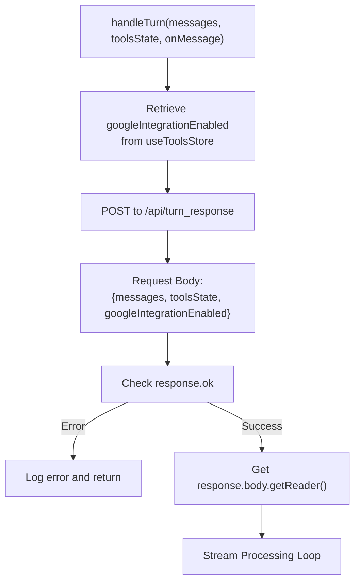
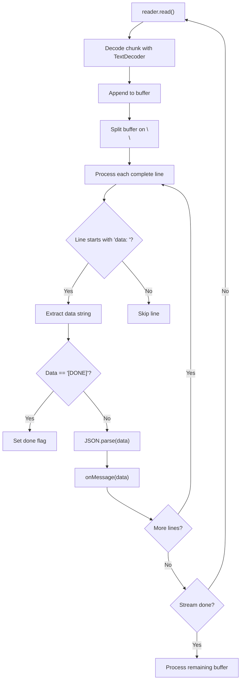
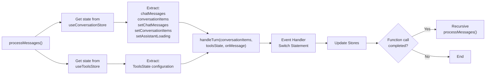
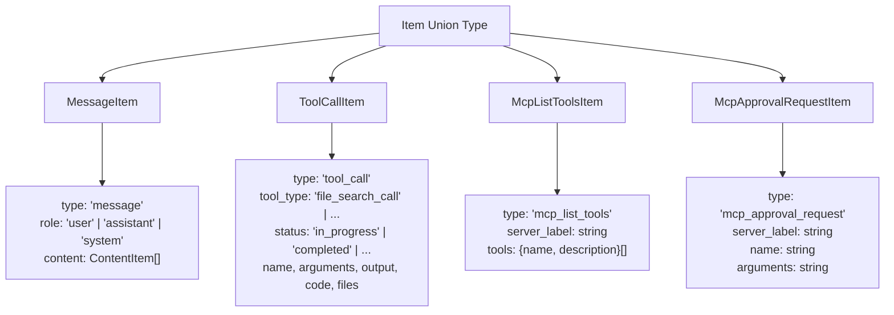
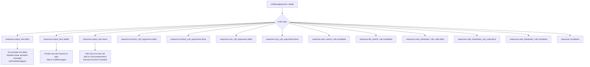
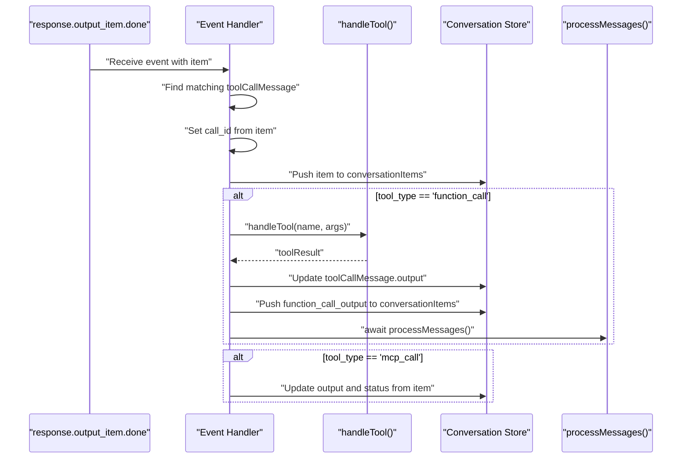
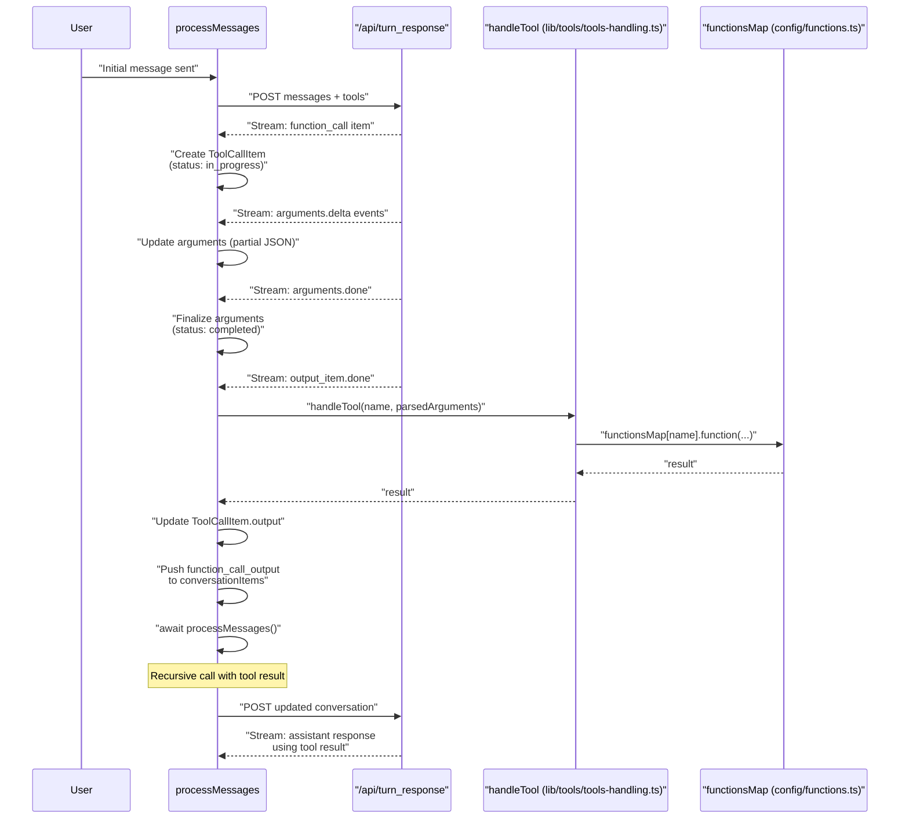
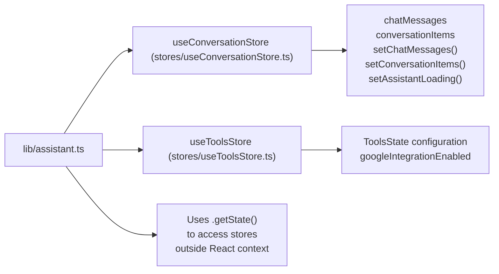

<!-- source: DeepWiki mcp.deepwiki.com · repo openai/openai-responses-starter-app · page 4.1 Assistant Processing Logic · fetched 2026-10-26 -->

# Assistant Processing Logic

<details>
<summary>Relevant source files</summary>

The following files were used as context for generating this wiki page:

- [lib/assistant.ts](lib/assistant.ts)

</details>


## Purpose and Scope

This document provides a detailed explanation of the conversation processing logic implemented in `lib/assistant.ts`, the core orchestration module for the application. This module handles:

- Making API requests to the OpenAI Responses API via the `/api/turn_response` endpoint [lib/assistant.ts:82-90]()
- Processing Server-Sent Events (SSE) streaming responses [lib/assistant.ts:97-132]()
- Managing conversation state through Zustand stores [lib/assistant.ts:139-147]()
- Executing custom function tools and handling tool outputs [lib/assistant.ts:322-346]()
- Supporting recursive multi-turn conversations when tools are invoked [lib/assistant.ts:345]()

For information about the API endpoint that this module communicates with, see [Turn Response API (6.1)](). For details on the UI components that trigger this logic, see [Chat Interface (4.2)](). For tool execution specifics, see [Tool Execution and Aggregation (5.2)]().

**Sources:** [lib/assistant.ts:1-553]()

---

## Core Functions Overview

The module exports two primary functions that work together to orchestrate conversation processing:

| Function | Purpose | Key Responsibilities |
|----------|---------|---------------------|
| `handleTurn` | API communication | Sends messages to `/api/turn_response`, streams SSE responses, parses events [lib/assistant.ts:74-136]() |
| `processMessages` | Conversation orchestration | Retrieves state, calls `handleTurn`, processes events, triggers recursive turns [lib/assistant.ts:138-552]() |

**Sources:** [lib/assistant.ts:74-136](), [lib/assistant.ts:138-552]()

---

## The handleTurn Function

### Function Signature and Purpose

```typescript
export const handleTurn = async (
  messages: any[],
  toolsState: ToolsState,
  onMessage: (data: any) => void
)
```

The `handleTurn` function is responsible for making HTTP requests to the backend API and streaming the response back to the caller via a callback function.

**Sources:** [lib/assistant.ts:74-77]()

### Request Flow



The function constructs a POST request with three key pieces of data:
- `messages`: The conversation history in OpenAI API format [lib/assistant.ts:86]()
- `toolsState`: Tool configuration from `useToolsStore` [lib/assistant.ts:87]()
- `googleIntegrationEnabled`: Boolean flag for Google services [lib/assistant.ts:88]()

**Sources:** [lib/assistant.ts:80-95]()

### Streaming Protocol Implementation

The function implements a Server-Sent Events (SSE) parser to handle the streaming response:



The streaming loop uses a buffer-based approach to handle partial chunks:

1. Reads raw bytes from the response stream [lib/assistant.ts:104]()
2. Decodes bytes to UTF-8 strings [lib/assistant.ts:106]()
3. Accumulates strings in a buffer [lib/assistant.ts:107]()
4. Splits on `\n\n` delimiters to extract complete SSE messages [lib/assistant.ts:109]()
5. Parses each message and invokes the `onMessage` callback [lib/assistant.ts:119-120]()

**Sources:** [lib/assistant.ts:98-136]()

---

## The processMessages Function

### Orchestration Overview

The `processMessages` function serves as the main entry point for conversation processing. It retrieves state from Zustand stores, invokes `handleTurn`, and processes streaming events through an extensive switch statement.



**Sources:** [lib/assistant.ts:138-552]()

### State Management Pattern

The function maintains two parallel message collections:

| Collection | Purpose | Format | Store Method |
|------------|---------|--------|--------------|
| `chatMessages` | UI rendering | `Item[]` with rich types (ToolCallItem, McpListToolsItem, etc.) | `setChatMessages()` [lib/assistant.ts:142]() |
| `conversationItems` | API requests | OpenAI API format | `setConversationItems()` [lib/assistant.ts:143]() |

This dual-collection pattern allows the UI to display specialized components (like tool call visualizations) while maintaining a clean API-compatible history.

**Sources:** [lib/assistant.ts:139-149]()

---

## Data Structures

### Item Type Hierarchy

The module defines a union type `Item` that encompasses all displayable chat elements:



**Sources:** [lib/assistant.ts:21-72]()

### Content Item Structure

Messages contain an array of `ContentItem` objects that represent different content types:

| Type | Usage | Fields |
|------|-------|--------|
| `input_text` | User input | `text`, optional `annotations` [lib/assistant.ts:15-18]() |
| `output_text` | Assistant response | `text`, optional `annotations` [lib/assistant.ts:15-18]() |
| `refusal` | Model refusal | `text` [lib/assistant.ts:15-18]() |
| `output_audio` | Audio response | (audio-specific fields) [lib/assistant.ts:15-18]() |

**Sources:** [lib/assistant.ts:14-18]()

---

## Streaming Event Processing

### Event Handler Architecture

The `processMessages` function's event handler uses a switch statement to dispatch 15+ different event types:



**Sources:** [lib/assistant.ts:156-551]()

### Text Streaming Events

#### response.output_text.delta

Handles incremental text updates as the assistant generates a response:

1. Accumulates delta strings into `assistantMessageContent` [lib/assistant.ts:169]()
2. Checks if the last chat message is an assistant message with matching `item_id` [lib/assistant.ts:172-178]()
3. If not, creates a new `MessageItem` with role "assistant" [lib/assistant.ts:179-189]()
4. If yes, updates the existing message's text content [lib/assistant.ts:193]()
5. Calls `setChatMessages()` to trigger UI update [lib/assistant.ts:203]()
6. Sets `isAssistantLoading` to false [lib/assistant.ts:204]()

**Sources:** [lib/assistant.ts:161-206]()

#### response.output_text.annotation.added

Extends text delta handling to include annotations (e.g., file references):

- Uses `normalizeAnnotation()` to ensure consistent field naming [lib/assistant.ts:197]()
- Appends annotations to the content item's `annotations` array [lib/assistant.ts:195-198]()

**Sources:** [lib/assistant.ts:161-206](), [lib/assistant.ts:8-12]()

### Tool Call Lifecycle Events

#### response.output_item.added

Creates initial `ToolCallItem` entries when the API announces a new tool call:

| Tool Type | Initial Status | Fields Set |
|-----------|---------------|------------|
| `function_call` | `in_progress` | `id`, `name`, `arguments` (empty) [lib/assistant.ts:249-258]() |
| `web_search_call` | `in_progress` | `id` [lib/assistant.ts:262-267]() |
| `file_search_call` | `in_progress` | `id` [lib/assistant.ts:271-276]() |
| `mcp_call` | `in_progress` | `id`, `name`, `arguments` (may be empty) [lib/assistant.ts:280-289]() |
| `code_interpreter_call` | `in_progress` | `id`, `code` (empty), `files` (empty array) [lib/assistant.ts:293-303]() |

**Sources:** [lib/assistant.ts:208-310]()

#### response.output_item.done

Finalizes tool call items by adding the `call_id` field and pushing to `conversationItems`. For `function_call` types, this triggers tool execution:



**Sources:** [lib/assistant.ts:312-357]()

#### response.function_call_arguments.delta

Streams function arguments incrementally for real-time display:

1. Accumulates delta into `functionArguments` string [lib/assistant.ts:362]()
2. Attempts to parse partial JSON using `parse()` from `partial-json` [lib/assistant.ts:370]()
3. Updates `ToolCallItem.arguments` and `parsedArguments` [lib/assistant.ts:371-372]()
4. Gracefully handles parse failures for incomplete JSON [lib/assistant.ts:373-376]()

**Sources:** [lib/assistant.ts:359-380]()

#### response.function_call_arguments.done

Receives complete arguments and finalizes parsing:

1. Replaces accumulated arguments with final `arguments` from data [lib/assistant.ts:386]()
2. Parses final JSON (guaranteed to be valid) [lib/assistant.ts:387]()
3. Sets `status` to "completed" [lib/assistant.ts:392]()

**Sources:** [lib/assistant.ts:382-397]()

### MCP Tool Events

MCP (Model Context Protocol) tools use parallel event types:

- `response.mcp_call_arguments.delta`: Streams MCP tool arguments, similar to function arguments [lib/assistant.ts:401-419]()
- `response.mcp_call_arguments.done`: Finalizes MCP arguments [lib/assistant.ts:421-432]()

These events follow the same accumulation and partial parsing pattern, but store values in `mcpArguments` instead of `functionArguments`.

**Sources:** [lib/assistant.ts:399-432]()

### Built-in Tool Completion Events

Built-in tools (web search, file search, code interpreter) emit completion events:

| Event | Updates |
|-------|---------|
| `response.web_search_call.completed` | Sets `output` and `status: "completed"` [lib/assistant.ts:434-446]() |
| `response.file_search_call.completed` | Sets `output` and `status: "completed"` [lib/assistant.ts:448-460]() |
| `response.code_interpreter_call_code.delta` | Accumulates code deltas [lib/assistant.ts:462-474]() |
| `response.code_interpreter_call_code.done` | Sets final code and marks completed [lib/assistant.ts:476-488]() |
| `response.code_interpreter_call.completed` | Marks overall call as completed [lib/assistant.ts:490-506]() |

**Sources:** [lib/assistant.ts:434-506]()

### Response Completion Event

#### response.completed

The final event in the stream, used to handle special output types:

1. **MCP Tools List**: Extracts all `mcp_list_tools` items from `response.output` and adds them to `chatMessages` for UI display [lib/assistant.ts:512-526]()
2. **MCP Approval Request**: Extracts `mcp_approval_request` items and adds them to `chatMessages` to prompt user approval [lib/assistant.ts:528-542]()

**Sources:** [lib/assistant.ts:508-546]()

---

## Recursive Tool Execution Pattern

### Function Call Workflow

The system implements a recursive pattern for custom function tools:



### Key Implementation Details

The recursive execution occurs in the `response.output_item.done` event handler:

1. **Completion Detection**: When `tool_type === "function_call"`, the handler recognizes a custom function needs execution [lib/assistant.ts:322]()
2. **Function Invocation**: Calls `handleTool(name, parsedArguments)` which looks up the function in `functionsMap` [lib/assistant.ts:324]()
3. **Output Recording**: Stores the tool result as JSON in both `ToolCallItem.output` and creates a `function_call_output` item in `conversationItems` [lib/assistant.ts:327-344]()
4. **Recursive Call**: Invokes `await processMessages()` again with the updated conversation that now includes the tool output [lib/assistant.ts:345]()
5. **Model Continuation**: The OpenAI API receives the tool result and generates a natural language response incorporating the data.

**Sources:** [lib/assistant.ts:322-346]()

---

## Integration with State Management

### Zustand Store Dependencies

The module imports and directly accesses two Zustand stores:



**Sources:** [lib/assistant.ts:3-4](), [lib/assistant.ts:139-147]()

### Direct State Access Pattern

Since `processMessages` is called from event handlers (not React components), it uses `useConversationStore.getState()` and `useToolsStore.getState()` to access store state synchronously:

```typescript
const {
  chatMessages,
  conversationItems,
  setChatMessages,
  setConversationItems,
  setAssistantLoading,
} = useConversationStore.getState();

const toolsState = useToolsStore.getState() as ToolsState;
```

This pattern allows the processing logic to work outside the React component tree while still maintaining reactive state updates.

**Sources:** [lib/assistant.ts:139-147]()

---

## Error Handling

The module implements basic error handling:

| Location | Error Handling |
|----------|----------------|
| `handleTurn` | Checks `response.ok`, logs errors, returns early [lib/assistant.ts:92-94]() |
| `processMessages` | Wraps entire flow in try-catch, logs errors [lib/assistant.ts:134-135]() |
| JSON Parsing | Try-catch around `parse()` for partial JSON, ignores failures [lib/assistant.ts:369-376]() |

Notable gaps:
- No user-facing error messages
- Network failures halt processing silently
- Partial state updates may occur before errors

**Sources:** [lib/assistant.ts:92-94](), [lib/assistant.ts:134-135](), [lib/assistant.ts:369-376]()

---

## Summary

The assistant processing logic serves as the critical bridge between the UI and the OpenAI Responses API:

- **`handleTurn`** manages HTTP communication and SSE streaming [lib/assistant.ts:74-136]()
- **`processMessages`** orchestrates conversation flow and event processing [lib/assistant.ts:138-552]()
- The recursive execution pattern enables multi-turn tool use scenarios [lib/assistant.ts:345]()
- Dual message collections (`chatMessages` vs `conversationItems`) separate UI concerns from API requirements [lib/assistant.ts:140-141]()
- Comprehensive event handling supports 15+ streaming event types across multiple tool types [lib/assistant.ts:160-547]()

This architecture enables real-time streaming responses, seamless tool integration, and a responsive user experience throughout complex multi-turn conversations.

**Sources:** [lib/assistant.ts:1-553]()

---

