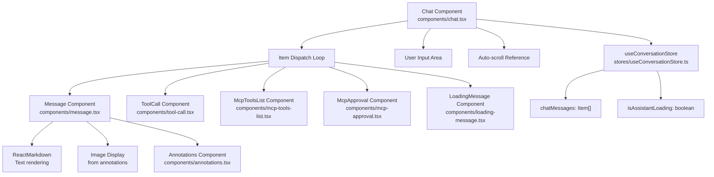
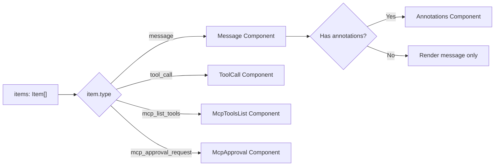
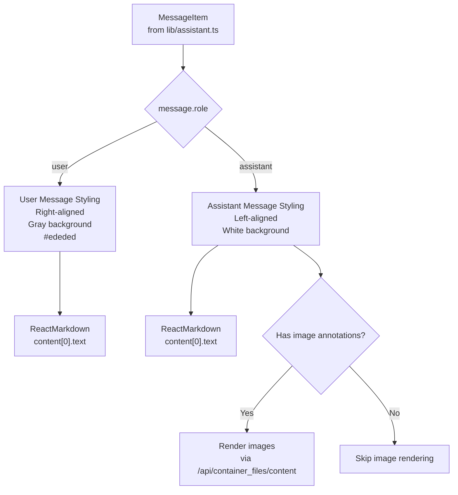
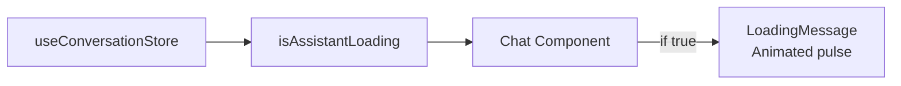
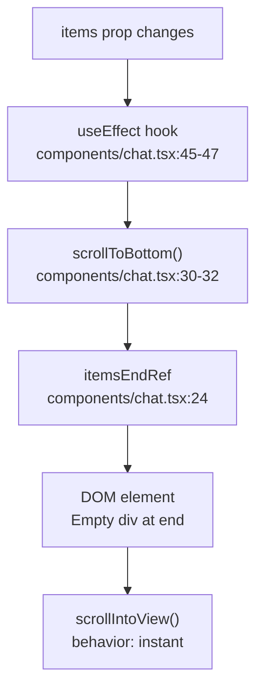

<!-- source: DeepWiki mcp.deepwiki.com · repo openai/openai-responses-starter-app · page 4.2 Chat Interface · fetched 2026-10-26 -->

# Chat Interface

<details>
<summary>Relevant source files</summary>

The following files were used as context for generating this wiki page:

- [components/annotations.tsx](components/annotations.tsx)
- [components/chat.tsx](components/chat.tsx)
- [components/message.tsx](components/message.tsx)

</details>


## Purpose and Scope

This document describes the chat interface components responsible for rendering the conversation UI, handling user input, and dispatching different item types to specialized renderers. The `Chat` component serves as the primary visual interface where users interact with the assistant through text messages, observe tool executions, and approve MCP operations.

For the underlying message processing logic that drives this interface, see [Assistant Processing Logic](#4.1). For tool call visualization details, see [Tool Call Visualization](#5.3). For state management, see [State Management](#4.3).

---

## Component Architecture

The chat interface is built as a hierarchical component structure with `Chat` as the orchestrator that dispatches items to specialized renderers.

### Component Hierarchy



**Sources**: [components/chat.tsx:1-138](), [components/message.tsx:1-60](), [components/annotations.tsx:1-81]()

---

## Chat Component Interface

The `Chat` component accepts three props that define its behavior:

| Prop | Type | Purpose |
|------|------|---------|
| `items` | `Item[]` | Array of conversation items to display |
| `onSendMessage` | `(message: string) => void` | Callback invoked when user sends a message |
| `onApprovalResponse` | `(approve: boolean, id: string) => void` | Callback for MCP approval decisions |

The component maintains two pieces of local state:
- `inputMessageText`: Current text in the input textarea [components/chat.tsx:25]().
- `isComposing`: Tracks IME composition state for non-English input [components/chat.tsx:27]().

**Sources**: [components/chat.tsx:13-28]()

---

## Item Dispatch System

The Chat component implements a type-based dispatch pattern to render different item types with specialized components.

### Item Type Routing



The dispatch logic is implemented in the main render loop at [components/chat.tsx:54-78]():

```tsx
{items.map((item, index) => (
  <React.Fragment key={index}>
    {item.type === "tool_call" ? (
      <ToolCall toolCall={item} />
    ) : item.type === "message" ? (
      <div className="flex flex-col gap-1">
        <Message message={item} />
        {item.content &&
          item.content[0].annotations &&
          item.content[0].annotations.length > 0 && (
            <Annotations
              annotations={item.content[0].annotations}
            />
          )}
      </div>
    ) : item.type === "mcp_list_tools" ? (
      <McpToolsList item={item} />
    ) : item.type === "mcp_approval_request" ? (
      <McpApproval
        item={item as McpApprovalRequestItem}
        onRespond={onApprovalResponse}
      />
    ) : null}
  </React.Fragment>
))}
```

**Sources**: [components/chat.tsx:54-78]()

---

## Message Rendering

The `Message` component handles rendering of `MessageItem` objects, which represent both user and assistant text messages.

### Message Component Architecture



### Text Rendering with ReactMarkdown

Both user and assistant messages use `ReactMarkdown` to render text content with Markdown formatting support. The component accesses the text via `message.content[0].text` at [components/message.tsx:19]() and [components/message.tsx:32]().

### Image Display from Annotations

For assistant messages, the component filters `container_file_citation` annotations to identify image files by extension at [components/message.tsx:34-41]():

```tsx
message.content[0].annotations
  .filter(
    (a) =>
      a.type === "container_file_citation" &&
      a.filename &&
      /\.(png|jpg|jpeg|gif|webp|svg)$/i.test(a.filename)
  )
```

Images are rendered using the file content API endpoint with query parameters for `file_id`, `container_id`, and `filename` at [components/message.tsx:45-46]().

### Styling Differences

| Aspect | User Messages | Assistant Messages |
|--------|---------------|-------------------|
| Alignment | Right (`justify-end`) [components/message.tsx:13]() | Left [components/message.tsx:27]() |
| Background | `#ededed` (gray) [components/message.tsx:15]() | `white` [components/message.tsx:29]() |
| Margin | Left margin (`ml-4, md:ml-24`) [components/message.tsx:15]() | Right margin (`mr-4, md:mr-24`) [components/message.tsx:29]() |
| Additional Features | None | Image annotations displayed [components/message.tsx:43-49]() |

**Sources**: [components/message.tsx:1-60]()

---

## Annotations Display

The `Annotations` component renders citation pills below assistant messages when annotations are present.

### Annotation Types

The `Annotation` type is defined with the following possible values [components/annotations.tsx:3-14]():

| Type | Display | Interaction |
|------|---------|-------------|
| `file_citation` | Filename in pill [components/annotations.tsx:22]() | Non-interactive |
| `url_citation` | Title with external link icon [components/annotations.tsx:32-33]() | Clickable link to URL [components/annotations.tsx:25-35]() |
| `container_file_citation` | Filename with download icon [components/annotations.tsx:44-45]() | Downloadable file link [components/annotations.tsx:39-47]() |

### Deduplication Logic

The component deduplicates annotations at [components/annotations.tsx:52-69]() to prevent showing the same citation multiple times, using type-specific comparison for `file_citation`, `url_citation`, and `container_file_citation`.

**Sources**: [components/annotations.tsx:1-81](), [components/chat.tsx:61-67]()

---

## User Input Handling

The Chat component provides a textarea-based input system with keyboard shortcuts and IME support.

### Input Flow Diagram

```mermaid
sequenceDiagram
    participant User
    participant Textarea["textarea<br/>components/chat.tsx:89-101"]
    participant State["inputMessageText state"]
    participant SendButton["Send Button<br/>components/chat.tsx:103-111"]
    participant Handler["onSendMessage callback"]
    
    User->>Textarea: Types message
    Textarea->>State: Update inputMessageText
    
    alt Enter without Shift
        User->>Textarea: Press Enter
        Textarea->>Handler: onSendMessage(inputMessageText)
        Textarea->>State: Clear inputMessageText
    end
    
    alt Click Send Button
        User->>SendButton: Click
        SendButton->>Handler: onSendMessage(inputMessageText)
        SendButton->>State: Clear inputMessageText
    end
```

### Keyboard Event Handling

The `handleKeyDown` function at [components/chat.tsx:34-43]() implements Enter-to-send with Shift+Enter for newlines:

```tsx
const handleKeyDown = useCallback(
  (event: React.KeyboardEvent<HTMLTextAreaElement>) => {
    if (event.key === "Enter" && !event.shiftKey && !isComposing) {
      event.preventDefault();
      onSendMessage(inputMessageText);
      setinputMessageText("");
    }
  },
  [onSendMessage, inputMessageText, isComposing]
);
```

### IME Composition Support

To support non-English input methods (e.g., Japanese, Chinese), the component tracks composition state using `onCompositionStart` and `onCompositionEnd` handlers at [components/chat.tsx:99-100](). This prevents premature message submission while the user is composing characters [components/chat.tsx:36]().

### Send Button State

The send button is disabled when `inputMessageText` is empty at [components/chat.tsx:104](), with visual styling changes via `disabled:` classes that gray out the button [components/chat.tsx:106]().

**Sources**: [components/chat.tsx:25-27](), [components/chat.tsx:34-43](), [components/chat.tsx:89-111]()

---

## Loading State Display

When the assistant is processing a response, the Chat component displays a `LoadingMessage` component.

### Loading Indicator Logic



The loading state is retrieved from `useConversationStore` at [components/chat.tsx:28]() and conditionally rendered at [components/chat.tsx:79]():

```tsx
{isAssistantLoading && <LoadingMessage />}
```

**Sources**: [components/chat.tsx:28](), [components/chat.tsx:79]()

---

## Auto-scrolling Behavior

The Chat component automatically scrolls to the bottom when new items are added to maintain focus on the latest message.

### Scroll Implementation



The implementation uses a ref to an empty div positioned after all messages at [components/chat.tsx:80](). The `scrollToBottom` function calls `scrollIntoView` with `behavior: "instant"` at [components/chat.tsx:31]() for immediate scrolling.

The `useEffect` hook at [components/chat.tsx:45-47]() triggers scrolling whenever the `items` array changes.

**Sources**: [components/chat.tsx:24](), [components/chat.tsx:30-32](), [components/chat.tsx:45-47](), [components/chat.tsx:80]()

---

## Layout Structure

The Chat component implements a responsive, vertically-stacked layout with fixed input at the bottom.

### Layout Hierarchy

| Element | Class | Purpose |
|---------|-------|---------|
| Outer container | `flex justify-center items-center size-full` [components/chat.tsx:50]() | Centers content horizontally and fills available space |
| Inner container | `flex grow flex-col h-full max-w-[750px] gap-2` [components/chat.tsx:51]() | Constrains width to 750px, vertical flex layout |
| Scrollable area | `h-[90vh] overflow-y-scroll px-10` [components/chat.tsx:52]() | 90% viewport height with vertical scrolling |
| Message container | `mt-auto space-y-5 pt-4` [components/chat.tsx:53]() | Auto top margin pushes messages to bottom |
| Input area | `flex-1 p-4 px-10` [components/chat.tsx:83]() | Fixed position at bottom with padding |

**Sources**: [components/chat.tsx:50-83]()

---

## Summary of Key File Responsibilities

| File | Primary Responsibility |
|------|------------------------|
| `components/chat.tsx` | Main chat container, item dispatch, user input handling, auto-scrolling |
| `components/message.tsx` | Render text messages with Markdown and images, handle user/assistant styling |
| `components/annotations.tsx` | Display and deduplicate citation pills for file/URL/container file references |

**Sources**: [components/chat.tsx:1-138](), [components/message.tsx:1-60](), [components/annotations.tsx:1-81]()

---

