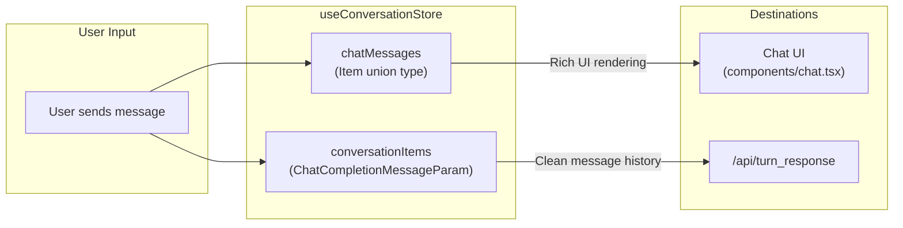
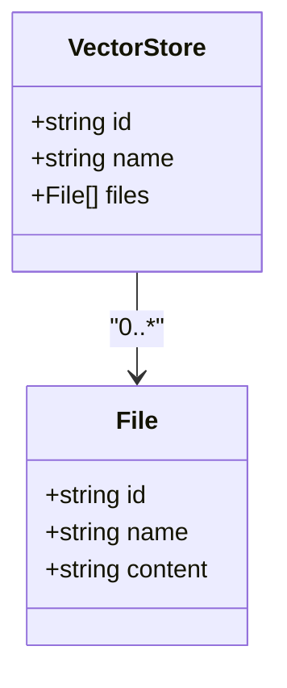
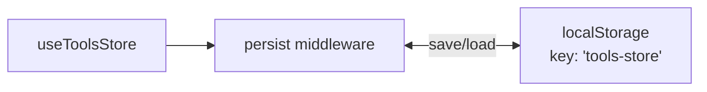
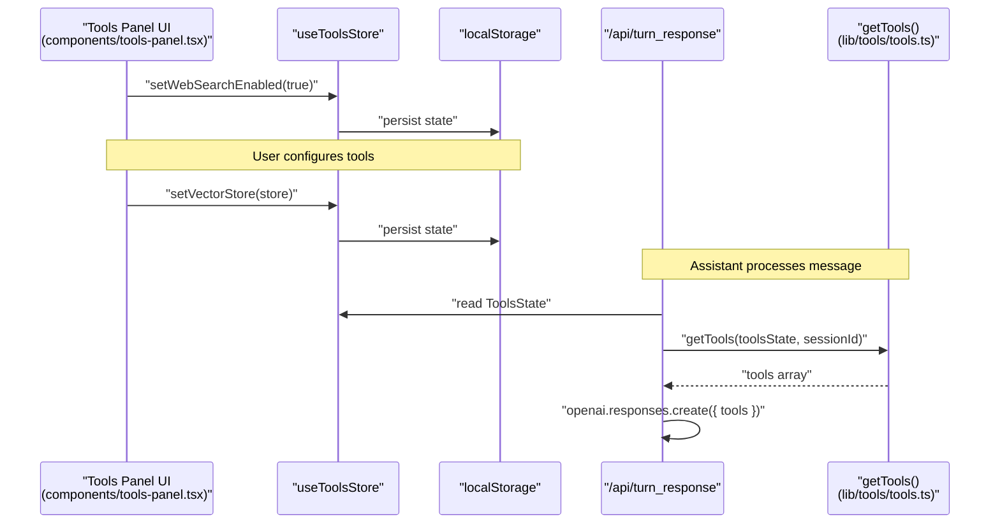
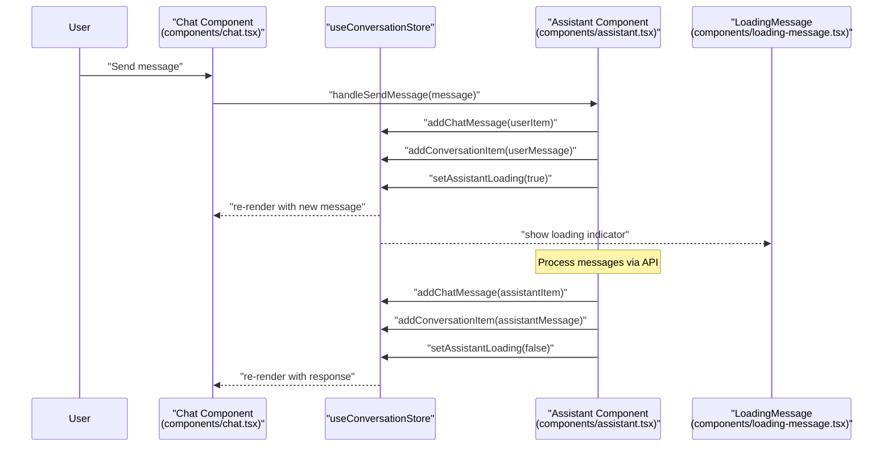
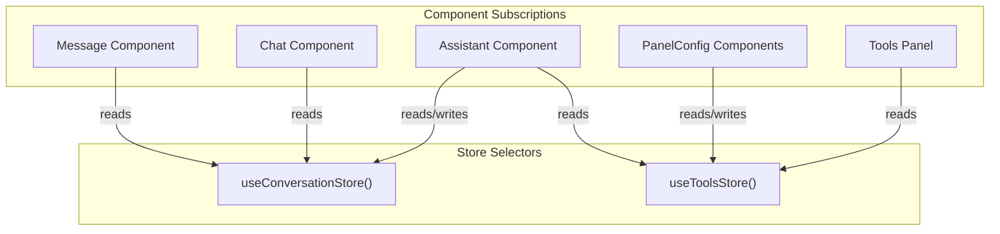

<!-- source: DeepWiki mcp.deepwiki.com · repo openai/openai-responses-starter-app · page 4.3 State Management · fetched 2026-10-26 -->

# State Management

<details>
<summary>Relevant source files</summary>

The following files were used as context for generating this wiki page:

- [components/loading-message.tsx](components/loading-message.tsx)
- [stores/useConversationStore.ts](stores/useConversationStore.ts)
- [stores/useToolsStore.ts](stores/useToolsStore.ts)

</details>


This document describes the state management architecture of the OpenAI Responses Starter App. The application uses two primary Zustand stores to manage global state: `useConversationStore` for chat messages and conversation state, and `useToolsStore` for tool configuration. This page explains the schemas, persistence mechanisms, and usage patterns of these stores.

For information about how the Assistant component processes messages using this state, see [Assistant Processing Logic](4.1). For details on how the Tools Panel configures the tools stored in `useToolsStore`, see [Tool Configuration UI](5.1).

---

## State Management Architecture

The application implements a centralized state management pattern using Zustand, a lightweight state management library. The two stores serve distinct purposes and are accessed throughout the component hierarchy.

### State Store Overview

Title: Zustand Store Architecture

```mermaid
graph TB
    subgraph "Application State"
        ConvStore["useConversationStore<br/>(stores/useConversationStore.ts)"]
        ToolsStore["useToolsStore<br/>(stores/useToolsStore.ts)"]
    end
    
    subgraph "Conversation Data"
        ChatMsgs["chatMessages: Item[]<br/>(UI rendering)"]
        ConvItems["conversationItems: any[]<br/>(API requests)"]
        Loading["isAssistantLoading: boolean"]
    end
    
    subgraph "Tool Configuration"
        WebSearch["webSearchEnabled: boolean<br/>webSearchConfig: WebSearchConfig"]
        FileSearch["fileSearchEnabled: boolean<br/>vectorStore: VectorStore"]
        Functions["functionsEnabled: boolean"]
        CodeInterp["codeInterpreterEnabled: boolean"]
        McpConf["mcpEnabled: boolean<br/>mcpConfig: McpConfig"]
        GoogleInt["googleIntegrationEnabled: boolean"]
    end
    
    subgraph "Persistence"
        LocalStorage["localStorage<br/>(tools-store key)"]
        Memory["In-Memory<br/>(conversation state)"]
    end
    
    ConvStore --> ChatMsgs
    ConvStore --> ConvItems
    ConvStore --> Loading
    
    ToolsStore --> WebSearch
    ToolsStore --> FileSearch
    ToolsStore --> Functions
    ToolsStore --> CodeInterp
    ToolsStore --> McpConf
    ToolsStore --> GoogleInt
    
    ToolsStore -.->|"persist middleware"| LocalStorage
    ConvStore -.->|"no persistence"| Memory
```


**Sources:** [stores/useConversationStore.ts:1-57](), [stores/useToolsStore.ts:1-123]()

---

## useConversationStore

The `useConversationStore` manages the conversation state, including chat messages, API message history, and loading indicators. It maintains two parallel message collections optimized for different purposes.

### Store Schema

| Field | Type | Purpose |
|-------|------|---------|
| `chatMessages` | `Item[]` | Messages displayed in the UI, including rich content types |
| `conversationItems` | `any[]` | Messages sent to the OpenAI Responses API |
| `isAssistantLoading` | `boolean` | Indicates whether the assistant is generating a response |

**Sources:** [stores/useConversationStore.ts:6-21]()

### Dual Message Format

The store maintains two parallel message collections to serve different needs:

Title: Message Data Flow


The `Item` union type supports multiple message formats for UI rendering:

- `type: "message"` - Standard text messages with `output_text` content [stores/useConversationStore.ts:25-29]()
- `type: "tool_call"` - Tool invocation visualizations
- `type: "mcp_list_tools"` - MCP server tool listings
- `type: "mcp_approval_request"` - MCP tool approval prompts

Meanwhile, `conversationItems` stores messages in OpenAI's standard `ChatCompletionMessageParam` format for API requests [stores/useConversationStore.ts:37-40]().

**Sources:** [stores/useConversationStore.ts:1-4](), [stores/useConversationStore.ts:8-10]()

### Store Actions

The store provides the following mutation functions:

| Action | Signature | Description |
|--------|-----------|-------------|
| `setChatMessages` | `(items: Item[]) => void` | Replace entire chat message array |
| `setConversationItems` | `(messages: any[]) => void` | Replace entire conversation item array |
| `addChatMessage` | `(item: Item) => void` | Append a single message to chat display |
| `addConversationItem` | `(message: ChatCompletionMessageParam) => void` | Append a single message to API history |
| `setAssistantLoading` | `(loading: boolean) => void` | Update loading indicator |
| `rawSet` | `(state: any) => void` | Direct state mutation for advanced use cases |
| `resetConversation` | `() => void` | Clear conversation and reset to initial message |

**Sources:** [stores/useConversationStore.ts:14-21](), [stores/useConversationStore.ts:33-53]()

### Initial State

The conversation store initializes with a default assistant greeting message:

```typescript
chatMessages: [
  {
    type: "message",
    role: "assistant",
    content: [{ type: "output_text", text: INITIAL_MESSAGE }],
  },
]
```

The `INITIAL_MESSAGE` constant is imported from `config/constants` and displayed when the application first loads [stores/useConversationStore.ts:24-30]().

**Sources:** [stores/useConversationStore.ts:23-32](), [stores/useConversationStore.ts:4]()

### Usage Pattern

Components access the conversation store using Zustand's hook pattern:

```typescript
const { chatMessages, isAssistantLoading, addChatMessage } = useConversationStore();
```

The Chat component reads `chatMessages` and `isAssistantLoading` for rendering, while the Assistant component writes to both message arrays during conversation processing.

**Sources:** [stores/useConversationStore.ts:23-54]()

---

## useToolsStore

The `useToolsStore` manages all tool configuration state, including enable/disable flags, vector store selection, web search configuration, MCP server settings, and Google integration status. Unlike the conversation store, this store uses Zustand's `persist` middleware to maintain state across browser sessions [stores/useToolsStore.ts:69-119]().

### Store Schema

The store implements the `ToolsState` interface, which is also used by the API layer:

| Field | Type | Description |
|-------|------|-------------|
| `webSearchEnabled` | `boolean` | Whether web search tool is enabled |
| `fileSearchEnabled` | `boolean` | Whether file search tool is enabled |
| `functionsEnabled` | `boolean` | Whether custom functions are enabled |
| `codeInterpreterEnabled` | `boolean` | Whether code interpreter tool is enabled |
| `mcpEnabled` | `boolean` | Whether MCP server integration is enabled |
| `googleIntegrationEnabled` | `boolean` | Whether Google Calendar/Gmail connectors are enabled |
| `vectorStore` | `VectorStore \| null` | Selected vector store for file search |
| `webSearchConfig` | `WebSearchConfig` | Configuration for web search location |
| `mcpConfig` | `McpConfig` | MCP server connection settings |

**Sources:** [stores/useToolsStore.ts:33-43](), [stores/useToolsStore.ts:5-31]()

### Type Definitions

#### VectorStore Type

Title: VectorStore Schema


**Sources:** [stores/useToolsStore.ts:5-15]()

#### WebSearchConfig Type

The `WebSearchConfig` type supports location-based search customization:

| Field | Type | Description |
|-------|------|-------------|
| `user_location.type` | `"approximate"` | Location precision level |
| `user_location.country` | `string \| undefined` | Country code |
| `user_location.city` | `string \| undefined` | City name |
| `user_location.region` | `string \| undefined` | Region/state name |

**Sources:** [stores/useToolsStore.ts:17-24]()

#### McpConfig Type

The `McpConfig` type defines MCP server connection parameters:

| Field | Type | Description |
|-------|------|-------------|
| `server_label` | `string` | Human-readable server name |
| `server_url` | `string` | Server endpoint URL |
| `allowed_tools` | `string` | Comma-separated list of allowed tool names |
| `skip_approval` | `boolean` | Whether to skip approval prompts |

**Sources:** [stores/useToolsStore.ts:26-31]()

### Persistence Mechanism

The tools store uses Zustand's `persist` middleware with the storage key `"tools-store"`:

Title: Tool State Persistence


This ensures that user tool configurations persist across browser sessions, page refreshes, and tab closures.

**Sources:** [stores/useToolsStore.ts:68-120](), [stores/useToolsStore.ts:2]()

### Default Values

The store initializes with the following default configuration [stores/useToolsStore.ts:70-111]():

| Setting | Default Value |
|---------|--------------|
| `fileSearchEnabled` | `false` |
| `webSearchEnabled` | `false` |
| `functionsEnabled` | `true` |
| `googleIntegrationEnabled` | `false` |
| `mcpEnabled` | `false` |
| `codeInterpreterEnabled` | `false` |
| `vectorStore` | `defaultVectorStore` if configured, otherwise `null` |
| `webSearchConfig.user_location` | All fields empty strings |
| `mcpConfig.skip_approval` | `true` |

**Sources:** [stores/useToolsStore.ts:71-111]()

### Store Actions

The store provides setter functions for each configuration field:

| Action | Signature | Description |
|--------|-----------|-------------|
| `setFileSearchEnabled` | `(enabled: boolean) => void` | Toggle file search |
| `setWebSearchEnabled` | `(enabled: boolean) => void` | Toggle web search |
| `setFunctionsEnabled` | `(enabled: boolean) => void` | Toggle custom functions |
| `setGoogleIntegrationEnabled` | `(enabled: boolean) => void` | Toggle Google connectors |
| `setMcpEnabled` | `(enabled: boolean) => void` | Toggle MCP integration |
| `setCodeInterpreterEnabled` | `(enabled: boolean) => void` | Toggle code interpreter |
| `setVectorStore` | `(store: VectorStore) => void` | Update selected vector store |
| `setWebSearchConfig` | `(config: WebSearchConfig) => void` | Update web search configuration |
| `setMcpConfig` | `(config: McpConfig) => void` | Update MCP server configuration |

**Sources:** [stores/useToolsStore.ts:45-65](), [stores/useToolsStore.ts:88-114]()

### Usage Pattern

Components access the tools store to both read and write configuration:

```typescript
const {
  webSearchEnabled,
  setWebSearchEnabled,
  vectorStore,
  mcpConfig
} = useToolsStore();
```

The Tools Panel components write configuration changes, while the API layer reads the complete `ToolsState` to determine which tools to enable for each turn.

**Sources:** [stores/useToolsStore.ts:68-122]()

---

## State Flow Patterns

### Tool Configuration Flow

Title: Tool Configuration Update Cycle


**Sources:** [stores/useToolsStore.ts:1-123]()

### Conversation State Flow

Title: Message Processing State Flow


**Sources:** [stores/useConversationStore.ts:1-57](), [components/loading-message.tsx:1-18]()

### State Reading Pattern

Both stores expose their state through Zustand's standard hook pattern, enabling components to subscribe to specific state slices:

Title: Store Subscription Pattern


Components only re-render when the specific state values they access change, providing efficient updates throughout the application.

**Sources:** [stores/useConversationStore.ts:23-54](), [stores/useToolsStore.ts:68-122]()

---

## State and API Integration

### ToolsState Export

The `ToolsState` interface is exported for use by the API layer, allowing the `/api/turn_response` endpoint to extract tool configuration [stores/useToolsStore.ts:33-43]():

```typescript
export interface ToolsState {
  webSearchEnabled: boolean;
  fileSearchEnabled: boolean;
  functionsEnabled: boolean;
  codeInterpreterEnabled: boolean;
  vectorStore: VectorStore;
  webSearchConfig: WebSearchConfig;
  mcpEnabled: boolean;
  mcpConfig: McpConfig;
  googleIntegrationEnabled: boolean;
}
```

This interface serves as a contract between the frontend state management and backend tool aggregation logic.

**Sources:** [stores/useToolsStore.ts:33-43]()

### Message Format Conversion

The conversation store maintains two message formats because the UI needs richer display types than the API supports:

| UI Format (`chatMessages`) | API Format (`conversationItems`) |
|----------------------------|----------------------------------|
| `Item` union type with `type` discriminator | `ChatCompletionMessageParam` |
| Includes `tool_call`, `mcp_list_tools`, `mcp_approval_request` | Only standard OpenAI message types |
| Used for rendering specialized components | Used for API requests |

The Assistant component is responsible for maintaining synchronization between these two arrays during conversation processing.

**Sources:** [stores/useConversationStore.ts:8-10]()

---

