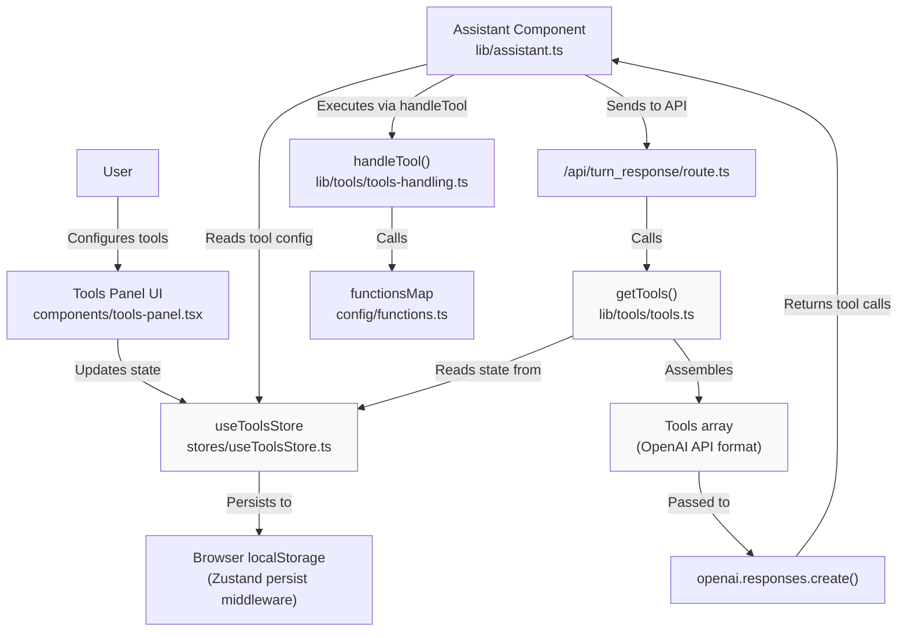
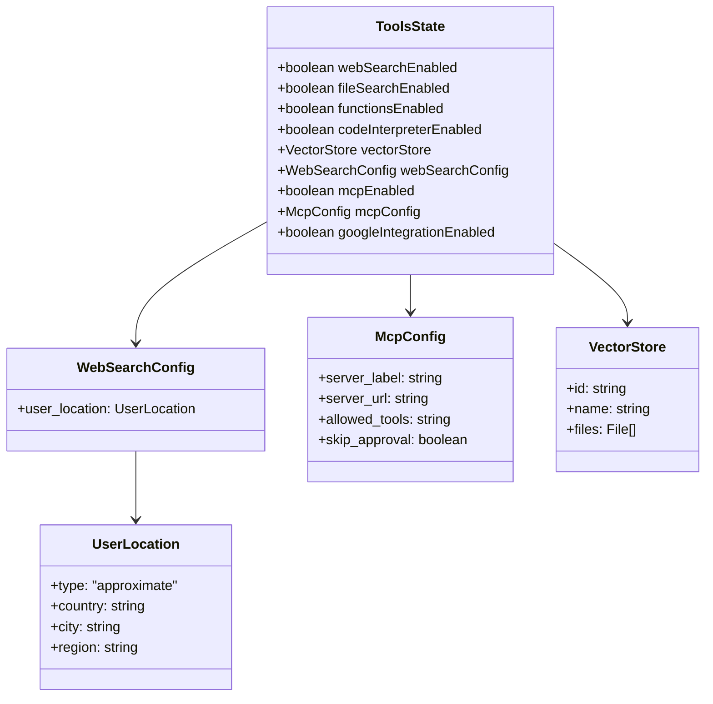
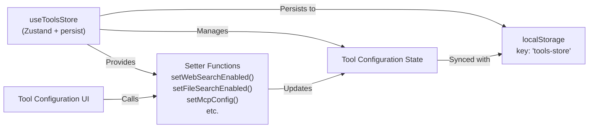
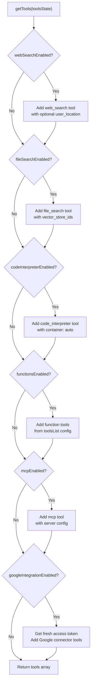

<!-- source: DeepWiki mcp.deepwiki.com · repo openai/openai-responses-starter-app · page 5 Tool System · fetched 2026-10-26 -->

# Tool System

<details>
<summary>Relevant source files</summary>

The following files were used as context for generating this wiki page:

- [config/tools-list.ts](config/tools-list.ts)
- [lib/tools/tools-handling.ts](lib/tools/tools-handling.ts)
- [lib/tools/tools.ts](lib/tools/tools.ts)

</details>


## Purpose and Scope

The Tool System provides a flexible architecture for configuring, aggregating, and enabling various AI capabilities in the OpenAI Responses Starter App. This document covers the overall tool system architecture, state management, and data flow patterns.

For specific implementation details, see:
- Tool configuration UI components: [Tool Configuration UI](#5.1)
- Tool execution and aggregation logic: [Tool Execution and Aggregation](#5.2)
- Tool call visualization in the chat interface: [Tool Call Visualization](#5.3)
- MCP server integration: [MCP Integration](#5.4)
- Google Calendar and Gmail integration: [Google Services Integration](#5.5)

## System Architecture

The tool system follows a **configuration-aggregation-execution** pattern where users configure tools through the UI, configurations are stored in state, aggregated into a tools array, and passed to the OpenAI API.

### High-Level Tool Flow



**Sources:** [stores/useToolsStore.ts:1-122](), [lib/tools/tools.ts:10-97](), [lib/tools/tools-handling.ts:5-12](), [config/functions.ts:1-27]()

## Tool Categories

The system supports five distinct categories of tools, each with different configuration requirements and execution patterns:

| Tool Category | Type Identifier | Configuration Source | Execution Location |
|--------------|-----------------|---------------------|-------------------|
| **Built-in OpenAI Tools** | `web_search`, `file_search`, `code_interpreter` | `useToolsStore` boolean flags | OpenAI servers |
| **Custom Functions** | `function` | `config/tools-list.ts` | Client-side via `config/functions.ts` |
| **MCP Server Tools** | `mcp` | `McpConfig` in `useToolsStore` | External MCP servers |
| **Google Connectors** | `connector` | OAuth tokens + `googleIntegrationEnabled` | OpenAI servers with connector auth |
| **Container Files** | N/A (annotations) | Vector store attachments | OpenAI servers |

**Sources:** [lib/tools/tools.ts:10-97](), [stores/useToolsStore.ts:33-43]()

## State Management

### ToolsState Interface

The `ToolsState` interface defines the complete configuration state for all tool types:



**Sources:** [stores/useToolsStore.ts:33-43](), [stores/useToolsStore.ts:17-31]()

### useToolsStore Implementation

The `useToolsStore` is a Zustand store with persistence middleware that maintains tool configurations across browser sessions:



The store provides setter functions for each configuration property, enabling reactive updates throughout the application.

**Sources:** [stores/useToolsStore.ts:68-120]()

## Tool Aggregation Process

The `getTools()` function in `lib/tools/tools.ts` aggregates enabled tools into an array formatted for the OpenAI Responses API:

### getTools() Logic Flow



**Sources:** [lib/tools/tools.ts:10-97]()

### Tool Format Examples

Each tool type has a specific format required by the OpenAI API:

**Web Search Tool:**
```typescript
{
  type: "web_search",
  user_location?: {
    type: "approximate",
    country: string,
    region: string,
    city: string
  }
}
```
*Source: [lib/tools/tools.ts:25-38]()*

**File Search Tool:**
```typescript
{
  type: "file_search",
  vector_store_ids: [string]
}
```
*Source: [lib/tools/tools.ts:41-46]()*

**Custom Function Tool:**
```typescript
{
  type: "function",
  name: string,
  description: string,
  parameters: {
    type: "object",
    properties: {...},
    required: string[],
    additionalProperties: false
  },
  strict: true
}
```
*Source: [lib/tools/tools.ts:54-68]()*

**MCP Tool:**
```typescript
{
  type: "mcp",
  server_label: string,
  server_url: string,
  require_approval?: "never",
  allowed_tools?: string[]
}
```
*Source: [lib/tools/tools.ts:72-87]()*

## Tool Execution

When the model decides to use a custom function, the client-side `handleTool` function is invoked. This function acts as a dispatcher, looking up the implementation in the `functionsMap`.

```typescript
export const handleTool = async (toolName: ToolName, parameters: any) => {
  console.log("Handle tool", toolName, parameters);
  if (functionsMap[toolName]) {
    return await functionsMap[toolName](parameters);
  } else {
    throw new Error(`Unknown tool: ${toolName}`);
  }
};
```

**Sources:** [lib/tools/tools-handling.ts:5-12](), [config/functions.ts:1-27]()

## Tool Configuration Persistence

The `useToolsStore` uses Zustand's `persist` middleware to maintain tool configurations across browser sessions:

**Persistence Configuration:**
- **Storage Key:** `tools-store`
- **Storage Backend:** `localStorage`
- **Serialization:** Automatic via Zustand
- **Initial State:** Defined in store initialization with default values

This ensures that users' tool preferences (enabled tools, MCP server configurations, web search locations, etc.) persist between sessions without requiring manual re-configuration.

**Sources:** [stores/useToolsStore.ts:68-120]()

## Integration Points

The Tool System integrates with multiple subsystems:

| Integration Point | Purpose | Reference |
|------------------|---------|-----------|
| **Assistant Component** | Reads tool state and passes to API | See [Assistant Processing Logic](#4.1) |
| **Turn Response API** | Receives tool config and calls `getTools()` | See [Turn Response API](#6.1) |
| **Functions Map** | Executes custom function tool calls | See [Tool Execution and Aggregation](#5.2) |
| **Connectors Auth** | Provides OAuth tokens for Google tools | See [Google Services Integration](#5.5) |
| **MCP Servers** | External servers providing additional tools | See [MCP Integration](#5.4) |

## Tool Categories Detail

### Built-in OpenAI Tools

Three OpenAI native tools that execute on OpenAI servers:

1. **web_search** - Internet search capability with optional location context
2. **file_search** - Searches through uploaded files in vector stores
3. **code_interpreter** - Python code execution in sandboxed containers

Configuration flags: [stores/useToolsStore.ts:34-37](), [stores/useToolsStore.ts:56-57]()

### Custom Functions

User-defined functions that execute client-side. Each function in `config/tools-list.ts` is transformed into a function tool definition with strict JSON schema validation.

Function implementations: [config/functions.ts:5-27]()
Tool aggregation: [lib/tools/tools.ts:53-69]()

### MCP Tools

Model Context Protocol servers expose tools dynamically. The system supports:
- Server URL configuration
- Tool allowlisting via comma-separated names
- Approval workflow control (require_approval setting)

Configuration: [stores/useToolsStore.ts:26-31]()
Aggregation: [lib/tools/tools.ts:72-87]()

### Google Connectors

OAuth-authenticated tools for Google Calendar and Gmail. Requires active OAuth session with fresh access tokens.

Integration flag: [stores/useToolsStore.ts:42]()
Aggregation: [lib/tools/tools.ts:90-94]()

---

