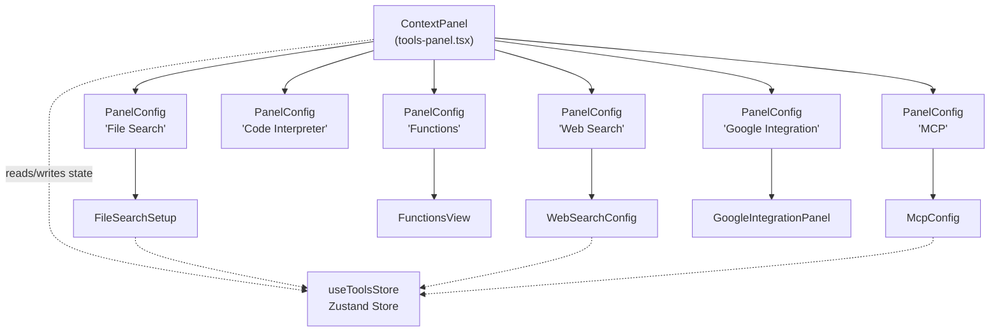
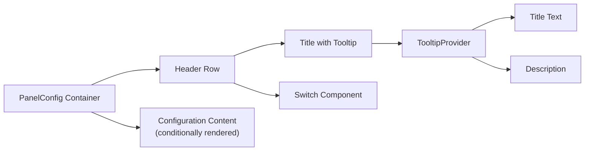
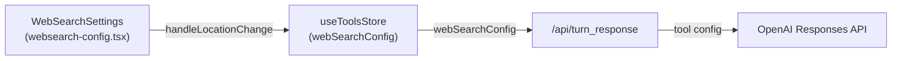
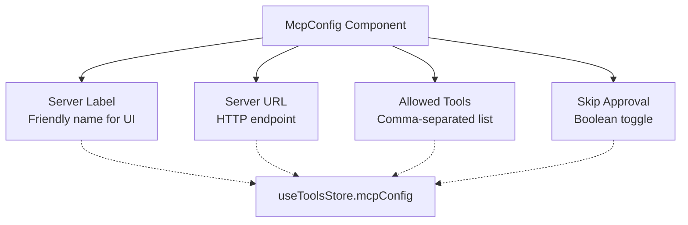
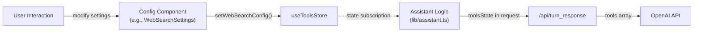

<!-- source: DeepWiki mcp.deepwiki.com · repo openai/openai-responses-starter-app · page 5.1 Tool Configuration UI · fetched 2026-10-26 -->

# Tool Configuration UI

<details>
<summary>Relevant source files</summary>

The following files were used as context for generating this wiki page:

- [components/country-selector.tsx](components/country-selector.tsx)
- [components/file-search-setup.tsx](components/file-search-setup.tsx)
- [components/functions-view.tsx](components/functions-view.tsx)
- [components/mcp-config.tsx](components/mcp-config.tsx)
- [components/panel-config.tsx](components/panel-config.tsx)
- [components/tools-panel.tsx](components/tools-panel.tsx)
- [components/websearch-config.tsx](components/websearch-config.tsx)
- [config/functions.ts](config/functions.ts)

</details>


## Purpose and Scope

This document describes the user interface components that allow users to enable, disable, and configure the various tools available to the assistant. The Tools Panel provides a consistent interface for managing tool settings, which are persisted via the tools store and passed to the OpenAI API during conversation turns.

For information about tool execution logic and aggregation, see [Tool Execution and Aggregation](#5.2). For tool call visualization in the chat interface, see [Tool Call Visualization](#5.3). For detailed MCP and Google integration flows, see [MCP Integration](#5.4) and [Google Services Integration](#5.5) respectively.

---

## Tools Panel Structure

The `ContextPanel` component (exported as default from [components/tools-panel.tsx:11]()) serves as the main container for all tool configuration interfaces. It renders a vertical list of tool configuration panels, each wrapped in the `PanelConfig` component.

### Component Architecture



**Component Hierarchy**: The Tools Panel follows a two-level structure where each tool type has a toggle-enabled panel with optional configuration details underneath.

Sources: [components/tools-panel.tsx:1-87]()

### Store Integration

The Tools Panel connects to `useToolsStore` to access and modify tool configuration state:

| State Variable | Purpose | Type |
|----------------|---------|------|
| `fileSearchEnabled` | Enable/disable file search | `boolean` |
| `webSearchEnabled` | Enable/disable web search | `boolean` |
| `functionsEnabled` | Enable/disable custom functions | `boolean` |
| `codeInterpreterEnabled` | Enable/disable code interpreter | `boolean` |
| `mcpEnabled` | Enable/disable MCP integration | `boolean` |
| `googleIntegrationEnabled` | Enable/disable Google services | `boolean` |
| `webSearchConfig` | Web search configuration object | `object` |
| `mcpConfig` | MCP server configuration object | `object` |

Each enabled state has a corresponding setter function (e.g., `setFileSearchEnabled`) that the panels use to toggle tools on/off [components/tools-panel.tsx:12-25]().

Sources: [components/tools-panel.tsx:12-25]()

### Layout and Styling

The panel uses a light gray background (`bg-[#f9f9f9]`) with scrollable content and responsive behavior [components/tools-panel.tsx:35-36]():

- Desktop: Fixed width sidebar with rounded corners.
- Mobile: Full-width overlay with top border radius.

---

## PanelConfig Wrapper Pattern

The `PanelConfig` component ([components/panel-config.tsx:8-50]()) provides a consistent interface for all tool configuration sections. It standardizes the toggle mechanism and layout across different tool types.

### Component Interface

```typescript
interface PanelConfigProps {
  title: string;          // Display name (e.g., "Web Search")
  tooltip: string;        // Hover tooltip explaining the tool
  enabled: boolean;       // Current enabled state
  setEnabled: (enabled: boolean) => void;  // State setter
  disabled?: boolean;     // Optional: disable the toggle
  children?: React.ReactNode;  // Configuration UI
}
```

Sources: [components/panel-config.tsx:8-22]()

### Visual Structure



**UI Pattern**: Each panel has a title with tooltip on the left and a toggle switch on the right. When enabled, child components render below the header.

Sources: [components/panel-config.tsx:28-48]()

### Usage Example

The Tools Panel instantiates multiple `PanelConfig` wrappers, passing tool-specific configuration components as children [components/tools-panel.tsx:37-83]():

```typescript
<PanelConfig
  title="Web Search"
  tooltip="Allows to search the web"
  enabled={webSearchEnabled}
  setEnabled={setWebSearchEnabled}
>
  <WebSearchConfig />
</PanelConfig>
```

Sources: [components/tools-panel.tsx:45-52]()

---

## Individual Tool Configuration Components

### Web Search Configuration

The `WebSearchSettings` component ([components/websearch-config.tsx:8-88]()) allows users to configure location-based search parameters. This influences web search results by providing geographic context to the OpenAI API.

#### Configuration Fields

| Field | Type | Purpose |
|-------|------|---------|
| `country` | string | Two-letter country code (ISO 3166-1 alpha-2) |
| `region` | string | State or province name |
| `city` | string | City name |

#### Data Flow



**State Management**: The component reads and writes to `webSearchConfig` in the tools store [components/websearch-config.tsx:9](), with updates propagated through `setWebSearchConfig`.

#### UI Components

- **Country Selector**: A popover-based combobox ([components/country-selector.tsx:280-337]()) that uses a predefined list of `ISO_3166_ALPHA_2_CODES` [components/country-selector.tsx:23-273]().
- **Region Input**: Text field for region/state [components/websearch-config.tsx:58-70]().
- **City Input**: Text field for city name [components/websearch-config.tsx:72-84]().
- **Clear Button**: Resets all location fields to empty strings [components/websearch-config.tsx:11-20]().

Sources: [components/websearch-config.tsx:1-88](), [components/country-selector.tsx:1-337]()

### File Search Setup

The `FileSearchSetup` component ([components/file-search-setup.tsx:11-102]()) manages the link between the assistant and OpenAI Vector Stores.

#### Vector Store Management

- **Existing Store**: Users can enter a Vector Store ID (starting with `vs_`) to retrieve and link an existing store [components/file-search-setup.tsx:22-34]().
- **Retrieval**: Calls `/api/vector_stores/retrieve_store?vector_store_id=${storeId}` to validate and fetch store details [components/file-search-setup.tsx:24-26]().
- **Unlinking**: The `unlinkStore` function clears the store ID and name in the tool store [components/file-search-setup.tsx:15-20]().
- **File Upload**: Integrates the `FileUpload` component to allow creating new stores by uploading documents [components/file-search-setup.tsx:93-98]().

Sources: [components/file-search-setup.tsx:1-102]()

### Functions View

The `FunctionsView` component ([components/functions-view.tsx:29-49]()) provides a read-only visualization of locally defined functions available for the assistant to call.

- **Function Mapping**: Displays functions imported from `toolsList` in [config/tools-list.ts]().
- **Signature Rendering**: Uses `getToolArgs` to map function parameters (name and type) into a code-like signature [components/functions-view.tsx:14-27]().
- **Implementation**: The actual execution logic for these functions is mapped in `functionsMap` [config/functions.ts:24-27](), which includes handlers like `get_weather` [config/functions.ts:5-17]() and `get_joke` [config/functions.ts:19-22]().

Sources: [components/functions-view.tsx:1-49](), [config/functions.ts:1-28]()

### MCP Configuration

The `McpConfig` component ([components/mcp-config.tsx:7-91]()) provides configuration for connecting to MCP (Model Context Protocol) servers.

#### Configuration Schema



**Configuration Object**: All fields are stored in the `mcpConfig` object with the following structure [components/mcp-config.tsx:11-16]():

```typescript
{
  server_label: string,    // e.g., "deepwiki"
  server_url: string,      // e.g., "https://example.com/mcp"
  allowed_tools: string,   // e.g., "tool1,tool2"
  skip_approval: boolean   // Skip approval UI flow
}
```

#### Input Components

1. **Server Label** [components/mcp-config.tsx:32-44](): Text input for naming the MCP server.
2. **Server URL** [components/mcp-config.tsx:46-59](): Text input for the HTTP endpoint.
3. **Allowed Tools** [components/mcp-config.tsx:61-74](): Comma-separated tool names to whitelist.
4. **Skip Approval Toggle** [components/mcp-config.tsx:76-87](): Switch component to bypass manual approval.

Sources: [components/mcp-config.tsx:1-91]()

### Code Interpreter Configuration

The Code Interpreter tool has no additional configuration UI. It only appears as a `PanelConfig` with no children, providing a simple enable/disable toggle [components/tools-panel.tsx:53-58]().

Sources: [components/tools-panel.tsx:53-58]()

### Google Integration Panel

The `GoogleIntegrationPanel` component is conditionally enabled based on OAuth configuration status. The Tools Panel checks OAuth status via the `/api/google/status` endpoint [components/tools-panel.tsx:28-33]():

```typescript
fetch("/api/google/status")
  .then((r) => r.json())
  .then((d) => setOauthConfigured(Boolean(d.oauthConfigured)))
```

The panel is disabled unless OAuth is configured [components/tools-panel.tsx:76-83]().

Sources: [components/tools-panel.tsx:26-83]()

---

## State Persistence and Initialization

### Store Subscription

All configuration components subscribe to `useToolsStore`, which manages the state for tool availability and specific parameters.

### Initial State Loading

The Tools Panel performs initialization tasks on mount:

1. **OAuth Status Check** [components/tools-panel.tsx:28-33](): Fetches Google OAuth configuration status to determine if the Google Integration panel should be enabled.
2. **Store Hydration**: Zustand automatically loads persisted state (if configured with middleware).

### Configuration Propagation

Tool configurations flow from the UI through the store to the API layer:



Sources: [components/tools-panel.tsx:1-87](), [components/websearch-config.tsx:9-34](), [components/mcp-config.tsx:8-17]()

---

## UI Design Patterns

### Consistent Input Styling

All input fields follow a consistent style pattern [components/websearch-config.tsx:66-67](), [components/mcp-config.tsx:39-40]():

```css
bg-white border text-sm flex-1 text-zinc-900 placeholder:text-zinc-400
```

### Label-Input Layout

Configuration fields use a horizontal label-input layout with fixed label width to ensure alignment [components/mcp-config.tsx:32-44]():

```typescript
<div className="flex items-center gap-2">
  <label className="text-sm w-24">Label</label>
  <Input ... />
</div>
```

### Clear/Reset Functionality

Components with multiple fields (Web Search, MCP) provide a "Clear" button in the top-right corner [components/websearch-config.tsx:38-45](), [components/mcp-config.tsx:21-28](). This resets all configuration fields to their default empty state.

Sources: [components/panel-config.tsx:1-50](), [components/websearch-config.tsx:1-88](), [components/mcp-config.tsx:1-91]()

---

