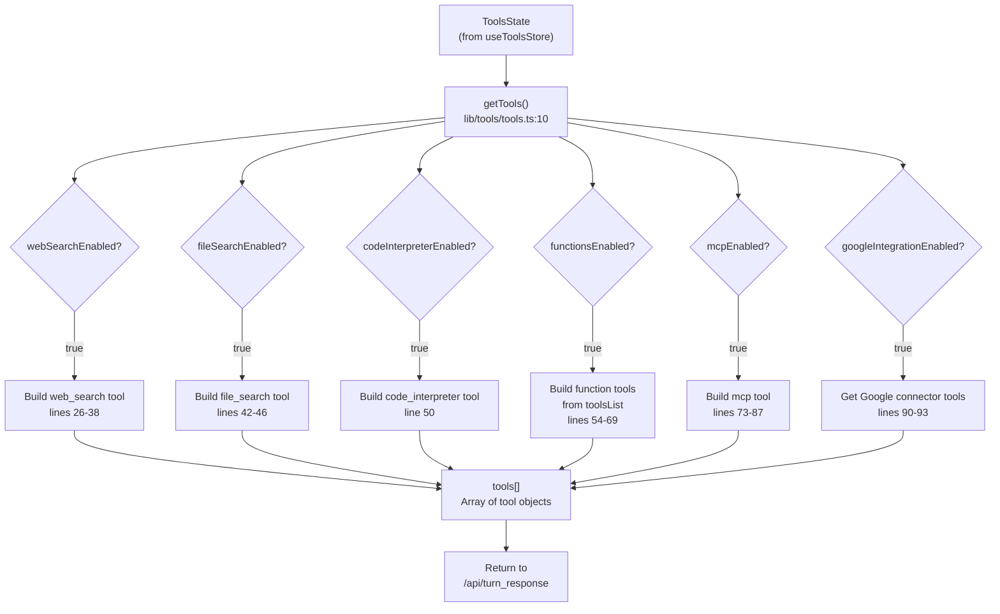
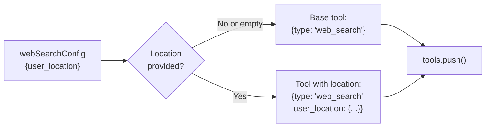
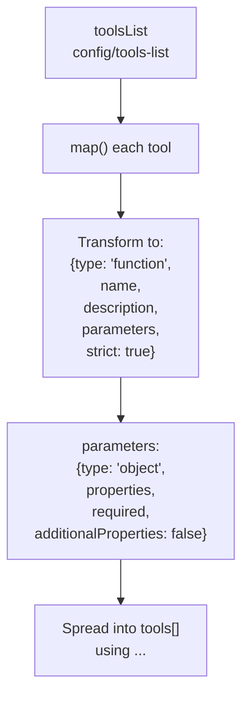
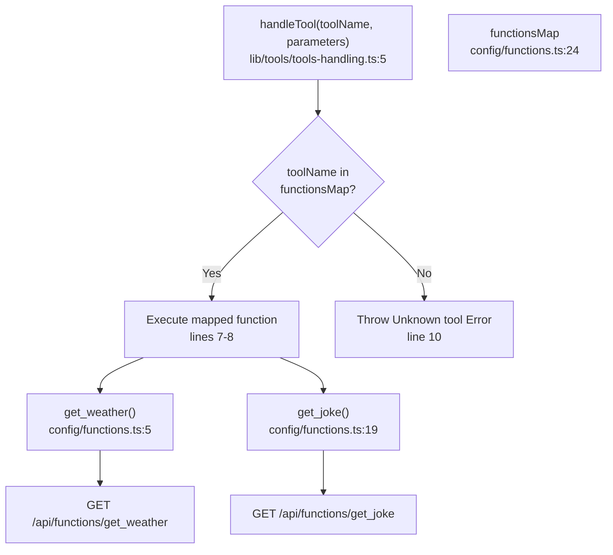

<!-- source: DeepWiki mcp.deepwiki.com · repo openai/openai-responses-starter-app · page 5.2 Tool Execution and Aggregation · fetched 2026-10-26 -->

# Tool Execution and Aggregation

<details>
<summary>Relevant source files</summary>

The following files were used as context for generating this wiki page:

- [app/api/functions/get_joke/route.ts](app/api/functions/get_joke/route.ts)
- [app/api/functions/get_weather/route.ts](app/api/functions/get_weather/route.ts)
- [components/websearch-config.tsx](components/websearch-config.tsx)
- [config/functions.ts](config/functions.ts)
- [lib/tools/tools-handling.ts](lib/tools/tools-handling.ts)
- [lib/tools/tools.ts](lib/tools/tools.ts)

</details>


This document explains the tool aggregation system that transforms user configuration into executable tools for the OpenAI Responses API. It covers the `getTools` function in [lib/tools/tools.ts](), the structure of different tool types, and the execution pattern for custom functions. For information about the user interface for configuring tools, see 5.1 Tool Configuration UI. For details on how tool calls are visualized in the chat, see 5.3 Tool Call Visualization.

## Purpose and Scope

The tool execution and aggregation system serves as the bridge between user-configured tool settings (stored in `useToolsStore`) and the tools array passed to the OpenAI Responses API. This page documents:

- The `getTools` aggregation function that assembles enabled tools.
- The structure and parameters for each tool type.
- Custom function definitions and execution patterns.
- How tool configuration translates to API-compatible tool objects.

## Tool Aggregation Pipeline

The core of the aggregation system is the `getTools` function in [lib/tools/tools.ts:10-97](), which transforms `ToolsState` into an array of tool configurations.



**Sources:** [lib/tools/tools.ts:10-97]()

### Function Signature and Flow

The `getTools` function is asynchronous and follows this pattern:

1. **Extract configuration** from `ToolsState` parameter [lib/tools/tools.ts:11-21]().
2. **Initialize empty tools array** [lib/tools/tools.ts:23]().
3. **Conditionally add tools** based on enabled flags [lib/tools/tools.ts:25-94]().
4. **Return aggregated tools** [lib/tools/tools.ts:96]().

The function is async because Google connector tools require token refresh, which involves async operations via `getFreshAccessToken()` [lib/tools/tools.ts:92]().

## Tool Types and Assembly

Each tool type has a specific structure required by the OpenAI Responses API. The following table summarizes the tool types and their assembly logic:

| Tool Type | Enable Flag | Configuration Source | Lines |
|-----------|-------------|---------------------|-------|
| Web Search | `webSearchEnabled` | `webSearchConfig` | [lib/tools/tools.ts:25-39]() |
| File Search | `fileSearchEnabled` | `vectorStore` | [lib/tools/tools.ts:41-47]() |
| Code Interpreter | `codeInterpreterEnabled` | None | [lib/tools/tools.ts:49-51]() |
| Custom Functions | `functionsEnabled` | `toolsList` from config | [lib/tools/tools.ts:53-70]() |
| MCP | `mcpEnabled` | `mcpConfig` | [lib/tools/tools.ts:72-88]() |
| Google Connectors | `googleIntegrationEnabled` | OAuth tokens | [lib/tools/tools.ts:90-94]() |

### Web Search Tool Structure



The web search tool optionally includes location data [lib/tools/tools.ts:29-37](). If any of `country`, `region`, or `city` are non-empty strings, the `user_location` object is added to the tool configuration. This state is managed in the UI by `WebSearchSettings` [components/websearch-config.tsx:8-88]().

**Sources:** [lib/tools/tools.ts:25-39](), [components/websearch-config.tsx:22-34]()

### File Search Tool Structure

The file search tool requires a vector store ID from the configuration [lib/tools/tools.ts:41-47]():

```typescript
{
  type: "file_search",
  vector_store_ids: [vectorStore?.id]
}
```

**Sources:** [lib/tools/tools.ts:41-47]()

### Code Interpreter Tool Structure

The code interpreter tool uses an auto-provisioned container [lib/tools/tools.ts:49-51]():

```typescript
{
  type: "code_interpreter",
  container: { type: "auto" }
}
```

**Sources:** [lib/tools/tools.ts:49-51]()

### Custom Functions Tool Structure

Custom functions are loaded from `toolsList` imported from [config/tools-list]() and transformed into OpenAI function tool format [lib/tools/tools.ts:53-70]():



Each function tool is constructed with:
- `type: "function"` identifier.
- `name` from tool definition.
- `description` from tool definition.
- `parameters` object with properties spread from tool definition.
- `required` array containing all parameter keys [lib/tools/tools.ts:63]().
- `strict: true` for strict schema validation [lib/tools/tools.ts:66]().

**Sources:** [lib/tools/tools.ts:53-70]()

### MCP Tool Structure

MCP (Model Context Protocol) tools are assembled with conditional properties [lib/tools/tools.ts:72-88]():

```typescript
{
  type: "mcp",
  server_label: mcpConfig.server_label,
  server_url: mcpConfig.server_url,
  require_approval?: "never",  // if skip_approval
  allowed_tools?: string[]      // if allowed_tools specified
}
```

The `require_approval` field is only included if `mcpConfig.skip_approval` is true [lib/tools/tools.ts:78-80](). The `allowed_tools` array is only included if `mcpConfig.allowed_tools` is a non-empty string, which is split by commas and trimmed [lib/tools/tools.ts:81-86]().

**Sources:** [lib/tools/tools.ts:72-88]()

### Google Connector Tools

Google connector tools are obtained via `getGoogleConnectorTools()` from [lib/tools/connectors]() [lib/tools/tools.ts:90-94](). This function requires a fresh access token, which is obtained using `getFreshAccessToken()` from [lib/connectors-auth](). The connector tools are spread directly into the tools array.

**Sources:** [lib/tools/tools.ts:90-94]()

## Tool Execution Logic

When the model decides to call a function, the `handleTool` function in [lib/tools/tools-handling.ts:5-12]() is responsible for routing the call to the correct implementation.



**Sources:** [lib/tools/tools-handling.ts:5-12](), [config/functions.ts:24-27]()

### Custom Function Implementations

Custom functions are defined in [config/functions.ts]() and typically wrap an internal API call.

| Function | Endpoint | Description |
|----------|----------|-------------|
| `get_weather` | `/api/functions/get_weather` | Fetches weather via Open-Meteo using coordinates from Nominatim [app/api/functions/get_weather/route.ts:8-23](). |
| `get_joke` | `/api/functions/get_joke` | Fetches a programming joke from an external Joke API [app/api/functions/get_joke/route.ts:4-7](). |

Example implementation for `get_weather` [config/functions.ts:5-17]():

```typescript
export const get_weather = async ({
  location,
  unit,
}: {
  location: string;
  unit: string;
}) => {
  const res = await fetch(
    `/api/functions/get_weather?location=${location}&unit=${unit}`
  ).then((res) => res.json());

  return res;
};
```

**Sources:** [config/functions.ts:5-17](), [app/api/functions/get_weather/route.ts:1-60](), [app/api/functions/get_joke/route.ts:1-22]()

### Functions Map

The `functionsMap` object serves as the registry for all executable custom functions [config/functions.ts:24-27]():

```typescript
export const functionsMap = {
  get_weather: get_weather,
  get_joke: get_joke,
};
```

**Sources:** [config/functions.ts:24-27]()

## Integration with Conversation Flow

The aggregated tools flow through the system during the turn response lifecycle:

1. **State Retrieval**: The assistant logic reads the current `ToolsState` from `useToolsStore`.
2. **Aggregation**: `getTools` is called to generate the API-ready tools array [lib/tools/tools.ts:10]().
3. **API Request**: The tools are sent to `/api/turn_response`.
4. **Execution**: When a tool call is received from the OpenAI stream, `handleTool` is invoked to execute the logic and return results [lib/tools/tools-handling.ts:5]().

**Sources:** [lib/tools/tools.ts:10-97](), [lib/tools/tools-handling.ts:5-12]()

---

