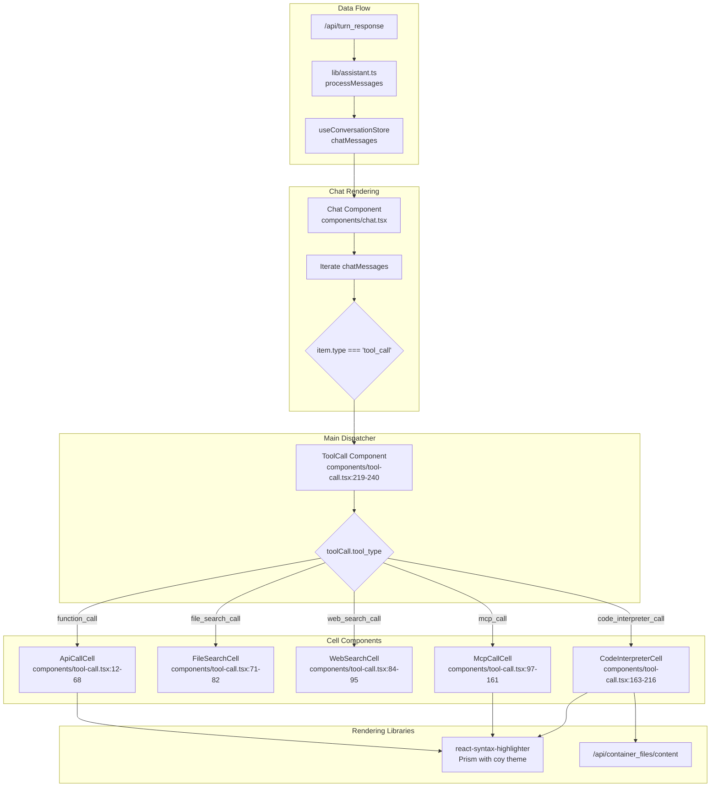
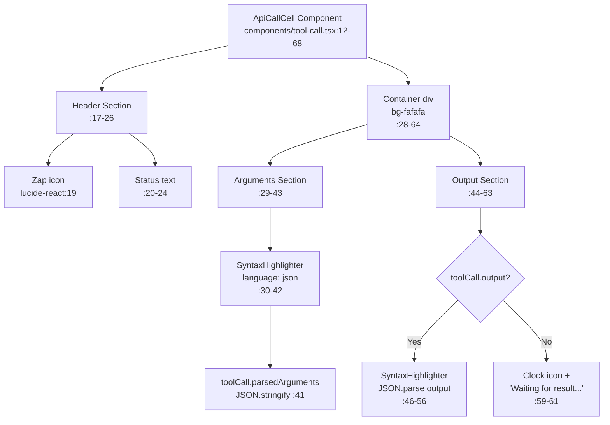
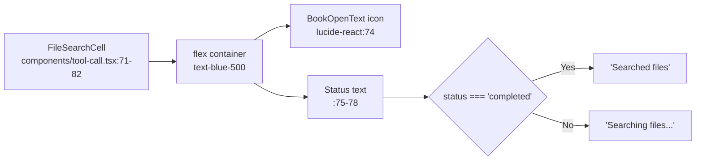
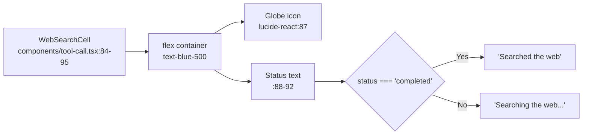
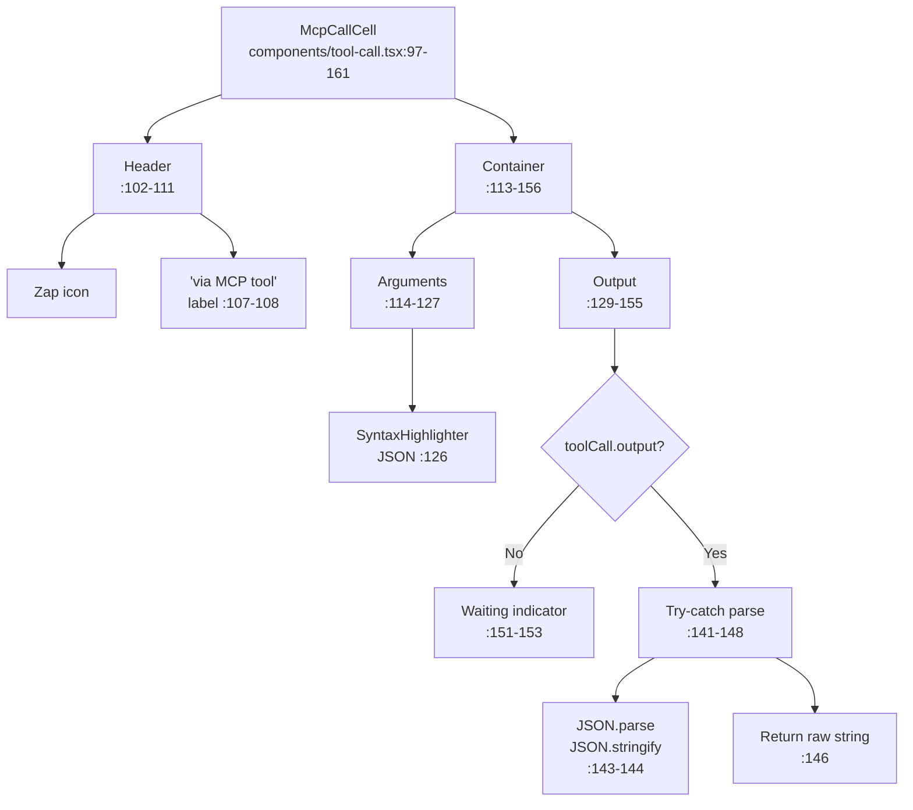
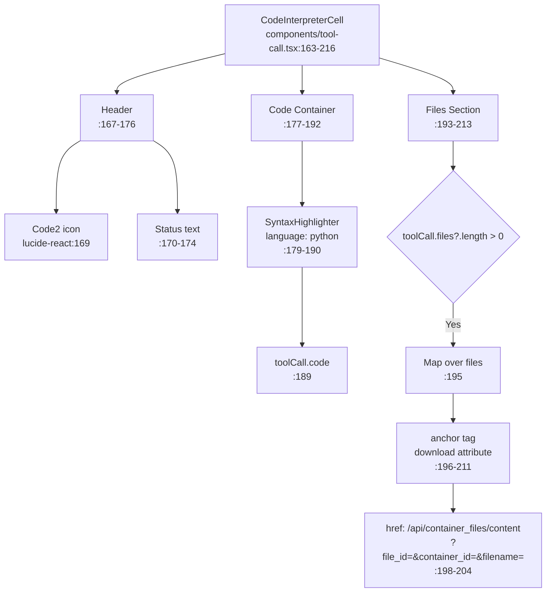
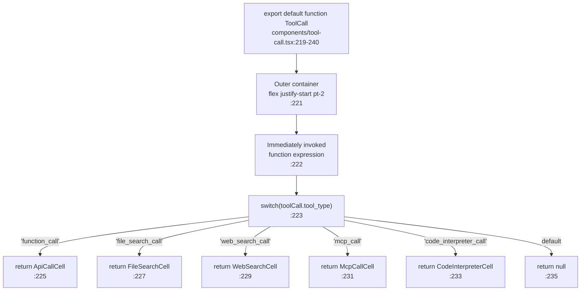
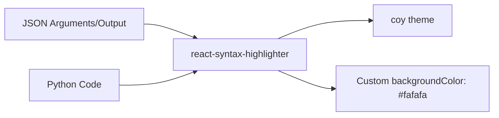

<!-- source: DeepWiki mcp.deepwiki.com · repo openai/openai-responses-starter-app · page 5.3 Tool Call Visualization · fetched 2026-10-26 -->

# Tool Call Visualization

Relevant source files

The following files were used as context for generating this wiki page:

- [app/api/container_files/content/route.ts](app/api/container_files/content/route.ts)
- [components/tool-call.tsx](components/tool-call.tsx)

The `ToolCall` component provides specialized visual rendering for tool executions within the chat interface. Each of the five supported tool types (`function_call`, `file_search_call`, `web_search_call`, `mcp_call`, `code_interpreter_call`) has a dedicated cell component that displays relevant information such as arguments, outputs, status indicators, and downloadable files. For information about configuring which tools are available, see page 5.1. For details about MCP-specific tool handling, see page 5.4.

## Overview

The `ToolCall` component [[components/tool-call.tsx:219-240]]() serves as the primary visualization dispatcher for tool executions. It receives `ToolCallItem` objects from the conversation store and routes them to specialized cell components based on the `tool_type` field. The component integrates with the chat interface (documented in page 4.2) to display tool activity during streaming responses.

### Supported Tool Types

| Tool Type | Cell Component | Visualization Style |
|-----------|----------------|---------------------|
| `function_call` | `ApiCallCell` | Detailed view with JSON arguments and output |
| `file_search_call` | `FileSearchCell` | Compact icon + status text |
| `web_search_call` | `WebSearchCell` | Compact icon + status text |
| `mcp_call` | `McpCallCell` | Detailed view with JSON arguments and output |
| `code_interpreter_call` | `CodeInterpreterCell` | Python code display + file downloads |

## Component Architecture

*ToolCall Component Architecture and Data Flow*

This diagram maps the rendering pipeline from conversation data through the component dispatch system to specialized cell renderers. The `ToolCall` component acts as a type-based router, selecting the appropriate cell component for each tool execution type.

Sources: [[components/tool-call.tsx:1-240]](), [[components/tool-call.tsx:12-68]](), [[components/tool-call.tsx:71-82]](), [[components/tool-call.tsx:84-95]](), [[components/tool-call.tsx:97-161]](), [[components/tool-call.tsx:163-216]]()

## Tool Call Types and Rendering

The visualization system handles five distinct tool call types, each with specialized rendering components:

### Function Call Visualization (`function_call`)

The `ApiCallCell` component [[components/tool-call.tsx:12-68]]() renders custom function tool calls with full argument and output visibility.

*ApiCallCell Rendering Logic*

**Key Implementation Details:**

| Element | Line Reference | Details |
|---------|----------------|---------|
| Status determination | [[components/tool-call.tsx:21-23]]() | Uses ternary on `toolCall.status === "completed"` |
| Arguments display | [[components/tool-call.tsx:41]]() | `JSON.stringify(toolCall.parsedArguments, null, 2)` |
| Output parsing | [[components/tool-call.tsx:56]]() | `JSON.stringify(JSON.parse(toolCall.output), null, 2)` |
| Waiting state | [[components/tool-call.tsx:59-61]]() | Shows Clock icon when `toolCall.output` is falsy |
| Container styling | [[components/tool-call.tsx:28-64]]() | Light gray background with scrollable sections |

Sources: [[components/tool-call.tsx:12-68]]()

### File Search Visualization (`file_search_call`)

The `FileSearchCell` component [[components/tool-call.tsx:71-82]]() provides a compact status indicator for file search operations.

*FileSearchCell Compact Rendering*

This minimal cell does not display arguments or outputs, as file search results are typically incorporated directly into the assistant's text response via citations.

Sources: [[components/tool-call.tsx:71-82]]()

### Web Search Visualization (`web_search_call`)

The `WebSearchCell` component [[components/tool-call.tsx:84-95]]() mirrors the file search design with different iconography.

*WebSearchCell Compact Rendering*

Like file search, web search results are embedded in the assistant's response text with citations, so the cell only shows execution status.

Sources: [[components/tool-call.tsx:84-95]]()

### MCP Call Visualization (`mcp_call`)

The `McpCallCell` component [[components/tool-call.tsx:97-161]]() handles MCP tool executions with defensive JSON parsing to handle non-JSON outputs.

*McpCallCell Defensive Parsing*

**Key Difference from ApiCallCell:**

The MCP cell uses a try-catch block [[components/tool-call.tsx:141-148]]() when parsing output, falling back to displaying the raw string if JSON parsing fails. This handles MCP tools that return plain text instead of JSON.

Sources: [[components/tool-call.tsx:97-161]]()

### Code Interpreter Visualization (`code_interpreter_call`)

The `CodeInterpreterCell` component [[components/tool-call.tsx:163-216]]() displays executed Python code and provides download links for generated files.

*CodeInterpreterCell with File Downloads*

**File Download URL Construction:**

The component builds download URLs [[components/tool-call.tsx:198-204]]() using query parameters that are handled by the container file content API route [[app/api/container_files/content/route.ts:1-5]]():

| Parameter | Source | Purpose |
|-----------|--------|---------|
| `file_id` | `f.file_id` | Required file identifier |
| `container_id` | `f.container_id` (optional) | Container/session context |
| `filename` | `f.filename` (optional) | Filename for download attribute |

The API endpoint `/api/container_files/content` retrieves file content from OpenAI's temporary storage [[app/api/container_files/content/route.ts:12-14]]().

Sources: [[components/tool-call.tsx:163-216]](), [[app/api/container_files/content/route.ts:1-34]]()

## Main Dispatcher Component

The root `ToolCall` component [[components/tool-call.tsx:219-240]]() implements type-based dispatch using a switch statement:

*ToolCall Dispatch Implementation*

The switch statement ensures type safety by returning `null` for unknown tool types [[components/tool-call.tsx:234-235]](). Each case passes the full `toolCall` prop to the specialized cell component.

Sources: [[components/tool-call.tsx:219-240]]()

## ToolCallItem Data Structure

The `ToolCallItem` interface (imported from [[lib/assistant.ts:3]]()) defines the data contract for tool call visualization:

| Property | Type | Required For | Purpose |
|----------|------|--------------|---------|
| `tool_type` | `'function_call' \| 'file_search_call' \| 'web_search_call' \| 'mcp_call' \| 'code_interpreter_call'` | All | Determines dispatch to cell component |
| `name` | `string` | All | Tool function identifier (e.g., `get_weather`, `brave_web_search`) |
| `status` | `'completed' \| string` | All | Controls status text and loading indicators |
| `parsedArguments` | `object` | Function, MCP | JSON object displayed in arguments section |
| `output` | `string \| undefined` | Function, MCP | JSON string or undefined (triggers waiting indicator) |
| `code` | `string` | Code Interpreter | Python code to display with syntax highlighting |
| `files` | `Array<{file_id: string, container_id?: string, filename?: string}>` | Code Interpreter | Generated file metadata for download links |

The `ToolCallProps` interface [[components/tool-call.tsx:8-10]]() wraps this data for component props.

Sources: [[components/tool-call.tsx:3]](), [[components/tool-call.tsx:8-10]]()

## Visual Design System

The tool call visualization follows consistent design patterns across all cell components:

### Status Text Patterns

All cells display dynamic status text based on the `toolCall.status` field:

| Cell Type | In Progress | Completed |
|-----------|-------------|-----------|
| ApiCallCell | `Calling ${toolCall.name}...` | `Called ${toolCall.name}` |
| FileSearchCell | `Searching files...` | `Searched files` |
| WebSearchCell | `Searching the web...` | `Searched the web` |
| McpCallCell | `Calling ${toolCall.name} via MCP tool...` | `Called ${toolCall.name} via MCP tool` |
| CodeInterpreterCell | `Running code interpreter...` | `Code executed` |

Status determination uses ternary operators checking `toolCall.status === "completed"` [[components/tool-call.tsx:21-23]](), [[components/tool-call.tsx:76-78]](), [[components/tool-call.tsx:89-91]](), [[components/tool-call.tsx:106-108]](), [[components/tool-call.tsx:171-173]]().

### Icon Mapping

| Tool Type | Icon Component | Lucide Import |
|-----------|----------------|---------------|
| Function/MCP calls | `Zap` | [[components/tool-call.tsx:4]]() |
| File search | `BookOpenText` | [[components/tool-call.tsx:4]]() |
| Web search | `Globe` | [[components/tool-call.tsx:4]]() |
| Code interpreter | `Code2` | [[components/tool-call.tsx:4]]() |
| Waiting state | `Clock` | [[components/tool-call.tsx:4]]() |
| File download | `Download` | [[components/tool-call.tsx:4]]() |

Sources: [[components/tool-call.tsx:4]](), [[components/tool-call.tsx:17-25]](), [[components/tool-call.tsx:73-79]](), [[components/tool-call.tsx:86-92]](), [[components/tool-call.tsx:168-175]]()

## Syntax Highlighting

Code and JSON content uses `react-syntax-highlighter` with the `coy` theme:

*Syntax Highlighting Configuration*

Sources: [[components/tool-call.tsx:5-6]](), [[components/tool-call.tsx:30-42]](), [[components/tool-call.tsx:115-127]](), [[components/tool-call.tsx:179-190]]()

---

