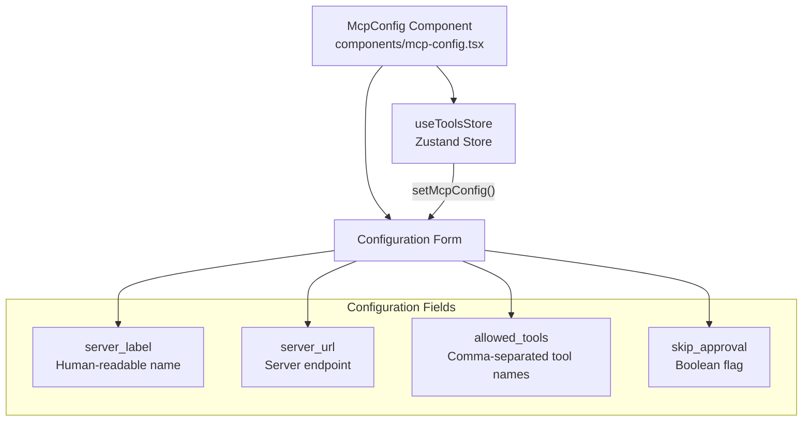
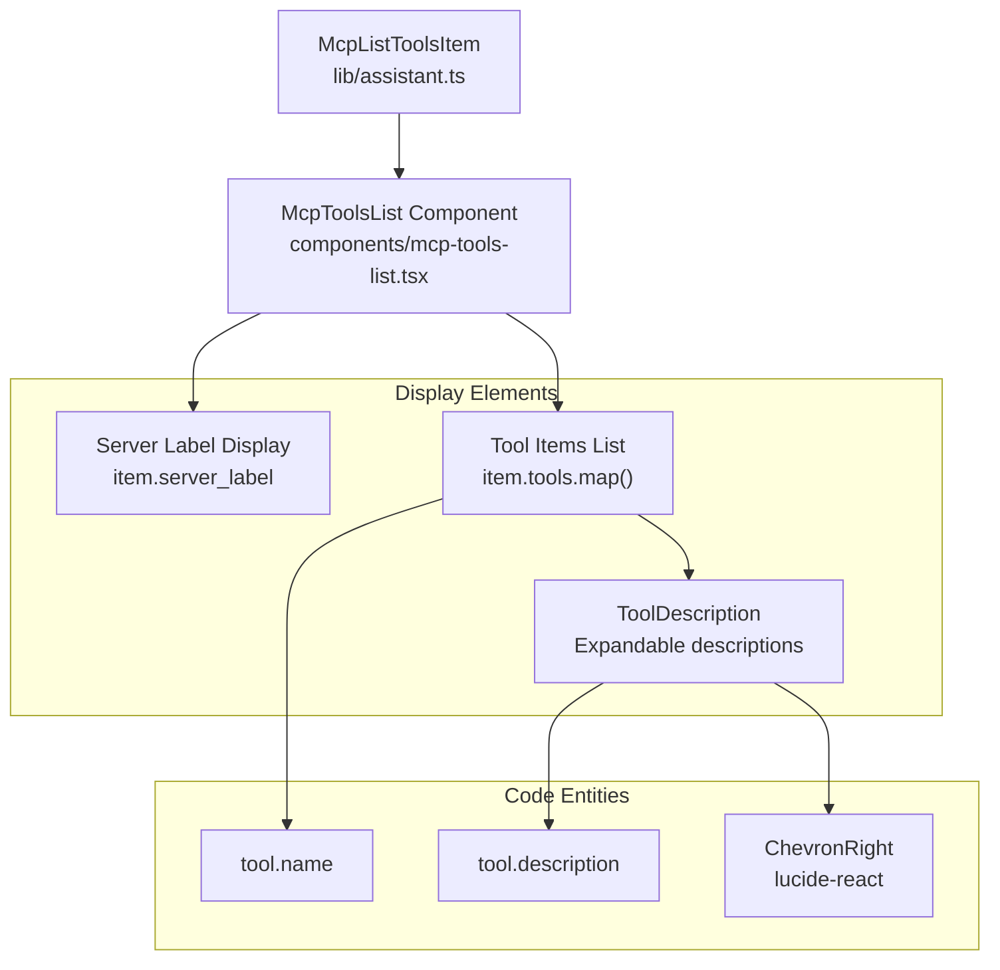
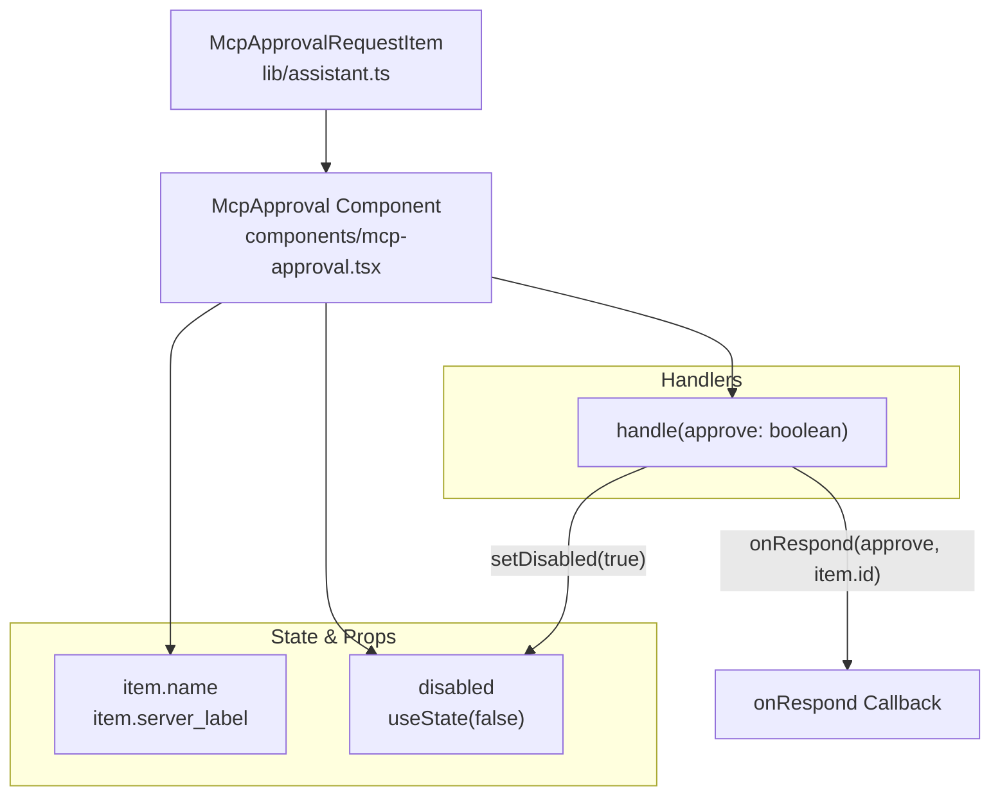
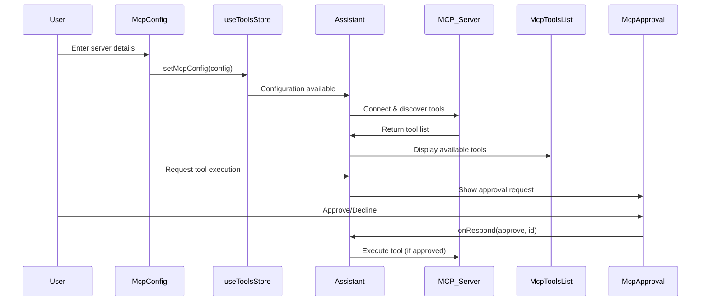

<!-- source: DeepWiki mcp.deepwiki.com · repo openai/openai-responses-starter-app · page 5.4 MCP Integration · fetched 2026-10-26 -->

# MCP Integration

Relevant source files

The following files were used as context for generating this wiki page:

- [components/mcp-approval.tsx](components/mcp-approval.tsx)
- [components/mcp-tools-list.tsx](components/mcp-tools-list.tsx)
- [lib/tools/connectors.ts](lib/tools/connectors.ts)

This document covers the Multi-Component Protocol (MCP) integration system, which enables the assistant to connect to external MCP servers and access their tools. MCP integration allows for extending the assistant's capabilities by incorporating tools from remote servers through a standardized protocol.

For information about the broader tool ecosystem, see [Tool System](#5). For tool configuration management, see [Tool Configuration UI](#5.1).

## Overview

The MCP integration system provides three main capabilities:

| Capability | Purpose | Key Components |
|------------|---------|----------------|
| Server Configuration | Configure connection to MCP servers | `McpConfig` component, `mcpConfig` store |
| Tool Discovery | List available tools from connected servers | `McpToolsList` component, `McpListToolsItem` type |
| Approval Workflow | User authorization for tool execution | `McpApproval` component, `McpApprovalRequestItem` type |

## MCP Server Configuration

### Configuration Interface

The MCP configuration is managed through the `McpConfig` component, which provides a form interface for setting up server connections.

**Sources:** [components/mcp-config.tsx:1-91]()

### Configuration Structure

The MCP configuration object contains four key fields:

| Field | Type | Description | Example |
|-------|------|-------------|---------|
| `server_label` | string | Display name for the server | "deepwiki" |
| `server_url` | string | MCP server endpoint URL | "https://example.com/mcp" |
| `allowed_tools` | string | Comma-separated tool names | "tool1,tool2" |
| `skip_approval` | boolean | Bypass approval workflow | `false` |

The configuration is persisted in the tools store and can be cleared using the "Clear" action in the UI [components/mcp-config.tsx:10-17]().

**Sources:** [components/mcp-config.tsx:31-87]()

## Tool Discovery and Listing

### Tool List Display

The `McpToolsList` component renders available tools from a connected MCP server. It receives a `McpListToolsItem` [components/mcp-tools-list.tsx:7]() and iterates through the `tools` array to display the name and description of each tool [components/mcp-tools-list.tsx:48-61]().

**Sources:** [components/mcp-tools-list.tsx:1-66](), [lib/assistant.ts:3]()

### Tool Description Expansion

Each tool in the list can have an expandable description that uses a `ChevronRight` icon for toggling visibility [components/mcp-tools-list.tsx:28-34](). The expansion state is managed locally within each `ToolDescription` component using React `useState` [components/mcp-tools-list.tsx:12-26]().

**Sources:** [components/mcp-tools-list.tsx:11-37]()

## Approval Workflow

### Approval Request Interface

The MCP approval system requires user authorization before executing tools from external servers if `require_approval` is set. The `McpApproval` component provides "Approve" and "Decline" buttons [components/mcp-approval.tsx:29-39]().

**Sources:** [components/mcp-approval.tsx:1-45](), [lib/assistant.ts:4]()

### Approval State Management

The approval component manages its own disabled state to prevent double-submission [components/mcp-approval.tsx:12-15](). When either button is clicked, the `handle` function is triggered, which updates the state and executes the callback [components/mcp-approval.tsx:14-17]().

**Sources:** [components/mcp-approval.tsx:14-16]()

## Connector Integration

MCP servers can also be configured as connectors for specific services like Google Calendar or Gmail. The `getGoogleConnectorTools` function defines these MCP-type tools [lib/tools/connectors.ts:1-5]().

### Connector Configuration

Connectors are configured with specific metadata to route requests through the MCP protocol:

| Property | Value (Example) | Description |
|----------|-----------------|-------------|
| `type` | `"mcp"` | Identifies the tool as an MCP server |
| `server_label` | `"GoogleCalendar"` | Human-readable identifier |
| `connector_id` | `"connector_googlecalendar"` | Internal ID for routing |
| `require_approval` | `"never"` | Configures the approval workflow trigger |

**Sources:** [lib/tools/connectors.ts:3-22]()

## Integration with Assistant Core

### Type Definitions

The MCP system defines several key types imported from `@/lib/assistant`:

| Type | Purpose | Used In |
|------|---------|---------|
| `McpListToolsItem` | Tool listing data structure | `McpToolsList` component |
| `McpApprovalRequestItem` | Approval request data structure | `McpApproval` component |

**Sources:** [components/mcp-tools-list.tsx:3](), [components/mcp-approval.tsx:4]()

### Store Integration

MCP configuration is managed through the `useToolsStore` Zustand store, providing persistence for server details and the `allowed_tools` whitelist.

**Sources:** [components/mcp-config.tsx:8]()

## Configuration Workflow

**Sources:** [components/mcp-config.tsx:8](), [components/mcp-tools-list.tsx:10](), [components/mcp-approval.tsx:11](), [components/mcp-approval.tsx:16]()

---

