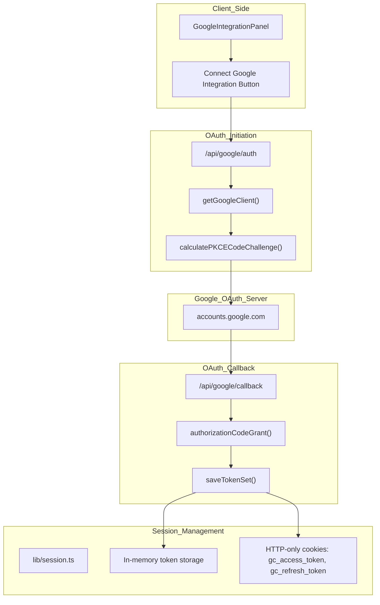
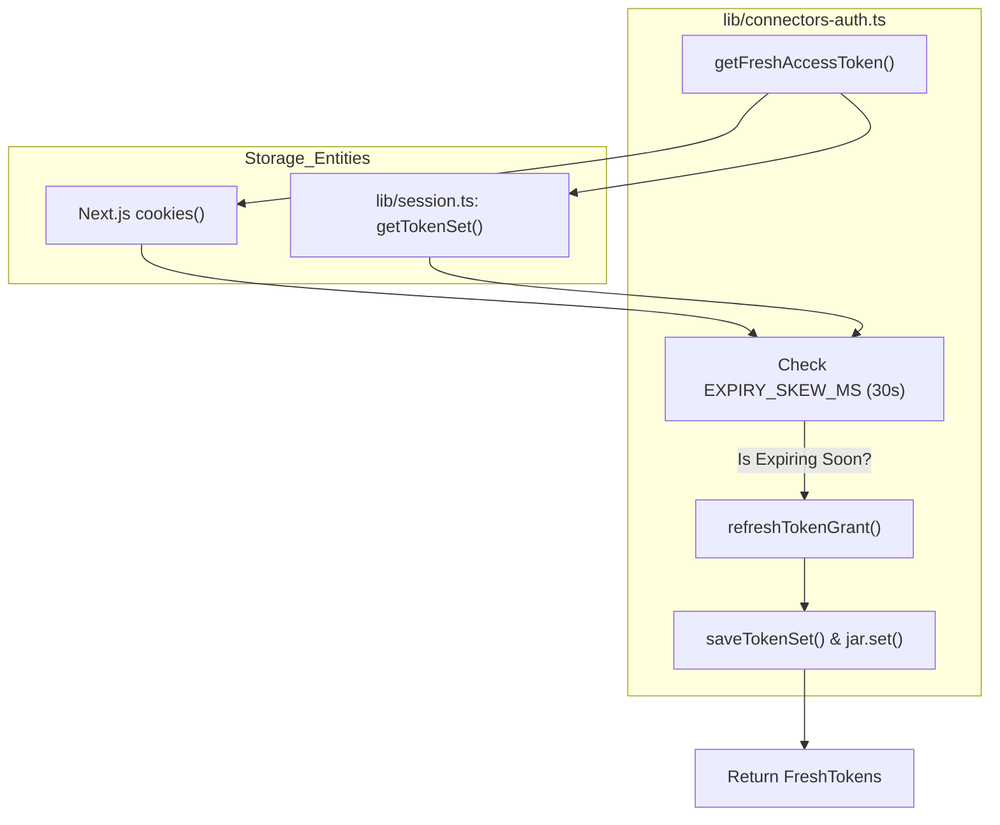
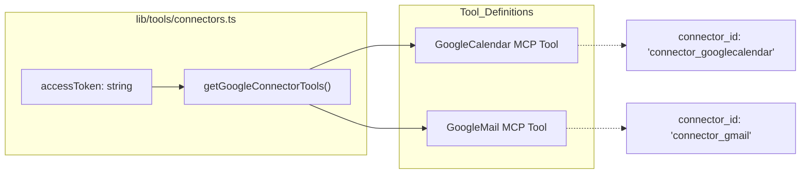

<!-- source: DeepWiki mcp.deepwiki.com · repo openai/openai-responses-starter-app · page 5.5 Google Services Integration · fetched 2026-10-26 -->

# Google Services Integration

Relevant source files

The following files were used as context for generating this wiki page:

- [components/google-integration.tsx](components/google-integration.tsx)
- [lib/connectors-auth.ts](lib/connectors-auth.ts)
- [lib/tools/connectors.ts](lib/tools/connectors.ts)

This document covers the Google Services integration system, which provides OAuth-based authentication to connect Google Calendar and Gmail as tool capabilities within the conversational AI assistant. The integration uses Google's OAuth 2.0 with PKCE flow for secure authentication and provides Calendar and Gmail access through MCP (Model Context Protocol) connectors.

For information about general tool configuration and management, see [5.1 Tool Configuration UI](). For details about MCP server integration patterns, see [5.4 MCP Integration]().

## OAuth Authentication Flow

The Google Services integration implements a complete OAuth 2.0 authorization code flow with PKCE (Proof Key for Code Exchange). The flow spans multiple API routes and maintains session state through secure HTTP-only cookies and in-memory storage.

### OAuth Flow Architecture

Sources: [app/api/google/auth/route.ts:1-52](), [app/api/google/callback/route.ts:1-78](), [components/google-integration.tsx:1-78](), [lib/connectors-auth.ts:22-44]()

The authentication flow begins when users click the "Connect Google Integration" button in the `GoogleIntegrationPanel` component. The flow executes these steps:

1.  **Initiation**: [app/api/google/auth/route.ts:15-52]() generates PKCE parameters and builds the authorization URL using `getGoogleClient()` [lib/connectors-auth.ts:22-44]().
2.  **User Authorization**: Redirect to Google's OAuth server with scopes defined in `GOOGLE_SCOPES` [lib/connectors-auth.ts:8-14]().
3.  **Callback Processing**: [app/api/google/callback/route.ts:34-58]() exchanges the authorization code for tokens.
4.  **Token Storage**: Tokens are stored both in-memory via `saveTokenSet` and in secure HTTP-only cookies [app/api/google/callback/route.ts:54-71]().

## Token Management System

The token management system handles the access token lifecycle, including automatic refresh when tokens approach expiration. This ensures continuous access to Google APIs without user re-authentication.

### Token Refresh and Retrieval

The `getFreshAccessToken` function [lib/connectors-auth.ts:57-113]() serves as the central logic for obtaining a valid token.

Sources: [lib/connectors-auth.ts:55-113](), [lib/session.ts:1-40]()

-   **Refresh Logic**: Tokens are refreshed if they are within 30 seconds of expiry (`EXPIRY_SKEW_MS`) [lib/connectors-auth.ts:55, 71-73]().
-   **Dual Retrieval**: The system attempts to read tokens from both HTTP-only cookies (`gc_access_token`) and the session-based in-memory store [lib/connectors-auth.ts:60-68]().
-   **Persistence**: Upon a successful refresh, the new tokens are written back to both the cookie jar and the in-memory `tokenSet` [lib/connectors-auth.ts:88-107]().

## UI Integration Component

The `GoogleIntegrationPanel` component [components/google-integration.tsx:13-78]() provides the user interface for managing Google Services connection status.

### Connection Status Management

The component uses an internal `useEffect` to poll the `/api/google/status` endpoint [components/google-integration.tsx:20-31]().

| State | Condition | UI Behavior |
| :--- | :--- | :--- |
| **Not Connected** | `!connected` | Shows "Connect Google Integration" button [components/google-integration.tsx:35-41]() |
| **OAuth Not Configured** | `!oauthConfigured` | Disables button with tooltip about missing `.env.local` vars [components/google-integration.tsx:47-62]() |
| **Integration Disabled** | `!googleIntegrationEnabled` | Disables button based on `useToolsStore` state [components/google-integration.tsx:42-46]() |
| **Connected** | `connected` | Shows a success checkmark and "Google OAuth set up" message [components/google-integration.tsx:66-75]() |

Sources: [components/google-integration.tsx:13-78](), [app/api/google/status/route.ts:5-18]()

## MCP Tool Configuration

Google Services are exposed as MCP (Model Context Protocol) tools through the `getGoogleConnectorTools()` function. This function transforms the OAuth `accessToken` into a format recognized by the tool execution system.

### Google Connector Tool Generation

Sources: [lib/tools/connectors.ts:1-23]()

The `getGoogleConnectorTools` function [lib/tools/connectors.ts:1-23]() returns an array of tool objects with the following properties:

1.  **Type**: Set to `"mcp"` [lib/tools/connectors.ts:5, 14]().
2.  **Authorization**: The `accessToken` is injected directly into the tool definition [lib/tools/connectors.ts:9, 18]().
3.  **Approval Workflow**: By default, `require_approval` is set to `"never"` [lib/tools/connectors.ts:11, 20](), allowing the assistant to perform searches without per-call user confirmation.
4.  **Capabilities**:
    *   **GoogleCalendar**: `connector_googlecalendar` - Focused on searching and reading calendar events [lib/tools/connectors.ts:6-8]().
    *   **GoogleMail**: `connector_gmail` - Focused on searching and reading emails [lib/tools/connectors.ts:15-17]().

## Configuration and Scopes

### Environment Variables
The integration requires the following variables to be set in the environment:
- `GOOGLE_CLIENT_ID`: OAuth client ID [lib/connectors-auth.ts:25]().
- `GOOGLE_CLIENT_SECRET`: OAuth client secret [lib/connectors-auth.ts:25]().
- `GOOGLE_REDIRECT_URI`: The authorized callback URL [lib/connectors-auth.ts:47-52]().

### Required OAuth Scopes
The `GOOGLE_SCOPES` constant [lib/connectors-auth.ts:8-14]() defines the permissions requested from the user:
- `openid`, `email`, `profile`: Basic identity.
- `https://www.googleapis.com/auth/calendar.events.readonly`: Read access to calendar.
- `https://www.googleapis.com/auth/gmail.readonly`: Read access to Gmail.

Sources: [lib/connectors-auth.ts:8-14, 25-34, 47-52]()

---

