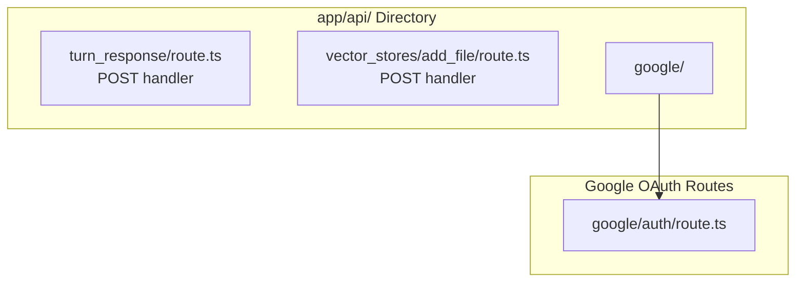
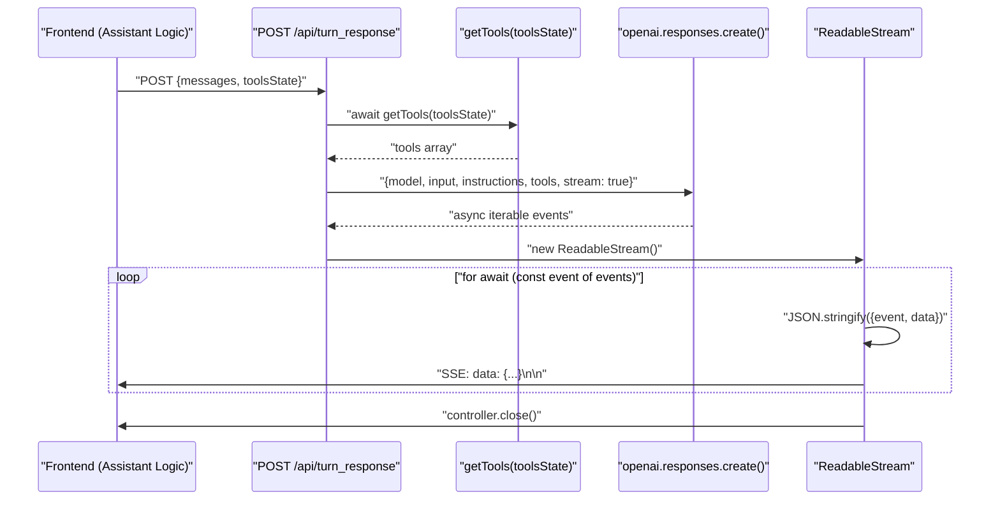
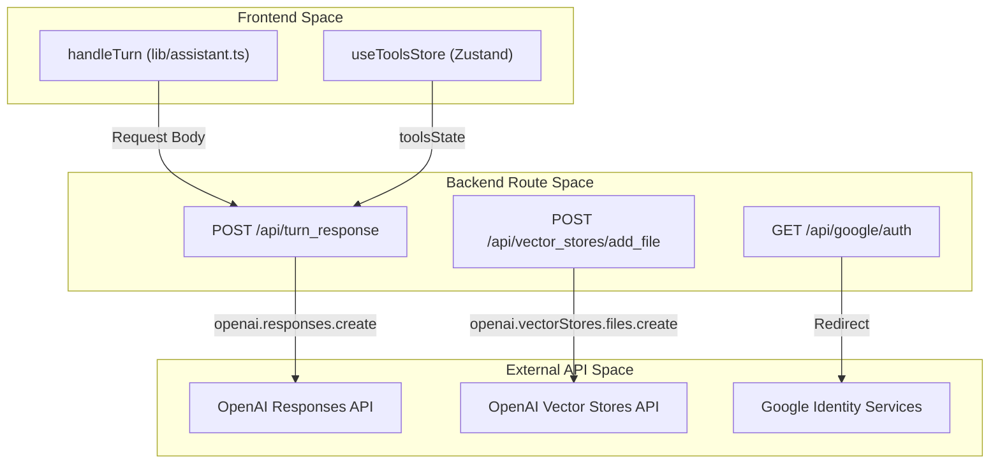

<!-- source: DeepWiki mcp.deepwiki.com · repo openai/openai-responses-starter-app · page 6 API Endpoints · fetched 2026-10-26 -->

# API Endpoints

Relevant source files

The following files were used as context for generating this wiki page:

- [app/api/google/auth/route.ts](app/api/google/auth/route.ts)
- [app/api/turn_response/route.ts](app/api/turn_response/route.ts)
- [app/api/vector_stores/add_file/route.ts](app/api/vector_stores/add_file/route.ts)

This page documents the server-side API routes that power the conversational AI assistant. These endpoints handle AI conversation processing, file management, and integration with external services. The API layer serves as the bridge between the frontend React components and external services like OpenAI and Google APIs.

For detailed information about specific endpoints, see:
- [Turn Response API](#6.1) — Detailed explanation of the `/api/turn_response` endpoint, request/response format, streaming protocol, and OpenAI API integration.
- [File and Vector Store APIs](#6.2) — Document endpoints for retrieving file content and managing vector stores for file search functionality.
- [Google OAuth API Flow](#6.3) — Explain the OAuth endpoints (`/api/google/auth`, `/callback`, `/status`), PKCE flow, state management, and token storage.

## API Architecture Overview

The application exposes several REST API endpoints built using Next.js App Router conventions. Each endpoint is implemented as a `route.ts` file within the `app/api/` directory structure following the Next.js 13+ App Router pattern.

### API Endpoints Summary

| Endpoint | Method | Purpose | Response Type | Section |
|----------|--------|---------|---------------|---------|
| `/api/turn_response` | POST | Process conversation turns with OpenAI Responses API | Server-Sent Events (SSE) | [Turn Response API](#6.1) |
| `/api/container_files/content` | GET | Retrieve file content from OpenAI containers | Binary/Blob | [File and Vector Store APIs](#6.2) |
| `/api/vector_stores/add_file` | POST | Attach a specific file to a vector store | JSON | [File and Vector Store APIs](#6.2) |
| `/api/google/auth` | GET | Initiate Google OAuth flow with PKCE | Redirect | [Google OAuth API Flow](#6.3) |
| `/api/google/callback` | GET | Handle OAuth callback and token exchange | Redirect | [Google OAuth API Flow](#6.3) |
| `/api/google/status` | GET | Check Google integration status | JSON | [Google OAuth API Flow](#6.3) |

### API Routes Architecture

**API Directory Structure**

**Sources:** [app/api/turn_response/route.ts:5-63](), [app/api/vector_stores/add_file/route.ts:5-19](), [app/api/google/auth/route.ts:19-56]()

## Request/Response Patterns

### Primary Conversation Flow

The conversation flow begins when the client sends the current message history and tool configuration to the backend. The backend then proxies this to OpenAI using the Responses API and streams the results back to the client.

**Conversation Processing Sequence**

**Sources:** [app/api/turn_response/route.ts:5-45]()

## Core Endpoints Overview

### Turn Response Endpoint

The primary conversation processing endpoint is `POST /api/turn_response`, implemented in [app/api/turn_response/route.ts:5-63](). It initializes the OpenAI client and manages the server-sent events stream.

**Key implementation details:**
- Calls `getTools(toolsState)` to aggregate tool definitions from the client-provided state [app/api/turn_response/route.ts:9]().
- Passes `MODEL` and developer instructions from global constants [app/api/turn_response/route.ts:17-21]().
- Disables `parallel_tool_calls` to ensure sequential execution for complex tool flows [app/api/turn_response/route.ts:23]().
- Wraps the OpenAI event stream in a `ReadableStream` that emits SSE-formatted data [app/api/turn_response/route.ts:27-45]().

For details, see [Turn Response API](#6.1).

**Sources:** [app/api/turn_response/route.ts:1-64]()

### File and Vector Store APIs

The application provides endpoints for managing the lifecycle of files used in "File Search" or "Code Interpreter" tools. 

- **Vector Store Management**: The `/api/vector_stores/add_file` endpoint uses the OpenAI SDK to associate an existing `fileId` with a `vectorStoreId` [app/api/vector_stores/add_file/route.ts:8-13]().
- **File Content Retrieval**: Specific routes (like `/api/container_files/content`) handle fetching the actual bytes of files generated by the model or uploaded by the user.

For details, see [File and Vector Store APIs](#6.2).

**Sources:** [app/api/vector_stores/add_file/route.ts:1-20]()

### Google OAuth API Flow

The Google integration relies on a PKCE-enhanced OAuth flow to securely manage user tokens for Gmail and Calendar access.

- **Initiation**: The `/api/google/auth` route generates a `code_verifier` and `code_challenge`, stores them in `httpOnly` cookies, and redirects the user to Google's consent screen [app/api/google/auth/route.ts:26-55]().
- **Session Management**: It ensures a session ID exists via `getOrCreateSessionId()` before starting the flow [app/api/google/auth/route.ts:24]().

For details, see [Google OAuth API Flow](#6.3).

**Sources:** [app/api/google/auth/route.ts:1-57]()

## API Endpoint Communication

### Data Flow Between API Routes

**System Entity Mapping**

**Sources:** [app/api/turn_response/route.ts:5-24](), [app/api/vector_stores/add_file/route.ts:8-13](), [app/api/google/auth/route.ts:44-55]()

### Error Handling

Endpoints implement consistent error handling patterns to ensure the frontend can gracefully handle failures:

- **Turn Response**: Catches errors in the streaming loop and sends a `controller.error(error)` signal [app/api/turn_response/route.ts:40-43](). General handler returns a 500 status with a JSON error message [app/api/turn_response/route.ts:54-62]().
- **Vector Stores**: Logs failures to the console and returns a simple string error message with a 500 status [app/api/vector_stores/add_file/route.ts:15-18]().

**Sources:** [app/api/turn_response/route.ts:54-62](), [app/api/vector_stores/add_file/route.ts:15-18]()

---

