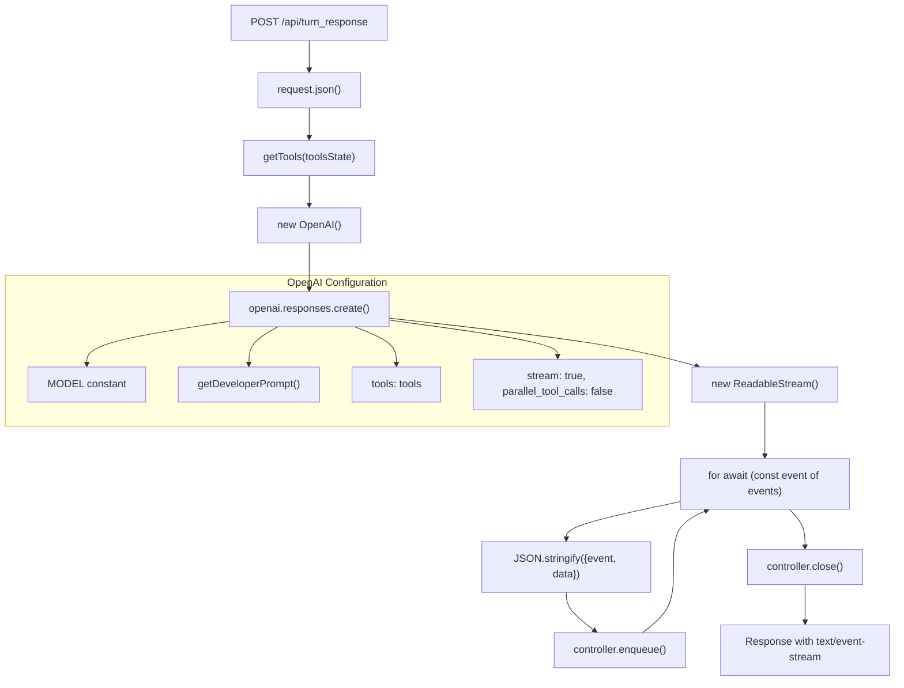
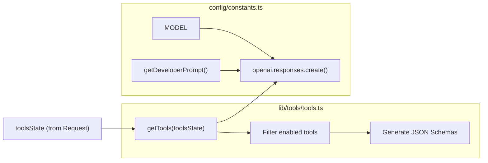
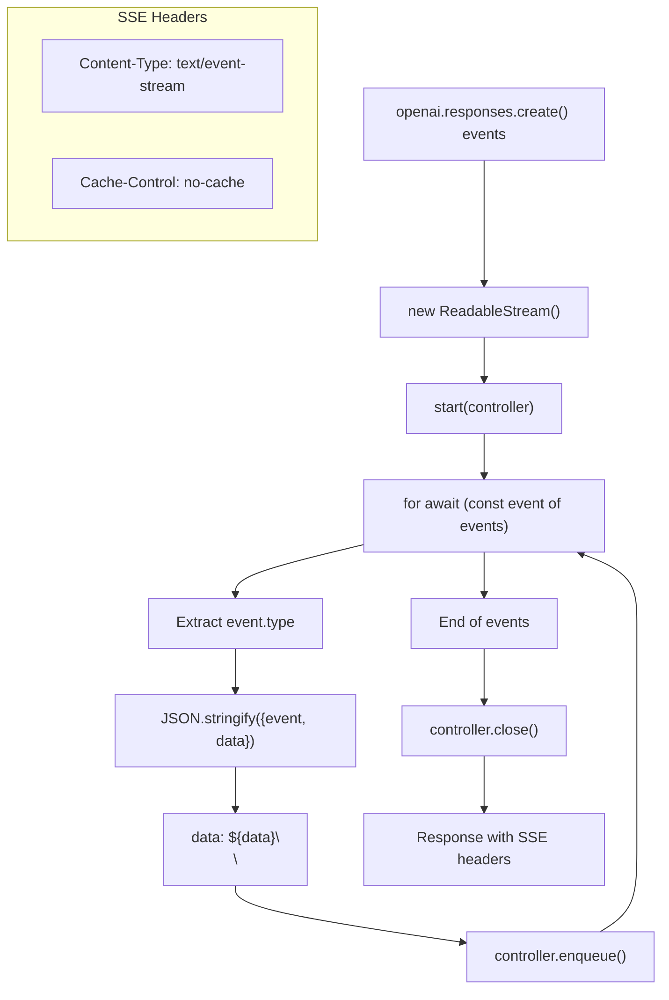

<!-- source: DeepWiki mcp.deepwiki.com · repo openai/openai-responses-starter-app · page 6.1 Turn Response API · fetched 2026-10-26 -->

# Turn Response API

Relevant source files

The following files were used as context for generating this wiki page:

- [app/api/turn_response/route.ts](app/api/turn_response/route.ts)
- [lib/assistant.ts](lib/assistant.ts)

This document covers the Turn Response API endpoint that serves as the primary interface for processing AI conversations with streaming responses and tool integration. The endpoint handles user messages, orchestrates OpenAI API calls, manages tool execution, and streams responses back to the client using Server-Sent Events (SSE).

## Endpoint Overview

The Turn Response API is implemented as a Next.js API route at `/api/turn_response` and accepts POST requests containing conversation messages and tool state configurations.

| Property | Value |
|----------|-------|
| **Route Path** | `/api/turn_response` |
| **HTTP Method** | `POST` |
| **Response Type** | Server-Sent Events (SSE) Stream |
| **Implementation** | [app/api/turn_response/route.ts:5-63]() |

### Request Format

The endpoint expects a JSON payload with the following structure:

| Field | Type | Description |
|-------|------|-------------|
| `messages` | `Array` | Conversation message history (OpenAI message format) |
| `toolsState` | `Object` | The state of tool configurations from the `useToolsStore` |

Sources: [app/api/turn_response/route.ts:7-9]()

## Request Processing Flow

The following diagram illustrates the request processing flow within the `POST` function, showing the bridge between the API route and the `getTools` logic.

**Turn Response API Processing Flow**

Sources: [app/api/turn_response/route.ts:7-45]()

## Tool Assembly Architecture

The API dynamically builds the tools list using the `getTools` utility. This function translates the application's internal tool state into a format compatible with the OpenAI Responses API.

**Tool Assembly Process**

The tool integration follows this sequence:
1. **Payload Extraction**: [app/api/turn_response/route.ts:7]() extracts `messages` and `toolsState` from the request body.
2. **Tool Assembly**: [app/api/turn_response/route.ts:9]() calls `getTools(toolsState)` to retrieve the array of tool definitions.
3. **OpenAI Initialization**: [app/api/turn_response/route.ts:15-24]() configures the OpenAI client with the model, instructions, and tools.

Sources: [app/api/turn_response/route.ts:7-24](), [lib/tools/tools.ts:1-10]() (referenced via import)

## Streaming Response Protocol

The API implements Server-Sent Events (SSE) streaming using a `ReadableStream` that processes OpenAI response events in real-time.

### Stream Implementation

### Event Processing

Each OpenAI response event is wrapped in a standardized format to be consumed by the client-side `handleTurn` function in `lib/assistant.ts`.

| Field | Description | Source |
|-------|-------------|--------|
| `event` | The specific OpenAI event type (e.g., `response.output_text.delta`) | [app/api/turn_response/route.ts:33]() |
| `data` | The complete event payload from the OpenAI SDK | [app/api/turn_response/route.ts:34]() |

The streaming loop at [app/api/turn_response/route.ts:30-37]() processes events continuously until the OpenAI response stream completes.

Sources: [app/api/turn_response/route.ts:27-53](), [lib/assistant.ts:113-122]()

## Client-Side Consumption

The `handleTurn` function in `lib/assistant.ts` is the primary consumer of this API. It handles the low-level streaming mechanics:

1. **Fetch**: Initiates the POST request to `/api/turn_response` [lib/assistant.ts:82-90]().
2. **Reader**: Uses `response.body.getReader()` to consume the stream [lib/assistant.ts:98]().
3. **Buffer Management**: Splits the incoming stream by `\n\n` delimiters and parses individual `data: ` lines [lib/assistant.ts:101-123]().
4. **Callback**: For each parsed JSON object, it invokes the `onMessage` callback provided by the caller (usually `processMessages`) [lib/assistant.ts:120]().

Sources: [lib/assistant.ts:74-136]()

## Configuration Integration

The API integrates with system-wide configuration constants to maintain consistency:

| Configuration | Source | Usage |
|---------------|--------|-------|
| `MODEL` | [config/constants.ts]() | OpenAI model selection (e.g., `gpt-4o`) |
| `getDeveloperPrompt()` | [config/constants.ts]() | System instructions for the assistant |

These configurations are applied at [app/api/turn_response/route.ts:18-20]() when creating the OpenAI responses request.

Sources: [app/api/turn_response/route.ts:1-3](), [app/api/turn_response/route.ts:18-20]()

## Error Handling

The API implements error handling at two levels:

### Stream-Level Errors
If an error occurs during the asynchronous iteration of OpenAI events, it is caught within the `ReadableStream`'s `start` method [app/api/turn_response/route.ts:40-43](). The error is logged and propagated to the client via `controller.error(error)`.

### Request-Level Errors
The entire POST handler is wrapped in a `try...catch` block [app/api/turn_response/route.ts:6-62]().
- **Top-Level Catch**: Handles failures in JSON parsing, tool generation, or OpenAI client initialization.
- **Error Response**: Returns a structured JSON error response with a 500 status code [app/api/turn_response/route.ts:56-61]().

Sources: [app/api/turn_response/route.ts:40-43](), [app/api/turn_response/route.ts:54-62]()

---

