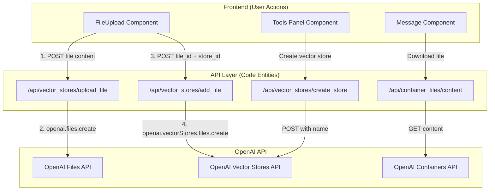
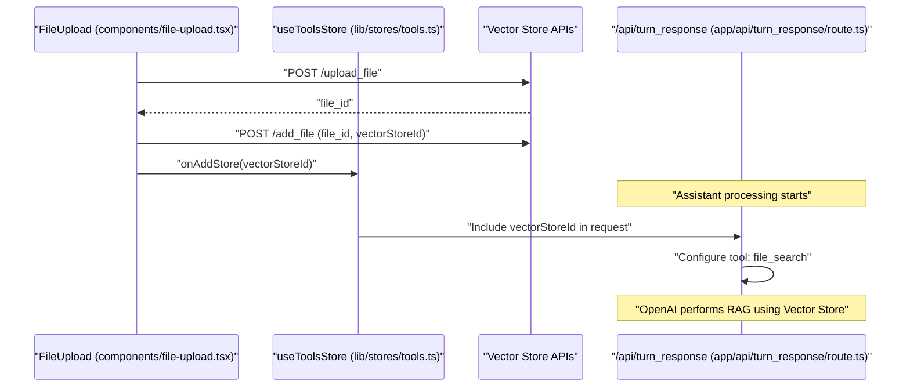

<!-- source: DeepWiki mcp.deepwiki.com · repo openai/openai-responses-starter-app · page 6.2 File and Vector Store APIs · fetched 2026-10-26 -->

# File and Vector Store APIs

Relevant source files

The following files were used as context for generating this wiki page:

- [app/api/container_files/content/route.ts](app/api/container_files/content/route.ts)
- [app/api/vector_stores/add_file/route.ts](app/api/vector_stores/add_file/route.ts)
- [app/api/vector_stores/create_store/route.ts](app/api/vector_stores/create_store/route.ts)
- [app/api/vector_stores/list_files/route.ts](app/api/vector_stores/list_files/route.ts)
- [app/api/vector_stores/retrieve_store/route.ts](app/api/vector_stores/retrieve_store/route.ts)
- [app/api/vector_stores/upload_file/route.ts](app/api/vector_stores/upload_file/route.ts)
- [components/file-upload.tsx](components/file-upload.tsx)
- [package-lock.json](package-lock.json)

This document describes the backend API endpoints that support file retrieval and vector store management for the file search functionality. These endpoints enable the application to access files stored in OpenAI containers and manage vector stores used for semantic file search.

For information about the main conversation processing endpoint, see [Turn Response API](#6.1). For tool configuration including file search setup, see [Tool Configuration UI](#5.1).

## Purpose and Scope

The File and Vector Store APIs provide three primary capabilities:

1.  **File Content Retrieval**: Downloading file contents from OpenAI containers or container files.
2.  **File Management**: Uploading files to OpenAI and associating them with specific vector stores.
3.  **Vector Store Management**: Creating, retrieving, and listing files within vector stores used for semantic file search operations.

These endpoints act as proxies to the OpenAI API, handling authentication and request formatting while providing a simplified interface for the frontend application.

## System Architecture

The following diagram illustrates how these APIs associate Natural Language Space (User actions) with Code Entity Space (API routes and components):

**Sources**: [app/api/container_files/content/route.ts:1-34](), [app/api/vector_stores/create_store/route.ts:1-16](), [components/file-upload.tsx:92-172](), [app/api/vector_stores/upload_file/route.ts:4-23]()

## File Content Retrieval

### Container Files Content API

| Property | Value |
|----------|-------|
| **Path** | `/api/container_files/content` |
| **Method** | `GET` |
| **Purpose** | Retrieves file content from OpenAI containers or container files |
| **Authentication** | Uses server-side `OPENAI_API_KEY` |

The endpoint extracts `file_id`, `container_id`, and `filename` from query parameters [app/api/container_files/content/route.ts:2-5](). It constructs a URL based on the presence of a `container_id` [app/api/container_files/content/route.ts:12-14](). The response is returned as a binary blob with a `Content-Disposition` header to trigger a browser download [app/api/container_files/content/route.ts:21-27]().

**Sources**: [app/api/container_files/content/route.ts:1-34]()

## Vector Store and File Management

The application provides a comprehensive suite of endpoints for managing the lifecycle of files used in search.

### Upload and Association Workflow

The `FileUpload` component coordinates a multi-step process to make a file searchable [components/file-upload.tsx:92-172]():

1.  **File Upload**: The file is sent to `/api/vector_stores/upload_file` [components/file-upload.tsx:109](). The server converts the base64 content to a Buffer and uploads it to OpenAI with the purpose `assistants` [app/api/vector_stores/upload_file/route.ts:8-16]().
2.  **Store Creation (Optional)**: If no store exists, the client calls `/api/vector_stores/create_store` [components/file-upload.tsx:130]().
3.  **File Association**: The client calls `/api/vector_stores/add_file` with the `fileId` and `vectorStoreId` [components/file-upload.tsx:151](). The server uses `openai.vectorStores.files.create` to link them [app/api/vector_stores/add_file/route.ts:8-13]().

### Endpoint Summary

| Path | Method | Code Entity | Description |
|------|--------|-------------|-------------|
| `/api/vector_stores/upload_file` | POST | `openai.files.create` | Uploads raw file to OpenAI [app/api/vector_stores/upload_file/route.ts:13]() |
| `/api/vector_stores/create_store` | POST | `openai.vectorStores.create` | Creates a named vector store [app/api/vector_stores/create_store/route.ts:8]() |
| `/api/vector_stores/add_file` | POST | `openai.vectorStores.files.create` | Attaches a file to a store [app/api/vector_stores/add_file/route.ts:8]() |
| `/api/vector_stores/list_files` | GET | `openai.vectorStores.files.list` | Lists all files in a store [app/api/vector_stores/list_files/route.ts:10]() |
| `/api/vector_stores/retrieve_store` | GET | `openai.vectorStores.retrieve` | Gets metadata for a store [app/api/vector_stores/retrieve_store/route.ts:9]() |

**Sources**: [app/api/vector_stores/upload_file/route.ts:1-24](), [app/api/vector_stores/create_store/route.ts:1-17](), [app/api/vector_stores/add_file/route.ts:1-20](), [app/api/vector_stores/list_files/route.ts:1-19](), [app/api/vector_stores/retrieve_store/route.ts:1-18]()

## Data Flow: File Search Integration

This diagram bridges the code entities responsible for file search from configuration to execution:

**Sources**: [components/file-upload.tsx:92-172](), [app/api/vector_stores/add_file/route.ts:5-19](), [app/api/vector_stores/upload_file/route.ts:4-23]()

## Error Handling

The APIs implement standardized error responses to ensure the frontend can provide user feedback:

*   **Validation Errors**: The Content API returns a `400` if `file_id` is missing [app/api/container_files/content/route.ts:6-10]().
*   **OpenAI SDK Failures**: All vector store endpoints wrap calls in `try/catch` blocks, returning a `500` status and logging the error to the server console [app/api/vector_stores/create_store/route.ts:12-16](), [app/api/vector_stores/add_file/route.ts:15-19]().
*   **Frontend Handling**: The `FileUpload` component catches these errors and alerts the user if the process fails [components/file-upload.tsx:166-169]().

## Security Considerations

*   **Server-Side Execution**: All OpenAI SDK interactions occur in Next.js Route Handlers (`route.ts`), ensuring the `OPENAI_API_KEY` is never sent to the client [app/api/vector_stores/create_store/route.ts:3]().
*   **Purpose Restriction**: Files uploaded via the API are explicitly set with `purpose: "assistants"` to restrict their usage within the OpenAI platform [app/api/vector_stores/upload_file/route.ts:15]().
*   **Content Proxying**: File content is proxied through the server, allowing for potential inspection or permission checks before reaching the user [app/api/container_files/content/route.ts:15-27]().

**Sources**: [app/api/vector_stores/upload_file/route.ts:13-16](), [app/api/container_files/content/route.ts:15-19]()

---

