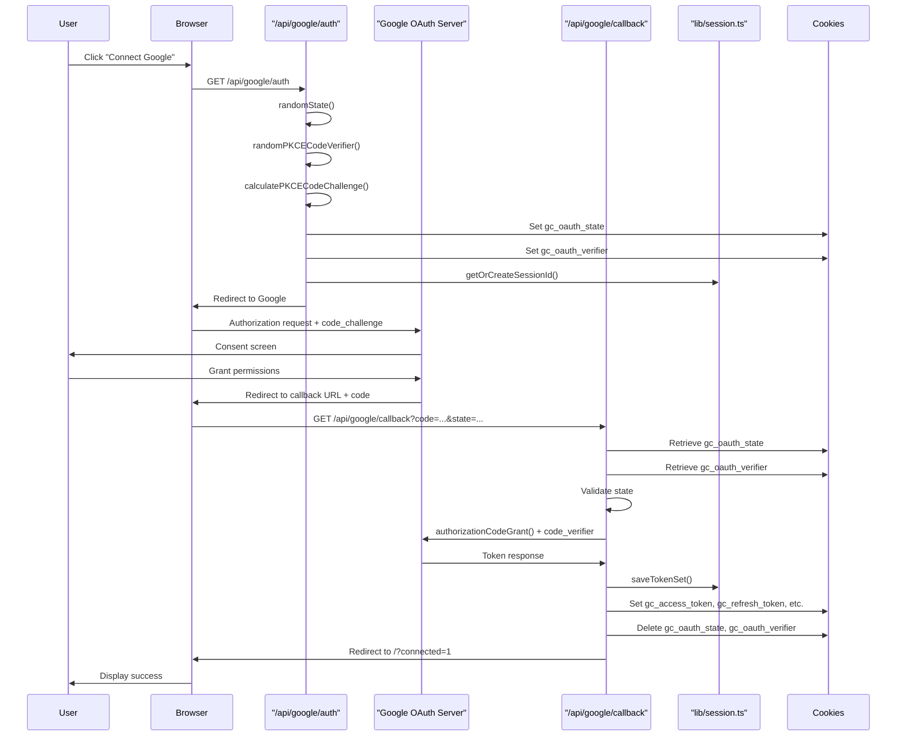
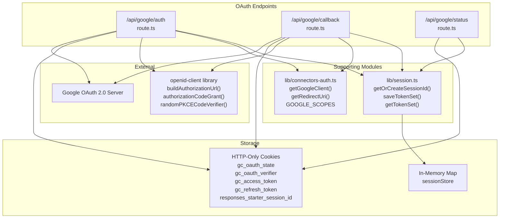
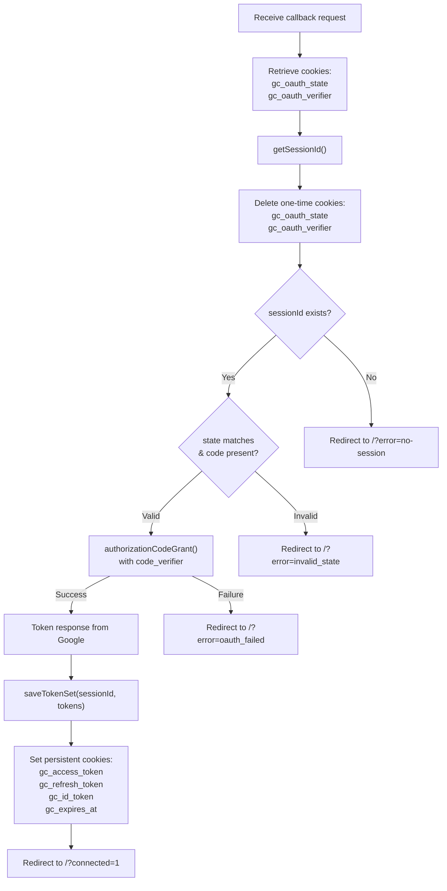
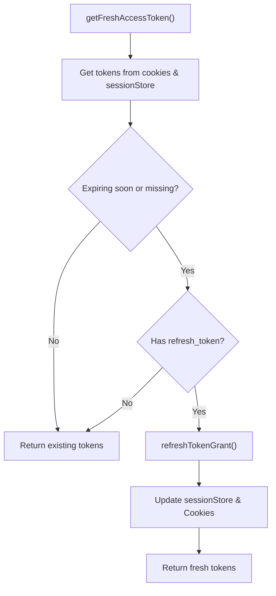
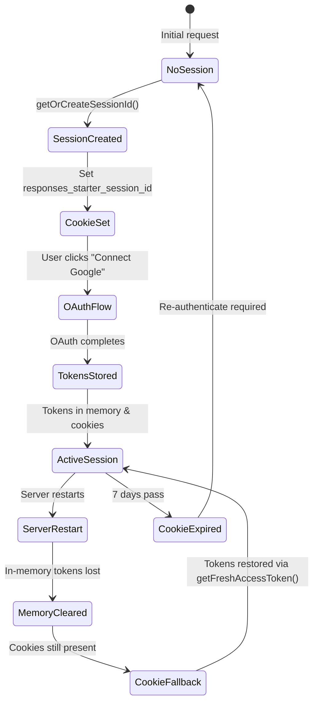

<!-- source: DeepWiki mcp.deepwiki.com · repo openai/openai-responses-starter-app · page 6.3 Google OAuth API Flow · fetched 2026-10-26 -->

# Google OAuth API Flow

<details>
<summary>Relevant source files</summary>

The following files were used as context for generating this wiki page:

- [.env.example](.env.example)
- [.gitignore](.gitignore)
- [app/api/google/auth/route.ts](app/api/google/auth/route.ts)
- [app/api/google/callback/route.ts](app/api/google/callback/route.ts)
- [app/api/google/status/route.ts](app/api/google/status/route.ts)
- [lib/connectors-auth.ts](lib/connectors-auth.ts)
- [lib/session.ts](lib/session.ts)

</details>


## Purpose and Scope

This document describes the Google OAuth 2.0 API flow implementation used to authenticate users and obtain access tokens for Google Calendar and Gmail integrations. The flow implements the OAuth 2.0 Authorization Code Grant with PKCE (Proof Key for Code Exchange) for enhanced security. This page covers the three API endpoints (`/api/google/auth`, `/api/google/callback`, `/api/google/status`), state management, and token storage strategies.

For information about how these OAuth tokens are used to generate Google Calendar and Gmail tool configurations, see [Google Services Integration](#5.5). For general session management details, see [Session Management](#8).

---

## OAuth 2.0 PKCE Flow Overview

The system implements a complete OAuth 2.0 Authorization Code Grant with PKCE (RFC 7636). PKCE protects against authorization code interception attacks by requiring the client to generate a code verifier and code challenge, ensuring that the authorization code cannot be exchanged for tokens by an attacker who intercepts it.

### Flow Diagram



**Sources:** [app/api/google/auth/route.ts](), [app/api/google/callback/route.ts](), [lib/session.ts]()

---

## API Endpoint Architecture

The OAuth flow is implemented through three API route handlers, each with a specific responsibility in the authentication lifecycle.



**Sources:** [app/api/google/auth/route.ts](), [app/api/google/callback/route.ts](), [app/api/google/status/route.ts](), [lib/session.ts]()

---

## Authentication Initiation Endpoint

### `/api/google/auth`

The authentication endpoint initiates the OAuth flow by generating PKCE parameters, storing them securely, and redirecting the user to Google's authorization server.

#### Key Operations

| Step | Function/Operation | Purpose |
|------|-------------------|---------|
| 1 | `getGoogleClient()` | Retrieves OAuth client configuration [lib/connectors-auth.ts:22-44]() |
| 2 | `getOrCreateSessionId()` | Ensures session cookie exists [lib/session.ts:20-34]() |
| 3 | `randomState()` | Generates CSRF protection token [app/api/google/auth/route.ts:26]() |
| 4 | `randomPKCECodeVerifier()` | Creates PKCE code verifier (43-128 chars) [app/api/google/auth/route.ts:27]() |
| 5 | `calculatePKCECodeChallenge()` | Derives SHA-256 hash of verifier [app/api/google/auth/route.ts:28]() |
| 6 | Cookie storage | Stores state and verifier for callback [app/api/google/auth/route.ts:39-40]() |
| 7 | `buildAuthorizationUrl()` | Constructs Google authorization URL [app/api/google/auth/route.ts:44-53]() |
| 8 | Redirect | Sends user to Google consent screen [app/api/google/auth/route.ts:55]() |

#### Implementation Details

The endpoint stores two critical values in HTTP-only cookies with a 10-minute expiration:

- **`gc_oauth_state`**: Random state parameter for CSRF protection [app/api/google/auth/route.ts:16]()
- **`gc_oauth_verifier`**: PKCE code verifier for token exchange [app/api/google/auth/route.ts:17]()

The authorization URL includes several important parameters [app/api/google/auth/route.ts:44-53]():

- `code_challenge`: SHA-256 hash of the code verifier
- `code_challenge_method`: "S256" indicating SHA-256 hashing
- `access_type`: "offline" to request refresh tokens
- `prompt`: "consent" to force re-consent and ensure refresh token
- `include_granted_scopes`: Preserves previously granted scopes

**Sources:** [app/api/google/auth/route.ts:19-56]()

---

## Callback Handler Endpoint

### `/api/google/callback`

The callback endpoint receives the authorization code from Google, validates the request, exchanges the code for tokens, and stores them for subsequent API calls.

#### Security Validation Flow



**Sources:** [app/api/google/callback/route.ts:10-77]()

#### Token Processing

The callback handler transforms the OAuth response into a structured `OAuthTokens` object [app/api/google/callback/route.ts:40-51]():

```typescript
interface OAuthTokens {
  access_token?: string;
  refresh_token?: string;
  id_token?: string;
  token_type?: string;
  scope?: string;
  expires_at?: number;  // Epoch milliseconds
}
```

The `expires_at` timestamp is calculated as `now + expires_in * 1000`, converting the relative expiration time to an absolute timestamp for easier expiration checking [app/api/google/callback/route.ts:47-50]().

**Sources:** [app/api/google/callback/route.ts:34-76](), [lib/session.ts:8-16]()

---

## Status Check Endpoint

### `/api/google/status`

The status endpoint allows the frontend to check whether Google OAuth is configured and whether the current session has valid tokens.

#### Response Schema

```typescript
{
  connected: boolean,      // Tokens exist in session or cookies
  oauthConfigured: boolean // GOOGLE_CLIENT_ID and SECRET are set
}
```

The endpoint checks multiple sources [app/api/google/status/route.ts:5-19]():

1. In-memory session store via `getTokenSet(sessionId)` [app/api/google/status/route.ts:7]()
2. Cookie-based storage via `gc_access_token` cookie [app/api/google/status/route.ts:9]()
3. Environment variables for configuration status [app/api/google/status/route.ts:14]()

This dual-check approach ensures that tokens are detected regardless of server restart scenarios where in-memory storage is lost but cookies persist.

**Sources:** [app/api/google/status/route.ts:5-19]()

---

## Token Storage and Refresh Strategy

The system implements a dual-storage strategy and a proactive refresh mechanism to maintain valid access tokens.

### Storage Comparison

| Storage Type | Location | Persistence | Access | Purpose |
|-------------|----------|-------------|--------|---------|
| In-Memory | `sessionStore` Map | Until server restart | Server-side only | Primary token source during session [lib/session.ts:18]() |
| HTTP-Only Cookies | Browser cookies | 7 days | Server-side only | Survives server restarts [app/api/google/callback/route.ts:63]() |

### Token Refresh Logic

The `getFreshAccessToken` function in `lib/connectors-auth.ts` manages token rotation. It refreshes tokens if the access token is missing or expiring within 30 seconds (`EXPIRY_SKEW_MS`) [lib/connectors-auth.ts:55-74]().



**Sources:** [lib/connectors-auth.ts:57-113]()

### In-Memory Storage

The `sessionStore` is a simple `Map<string, OAuthTokens>` [lib/session.ts:18]() that provides fast access to tokens during active sessions. 

#### Key Functions

- **`saveTokenSet(sessionId, tokens)`**: Stores tokens in memory [lib/session.ts:41-43]()
- **`getTokenSet(sessionId)`**: Retrieves tokens from memory [lib/session.ts:45-48]()
- **`clearSession(sessionId)`**: Removes tokens from memory [lib/session.ts:50-53]()

**Sources:** [lib/session.ts:8-53]()

---

## Session Management Integration

### Session ID Lifecycle

The session ID cookie (`responses_starter_session_id`) is created by `getOrCreateSessionId()` [lib/session.ts:20-34]() and serves as the key for the in-memory token store. 

The session ID is a 32-character hexadecimal string generated via `crypto.randomBytes(16)` [lib/session.ts:25]().



**Sources:** [lib/session.ts:20-54](), [lib/connectors-auth.ts:57-113]()

---

## Environment Configuration

The OAuth flow requires specific environment variables to be set. Missing variables will cause `getGoogleClient()` to throw an error [lib/connectors-auth.ts:30-34]().

| Variable | Purpose | Example |
|----------|---------|---------|
| `GOOGLE_CLIENT_ID` | OAuth 2.0 client application ID | `123456789-abc.apps.googleusercontent.com` |
| `GOOGLE_CLIENT_SECRET` | Client secret for token exchange | `GOCSPX-...` |
| `GOOGLE_REDIRECT_URI` | Callback URL registered with Google | `http://localhost:3000/api/google/callback` |

**Sources:** [.env.example:2-4](), [lib/connectors-auth.ts:25-52]()

---

## Scope Configuration

The system requests specific Google API scopes to enable Calendar and Gmail integrations. These are defined in `lib/connectors-auth.ts` [lib/connectors-auth.ts:8-14]():

- `openid`, `email`, `profile`: Basic identity
- `https://www.googleapis.com/auth/calendar.events.readonly`: Calendar access
- `https://www.googleapis.com/auth/gmail.readonly`: Gmail access

The `include_granted_scopes: "true"` and `prompt: "consent"` parameters are used to ensure refresh tokens are provided and existing permissions are maintained [app/api/google/auth/route.ts:48-49]().

**Sources:** [lib/connectors-auth.ts:8-14](), [app/api/google/auth/route.ts:44-53]()

---

## Error Handling

The OAuth flow includes comprehensive error handling with user-facing error codes:

| Error Code | Redirect | Cause |
|------------|----------|-------|
| `no-session` | `/?error=no-session` | Session cookie missing at callback [app/api/google/callback/route.ts:23]() |
| `invalid_state` | `/?error=invalid_state` | State mismatch or missing code [app/api/google/callback/route.ts:31]() |
| `oauth_failed` | `/?error=oauth_failed` | Token exchange failed in `authorizationCodeGrant` [app/api/google/callback/route.ts:75]() |

**Sources:** [app/api/google/callback/route.ts:19-76]()

---

