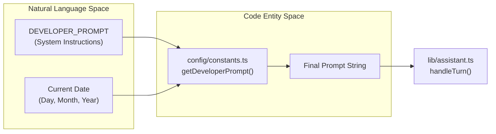
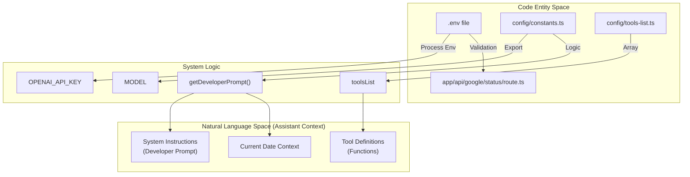

<!-- source: DeepWiki mcp.deepwiki.com · repo openai/openai-responses-starter-app · page 7 Configuration and Constants · fetched 2026-10-26 -->

# Configuration and Constants

<details>
<summary>Relevant source files</summary>

The following files were used as context for generating this wiki page:

- [.env.example](.env.example)
- [.gitignore](.gitignore)
- [app/api/google/status/route.ts](app/api/google/status/route.ts)
- [config/constants.ts](config/constants.ts)
- [config/tools-list.ts](config/tools-list.ts)
- [next.config.mjs](next.config.mjs)

</details>


This page documents the application's configuration layer, including the AI model selection, developer prompts that guide assistant behavior, environment variables for external integrations, and Next.js framework settings. These configurations are centralized in [config/constants.ts]() and [next.config.mjs](), with environment-specific settings managed through `.env` files.

For information about session-level configuration and OAuth token management, see [Session Management](#8). For tool-specific configuration managed through the UI, see [Tool Configuration UI](#5.1).

## Model Configuration

The application uses a single constant to specify the OpenAI model across all API calls:

```typescript
export const MODEL = "gpt-5.2";
```

This constant is defined in [config/constants.ts:1]() and used throughout the application, particularly in logic responsible for constructing OpenAI Responses API calls. The model string determines which OpenAI model processes conversations and executes tool calls. Changing this value affects all assistant responses globally.

**Sources:** [config/constants.ts:1]()

## Developer Prompt System

The developer prompt is a system-level instruction that shapes the assistant's behavior across all conversations. It is not visible to users but guides how the assistant responds to queries and uses available tools.

### Base Developer Prompt

The `DEVELOPER_PROMPT` constant [config/constants.ts:4-25]() contains multi-line instructions covering:

| Instruction Category | Purpose |
|---------------------|---------|
| **General Behavior** | "You are a helpful assistant helping users with their queries" |
| **Response Style** | Concise replies (3–6 sentences), markdown lists, and no speculation [config/constants.ts:7-10]() |
| **Ambiguity** | Instructions to ask clarifying questions instead of fabricating details [config/constants.ts:12-14]() |
| **Web Search Usage** | Directs the assistant to use web search for fresh or unknown facts [config/constants.ts:17]() |
| **Context Storage** | Instructs use of `save_context` tool for user-provided info [config/constants.ts:18]() |
| **File Search** | Guides use of `file_search` for user's uploaded data [config/constants.ts:19]() |
| **Google Connectors** | Specific rules for Calendar and Gmail, including weekend definitions [config/constants.ts:20-23]() |

### Dynamic Date Injection

The `getDeveloperPrompt()` function [config/constants.ts:27-34]() enhances the base prompt with temporal context:



The function appends the current date in format: `"Today is {DayName}, {MonthName} {Day}, {Year}."` [config/constants.ts:33](). This ensures the assistant has accurate temporal awareness for queries about schedules and deadlines.

**Sources:** [config/constants.ts:4-34]()

## Environment Variables

The application requires environment variables for external service integration. These are configured through a `.env` file in the project root, following the template in [.env.example]().

### Required Variables

| Variable | Purpose | Example Value |
|----------|---------|---------------|
| `OPENAI_API_KEY` | Authenticates with OpenAI API [env.example:1]() | `sk-proj-...` |
| `GOOGLE_CLIENT_ID` | OAuth 2.0 client identifier [env.example:2]() | `...apps.googleusercontent.com` |
| `GOOGLE_CLIENT_SECRET` | OAuth 2.0 client secret [env.example:3]() | `GOCSPX-...` |
| `OAUTH_REDIRECT_URI` | OAuth callback URL [env.example:4]() | `http://localhost:3000/api/google/callback` |

### OAuth Configuration Validation

The Google OAuth endpoints validate configuration availability before attempting authentication. In [app/api/google/status/route.ts:10-18](), the status endpoint checks:

```typescript
const { GOOGLE_CLIENT_ID, GOOGLE_CLIENT_SECRET } = process.env as Record<
  string,
  string | undefined
>;
const oauthConfigured = Boolean(GOOGLE_CLIENT_ID && GOOGLE_CLIENT_SECRET);
```

This allows the UI to conditionally display Google integration features only when properly configured.

**Sources:** [.env.example:1-5](), [app/api/google/status/route.ts:10-18]()

## Initial UI State and Tool Definitions

### Initial Message and Vector Store

The application defines default states for the chat UI and tool configurations in [config/constants.ts]().

*   **`INITIAL_MESSAGE`**: The first greeting displayed in the chat interface [config/constants.ts:40-42]().
*   **`defaultVectorStore`**: A placeholder object used to initialize the file search configuration [config/constants.ts:44-47]().

### Tool List

The `toolsList` constant in [config/tools-list.ts:5-26]() defines static function-calling tools available to the assistant.

| Tool Name | Description | Parameters |
|-----------|-------------|------------|
| `get_weather` | Get weather for a location | `location`, `unit` (celsius/fahrenheit) |
| `get_joke` | Get a programming joke | None |

**Sources:** [config/constants.ts:40-47](), [config/tools-list.ts:5-26]()

## Next.js Framework Configuration

The [next.config.mjs]() file configures Next.js framework behavior:

```typescript
/** @type {import('next').NextConfig} */
const nextConfig = {
  devIndicators: false,
};

export default nextConfig;
```

This configuration disables the development mode indicator overlay [next.config.mjs:3](). The application relies on standard Next.js defaults for the App Router and API route handling.

**Sources:** [next.config.mjs:1-6]()

## Configuration Usage Map

The following diagram shows how configuration constants and environment variables flow from the "Code Entity Space" into the "Natural Language Space" (the assistant's context).



**Sources:** [config/constants.ts](), [config/tools-list.ts](), [app/api/google/status/route.ts](), [.env.example]()

## Modifying Configuration

To change application behavior:

1.  **Model Selection**: Edit `MODEL` in [config/constants.ts:1]() (e.g., to `"gpt-4o"`).
2.  **Assistant Instructions**: Modify `DEVELOPER_PROMPT` in [config/constants.ts:4-25]() to change tool usage guidelines or response formatting.
3.  **External Services**: Update `.env` with valid API keys and OAuth credentials following [.env.example]().
4.  **Static Tools**: Add or remove function definitions in [config/tools-list.ts:5-26]().
5.  **Framework Features**: Add Next.js options to [next.config.mjs]() for features like redirects or custom headers.

**Sources:** [config/constants.ts](), [config/tools-list.ts](), [.env.example](), [next.config.mjs]()

---

