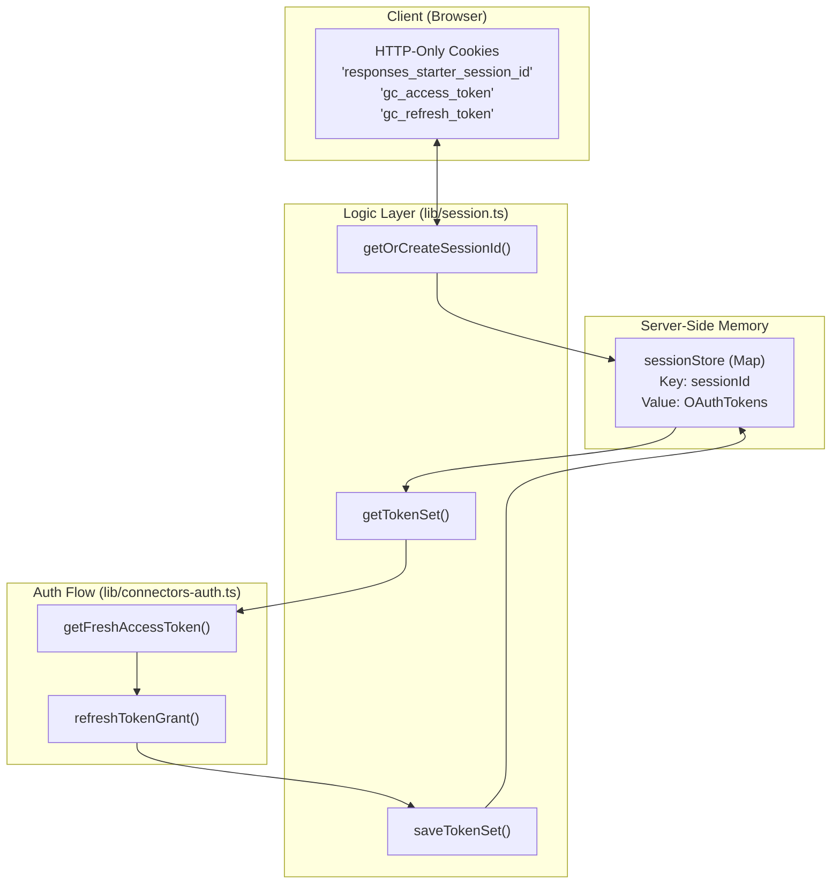
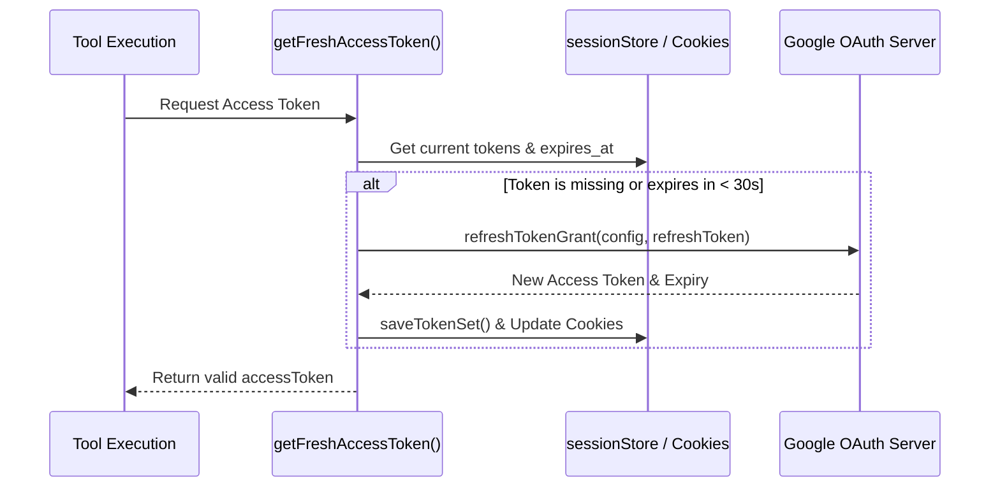

<!-- source: DeepWiki mcp.deepwiki.com · repo openai/openai-responses-starter-app · page 8 Session Management · fetched 2026-10-26 -->

# Session Management

Relevant source files

The following files were used as context for generating this wiki page:

- [app/api/google/callback/route.ts](app/api/google/callback/route.ts)
- [lib/connectors-auth.ts](lib/connectors-auth.ts)
- [lib/session.ts](lib/session.ts)

This page details the implementation of session tracking and OAuth token management. The application uses a hybrid approach, storing session identifiers and tokens in both HTTP-only cookies and server-side memory to facilitate secure access across various API routes and long-running tool executions.

## System Overview

The session management system is responsible for identifying users across requests and maintaining valid OAuth credentials for Google Services (Calendar and Gmail).

### Session and Token Architecture

**Natural Language to Code Entity Space: Session Components**
Sources: [lib/session.ts:1-53](), [lib/connectors-auth.ts:57-113]()

## Session Lifecycle

The application tracks users using a session ID generated server-side.

### Session ID Management
The session ID is a 16-byte hex string generated using `crypto.randomBytes` [lib/session.ts:25](). It is stored in a cookie named `responses_starter_session_id` [lib/session.ts:4]().

| Function | File | Description |
| :--- | :--- | :--- |
| `getOrCreateSessionId` | [lib/session.ts:20]() | Retrieves the ID from cookies or generates a new one and sets the cookie. |
| `getSessionId` | [lib/session.ts:36]() | Retrieves the current session ID from the cookie jar without creating one. |
| `clearSession` | [lib/session.ts:50]() | Removes the session data from the in-memory `sessionStore`. |

The session cookie is configured with `httpOnly: true` and `sameSite: "lax"` to prevent client-side script access and mitigate CSRF risks [lib/session.ts:27-32]().

Sources: [lib/session.ts:1-53]()

## OAuth Token Storage

The application manages Google OAuth tokens through two layers of storage: in-memory for the current process and cookies for persistence across different route handler instances.

### In-Memory Storage (`sessionStore`)
A `Map<string, OAuthTokens>` acts as a simple session store [lib/session.ts:18](). The `OAuthTokens` interface defines the structure for access, refresh, and ID tokens along with their expiration [lib/session.ts:8-16]().

### Cookie Persistence
During the OAuth callback at `/api/google/callback`, tokens are saved to the `sessionStore` via `saveTokenSet` [app/api/google/callback/route.ts:54]() and simultaneously persisted in individual cookies:
* `gc_access_token`
* `gc_refresh_token`
* `gc_id_token`
* `gc_expires_at`

This redundancy ensures that if the server process restarts (clearing the in-memory Map), the tokens can be recovered from the user's cookies [app/api/google/callback/route.ts:65-71]().

Sources: [lib/session.ts:8-18](), [app/api/google/callback/route.ts:53-72]()

## Token Refresh Mechanism

To maintain access to Google APIs without re-authentication, the system implements an automatic refresh logic within `getFreshAccessToken` [lib/connectors-auth.ts:57]().

### Refresh Logic Flow

**Token Refresh Sequence**
Sources: [lib/connectors-auth.ts:57-113]()

### Implementation Details
1. **Expiry Skew**: The system considers a token "expiring soon" if it is within 30 seconds of its `expires_at` timestamp [lib/connectors-auth.ts:55]().
2. **Prioritization**: It checks both the cookie jar and the in-memory `tokenSet`, prioritizing cookie values [lib/connectors-auth.ts:62-68]().
3. **Grant Execution**: If a refresh is required, it uses `refreshTokenGrant` from the `openid-client` library [lib/connectors-auth.ts:79]().
4. **Update**: Upon success, both the `sessionStore` and the browser cookies are updated with the new credentials [lib/connectors-auth.ts:95-107]().

Sources: [lib/connectors-auth.ts:54-113]()

## Security Implementation

| Feature | Implementation | Source |
| :--- | :--- | :--- |
| **Session Isolation** | Session ID used as key in `Map` to prevent data leakage between users. | [lib/session.ts:18-47]() |
| **HTTP-Only Cookies** | All session and token cookies use `httpOnly: true`. | [lib/session.ts:28](), [app/api/google/callback/route.ts:59]() |
| **Secure Transport** | `secure` flag is dynamically set based on `NODE_ENV === "production"`. | [lib/session.ts:31](), [app/api/google/callback/route.ts:62]() |
| **State Validation** | OAuth flow uses `STATE_COOKIE` and `VERIFIER_COOKIE` (PKCE) to prevent interception. | [app/api/google/callback/route.ts:7-20]() |

Sources: [lib/session.ts:26-32](), [app/api/google/callback/route.ts:7-64]()

---

