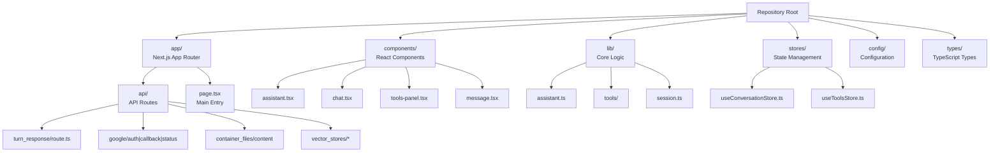
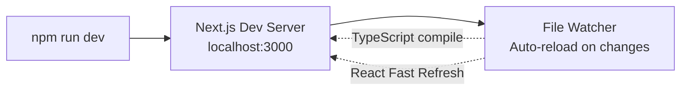
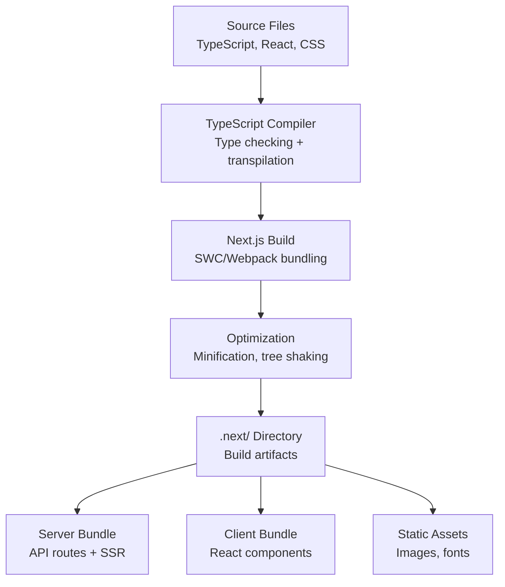
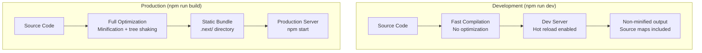
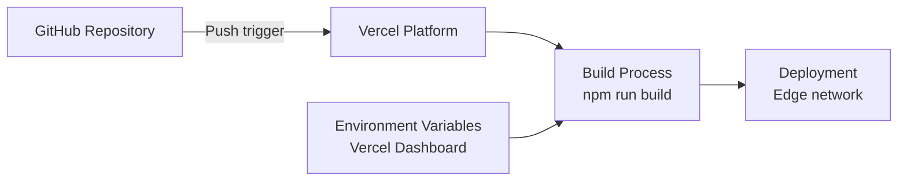
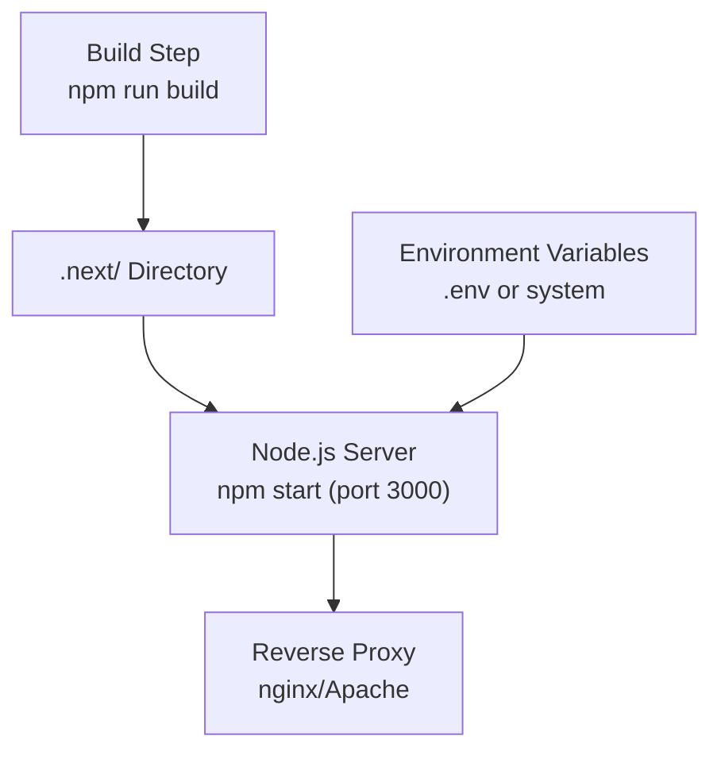

<!-- source: DeepWiki mcp.deepwiki.com · repo openai/openai-responses-starter-app · page 9 Development and Deployment · fetched 2026-10-26 -->

# Development and Deployment

Relevant source files

The following files were used as context for generating this wiki page:

- [eslint.config.mjs](eslint.config.mjs)
- [next.config.mjs](next.config.mjs)
- [package.json](package.json)
- [tailwind.config.ts](tailwind.config.ts)
- [tsconfig.json](tsconfig.json)

This document provides a comprehensive guide for developers working with the OpenAI Responses Starter App codebase. It covers project structure, development workflows, available npm scripts, build processes, and deployment considerations.

For initial setup instructions, see **Getting Started**. For architecture overview, see **Architecture Overview**.

## Project Structure

The codebase follows Next.js 15 App Router conventions with a modular architecture separating UI components, API routes, business logic, and state management.

### Directory Organization

**High-Level Directory Structure**  
Sources: [package.json:1-54](), [tsconfig.json:21-23]()

### Key File Categories

| Directory | Purpose | Key Files |
|-----------|---------|-----------|
| `app/` | Next.js routing and pages | `page.tsx`, `layout.tsx` |
| `app/api/` | Backend API endpoints | `turn_response/route.ts`, `google/*/route.ts` |
| `components/` | React UI components | `assistant.tsx`, `chat.tsx`, `tools-panel.tsx` |
| `lib/` | Core business logic | `assistant.ts`, `tools/tools.ts`, `session.ts` |
| `stores/` | Zustand state management | `useConversationStore.ts`, `useToolsStore.ts` |
| `config/` | Application configuration | `functions.ts`, `constants.ts` |
| `types/` | TypeScript type definitions | `item.ts`, `tools.ts` |

Sources: [package.json:1-54](), [tsconfig.json:21-23]()

## Development Workflow

### Available npm Scripts

The project uses standard Next.js development scripts defined in `package.json`.

| Script | Command | Purpose |
|--------|---------|---------|
| `dev` | `npm run dev` | Start development server with hot reload |
| `build` | `npm run build` | Create optimized production build |
| `start` | `npm start` | Run production build locally |
| `lint` | `npm run lint` | Run ESLint for code quality checks |

**Development Script Usage**  
Sources: [package.json:5-10]()

### Development Server

The development server runs on `http://localhost:3000` with hot module replacement enabled. The `devIndicators` are disabled in the configuration to provide a cleaner UI experience during development.

**Development Server Workflow**  
Sources: [package.json:6](), [next.config.mjs:2-4]()

### Local Development Setup

1. **Install Dependencies**: Run `npm install` to install all required packages listed in `package.json`.
2. **Environment Configuration**: Create a `.env.local` file (based on `.env.example`) to store secrets like `OPENAI_API_KEY`.
3. **Start Development**: Run `npm run dev` to start the Next.js development server.
4. **Linting**: Run `npm run lint` to ensure code adheres to the project's TypeScript and Next.js standards.

Sources: [package.json:5-10](), [eslint.config.mjs:12-19]()

## Build Process

The application uses the Next.js build system to create optimized production bundles. It leverages TypeScript for type safety and Tailwind CSS for styling.

### Build Configuration

Next.js configuration is minimal, defined in `next.config.mjs`. The TypeScript configuration is set to `ES2017` target with `strict` mode enabled.

**Build Pipeline Stages**  
Sources: [package.json:7](), [next.config.mjs:1-7](), [tsconfig.json:1-27](), [tailwind.config.ts:1-64]()

### Build Output Structure

| Directory | Contents | Purpose |
|-----------|----------|---------|
| `.next/server/` | Server-side bundles | API routes (e.g., `/api/turn_response`), server components |
| `.next/static/` | Client-side assets | JavaScript bundles, CSS (Tailwind) |
| `.next/cache/` | Build cache | Incremental build optimization |

The build process generates optimized JavaScript bundles with code splitting and static assets with content hashing for cache invalidation.

Sources: [package.json:7](), [next.config.mjs:1-7]()

### Development vs Production Builds

**Development vs Production Build Flow**  
Sources: [package.json:6-8]()

## Deployment Strategies

### Vercel Deployment (Recommended)

Vercel provides native Next.js support with automatic deployments from Git repositories.

**Vercel Deployment Flow**  
Sources: [package.json:7]()

### Self-Hosted Deployment

For custom infrastructure, deploy using a Node.js server.

#### Node.js Server Deployment

**Self-Hosted Architecture**  
Sources: [package.json:8]()

**Deployment Steps:**
1. Run `npm install` on the server.
2. Run `npm run build` to generate the `.next` production folder.
3. Set environment variables (e.g., `OPENAI_API_KEY`) in the production environment.
4. Start the server using `npm start`.
5. Configure a reverse proxy (like Nginx) for SSL termination and port forwarding to 3000.

Sources: [package.json:7-8]()

## Security and Optimization

### Code Quality and Linting
The project uses ESLint with `next/core-web-vitals` and `next/typescript` configurations. A specific rule is set to disable `@typescript-eslint/no-explicit-any` to allow flexibility in handling dynamic OpenAI API responses.

Sources: [eslint.config.mjs:12-19]()

### CSS Optimization
Tailwind CSS is configured to purge unused styles by scanning files in `./pages`, `./components`, and `./app`. It includes `tailwindcss-animate` for UI transitions.

Sources: [tailwind.config.ts:4-62]()

### Performance Monitoring
Monitor the `/api/turn_response` endpoint for latency, as streaming responses from OpenAI are central to the user experience. Ensure that the server environment supports long-lived HTTP connections for streaming.

Sources: [package.json:26-27]()

---

