# Page: Overview

# Overview

<details>
<summary>Relevant source files</summary>

The following files were used as context for generating this wiki page:

- [README.md](README.md)
- [app/layout.tsx](app/layout.tsx)
- [app/page.tsx](app/page.tsx)
- [package.json](package.json)

</details>


This document provides an overview of the OpenAI Responses Starter App, a Next.js application that demonstrates integration with the OpenAI Responses API. The application showcases multi-turn conversation handling, real-time streaming, tool execution, and various integrations including web search, file search, MCP servers, and Google services.

For detailed information about specific subsystems, see:
- Installation and configuration: [Getting Started](#2)
- Conversation processing mechanics: [Core Components](#4)
- Tool configuration and execution: [Tool System](#5)
- Backend API routes: [API Endpoints](#6)

**Sources:** [README.md:1-156](), [package.json:1-53]()

## Application Purpose

The OpenAI Responses Starter App serves as a reference implementation for building conversational assistants using the OpenAI Responses API. It provides working examples of:

| Feature | Implementation |
|---------|----------------|
| Multi-turn conversations | Message history tracking with streaming responses |
| Built-in tools | Web search, file search, code interpreter |
| Custom functions | Example `get_weather` and `get_joke` functions |
| MCP integration | Model Context Protocol server configuration |
| Google connectors | OAuth-based Calendar and Gmail integration |
| UI rendering | Markdown messages, tool call visualization, annotations |

**Sources:** [README.md:7-21]()

## Technology Stack

The application is built with the following core technologies:

| Component | Technology | Version |
|-----------|-----------|---------|
| Framework | Next.js | 15.2.3 |
| UI Library | React | 18 |
| API Client | OpenAI SDK | 4.87.3 |
| State Management | Zustand | 5.0.2 |
| UI Components | Radix UI | Various |
| Markdown Rendering | react-markdown | 9.0.1 |
| Charting | recharts | 2.12.7 |
| OAuth | openid-client | 6.6.4 |

**Sources:** [package.json:11-40]()

## High-Level Architecture

The application follows a three-tier architecture with clear separation between presentation, state management, and API interaction layers.

### System Architecture Diagram

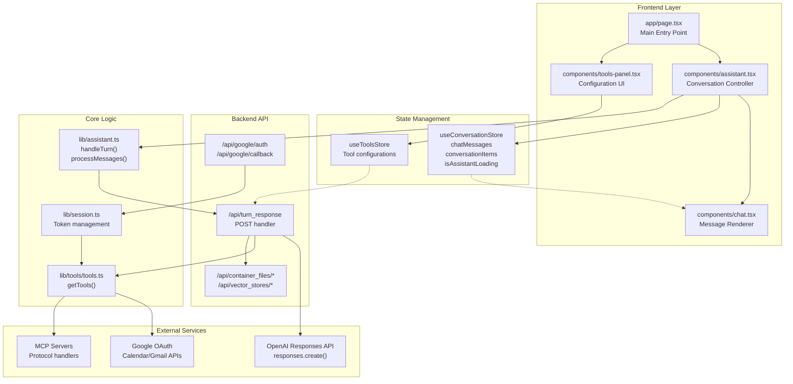

**Sources:** [app/page.tsx:1-52](), [README.md:1-156]()

## Application Entry Point

The main application is rendered through `Main` in [app/page.tsx:9-52](), which implements a responsive two-column layout:

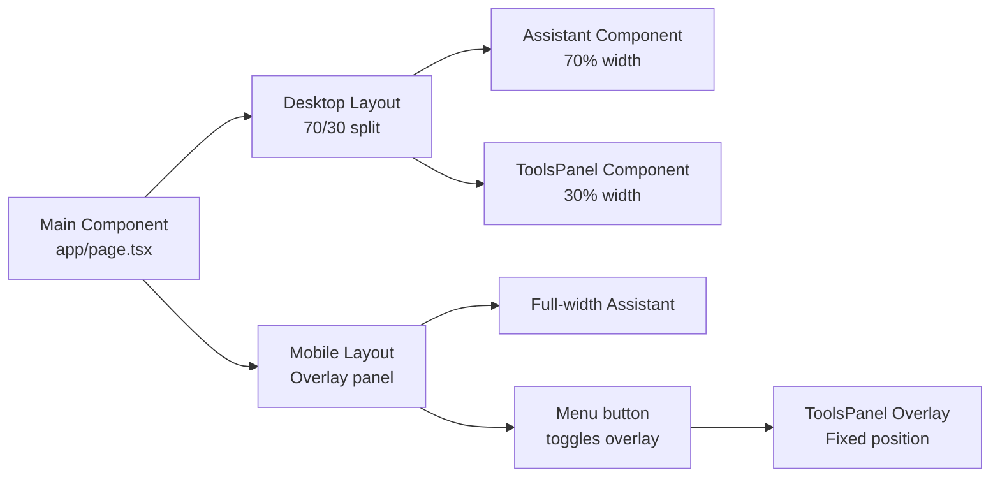

The layout automatically adapts based on screen size, with the `ToolsPanel` becoming an overlay on mobile devices accessed via a hamburger menu. Additionally, it handles post-OAuth cleanup by checking the `connected` URL parameter and calling `resetConversation()` from `useConversationStore` [app/page.tsx:16-23]().

**Sources:** [app/page.tsx:7-52]()

## Core Data Flow

### Conversation Processing Pipeline

The application processes user messages through the following sequence:

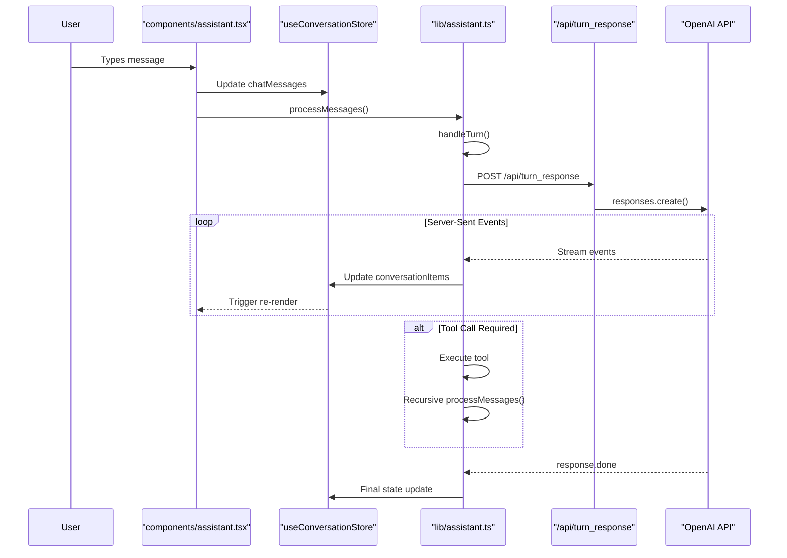

The conversation flow uses Server-Sent Events (SSE) for real-time streaming, allowing progressive UI updates as the AI generates responses. When tools are invoked, the system executes them locally and recursively continues the conversation.

**Sources:** [README.md:12-13](), [app/page.tsx:28]()

## State Management Architecture

The application maintains two primary Zustand stores that persist across component re-renders:

### Store Structure

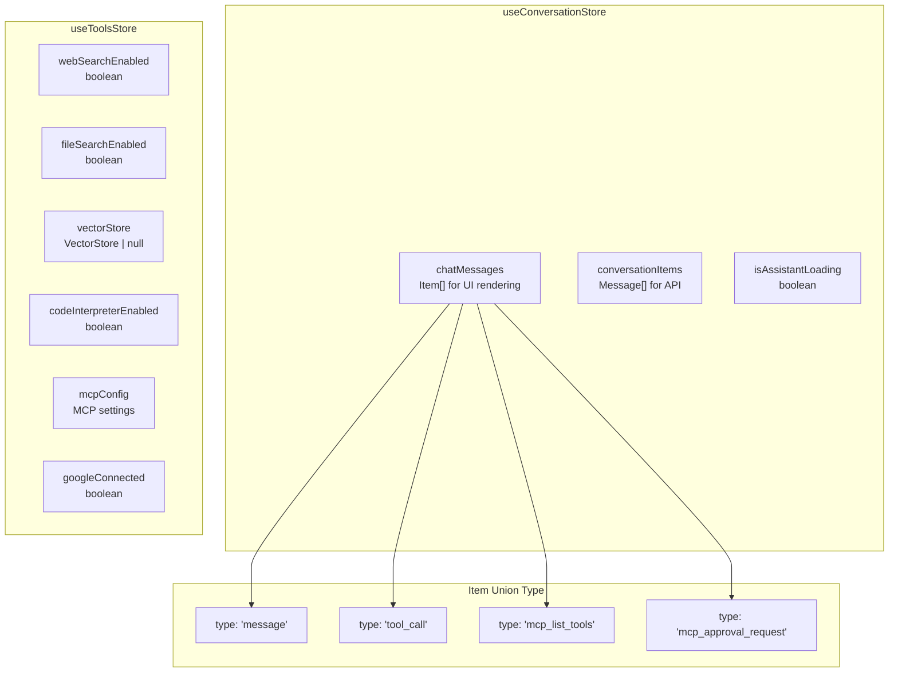

The `useConversationStore` maintains two parallel message collections: `chatMessages` optimized for UI rendering with rich item types, and `conversationItems` formatted for OpenAI API consumption. This separation enables the UI to display tool calls and MCP-specific content while sending clean message history to the API.

**Sources:** [app/page.tsx:7-12](), [README.md:12-18]()

## Tool System Overview

The application aggregates tools from multiple sources:

| Tool Type | Examples | Configuration |
|-----------|----------|---------------|
| Built-in OpenAI | `web_search`, `file_search`, `code_interpreter` | Enabled via `useToolsStore` |
| Custom Functions | `get_weather`, `get_joke` | Defined in `config/functions.ts` |
| MCP Servers | User-configured endpoints | MCP protocol configuration |
| Google Connectors | `goog_calendar`, `goog_gmail` | OAuth tokens via session |

The `getTools()` function aggregates these configurations into a tools array passed to the OpenAI Responses API. For details on tool configuration UI and execution, see [Tool System](#5).

**Sources:** [README.md:63-93]()

## Key Workflows

### OAuth Integration Flow

For services requiring authentication (e.g., Google Calendar and Gmail), the application implements a complete OAuth 2.0 PKCE flow:

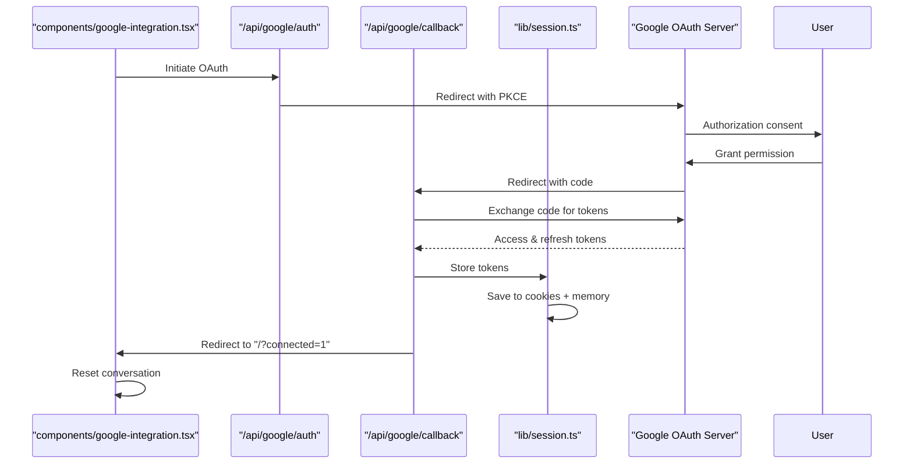

Tokens are stored both in HTTP-only cookies (for persistence) and in-memory session storage (for server-side access). The refresh token enables automatic token renewal without user re-authentication.

**Sources:** [README.md:88-123](), [app/page.tsx:14-23]()

### Streaming Response Handling

The application uses the OpenAI Responses API's streaming capability to provide real-time updates. The `lib/assistant.ts` module processes Server-Sent Events and updates the conversation store progressively as chunks arrive.

**Sources:** [README.md:13]()

## File Organization

The codebase follows Next.js conventions with the App Router:

| Directory | Purpose |
|-----------|---------|
| `app/` | Next.js app router pages and API routes |
| `components/` | React UI components |
| `lib/` | Core business logic and utility functions |
| `stores/` | Zustand state management stores |
| `config/` | Application configuration and constants |
| `types/` | TypeScript type definitions |

**Sources:** [app/page.tsx:1-52](), [package.json:1-53]()

## Development and Deployment

The application requires Node.js and the following environment variables:

| Variable | Purpose | Required |
|----------|---------|----------|
| `OPENAI_API_KEY` | OpenAI API authentication | Yes |
| `GOOGLE_CLIENT_ID` | Google OAuth client ID | Optional |
| `GOOGLE_CLIENT_SECRET` | Google OAuth secret | Optional |
| `GOOGLE_REDIRECT_URI` | OAuth callback URL | Optional |

Available npm scripts from [package.json:5-9]():

```bash
npm run dev    # Start development server on localhost:3000
npm run build  # Create production build
npm run start  # Start production server
npm run lint   # Run ESLint
```

For detailed setup instructions, see [Getting Started](#2). For deployment considerations, see [Development and Deployment](#9).

**Sources:** [README.md:23-61](), [README.md:95-122](), [package.json:5-9]()

---

# Page: Getting Started

# Getting Started

<details>
<summary>Relevant source files</summary>

The following files were used as context for generating this wiki page:

- [.env.example](.env.example)
- [.gitignore](.gitignore)
- [README.md](README.md)
- [app/api/google/status/route.ts](app/api/google/status/route.ts)
- [next.config.mjs](next.config.mjs)
- [package.json](package.json)

</details>


This document provides step-by-step instructions for installing and configuring the OpenAI Responses Starter App. It covers prerequisites, installation, environment setup (API keys and OAuth), and running the development server for the first time.

---

## Prerequisites

Before installing the application, ensure your system meets the following requirements:

| Requirement | Version | Purpose |
|------------|---------|---------|
| Node.js | ≥18.17.0 | Runtime environment for Next.js [package.json:42-52]() |
| npm | ≥9.0.0 | Package manager (included with Node.js) [package.json:5-9]() |
| OpenAI API Account | - | Required for Responses API access [README.md:25-28]() |
| Google Cloud Project | - | Optional, for Google Calendar/Gmail integration [README.md:95-98]() |

**Sources:** [package.json:1-53](), [README.md:25-28](), [README.md:95-98]()

---

## Installation Process

### Installation Flow Diagram

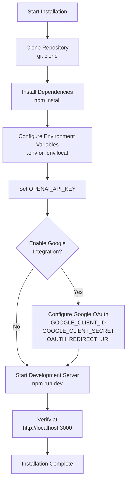

**Sources:** [README.md:23-61]()

---

### Step 1: Clone the Repository

```bash
git clone https://github.com/openai/openai-responses-starter-app.git
cd openai-responses-starter-app
```

This creates a local copy of the application in a new directory named `openai-responses-starter-app`.

**Sources:** [README.md:41-45]()

---

### Step 2: Install Dependencies

Execute the following command in the project root directory:

```bash
npm install
```

This installs all required packages defined in `package.json`, including:

| Package | Purpose |
|---------|---------|
| `next` (^15.2.3) | Next.js framework for React applications [package.json:26]() |
| `openai` (^4.87.3) | Official OpenAI API client library [package.json:27]() |
| `zustand` (^5.0.2) | State management for tool and conversation state [package.json:40]() |
| `react-markdown` (^9.0.1) | Markdown rendering for AI responses [package.json:33]() |
| `openid-client` (^6.6.4) | OAuth 2.0 client for Google integration [package.json:28]() |

**Sources:** [package.json:1-53](), [README.md:47-53]()

---

## Environment Configuration

The application requires environment variables for API authentication and optional integrations. Configuration can be provided via project-level `.env` or `.env.local` files at the project root.

### Environment Variables Mapping

This diagram maps environment variables to the backend routes and external services that consume them.

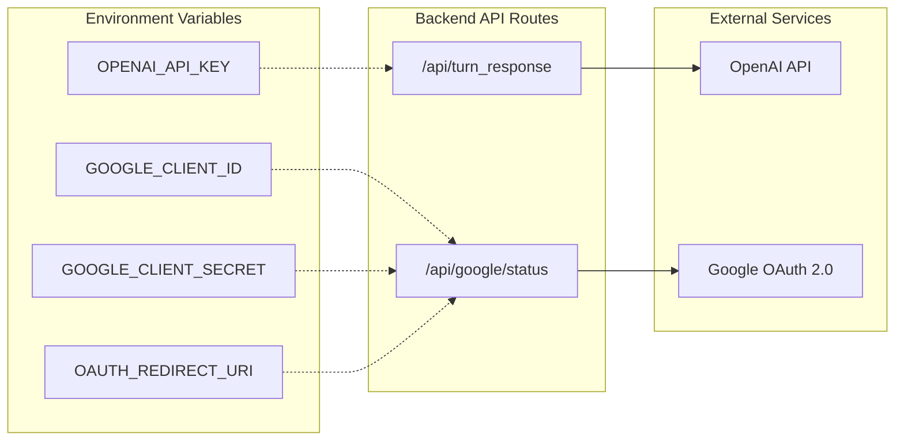

**Sources:** [.env.example:1-5](), [app/api/google/status/route.ts:10-14](), [README.md:30-40]()

---

### Required: OpenAI API Key

The `OPENAI_API_KEY` is required for all Responses API functionality.

#### Obtaining an OpenAI API Key

1. If you don't have an OpenAI account, [sign up](https://platform.openai.com/signup) [README.md:27]().
2. Follow the [OpenAI Quickstart guide](https://platform.openai.com/docs/quickstart) to retrieve your API key [README.md:28]().

#### Configuration Options

**Option 1: Project-level `.env` file**

Create a `.env` file at the project root:

```bash
OPENAI_API_KEY=sk-proj-your-actual-key-here
```

The `.env.example` file provides a template for this configuration [README.md:35-39]().

**Sources:** [README.md:25-39](), [.env.example:1]()

---

### Optional: Google OAuth Configuration

Google OAuth enables integration with Google Calendar and Gmail via OpenAI's first-party connectors [README.md:88-91]().

#### Google Cloud Console Setup

1. **Create OAuth 2.0 Client**: Go to Google Cloud Console → APIs & Services → Credentials. Create a **Web application** client [README.md:99]().
2. **Authorized Redirect URI**: Add `http://localhost:3000/api/google/callback` [README.md:100]().
3. **Enable APIs**: Enable "Google Calendar API" and "Gmail API" [README.md:103-106]().
4. **Configure Scopes**: Ensure your app requests `openid`, `email`, `profile`, `calendar.events`, and `gmail.modify` [README.md:108-115]().

#### Configuration in `.env.local`

Create a `.env.local` file at the project root:

```bash
GOOGLE_CLIENT_ID="your-client-id"
GOOGLE_CLIENT_SECRET="your-client-secret"
OAUTH_REDIRECT_URI="http://localhost:3000/api/google/callback"
```

The `GET` handler in `app/api/google/status/route.ts` checks for these variables to determine if the system is `oauthConfigured` [app/api/google/status/route.ts:10-18]().

**Sources:** [README.md:95-122](), [.env.example:2-4](), [app/api/google/status/route.ts:10-14]()

---

## Running the Development Server

Start the application using the following command:

```bash
npm run dev
```

This executes `next dev` as defined in `package.json:6` [package.json:6](). The application will be available at `http://localhost:3000` [README.md:61]().

### Visual Verification

The application layout consists of a chat interface and a tools configuration panel.

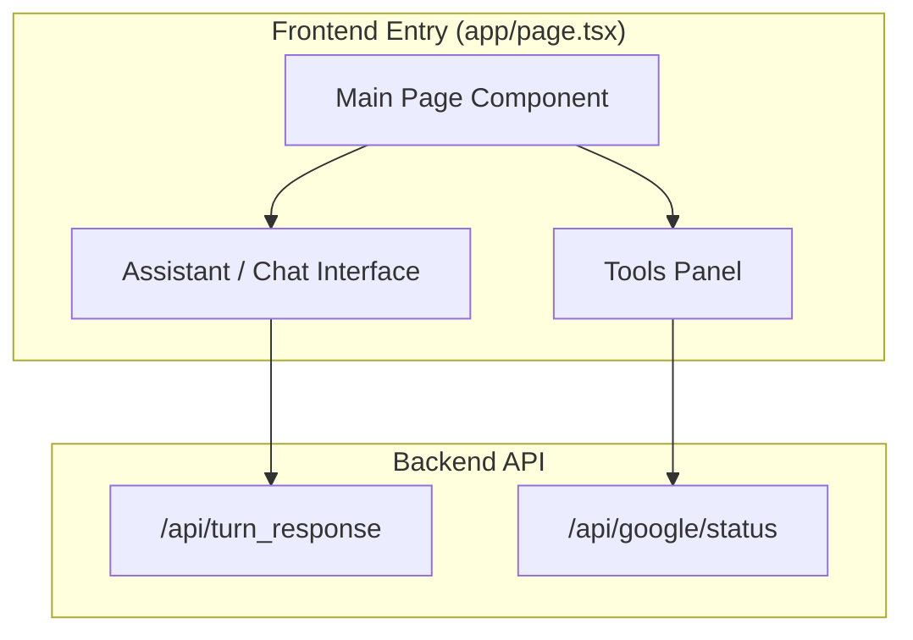

**Sources:** [README.md:55-61](), [package.json:6](), [app/api/google/status/route.ts:5-19]()

---

## Available npm Scripts

| Command | Script Definition | Purpose |
|---------|------------------|---------|
| `npm run dev` | `next dev` | Start development server [package.json:6]() |
| `npm run build` | `next build` | Build production application [package.json:7]() |
| `npm start` | `next start` | Start production server [package.json:8]() |
| `npm run lint` | `next lint` | Run ESLint checks [package.json:9]() |

**Sources:** [package.json:5-10]()

---

# Page: Architecture Overview

# Architecture Overview

<details>
<summary>Relevant source files</summary>

The following files were used as context for generating this wiki page:

- [README.md](README.md)
- [app/page.tsx](app/page.tsx)
- [components/assistant.tsx](components/assistant.tsx)
- [lib/assistant.ts](lib/assistant.ts)

</details>


## Purpose and Scope

This document provides a high-level overview of the system architecture for the OpenAI Responses Starter App, a Next.js-based conversational AI assistant. It covers the core architectural patterns, data flow, and key system interactions that enable streaming AI conversations with advanced tool integration capabilities.

For detailed information about individual components, see [Core Components](#4). For tool-specific architecture, see [Tool System](#5). For API endpoint implementation details, see [6. API Endpoints]().

## System Architecture Overview

The application implements a three-tier architecture with clear separation between the presentation layer (Next.js components), the state management layer (Zustand stores), and the backend API layer. The core orchestrator is `lib/assistant.ts`, which bridges frontend interactions with the OpenAI Responses API.

### Three-Tier Architecture Diagram

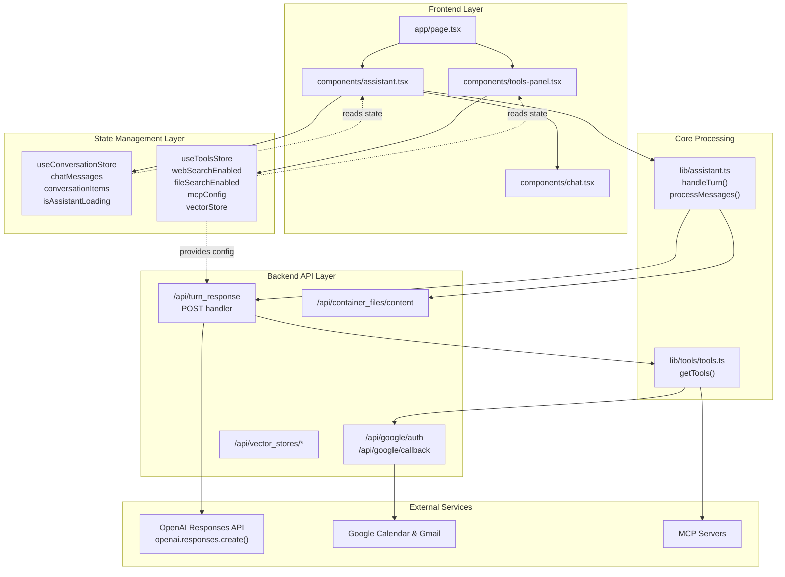

**Sources:** [lib/assistant.ts:74-136](), [lib/assistant.ts:138-159](), [app/api/turn_response/route.ts:5-63](), [stores/useConversationStore.ts:1-56](), [stores/useToolsStore.ts:1-122](), [lib/tools/tools.ts:10-97]()

## Conversation Flow and Message Processing

The core message processing flow follows an event-driven pattern where user messages trigger a streaming AI response. The system uses Server-Sent Events (SSE) for real-time updates and implements recursive processing for multi-turn tool interactions.

### Conversation Processing Sequence

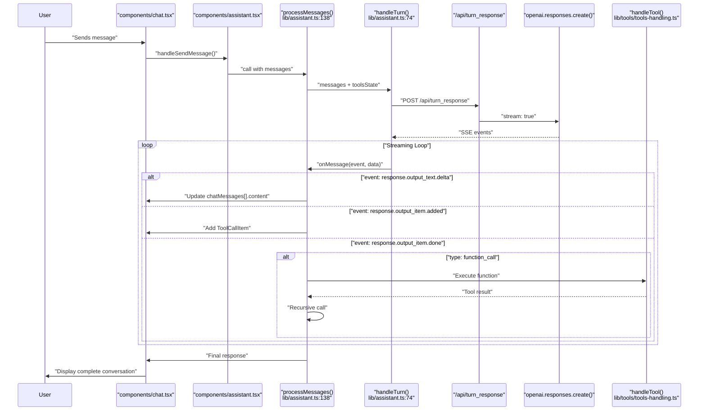

**Sources:** [lib/assistant.ts:138-159](), [lib/assistant.ts:74-136](), [components/assistant.tsx:11-32](), [lib/assistant.ts:328-346]()

### Event Processing Pipeline

The `processMessages()` function implements a comprehensive event handler that processes various event types from the OpenAI Responses API. Each event type triggers specific state mutations in the Zustand stores.

| Event Type | Code Reference | Purpose | State Update |
|------------|----------------|---------|--------------|
| `response.output_text.delta` | [lib/assistant.ts:161-206]() | Stream text deltas | Updates `chatMessages[].content[].text` |
| `response.output_item.added` | [lib/assistant.ts:208-310]() | New tool call initiated | Adds `ToolCallItem` to `chatMessages` |
| `response.output_item.done` | [lib/assistant.ts:312-357]() | Tool call completed | Executes `handleTool()` for functions |
| `response.function_call_arguments.delta` | [lib/assistant.ts:359-380]() | Stream function args | Updates `ToolCallItem.arguments` |
| `response.function_call_arguments.done` | [lib/assistant.ts:382-397]() | Final function args | Sets `ToolCallItem.status = 'completed'` |
| `response.web_search_call.completed` | [lib/assistant.ts:434-443]() | Web search finished | Sets `ToolCallItem.output` |
| `response.file_search_call.completed` | [lib/assistant.ts:445-454]() | File search finished | Sets `ToolCallItem.output` |
| `response.code_interpreter_call_code.delta` | [lib/assistant.ts:456-473]() | Stream code execution | Updates `ToolCallItem.code` |
| `response.completed` | [lib/assistant.ts:508-546]() | Turn completed | Adds MCP items to `chatMessages` |

**Sources:** [lib/assistant.ts:156-552]()

## Data Flow and State Management

The application maintains conversation state through two primary Zustand stores that serve different purposes. The `useConversationStore` maintains parallel message collections for UI rendering and API communication, while `useToolsStore` centralizes tool configuration with local storage persistence.

### Dual-Store Architecture

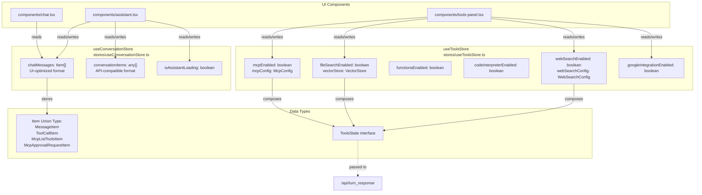

**Sources:** [stores/useConversationStore.ts:1-56](), [stores/useToolsStore.ts:1-122](), [lib/assistant.ts:14-72]()

### State Store Details

**`useConversationStore` (stores/useConversationStore.ts)**

Maintains two parallel message arrays that serve different purposes:

| State Variable | Type | Purpose |
|----------------|------|---------|
| `chatMessages` | `Item[]` | UI-optimized format with union types for rendering |
| `conversationItems` | `any[]` | API-compatible format matching OpenAI schema |
| `isAssistantLoading` | `boolean` | Loading state indicator for UI |

The dual-array architecture allows the UI to display rich content (tool calls, MCP approval requests, loading states) while maintaining a clean conversation history for API calls.

**`useToolsStore` (stores/useToolsStore.ts)**

Centralizes all tool configuration with Zustand persist middleware for local storage:

| Configuration | Type | Default |
|---------------|------|---------|
| `webSearchEnabled` | `boolean` | `false` |
| `webSearchConfig` | `WebSearchConfig` | Location settings |
| `fileSearchEnabled` | `boolean` | `false` |
| `vectorStore` | `VectorStore \| null` | From `defaultVectorStore` |
| `functionsEnabled` | `boolean` | `true` |
| `codeInterpreterEnabled` | `boolean` | `false` |
| `mcpEnabled` | `boolean` | `false` |
| `mcpConfig` | `McpConfig` | Server connection details |
| `googleIntegrationEnabled` | `boolean` | `false` |

**Sources:** [stores/useConversationStore.ts:6-54](), [stores/useToolsStore.ts:33-120](), [lib/assistant.ts:139-148]()

### Data Flow Pattern

1. **User Input** → `Assistant` component calls `processMessages()` from `lib/assistant.ts` [components/assistant.tsx:28]()
2. **State Retrieval** → `processMessages()` reads both stores via `getState()` [lib/assistant.ts:139-148]()
3. **API Request** → `handleTurn()` sends `conversationItems` + `ToolsState` to `/api/turn_response` [lib/assistant.ts:82-90]()
4. **Streaming Response** → SSE events parsed in `handleTurn()` [lib/assistant.ts:98-136]()
5. **State Updates** → Event handlers update `chatMessages` via `setChatMessages()` [lib/assistant.ts:203]()
6. **Conversation Items** → Tool outputs appended to `conversationItems` via `setConversationItems()` [lib/assistant.ts:352]()
7. **Recursive Processing** → Function tool completion triggers recursive `processMessages()` call [lib/assistant.ts:345]()
8. **UI Rendering** → React components re-render based on Zustand state changes.

**Sources:** [lib/assistant.ts:138-552](), [lib/assistant.ts:74-136](), [components/assistant.tsx:11-32]()

## Key Architectural Patterns

### Event-Driven Processing
The core `processMessages()` function implements an event-driven architecture that processes streaming AI responses. Each event type triggers specific state updates and potential tool executions.

```typescript
// Main event processing switch in processMessages()
switch (event) {
  case "response.output_text.delta": // Text streaming
  case "response.output_item.added": // Tool calls initiated  
  case "response.output_item.done": // Tool execution trigger
  case "response.function_call_arguments.delta": // Argument streaming
  // ... other event types
}
```

**Sources:** [lib/assistant.ts:157-543]()

### Tool Integration Architecture
The system supports multiple tool types through a unified interface:

| Tool Type | Processing Pattern | Status Tracking |
|-----------|-------------------|-----------------|
| `function_call` | Local JavaScript execution via `handleTool()` | `in_progress` → `completed` |
| `web_search_call` | Built-in OpenAI tool | Status updates via events |
| `file_search_call` | Vector store queries | Status updates via events |
| `code_interpreter_call` | Python code execution | Code streaming + file output |
| `mcp_call` | External MCP server tools | Argument streaming + approval flow |

**Sources:** [lib/assistant.ts:243-305](), [lib/assistant.ts:324-343]()

### Streaming Response Handling

The `handleTurn()` function implements Server-Sent Events (SSE) processing for real-time AI response streaming. It reads the response body as a stream, processes SSE-formatted data, and invokes a callback for each parsed event.

**SSE Processing Implementation** ([lib/assistant.ts:98-136]()):

1. **Stream Reader Setup** - Creates a `ReadableStream` reader and `TextDecoder` at [lib/assistant.ts:98-100]()
2. **Buffer Management** - Accumulates chunks and splits on `\n\n` delimiters at [lib/assistant.ts:106-110]()
3. **Event Parsing** - Extracts lines starting with `data: ` and parses JSON at [lib/assistant.ts:112-122]()
4. **Callback Invocation** - Calls `onMessage({ event, data })` for each parsed event at [lib/assistant.ts:120]()
5. **Stream Termination** - Handles `[DONE]` marker and remaining buffer at [lib/assistant.ts:115-132]()

**Sources:** [lib/assistant.ts:74-136]()

## Integration Points

### OpenAI Responses API
The primary AI processing occurs through the OpenAI Responses API, typically targeting `gpt-4.1` or similar models. The API request includes the conversation history and the active tool configurations derived from `useToolsStore`.

**Sources:** [lib/assistant.ts:82-90](), [README.md:7-8]()

### Google Services Integration
Google Calendar and Gmail integration is handled through:
- OAuth flow for token management.
- Google Connectors that wrap API calls.
- MCP-style tool definitions for AI interaction.
- Fresh token retrieval with automatic refresh.

**Sources:** [lib/assistant.ts:80-89](), [README.md:87-94]()

### MCP (Model Context Protocol) Integration
The system supports external MCP servers for extended tool capabilities:
- Dynamic tool discovery and listing.
- User approval workflow for tool execution.
- Streaming argument processing.
- Tool result display and conversation integration.

**Sources:** [lib/assistant.ts:278-292](), [lib/assistant.ts:522-536](), [README.md:79-82]()

---

# Page: Core Components

# Core Components

<details>
<summary>Relevant source files</summary>

The following files were used as context for generating this wiki page:

- [components/assistant.tsx](components/assistant.tsx)
- [components/chat.tsx](components/chat.tsx)
- [components/loading-message.tsx](components/loading-message.tsx)
- [components/message.tsx](components/message.tsx)
- [stores/useConversationStore.ts](stores/useConversationStore.ts)

</details>


The core components comprise the essential UI and logic modules that power the conversation interface. These components orchestrate the flow from user input through AI processing to rendered output, coordinating between the frontend, state management layer, and backend APIs.

This page provides an overview of the core component architecture. For detailed information on specific components, see:
- [Assistant Processing Logic](#4.1) - Deep dive into `lib/assistant.ts`
- [Chat Interface](#4.2) - Details on the `Chat` component
- [State Management](#4.3) - Zustand store documentation

Related systems documented elsewhere:
- [Tool System](#5) - Tool configuration, execution, and visualization
- [API Endpoints](#6) - Backend route handlers

## Component Architecture Overview

The core system consists of three primary layers:

| Layer | Primary Components | Responsibility |
|-------|-------------------|----------------|
| **UI Layer** | `components/assistant.tsx`<br/>`components/chat.tsx`<br/>`components/message.tsx`<br/>`components/tool-call.tsx` | User interaction, message rendering, visual presentation |
| **Processing Layer** | `lib/assistant.ts` | Message processing, API communication, event handling |
| **State Layer** | `stores/useConversationStore.ts`<br/>`stores/useToolsStore.ts` | Global state management, data persistence |

**Title:** Core Component Architecture and Data Flow

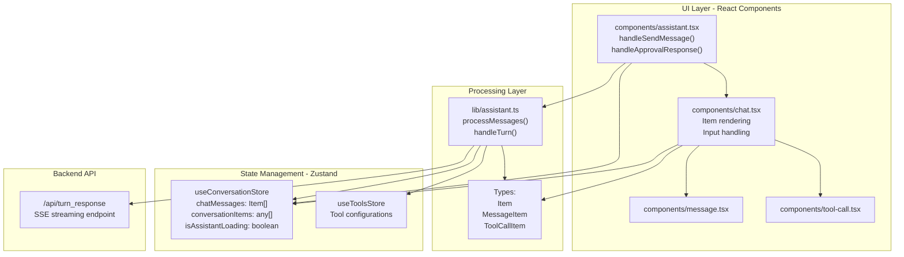

**Sources:** [components/assistant.tsx:1-60](), [components/chat.tsx:1-138](), [lib/assistant.ts:1-100]()

## Assistant Component

The `Assistant` component serves as the primary orchestrator between user interactions and the AI processing pipeline. Located at [components/assistant.tsx](), it provides the top-level conversation management logic.

### Core Responsibilities

| Function | Purpose | Key Operations |
|----------|---------|----------------|
| `handleSendMessage()` | Process user input | Creates `Item` and message objects, adds to stores, calls `processMessages()` |
| `handleApprovalResponse()` | Handle MCP approval requests | Creates approval response item, adds to conversation, triggers processing |

**Title:** Assistant Component Integration Pattern

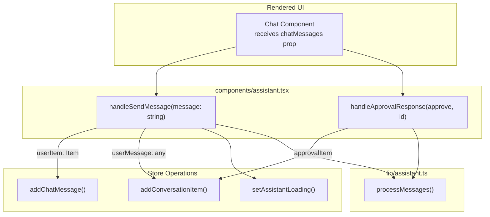

**Sources:** [components/assistant.tsx:11-49](), [components/assistant.tsx:53-57]()

### Data Structure Conversion

The component maintains two parallel data representations:

| Store Array | Type | Purpose |
|-------------|------|---------|
| `chatMessages` | `Item[]` | UI-optimized format for rendering |
| `conversationItems` | `any[]` | API-compatible format for OpenAI requests |

The `handleSendMessage()` function creates both representations simultaneously. The `userItem` follows the `Item` type structure for UI display, while `userMessage` follows the OpenAI API message format.

**Sources:** [components/assistant.tsx:14-22](), [stores/useConversationStore.ts:8-10]()

## Processing Layer: lib/assistant.ts

The `lib/assistant.ts` module contains the core message processing logic. This module is documented in detail in [Assistant Processing Logic](#4.1). Key functions include:

| Function | Responsibility |
|----------|---------------|
| `handleTurn()` | Manages SSE communication with `/api/turn_response` |
| `processMessages()` | Dispatches streaming events, updates state, handles tool execution |

The processing layer implements a recursive pattern: when tools are executed, `processMessages()` calls itself with the updated conversation history, enabling multi-turn tool use.

**Sources:** [components/assistant.tsx:28](), [components/assistant.tsx:45]()

## Chat Component

The `Chat` component at [components/chat.tsx]() is the primary UI orchestrator, responsible for rendering conversation items and capturing user input. It receives data via props and delegates rendering to specialized child components.

### Props Interface

```typescript
interface ChatProps {
  items: Item[];
  onSendMessage: (message: string) => void;
  onApprovalResponse: (approve: boolean, id: string) => void;
}
```

**Sources:** [components/chat.tsx:13-17]()

### Component Rendering Hierarchy

**Title:** Chat Component Child Component Dispatch System

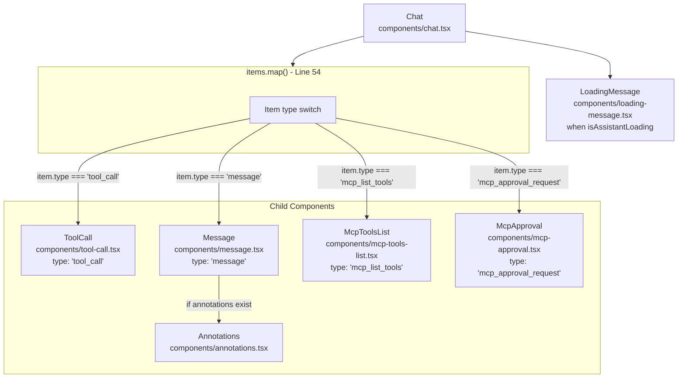

**Sources:** [components/chat.tsx:54-78](), [components/chat.tsx:79]()

### Item Type Dispatch Table

The rendering logic uses a switch-like structure within the `map` function to select the appropriate component:

| `item.type` Value | Rendered Component | Data Structure | Lines |
|-------------------|-------------------|----------------|-------|
| `"tool_call"` | `<ToolCall toolCall={item} />` | `ToolCallItem` | [components/chat.tsx:56-57]() |
| `"message"` | `<Message message={item} />` | `MessageItem` | [components/chat.tsx:58-60]() |
| `"mcp_list_tools"` | `<McpToolsList item={item} />` | `McpListToolsItem` | [components/chat.tsx:69-70]() |
| `"mcp_approval_request"` | `<McpApproval item={item} onRespond={...} />` | `McpApprovalRequestItem` | [components/chat.tsx:71-75]() |

**Sources:** [components/chat.tsx:56-76]()

### Input System

The chat input implements a controlled textarea with keyboard shortcut handling and IME (Input Method Editor) support for non-Latin scripts.

**Title:** Input System State and Event Flow

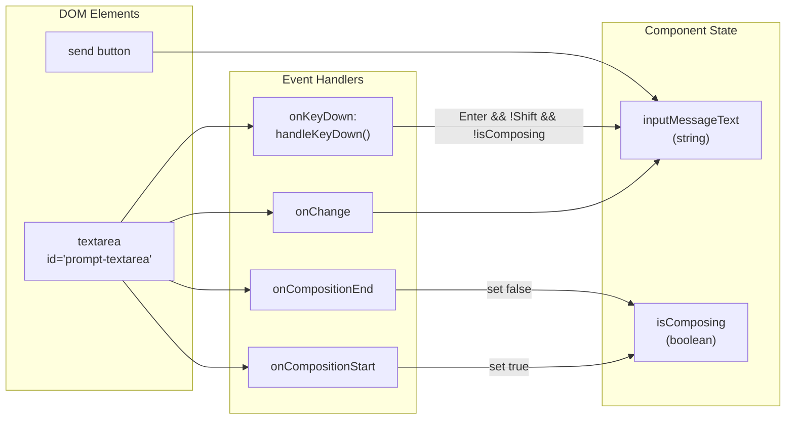

**Sources:** [components/chat.tsx:25-43](), [components/chat.tsx:89-111]()

#### IME Support

The `isComposing` state prevents premature message submission when users are composing characters using IME (e.g., Japanese, Chinese, Korean input methods):

- `onCompositionStart`: Sets `isComposing = true` [components/chat.tsx:99]()
- `onCompositionEnd`: Sets `isComposing = false` [components/chat.tsx:100]()
- `handleKeyDown`: Only submits on Enter if `!isComposing` [components/chat.tsx:36]()

## State Management Overview

The application uses Zustand for state management, primarily via the `useConversationStore`.

| Store | Module | Key State Fields |
|-------|--------|------------------|
| Conversation Store | `stores/useConversationStore.ts` | `chatMessages`, `conversationItems`, `isAssistantLoading` |

### Conversation Store Integration

The `useConversationStore` is accessed throughout the core components:

**Title:** Conversation Store Usage Across Components

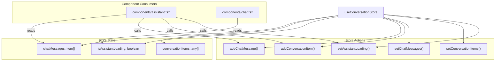

**Sources:** [stores/useConversationStore.ts:23-54](), [components/assistant.tsx:8-9](), [components/chat.tsx:28]()

### Dual Message Representation

The system maintains two parallel arrays:

| Array | Type | Used By | Purpose |
|-------|------|---------|---------|
| `chatMessages` | `Item[]` | UI components | Optimized for rendering (includes tool calls, MCP items) |
| `conversationItems` | `any[]` | API calls | OpenAI API-compatible message format |

**Sources:** [stores/useConversationStore.ts:8-10](), [components/assistant.tsx:14-22]()

## Message Rendering Components

### Message Component

The `Message` component at [components/message.tsx]() renders standard text messages using `react-markdown`. It handles both user and assistant roles, applying different styling and layout for each. It also handles rendering of image attachments found in annotations.

**Sources:** [components/message.tsx:9-57]()

### LoadingMessage Component

The `LoadingMessage` component at [components/loading-message.tsx]() is displayed when the assistant is processing a request, providing a pulsing animation as visual feedback.

**Sources:** [components/loading-message.tsx:3-17]()

---

# Page: Assistant Processing Logic

# Assistant Processing Logic

<details>
<summary>Relevant source files</summary>

The following files were used as context for generating this wiki page:

- [lib/assistant.ts](lib/assistant.ts)

</details>


## Purpose and Scope

This document provides a detailed explanation of the conversation processing logic implemented in `lib/assistant.ts`, the core orchestration module for the application. This module handles:

- Making API requests to the OpenAI Responses API via the `/api/turn_response` endpoint [lib/assistant.ts:82-90]()
- Processing Server-Sent Events (SSE) streaming responses [lib/assistant.ts:97-132]()
- Managing conversation state through Zustand stores [lib/assistant.ts:139-147]()
- Executing custom function tools and handling tool outputs [lib/assistant.ts:322-346]()
- Supporting recursive multi-turn conversations when tools are invoked [lib/assistant.ts:345]()

For information about the API endpoint that this module communicates with, see [Turn Response API (6.1)](). For details on the UI components that trigger this logic, see [Chat Interface (4.2)](). For tool execution specifics, see [Tool Execution and Aggregation (5.2)]().

**Sources:** [lib/assistant.ts:1-553]()

---

## Core Functions Overview

The module exports two primary functions that work together to orchestrate conversation processing:

| Function | Purpose | Key Responsibilities |
|----------|---------|---------------------|
| `handleTurn` | API communication | Sends messages to `/api/turn_response`, streams SSE responses, parses events [lib/assistant.ts:74-136]() |
| `processMessages` | Conversation orchestration | Retrieves state, calls `handleTurn`, processes events, triggers recursive turns [lib/assistant.ts:138-552]() |

**Sources:** [lib/assistant.ts:74-136](), [lib/assistant.ts:138-552]()

---

## The handleTurn Function

### Function Signature and Purpose

```typescript
export const handleTurn = async (
  messages: any[],
  toolsState: ToolsState,
  onMessage: (data: any) => void
)
```

The `handleTurn` function is responsible for making HTTP requests to the backend API and streaming the response back to the caller via a callback function.

**Sources:** [lib/assistant.ts:74-77]()

### Request Flow

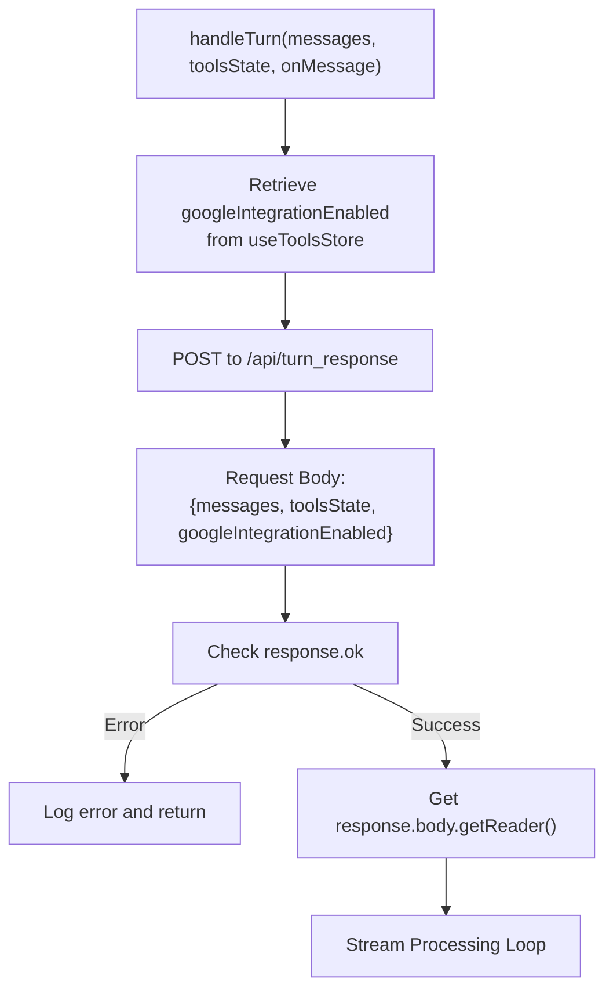

The function constructs a POST request with three key pieces of data:
- `messages`: The conversation history in OpenAI API format [lib/assistant.ts:86]()
- `toolsState`: Tool configuration from `useToolsStore` [lib/assistant.ts:87]()
- `googleIntegrationEnabled`: Boolean flag for Google services [lib/assistant.ts:88]()

**Sources:** [lib/assistant.ts:80-95]()

### Streaming Protocol Implementation

The function implements a Server-Sent Events (SSE) parser to handle the streaming response:

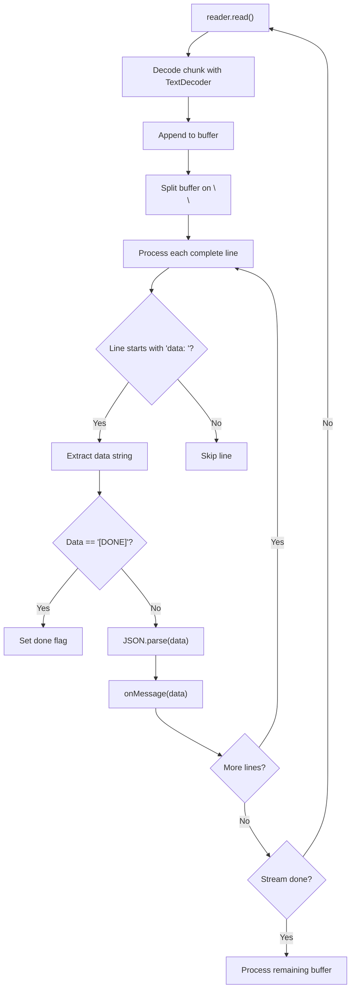

The streaming loop uses a buffer-based approach to handle partial chunks:

1. Reads raw bytes from the response stream [lib/assistant.ts:104]()
2. Decodes bytes to UTF-8 strings [lib/assistant.ts:106]()
3. Accumulates strings in a buffer [lib/assistant.ts:107]()
4. Splits on `\n\n` delimiters to extract complete SSE messages [lib/assistant.ts:109]()
5. Parses each message and invokes the `onMessage` callback [lib/assistant.ts:119-120]()

**Sources:** [lib/assistant.ts:98-136]()

---

## The processMessages Function

### Orchestration Overview

The `processMessages` function serves as the main entry point for conversation processing. It retrieves state from Zustand stores, invokes `handleTurn`, and processes streaming events through an extensive switch statement.

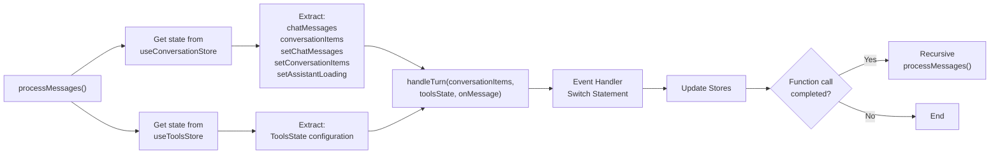

**Sources:** [lib/assistant.ts:138-552]()

### State Management Pattern

The function maintains two parallel message collections:

| Collection | Purpose | Format | Store Method |
|------------|---------|--------|--------------|
| `chatMessages` | UI rendering | `Item[]` with rich types (ToolCallItem, McpListToolsItem, etc.) | `setChatMessages()` [lib/assistant.ts:142]() |
| `conversationItems` | API requests | OpenAI API format | `setConversationItems()` [lib/assistant.ts:143]() |

This dual-collection pattern allows the UI to display specialized components (like tool call visualizations) while maintaining a clean API-compatible history.

**Sources:** [lib/assistant.ts:139-149]()

---

## Data Structures

### Item Type Hierarchy

The module defines a union type `Item` that encompasses all displayable chat elements:

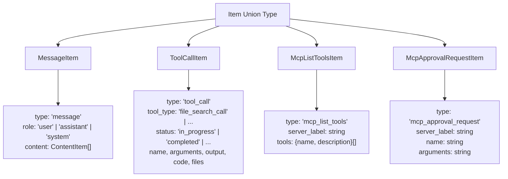

**Sources:** [lib/assistant.ts:21-72]()

### Content Item Structure

Messages contain an array of `ContentItem` objects that represent different content types:

| Type | Usage | Fields |
|------|-------|--------|
| `input_text` | User input | `text`, optional `annotations` [lib/assistant.ts:15-18]() |
| `output_text` | Assistant response | `text`, optional `annotations` [lib/assistant.ts:15-18]() |
| `refusal` | Model refusal | `text` [lib/assistant.ts:15-18]() |
| `output_audio` | Audio response | (audio-specific fields) [lib/assistant.ts:15-18]() |

**Sources:** [lib/assistant.ts:14-18]()

---

## Streaming Event Processing

### Event Handler Architecture

The `processMessages` function's event handler uses a switch statement to dispatch 15+ different event types:

```mermaid
graph TD
    Start["onMessage({event, data})"] --> Switch{"event type"}
    
    Switch --> E1["response.output_text.delta"]
    Switch --> E2["response.output_item.added"]
    Switch --> E3["response.output_item.done"]
    Switch --> E4["response.function_call_arguments.delta"]
    Switch --> E5["response.function_call_arguments.done"]
    Switch --> E6["response.mcp_call_arguments.delta"]
    Switch --> E7["response.mcp_call_arguments.done"]
    Switch --> E8["response.web_search_call.completed"]
    Switch --> E9["response.file_search_call.completed"]
    Switch --> E10["response.code_interpreter_call_code.delta"]
    Switch --> E11["response.code_interpreter_call_code.done"]
    Switch --> E12["response.code_interpreter_call.completed"]
    Switch --> E13["response.completed"]
    
    E1 --> Update1["Accumulate text delta<br/>Update/create assistant message<br/>setChatMessages()"]
    E2 --> Update2["Create new item based on type<br/>Add to chatMessages"]
    E3 --> Update3["Add call_id to tool call<br/>Add to conversationItems<br/>Execute function if needed"]
```

**Sources:** [lib/assistant.ts:156-551]()

### Text Streaming Events

#### response.output_text.delta

Handles incremental text updates as the assistant generates a response:

1. Accumulates delta strings into `assistantMessageContent` [lib/assistant.ts:169]()
2. Checks if the last chat message is an assistant message with matching `item_id` [lib/assistant.ts:172-178]()
3. If not, creates a new `MessageItem` with role "assistant" [lib/assistant.ts:179-189]()
4. If yes, updates the existing message's text content [lib/assistant.ts:193]()
5. Calls `setChatMessages()` to trigger UI update [lib/assistant.ts:203]()
6. Sets `isAssistantLoading` to false [lib/assistant.ts:204]()

**Sources:** [lib/assistant.ts:161-206]()

#### response.output_text.annotation.added

Extends text delta handling to include annotations (e.g., file references):

- Uses `normalizeAnnotation()` to ensure consistent field naming [lib/assistant.ts:197]()
- Appends annotations to the content item's `annotations` array [lib/assistant.ts:195-198]()

**Sources:** [lib/assistant.ts:161-206](), [lib/assistant.ts:8-12]()

### Tool Call Lifecycle Events

#### response.output_item.added

Creates initial `ToolCallItem` entries when the API announces a new tool call:

| Tool Type | Initial Status | Fields Set |
|-----------|---------------|------------|
| `function_call` | `in_progress` | `id`, `name`, `arguments` (empty) [lib/assistant.ts:249-258]() |
| `web_search_call` | `in_progress` | `id` [lib/assistant.ts:262-267]() |
| `file_search_call` | `in_progress` | `id` [lib/assistant.ts:271-276]() |
| `mcp_call` | `in_progress` | `id`, `name`, `arguments` (may be empty) [lib/assistant.ts:280-289]() |
| `code_interpreter_call` | `in_progress` | `id`, `code` (empty), `files` (empty array) [lib/assistant.ts:293-303]() |

**Sources:** [lib/assistant.ts:208-310]()

#### response.output_item.done

Finalizes tool call items by adding the `call_id` field and pushing to `conversationItems`. For `function_call` types, this triggers tool execution:

```mermaid
sequenceDiagram
    participant Event as "response.output_item.done"
    participant Handler as "Event Handler"
    participant ToolCall as "handleTool()"
    participant Store as "Conversation Store"
    participant Recursive as "processMessages()"
    
    Event->>Handler: "Receive event with item"
    Handler->>Handler: "Find matching toolCallMessage"
    Handler->>Handler: "Set call_id from item"
    Handler->>Store: "Push item to conversationItems"
    
    alt tool_type == 'function_call'
        Handler->>ToolCall: "handleTool(name, args)"
        ToolCall-->>Handler: "toolResult"
        Handler->>Store: "Update toolCallMessage.output"
        Handler->>Store: "Push function_call_output to conversationItems"
        Handler->>Recursive: "await processMessages()"
    end
    
    alt tool_type == 'mcp_call'
        Handler->>Store: "Update output and status from item"
    end
```

**Sources:** [lib/assistant.ts:312-357]()

#### response.function_call_arguments.delta

Streams function arguments incrementally for real-time display:

1. Accumulates delta into `functionArguments` string [lib/assistant.ts:362]()
2. Attempts to parse partial JSON using `parse()` from `partial-json` [lib/assistant.ts:370]()
3. Updates `ToolCallItem.arguments` and `parsedArguments` [lib/assistant.ts:371-372]()
4. Gracefully handles parse failures for incomplete JSON [lib/assistant.ts:373-376]()

**Sources:** [lib/assistant.ts:359-380]()

#### response.function_call_arguments.done

Receives complete arguments and finalizes parsing:

1. Replaces accumulated arguments with final `arguments` from data [lib/assistant.ts:386]()
2. Parses final JSON (guaranteed to be valid) [lib/assistant.ts:387]()
3. Sets `status` to "completed" [lib/assistant.ts:392]()

**Sources:** [lib/assistant.ts:382-397]()

### MCP Tool Events

MCP (Model Context Protocol) tools use parallel event types:

- `response.mcp_call_arguments.delta`: Streams MCP tool arguments, similar to function arguments [lib/assistant.ts:401-419]()
- `response.mcp_call_arguments.done`: Finalizes MCP arguments [lib/assistant.ts:421-432]()

These events follow the same accumulation and partial parsing pattern, but store values in `mcpArguments` instead of `functionArguments`.

**Sources:** [lib/assistant.ts:399-432]()

### Built-in Tool Completion Events

Built-in tools (web search, file search, code interpreter) emit completion events:

| Event | Updates |
|-------|---------|
| `response.web_search_call.completed` | Sets `output` and `status: "completed"` [lib/assistant.ts:434-446]() |
| `response.file_search_call.completed` | Sets `output` and `status: "completed"` [lib/assistant.ts:448-460]() |
| `response.code_interpreter_call_code.delta` | Accumulates code deltas [lib/assistant.ts:462-474]() |
| `response.code_interpreter_call_code.done` | Sets final code and marks completed [lib/assistant.ts:476-488]() |
| `response.code_interpreter_call.completed` | Marks overall call as completed [lib/assistant.ts:490-506]() |

**Sources:** [lib/assistant.ts:434-506]()

### Response Completion Event

#### response.completed

The final event in the stream, used to handle special output types:

1. **MCP Tools List**: Extracts all `mcp_list_tools` items from `response.output` and adds them to `chatMessages` for UI display [lib/assistant.ts:512-526]()
2. **MCP Approval Request**: Extracts `mcp_approval_request` items and adds them to `chatMessages` to prompt user approval [lib/assistant.ts:528-542]()

**Sources:** [lib/assistant.ts:508-546]()

---

## Recursive Tool Execution Pattern

### Function Call Workflow

The system implements a recursive pattern for custom function tools:

```mermaid
sequenceDiagram
    participant User
    participant processMessages
    participant API as "/api/turn_response"
    participant handleTool as "handleTool (lib/tools/tools-handling.ts)"
    participant functionsMap as "functionsMap (config/functions.ts)"
    
    User->>processMessages: "Initial message sent"
    processMessages->>API: "POST messages + tools"
    API-->>processMessages: "Stream: function_call item"
    processMessages->>processMessages: "Create ToolCallItem<br/>(status: in_progress)"
    API-->>processMessages: "Stream: arguments.delta events"
    processMessages->>processMessages: "Update arguments (partial JSON)"
    API-->>processMessages: "Stream: arguments.done"
    processMessages->>processMessages: "Finalize arguments<br/>(status: completed)"
    API-->>processMessages: "Stream: output_item.done"
    
    processMessages->>handleTool: "handleTool(name, parsedArguments)"
    handleTool->>functionsMap: "functionsMap[name].function(...)"
    functionsMap-->>handleTool: "result"
    handleTool-->>processMessages: "result"
    
    processMessages->>processMessages: "Update ToolCallItem.output"
    processMessages->>processMessages: "Push function_call_output<br/>to conversationItems"
    processMessages->>processMessages: "await processMessages()"
    
    Note over processMessages: Recursive call with tool result
    
    processMessages->>API: "POST updated conversation"
    API-->>processMessages: "Stream: assistant response<br/>using tool result"
```

### Key Implementation Details

The recursive execution occurs in the `response.output_item.done` event handler:

1. **Completion Detection**: When `tool_type === "function_call"`, the handler recognizes a custom function needs execution [lib/assistant.ts:322]()
2. **Function Invocation**: Calls `handleTool(name, parsedArguments)` which looks up the function in `functionsMap` [lib/assistant.ts:324]()
3. **Output Recording**: Stores the tool result as JSON in both `ToolCallItem.output` and creates a `function_call_output` item in `conversationItems` [lib/assistant.ts:327-344]()
4. **Recursive Call**: Invokes `await processMessages()` again with the updated conversation that now includes the tool output [lib/assistant.ts:345]()
5. **Model Continuation**: The OpenAI API receives the tool result and generates a natural language response incorporating the data.

**Sources:** [lib/assistant.ts:322-346]()

---

## Integration with State Management

### Zustand Store Dependencies

The module imports and directly accesses two Zustand stores:

```mermaid
graph LR
    assistant["lib/assistant.ts"] --> convStore["useConversationStore (stores/useConversationStore.ts)"]
    assistant --> toolsStore["useToolsStore (stores/useToolsStore.ts)"]
    
    convStore --> convMethods["chatMessages<br/>conversationItems<br/>setChatMessages()<br/>setConversationItems()<br/>setAssistantLoading()"]
    
    toolsStore --> toolsMethods["ToolsState configuration<br/>googleIntegrationEnabled"]
    
    assistant --> getState["Uses .getState()<br/>to access stores<br/>outside React context"]
```

**Sources:** [lib/assistant.ts:3-4](), [lib/assistant.ts:139-147]()

### Direct State Access Pattern

Since `processMessages` is called from event handlers (not React components), it uses `useConversationStore.getState()` and `useToolsStore.getState()` to access store state synchronously:

```typescript
const {
  chatMessages,
  conversationItems,
  setChatMessages,
  setConversationItems,
  setAssistantLoading,
} = useConversationStore.getState();

const toolsState = useToolsStore.getState() as ToolsState;
```

This pattern allows the processing logic to work outside the React component tree while still maintaining reactive state updates.

**Sources:** [lib/assistant.ts:139-147]()

---

## Error Handling

The module implements basic error handling:

| Location | Error Handling |
|----------|----------------|
| `handleTurn` | Checks `response.ok`, logs errors, returns early [lib/assistant.ts:92-94]() |
| `processMessages` | Wraps entire flow in try-catch, logs errors [lib/assistant.ts:134-135]() |
| JSON Parsing | Try-catch around `parse()` for partial JSON, ignores failures [lib/assistant.ts:369-376]() |

Notable gaps:
- No user-facing error messages
- Network failures halt processing silently
- Partial state updates may occur before errors

**Sources:** [lib/assistant.ts:92-94](), [lib/assistant.ts:134-135](), [lib/assistant.ts:369-376]()

---

## Summary

The assistant processing logic serves as the critical bridge between the UI and the OpenAI Responses API:

- **`handleTurn`** manages HTTP communication and SSE streaming [lib/assistant.ts:74-136]()
- **`processMessages`** orchestrates conversation flow and event processing [lib/assistant.ts:138-552]()
- The recursive execution pattern enables multi-turn tool use scenarios [lib/assistant.ts:345]()
- Dual message collections (`chatMessages` vs `conversationItems`) separate UI concerns from API requirements [lib/assistant.ts:140-141]()
- Comprehensive event handling supports 15+ streaming event types across multiple tool types [lib/assistant.ts:160-547]()

This architecture enables real-time streaming responses, seamless tool integration, and a responsive user experience throughout complex multi-turn conversations.

**Sources:** [lib/assistant.ts:1-553]()

---

# Page: Chat Interface

# Chat Interface

<details>
<summary>Relevant source files</summary>

The following files were used as context for generating this wiki page:

- [components/annotations.tsx](components/annotations.tsx)
- [components/chat.tsx](components/chat.tsx)
- [components/message.tsx](components/message.tsx)

</details>


## Purpose and Scope

This document describes the chat interface components responsible for rendering the conversation UI, handling user input, and dispatching different item types to specialized renderers. The `Chat` component serves as the primary visual interface where users interact with the assistant through text messages, observe tool executions, and approve MCP operations.

For the underlying message processing logic that drives this interface, see [Assistant Processing Logic](#4.1). For tool call visualization details, see [Tool Call Visualization](#5.3). For state management, see [State Management](#4.3).

---

## Component Architecture

The chat interface is built as a hierarchical component structure with `Chat` as the orchestrator that dispatches items to specialized renderers.

### Component Hierarchy

```mermaid
graph TB
    Chat["Chat Component<br/>components/chat.tsx"]
    
    Chat --> ItemLoop["Item Dispatch Loop"]
    Chat --> Input["User Input Area"]
    Chat --> ScrollRef["Auto-scroll Reference"]
    
    ItemLoop --> Message["Message Component<br/>components/message.tsx"]
    ItemLoop --> ToolCall["ToolCall Component<br/>components/tool-call.tsx"]
    ItemLoop --> McpList["McpToolsList Component<br/>components/mcp-tools-list.tsx"]
    ItemLoop --> McpApproval["McpApproval Component<br/>components/mcp-approval.tsx"]
    ItemLoop --> Loading["LoadingMessage Component<br/>components/loading-message.tsx"]
    
    Message --> ReactMarkdown["ReactMarkdown<br/>Text rendering"]
    Message --> ImageDisplay["Image Display<br/>from annotations"]
    Message --> Annotations["Annotations Component<br/>components/annotations.tsx"]
    
    Chat --> Store["useConversationStore<br/>stores/useConversationStore.ts"]
    
    Store --> ChatMessages["chatMessages: Item[]"]
    Store --> IsLoading["isAssistantLoading: boolean"]
```

**Sources**: [components/chat.tsx:1-138](), [components/message.tsx:1-60](), [components/annotations.tsx:1-81]()

---

## Chat Component Interface

The `Chat` component accepts three props that define its behavior:

| Prop | Type | Purpose |
|------|------|---------|
| `items` | `Item[]` | Array of conversation items to display |
| `onSendMessage` | `(message: string) => void` | Callback invoked when user sends a message |
| `onApprovalResponse` | `(approve: boolean, id: string) => void` | Callback for MCP approval decisions |

The component maintains two pieces of local state:
- `inputMessageText`: Current text in the input textarea [components/chat.tsx:25]().
- `isComposing`: Tracks IME composition state for non-English input [components/chat.tsx:27]().

**Sources**: [components/chat.tsx:13-28]()

---

## Item Dispatch System

The Chat component implements a type-based dispatch pattern to render different item types with specialized components.

### Item Type Routing

```mermaid
graph LR
    ItemArray["items: Item[]"]
    
    ItemArray --> TypeCheck{"item.type"}
    
    TypeCheck -->|"message"| MessageComp["Message Component"]
    TypeCheck -->|"tool_call"| ToolCallComp["ToolCall Component"]
    TypeCheck -->|"mcp_list_tools"| McpListComp["McpToolsList Component"]
    TypeCheck -->|"mcp_approval_request"| McpApprovalComp["McpApproval Component"]
    
    MessageComp --> AnnotationCheck{"Has annotations?"}
    AnnotationCheck -->|Yes| AnnotationsComp["Annotations Component"]
    AnnotationCheck -->|No| Render["Render message only"]
```

The dispatch logic is implemented in the main render loop at [components/chat.tsx:54-78]():

```tsx
{items.map((item, index) => (
  <React.Fragment key={index}>
    {item.type === "tool_call" ? (
      <ToolCall toolCall={item} />
    ) : item.type === "message" ? (
      <div className="flex flex-col gap-1">
        <Message message={item} />
        {item.content &&
          item.content[0].annotations &&
          item.content[0].annotations.length > 0 && (
            <Annotations
              annotations={item.content[0].annotations}
            />
          )}
      </div>
    ) : item.type === "mcp_list_tools" ? (
      <McpToolsList item={item} />
    ) : item.type === "mcp_approval_request" ? (
      <McpApproval
        item={item as McpApprovalRequestItem}
        onRespond={onApprovalResponse}
      />
    ) : null}
  </React.Fragment>
))}
```

**Sources**: [components/chat.tsx:54-78]()

---

## Message Rendering

The `Message` component handles rendering of `MessageItem` objects, which represent both user and assistant text messages.

### Message Component Architecture

```mermaid
graph TB
    MessageItem["MessageItem<br/>from lib/assistant.ts"]
    
    MessageItem --> RoleCheck{"message.role"}
    
    RoleCheck -->|"user"| UserStyle["User Message Styling<br/>Right-aligned<br/>Gray background<br/>#ededed"]
    RoleCheck -->|"assistant"| AssistantStyle["Assistant Message Styling<br/>Left-aligned<br/>White background"]
    
    UserStyle --> Markdown1["ReactMarkdown<br/>content[0].text"]
    AssistantStyle --> Markdown2["ReactMarkdown<br/>content[0].text"]
    
    AssistantStyle --> ImageCheck{"Has image annotations?"}
    ImageCheck -->|Yes| ImageRender["Render images<br/>via /api/container_files/content"]
    ImageCheck -->|No| SkipImages["Skip image rendering"]
```

### Text Rendering with ReactMarkdown

Both user and assistant messages use `ReactMarkdown` to render text content with Markdown formatting support. The component accesses the text via `message.content[0].text` at [components/message.tsx:19]() and [components/message.tsx:32]().

### Image Display from Annotations

For assistant messages, the component filters `container_file_citation` annotations to identify image files by extension at [components/message.tsx:34-41]():

```tsx
message.content[0].annotations
  .filter(
    (a) =>
      a.type === "container_file_citation" &&
      a.filename &&
      /\.(png|jpg|jpeg|gif|webp|svg)$/i.test(a.filename)
  )
```

Images are rendered using the file content API endpoint with query parameters for `file_id`, `container_id`, and `filename` at [components/message.tsx:45-46]().

### Styling Differences

| Aspect | User Messages | Assistant Messages |
|--------|---------------|-------------------|
| Alignment | Right (`justify-end`) [components/message.tsx:13]() | Left [components/message.tsx:27]() |
| Background | `#ededed` (gray) [components/message.tsx:15]() | `white` [components/message.tsx:29]() |
| Margin | Left margin (`ml-4, md:ml-24`) [components/message.tsx:15]() | Right margin (`mr-4, md:mr-24`) [components/message.tsx:29]() |
| Additional Features | None | Image annotations displayed [components/message.tsx:43-49]() |

**Sources**: [components/message.tsx:1-60]()

---

## Annotations Display

The `Annotations` component renders citation pills below assistant messages when annotations are present.

### Annotation Types

The `Annotation` type is defined with the following possible values [components/annotations.tsx:3-14]():

| Type | Display | Interaction |
|------|---------|-------------|
| `file_citation` | Filename in pill [components/annotations.tsx:22]() | Non-interactive |
| `url_citation` | Title with external link icon [components/annotations.tsx:32-33]() | Clickable link to URL [components/annotations.tsx:25-35]() |
| `container_file_citation` | Filename with download icon [components/annotations.tsx:44-45]() | Downloadable file link [components/annotations.tsx:39-47]() |

### Deduplication Logic

The component deduplicates annotations at [components/annotations.tsx:52-69]() to prevent showing the same citation multiple times, using type-specific comparison for `file_citation`, `url_citation`, and `container_file_citation`.

**Sources**: [components/annotations.tsx:1-81](), [components/chat.tsx:61-67]()

---

## User Input Handling

The Chat component provides a textarea-based input system with keyboard shortcuts and IME support.

### Input Flow Diagram

```mermaid
sequenceDiagram
    participant User
    participant Textarea["textarea<br/>components/chat.tsx:89-101"]
    participant State["inputMessageText state"]
    participant SendButton["Send Button<br/>components/chat.tsx:103-111"]
    participant Handler["onSendMessage callback"]
    
    User->>Textarea: Types message
    Textarea->>State: Update inputMessageText
    
    alt Enter without Shift
        User->>Textarea: Press Enter
        Textarea->>Handler: onSendMessage(inputMessageText)
        Textarea->>State: Clear inputMessageText
    end
    
    alt Click Send Button
        User->>SendButton: Click
        SendButton->>Handler: onSendMessage(inputMessageText)
        SendButton->>State: Clear inputMessageText
    end
```

### Keyboard Event Handling

The `handleKeyDown` function at [components/chat.tsx:34-43]() implements Enter-to-send with Shift+Enter for newlines:

```tsx
const handleKeyDown = useCallback(
  (event: React.KeyboardEvent<HTMLTextAreaElement>) => {
    if (event.key === "Enter" && !event.shiftKey && !isComposing) {
      event.preventDefault();
      onSendMessage(inputMessageText);
      setinputMessageText("");
    }
  },
  [onSendMessage, inputMessageText, isComposing]
);
```

### IME Composition Support

To support non-English input methods (e.g., Japanese, Chinese), the component tracks composition state using `onCompositionStart` and `onCompositionEnd` handlers at [components/chat.tsx:99-100](). This prevents premature message submission while the user is composing characters [components/chat.tsx:36]().

### Send Button State

The send button is disabled when `inputMessageText` is empty at [components/chat.tsx:104](), with visual styling changes via `disabled:` classes that gray out the button [components/chat.tsx:106]().

**Sources**: [components/chat.tsx:25-27](), [components/chat.tsx:34-43](), [components/chat.tsx:89-111]()

---

## Loading State Display

When the assistant is processing a response, the Chat component displays a `LoadingMessage` component.

### Loading Indicator Logic

```mermaid
graph LR
    Store["useConversationStore"]
    Loading["isAssistantLoading"]
    Chat["Chat Component"]
    Render["LoadingMessage<br/>Animated pulse"]
    
    Store --> Loading
    Loading --> Chat
    Chat -->|if true| Render
```

The loading state is retrieved from `useConversationStore` at [components/chat.tsx:28]() and conditionally rendered at [components/chat.tsx:79]():

```tsx
{isAssistantLoading && <LoadingMessage />}
```

**Sources**: [components/chat.tsx:28](), [components/chat.tsx:79]()

---

## Auto-scrolling Behavior

The Chat component automatically scrolls to the bottom when new items are added to maintain focus on the latest message.

### Scroll Implementation

```mermaid
graph TB
    ItemsChange["items prop changes"]
    Effect["useEffect hook<br/>components/chat.tsx:45-47"]
    ScrollFunc["scrollToBottom()<br/>components/chat.tsx:30-32"]
    Ref["itemsEndRef<br/>components/chat.tsx:24"]
    DOM["DOM element<br/>Empty div at end"]
    
    ItemsChange --> Effect
    Effect --> ScrollFunc
    ScrollFunc --> Ref
    Ref --> DOM
    DOM --> Scroll["scrollIntoView()<br/>behavior: instant"]
```

The implementation uses a ref to an empty div positioned after all messages at [components/chat.tsx:80](). The `scrollToBottom` function calls `scrollIntoView` with `behavior: "instant"` at [components/chat.tsx:31]() for immediate scrolling.

The `useEffect` hook at [components/chat.tsx:45-47]() triggers scrolling whenever the `items` array changes.

**Sources**: [components/chat.tsx:24](), [components/chat.tsx:30-32](), [components/chat.tsx:45-47](), [components/chat.tsx:80]()

---

## Layout Structure

The Chat component implements a responsive, vertically-stacked layout with fixed input at the bottom.

### Layout Hierarchy

| Element | Class | Purpose |
|---------|-------|---------|
| Outer container | `flex justify-center items-center size-full` [components/chat.tsx:50]() | Centers content horizontally and fills available space |
| Inner container | `flex grow flex-col h-full max-w-[750px] gap-2` [components/chat.tsx:51]() | Constrains width to 750px, vertical flex layout |
| Scrollable area | `h-[90vh] overflow-y-scroll px-10` [components/chat.tsx:52]() | 90% viewport height with vertical scrolling |
| Message container | `mt-auto space-y-5 pt-4` [components/chat.tsx:53]() | Auto top margin pushes messages to bottom |
| Input area | `flex-1 p-4 px-10` [components/chat.tsx:83]() | Fixed position at bottom with padding |

**Sources**: [components/chat.tsx:50-83]()

---

## Summary of Key File Responsibilities

| File | Primary Responsibility |
|------|------------------------|
| `components/chat.tsx` | Main chat container, item dispatch, user input handling, auto-scrolling |
| `components/message.tsx` | Render text messages with Markdown and images, handle user/assistant styling |
| `components/annotations.tsx` | Display and deduplicate citation pills for file/URL/container file references |

**Sources**: [components/chat.tsx:1-138](), [components/message.tsx:1-60](), [components/annotations.tsx:1-81]()

---

# Page: State Management

# State Management

<details>
<summary>Relevant source files</summary>

The following files were used as context for generating this wiki page:

- [components/loading-message.tsx](components/loading-message.tsx)
- [stores/useConversationStore.ts](stores/useConversationStore.ts)
- [stores/useToolsStore.ts](stores/useToolsStore.ts)

</details>


This document describes the state management architecture of the OpenAI Responses Starter App. The application uses two primary Zustand stores to manage global state: `useConversationStore` for chat messages and conversation state, and `useToolsStore` for tool configuration. This page explains the schemas, persistence mechanisms, and usage patterns of these stores.

For information about how the Assistant component processes messages using this state, see [Assistant Processing Logic](4.1). For details on how the Tools Panel configures the tools stored in `useToolsStore`, see [Tool Configuration UI](5.1).

---

## State Management Architecture

The application implements a centralized state management pattern using Zustand, a lightweight state management library. The two stores serve distinct purposes and are accessed throughout the component hierarchy.

### State Store Overview

Title: Zustand Store Architecture
```mermaid
graph TB
    subgraph "Application State"
        ConvStore["useConversationStore<br/>(stores/useConversationStore.ts)"]
        ToolsStore["useToolsStore<br/>(stores/useToolsStore.ts)"]
    end
    
    subgraph "Conversation Data"
        ChatMsgs["chatMessages: Item[]<br/>(UI rendering)"]
        ConvItems["conversationItems: any[]<br/>(API requests)"]
        Loading["isAssistantLoading: boolean"]
    end
    
    subgraph "Tool Configuration"
        WebSearch["webSearchEnabled: boolean<br/>webSearchConfig: WebSearchConfig"]
        FileSearch["fileSearchEnabled: boolean<br/>vectorStore: VectorStore"]
        Functions["functionsEnabled: boolean"]
        CodeInterp["codeInterpreterEnabled: boolean"]
        McpConf["mcpEnabled: boolean<br/>mcpConfig: McpConfig"]
        GoogleInt["googleIntegrationEnabled: boolean"]
    end
    
    subgraph "Persistence"
        LocalStorage["localStorage<br/>(tools-store key)"]
        Memory["In-Memory<br/>(conversation state)"]
    end
    
    ConvStore --> ChatMsgs
    ConvStore --> ConvItems
    ConvStore --> Loading
    
    ToolsStore --> WebSearch
    ToolsStore --> FileSearch
    ToolsStore --> Functions
    ToolsStore --> CodeInterp
    ToolsStore --> McpConf
    ToolsStore --> GoogleInt
    
    ToolsStore -.->|"persist middleware"| LocalStorage
    ConvStore -.->|"no persistence"| Memory
```

**Sources:** [stores/useConversationStore.ts:1-57](), [stores/useToolsStore.ts:1-123]()

---

## useConversationStore

The `useConversationStore` manages the conversation state, including chat messages, API message history, and loading indicators. It maintains two parallel message collections optimized for different purposes.

### Store Schema

| Field | Type | Purpose |
|-------|------|---------|
| `chatMessages` | `Item[]` | Messages displayed in the UI, including rich content types |
| `conversationItems` | `any[]` | Messages sent to the OpenAI Responses API |
| `isAssistantLoading` | `boolean` | Indicates whether the assistant is generating a response |

**Sources:** [stores/useConversationStore.ts:6-21]()

### Dual Message Format

The store maintains two parallel message collections to serve different needs:

Title: Message Data Flow
```mermaid
graph LR
    subgraph "User Input"
        UserMsg["User sends message"]
    end
    
    subgraph "useConversationStore"
        ChatMsgs["chatMessages<br/>(Item union type)"]
        ConvItems["conversationItems<br/>(ChatCompletionMessageParam)"]
    end
    
    subgraph "Destinations"
        UI["Chat UI<br/>(components/chat.tsx)"]
        API["/api/turn_response"]
    end
    
    UserMsg --> ChatMsgs
    UserMsg --> ConvItems
    
    ChatMsgs -->|"Rich UI rendering"| UI
    ConvItems -->|"Clean message history"| API
```

The `Item` union type supports multiple message formats for UI rendering:

- `type: "message"` - Standard text messages with `output_text` content [stores/useConversationStore.ts:25-29]()
- `type: "tool_call"` - Tool invocation visualizations
- `type: "mcp_list_tools"` - MCP server tool listings
- `type: "mcp_approval_request"` - MCP tool approval prompts

Meanwhile, `conversationItems` stores messages in OpenAI's standard `ChatCompletionMessageParam` format for API requests [stores/useConversationStore.ts:37-40]().

**Sources:** [stores/useConversationStore.ts:1-4](), [stores/useConversationStore.ts:8-10]()

### Store Actions

The store provides the following mutation functions:

| Action | Signature | Description |
|--------|-----------|-------------|
| `setChatMessages` | `(items: Item[]) => void` | Replace entire chat message array |
| `setConversationItems` | `(messages: any[]) => void` | Replace entire conversation item array |
| `addChatMessage` | `(item: Item) => void` | Append a single message to chat display |
| `addConversationItem` | `(message: ChatCompletionMessageParam) => void` | Append a single message to API history |
| `setAssistantLoading` | `(loading: boolean) => void` | Update loading indicator |
| `rawSet` | `(state: any) => void` | Direct state mutation for advanced use cases |
| `resetConversation` | `() => void` | Clear conversation and reset to initial message |

**Sources:** [stores/useConversationStore.ts:14-21](), [stores/useConversationStore.ts:33-53]()

### Initial State

The conversation store initializes with a default assistant greeting message:

```typescript
chatMessages: [
  {
    type: "message",
    role: "assistant",
    content: [{ type: "output_text", text: INITIAL_MESSAGE }],
  },
]
```

The `INITIAL_MESSAGE` constant is imported from `config/constants` and displayed when the application first loads [stores/useConversationStore.ts:24-30]().

**Sources:** [stores/useConversationStore.ts:23-32](), [stores/useConversationStore.ts:4]()

### Usage Pattern

Components access the conversation store using Zustand's hook pattern:

```typescript
const { chatMessages, isAssistantLoading, addChatMessage } = useConversationStore();
```

The Chat component reads `chatMessages` and `isAssistantLoading` for rendering, while the Assistant component writes to both message arrays during conversation processing.

**Sources:** [stores/useConversationStore.ts:23-54]()

---

## useToolsStore

The `useToolsStore` manages all tool configuration state, including enable/disable flags, vector store selection, web search configuration, MCP server settings, and Google integration status. Unlike the conversation store, this store uses Zustand's `persist` middleware to maintain state across browser sessions [stores/useToolsStore.ts:69-119]().

### Store Schema

The store implements the `ToolsState` interface, which is also used by the API layer:

| Field | Type | Description |
|-------|------|-------------|
| `webSearchEnabled` | `boolean` | Whether web search tool is enabled |
| `fileSearchEnabled` | `boolean` | Whether file search tool is enabled |
| `functionsEnabled` | `boolean` | Whether custom functions are enabled |
| `codeInterpreterEnabled` | `boolean` | Whether code interpreter tool is enabled |
| `mcpEnabled` | `boolean` | Whether MCP server integration is enabled |
| `googleIntegrationEnabled` | `boolean` | Whether Google Calendar/Gmail connectors are enabled |
| `vectorStore` | `VectorStore \| null` | Selected vector store for file search |
| `webSearchConfig` | `WebSearchConfig` | Configuration for web search location |
| `mcpConfig` | `McpConfig` | MCP server connection settings |

**Sources:** [stores/useToolsStore.ts:33-43](), [stores/useToolsStore.ts:5-31]()

### Type Definitions

#### VectorStore Type

Title: VectorStore Schema
```mermaid
classDiagram
    class VectorStore {
        +string id
        +string name
        +File[] files
    }
    
    class File {
        +string id
        +string name
        +string content
    }
    
    VectorStore --> File : "0..*"
```

**Sources:** [stores/useToolsStore.ts:5-15]()

#### WebSearchConfig Type

The `WebSearchConfig` type supports location-based search customization:

| Field | Type | Description |
|-------|------|-------------|
| `user_location.type` | `"approximate"` | Location precision level |
| `user_location.country` | `string \| undefined` | Country code |
| `user_location.city` | `string \| undefined` | City name |
| `user_location.region` | `string \| undefined` | Region/state name |

**Sources:** [stores/useToolsStore.ts:17-24]()

#### McpConfig Type

The `McpConfig` type defines MCP server connection parameters:

| Field | Type | Description |
|-------|------|-------------|
| `server_label` | `string` | Human-readable server name |
| `server_url` | `string` | Server endpoint URL |
| `allowed_tools` | `string` | Comma-separated list of allowed tool names |
| `skip_approval` | `boolean` | Whether to skip approval prompts |

**Sources:** [stores/useToolsStore.ts:26-31]()

### Persistence Mechanism

The tools store uses Zustand's `persist` middleware with the storage key `"tools-store"`:

Title: Tool State Persistence
```mermaid
graph LR
    Store["useToolsStore"]
    Middleware["persist middleware"]
    LocalStorage["localStorage<br/>key: 'tools-store'"]
    
    Store --> Middleware
    Middleware <-->|"save/load"| LocalStorage
```

This ensures that user tool configurations persist across browser sessions, page refreshes, and tab closures.

**Sources:** [stores/useToolsStore.ts:68-120](), [stores/useToolsStore.ts:2]()

### Default Values

The store initializes with the following default configuration [stores/useToolsStore.ts:70-111]():

| Setting | Default Value |
|---------|--------------|
| `fileSearchEnabled` | `false` |
| `webSearchEnabled` | `false` |
| `functionsEnabled` | `true` |
| `googleIntegrationEnabled` | `false` |
| `mcpEnabled` | `false` |
| `codeInterpreterEnabled` | `false` |
| `vectorStore` | `defaultVectorStore` if configured, otherwise `null` |
| `webSearchConfig.user_location` | All fields empty strings |
| `mcpConfig.skip_approval` | `true` |

**Sources:** [stores/useToolsStore.ts:71-111]()

### Store Actions

The store provides setter functions for each configuration field:

| Action | Signature | Description |
|--------|-----------|-------------|
| `setFileSearchEnabled` | `(enabled: boolean) => void` | Toggle file search |
| `setWebSearchEnabled` | `(enabled: boolean) => void` | Toggle web search |
| `setFunctionsEnabled` | `(enabled: boolean) => void` | Toggle custom functions |
| `setGoogleIntegrationEnabled` | `(enabled: boolean) => void` | Toggle Google connectors |
| `setMcpEnabled` | `(enabled: boolean) => void` | Toggle MCP integration |
| `setCodeInterpreterEnabled` | `(enabled: boolean) => void` | Toggle code interpreter |
| `setVectorStore` | `(store: VectorStore) => void` | Update selected vector store |
| `setWebSearchConfig` | `(config: WebSearchConfig) => void` | Update web search configuration |
| `setMcpConfig` | `(config: McpConfig) => void` | Update MCP server configuration |

**Sources:** [stores/useToolsStore.ts:45-65](), [stores/useToolsStore.ts:88-114]()

### Usage Pattern

Components access the tools store to both read and write configuration:

```typescript
const {
  webSearchEnabled,
  setWebSearchEnabled,
  vectorStore,
  mcpConfig
} = useToolsStore();
```

The Tools Panel components write configuration changes, while the API layer reads the complete `ToolsState` to determine which tools to enable for each turn.

**Sources:** [stores/useToolsStore.ts:68-122]()

---

## State Flow Patterns

### Tool Configuration Flow

Title: Tool Configuration Update Cycle
```mermaid
sequenceDiagram
    participant ToolsPanel as "Tools Panel UI<br/>(components/tools-panel.tsx)"
    participant ToolsStore as "useToolsStore"
    participant LocalStorage as "localStorage"
    participant API as "/api/turn_response"
    participant GetTools as "getTools()<br/>(lib/tools/tools.ts)"
    
    ToolsPanel->>ToolsStore: "setWebSearchEnabled(true)"
    ToolsStore->>LocalStorage: "persist state"
    
    Note over ToolsPanel,LocalStorage: User configures tools
    
    ToolsPanel->>ToolsStore: "setVectorStore(store)"
    ToolsStore->>LocalStorage: "persist state"
    
    Note over API,GetTools: Assistant processes message
    
    API->>ToolsStore: "read ToolsState"
    API->>GetTools: "getTools(toolsState, sessionId)"
    GetTools-->>API: "tools array"
    API->>API: "openai.responses.create({ tools })"
```

**Sources:** [stores/useToolsStore.ts:1-123]()

### Conversation State Flow

Title: Message Processing State Flow
```mermaid
sequenceDiagram
    participant User
    participant Chat as "Chat Component<br/>(components/chat.tsx)"
    participant ConvStore as "useConversationStore"
    participant Assistant as "Assistant Component<br/>(components/assistant.tsx)"
    participant Loading as "LoadingMessage<br/>(components/loading-message.tsx)"
    
    User->>Chat: "Send message"
    Chat->>Assistant: "handleSendMessage(message)"
    Assistant->>ConvStore: "addChatMessage(userItem)"
    Assistant->>ConvStore: "addConversationItem(userMessage)"
    Assistant->>ConvStore: "setAssistantLoading(true)"
    
    ConvStore-->>Chat: "re-render with new message"
    ConvStore-->>Loading: "show loading indicator"
    
    Note over Assistant: Process messages via API
    
    Assistant->>ConvStore: "addChatMessage(assistantItem)"
    Assistant->>ConvStore: "addConversationItem(assistantMessage)"
    Assistant->>ConvStore: "setAssistantLoading(false)"
    
    ConvStore-->>Chat: "re-render with response"
```

**Sources:** [stores/useConversationStore.ts:1-57](), [components/loading-message.tsx:1-18]()

### State Reading Pattern

Both stores expose their state through Zustand's standard hook pattern, enabling components to subscribe to specific state slices:

Title: Store Subscription Pattern
```mermaid
graph TB
    subgraph "Component Subscriptions"
        Assistant["Assistant Component"]
        Chat["Chat Component"]
        Message["Message Component"]
        ToolsPanel["Tools Panel"]
        PanelConfig["PanelConfig Components"]
    end
    
    subgraph "Store Selectors"
        ConvHook["useConversationStore()"]
        ToolsHook["useToolsStore()"]
    end
    
    Assistant -->|"reads/writes"| ConvHook
    Chat -->|"reads"| ConvHook
    Message -->|"reads"| ConvHook
    
    ToolsPanel -->|"reads"| ToolsHook
    PanelConfig -->|"reads/writes"| ToolsHook
    
    Assistant -->|"reads"| ToolsHook
```

Components only re-render when the specific state values they access change, providing efficient updates throughout the application.

**Sources:** [stores/useConversationStore.ts:23-54](), [stores/useToolsStore.ts:68-122]()

---

## State and API Integration

### ToolsState Export

The `ToolsState` interface is exported for use by the API layer, allowing the `/api/turn_response` endpoint to extract tool configuration [stores/useToolsStore.ts:33-43]():

```typescript
export interface ToolsState {
  webSearchEnabled: boolean;
  fileSearchEnabled: boolean;
  functionsEnabled: boolean;
  codeInterpreterEnabled: boolean;
  vectorStore: VectorStore;
  webSearchConfig: WebSearchConfig;
  mcpEnabled: boolean;
  mcpConfig: McpConfig;
  googleIntegrationEnabled: boolean;
}
```

This interface serves as a contract between the frontend state management and backend tool aggregation logic.

**Sources:** [stores/useToolsStore.ts:33-43]()

### Message Format Conversion

The conversation store maintains two message formats because the UI needs richer display types than the API supports:

| UI Format (`chatMessages`) | API Format (`conversationItems`) |
|----------------------------|----------------------------------|
| `Item` union type with `type` discriminator | `ChatCompletionMessageParam` |
| Includes `tool_call`, `mcp_list_tools`, `mcp_approval_request` | Only standard OpenAI message types |
| Used for rendering specialized components | Used for API requests |

The Assistant component is responsible for maintaining synchronization between these two arrays during conversation processing.

**Sources:** [stores/useConversationStore.ts:8-10]()

---

# Page: Tool System

# Tool System

<details>
<summary>Relevant source files</summary>

The following files were used as context for generating this wiki page:

- [config/tools-list.ts](config/tools-list.ts)
- [lib/tools/tools-handling.ts](lib/tools/tools-handling.ts)
- [lib/tools/tools.ts](lib/tools/tools.ts)

</details>


## Purpose and Scope

The Tool System provides a flexible architecture for configuring, aggregating, and enabling various AI capabilities in the OpenAI Responses Starter App. This document covers the overall tool system architecture, state management, and data flow patterns.

For specific implementation details, see:
- Tool configuration UI components: [Tool Configuration UI](#5.1)
- Tool execution and aggregation logic: [Tool Execution and Aggregation](#5.2)
- Tool call visualization in the chat interface: [Tool Call Visualization](#5.3)
- MCP server integration: [MCP Integration](#5.4)
- Google Calendar and Gmail integration: [Google Services Integration](#5.5)

## System Architecture

The tool system follows a **configuration-aggregation-execution** pattern where users configure tools through the UI, configurations are stored in state, aggregated into a tools array, and passed to the OpenAI API.

### High-Level Tool Flow

```mermaid
graph TB
    User["User"] -->|"Configures tools"| ToolsPanel["Tools Panel UI<br/>components/tools-panel.tsx"]
    ToolsPanel -->|"Updates state"| ToolsStore["useToolsStore<br/>stores/useToolsStore.ts"]
    ToolsStore -->|"Persists to"| LocalStorage["Browser localStorage<br/>(Zustand persist middleware)"]
    
    Assistant["Assistant Component<br/>lib/assistant.ts"] -->|"Reads tool config"| ToolsStore
    Assistant -->|"Sends to API"| TurnAPI["/api/turn_response/route.ts"]
    
    TurnAPI -->|"Calls"| GetTools["getTools()<br/>lib/tools/tools.ts"]
    GetTools -->|"Reads state from"| ToolsStore
    GetTools -->|"Assembles"| ToolsArray["Tools array<br/>(OpenAI API format)"]
    
    ToolsArray -->|"Passed to"| OpenAIAPI["openai.responses.create()"]
    
    OpenAIAPI -->|"Returns tool calls"| Assistant
    Assistant -->|"Executes via handleTool"| ToolHandling["handleTool()<br/>lib/tools/tools-handling.ts"]
    ToolHandling -->|"Calls"| FunctionsMap["functionsMap<br/>config/functions.ts"]
    
    style ToolsStore fill:#f9f9f9
    style GetTools fill:#f9f9f9
    style ToolsArray fill:#f9f9f9
```

**Sources:** [stores/useToolsStore.ts:1-122](), [lib/tools/tools.ts:10-97](), [lib/tools/tools-handling.ts:5-12](), [config/functions.ts:1-27]()

## Tool Categories

The system supports five distinct categories of tools, each with different configuration requirements and execution patterns:

| Tool Category | Type Identifier | Configuration Source | Execution Location |
|--------------|-----------------|---------------------|-------------------|
| **Built-in OpenAI Tools** | `web_search`, `file_search`, `code_interpreter` | `useToolsStore` boolean flags | OpenAI servers |
| **Custom Functions** | `function` | `config/tools-list.ts` | Client-side via `config/functions.ts` |
| **MCP Server Tools** | `mcp` | `McpConfig` in `useToolsStore` | External MCP servers |
| **Google Connectors** | `connector` | OAuth tokens + `googleIntegrationEnabled` | OpenAI servers with connector auth |
| **Container Files** | N/A (annotations) | Vector store attachments | OpenAI servers |

**Sources:** [lib/tools/tools.ts:10-97](), [stores/useToolsStore.ts:33-43]()

## State Management

### ToolsState Interface

The `ToolsState` interface defines the complete configuration state for all tool types:

```mermaid
classDiagram
    class ToolsState {
        +boolean webSearchEnabled
        +boolean fileSearchEnabled
        +boolean functionsEnabled
        +boolean codeInterpreterEnabled
        +VectorStore vectorStore
        +WebSearchConfig webSearchConfig
        +boolean mcpEnabled
        +McpConfig mcpConfig
        +boolean googleIntegrationEnabled
    }
    
    class WebSearchConfig {
        +user_location: UserLocation
    }
    
    class UserLocation {
        +type: "approximate"
        +country: string
        +city: string
        +region: string
    }
    
    class McpConfig {
        +server_label: string
        +server_url: string
        +allowed_tools: string
        +skip_approval: boolean
    }
    
    class VectorStore {
        +id: string
        +name: string
        +files: File[]
    }
    
    ToolsState --> WebSearchConfig
    ToolsState --> McpConfig
    ToolsState --> VectorStore
    WebSearchConfig --> UserLocation
```

**Sources:** [stores/useToolsStore.ts:33-43](), [stores/useToolsStore.ts:17-31]()

### useToolsStore Implementation

The `useToolsStore` is a Zustand store with persistence middleware that maintains tool configurations across browser sessions:

```mermaid
graph LR
    Store["useToolsStore<br/>(Zustand + persist)"]
    Store -->|"Manages"| State["Tool Configuration State"]
    Store -->|"Provides"| Setters["Setter Functions<br/>setWebSearchEnabled()<br/>setFileSearchEnabled()<br/>setMcpConfig()<br/>etc."]
    Store -->|"Persists to"| Storage["localStorage<br/>key: 'tools-store'"]
    
    UI["Tool Configuration UI"] -->|"Calls"| Setters
    Setters -->|"Updates"| State
    State -->|"Synced with"| Storage
```

The store provides setter functions for each configuration property, enabling reactive updates throughout the application.

**Sources:** [stores/useToolsStore.ts:68-120]()

## Tool Aggregation Process

The `getTools()` function in `lib/tools/tools.ts` aggregates enabled tools into an array formatted for the OpenAI Responses API:

### getTools() Logic Flow

```mermaid
graph TD
    Start["getTools(toolsState)"] --> WebCheck{"webSearchEnabled?"}
    WebCheck -->|"Yes"| AddWeb["Add web_search tool<br/>with optional user_location"]
    WebCheck -->|"No"| FileCheck
    AddWeb --> FileCheck
    
    FileCheck{"fileSearchEnabled?"}
    FileCheck -->|"Yes"| AddFile["Add file_search tool<br/>with vector_store_ids"]
    FileCheck -->|"No"| CodeCheck
    AddFile --> CodeCheck
    
    CodeCheck{"codeInterpreterEnabled?"}
    CodeCheck -->|"Yes"| AddCode["Add code_interpreter tool<br/>with container: auto"]
    CodeCheck -->|"No"| FuncCheck
    AddCode --> FuncCheck
    
    FuncCheck{"functionsEnabled?"}
    FuncCheck -->|"Yes"| AddFuncs["Add function tools<br/>from toolsList config"]
    FuncCheck -->|"No"| McpCheck
    AddFuncs --> McpCheck
    
    McpCheck{"mcpEnabled?"}
    McpCheck -->|"Yes"| AddMcp["Add mcp tool<br/>with server config"]
    McpCheck -->|"No"| GoogleCheck
    AddMcp --> GoogleCheck
    
    GoogleCheck{"googleIntegrationEnabled?"}
    GoogleCheck -->|"Yes"| AddGoogle["Get fresh access token<br/>Add Google connector tools"]
    GoogleCheck -->|"No"| Return
    AddGoogle --> Return["Return tools array"]
```

**Sources:** [lib/tools/tools.ts:10-97]()

### Tool Format Examples

Each tool type has a specific format required by the OpenAI API:

**Web Search Tool:**
```typescript
{
  type: "web_search",
  user_location?: {
    type: "approximate",
    country: string,
    region: string,
    city: string
  }
}
```
*Source: [lib/tools/tools.ts:25-38]()*

**File Search Tool:**
```typescript
{
  type: "file_search",
  vector_store_ids: [string]
}
```
*Source: [lib/tools/tools.ts:41-46]()*

**Custom Function Tool:**
```typescript
{
  type: "function",
  name: string,
  description: string,
  parameters: {
    type: "object",
    properties: {...},
    required: string[],
    additionalProperties: false
  },
  strict: true
}
```
*Source: [lib/tools/tools.ts:54-68]()*

**MCP Tool:**
```typescript
{
  type: "mcp",
  server_label: string,
  server_url: string,
  require_approval?: "never",
  allowed_tools?: string[]
}
```
*Source: [lib/tools/tools.ts:72-87]()*

## Tool Execution

When the model decides to use a custom function, the client-side `handleTool` function is invoked. This function acts as a dispatcher, looking up the implementation in the `functionsMap`.

```typescript
export const handleTool = async (toolName: ToolName, parameters: any) => {
  console.log("Handle tool", toolName, parameters);
  if (functionsMap[toolName]) {
    return await functionsMap[toolName](parameters);
  } else {
    throw new Error(`Unknown tool: ${toolName}`);
  }
};
```

**Sources:** [lib/tools/tools-handling.ts:5-12](), [config/functions.ts:1-27]()

## Tool Configuration Persistence

The `useToolsStore` uses Zustand's `persist` middleware to maintain tool configurations across browser sessions:

**Persistence Configuration:**
- **Storage Key:** `tools-store`
- **Storage Backend:** `localStorage`
- **Serialization:** Automatic via Zustand
- **Initial State:** Defined in store initialization with default values

This ensures that users' tool preferences (enabled tools, MCP server configurations, web search locations, etc.) persist between sessions without requiring manual re-configuration.

**Sources:** [stores/useToolsStore.ts:68-120]()

## Integration Points

The Tool System integrates with multiple subsystems:

| Integration Point | Purpose | Reference |
|------------------|---------|-----------|
| **Assistant Component** | Reads tool state and passes to API | See [Assistant Processing Logic](#4.1) |
| **Turn Response API** | Receives tool config and calls `getTools()` | See [Turn Response API](#6.1) |
| **Functions Map** | Executes custom function tool calls | See [Tool Execution and Aggregation](#5.2) |
| **Connectors Auth** | Provides OAuth tokens for Google tools | See [Google Services Integration](#5.5) |
| **MCP Servers** | External servers providing additional tools | See [MCP Integration](#5.4) |

## Tool Categories Detail

### Built-in OpenAI Tools

Three OpenAI native tools that execute on OpenAI servers:

1. **web_search** - Internet search capability with optional location context
2. **file_search** - Searches through uploaded files in vector stores
3. **code_interpreter** - Python code execution in sandboxed containers

Configuration flags: [stores/useToolsStore.ts:34-37](), [stores/useToolsStore.ts:56-57]()

### Custom Functions

User-defined functions that execute client-side. Each function in `config/tools-list.ts` is transformed into a function tool definition with strict JSON schema validation.

Function implementations: [config/functions.ts:5-27]()
Tool aggregation: [lib/tools/tools.ts:53-69]()

### MCP Tools

Model Context Protocol servers expose tools dynamically. The system supports:
- Server URL configuration
- Tool allowlisting via comma-separated names
- Approval workflow control (require_approval setting)

Configuration: [stores/useToolsStore.ts:26-31]()
Aggregation: [lib/tools/tools.ts:72-87]()

### Google Connectors

OAuth-authenticated tools for Google Calendar and Gmail. Requires active OAuth session with fresh access tokens.

Integration flag: [stores/useToolsStore.ts:42]()
Aggregation: [lib/tools/tools.ts:90-94]()

---

# Page: Tool Configuration UI

# Tool Configuration UI

<details>
<summary>Relevant source files</summary>

The following files were used as context for generating this wiki page:

- [components/country-selector.tsx](components/country-selector.tsx)
- [components/file-search-setup.tsx](components/file-search-setup.tsx)
- [components/functions-view.tsx](components/functions-view.tsx)
- [components/mcp-config.tsx](components/mcp-config.tsx)
- [components/panel-config.tsx](components/panel-config.tsx)
- [components/tools-panel.tsx](components/tools-panel.tsx)
- [components/websearch-config.tsx](components/websearch-config.tsx)
- [config/functions.ts](config/functions.ts)

</details>


## Purpose and Scope

This document describes the user interface components that allow users to enable, disable, and configure the various tools available to the assistant. The Tools Panel provides a consistent interface for managing tool settings, which are persisted via the tools store and passed to the OpenAI API during conversation turns.

For information about tool execution logic and aggregation, see [Tool Execution and Aggregation](#5.2). For tool call visualization in the chat interface, see [Tool Call Visualization](#5.3). For detailed MCP and Google integration flows, see [MCP Integration](#5.4) and [Google Services Integration](#5.5) respectively.

---

## Tools Panel Structure

The `ContextPanel` component (exported as default from [components/tools-panel.tsx:11]()) serves as the main container for all tool configuration interfaces. It renders a vertical list of tool configuration panels, each wrapped in the `PanelConfig` component.

### Component Architecture

```mermaid
graph TB
    ToolsPanel["ContextPanel<br/>(tools-panel.tsx)"]
    Store["useToolsStore<br/>Zustand Store"]
    
    ToolsPanel --> PanelConfig1["PanelConfig<br/>'File Search'"]
    ToolsPanel --> PanelConfig2["PanelConfig<br/>'Web Search'"]
    ToolsPanel --> PanelConfig3["PanelConfig<br/>'Code Interpreter'"]
    ToolsPanel --> PanelConfig4["PanelConfig<br/>'Functions'"]
    ToolsPanel --> PanelConfig5["PanelConfig<br/>'MCP'"]
    ToolsPanel --> PanelConfig6["PanelConfig<br/>'Google Integration'"]
    
    PanelConfig1 --> FileSearchSetup["FileSearchSetup"]
    PanelConfig2 --> WebSearchConfig["WebSearchConfig"]
    PanelConfig4 --> FunctionsView["FunctionsView"]
    PanelConfig5 --> McpConfig["McpConfig"]
    PanelConfig6 --> GoogleIntegration["GoogleIntegrationPanel"]
    
    ToolsPanel -.->|"reads/writes state"| Store
    FileSearchSetup -.-> Store
    WebSearchConfig -.-> Store
    McpConfig -.-> Store
```

**Component Hierarchy**: The Tools Panel follows a two-level structure where each tool type has a toggle-enabled panel with optional configuration details underneath.

Sources: [components/tools-panel.tsx:1-87]()

### Store Integration

The Tools Panel connects to `useToolsStore` to access and modify tool configuration state:

| State Variable | Purpose | Type |
|----------------|---------|------|
| `fileSearchEnabled` | Enable/disable file search | `boolean` |
| `webSearchEnabled` | Enable/disable web search | `boolean` |
| `functionsEnabled` | Enable/disable custom functions | `boolean` |
| `codeInterpreterEnabled` | Enable/disable code interpreter | `boolean` |
| `mcpEnabled` | Enable/disable MCP integration | `boolean` |
| `googleIntegrationEnabled` | Enable/disable Google services | `boolean` |
| `webSearchConfig` | Web search configuration object | `object` |
| `mcpConfig` | MCP server configuration object | `object` |

Each enabled state has a corresponding setter function (e.g., `setFileSearchEnabled`) that the panels use to toggle tools on/off [components/tools-panel.tsx:12-25]().

Sources: [components/tools-panel.tsx:12-25]()

### Layout and Styling

The panel uses a light gray background (`bg-[#f9f9f9]`) with scrollable content and responsive behavior [components/tools-panel.tsx:35-36]():

- Desktop: Fixed width sidebar with rounded corners.
- Mobile: Full-width overlay with top border radius.

---

## PanelConfig Wrapper Pattern

The `PanelConfig` component ([components/panel-config.tsx:8-50]()) provides a consistent interface for all tool configuration sections. It standardizes the toggle mechanism and layout across different tool types.

### Component Interface

```typescript
interface PanelConfigProps {
  title: string;          // Display name (e.g., "Web Search")
  tooltip: string;        // Hover tooltip explaining the tool
  enabled: boolean;       // Current enabled state
  setEnabled: (enabled: boolean) => void;  // State setter
  disabled?: boolean;     // Optional: disable the toggle
  children?: React.ReactNode;  // Configuration UI
}
```

Sources: [components/panel-config.tsx:8-22]()

### Visual Structure

```mermaid
graph LR
    Panel["PanelConfig Container"]
    
    Panel --> Header["Header Row"]
    Panel --> Children["Configuration Content<br/>(conditionally rendered)"]
    
    Header --> Title["Title with Tooltip"]
    Header --> Toggle["Switch Component"]
    
    Title --> TooltipProvider["TooltipProvider"]
    TooltipProvider --> TooltipTrigger["Title Text"]
    TooltipProvider --> TooltipContent["Description"]
```

**UI Pattern**: Each panel has a title with tooltip on the left and a toggle switch on the right. When enabled, child components render below the header.

Sources: [components/panel-config.tsx:28-48]()

### Usage Example

The Tools Panel instantiates multiple `PanelConfig` wrappers, passing tool-specific configuration components as children [components/tools-panel.tsx:37-83]():

```typescript
<PanelConfig
  title="Web Search"
  tooltip="Allows to search the web"
  enabled={webSearchEnabled}
  setEnabled={setWebSearchEnabled}
>
  <WebSearchConfig />
</PanelConfig>
```

Sources: [components/tools-panel.tsx:45-52]()

---

## Individual Tool Configuration Components

### Web Search Configuration

The `WebSearchSettings` component ([components/websearch-config.tsx:8-88]()) allows users to configure location-based search parameters. This influences web search results by providing geographic context to the OpenAI API.

#### Configuration Fields

| Field | Type | Purpose |
|-------|------|---------|
| `country` | string | Two-letter country code (ISO 3166-1 alpha-2) |
| `region` | string | State or province name |
| `city` | string | City name |

#### Data Flow

```mermaid
graph LR
    UI["WebSearchSettings<br/>(websearch-config.tsx)"]
    Store["useToolsStore<br/>(webSearchConfig)"]
    API["/api/turn_response"]
    OpenAI["OpenAI Responses API"]
    
    UI -->|"handleLocationChange"| Store
    Store -->|"webSearchConfig"| API
    API -->|"tool config"| OpenAI
```

**State Management**: The component reads and writes to `webSearchConfig` in the tools store [components/websearch-config.tsx:9](), with updates propagated through `setWebSearchConfig`.

#### UI Components

- **Country Selector**: A popover-based combobox ([components/country-selector.tsx:280-337]()) that uses a predefined list of `ISO_3166_ALPHA_2_CODES` [components/country-selector.tsx:23-273]().
- **Region Input**: Text field for region/state [components/websearch-config.tsx:58-70]().
- **City Input**: Text field for city name [components/websearch-config.tsx:72-84]().
- **Clear Button**: Resets all location fields to empty strings [components/websearch-config.tsx:11-20]().

Sources: [components/websearch-config.tsx:1-88](), [components/country-selector.tsx:1-337]()

### File Search Setup

The `FileSearchSetup` component ([components/file-search-setup.tsx:11-102]()) manages the link between the assistant and OpenAI Vector Stores.

#### Vector Store Management

- **Existing Store**: Users can enter a Vector Store ID (starting with `vs_`) to retrieve and link an existing store [components/file-search-setup.tsx:22-34]().
- **Retrieval**: Calls `/api/vector_stores/retrieve_store?vector_store_id=${storeId}` to validate and fetch store details [components/file-search-setup.tsx:24-26]().
- **Unlinking**: The `unlinkStore` function clears the store ID and name in the tool store [components/file-search-setup.tsx:15-20]().
- **File Upload**: Integrates the `FileUpload` component to allow creating new stores by uploading documents [components/file-search-setup.tsx:93-98]().

Sources: [components/file-search-setup.tsx:1-102]()

### Functions View

The `FunctionsView` component ([components/functions-view.tsx:29-49]()) provides a read-only visualization of locally defined functions available for the assistant to call.

- **Function Mapping**: Displays functions imported from `toolsList` in [config/tools-list.ts]().
- **Signature Rendering**: Uses `getToolArgs` to map function parameters (name and type) into a code-like signature [components/functions-view.tsx:14-27]().
- **Implementation**: The actual execution logic for these functions is mapped in `functionsMap` [config/functions.ts:24-27](), which includes handlers like `get_weather` [config/functions.ts:5-17]() and `get_joke` [config/functions.ts:19-22]().

Sources: [components/functions-view.tsx:1-49](), [config/functions.ts:1-28]()

### MCP Configuration

The `McpConfig` component ([components/mcp-config.tsx:7-91]()) provides configuration for connecting to MCP (Model Context Protocol) servers.

#### Configuration Schema

```mermaid
graph TB
    McpConfig["McpConfig Component"]
    
    McpConfig --> ServerLabel["Server Label<br/>Friendly name for UI"]
    McpConfig --> ServerURL["Server URL<br/>HTTP endpoint"]
    McpConfig --> AllowedTools["Allowed Tools<br/>Comma-separated list"]
    McpConfig --> SkipApproval["Skip Approval<br/>Boolean toggle"]
    
    Store["useToolsStore.mcpConfig"]
    
    ServerLabel -.-> Store
    ServerURL -.-> Store
    AllowedTools -.-> Store
    SkipApproval -.-> Store
```

**Configuration Object**: All fields are stored in the `mcpConfig` object with the following structure [components/mcp-config.tsx:11-16]():

```typescript
{
  server_label: string,    // e.g., "deepwiki"
  server_url: string,      // e.g., "https://example.com/mcp"
  allowed_tools: string,   // e.g., "tool1,tool2"
  skip_approval: boolean   // Skip approval UI flow
}
```

#### Input Components

1. **Server Label** [components/mcp-config.tsx:32-44](): Text input for naming the MCP server.
2. **Server URL** [components/mcp-config.tsx:46-59](): Text input for the HTTP endpoint.
3. **Allowed Tools** [components/mcp-config.tsx:61-74](): Comma-separated tool names to whitelist.
4. **Skip Approval Toggle** [components/mcp-config.tsx:76-87](): Switch component to bypass manual approval.

Sources: [components/mcp-config.tsx:1-91]()

### Code Interpreter Configuration

The Code Interpreter tool has no additional configuration UI. It only appears as a `PanelConfig` with no children, providing a simple enable/disable toggle [components/tools-panel.tsx:53-58]().

Sources: [components/tools-panel.tsx:53-58]()

### Google Integration Panel

The `GoogleIntegrationPanel` component is conditionally enabled based on OAuth configuration status. The Tools Panel checks OAuth status via the `/api/google/status` endpoint [components/tools-panel.tsx:28-33]():

```typescript
fetch("/api/google/status")
  .then((r) => r.json())
  .then((d) => setOauthConfigured(Boolean(d.oauthConfigured)))
```

The panel is disabled unless OAuth is configured [components/tools-panel.tsx:76-83]().

Sources: [components/tools-panel.tsx:26-83]()

---

## State Persistence and Initialization

### Store Subscription

All configuration components subscribe to `useToolsStore`, which manages the state for tool availability and specific parameters.

### Initial State Loading

The Tools Panel performs initialization tasks on mount:

1. **OAuth Status Check** [components/tools-panel.tsx:28-33](): Fetches Google OAuth configuration status to determine if the Google Integration panel should be enabled.
2. **Store Hydration**: Zustand automatically loads persisted state (if configured with middleware).

### Configuration Propagation

Tool configurations flow from the UI through the store to the API layer:

```mermaid
graph LR
    User["User Interaction"]
    Component["Config Component<br/>(e.g., WebSearchSettings)"]
    Store["useToolsStore"]
    Assistant["Assistant Logic<br/>(lib/assistant.ts)"]
    API["/api/turn_response"]
    
    User -->|"modify settings"| Component
    Component -->|"setWebSearchConfig()"| Store
    Store -.->|"state subscription"| Assistant
    Assistant -->|"toolsState in request"| API
    API -->|"tools array"| OpenAI["OpenAI API"]
```

Sources: [components/tools-panel.tsx:1-87](), [components/websearch-config.tsx:9-34](), [components/mcp-config.tsx:8-17]()

---

## UI Design Patterns

### Consistent Input Styling

All input fields follow a consistent style pattern [components/websearch-config.tsx:66-67](), [components/mcp-config.tsx:39-40]():

```css
bg-white border text-sm flex-1 text-zinc-900 placeholder:text-zinc-400
```

### Label-Input Layout

Configuration fields use a horizontal label-input layout with fixed label width to ensure alignment [components/mcp-config.tsx:32-44]():

```typescript
<div className="flex items-center gap-2">
  <label className="text-sm w-24">Label</label>
  <Input ... />
</div>
```

### Clear/Reset Functionality

Components with multiple fields (Web Search, MCP) provide a "Clear" button in the top-right corner [components/websearch-config.tsx:38-45](), [components/mcp-config.tsx:21-28](). This resets all configuration fields to their default empty state.

Sources: [components/panel-config.tsx:1-50](), [components/websearch-config.tsx:1-88](), [components/mcp-config.tsx:1-91]()

---

# Page: Tool Execution and Aggregation

# Tool Execution and Aggregation

<details>
<summary>Relevant source files</summary>

The following files were used as context for generating this wiki page:

- [app/api/functions/get_joke/route.ts](app/api/functions/get_joke/route.ts)
- [app/api/functions/get_weather/route.ts](app/api/functions/get_weather/route.ts)
- [components/websearch-config.tsx](components/websearch-config.tsx)
- [config/functions.ts](config/functions.ts)
- [lib/tools/tools-handling.ts](lib/tools/tools-handling.ts)
- [lib/tools/tools.ts](lib/tools/tools.ts)

</details>


This document explains the tool aggregation system that transforms user configuration into executable tools for the OpenAI Responses API. It covers the `getTools` function in [lib/tools/tools.ts](), the structure of different tool types, and the execution pattern for custom functions. For information about the user interface for configuring tools, see 5.1 Tool Configuration UI. For details on how tool calls are visualized in the chat, see 5.3 Tool Call Visualization.

## Purpose and Scope

The tool execution and aggregation system serves as the bridge between user-configured tool settings (stored in `useToolsStore`) and the tools array passed to the OpenAI Responses API. This page documents:

- The `getTools` aggregation function that assembles enabled tools.
- The structure and parameters for each tool type.
- Custom function definitions and execution patterns.
- How tool configuration translates to API-compatible tool objects.

## Tool Aggregation Pipeline

The core of the aggregation system is the `getTools` function in [lib/tools/tools.ts:10-97](), which transforms `ToolsState` into an array of tool configurations.

```mermaid
flowchart TD
    ToolsState["ToolsState<br/>(from useToolsStore)"]
    getTools["getTools()<br/>lib/tools/tools.ts:10"]
    
    ToolsState --> getTools
    
    getTools --> CheckWeb{"webSearchEnabled?"}
    getTools --> CheckFile{"fileSearchEnabled?"}
    getTools --> CheckCode{"codeInterpreterEnabled?"}
    getTools --> CheckFunc{"functionsEnabled?"}
    getTools --> CheckMCP{"mcpEnabled?"}
    getTools --> CheckGoogle{"googleIntegrationEnabled?"}
    
    CheckWeb -->|true| BuildWeb["Build web_search tool<br/>lines 26-38"]
    CheckFile -->|true| BuildFile["Build file_search tool<br/>lines 42-46"]
    CheckCode -->|true| BuildCode["Build code_interpreter tool<br/>line 50"]
    CheckFunc -->|true| BuildFunc["Build function tools<br/>from toolsList<br/>lines 54-69"]
    CheckMCP -->|true| BuildMCP["Build mcp tool<br/>lines 73-87"]
    CheckGoogle -->|true| BuildGoogle["Get Google connector tools<br/>lines 90-93"]
    
    BuildWeb --> ToolsArray["tools[]<br/>Array of tool objects"]
    BuildFile --> ToolsArray
    BuildCode --> ToolsArray
    BuildFunc --> ToolsArray
    BuildMCP --> ToolsArray
    BuildGoogle --> ToolsArray
    
    ToolsArray --> Return["Return to<br/>/api/turn_response"]
```

**Sources:** [lib/tools/tools.ts:10-97]()

### Function Signature and Flow

The `getTools` function is asynchronous and follows this pattern:

1. **Extract configuration** from `ToolsState` parameter [lib/tools/tools.ts:11-21]().
2. **Initialize empty tools array** [lib/tools/tools.ts:23]().
3. **Conditionally add tools** based on enabled flags [lib/tools/tools.ts:25-94]().
4. **Return aggregated tools** [lib/tools/tools.ts:96]().

The function is async because Google connector tools require token refresh, which involves async operations via `getFreshAccessToken()` [lib/tools/tools.ts:92]().

## Tool Types and Assembly

Each tool type has a specific structure required by the OpenAI Responses API. The following table summarizes the tool types and their assembly logic:

| Tool Type | Enable Flag | Configuration Source | Lines |
|-----------|-------------|---------------------|-------|
| Web Search | `webSearchEnabled` | `webSearchConfig` | [lib/tools/tools.ts:25-39]() |
| File Search | `fileSearchEnabled` | `vectorStore` | [lib/tools/tools.ts:41-47]() |
| Code Interpreter | `codeInterpreterEnabled` | None | [lib/tools/tools.ts:49-51]() |
| Custom Functions | `functionsEnabled` | `toolsList` from config | [lib/tools/tools.ts:53-70]() |
| MCP | `mcpEnabled` | `mcpConfig` | [lib/tools/tools.ts:72-88]() |
| Google Connectors | `googleIntegrationEnabled` | OAuth tokens | [lib/tools/tools.ts:90-94]() |

### Web Search Tool Structure

```mermaid
graph LR
    WebConfig["webSearchConfig<br/>{user_location}"]
    Check{"Location<br/>provided?"}
    Base["Base tool:<br/>{type: 'web_search'}"]
    WithLoc["Tool with location:<br/>{type: 'web_search',<br/>user_location: {...}}"]
    
    WebConfig --> Check
    Check -->|No or empty| Base
    Check -->|Yes| WithLoc
    
    Base --> Push["tools.push()"]
    WithLoc --> Push
```

The web search tool optionally includes location data [lib/tools/tools.ts:29-37](). If any of `country`, `region`, or `city` are non-empty strings, the `user_location` object is added to the tool configuration. This state is managed in the UI by `WebSearchSettings` [components/websearch-config.tsx:8-88]().

**Sources:** [lib/tools/tools.ts:25-39](), [components/websearch-config.tsx:22-34]()

### File Search Tool Structure

The file search tool requires a vector store ID from the configuration [lib/tools/tools.ts:41-47]():

```typescript
{
  type: "file_search",
  vector_store_ids: [vectorStore?.id]
}
```

**Sources:** [lib/tools/tools.ts:41-47]()

### Code Interpreter Tool Structure

The code interpreter tool uses an auto-provisioned container [lib/tools/tools.ts:49-51]():

```typescript
{
  type: "code_interpreter",
  container: { type: "auto" }
}
```

**Sources:** [lib/tools/tools.ts:49-51]()

### Custom Functions Tool Structure

Custom functions are loaded from `toolsList` imported from [config/tools-list]() and transformed into OpenAI function tool format [lib/tools/tools.ts:53-70]():

```mermaid
graph TB
    toolsList["toolsList<br/>config/tools-list"]
    Map["map() each tool"]
    Transform["Transform to:<br/>{type: 'function',<br/>name,<br/>description,<br/>parameters,<br/>strict: true}"]
    
    toolsList --> Map
    Map --> Transform
    
    Transform --> Params["parameters:<br/>{type: 'object',<br/>properties,<br/>required,<br/>additionalProperties: false}"]
    
    Params --> Push["Spread into tools[]<br/>using ..."]
```

Each function tool is constructed with:
- `type: "function"` identifier.
- `name` from tool definition.
- `description` from tool definition.
- `parameters` object with properties spread from tool definition.
- `required` array containing all parameter keys [lib/tools/tools.ts:63]().
- `strict: true` for strict schema validation [lib/tools/tools.ts:66]().

**Sources:** [lib/tools/tools.ts:53-70]()

### MCP Tool Structure

MCP (Model Context Protocol) tools are assembled with conditional properties [lib/tools/tools.ts:72-88]():

```typescript
{
  type: "mcp",
  server_label: mcpConfig.server_label,
  server_url: mcpConfig.server_url,
  require_approval?: "never",  // if skip_approval
  allowed_tools?: string[]      // if allowed_tools specified
}
```

The `require_approval` field is only included if `mcpConfig.skip_approval` is true [lib/tools/tools.ts:78-80](). The `allowed_tools` array is only included if `mcpConfig.allowed_tools` is a non-empty string, which is split by commas and trimmed [lib/tools/tools.ts:81-86]().

**Sources:** [lib/tools/tools.ts:72-88]()

### Google Connector Tools

Google connector tools are obtained via `getGoogleConnectorTools()` from [lib/tools/connectors]() [lib/tools/tools.ts:90-94](). This function requires a fresh access token, which is obtained using `getFreshAccessToken()` from [lib/connectors-auth](). The connector tools are spread directly into the tools array.

**Sources:** [lib/tools/tools.ts:90-94]()

## Tool Execution Logic

When the model decides to call a function, the `handleTool` function in [lib/tools/tools-handling.ts:5-12]() is responsible for routing the call to the correct implementation.

```mermaid
graph TB
    handleTool["handleTool(toolName, parameters)<br/>lib/tools/tools-handling.ts:5"]
    functionsMap["functionsMap<br/>config/functions.ts:24"]
    
    handleTool --> Lookup{"toolName in<br/>functionsMap?"}
    Lookup -->|Yes| Execute["Execute mapped function<br/>lines 7-8"]
    Lookup -->|No| Error["Throw Unknown tool Error<br/>line 10"]
    
    Execute --> get_weather["get_weather()<br/>config/functions.ts:5"]
    Execute --> get_joke["get_joke()<br/>config/functions.ts:19"]
    
    get_weather --> API1["GET /api/functions/get_weather"]
    get_joke --> API2["GET /api/functions/get_joke"]
```

**Sources:** [lib/tools/tools-handling.ts:5-12](), [config/functions.ts:24-27]()

### Custom Function Implementations

Custom functions are defined in [config/functions.ts]() and typically wrap an internal API call.

| Function | Endpoint | Description |
|----------|----------|-------------|
| `get_weather` | `/api/functions/get_weather` | Fetches weather via Open-Meteo using coordinates from Nominatim [app/api/functions/get_weather/route.ts:8-23](). |
| `get_joke` | `/api/functions/get_joke` | Fetches a programming joke from an external Joke API [app/api/functions/get_joke/route.ts:4-7](). |

Example implementation for `get_weather` [config/functions.ts:5-17]():

```typescript
export const get_weather = async ({
  location,
  unit,
}: {
  location: string;
  unit: string;
}) => {
  const res = await fetch(
    `/api/functions/get_weather?location=${location}&unit=${unit}`
  ).then((res) => res.json());

  return res;
};
```

**Sources:** [config/functions.ts:5-17](), [app/api/functions/get_weather/route.ts:1-60](), [app/api/functions/get_joke/route.ts:1-22]()

### Functions Map

The `functionsMap` object serves as the registry for all executable custom functions [config/functions.ts:24-27]():

```typescript
export const functionsMap = {
  get_weather: get_weather,
  get_joke: get_joke,
};
```

**Sources:** [config/functions.ts:24-27]()

## Integration with Conversation Flow

The aggregated tools flow through the system during the turn response lifecycle:

1. **State Retrieval**: The assistant logic reads the current `ToolsState` from `useToolsStore`.
2. **Aggregation**: `getTools` is called to generate the API-ready tools array [lib/tools/tools.ts:10]().
3. **API Request**: The tools are sent to `/api/turn_response`.
4. **Execution**: When a tool call is received from the OpenAI stream, `handleTool` is invoked to execute the logic and return results [lib/tools/tools-handling.ts:5]().

**Sources:** [lib/tools/tools.ts:10-97](), [lib/tools/tools-handling.ts:5-12]()

---

# Page: Tool Call Visualization

# Tool Call Visualization

<details>
<summary>Relevant source files</summary>

The following files were used as context for generating this wiki page:

- [app/api/container_files/content/route.ts](app/api/container_files/content/route.ts)
- [components/tool-call.tsx](components/tool-call.tsx)

</details>


The `ToolCall` component provides specialized visual rendering for tool executions within the chat interface. Each of the five supported tool types (`function_call`, `file_search_call`, `web_search_call`, `mcp_call`, `code_interpreter_call`) has a dedicated cell component that displays relevant information such as arguments, outputs, status indicators, and downloadable files. For information about configuring which tools are available, see page 5.1. For details about MCP-specific tool handling, see page 5.4.

## Overview

The `ToolCall` component [[components/tool-call.tsx:219-240]]() serves as the primary visualization dispatcher for tool executions. It receives `ToolCallItem` objects from the conversation store and routes them to specialized cell components based on the `tool_type` field. The component integrates with the chat interface (documented in page 4.2) to display tool activity during streaming responses.

### Supported Tool Types

| Tool Type | Cell Component | Visualization Style |
|-----------|----------------|---------------------|
| `function_call` | `ApiCallCell` | Detailed view with JSON arguments and output |
| `file_search_call` | `FileSearchCell` | Compact icon + status text |
| `web_search_call` | `WebSearchCell` | Compact icon + status text |
| `mcp_call` | `McpCallCell` | Detailed view with JSON arguments and output |
| `code_interpreter_call` | `CodeInterpreterCell` | Python code display + file downloads |

## Component Architecture

```mermaid
graph TB
    subgraph "Chat Rendering"
        Chat["Chat Component<br/>components/chat.tsx"] --> ItemLoop["Iterate chatMessages"]
        ItemLoop --> ToolCallCheck{"item.type === 'tool_call'"}
    end
    
    subgraph "Main Dispatcher"
        ToolCallCheck --> ToolCall["ToolCall Component<br/>components/tool-call.tsx:219-240"]
        ToolCall --> TypeSwitch{"toolCall.tool_type"}
    end
    
    subgraph "Cell Components"
        TypeSwitch -->|function_call| ApiCallCell["ApiCallCell<br/>components/tool-call.tsx:12-68"]
        TypeSwitch -->|file_search_call| FileSearchCell["FileSearchCell<br/>components/tool-call.tsx:71-82"]
        TypeSwitch -->|web_search_call| WebSearchCell["WebSearchCell<br/>components/tool-call.tsx:84-95"]
        TypeSwitch -->|mcp_call| McpCallCell["McpCallCell<br/>components/tool-call.tsx:97-161"]
        TypeSwitch -->|code_interpreter_call| CodeInterpreterCell["CodeInterpreterCell<br/>components/tool-call.tsx:163-216"]
    end
    
    subgraph "Rendering Libraries"
        ApiCallCell --> SyntaxHighlighter["react-syntax-highlighter<br/>Prism with coy theme"]
        McpCallCell --> SyntaxHighlighter
        CodeInterpreterCell --> SyntaxHighlighter
        CodeInterpreterCell --> FileLinks["/api/container_files/content"]
    end
    
    subgraph "Data Flow"
        ConvStore["useConversationStore<br/>chatMessages"] --> Chat
        Assistant["lib/assistant.ts<br/>processMessages"] --> ConvStore
        TurnAPI["/api/turn_response"] --> Assistant
    end
```

*ToolCall Component Architecture and Data Flow*

This diagram maps the rendering pipeline from conversation data through the component dispatch system to specialized cell renderers. The `ToolCall` component acts as a type-based router, selecting the appropriate cell component for each tool execution type.

Sources: [[components/tool-call.tsx:1-240]](), [[components/tool-call.tsx:12-68]](), [[components/tool-call.tsx:71-82]](), [[components/tool-call.tsx:84-95]](), [[components/tool-call.tsx:97-161]](), [[components/tool-call.tsx:163-216]]()

## Tool Call Types and Rendering

The visualization system handles five distinct tool call types, each with specialized rendering components:

### Function Call Visualization (`function_call`)

The `ApiCallCell` component [[components/tool-call.tsx:12-68]]() renders custom function tool calls with full argument and output visibility.

```mermaid
graph TB
    ApiCallCell["ApiCallCell Component<br/>components/tool-call.tsx:12-68"]
    
    ApiCallCell --> Header["Header Section<br/>:17-26"]
    ApiCallCell --> Container["Container div<br/>bg-fafafa<br/>:28-64"]
    
    Header --> ZapIcon["Zap icon<br/>lucide-react:19"]
    Header --> StatusText["Status text<br/>:20-24"]
    
    Container --> ArgsSection["Arguments Section<br/>:29-43"]
    Container --> OutputSection["Output Section<br/>:44-63"]
    
    ArgsSection --> ArgsSyntax["SyntaxHighlighter<br/>language: json<br/>:30-42"]
    ArgsSyntax --> ParsedArgs["toolCall.parsedArguments<br/>JSON.stringify :41"]
    
    OutputSection --> OutputCheck{"toolCall.output?"}
    OutputCheck -->|Yes| OutputSyntax["SyntaxHighlighter<br/>JSON.parse output<br/>:46-56"]
    OutputCheck -->|No| WaitingIndicator["Clock icon +<br/>'Waiting for result...'<br/>:59-61"]
```

*ApiCallCell Rendering Logic*

**Key Implementation Details:**

| Element | Line Reference | Details |
|---------|----------------|---------|
| Status determination | [[components/tool-call.tsx:21-23]]() | Uses ternary on `toolCall.status === "completed"` |
| Arguments display | [[components/tool-call.tsx:41]]() | `JSON.stringify(toolCall.parsedArguments, null, 2)` |
| Output parsing | [[components/tool-call.tsx:56]]() | `JSON.stringify(JSON.parse(toolCall.output), null, 2)` |
| Waiting state | [[components/tool-call.tsx:59-61]]() | Shows Clock icon when `toolCall.output` is falsy |
| Container styling | [[components/tool-call.tsx:28-64]]() | Light gray background with scrollable sections |

Sources: [[components/tool-call.tsx:12-68]]()

### File Search Visualization (`file_search_call`)

The `FileSearchCell` component [[components/tool-call.tsx:71-82]]() provides a compact status indicator for file search operations.

```mermaid
graph LR
    FileSearchCell["FileSearchCell<br/>components/tool-call.tsx:71-82"]
    FileSearchCell --> FlexContainer["flex container<br/>text-blue-500"]
    FlexContainer --> BookIcon["BookOpenText icon<br/>lucide-react:74"]
    FlexContainer --> StatusText["Status text<br/>:75-78"]
    StatusText --> StatusCheck{"status === 'completed'"}
    StatusCheck -->|Yes| Completed["'Searched files'"]
    StatusCheck -->|No| InProgress["'Searching files...'"]
```

*FileSearchCell Compact Rendering*

This minimal cell does not display arguments or outputs, as file search results are typically incorporated directly into the assistant's text response via citations.

Sources: [[components/tool-call.tsx:71-82]]()

### Web Search Visualization (`web_search_call`)

The `WebSearchCell` component [[components/tool-call.tsx:84-95]]() mirrors the file search design with different iconography.

```mermaid
graph LR
    WebSearchCell["WebSearchCell<br/>components/tool-call.tsx:84-95"]
    WebSearchCell --> FlexContainer["flex container<br/>text-blue-500"]
    FlexContainer --> GlobeIcon["Globe icon<br/>lucide-react:87"]
    FlexContainer --> StatusText["Status text<br/>:88-92"]
    StatusText --> StatusCheck{"status === 'completed'"}
    StatusCheck -->|Yes| Completed["'Searched the web'"]
    StatusCheck -->|No| InProgress["'Searching the web...'"]
```

*WebSearchCell Compact Rendering*

Like file search, web search results are embedded in the assistant's response text with citations, so the cell only shows execution status.

Sources: [[components/tool-call.tsx:84-95]]()

### MCP Call Visualization (`mcp_call`)

The `McpCallCell` component [[components/tool-call.tsx:97-161]]() handles MCP tool executions with defensive JSON parsing to handle non-JSON outputs.

```mermaid
graph TB
    McpCallCell["McpCallCell<br/>components/tool-call.tsx:97-161"]
    
    McpCallCell --> Header["Header<br/>:102-111"]
    McpCallCell --> Container["Container<br/>:113-156"]
    
    Header --> ZapIcon["Zap icon"]
    Header --> McpLabel["'via MCP tool'<br/>label :107-108"]
    
    Container --> ArgsSection["Arguments<br/>:114-127"]
    Container --> OutputSection["Output<br/>:129-155"]
    
    ArgsSection --> ArgsSyntax["SyntaxHighlighter<br/>JSON :126"]
    
    OutputSection --> OutputCheck{"toolCall.output?"}
    OutputCheck -->|No| Waiting["Waiting indicator<br/>:151-153"]
    OutputCheck -->|Yes| ParseAttempt["Try-catch parse<br/>:141-148"]
    
    ParseAttempt --> TryBlock["JSON.parse<br/>JSON.stringify<br/>:143-144"]
    ParseAttempt --> CatchBlock["Return raw string<br/>:146"]
```

*McpCallCell Defensive Parsing*

**Key Difference from ApiCallCell:**

The MCP cell uses a try-catch block [[components/tool-call.tsx:141-148]]() when parsing output, falling back to displaying the raw string if JSON parsing fails. This handles MCP tools that return plain text instead of JSON.

Sources: [[components/tool-call.tsx:97-161]]()

### Code Interpreter Visualization (`code_interpreter_call`)

The `CodeInterpreterCell` component [[components/tool-call.tsx:163-216]]() displays executed Python code and provides download links for generated files.

```mermaid
graph TB
    CodeInterpreterCell["CodeInterpreterCell<br/>components/tool-call.tsx:163-216"]
    
    CodeInterpreterCell --> Header["Header<br/>:167-176"]
    CodeInterpreterCell --> CodeContainer["Code Container<br/>:177-192"]
    CodeInterpreterCell --> FilesSection["Files Section<br/>:193-213"]
    
    Header --> Code2Icon["Code2 icon<br/>lucide-react:169"]
    Header --> StatusText["Status text<br/>:170-174"]
    
    CodeContainer --> PythonSyntax["SyntaxHighlighter<br/>language: python<br/>:179-190"]
    PythonSyntax --> CodeProp["toolCall.code<br/>:189"]
    
    FilesSection --> FileCheck{"toolCall.files?.length > 0"}
    FileCheck -->|Yes| FileLoop["Map over files<br/>:195"]
    FileLoop --> DownloadLink["anchor tag<br/>download attribute<br/>:196-211"]
    
    DownloadLink --> FileAPI["href: /api/container_files/content<br/>?file_id=&container_id=&filename=<br/>:198-204"]
```

*CodeInterpreterCell with File Downloads*

**File Download URL Construction:**

The component builds download URLs [[components/tool-call.tsx:198-204]]() using query parameters that are handled by the container file content API route [[app/api/container_files/content/route.ts:1-5]]():

| Parameter | Source | Purpose |
|-----------|--------|---------|
| `file_id` | `f.file_id` | Required file identifier |
| `container_id` | `f.container_id` (optional) | Container/session context |
| `filename` | `f.filename` (optional) | Filename for download attribute |

The API endpoint `/api/container_files/content` retrieves file content from OpenAI's temporary storage [[app/api/container_files/content/route.ts:12-14]]().

Sources: [[components/tool-call.tsx:163-216]](), [[app/api/container_files/content/route.ts:1-34]]()

## Main Dispatcher Component

The root `ToolCall` component [[components/tool-call.tsx:219-240]]() implements type-based dispatch using a switch statement:

```mermaid
graph TB
    ToolCall["export default function ToolCall<br/>components/tool-call.tsx:219-240"]
    
    ToolCall --> OuterDiv["Outer container<br/>flex justify-start pt-2<br/>:221"]
    OuterDiv --> IIFE["Immediately invoked<br/>function expression<br/>:222"]
    
    IIFE --> Switch["switch(toolCall.tool_type)<br/>:223"]
    
    Switch -->|'function_call'| ReturnApi["return ApiCallCell<br/>:225"]
    Switch -->|'file_search_call'| ReturnFile["return FileSearchCell<br/>:227"]
    Switch -->|'web_search_call'| ReturnWeb["return WebSearchCell<br/>:229"]
    Switch -->|'mcp_call'| ReturnMcp["return McpCallCell<br/>:231"]
    Switch -->|'code_interpreter_call'| ReturnCode["return CodeInterpreterCell<br/>:233"]
    Switch -->|default| ReturnNull["return null<br/>:235"]
```

*ToolCall Dispatch Implementation*

The switch statement ensures type safety by returning `null` for unknown tool types [[components/tool-call.tsx:234-235]](). Each case passes the full `toolCall` prop to the specialized cell component.

Sources: [[components/tool-call.tsx:219-240]]()

## ToolCallItem Data Structure

The `ToolCallItem` interface (imported from [[lib/assistant.ts:3]]()) defines the data contract for tool call visualization:

| Property | Type | Required For | Purpose |
|----------|------|--------------|---------|
| `tool_type` | `'function_call' \| 'file_search_call' \| 'web_search_call' \| 'mcp_call' \| 'code_interpreter_call'` | All | Determines dispatch to cell component |
| `name` | `string` | All | Tool function identifier (e.g., `get_weather`, `brave_web_search`) |
| `status` | `'completed' \| string` | All | Controls status text and loading indicators |
| `parsedArguments` | `object` | Function, MCP | JSON object displayed in arguments section |
| `output` | `string \| undefined` | Function, MCP | JSON string or undefined (triggers waiting indicator) |
| `code` | `string` | Code Interpreter | Python code to display with syntax highlighting |
| `files` | `Array<{file_id: string, container_id?: string, filename?: string}>` | Code Interpreter | Generated file metadata for download links |

The `ToolCallProps` interface [[components/tool-call.tsx:8-10]]() wraps this data for component props.

Sources: [[components/tool-call.tsx:3]](), [[components/tool-call.tsx:8-10]]()

## Visual Design System

The tool call visualization follows consistent design patterns across all cell components:

### Status Text Patterns

All cells display dynamic status text based on the `toolCall.status` field:

| Cell Type | In Progress | Completed |
|-----------|-------------|-----------|
| ApiCallCell | `Calling ${toolCall.name}...` | `Called ${toolCall.name}` |
| FileSearchCell | `Searching files...` | `Searched files` |
| WebSearchCell | `Searching the web...` | `Searched the web` |
| McpCallCell | `Calling ${toolCall.name} via MCP tool...` | `Called ${toolCall.name} via MCP tool` |
| CodeInterpreterCell | `Running code interpreter...` | `Code executed` |

Status determination uses ternary operators checking `toolCall.status === "completed"` [[components/tool-call.tsx:21-23]](), [[components/tool-call.tsx:76-78]](), [[components/tool-call.tsx:89-91]](), [[components/tool-call.tsx:106-108]](), [[components/tool-call.tsx:171-173]]().

### Icon Mapping

| Tool Type | Icon Component | Lucide Import |
|-----------|----------------|---------------|
| Function/MCP calls | `Zap` | [[components/tool-call.tsx:4]]() |
| File search | `BookOpenText` | [[components/tool-call.tsx:4]]() |
| Web search | `Globe` | [[components/tool-call.tsx:4]]() |
| Code interpreter | `Code2` | [[components/tool-call.tsx:4]]() |
| Waiting state | `Clock` | [[components/tool-call.tsx:4]]() |
| File download | `Download` | [[components/tool-call.tsx:4]]() |

Sources: [[components/tool-call.tsx:4]](), [[components/tool-call.tsx:17-25]](), [[components/tool-call.tsx:73-79]](), [[components/tool-call.tsx:86-92]](), [[components/tool-call.tsx:168-175]]()

## Syntax Highlighting

Code and JSON content uses `react-syntax-highlighter` with the `coy` theme:

```mermaid
graph LR
    JSONContent["JSON Arguments/Output"] --> SyntaxHighlighter["react-syntax-highlighter"]
    PythonCode["Python Code"] --> SyntaxHighlighter
    SyntaxHighlighter --> CoyTheme["coy theme"]
    SyntaxHighlighter --> CustomStyles["Custom backgroundColor: #fafafa"]
```

*Syntax Highlighting Configuration*

Sources: [[components/tool-call.tsx:5-6]](), [[components/tool-call.tsx:30-42]](), [[components/tool-call.tsx:115-127]](), [[components/tool-call.tsx:179-190]]()

---

# Page: MCP Integration

# MCP Integration

<details>
<summary>Relevant source files</summary>

The following files were used as context for generating this wiki page:

- [components/mcp-approval.tsx](components/mcp-approval.tsx)
- [components/mcp-tools-list.tsx](components/mcp-tools-list.tsx)
- [lib/tools/connectors.ts](lib/tools/connectors.ts)

</details>


This document covers the Multi-Component Protocol (MCP) integration system, which enables the assistant to connect to external MCP servers and access their tools. MCP integration allows for extending the assistant's capabilities by incorporating tools from remote servers through a standardized protocol.

For information about the broader tool ecosystem, see [Tool System](#5). For tool configuration management, see [Tool Configuration UI](#5.1).

## Overview

The MCP integration system provides three main capabilities:

| Capability | Purpose | Key Components |
|------------|---------|----------------|
| Server Configuration | Configure connection to MCP servers | `McpConfig` component, `mcpConfig` store |
| Tool Discovery | List available tools from connected servers | `McpToolsList` component, `McpListToolsItem` type |
| Approval Workflow | User authorization for tool execution | `McpApproval` component, `McpApprovalRequestItem` type |

## MCP Server Configuration

### Configuration Interface

The MCP configuration is managed through the `McpConfig` component, which provides a form interface for setting up server connections.

```mermaid
graph TD
    McpConfig["McpConfig Component<br/>components/mcp-config.tsx"]
    useToolsStore["useToolsStore<br/>Zustand Store"]
    ConfigForm["Configuration Form"]
    
    subgraph "Configuration Fields"
        ServerLabel["server_label<br/>Human-readable name"]
        ServerURL["server_url<br/>Server endpoint"]
        AllowedTools["allowed_tools<br/>Comma-separated tool names"]
        SkipApproval["skip_approval<br/>Boolean flag"]
    end
    
    McpConfig --> useToolsStore
    McpConfig --> ConfigForm
    ConfigForm --> ServerLabel
    ConfigForm --> ServerURL
    ConfigForm --> AllowedTools
    ConfigForm --> SkipApproval
    
    useToolsStore --> |"setMcpConfig()"| ConfigForm
```

**Sources:** [components/mcp-config.tsx:1-91]()

### Configuration Structure

The MCP configuration object contains four key fields:

| Field | Type | Description | Example |
|-------|------|-------------|---------|
| `server_label` | string | Display name for the server | "deepwiki" |
| `server_url` | string | MCP server endpoint URL | "https://example.com/mcp" |
| `allowed_tools` | string | Comma-separated tool names | "tool1,tool2" |
| `skip_approval` | boolean | Bypass approval workflow | `false` |

The configuration is persisted in the tools store and can be cleared using the "Clear" action in the UI [components/mcp-config.tsx:10-17]().

**Sources:** [components/mcp-config.tsx:31-87]()

## Tool Discovery and Listing

### Tool List Display

The `McpToolsList` component renders available tools from a connected MCP server. It receives a `McpListToolsItem` [components/mcp-tools-list.tsx:7]() and iterates through the `tools` array to display the name and description of each tool [components/mcp-tools-list.tsx:48-61]().

```mermaid
graph TD
    McpToolsList["McpToolsList Component<br/>components/mcp-tools-list.tsx"]
    McpListToolsItem["McpListToolsItem<br/>lib/assistant.ts"]
    
    subgraph "Display Elements"
        ServerInfo["Server Label Display<br/>item.server_label"]
        ToolItems["Tool Items List<br/>item.tools.map()"]
        ToolDescription["ToolDescription<br/>Expandable descriptions"]
    end
    
    subgraph "Code Entities"
        ToolName["tool.name"]
        ToolDesc["tool.description"]
        Chevron["ChevronRight<br/>lucide-react"]
    end
    
    McpListToolsItem --> McpToolsList
    McpToolsList --> ServerInfo
    McpToolsList --> ToolItems
    ToolItems --> ToolName
    ToolItems --> ToolDescription
    ToolDescription --> ToolDesc
    ToolDescription --> Chevron
```

**Sources:** [components/mcp-tools-list.tsx:1-66](), [lib/assistant.ts:3]()

### Tool Description Expansion

Each tool in the list can have an expandable description that uses a `ChevronRight` icon for toggling visibility [components/mcp-tools-list.tsx:28-34](). The expansion state is managed locally within each `ToolDescription` component using React `useState` [components/mcp-tools-list.tsx:12-26]().

**Sources:** [components/mcp-tools-list.tsx:11-37]()

## Approval Workflow

### Approval Request Interface

The MCP approval system requires user authorization before executing tools from external servers if `require_approval` is set. The `McpApproval` component provides "Approve" and "Decline" buttons [components/mcp-approval.tsx:29-39]().

```mermaid
graph TD
    McpApproval["McpApproval Component<br/>components/mcp-approval.tsx"]
    McpApprovalRequestItem["McpApprovalRequestItem<br/>lib/assistant.ts"]
    onRespond["onRespond Callback"]
    
    subgraph "State & Props"
        ItemData["item.name<br/>item.server_label"]
        DisabledState["disabled<br/>useState(false)"]
    end
    
    subgraph "Handlers"
        HandleFn["handle(approve: boolean)"]
    end
    
    McpApprovalRequestItem --> McpApproval
    McpApproval --> ItemData
    McpApproval --> DisabledState
    McpApproval --> HandleFn
    HandleFn --> |"setDisabled(true)"| DisabledState
    HandleFn --> |"onRespond(approve, item.id)"| onRespond
```

**Sources:** [components/mcp-approval.tsx:1-45](), [lib/assistant.ts:4]()

### Approval State Management

The approval component manages its own disabled state to prevent double-submission [components/mcp-approval.tsx:12-15](). When either button is clicked, the `handle` function is triggered, which updates the state and executes the callback [components/mcp-approval.tsx:14-17]().

**Sources:** [components/mcp-approval.tsx:14-16]()

## Connector Integration

MCP servers can also be configured as connectors for specific services like Google Calendar or Gmail. The `getGoogleConnectorTools` function defines these MCP-type tools [lib/tools/connectors.ts:1-5]().

### Connector Configuration

Connectors are configured with specific metadata to route requests through the MCP protocol:

| Property | Value (Example) | Description |
|----------|-----------------|-------------|
| `type` | `"mcp"` | Identifies the tool as an MCP server |
| `server_label` | `"GoogleCalendar"` | Human-readable identifier |
| `connector_id` | `"connector_googlecalendar"` | Internal ID for routing |
| `require_approval` | `"never"` | Configures the approval workflow trigger |

**Sources:** [lib/tools/connectors.ts:3-22]()

## Integration with Assistant Core

### Type Definitions

The MCP system defines several key types imported from `@/lib/assistant`:

| Type | Purpose | Used In |
|------|---------|---------|
| `McpListToolsItem` | Tool listing data structure | `McpToolsList` component |
| `McpApprovalRequestItem` | Approval request data structure | `McpApproval` component |

**Sources:** [components/mcp-tools-list.tsx:3](), [components/mcp-approval.tsx:4]()

### Store Integration

MCP configuration is managed through the `useToolsStore` Zustand store, providing persistence for server details and the `allowed_tools` whitelist.

**Sources:** [components/mcp-config.tsx:8]()

## Configuration Workflow

```mermaid
sequenceDiagram
    participant User
    participant McpConfig
    participant useToolsStore
    participant Assistant
    
    User->>McpConfig: Enter server details
    McpConfig->>useToolsStore: setMcpConfig(config)
    useToolsStore->>Assistant: Configuration available
    
    Assistant->>MCP_Server: Connect & discover tools
    MCP_Server->>Assistant: Return tool list
    Assistant->>McpToolsList: Display available tools
    
    User->>Assistant: Request tool execution
    Assistant->>McpApproval: Show approval request
    User->>McpApproval: Approve/Decline
    McpApproval->>Assistant: onRespond(approve, id)
    Assistant->>MCP_Server: Execute tool (if approved)
```

**Sources:** [components/mcp-config.tsx:8](), [components/mcp-tools-list.tsx:10](), [components/mcp-approval.tsx:11](), [components/mcp-approval.tsx:16]()

---

# Page: Google Services Integration

# Google Services Integration

<details>
<summary>Relevant source files</summary>

The following files were used as context for generating this wiki page:

- [components/google-integration.tsx](components/google-integration.tsx)
- [lib/connectors-auth.ts](lib/connectors-auth.ts)
- [lib/tools/connectors.ts](lib/tools/connectors.ts)

</details>


This document covers the Google Services integration system, which provides OAuth-based authentication to connect Google Calendar and Gmail as tool capabilities within the conversational AI assistant. The integration uses Google's OAuth 2.0 with PKCE flow for secure authentication and provides Calendar and Gmail access through MCP (Model Context Protocol) connectors.

For information about general tool configuration and management, see [5.1 Tool Configuration UI](). For details about MCP server integration patterns, see [5.4 MCP Integration]().

## OAuth Authentication Flow

The Google Services integration implements a complete OAuth 2.0 authorization code flow with PKCE (Proof Key for Code Exchange). The flow spans multiple API routes and maintains session state through secure HTTP-only cookies and in-memory storage.

### OAuth Flow Architecture

```mermaid
graph TB
    subgraph "Client_Side"
        UI["GoogleIntegrationPanel"]
        ConnectBtn["Connect Google Integration Button"]
    end
    
    subgraph "OAuth_Initiation"
        AuthRoute["/api/google/auth"]
        GetClient["getGoogleClient()"]
        PKCE["calculatePKCECodeChallenge()"]
    end
    
    subgraph "Google_OAuth_Server"
        GoogleAuth["accounts.google.com"]
    end
    
    subgraph "OAuth_Callback"
        CallbackRoute["/api/google/callback"] 
        CodeExchange["authorizationCodeGrant()"]
        TokenStorage["saveTokenSet()"]
    end
    
    subgraph "Session_Management"
        SessionLib["lib/session.ts"]
        TokenSetMap["In-memory token storage"]
        HTTPCookies["HTTP-only cookies: gc_access_token, gc_refresh_token"]
    end
    
    UI --> ConnectBtn
    ConnectBtn --> AuthRoute
    AuthRoute --> GetClient
    GetClient --> PKCE
    PKCE --> GoogleAuth
    GoogleAuth --> CallbackRoute
    CallbackRoute --> CodeExchange
    CodeExchange --> TokenStorage
    TokenStorage --> TokenSetMap
    TokenStorage --> HTTPCookies
```

Sources: [app/api/google/auth/route.ts:1-52](), [app/api/google/callback/route.ts:1-78](), [components/google-integration.tsx:1-78](), [lib/connectors-auth.ts:22-44]()

The authentication flow begins when users click the "Connect Google Integration" button in the `GoogleIntegrationPanel` component. The flow executes these steps:

1.  **Initiation**: [app/api/google/auth/route.ts:15-52]() generates PKCE parameters and builds the authorization URL using `getGoogleClient()` [lib/connectors-auth.ts:22-44]().
2.  **User Authorization**: Redirect to Google's OAuth server with scopes defined in `GOOGLE_SCOPES` [lib/connectors-auth.ts:8-14]().
3.  **Callback Processing**: [app/api/google/callback/route.ts:34-58]() exchanges the authorization code for tokens.
4.  **Token Storage**: Tokens are stored both in-memory via `saveTokenSet` and in secure HTTP-only cookies [app/api/google/callback/route.ts:54-71]().

## Token Management System

The token management system handles the access token lifecycle, including automatic refresh when tokens approach expiration. This ensures continuous access to Google APIs without user re-authentication.

### Token Refresh and Retrieval

The `getFreshAccessToken` function [lib/connectors-auth.ts:57-113]() serves as the central logic for obtaining a valid token.

```mermaid
graph TD
    subgraph "lib/connectors-auth.ts"
        Start["getFreshAccessToken()"]
        CheckExpiry["Check EXPIRY_SKEW_MS (30s)"]
        RefreshReq["refreshTokenGrant()"]
        UpdateStore["saveTokenSet() & jar.set()"]
    end

    subgraph "Storage_Entities"
        Cookies["Next.js cookies()"]
        Session["lib/session.ts: getTokenSet()"]
    end

    Start --> Cookies
    Start --> Session
    Cookies --> CheckExpiry
    Session --> CheckExpiry
    CheckExpiry -- "Is Expiring Soon?" --> RefreshReq
    RefreshReq --> UpdateStore
    UpdateStore --> Result["Return FreshTokens"]
```

Sources: [lib/connectors-auth.ts:55-113](), [lib/session.ts:1-40]()

-   **Refresh Logic**: Tokens are refreshed if they are within 30 seconds of expiry (`EXPIRY_SKEW_MS`) [lib/connectors-auth.ts:55, 71-73]().
-   **Dual Retrieval**: The system attempts to read tokens from both HTTP-only cookies (`gc_access_token`) and the session-based in-memory store [lib/connectors-auth.ts:60-68]().
-   **Persistence**: Upon a successful refresh, the new tokens are written back to both the cookie jar and the in-memory `tokenSet` [lib/connectors-auth.ts:88-107]().

## UI Integration Component

The `GoogleIntegrationPanel` component [components/google-integration.tsx:13-78]() provides the user interface for managing Google Services connection status.

### Connection Status Management

The component uses an internal `useEffect` to poll the `/api/google/status` endpoint [components/google-integration.tsx:20-31]().

| State | Condition | UI Behavior |
| :--- | :--- | :--- |
| **Not Connected** | `!connected` | Shows "Connect Google Integration" button [components/google-integration.tsx:35-41]() |
| **OAuth Not Configured** | `!oauthConfigured` | Disables button with tooltip about missing `.env.local` vars [components/google-integration.tsx:47-62]() |
| **Integration Disabled** | `!googleIntegrationEnabled` | Disables button based on `useToolsStore` state [components/google-integration.tsx:42-46]() |
| **Connected** | `connected` | Shows a success checkmark and "Google OAuth set up" message [components/google-integration.tsx:66-75]() |

Sources: [components/google-integration.tsx:13-78](), [app/api/google/status/route.ts:5-18]()

## MCP Tool Configuration

Google Services are exposed as MCP (Model Context Protocol) tools through the `getGoogleConnectorTools()` function. This function transforms the OAuth `accessToken` into a format recognized by the tool execution system.

### Google Connector Tool Generation

```mermaid
graph LR
    subgraph "lib/tools/connectors.ts"
        Input["accessToken: string"]
        Fn["getGoogleConnectorTools()"]
    end

    subgraph "Tool_Definitions"
        Cal["GoogleCalendar MCP Tool"]
        Mail["GoogleMail MCP Tool"]
    end

    Input --> Fn
    Fn --> Cal
    Fn --> Mail

    Cal -.-> C_ID["connector_id: 'connector_googlecalendar'"]
    Mail -.-> M_ID["connector_id: 'connector_gmail'"]
```

Sources: [lib/tools/connectors.ts:1-23]()

The `getGoogleConnectorTools` function [lib/tools/connectors.ts:1-23]() returns an array of tool objects with the following properties:

1.  **Type**: Set to `"mcp"` [lib/tools/connectors.ts:5, 14]().
2.  **Authorization**: The `accessToken` is injected directly into the tool definition [lib/tools/connectors.ts:9, 18]().
3.  **Approval Workflow**: By default, `require_approval` is set to `"never"` [lib/tools/connectors.ts:11, 20](), allowing the assistant to perform searches without per-call user confirmation.
4.  **Capabilities**:
    *   **GoogleCalendar**: `connector_googlecalendar` - Focused on searching and reading calendar events [lib/tools/connectors.ts:6-8]().
    *   **GoogleMail**: `connector_gmail` - Focused on searching and reading emails [lib/tools/connectors.ts:15-17]().

## Configuration and Scopes

### Environment Variables
The integration requires the following variables to be set in the environment:
- `GOOGLE_CLIENT_ID`: OAuth client ID [lib/connectors-auth.ts:25]().
- `GOOGLE_CLIENT_SECRET`: OAuth client secret [lib/connectors-auth.ts:25]().
- `GOOGLE_REDIRECT_URI`: The authorized callback URL [lib/connectors-auth.ts:47-52]().

### Required OAuth Scopes
The `GOOGLE_SCOPES` constant [lib/connectors-auth.ts:8-14]() defines the permissions requested from the user:
- `openid`, `email`, `profile`: Basic identity.
- `https://www.googleapis.com/auth/calendar.events.readonly`: Read access to calendar.
- `https://www.googleapis.com/auth/gmail.readonly`: Read access to Gmail.

Sources: [lib/connectors-auth.ts:8-14, 25-34, 47-52]()

---

# Page: API Endpoints

# API Endpoints

<details>
<summary>Relevant source files</summary>

The following files were used as context for generating this wiki page:

- [app/api/google/auth/route.ts](app/api/google/auth/route.ts)
- [app/api/turn_response/route.ts](app/api/turn_response/route.ts)
- [app/api/vector_stores/add_file/route.ts](app/api/vector_stores/add_file/route.ts)

</details>


This page documents the server-side API routes that power the conversational AI assistant. These endpoints handle AI conversation processing, file management, and integration with external services. The API layer serves as the bridge between the frontend React components and external services like OpenAI and Google APIs.

For detailed information about specific endpoints, see:
- [Turn Response API](#6.1) — Detailed explanation of the `/api/turn_response` endpoint, request/response format, streaming protocol, and OpenAI API integration.
- [File and Vector Store APIs](#6.2) — Document endpoints for retrieving file content and managing vector stores for file search functionality.
- [Google OAuth API Flow](#6.3) — Explain the OAuth endpoints (`/api/google/auth`, `/callback`, `/status`), PKCE flow, state management, and token storage.

## API Architecture Overview

The application exposes several REST API endpoints built using Next.js App Router conventions. Each endpoint is implemented as a `route.ts` file within the `app/api/` directory structure following the Next.js 13+ App Router pattern.

### API Endpoints Summary

| Endpoint | Method | Purpose | Response Type | Section |
|----------|--------|---------|---------------|---------|
| `/api/turn_response` | POST | Process conversation turns with OpenAI Responses API | Server-Sent Events (SSE) | [Turn Response API](#6.1) |
| `/api/container_files/content` | GET | Retrieve file content from OpenAI containers | Binary/Blob | [File and Vector Store APIs](#6.2) |
| `/api/vector_stores/add_file` | POST | Attach a specific file to a vector store | JSON | [File and Vector Store APIs](#6.2) |
| `/api/google/auth` | GET | Initiate Google OAuth flow with PKCE | Redirect | [Google OAuth API Flow](#6.3) |
| `/api/google/callback` | GET | Handle OAuth callback and token exchange | Redirect | [Google OAuth API Flow](#6.3) |
| `/api/google/status` | GET | Check Google integration status | JSON | [Google OAuth API Flow](#6.3) |

### API Routes Architecture

**API Directory Structure**

```mermaid
graph TB
    subgraph "app/api/ Directory"
        TurnResponse["turn_response/route.ts<br/>POST handler"]
        VectorStores["vector_stores/add_file/route.ts<br/>POST handler"]
        GoogleDir["google/"]
    end
    
    subgraph "Google OAuth Routes"
        GoogleAuth["google/auth/route.ts"]
    end
    
    GoogleDir --> GoogleAuth
```

**Sources:** [app/api/turn_response/route.ts:5-63](), [app/api/vector_stores/add_file/route.ts:5-19](), [app/api/google/auth/route.ts:19-56]()

## Request/Response Patterns

### Primary Conversation Flow

The conversation flow begins when the client sends the current message history and tool configuration to the backend. The backend then proxies this to OpenAI using the Responses API and streams the results back to the client.

**Conversation Processing Sequence**

```mermaid
sequenceDiagram
    participant Client as "Frontend (Assistant Logic)"
    participant Route as "POST /api/turn_response"
    participant GetTools as "getTools(toolsState)"
    participant OpenAI as "openai.responses.create()"
    participant Stream as "ReadableStream"
    
    Client->>Route: "POST {messages, toolsState}"
    Route->>GetTools: "await getTools(toolsState)"
    GetTools-->>Route: "tools array"
    Route->>OpenAI: "{model, input, instructions, tools, stream: true}"
    OpenAI-->>Route: "async iterable events"
    Route->>Stream: "new ReadableStream()"
    
    loop "for await (const event of events)"
        Stream->>Stream: "JSON.stringify({event, data})"
        Stream->>Client: "SSE: data: {...}\n\n"
    end
    
    Stream->>Client: "controller.close()"
```

**Sources:** [app/api/turn_response/route.ts:5-45]()

## Core Endpoints Overview

### Turn Response Endpoint

The primary conversation processing endpoint is `POST /api/turn_response`, implemented in [app/api/turn_response/route.ts:5-63](). It initializes the OpenAI client and manages the server-sent events stream.

**Key implementation details:**
- Calls `getTools(toolsState)` to aggregate tool definitions from the client-provided state [app/api/turn_response/route.ts:9]().
- Passes `MODEL` and developer instructions from global constants [app/api/turn_response/route.ts:17-21]().
- Disables `parallel_tool_calls` to ensure sequential execution for complex tool flows [app/api/turn_response/route.ts:23]().
- Wraps the OpenAI event stream in a `ReadableStream` that emits SSE-formatted data [app/api/turn_response/route.ts:27-45]().

For details, see [Turn Response API](#6.1).

**Sources:** [app/api/turn_response/route.ts:1-64]()

### File and Vector Store APIs

The application provides endpoints for managing the lifecycle of files used in "File Search" or "Code Interpreter" tools. 

- **Vector Store Management**: The `/api/vector_stores/add_file` endpoint uses the OpenAI SDK to associate an existing `fileId` with a `vectorStoreId` [app/api/vector_stores/add_file/route.ts:8-13]().
- **File Content Retrieval**: Specific routes (like `/api/container_files/content`) handle fetching the actual bytes of files generated by the model or uploaded by the user.

For details, see [File and Vector Store APIs](#6.2).

**Sources:** [app/api/vector_stores/add_file/route.ts:1-20]()

### Google OAuth API Flow

The Google integration relies on a PKCE-enhanced OAuth flow to securely manage user tokens for Gmail and Calendar access.

- **Initiation**: The `/api/google/auth` route generates a `code_verifier` and `code_challenge`, stores them in `httpOnly` cookies, and redirects the user to Google's consent screen [app/api/google/auth/route.ts:26-55]().
- **Session Management**: It ensures a session ID exists via `getOrCreateSessionId()` before starting the flow [app/api/google/auth/route.ts:24]().

For details, see [Google OAuth API Flow](#6.3).

**Sources:** [app/api/google/auth/route.ts:1-57]()

## API Endpoint Communication

### Data Flow Between API Routes

**System Entity Mapping**

```mermaid
graph TB
    subgraph "Frontend Space"
        ToolsStore["useToolsStore (Zustand)"]
        AssistantLogic["handleTurn (lib/assistant.ts)"]
    end
    
    subgraph "Backend Route Space"
        TurnAPI["POST /api/turn_response"]
        GoogleAuthAPI["GET /api/google/auth"]
        VectorAPI["POST /api/vector_stores/add_file"]
    end
    
    subgraph "External API Space"
        OpenAIResponses["OpenAI Responses API"]
        OpenAIVector["OpenAI Vector Stores API"]
        GoogleOAuth["Google Identity Services"]
    end
    
    AssistantLogic -->|Request Body| TurnAPI
    TurnAPI -->|openai.responses.create| OpenAIResponses
    ToolsStore -->|toolsState| TurnAPI
    
    GoogleAuthAPI -->|Redirect| GoogleOAuth
    VectorAPI -->|openai.vectorStores.files.create| OpenAIVector
```

**Sources:** [app/api/turn_response/route.ts:5-24](), [app/api/vector_stores/add_file/route.ts:8-13](), [app/api/google/auth/route.ts:44-55]()

### Error Handling

Endpoints implement consistent error handling patterns to ensure the frontend can gracefully handle failures:

- **Turn Response**: Catches errors in the streaming loop and sends a `controller.error(error)` signal [app/api/turn_response/route.ts:40-43](). General handler returns a 500 status with a JSON error message [app/api/turn_response/route.ts:54-62]().
- **Vector Stores**: Logs failures to the console and returns a simple string error message with a 500 status [app/api/vector_stores/add_file/route.ts:15-18]().

**Sources:** [app/api/turn_response/route.ts:54-62](), [app/api/vector_stores/add_file/route.ts:15-18]()

---

# Page: Turn Response API

# Turn Response API

<details>
<summary>Relevant source files</summary>

The following files were used as context for generating this wiki page:

- [app/api/turn_response/route.ts](app/api/turn_response/route.ts)
- [lib/assistant.ts](lib/assistant.ts)

</details>


This document covers the Turn Response API endpoint that serves as the primary interface for processing AI conversations with streaming responses and tool integration. The endpoint handles user messages, orchestrates OpenAI API calls, manages tool execution, and streams responses back to the client using Server-Sent Events (SSE).

## Endpoint Overview

The Turn Response API is implemented as a Next.js API route at `/api/turn_response` and accepts POST requests containing conversation messages and tool state configurations.

| Property | Value |
|----------|-------|
| **Route Path** | `/api/turn_response` |
| **HTTP Method** | `POST` |
| **Response Type** | Server-Sent Events (SSE) Stream |
| **Implementation** | [app/api/turn_response/route.ts:5-63]() |

### Request Format

The endpoint expects a JSON payload with the following structure:

| Field | Type | Description |
|-------|------|-------------|
| `messages` | `Array` | Conversation message history (OpenAI message format) |
| `toolsState` | `Object` | The state of tool configurations from the `useToolsStore` |

Sources: [app/api/turn_response/route.ts:7-9]()

## Request Processing Flow

The following diagram illustrates the request processing flow within the `POST` function, showing the bridge between the API route and the `getTools` logic.

**Turn Response API Processing Flow**
```mermaid
flowchart TD
    Request["POST /api/turn_response"] --> Parse["request.json()"]
    Parse --> ToolBuilder["getTools(toolsState)"]
    ToolBuilder --> OpenAIClient["new OpenAI()"]
    OpenAIClient --> ResponseCreate["openai.responses.create()"]
    
    ResponseCreate --> StreamCreate["new ReadableStream()"]
    StreamCreate --> EventLoop["for await (const event of events)"]
    EventLoop --> DataFormat["JSON.stringify({event, data})"]
    DataFormat --> SSEEnqueue["controller.enqueue()"]
    SSEEnqueue --> EventLoop
    
    EventLoop --> StreamClose["controller.close()"]
    StreamClose --> SSEResponse["Response with text/event-stream"]
    
    subgraph "OpenAI Configuration"
        ResponseCreate --> Model["MODEL constant"]
        ResponseCreate --> Instructions["getDeveloperPrompt()"]
        ResponseCreate --> ToolsConfig["tools: tools"]
        ResponseCreate --> StreamConfig["stream: true, parallel_tool_calls: false"]
    end
```

Sources: [app/api/turn_response/route.ts:7-45]()

## Tool Assembly Architecture

The API dynamically builds the tools list using the `getTools` utility. This function translates the application's internal tool state into a format compatible with the OpenAI Responses API.

**Tool Assembly Process**
```mermaid
flowchart LR
    ToolsState["toolsState (from Request)"] --> GetTools["getTools(toolsState)"]
    GetTools --> OpenAIRequest["openai.responses.create()"]
    
    subgraph "lib/tools/tools.ts"
        GetTools --> ToolLogic["Filter enabled tools"]
        ToolLogic --> SchemaGen["Generate JSON Schemas"]
    end
    
    subgraph "config/constants.ts"
        ModelConstant["MODEL"] --> OpenAIRequest
        DeveloperPrompt["getDeveloperPrompt()"] --> OpenAIRequest
    end
```

The tool integration follows this sequence:
1. **Payload Extraction**: [app/api/turn_response/route.ts:7]() extracts `messages` and `toolsState` from the request body.
2. **Tool Assembly**: [app/api/turn_response/route.ts:9]() calls `getTools(toolsState)` to retrieve the array of tool definitions.
3. **OpenAI Initialization**: [app/api/turn_response/route.ts:15-24]() configures the OpenAI client with the model, instructions, and tools.

Sources: [app/api/turn_response/route.ts:7-24](), [lib/tools/tools.ts:1-10]() (referenced via import)

## Streaming Response Protocol

The API implements Server-Sent Events (SSE) streaming using a `ReadableStream` that processes OpenAI response events in real-time.

### Stream Implementation

```mermaid
flowchart TD
    OpenAIEvents["openai.responses.create() events"] --> ReadableStream["new ReadableStream()"]
    ReadableStream --> StartController["start(controller)"]
    
    StartController --> AsyncLoop["for await (const event of events)"]
    AsyncLoop --> EventProcess["Extract event.type"]
    EventProcess --> JSONStringify["JSON.stringify({event, data})"]
    JSONStringify --> SSEFormat["data: ${data}\\n\\n"]
    SSEFormat --> ControllerEnqueue["controller.enqueue()"]
    
    ControllerEnqueue --> AsyncLoop
    AsyncLoop --> LoopEnd["End of events"]
    LoopEnd --> ControllerClose["controller.close()"]
    
    ControllerClose --> ResponseHeaders["Response with SSE headers"]
    
    subgraph "SSE Headers"
        ContentType["Content-Type: text/event-stream"]
        CacheControl["Cache-Control: no-cache"]
    end
```

### Event Processing

Each OpenAI response event is wrapped in a standardized format to be consumed by the client-side `handleTurn` function in `lib/assistant.ts`.

| Field | Description | Source |
|-------|-------------|--------|
| `event` | The specific OpenAI event type (e.g., `response.output_text.delta`) | [app/api/turn_response/route.ts:33]() |
| `data` | The complete event payload from the OpenAI SDK | [app/api/turn_response/route.ts:34]() |

The streaming loop at [app/api/turn_response/route.ts:30-37]() processes events continuously until the OpenAI response stream completes.

Sources: [app/api/turn_response/route.ts:27-53](), [lib/assistant.ts:113-122]()

## Client-Side Consumption

The `handleTurn` function in `lib/assistant.ts` is the primary consumer of this API. It handles the low-level streaming mechanics:

1. **Fetch**: Initiates the POST request to `/api/turn_response` [lib/assistant.ts:82-90]().
2. **Reader**: Uses `response.body.getReader()` to consume the stream [lib/assistant.ts:98]().
3. **Buffer Management**: Splits the incoming stream by `\n\n` delimiters and parses individual `data: ` lines [lib/assistant.ts:101-123]().
4. **Callback**: For each parsed JSON object, it invokes the `onMessage` callback provided by the caller (usually `processMessages`) [lib/assistant.ts:120]().

Sources: [lib/assistant.ts:74-136]()

## Configuration Integration

The API integrates with system-wide configuration constants to maintain consistency:

| Configuration | Source | Usage |
|---------------|--------|-------|
| `MODEL` | [config/constants.ts]() | OpenAI model selection (e.g., `gpt-4o`) |
| `getDeveloperPrompt()` | [config/constants.ts]() | System instructions for the assistant |

These configurations are applied at [app/api/turn_response/route.ts:18-20]() when creating the OpenAI responses request.

Sources: [app/api/turn_response/route.ts:1-3](), [app/api/turn_response/route.ts:18-20]()

## Error Handling

The API implements error handling at two levels:

### Stream-Level Errors
If an error occurs during the asynchronous iteration of OpenAI events, it is caught within the `ReadableStream`'s `start` method [app/api/turn_response/route.ts:40-43](). The error is logged and propagated to the client via `controller.error(error)`.

### Request-Level Errors
The entire POST handler is wrapped in a `try...catch` block [app/api/turn_response/route.ts:6-62]().
- **Top-Level Catch**: Handles failures in JSON parsing, tool generation, or OpenAI client initialization.
- **Error Response**: Returns a structured JSON error response with a 500 status code [app/api/turn_response/route.ts:56-61]().

Sources: [app/api/turn_response/route.ts:40-43](), [app/api/turn_response/route.ts:54-62]()

---

# Page: File and Vector Store APIs

# File and Vector Store APIs

<details>
<summary>Relevant source files</summary>

The following files were used as context for generating this wiki page:

- [app/api/container_files/content/route.ts](app/api/container_files/content/route.ts)
- [app/api/vector_stores/add_file/route.ts](app/api/vector_stores/add_file/route.ts)
- [app/api/vector_stores/create_store/route.ts](app/api/vector_stores/create_store/route.ts)
- [app/api/vector_stores/list_files/route.ts](app/api/vector_stores/list_files/route.ts)
- [app/api/vector_stores/retrieve_store/route.ts](app/api/vector_stores/retrieve_store/route.ts)
- [app/api/vector_stores/upload_file/route.ts](app/api/vector_stores/upload_file/route.ts)
- [components/file-upload.tsx](components/file-upload.tsx)
- [package-lock.json](package-lock.json)

</details>


This document describes the backend API endpoints that support file retrieval and vector store management for the file search functionality. These endpoints enable the application to access files stored in OpenAI containers and manage vector stores used for semantic file search.

For information about the main conversation processing endpoint, see [Turn Response API](#6.1). For tool configuration including file search setup, see [Tool Configuration UI](#5.1).

## Purpose and Scope

The File and Vector Store APIs provide three primary capabilities:

1.  **File Content Retrieval**: Downloading file contents from OpenAI containers or container files.
2.  **File Management**: Uploading files to OpenAI and associating them with specific vector stores.
3.  **Vector Store Management**: Creating, retrieving, and listing files within vector stores used for semantic file search operations.

These endpoints act as proxies to the OpenAI API, handling authentication and request formatting while providing a simplified interface for the frontend application.

## System Architecture

The following diagram illustrates how these APIs associate Natural Language Space (User actions) with Code Entity Space (API routes and components):

```mermaid
graph TB
    subgraph "Frontend (User Actions)"
        UploadUI["FileUpload Component"]
        ToolsPanel["Tools Panel Component"]
        Message["Message Component"]
    end
    
    subgraph "API Layer (Code Entities)"
        UploadFileAPI["/api/vector_stores/upload_file"]
        AddFileAPI["/api/vector_stores/add_file"]
        CreateStoreAPI["/api/vector_stores/create_store"]
        ContentAPI["/api/container_files/content"]
    end
    
    subgraph "OpenAI API"
        FilesAPI["OpenAI Files API"]
        VectorStores["OpenAI Vector Stores API"]
        ContainerFiles["OpenAI Containers API"]
    end
    
    UploadUI -->|"1. POST file content"| UploadFileAPI
    UploadFileAPI -->|"2. openai.files.create"| FilesAPI
    
    UploadUI -->|"3. POST file_id + store_id"| AddFileAPI
    AddFileAPI -->|"4. openai.vectorStores.files.create"| VectorStores
    
    ToolsPanel -->|"Create vector store"| CreateStoreAPI
    CreateStoreAPI -->|"POST with name"| VectorStores
    
    Message -->|"Download file"| ContentAPI
    ContentAPI -->|"GET content"| ContainerFiles
```

**Sources**: [app/api/container_files/content/route.ts:1-34](), [app/api/vector_stores/create_store/route.ts:1-16](), [components/file-upload.tsx:92-172](), [app/api/vector_stores/upload_file/route.ts:4-23]()

## File Content Retrieval

### Container Files Content API

| Property | Value |
|----------|-------|
| **Path** | `/api/container_files/content` |
| **Method** | `GET` |
| **Purpose** | Retrieves file content from OpenAI containers or container files |
| **Authentication** | Uses server-side `OPENAI_API_KEY` |

The endpoint extracts `file_id`, `container_id`, and `filename` from query parameters [app/api/container_files/content/route.ts:2-5](). It constructs a URL based on the presence of a `container_id` [app/api/container_files/content/route.ts:12-14](). The response is returned as a binary blob with a `Content-Disposition` header to trigger a browser download [app/api/container_files/content/route.ts:21-27]().

**Sources**: [app/api/container_files/content/route.ts:1-34]()

## Vector Store and File Management

The application provides a comprehensive suite of endpoints for managing the lifecycle of files used in search.

### Upload and Association Workflow

The `FileUpload` component coordinates a multi-step process to make a file searchable [components/file-upload.tsx:92-172]():

1.  **File Upload**: The file is sent to `/api/vector_stores/upload_file` [components/file-upload.tsx:109](). The server converts the base64 content to a Buffer and uploads it to OpenAI with the purpose `assistants` [app/api/vector_stores/upload_file/route.ts:8-16]().
2.  **Store Creation (Optional)**: If no store exists, the client calls `/api/vector_stores/create_store` [components/file-upload.tsx:130]().
3.  **File Association**: The client calls `/api/vector_stores/add_file` with the `fileId` and `vectorStoreId` [components/file-upload.tsx:151](). The server uses `openai.vectorStores.files.create` to link them [app/api/vector_stores/add_file/route.ts:8-13]().

### Endpoint Summary

| Path | Method | Code Entity | Description |
|------|--------|-------------|-------------|
| `/api/vector_stores/upload_file` | POST | `openai.files.create` | Uploads raw file to OpenAI [app/api/vector_stores/upload_file/route.ts:13]() |
| `/api/vector_stores/create_store` | POST | `openai.vectorStores.create` | Creates a named vector store [app/api/vector_stores/create_store/route.ts:8]() |
| `/api/vector_stores/add_file` | POST | `openai.vectorStores.files.create` | Attaches a file to a store [app/api/vector_stores/add_file/route.ts:8]() |
| `/api/vector_stores/list_files` | GET | `openai.vectorStores.files.list` | Lists all files in a store [app/api/vector_stores/list_files/route.ts:10]() |
| `/api/vector_stores/retrieve_store` | GET | `openai.vectorStores.retrieve` | Gets metadata for a store [app/api/vector_stores/retrieve_store/route.ts:9]() |

**Sources**: [app/api/vector_stores/upload_file/route.ts:1-24](), [app/api/vector_stores/create_store/route.ts:1-17](), [app/api/vector_stores/add_file/route.ts:1-20](), [app/api/vector_stores/list_files/route.ts:1-19](), [app/api/vector_stores/retrieve_store/route.ts:1-18]()

## Data Flow: File Search Integration

This diagram bridges the code entities responsible for file search from configuration to execution:

```mermaid
sequenceDiagram
    participant UI as "FileUpload (components/file-upload.tsx)"
    participant Store as "useToolsStore (lib/stores/tools.ts)"
    participant API as "Vector Store APIs"
    participant Turn as "/api/turn_response (app/api/turn_response/route.ts)"
    
    UI->>API: "POST /upload_file"
    API-->>UI: "file_id"
    UI->>API: "POST /add_file (file_id, vectorStoreId)"
    UI->>Store: "onAddStore(vectorStoreId)"
    
    Note over Turn: "Assistant processing starts"
    Store->>Turn: "Include vectorStoreId in request"
    Turn->>Turn: "Configure tool: file_search"
    
    Note over Turn: "OpenAI performs RAG using Vector Store"
```

**Sources**: [components/file-upload.tsx:92-172](), [app/api/vector_stores/add_file/route.ts:5-19](), [app/api/vector_stores/upload_file/route.ts:4-23]()

## Error Handling

The APIs implement standardized error responses to ensure the frontend can provide user feedback:

*   **Validation Errors**: The Content API returns a `400` if `file_id` is missing [app/api/container_files/content/route.ts:6-10]().
*   **OpenAI SDK Failures**: All vector store endpoints wrap calls in `try/catch` blocks, returning a `500` status and logging the error to the server console [app/api/vector_stores/create_store/route.ts:12-16](), [app/api/vector_stores/add_file/route.ts:15-19]().
*   **Frontend Handling**: The `FileUpload` component catches these errors and alerts the user if the process fails [components/file-upload.tsx:166-169]().

## Security Considerations

*   **Server-Side Execution**: All OpenAI SDK interactions occur in Next.js Route Handlers (`route.ts`), ensuring the `OPENAI_API_KEY` is never sent to the client [app/api/vector_stores/create_store/route.ts:3]().
*   **Purpose Restriction**: Files uploaded via the API are explicitly set with `purpose: "assistants"` to restrict their usage within the OpenAI platform [app/api/vector_stores/upload_file/route.ts:15]().
*   **Content Proxying**: File content is proxied through the server, allowing for potential inspection or permission checks before reaching the user [app/api/container_files/content/route.ts:15-27]().

**Sources**: [app/api/vector_stores/upload_file/route.ts:13-16](), [app/api/container_files/content/route.ts:15-19]()

---

# Page: Google OAuth API Flow

# Google OAuth API Flow

<details>
<summary>Relevant source files</summary>

The following files were used as context for generating this wiki page:

- [.env.example](.env.example)
- [.gitignore](.gitignore)
- [app/api/google/auth/route.ts](app/api/google/auth/route.ts)
- [app/api/google/callback/route.ts](app/api/google/callback/route.ts)
- [app/api/google/status/route.ts](app/api/google/status/route.ts)
- [lib/connectors-auth.ts](lib/connectors-auth.ts)
- [lib/session.ts](lib/session.ts)

</details>


## Purpose and Scope

This document describes the Google OAuth 2.0 API flow implementation used to authenticate users and obtain access tokens for Google Calendar and Gmail integrations. The flow implements the OAuth 2.0 Authorization Code Grant with PKCE (Proof Key for Code Exchange) for enhanced security. This page covers the three API endpoints (`/api/google/auth`, `/api/google/callback`, `/api/google/status`), state management, and token storage strategies.

For information about how these OAuth tokens are used to generate Google Calendar and Gmail tool configurations, see [Google Services Integration](#5.5). For general session management details, see [Session Management](#8).

---

## OAuth 2.0 PKCE Flow Overview

The system implements a complete OAuth 2.0 Authorization Code Grant with PKCE (RFC 7636). PKCE protects against authorization code interception attacks by requiring the client to generate a code verifier and code challenge, ensuring that the authorization code cannot be exchanged for tokens by an attacker who intercepts it.

### Flow Diagram

```mermaid
sequenceDiagram
    participant User
    participant Browser
    participant AuthRoute as "/api/google/auth"
    participant Google as "Google OAuth Server"
    participant CallbackRoute as "/api/google/callback"
    participant Session as "lib/session.ts"
    participant Cookies
    
    User->>Browser: Click "Connect Google"
    Browser->>AuthRoute: GET /api/google/auth
    
    AuthRoute->>AuthRoute: randomState()
    AuthRoute->>AuthRoute: randomPKCECodeVerifier()
    AuthRoute->>AuthRoute: calculatePKCECodeChallenge()
    
    AuthRoute->>Cookies: Set gc_oauth_state
    AuthRoute->>Cookies: Set gc_oauth_verifier
    AuthRoute->>Session: getOrCreateSessionId()
    
    AuthRoute->>Browser: Redirect to Google
    Browser->>Google: Authorization request + code_challenge
    
    Google->>User: Consent screen
    User->>Google: Grant permissions
    
    Google->>Browser: Redirect to callback URL + code
    Browser->>CallbackRoute: GET /api/google/callback?code=...&state=...
    
    CallbackRoute->>Cookies: Retrieve gc_oauth_state
    CallbackRoute->>Cookies: Retrieve gc_oauth_verifier
    CallbackRoute->>CallbackRoute: Validate state
    
    CallbackRoute->>Google: authorizationCodeGrant() + code_verifier
    Google->>CallbackRoute: Token response
    
    CallbackRoute->>Session: saveTokenSet()
    CallbackRoute->>Cookies: Set gc_access_token, gc_refresh_token, etc.
    CallbackRoute->>Cookies: Delete gc_oauth_state, gc_oauth_verifier
    
    CallbackRoute->>Browser: Redirect to /?connected=1
    Browser->>User: Display success
```

**Sources:** [app/api/google/auth/route.ts](), [app/api/google/callback/route.ts](), [lib/session.ts]()

---

## API Endpoint Architecture

The OAuth flow is implemented through three API route handlers, each with a specific responsibility in the authentication lifecycle.

```mermaid
graph TB
    subgraph "OAuth Endpoints"
        AuthEndpoint["/api/google/auth<br/>route.ts"]
        CallbackEndpoint["/api/google/callback<br/>route.ts"]
        StatusEndpoint["/api/google/status<br/>route.ts"]
    end
    
    subgraph "Supporting Modules"
        SessionLib["lib/session.ts<br/>getOrCreateSessionId()<br/>saveTokenSet()<br/>getTokenSet()"]
        ConnectorsAuth["lib/connectors-auth.ts<br/>getGoogleClient()<br/>getRedirectUri()<br/>GOOGLE_SCOPES"]
    end
    
    subgraph "Storage"
        Cookies["HTTP-Only Cookies<br/>gc_oauth_state<br/>gc_oauth_verifier<br/>gc_access_token<br/>gc_refresh_token<br/>responses_starter_session_id"]
        Memory["In-Memory Map<br/>sessionStore"]
    end
    
    subgraph "External"
        OpenIDClient["openid-client library<br/>buildAuthorizationUrl()<br/>authorizationCodeGrant()<br/>randomPKCECodeVerifier()"]
        GoogleOAuth["Google OAuth 2.0 Server"]
    end
    
    AuthEndpoint --> SessionLib
    AuthEndpoint --> ConnectorsAuth
    AuthEndpoint --> OpenIDClient
    AuthEndpoint --> Cookies
    AuthEndpoint --> GoogleOAuth
    
    CallbackEndpoint --> SessionLib
    CallbackEndpoint --> ConnectorsAuth
    CallbackEndpoint --> OpenIDClient
    CallbackEndpoint --> Cookies
    CallbackEndpoint --> GoogleOAuth
    
    StatusEndpoint --> SessionLib
    StatusEndpoint --> Cookies
    
    SessionLib --> Memory
```

**Sources:** [app/api/google/auth/route.ts](), [app/api/google/callback/route.ts](), [app/api/google/status/route.ts](), [lib/session.ts]()

---

## Authentication Initiation Endpoint

### `/api/google/auth`

The authentication endpoint initiates the OAuth flow by generating PKCE parameters, storing them securely, and redirecting the user to Google's authorization server.

#### Key Operations

| Step | Function/Operation | Purpose |
|------|-------------------|---------|
| 1 | `getGoogleClient()` | Retrieves OAuth client configuration [lib/connectors-auth.ts:22-44]() |
| 2 | `getOrCreateSessionId()` | Ensures session cookie exists [lib/session.ts:20-34]() |
| 3 | `randomState()` | Generates CSRF protection token [app/api/google/auth/route.ts:26]() |
| 4 | `randomPKCECodeVerifier()` | Creates PKCE code verifier (43-128 chars) [app/api/google/auth/route.ts:27]() |
| 5 | `calculatePKCECodeChallenge()` | Derives SHA-256 hash of verifier [app/api/google/auth/route.ts:28]() |
| 6 | Cookie storage | Stores state and verifier for callback [app/api/google/auth/route.ts:39-40]() |
| 7 | `buildAuthorizationUrl()` | Constructs Google authorization URL [app/api/google/auth/route.ts:44-53]() |
| 8 | Redirect | Sends user to Google consent screen [app/api/google/auth/route.ts:55]() |

#### Implementation Details

The endpoint stores two critical values in HTTP-only cookies with a 10-minute expiration:

- **`gc_oauth_state`**: Random state parameter for CSRF protection [app/api/google/auth/route.ts:16]()
- **`gc_oauth_verifier`**: PKCE code verifier for token exchange [app/api/google/auth/route.ts:17]()

The authorization URL includes several important parameters [app/api/google/auth/route.ts:44-53]():

- `code_challenge`: SHA-256 hash of the code verifier
- `code_challenge_method`: "S256" indicating SHA-256 hashing
- `access_type`: "offline" to request refresh tokens
- `prompt`: "consent" to force re-consent and ensure refresh token
- `include_granted_scopes`: Preserves previously granted scopes

**Sources:** [app/api/google/auth/route.ts:19-56]()

---

## Callback Handler Endpoint

### `/api/google/callback`

The callback endpoint receives the authorization code from Google, validates the request, exchanges the code for tokens, and stores them for subsequent API calls.

#### Security Validation Flow

```mermaid
graph TD
    Receive["Receive callback request"]
    
    GetCookies["Retrieve cookies:<br/>gc_oauth_state<br/>gc_oauth_verifier"]
    
    GetSession["getSessionId()"]
    
    ClearCookies["Delete one-time cookies:<br/>gc_oauth_state<br/>gc_oauth_verifier"]
    
    CheckSession{"sessionId exists?"}
    CheckState{"state matches<br/>& code present?"}
    
    Exchange["authorizationCodeGrant()<br/>with code_verifier"]
    
    TokenResponse["Token response from Google"]
    
    SaveMemory["saveTokenSet(sessionId, tokens)"]
    SaveCookies["Set persistent cookies:<br/>gc_access_token<br/>gc_refresh_token<br/>gc_id_token<br/>gc_expires_at"]
    
    Success["Redirect to /?connected=1"]
    ErrorNoSession["Redirect to /?error=no-session"]
    ErrorState["Redirect to /?error=invalid_state"]
    ErrorOAuth["Redirect to /?error=oauth_failed"]
    
    Receive --> GetCookies
    GetCookies --> GetSession
    GetSession --> ClearCookies
    ClearCookies --> CheckSession
    
    CheckSession -->|No| ErrorNoSession
    CheckSession -->|Yes| CheckState
    
    CheckState -->|Invalid| ErrorState
    CheckState -->|Valid| Exchange
    
    Exchange -->|Success| TokenResponse
    Exchange -->|Failure| ErrorOAuth
    
    TokenResponse --> SaveMemory
    SaveMemory --> SaveCookies
    SaveCookies --> Success
```

**Sources:** [app/api/google/callback/route.ts:10-77]()

#### Token Processing

The callback handler transforms the OAuth response into a structured `OAuthTokens` object [app/api/google/callback/route.ts:40-51]():

```typescript
interface OAuthTokens {
  access_token?: string;
  refresh_token?: string;
  id_token?: string;
  token_type?: string;
  scope?: string;
  expires_at?: number;  // Epoch milliseconds
}
```

The `expires_at` timestamp is calculated as `now + expires_in * 1000`, converting the relative expiration time to an absolute timestamp for easier expiration checking [app/api/google/callback/route.ts:47-50]().

**Sources:** [app/api/google/callback/route.ts:34-76](), [lib/session.ts:8-16]()

---

## Status Check Endpoint

### `/api/google/status`

The status endpoint allows the frontend to check whether Google OAuth is configured and whether the current session has valid tokens.

#### Response Schema

```typescript
{
  connected: boolean,      // Tokens exist in session or cookies
  oauthConfigured: boolean // GOOGLE_CLIENT_ID and SECRET are set
}
```

The endpoint checks multiple sources [app/api/google/status/route.ts:5-19]():

1. In-memory session store via `getTokenSet(sessionId)` [app/api/google/status/route.ts:7]()
2. Cookie-based storage via `gc_access_token` cookie [app/api/google/status/route.ts:9]()
3. Environment variables for configuration status [app/api/google/status/route.ts:14]()

This dual-check approach ensures that tokens are detected regardless of server restart scenarios where in-memory storage is lost but cookies persist.

**Sources:** [app/api/google/status/route.ts:5-19]()

---

## Token Storage and Refresh Strategy

The system implements a dual-storage strategy and a proactive refresh mechanism to maintain valid access tokens.

### Storage Comparison

| Storage Type | Location | Persistence | Access | Purpose |
|-------------|----------|-------------|--------|---------|
| In-Memory | `sessionStore` Map | Until server restart | Server-side only | Primary token source during session [lib/session.ts:18]() |
| HTTP-Only Cookies | Browser cookies | 7 days | Server-side only | Survives server restarts [app/api/google/callback/route.ts:63]() |

### Token Refresh Logic

The `getFreshAccessToken` function in `lib/connectors-auth.ts` manages token rotation. It refreshes tokens if the access token is missing or expiring within 30 seconds (`EXPIRY_SKEW_MS`) [lib/connectors-auth.ts:55-74]().

```mermaid
graph TD
    Start["getFreshAccessToken()"] --> GetTokens["Get tokens from cookies & sessionStore"]
    GetTokens --> CheckExpiry{"Expiring soon or missing?"}
    CheckExpiry -- "No" --> Return["Return existing tokens"]
    CheckExpiry -- "Yes" --> Refresh{"Has refresh_token?"}
    Refresh -- "No" --> Return
    Refresh -- "Yes" --> Grant["refreshTokenGrant()"]
    Grant --> UpdateStore["Update sessionStore & Cookies"]
    UpdateStore --> ReturnNew["Return fresh tokens"]
```

**Sources:** [lib/connectors-auth.ts:57-113]()

### In-Memory Storage

The `sessionStore` is a simple `Map<string, OAuthTokens>` [lib/session.ts:18]() that provides fast access to tokens during active sessions. 

#### Key Functions

- **`saveTokenSet(sessionId, tokens)`**: Stores tokens in memory [lib/session.ts:41-43]()
- **`getTokenSet(sessionId)`**: Retrieves tokens from memory [lib/session.ts:45-48]()
- **`clearSession(sessionId)`**: Removes tokens from memory [lib/session.ts:50-53]()

**Sources:** [lib/session.ts:8-53]()

---

## Session Management Integration

### Session ID Lifecycle

The session ID cookie (`responses_starter_session_id`) is created by `getOrCreateSessionId()` [lib/session.ts:20-34]() and serves as the key for the in-memory token store. 

The session ID is a 32-character hexadecimal string generated via `crypto.randomBytes(16)` [lib/session.ts:25]().

```mermaid
stateDiagram-v2
    [*] --> NoSession: Initial request
    
    NoSession --> SessionCreated: getOrCreateSessionId()
    SessionCreated --> CookieSet: Set responses_starter_session_id
    CookieSet --> OAuthFlow: User clicks "Connect Google"
    
    OAuthFlow --> TokensStored: OAuth completes
    TokensStored --> ActiveSession: Tokens in memory & cookies
    
    ActiveSession --> ServerRestart: Server restarts
    ServerRestart --> MemoryCleared: In-memory tokens lost
    MemoryCleared --> CookieFallback: Cookies still present
    
    CookieFallback --> ActiveSession: Tokens restored via getFreshAccessToken()
    
    ActiveSession --> CookieExpired: 7 days pass
    CookieExpired --> NoSession: Re-authenticate required
```

**Sources:** [lib/session.ts:20-54](), [lib/connectors-auth.ts:57-113]()

---

## Environment Configuration

The OAuth flow requires specific environment variables to be set. Missing variables will cause `getGoogleClient()` to throw an error [lib/connectors-auth.ts:30-34]().

| Variable | Purpose | Example |
|----------|---------|---------|
| `GOOGLE_CLIENT_ID` | OAuth 2.0 client application ID | `123456789-abc.apps.googleusercontent.com` |
| `GOOGLE_CLIENT_SECRET` | Client secret for token exchange | `GOCSPX-...` |
| `GOOGLE_REDIRECT_URI` | Callback URL registered with Google | `http://localhost:3000/api/google/callback` |

**Sources:** [.env.example:2-4](), [lib/connectors-auth.ts:25-52]()

---

## Scope Configuration

The system requests specific Google API scopes to enable Calendar and Gmail integrations. These are defined in `lib/connectors-auth.ts` [lib/connectors-auth.ts:8-14]():

- `openid`, `email`, `profile`: Basic identity
- `https://www.googleapis.com/auth/calendar.events.readonly`: Calendar access
- `https://www.googleapis.com/auth/gmail.readonly`: Gmail access

The `include_granted_scopes: "true"` and `prompt: "consent"` parameters are used to ensure refresh tokens are provided and existing permissions are maintained [app/api/google/auth/route.ts:48-49]().

**Sources:** [lib/connectors-auth.ts:8-14](), [app/api/google/auth/route.ts:44-53]()

---

## Error Handling

The OAuth flow includes comprehensive error handling with user-facing error codes:

| Error Code | Redirect | Cause |
|------------|----------|-------|
| `no-session` | `/?error=no-session` | Session cookie missing at callback [app/api/google/callback/route.ts:23]() |
| `invalid_state` | `/?error=invalid_state` | State mismatch or missing code [app/api/google/callback/route.ts:31]() |
| `oauth_failed` | `/?error=oauth_failed` | Token exchange failed in `authorizationCodeGrant` [app/api/google/callback/route.ts:75]() |

**Sources:** [app/api/google/callback/route.ts:19-76]()

---

# Page: Configuration and Constants

# Configuration and Constants

<details>
<summary>Relevant source files</summary>

The following files were used as context for generating this wiki page:

- [.env.example](.env.example)
- [.gitignore](.gitignore)
- [app/api/google/status/route.ts](app/api/google/status/route.ts)
- [config/constants.ts](config/constants.ts)
- [config/tools-list.ts](config/tools-list.ts)
- [next.config.mjs](next.config.mjs)

</details>


This page documents the application's configuration layer, including the AI model selection, developer prompts that guide assistant behavior, environment variables for external integrations, and Next.js framework settings. These configurations are centralized in [config/constants.ts]() and [next.config.mjs](), with environment-specific settings managed through `.env` files.

For information about session-level configuration and OAuth token management, see [Session Management](#8). For tool-specific configuration managed through the UI, see [Tool Configuration UI](#5.1).

## Model Configuration

The application uses a single constant to specify the OpenAI model across all API calls:

```typescript
export const MODEL = "gpt-5.2";
```

This constant is defined in [config/constants.ts:1]() and used throughout the application, particularly in logic responsible for constructing OpenAI Responses API calls. The model string determines which OpenAI model processes conversations and executes tool calls. Changing this value affects all assistant responses globally.

**Sources:** [config/constants.ts:1]()

## Developer Prompt System

The developer prompt is a system-level instruction that shapes the assistant's behavior across all conversations. It is not visible to users but guides how the assistant responds to queries and uses available tools.

### Base Developer Prompt

The `DEVELOPER_PROMPT` constant [config/constants.ts:4-25]() contains multi-line instructions covering:

| Instruction Category | Purpose |
|---------------------|---------|
| **General Behavior** | "You are a helpful assistant helping users with their queries" |
| **Response Style** | Concise replies (3–6 sentences), markdown lists, and no speculation [config/constants.ts:7-10]() |
| **Ambiguity** | Instructions to ask clarifying questions instead of fabricating details [config/constants.ts:12-14]() |
| **Web Search Usage** | Directs the assistant to use web search for fresh or unknown facts [config/constants.ts:17]() |
| **Context Storage** | Instructs use of `save_context` tool for user-provided info [config/constants.ts:18]() |
| **File Search** | Guides use of `file_search` for user's uploaded data [config/constants.ts:19]() |
| **Google Connectors** | Specific rules for Calendar and Gmail, including weekend definitions [config/constants.ts:20-23]() |

### Dynamic Date Injection

The `getDeveloperPrompt()` function [config/constants.ts:27-34]() enhances the base prompt with temporal context:

```mermaid
flowchart LR
    subgraph "Natural Language Space"
        StaticPrompt["DEVELOPER_PROMPT<br/>(System Instructions)"]
        CurrentDate["Current Date<br/>(Day, Month, Year)"]
    end

    subgraph "Code Entity Space"
        getDeveloperPrompt["config/constants.ts<br/>getDeveloperPrompt()"]
        EnhancedPrompt["Final Prompt String"]
    end
    
    StaticPrompt --> getDeveloperPrompt
    CurrentDate --> getDeveloperPrompt
    getDeveloperPrompt --> EnhancedPrompt
    EnhancedPrompt --> handleTurn["lib/assistant.ts<br/>handleTurn()"]
```

The function appends the current date in format: `"Today is {DayName}, {MonthName} {Day}, {Year}."` [config/constants.ts:33](). This ensures the assistant has accurate temporal awareness for queries about schedules and deadlines.

**Sources:** [config/constants.ts:4-34]()

## Environment Variables

The application requires environment variables for external service integration. These are configured through a `.env` file in the project root, following the template in [.env.example]().

### Required Variables

| Variable | Purpose | Example Value |
|----------|---------|---------------|
| `OPENAI_API_KEY` | Authenticates with OpenAI API [env.example:1]() | `sk-proj-...` |
| `GOOGLE_CLIENT_ID` | OAuth 2.0 client identifier [env.example:2]() | `...apps.googleusercontent.com` |
| `GOOGLE_CLIENT_SECRET` | OAuth 2.0 client secret [env.example:3]() | `GOCSPX-...` |
| `OAUTH_REDIRECT_URI` | OAuth callback URL [env.example:4]() | `http://localhost:3000/api/google/callback` |

### OAuth Configuration Validation

The Google OAuth endpoints validate configuration availability before attempting authentication. In [app/api/google/status/route.ts:10-18](), the status endpoint checks:

```typescript
const { GOOGLE_CLIENT_ID, GOOGLE_CLIENT_SECRET } = process.env as Record<
  string,
  string | undefined
>;
const oauthConfigured = Boolean(GOOGLE_CLIENT_ID && GOOGLE_CLIENT_SECRET);
```

This allows the UI to conditionally display Google integration features only when properly configured.

**Sources:** [.env.example:1-5](), [app/api/google/status/route.ts:10-18]()

## Initial UI State and Tool Definitions

### Initial Message and Vector Store

The application defines default states for the chat UI and tool configurations in [config/constants.ts]().

*   **`INITIAL_MESSAGE`**: The first greeting displayed in the chat interface [config/constants.ts:40-42]().
*   **`defaultVectorStore`**: A placeholder object used to initialize the file search configuration [config/constants.ts:44-47]().

### Tool List

The `toolsList` constant in [config/tools-list.ts:5-26]() defines static function-calling tools available to the assistant.

| Tool Name | Description | Parameters |
|-----------|-------------|------------|
| `get_weather` | Get weather for a location | `location`, `unit` (celsius/fahrenheit) |
| `get_joke` | Get a programming joke | None |

**Sources:** [config/constants.ts:40-47](), [config/tools-list.ts:5-26]()

## Next.js Framework Configuration

The [next.config.mjs]() file configures Next.js framework behavior:

```typescript
/** @type {import('next').NextConfig} */
const nextConfig = {
  devIndicators: false,
};

export default nextConfig;
```

This configuration disables the development mode indicator overlay [next.config.mjs:3](). The application relies on standard Next.js defaults for the App Router and API route handling.

**Sources:** [next.config.mjs:1-6]()

## Configuration Usage Map

The following diagram shows how configuration constants and environment variables flow from the "Code Entity Space" into the "Natural Language Space" (the assistant's context).

```mermaid
flowchart TD
    subgraph "Code Entity Space"
        ENV[".env file"]
        CONST["config/constants.ts"]
        TOOLS["config/tools-list.ts"]
        STATUS_API["app/api/google/status/route.ts"]
    end

    subgraph "System Logic"
        API_KEY["OPENAI_API_KEY"]
        MODEL_VAR["MODEL"]
        PROMPT_GEN["getDeveloperPrompt()"]
        TOOL_DEF["toolsList"]
    end

    subgraph "Natural Language Space (Assistant Context)"
        SYS_MSG["System Instructions<br/>(Developer Prompt)"]
        CAPABILITIES["Tool Definitions<br/>(Functions)"]
        TEMPORAL["Current Date Context"]
    end

    ENV -->|Process Env| API_KEY
    CONST -->|Export| MODEL_VAR
    CONST -->|Logic| PROMPT_GEN
    TOOLS -->|Array| TOOL_DEF
    
    PROMPT_GEN --> SYS_MSG
    PROMPT_GEN --> TEMPORAL
    TOOL_DEF --> CAPABILITIES
    
    ENV -->|Validation| STATUS_API
```

**Sources:** [config/constants.ts](), [config/tools-list.ts](), [app/api/google/status/route.ts](), [.env.example]()

## Modifying Configuration

To change application behavior:

1.  **Model Selection**: Edit `MODEL` in [config/constants.ts:1]() (e.g., to `"gpt-4o"`).
2.  **Assistant Instructions**: Modify `DEVELOPER_PROMPT` in [config/constants.ts:4-25]() to change tool usage guidelines or response formatting.
3.  **External Services**: Update `.env` with valid API keys and OAuth credentials following [.env.example]().
4.  **Static Tools**: Add or remove function definitions in [config/tools-list.ts:5-26]().
5.  **Framework Features**: Add Next.js options to [next.config.mjs]() for features like redirects or custom headers.

**Sources:** [config/constants.ts](), [config/tools-list.ts](), [.env.example](), [next.config.mjs]()

---

# Page: Session Management

# Session Management

<details>
<summary>Relevant source files</summary>

The following files were used as context for generating this wiki page:

- [app/api/google/callback/route.ts](app/api/google/callback/route.ts)
- [lib/connectors-auth.ts](lib/connectors-auth.ts)
- [lib/session.ts](lib/session.ts)

</details>


This page details the implementation of session tracking and OAuth token management. The application uses a hybrid approach, storing session identifiers and tokens in both HTTP-only cookies and server-side memory to facilitate secure access across various API routes and long-running tool executions.

## System Overview

The session management system is responsible for identifying users across requests and maintaining valid OAuth credentials for Google Services (Calendar and Gmail).

### Session and Token Architecture

```mermaid
graph TD
    subgraph "Client (Browser)"
        BrowserCookies["HTTP-Only Cookies<br/>'responses_starter_session_id'<br/>'gc_access_token'<br/>'gc_refresh_token'"]
    end

    subgraph "Server-Side Memory"
        SessionStore["sessionStore (Map)<br/>Key: sessionId<br/>Value: OAuthTokens"]
    end

    subgraph "Logic Layer (lib/session.ts)"
        GetSession["getOrCreateSessionId()"]
        SaveToken["saveTokenSet()"]
        GetToken["getTokenSet()"]
    end

    subgraph "Auth Flow (lib/connectors-auth.ts)"
        FreshToken["getFreshAccessToken()"]
        RefreshGrant["refreshTokenGrant()"]
    end

    BrowserCookies <--> GetSession
    GetSession --> SessionStore
    SaveToken --> SessionStore
    SessionStore --> GetToken
    GetToken --> FreshToken
    FreshToken --> RefreshGrant
    RefreshGrant --> SaveToken
```

**Natural Language to Code Entity Space: Session Components**
Sources: [lib/session.ts:1-53](), [lib/connectors-auth.ts:57-113]()

## Session Lifecycle

The application tracks users using a session ID generated server-side.

### Session ID Management
The session ID is a 16-byte hex string generated using `crypto.randomBytes` [lib/session.ts:25](). It is stored in a cookie named `responses_starter_session_id` [lib/session.ts:4]().

| Function | File | Description |
| :--- | :--- | :--- |
| `getOrCreateSessionId` | [lib/session.ts:20]() | Retrieves the ID from cookies or generates a new one and sets the cookie. |
| `getSessionId` | [lib/session.ts:36]() | Retrieves the current session ID from the cookie jar without creating one. |
| `clearSession` | [lib/session.ts:50]() | Removes the session data from the in-memory `sessionStore`. |

The session cookie is configured with `httpOnly: true` and `sameSite: "lax"` to prevent client-side script access and mitigate CSRF risks [lib/session.ts:27-32]().

Sources: [lib/session.ts:1-53]()

## OAuth Token Storage

The application manages Google OAuth tokens through two layers of storage: in-memory for the current process and cookies for persistence across different route handler instances.

### In-Memory Storage (`sessionStore`)
A `Map<string, OAuthTokens>` acts as a simple session store [lib/session.ts:18](). The `OAuthTokens` interface defines the structure for access, refresh, and ID tokens along with their expiration [lib/session.ts:8-16]().

### Cookie Persistence
During the OAuth callback at `/api/google/callback`, tokens are saved to the `sessionStore` via `saveTokenSet` [app/api/google/callback/route.ts:54]() and simultaneously persisted in individual cookies:
* `gc_access_token`
* `gc_refresh_token`
* `gc_id_token`
* `gc_expires_at`

This redundancy ensures that if the server process restarts (clearing the in-memory Map), the tokens can be recovered from the user's cookies [app/api/google/callback/route.ts:65-71]().

Sources: [lib/session.ts:8-18](), [app/api/google/callback/route.ts:53-72]()

## Token Refresh Mechanism

To maintain access to Google APIs without re-authentication, the system implements an automatic refresh logic within `getFreshAccessToken` [lib/connectors-auth.ts:57]().

### Refresh Logic Flow

```mermaid
sequenceDiagram
    participant Tool as Tool Execution
    participant Auth as getFreshAccessToken()
    participant Session as sessionStore / Cookies
    participant Google as Google OAuth Server

    Tool->>Auth: Request Access Token
    Auth->>Session: Get current tokens & expires_at
    alt Token is missing or expires in < 30s
        Auth->>Google: refreshTokenGrant(config, refreshToken)
        Google-->>Auth: New Access Token & Expiry
        Auth->>Session: saveTokenSet() & Update Cookies
    end
    Auth-->>Tool: Return valid accessToken
```

**Token Refresh Sequence**
Sources: [lib/connectors-auth.ts:57-113]()

### Implementation Details
1. **Expiry Skew**: The system considers a token "expiring soon" if it is within 30 seconds of its `expires_at` timestamp [lib/connectors-auth.ts:55]().
2. **Prioritization**: It checks both the cookie jar and the in-memory `tokenSet`, prioritizing cookie values [lib/connectors-auth.ts:62-68]().
3. **Grant Execution**: If a refresh is required, it uses `refreshTokenGrant` from the `openid-client` library [lib/connectors-auth.ts:79]().
4. **Update**: Upon success, both the `sessionStore` and the browser cookies are updated with the new credentials [lib/connectors-auth.ts:95-107]().

Sources: [lib/connectors-auth.ts:54-113]()

## Security Implementation

| Feature | Implementation | Source |
| :--- | :--- | :--- |
| **Session Isolation** | Session ID used as key in `Map` to prevent data leakage between users. | [lib/session.ts:18-47]() |
| **HTTP-Only Cookies** | All session and token cookies use `httpOnly: true`. | [lib/session.ts:28](), [app/api/google/callback/route.ts:59]() |
| **Secure Transport** | `secure` flag is dynamically set based on `NODE_ENV === "production"`. | [lib/session.ts:31](), [app/api/google/callback/route.ts:62]() |
| **State Validation** | OAuth flow uses `STATE_COOKIE` and `VERIFIER_COOKIE` (PKCE) to prevent interception. | [app/api/google/callback/route.ts:7-20]() |

Sources: [lib/session.ts:26-32](), [app/api/google/callback/route.ts:7-64]()

---

# Page: Development and Deployment

# Development and Deployment

<details>
<summary>Relevant source files</summary>

The following files were used as context for generating this wiki page:

- [eslint.config.mjs](eslint.config.mjs)
- [next.config.mjs](next.config.mjs)
- [package.json](package.json)
- [tailwind.config.ts](tailwind.config.ts)
- [tsconfig.json](tsconfig.json)

</details>


This document provides a comprehensive guide for developers working with the OpenAI Responses Starter App codebase. It covers project structure, development workflows, available npm scripts, build processes, and deployment considerations.

For initial setup instructions, see **Getting Started**. For architecture overview, see **Architecture Overview**.

## Project Structure

The codebase follows Next.js 15 App Router conventions with a modular architecture separating UI components, API routes, business logic, and state management.

### Directory Organization

```mermaid
graph TB
    root["Repository Root"]
    
    root --> app["app/<br/>Next.js App Router"]
    root --> components["components/<br/>React Components"]
    root --> lib["lib/<br/>Core Logic"]
    root --> stores["stores/<br/>State Management"]
    root --> config["config/<br/>Configuration"]
    root --> types["types/<br/>TypeScript Types"]
    
    app --> api["api/<br/>API Routes"]
    app --> page["page.tsx<br/>Main Entry"]
    
    api --> turn["turn_response/route.ts"]
    api --> google["google/auth|callback|status"]
    api --> files["container_files/content"]
    api --> vector["vector_stores/*"]
    
    components --> assistant["assistant.tsx"]
    components --> chat["chat.tsx"]
    components --> tools["tools-panel.tsx"]
    components --> message["message.tsx"]
    
    lib --> assistantLib["assistant.ts"]
    lib --> toolsLib["tools/"]
    lib --> session["session.ts"]
    
    stores --> conv["useConversationStore.ts"]
    stores --> toolsStore["useToolsStore.ts"]
```

**High-Level Directory Structure**  
Sources: [package.json:1-54](), [tsconfig.json:21-23]()

### Key File Categories

| Directory | Purpose | Key Files |
|-----------|---------|-----------|
| `app/` | Next.js routing and pages | `page.tsx`, `layout.tsx` |
| `app/api/` | Backend API endpoints | `turn_response/route.ts`, `google/*/route.ts` |
| `components/` | React UI components | `assistant.tsx`, `chat.tsx`, `tools-panel.tsx` |
| `lib/` | Core business logic | `assistant.ts`, `tools/tools.ts`, `session.ts` |
| `stores/` | Zustand state management | `useConversationStore.ts`, `useToolsStore.ts` |
| `config/` | Application configuration | `functions.ts`, `constants.ts` |
| `types/` | TypeScript type definitions | `item.ts`, `tools.ts` |

Sources: [package.json:1-54](), [tsconfig.json:21-23]()

## Development Workflow

### Available npm Scripts

The project uses standard Next.js development scripts defined in `package.json`.

| Script | Command | Purpose |
|--------|---------|---------|
| `dev` | `npm run dev` | Start development server with hot reload |
| `build` | `npm run build` | Create optimized production build |
| `start` | `npm start` | Run production build locally |
| `lint` | `npm run lint` | Run ESLint for code quality checks |

**Development Script Usage**  
Sources: [package.json:5-10]()

### Development Server

The development server runs on `http://localhost:3000` with hot module replacement enabled. The `devIndicators` are disabled in the configuration to provide a cleaner UI experience during development.

```mermaid
graph LR
    dev["npm run dev"]
    server["Next.js Dev Server<br/>localhost:3000"]
    watch["File Watcher<br/>Auto-reload on changes"]
    
    dev --> server
    server --> watch
    watch -.->|TypeScript compile| server
    watch -.->|React Fast Refresh| server
```

**Development Server Workflow**  
Sources: [package.json:6](), [next.config.mjs:2-4]()

### Local Development Setup

1. **Install Dependencies**: Run `npm install` to install all required packages listed in `package.json`.
2. **Environment Configuration**: Create a `.env.local` file (based on `.env.example`) to store secrets like `OPENAI_API_KEY`.
3. **Start Development**: Run `npm run dev` to start the Next.js development server.
4. **Linting**: Run `npm run lint` to ensure code adheres to the project's TypeScript and Next.js standards.

Sources: [package.json:5-10](), [eslint.config.mjs:12-19]()

## Build Process

The application uses the Next.js build system to create optimized production bundles. It leverages TypeScript for type safety and Tailwind CSS for styling.

### Build Configuration

Next.js configuration is minimal, defined in `next.config.mjs`. The TypeScript configuration is set to `ES2017` target with `strict` mode enabled.

```mermaid
graph TB
    source["Source Files<br/>TypeScript, React, CSS"]
    
    typescript["TypeScript Compiler<br/>Type checking + transpilation"]
    webpack["Next.js Build<br/>SWC/Webpack bundling"]
    optimize["Optimization<br/>Minification, tree shaking"]
    
    output[".next/ Directory<br/>Build artifacts"]
    
    source --> typescript
    typescript --> webpack
    webpack --> optimize
    optimize --> output
    
    output --> server["Server Bundle<br/>API routes + SSR"]
    output --> client["Client Bundle<br/>React components"]
    output --> static["Static Assets<br/>Images, fonts"]
```

**Build Pipeline Stages**  
Sources: [package.json:7](), [next.config.mjs:1-7](), [tsconfig.json:1-27](), [tailwind.config.ts:1-64]()

### Build Output Structure

| Directory | Contents | Purpose |
|-----------|----------|---------|
| `.next/server/` | Server-side bundles | API routes (e.g., `/api/turn_response`), server components |
| `.next/static/` | Client-side assets | JavaScript bundles, CSS (Tailwind) |
| `.next/cache/` | Build cache | Incremental build optimization |

The build process generates optimized JavaScript bundles with code splitting and static assets with content hashing for cache invalidation.

Sources: [package.json:7](), [next.config.mjs:1-7]()

### Development vs Production Builds

```mermaid
graph TB
    subgraph "Development (npm run dev)"
        devSource["Source Code"]
        devBuild["Fast Compilation<br/>No optimization"]
        devServer["Dev Server<br/>Hot reload enabled"]
        devOutput["Non-minified output<br/>Source maps included"]
    end
    
    subgraph "Production (npm run build)"
        prodSource["Source Code"]
        prodBuild["Full Optimization<br/>Minification + tree shaking"]
        prodBundle["Static Bundle<br/>.next/ directory"]
        prodServer["Production Server<br/>npm start"]
    end
    
    devSource --> devBuild --> devServer --> devOutput
    prodSource --> prodBuild --> prodBundle --> prodServer
```

**Development vs Production Build Flow**  
Sources: [package.json:6-8]()

## Deployment Strategies

### Vercel Deployment (Recommended)

Vercel provides native Next.js support with automatic deployments from Git repositories.

```mermaid
graph LR
    github["GitHub Repository"]
    vercel["Vercel Platform"]
    build["Build Process<br/>npm run build"]
    deploy["Deployment<br/>Edge network"]
    
    github -->|Push trigger| vercel
    vercel --> build
    build --> deploy
    
    env["Environment Variables<br/>Vercel Dashboard"]
    env --> build
```

**Vercel Deployment Flow**  
Sources: [package.json:7]()

### Self-Hosted Deployment

For custom infrastructure, deploy using a Node.js server.

#### Node.js Server Deployment

```mermaid
graph TB
    build["Build Step<br/>npm run build"]
    artifacts[".next/ Directory"]
    server["Node.js Server<br/>npm start (port 3000)"]
    reverse["Reverse Proxy<br/>nginx/Apache"]
    
    build --> artifacts
    artifacts --> server
    server --> reverse
    
    env["Environment Variables<br/>.env or system"]
    env --> server
```

**Self-Hosted Architecture**  
Sources: [package.json:8]()

**Deployment Steps:**
1. Run `npm install` on the server.
2. Run `npm run build` to generate the `.next` production folder.
3. Set environment variables (e.g., `OPENAI_API_KEY`) in the production environment.
4. Start the server using `npm start`.
5. Configure a reverse proxy (like Nginx) for SSL termination and port forwarding to 3000.

Sources: [package.json:7-8]()

## Security and Optimization

### Code Quality and Linting
The project uses ESLint with `next/core-web-vitals` and `next/typescript` configurations. A specific rule is set to disable `@typescript-eslint/no-explicit-any` to allow flexibility in handling dynamic OpenAI API responses.

Sources: [eslint.config.mjs:12-19]()

### CSS Optimization
Tailwind CSS is configured to purge unused styles by scanning files in `./pages`, `./components`, and `./app`. It includes `tailwindcss-animate` for UI transitions.

Sources: [tailwind.config.ts:4-62]()

### Performance Monitoring
Monitor the `/api/turn_response` endpoint for latency, as streaming responses from OpenAI are central to the user experience. Ensure that the server environment supports long-lived HTTP connections for streaming.

Sources: [package.json:26-27]()

---

# Page: Glossary

# Glossary

<details>
<summary>Relevant source files</summary>

The following files were used as context for generating this wiki page:

- [README.md](README.md)
- [components/mcp-approval.tsx](components/mcp-approval.tsx)
- [components/mcp-tools-list.tsx](components/mcp-tools-list.tsx)
- [config/constants.ts](config/constants.ts)
- [lib/assistant.ts](lib/assistant.ts)
- [lib/session.ts](lib/session.ts)
- [lib/tools/tools.ts](lib/tools/tools.ts)
- [stores/useToolsStore.ts](stores/useToolsStore.ts)

</details>


This page defines codebase-specific terms, jargon, and domain concepts used within the OpenAI Responses Starter App. It provides technical definitions and maps these concepts to specific implementation details in the code.

## Core Concepts

### Responses API
The primary OpenAI API interface this application demonstrates. Unlike the standard Chat Completions API, the Responses API supports built-in tools like Web Search and File Search natively, along with persistent state management for complex turns.
*   **Implementation**: Utilized in the backend route `app/api/turn_response/route.ts` to generate assistant responses.
*   **Sources**: [README.md:7-9](), [app/api/turn_response/route.ts:1-10]()

### Item
The fundamental unit of data in the conversation stream. Items represent different types of content that can appear in the chat interface, including messages, tool calls, and UI-specific requests.
*   **Key Types**: `MessageItem`, `ToolCallItem`, `McpListToolsItem`, `McpApprovalRequestItem`.
*   **Definition**: [lib/assistant.ts:68-72]()
*   **Sources**: [lib/assistant.ts:21-72]()

### ContentItem
A sub-component of a `MessageItem`. It contains the actual payload of a message, such as text or audio, along with any associated annotations.
*   **Definition**: [lib/assistant.ts:14-18]()
*   **Sources**: [lib/assistant.ts:14-18]()

---

## Tooling & Integrations

### MCP (Model Context Protocol)
A protocol that allows the assistant to interact with external servers to list tools and execute functions. The application supports configuring a public MCP server URL and label.
*   **Config Structure**: Defined as `McpConfig` containing `server_url`, `server_label`, and `allowed_tools`.
*   **Logic**: Handled in `getTools` to append an `mcp` type tool to the OpenAI request.
*   **Sources**: [stores/useToolsStore.ts:26-31](), [lib/tools/tools.ts:72-88]()

### 1P Connectors (First-Party Connectors)
Managed integrations provided by OpenAI to connect to services like Google Calendar and Gmail.
*   **Implementation**: Enabled via `googleIntegrationEnabled` in the `ToolsState`.
*   **Authentication**: Uses OAuth 2.0 with tokens stored in a session-based `sessionStore`.
*   **Sources**: [lib/tools/tools.ts:90-94](), [lib/session.ts:8-18](), [README.md:87-94]()

### Vector Store
A storage mechanism for files used by the `file_search` tool. It allows the model to perform RAG (Retrieval-Augmented Generation) over uploaded documents.
*   **Implementation**: Managed in `useToolsStore` and passed to the API via `vector_store_ids`.
*   **Sources**: [stores/useToolsStore.ts:11-15](), [lib/tools/tools.ts:41-47]()

---

## State & Data Flow

### Conversation Store
A Zustand store that manages the lifecycle of the chat, including the list of items displayed to the user and the raw items sent to the API.
*   **File**: `stores/useConversationStore.ts`
*   **Key State**: `chatMessages` (UI representation) and `conversationItems` (API representation).
*   **Sources**: [lib/assistant.ts:138-145](), [stores/useConversationStore.ts:1-20]()

### Tools Store
A persisted Zustand store that holds the configuration for all enabled tools (Web Search, File Search, MCP, etc.).
*   **File**: `stores/useToolsStore.ts`
*   **Sources**: [stores/useToolsStore.ts:33-43]()

### Turn Response
The process of sending the current conversation state to the backend and streaming the resulting assistant items back to the frontend.
*   **Function**: `handleTurn` in `lib/assistant.ts`.
*   **Endpoint**: `/api/turn_response`.
*   **Sources**: [lib/assistant.ts:74-90]()

---

## Technical Diagrams

### Concept Mapping: Natural Language to Code Entities
This diagram bridges user-facing features to the specific classes and files that implement them.

```mermaid
graph TD
    subgraph "Natural Language Space"
        A["'Search the web for...'" ]
        B["'Read my PDF files'"]
        C["'Check my calendar'"]
    end

    subgraph "Code Entity Space"
        A --> WA["web_search tool type"]
        WA --> TS["lib/tools/tools.ts"]
        
        B --> FS["file_search tool type"]
        FS --> VS["vectorStore in useToolsStore.ts"]
        
        C --> GC["google_connector"]
        GC --> CA["lib/connectors-auth.ts"]
    end

    subgraph "State Management"
        TS --> STORE["useToolsStore.ts"]
        CA --> SESS["lib/session.ts"]
    end
```
**Sources**: [lib/tools/tools.ts:10-97](), [stores/useToolsStore.ts:33-43](), [lib/session.ts:1-18]()

### Streaming Data Flow
How raw data chunks from the OpenAI Responses API are transformed into UI components.

```mermaid
sequenceDiagram
    participant API as /api/turn_response
    participant LT as lib/assistant.ts (handleTurn)
    participant PM as lib/assistant.ts (processMessages)
    participant ST as stores/useConversationStore.ts

    API->>LT: "data: { event: 'response.output_text.delta', ... }"
    LT->>PM: Trigger onMessage callback
    PM->>PM: update assistantMessageContent
    PM->>ST: setChatMessages([...])
    ST->>UI: React Re-render (Chat Component)
```
**Sources**: [lib/assistant.ts:97-123](), [lib/assistant.ts:156-205](), [stores/useConversationStore.ts:1-20]()

---

## Terminology Table

| Term | Definition | Code Pointer |
| :--- | :--- | :--- |
| **Developer Prompt** | The system instructions that guide the assistant's behavior and personality. | [config/constants.ts:4-25]() |
| **Annotation** | A citation or reference within a text response, often linking to a file or web source. | [lib/assistant.ts:8-12]() |
| **Tool Call** | A request from the model to execute a specific function or built-in tool. | [lib/assistant.ts:29-51]() |
| **Partial JSON** | A utility used to parse JSON arguments while they are still streaming from the model. | [lib/assistant.ts:1]() |
| **Session ID** | A unique hex string stored in a `httpOnly` cookie to track OAuth tokens for a specific user. | [lib/session.ts:4-33]() |
| **Functions Map** | A registry of client-side Javascript functions that the assistant can invoke. | [config/functions.ts:1-10]() |

**Sources**: [config/constants.ts:4-25](), [lib/assistant.ts:1-51](), [lib/session.ts:4-33]()