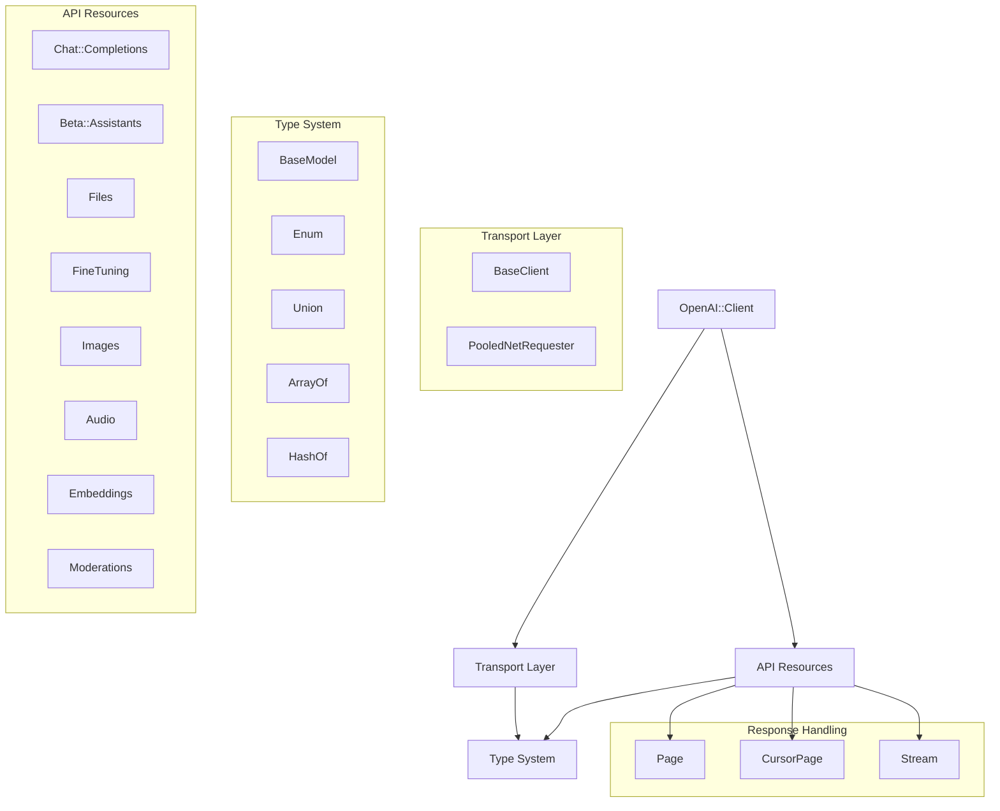
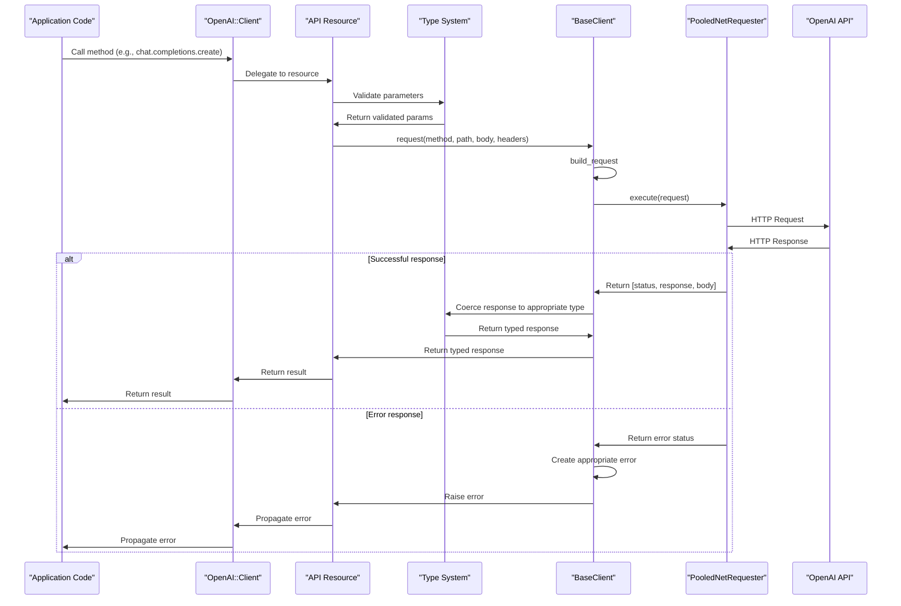
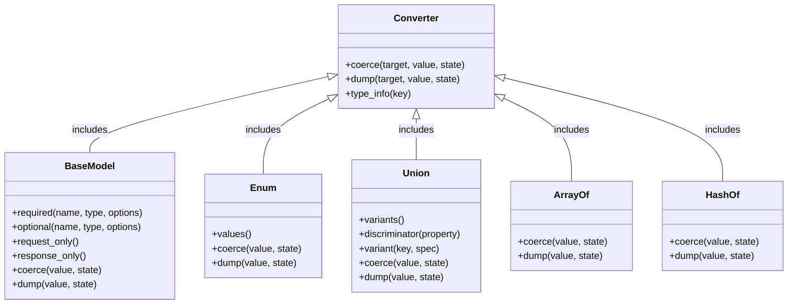
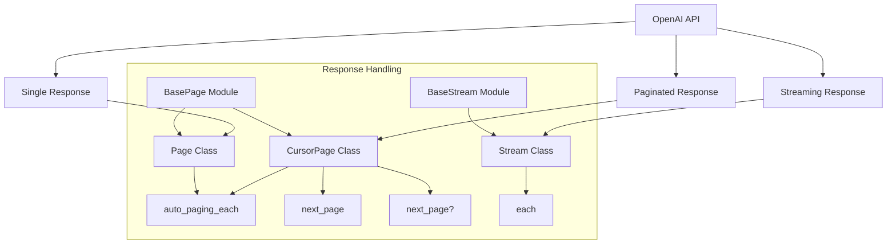
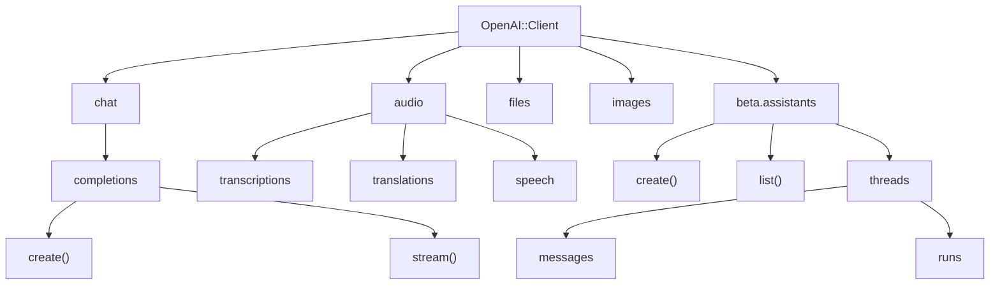

<!-- source: DeepWiki mcp.deepwiki.com · repo openai/openai-ruby · page 1 Overview · fetched 2026-10-26 -->

# Overview

Relevant source files

The following files were used as context for generating this wiki page:

- [.gitignore](.gitignore)
- [.rubocop.yml](.rubocop.yml)
- [.ruby-version](.ruby-version)
- [README.md](README.md)
- [Rakefile](Rakefile)
- [lib/openai.rb](lib/openai.rb)
- [lib/openai/errors.rb](lib/openai/errors.rb)
- [openai.gemspec](openai.gemspec)
- [rbi/openai/errors.rbi](rbi/openai/errors.rbi)
- [scripts/bootstrap](scripts/bootstrap)
- [sig/openai/internal/type/array_of.rbs](sig/openai/internal/type/array_of.rbs)
- [sig/openai/internal/type/base_page.rbs](sig/openai/internal/type/base_page.rbs)
- [sig/openai/internal/type/hash_of.rbs](sig/openai/internal/type/hash_of.rbs)

The OpenAI Ruby SDK provides convenient and type-safe access to the OpenAI REST API from any Ruby 3.2.0+ application. This document introduces the SDK's purpose, core functionality, and general architecture.

For specific usage instructions, see [Getting Started](#2). For detailed architecture explanations, see [Core Architecture](#3).

## Purpose and Functionality

The OpenAI Ruby SDK serves as a client library for accessing OpenAI's API services including:

- Chat Completions
- Assistants API (Beta)
- Images generation and editing
- Audio transcription and translation
- Embeddings
- Fine-tuning
- Files management
- Moderations

The SDK provides a fully-typed interface to these services, with comprehensive documentation in YARD, RBS, and RBI formats for development support.

Sources: [README.md:1-9](), [openai.gemspec:5-15]()

## Core Components

The OpenAI Ruby SDK is structured around several core components that work together to provide a seamless interface to the OpenAI API.

### Component Descriptions

1. **OpenAI::Client**: The primary entry point for all API interactions, orchestrating requests to specific resources.

2. **Transport Layer**: Manages HTTP communication with the OpenAI API, including:
   - **BaseClient**: Handles request building, execution, and response processing
   - **PooledNetRequester**: Manages connection pooling for efficient HTTP requests

3. **Type System**: Ensures data integrity and validation:
   - **BaseModel**: Base class for parameter and response objects
   - **Enum**: Provides type-safe enumeration values
   - **Union**: Supports polymorphic types
   - **ArrayOf/HashOf**: Collection type validators

4. **API Resources**: Resource-specific classes that encapsulate API endpoints
   
5. **Response Handling**: Components for working with different response formats:
   - **Page/CursorPage**: Handles paginated responses
   - **Stream**: Processes streaming responses

Sources: [lib/openai.rb:30-60](), [lib/openai/errors.rb:1-20](), [README.md:25-41]()

## Request Flow

The following sequence diagram illustrates how requests flow through the SDK:

This flow demonstrates how the SDK handles validation, request execution, response processing, and error handling through its layered architecture.

Sources: [README.md:110-125](), [lib/openai/errors.rb:114-226]()

## Type System

The OpenAI Ruby SDK implements a robust type system that ensures data validity throughout API interactions:

Key features of the type system include:

1. **Parameter Validation**: All API parameters are validated before sending requests
2. **Response Typing**: Response data is automatically converted to appropriate types
3. **Error Handling**: Type conversion errors are caught and reported
4. **Supporting Types**: Collection types (arrays, hashes), enums, and union types

The `BaseModel` class serves as the foundation for all parameter and response objects, providing utilities for data access, conversion, and serialization.

Sources: [lib/openai.rb:32-40](), [sig/openai/internal/type/array_of.rbs:1-45](), [sig/openai/internal/type/hash_of.rbs:1-45](), [README.md:190-200]()

## Response Handling

The SDK provides specialized handling for different response types from the OpenAI API:

### Response Types

1. **Single Responses**: Standard API responses, wrapped in a `Page` object
2. **Paginated Responses**: List endpoints with multiple pages of results, handled via `CursorPage`
3. **Streaming Responses**: Real-time streaming data (like chat completions), processed through `Stream`

The SDK provides convenient methods like `auto_paging_each` for iterating through multi-page results and `each` for processing streaming responses.

Sources: [README.md:60-85](), [sig/openai/internal/type/base_page.rbs:1-24](), [lib/openai.rb:41-53]()

## Error Handling

The SDK implements a comprehensive error handling system for both API and SDK-level errors:

| Error Type | Description |
|------------|-------------|
| `APIConnectionError` | Network connectivity issues |
| `APITimeoutError` | Request timeouts |
| `APIStatusError` | Base class for HTTP status errors |
| `BadRequestError` | HTTP 400 responses |
| `AuthenticationError` | HTTP 401 responses |
| `PermissionDeniedError` | HTTP 403 responses |
| `NotFoundError` | HTTP 404 responses |
| `ConflictError` | HTTP 409 responses |
| `RateLimitError` | HTTP 429 responses |
| `InternalServerError` | HTTP 500+ responses |
| `ConversionError` | Type conversion issues |

The SDK also includes automatic retry functionality for transient errors (like network issues and rate limits), with configurable retry behavior.

Sources: [README.md:110-186](), [lib/openai/errors.rb:1-228](), [rbi/openai/errors.rbi:1-189]()

## Key Features

Beyond the core architecture, the SDK provides several important features for effective API interaction:

1. **Connection Pooling**: Efficient handling of HTTP connections using the `connection_pool` gem
2. **Automatic Retries**: Built-in retry logic for transient errors with configurable behavior
3. **Timeouts**: Configurable request timeouts to prevent long-running operations
4. **Custom Requests**: Support for undocumented endpoints and parameters
5. **File Uploads**: Convenient handling of file uploads with various input types
6. **Thread Safety**: `OpenAI::Client` instances are thread-safe with request pooling

The SDK is designed to be both developer-friendly and production-ready, with comprehensive type safety and documentation support.

Sources: [README.md:242-251](), [README.md:144-186](), [README.md:88-106]()

## Usage Patterns

The SDK follows a resource-based API design pattern where resources are organized hierarchically:

This hierarchical structure allows for intuitive navigation of the API surface, with common patterns like:

- `client.resource.create(...)` for creating objects
- `client.resource.list(...)` for retrieving lists
- `client.resource.retrieve(...)` for fetching specific objects
- `client.resource.child_resource` for accessing nested resources

Every resource follows consistent patterns, making the SDK predictable and easy to use once the basic concepts are understood.

Sources: [README.md:25-57](), [lib/openai.rb:455-494]()

---

