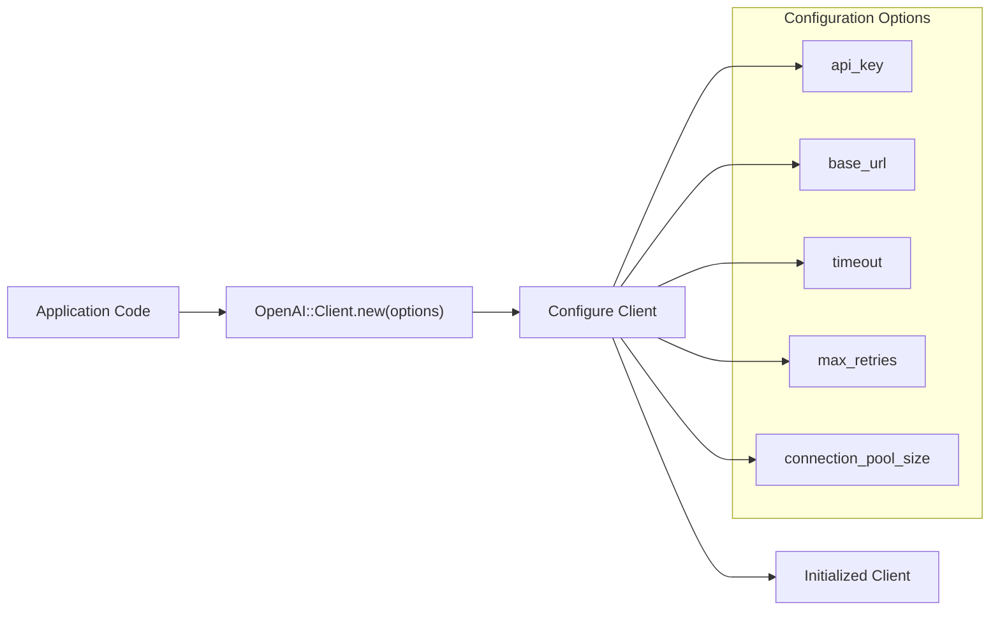
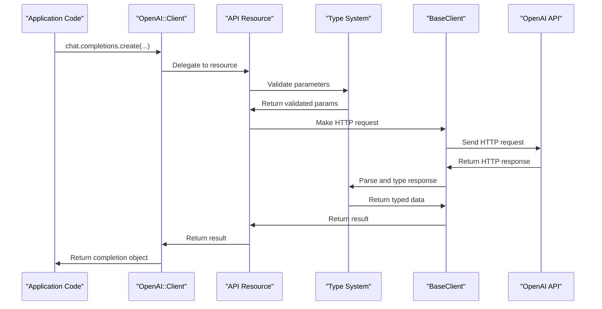
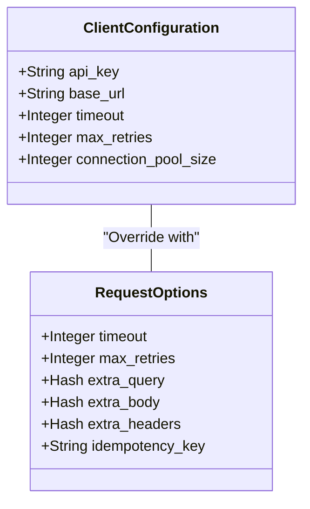

<!-- source: DeepWiki mcp.deepwiki.com · repo openai/openai-ruby · page 2 Getting Started · fetched 2026-10-26 -->

# Getting Started

<details>
<summary>Relevant source files</summary>

The following files were used as context for generating this wiki page:

- [.gitignore](.gitignore)
- [.release-please-manifest.json](.release-please-manifest.json)
- [.ruby-version](.ruby-version)
- [CHANGELOG.md](CHANGELOG.md)
- [Gemfile.lock](Gemfile.lock)
- [README.md](README.md)
- [lib/openai/version.rb](lib/openai/version.rb)
- [openai.gemspec](openai.gemspec)
- [scripts/bootstrap](scripts/bootstrap)
- [sig/openai/version.rbs](sig/openai/version.rbs)

</details>


The OpenAI Ruby SDK provides a convenient interface for Ruby applications to interact with OpenAI's API services. This guide will help you install the SDK, configure it, and understand its basic usage patterns. For more detailed architectural information, see [Core Architecture](#3).

## Installation

The OpenAI Ruby SDK requires Ruby 3.2.0 or higher and can be installed via Bundler.

Add this line to your application's Gemfile:

```ruby
gem "openai", github: "openai/openai-ruby", branch: "main"
```

Then run:

```bash
bundle install
```

Sources: [README.md:11-23](), [openai.gemspec:15-15](), [.ruby-version:1-1]()

## Client Initialization

To start using the SDK, you need to initialize the client with your API key:

```ruby
require "openai"

# Initialize the client with your API key
openai = OpenAI::Client.new(
  api_key: ENV["OPENAI_API_KEY"] # This is the default and can be omitted
)
```

### Client Initialization Flow



Sources: [README.md:25-41]()

## Basic Usage

Once you have an initialized client, you can start making API calls:

### Chat Completions

```ruby
chat_completion = openai.chat.completions.create(
  messages: [{role: "user", content: "Say this is a test"}],
  model: "gpt-4"
)

puts(chat_completion)
```

### Streaming Responses

```ruby
stream = openai.chat.completions.stream_raw(
  messages: [{role: "user", content: "Say this is a test"}],
  model: "gpt-4"
)

stream.each do |completion|
  puts(completion)
end
```

### Request-Response Flow



Sources: [README.md:25-58]()

## Working with Responses

The SDK provides different ways to work with API responses:

### Standard Responses

Standard responses are returned as typed objects with accessible properties:

```ruby
completion = openai.chat.completions.create(
  messages: [{role: "user", content: "Hello!"}],
  model: "gpt-4"
)

puts completion.choices[0].message.content
```

### Paginated Responses

List methods in the API return paginated results:

```ruby
page = openai.fine_tuning.jobs.list(limit: 20)

# Access the first item
job = page.data[0]
puts(job.id)

# Automatically fetch more pages as needed
page.auto_paging_each do |job|
  puts(job.id)
end

# Or manually navigate pages
if page.next_page?
  new_page = page.next_page
  puts(new_page.data[0].id)
end
```

Sources: [README.md:60-86]()

## File Uploads

The SDK supports several ways to upload files:

```ruby
# Using Pathname for large files
file_object = openai.files.create(file: Pathname("input.jsonl"), purpose: "fine-tune")

# Using file contents directly
file_object = openai.files.create(file: File.read("input.jsonl"), purpose: "fine-tune")

# With custom filename and content type
file = OpenAI::FilePart.new(
  File.read("input.jsonl"), 
  filename: "input.jsonl", 
  content_type: "application/json"
)
file_object = openai.files.create(file: file, purpose: "fine-tune")
```

**Note**: When using raw IO descriptors, retries are disabled as the library can't be sure if the descriptor is a file or pipe (which cannot be rewound).

Sources: [README.md:88-108]()

## Error Handling

The SDK raises appropriate exceptions when errors occur. Here's how to handle them:

```ruby
begin
  job = openai.fine_tuning.jobs.create(model: "babbage-002", training_file: "file-abc123")
rescue OpenAI::Errors::APIConnectionError => e
  puts("The server could not be reached")
  puts(e.cause)  # an underlying Exception, likely raised within `net/http`
rescue OpenAI::Errors::RateLimitError => e
  puts("A 429 status code was received; we should back off a bit.")
rescue OpenAI::Errors::APIStatusError => e
  puts("Another non-200-range status code was received")
  puts(e.status)
end
```

### Common Error Types

| Cause | Error Type |
| --- | --- |
| HTTP 400 | `BadRequestError` |
| HTTP 401 | `AuthenticationError` |
| HTTP 403 | `PermissionDeniedError` |
| HTTP 404 | `NotFoundError` |
| HTTP 409 | `ConflictError` |
| HTTP 422 | `UnprocessableEntityError` |
| HTTP 429 | `RateLimitError` |
| HTTP >= 500 | `InternalServerError` |
| Timeout | `APITimeoutError` |
| Network error | `APIConnectionError` |

Sources: [README.md:110-143]()

## Configuration Options

The client can be configured globally or per-request:

### Global Configuration

```ruby
openai = OpenAI::Client.new(
  api_key: "your-api-key-here",       # Default: ENV["OPENAI_API_KEY"]
  base_url: "https://custom-url.com", # Default: ENV["OPENAI_BASE_URL"] or OpenAI's API URL
  timeout: 60,                        # Default: 600 seconds
  max_retries: 5,                     # Default: 2
  connection_pool_size: 25            # Default: 99
)
```

### Per-Request Configuration

```ruby
openai.chat.completions.create(
  messages: [{role: "user", content: "How can I get the name of the current day in JavaScript?"}],
  model: "gpt-4",
  request_options: {
    timeout: 30,
    max_retries: 1,
    extra_query: {my_query_parameter: "value"},
    extra_body: {my_body_parameter: "value"},
    extra_headers: {"my-header": "value"}
  }
)
```

### Configuration Options Diagram



Sources: [README.md:144-186](), [README.md:207-227]()

## Retries

The SDK automatically retries certain types of errors:

- Connection errors (network issues)
- HTTP status codes: 408, 409, 429, 500+
- Timeouts

You can configure retry behavior:

```ruby
# Global configuration
openai = OpenAI::Client.new(
  max_retries: 0 # Disable retries (default is 2)
)

# Per-request configuration
openai.chat.completions.create(
  messages: [{role: "user", content: "How can I get the name of the current day in JavaScript?"}],
  model: "gpt-4",
  request_options: {max_retries: 5}
)
```

Sources: [README.md:144-164]()

## Advanced Usage

For more advanced usage patterns, including undocumented parameters and endpoints, see [Basic Usage](#2.2) and [Configuration Options](#2.3).

### Concurrency & Connection Pooling

The `OpenAI::Client` instances are threadsafe and maintain their own HTTP connection pool with a default size of 99 connections. It's recommended to instantiate the client once per application for optimal performance.

When all available connections from the pool are checked out, requests wait for a new connection to become available, with queue time counting towards the request timeout.

Sources: [README.md:243-252]()

---

