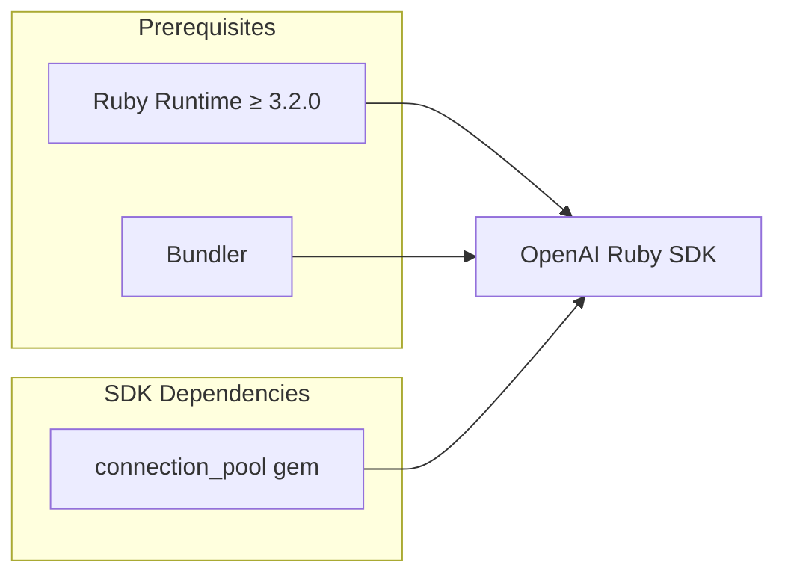
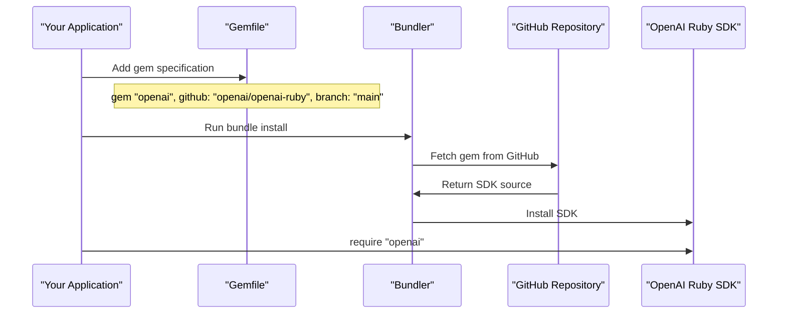
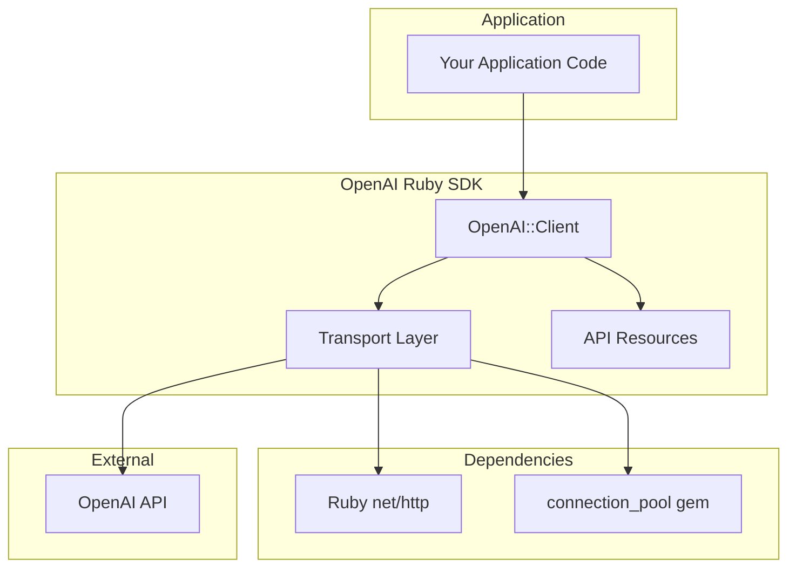

<!-- source: DeepWiki mcp.deepwiki.com · repo openai/openai-ruby · page 2.1 Installation · fetched 2026-10-26 -->

# Installation

<details>
<summary>Relevant source files</summary>

The following files were used as context for generating this wiki page:

- [.gitignore](.gitignore)
- [.release-please-manifest.json](.release-please-manifest.json)
- [.ruby-version](.ruby-version)
- [CHANGELOG.md](CHANGELOG.md)
- [CONTRIBUTING.md](CONTRIBUTING.md)
- [Gemfile.lock](Gemfile.lock)
- [README.md](README.md)
- [lib/openai/version.rb](lib/openai/version.rb)
- [openai.gemspec](openai.gemspec)
- [scripts/bootstrap](scripts/bootstrap)
- [scripts/format](scripts/format)
- [scripts/lint](scripts/lint)
- [scripts/test](scripts/test)
- [sig/openai/version.rbs](sig/openai/version.rbs)
- [sorbet/rbi/.gitignore](sorbet/rbi/.gitignore)

</details>


This page provides detailed information about installing the OpenAI Ruby SDK in your application. The SDK offers convenient access to the OpenAI REST API from any Ruby application with comprehensive type support. For information about configuring the SDK after installation, see [Configuration Options](#2.3).

## System Requirements

Before installing the OpenAI Ruby SDK, ensure your system meets the following requirements:

- **Ruby**: Version 3.2.0 or higher
- **Bundler**: For dependency management



Sources: [README.md:3-3](), [README.md:316-316](), [.ruby-version:1-1](), [openai.gemspec:15-15]()

## Installation via Bundler

The OpenAI Ruby SDK is currently in beta and not yet available on RubyGems. To install the SDK, you need to add it to your application's `Gemfile`:

1. Add the following line to your application's `Gemfile`:

```ruby
gem "openai", github: "openai/openai-ruby", branch: "main"
```

2. Run bundler to install the gem:

```bash
bundle install
```

3. Require the gem in your application:

```ruby
require "openai"
```



Sources: [README.md:13-21](), [README.md:28-29]()

## Installation from Source

For development purposes or to use the latest unreleased version, you can install the SDK directly from source:

### From GitHub Repository

Add this to your `Gemfile`:

```ruby
gem "openai", git: "https://www.github.com/openai/openai-ruby"
```

### From Local Clone

1. Clone the repository:

```bash
git clone https://www.github.com/openai/openai-ruby /path/to/local/repo
```

2. Reference the local repository in your `Gemfile`:

```ruby
gem "openai", path: "/path/to/local/repo"
```

3. Run bundler:

```bash
bundle install
```

Sources: [CONTRIBUTING.md:41-57]()

## Verification

After installation, you can verify that the SDK is correctly installed by creating a simple application that imports the SDK and checks the version:

```ruby
require "openai"
puts OpenAI::VERSION
```

If installed correctly, this will output the current version of the SDK, such as `0.1.0.pre.beta.1`.

Sources: [lib/openai/version.rb:4-4]()

## Architecture and Dependencies

The OpenAI Ruby SDK uses the standard library's `net/http` as the HTTP transport with connection pooling via the `connection_pool` gem. This architecture ensures efficient handling of API requests with proper resource management.



Sources: [README.md:3-3](), [openai.gemspec:27-27]()

## Connection Pooling

The SDK includes connection pooling for efficient resource management. Each instance of `OpenAI::Client` has its own HTTP connection pool with a default size of 99. For optimal performance, it's recommended to instantiate the client once per application.

| Setting | Default Value | Description |
|---------|---------------|-------------|
| Connection Pool Size | 99 | Maximum number of concurrent connections |
| Timeout | 600 seconds | Default request timeout |
| Max Retries | 2 | Default number of retry attempts |

Sources: [README.md:246-246](), [CHANGELOG.md:13-13](), [README.md:168-168](), [README.md:146-146]()

## Troubleshooting

### Ruby Version Issues

If you encounter errors related to Ruby version compatibility, ensure you're using Ruby 3.2.0 or higher:

```bash
ruby --version
```

If your Ruby version is below 3.2.0, consider using a version manager like `rbenv` or `asdf` to install and use a compatible version.

### Bundler Issues

If bundler fails to install the gem, ensure your bundler is up to date:

```bash
gem update bundler
```

### Using with Solargraph or Ruby LSP

For better development experience when using the SDK as a Git dependency, consider using IDE support tools:

- **Ruby LSP**: Good support for go-to-definition functionality
- **Solargraph**: Good support for auto-completion 

Both tools can be used simultaneously for the best experience.

Sources: [CONTRIBUTING.md:100-114]()

## Next Steps

After successfully installing the OpenAI Ruby SDK, you can proceed to basic usage and configuration:

- See [Basic Usage](#2.2) for examples of how to use the SDK
- See [Configuration Options](#2.3) for detailed information on configuring the client

---

