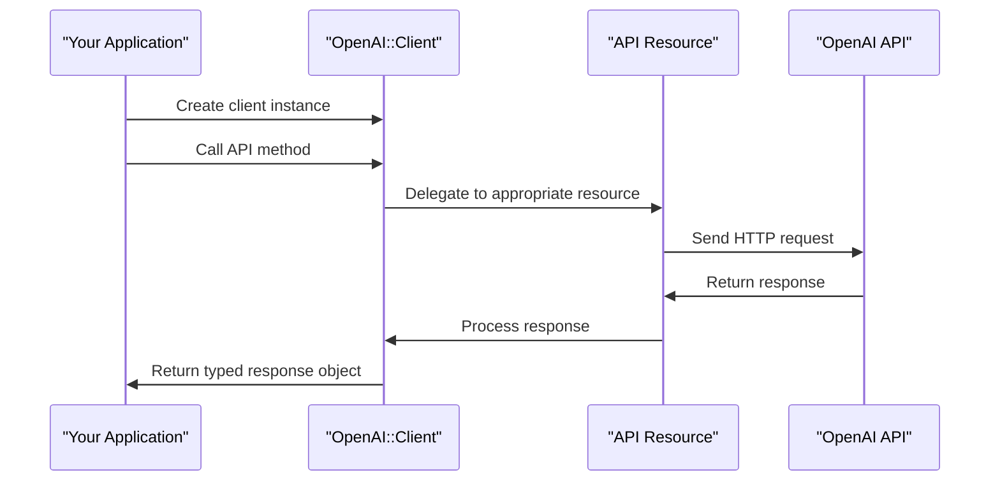
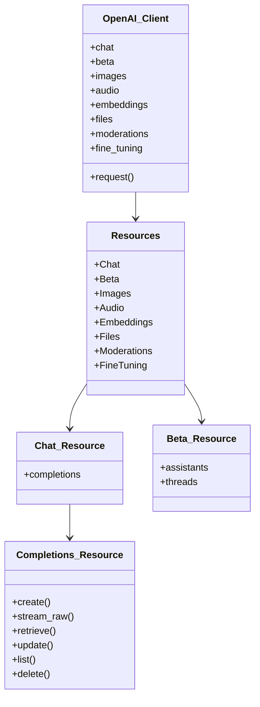
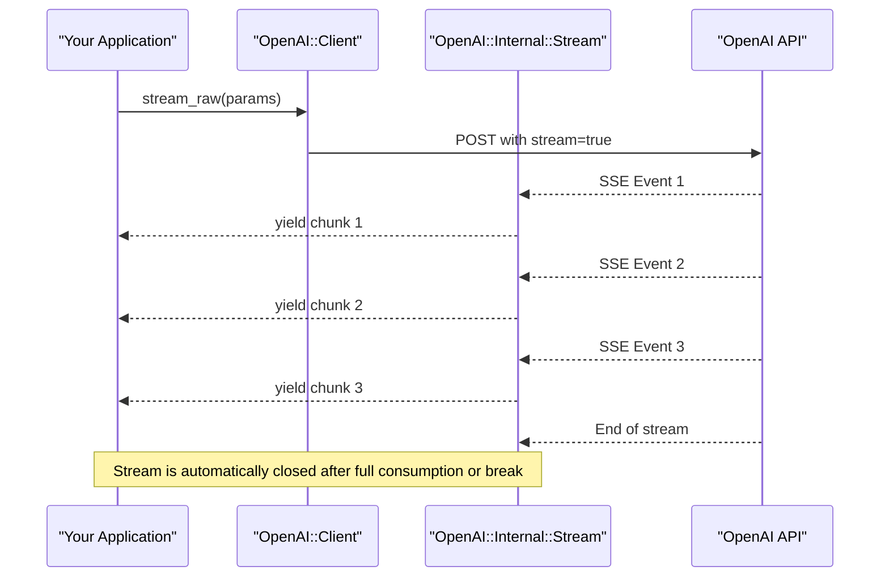
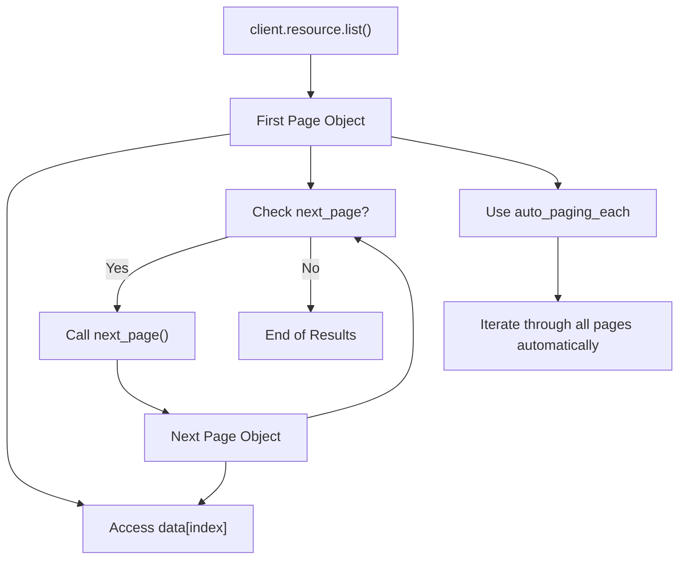
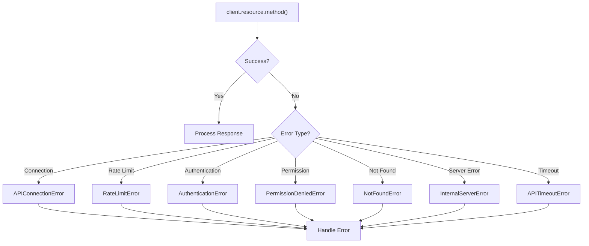

<!-- source: DeepWiki mcp.deepwiki.com · repo openai/openai-ruby · page 2.2 Basic Usage · fetched 2026-10-26 -->

# Basic Usage

<details>
<summary>Relevant source files</summary>

The following files were used as context for generating this wiki page:

- [.gitignore](.gitignore)
- [.ruby-version](.ruby-version)
- [.solargraph.yml](.solargraph.yml)
- [README.md](README.md)
- [examples/advanced_streaming.rb](examples/advanced_streaming.rb)
- [examples/demo.rb](examples/demo.rb)
- [examples/demo_sorbet.rb](examples/demo_sorbet.rb)
- [examples/picture.rb](examples/picture.rb)
- [examples/streaming.rb](examples/streaming.rb)
- [lib/openai/resources/beta/threads.rb](lib/openai/resources/beta/threads.rb)
- [lib/openai/resources/chat/completions.rb](lib/openai/resources/chat/completions.rb)
- [lib/openai/resources/responses.rb](lib/openai/resources/responses.rb)
- [openai.gemspec](openai.gemspec)
- [scripts/bootstrap](scripts/bootstrap)
- [sorbet/config](sorbet/config)
- [test/openai/client_test.rb](test/openai/client_test.rb)

</details>


This page covers the fundamental usage patterns of the OpenAI Ruby SDK, including initializing the client, making API calls, and handling responses. For configuration details and advanced options, see [Configuration Options](#2.3).

## Client Initialization

The first step in using the OpenAI Ruby SDK is creating a client instance:

```ruby
require "openai"

# Initialize with API key from environment variable
client = OpenAI::Client.new

# Or explicitly provide an API key
client = OpenAI::Client.new(api_key: "your-api-key-here")
```

Sources: [README.md:28-33](), [examples/demo.rb:5-8]()

## Basic Request Flow

### Basic Request Flow Diagram



Sources: [lib/openai/resources/chat/completions.rb:100-182](), [README.md:35-40]()

## Making API Calls

### Chat Completions

The most common API call is creating a chat completion:

```ruby
completion = client.chat.completions.create(
  messages: [{role: "user", content: "Say this is a test"}],
  model: "gpt-4"
)

puts completion.choices.first.message.content
```

Sources: [README.md:35-40](), [examples/demo.rb:14-24]()

### Assistants API (Beta)

Create and run an assistant:

```ruby
thread = client.beta.threads.create

run = client.beta.threads.runs.create(
  thread_id: thread.id,
  assistant_id: "asst_abc123"
)
```

Sources: [lib/openai/resources/beta/threads.rb:31-40]()

### Image Generation

Generate images using the images API:

```ruby
response = client.images.generate(
  prompt: "An astronaut lounging in a tropical resort in space, pixel art"
)
```

Sources: [examples/picture.rb:10-14]()

## Client Architecture Diagram



Sources: [lib/openai/resources/chat/completions.rb:1-412](), [lib/openai/resources/beta/threads.rb:1-248](), [lib/openai/resources/responses.rb:1-223]()

## Streaming Responses

For real-time responses, use streaming:

```ruby
stream = client.chat.completions.stream_raw(
  messages: [{role: "user", content: "How do I output all files in a directory using Python?"}],
  model: "gpt-4"
)

stream.each do |chunk|
  next if chunk.choices.empty?
  puts chunk.choices.first.delta.content
end
```

Streams implement the `Enumerable` interface, allowing you to use all Ruby collection methods:

```ruby
# Process all chunks at once
all_choices = stream
  .select { |completion| completion.object == :text_completion }
  .flat_map { |completion| completion.choices }

# Use lazy enumeration for more efficient processing
stream_of_choices = stream
  .lazy
  .select { |completion| completion.object == :text_completion }
  .flat_map { |completion| completion.choices }
```

Remember to close streams if they're not fully consumed:

```ruby
stream.close
```

Sources: [README.md:43-58](), [examples/demo.rb:27-46](), [examples/streaming.rb:10-49](), [examples/advanced_streaming.rb:10-76]()

### Streaming Diagram



Sources: [lib/openai/resources/chat/completions.rb:278-294](), [README.md:43-58]()

## Pagination

List methods in the OpenAI API return paginated results. The SDK provides auto-paginating iterators:

```ruby
page = client.fine_tuning.jobs.list(limit: 20)

# Fetch single item from page
job = page.data[0]
puts job.id

# Automatically fetch more pages as needed
page.auto_paging_each do |job|
  puts job.id
end

# Or control pagination manually
if page.next_page?
  new_page = page.next_page
  puts new_page.data[0].id
end
```

Sources: [README.md:60-86](), [lib/openai/resources/chat/completions.rb:369-379]()

### Pagination Diagram



Sources: [README.md:60-86]()

## File Uploads

File parameters can be passed in several ways:

```ruby
# Using Pathname for large files (avoids loading entire file into memory)
file_object = client.files.create(
  file: Pathname("input.jsonl"), 
  purpose: "fine-tune"
)

# Passing file contents directly
file_object = client.files.create(
  file: File.read("input.jsonl"), 
  purpose: "fine-tune"
)

# With explicit filename and content type
file = OpenAI::FilePart.new(
  File.read("input.jsonl"), 
  filename: "input.jsonl", 
  content_type: "application/json"
)
file_object = client.files.create(
  file: file, 
  purpose: "fine-tune"
)
```

Note: Passing raw IO objects disables retries, as the library can't be sure if the descriptor is a file or pipe.

Sources: [README.md:88-108]()

## Error Handling

The SDK throws subclasses of `OpenAI::Errors::APIError` when API calls fail:

```ruby
begin
  job = client.fine_tuning.jobs.create(
    model: "babbage-002", 
    training_file: "file-abc123"
  )
rescue OpenAI::Errors::APIConnectionError => e
  puts "The server could not be reached"
  puts e.cause  # underlying Exception, likely from net/http
rescue OpenAI::Errors::RateLimitError => e
  puts "A 429 status code was received; we should back off"
rescue OpenAI::Errors::APIStatusError => e
  puts "Another non-200-range status code was received"
  puts e.status
end
```

Common error types include:

| HTTP Status | Error Type |
|-------------|------------|
| 400 | `BadRequestError` |
| 401 | `AuthenticationError` |
| 403 | `PermissionDeniedError` |
| 404 | `NotFoundError` |
| 409 | `ConflictError` |
| 422 | `UnprocessableEntityError` |
| 429 | `RateLimitError` |
| ≥500 | `InternalServerError` |
| Timeout | `APITimeoutError` |
| Network | `APIConnectionError` |

Sources: [README.md:110-143](), [test/openai/client_test.rb:30-46]()

### Error Handling Diagram



Sources: [README.md:110-143](), [test/openai/client_test.rb:30-46]()

## Retries and Timeouts

By default, certain errors (connection issues, timeouts, rate limits, server errors) are automatically retried 2 times with exponential backoff.

```ruby
# Configure default retries for all requests
client = OpenAI::Client.new(
  api_key: "your-api-key",
  max_retries: 5  # default is 2
)

# Or configure per-request
client.chat.completions.create(
  messages: [{role: "user", content: "Hello world"}],
  model: "gpt-4",
  request_options: {max_retries: 5}
)
```

Requests time out after 600 seconds by default:

```ruby
# Configure default timeout for all requests
client = OpenAI::Client.new(
  api_key: "your-api-key",
  timeout: 30  # default is 600 seconds
)

# Or configure per-request
client.chat.completions.create(
  messages: [{role: "user", content: "Hello world"}],
  model: "gpt-4",
  request_options: {timeout: 10}
)
```

On timeout, `OpenAI::Errors::APITimeoutError` is raised, and these errors are also retried by default.

Sources: [README.md:144-187](), [test/openai/client_test.rb:48-108]()

## Advanced Usage

For more advanced usage patterns, including:

- Working with undocumented properties
- Making custom API requests
- Type-safe requests with Sorbet
- Enum handling

See the [Core Architecture](#3) page.

Sources: [README.md:190-311](), [examples/demo_sorbet.rb:1-61]()

---

