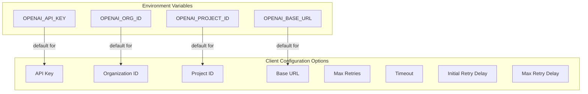
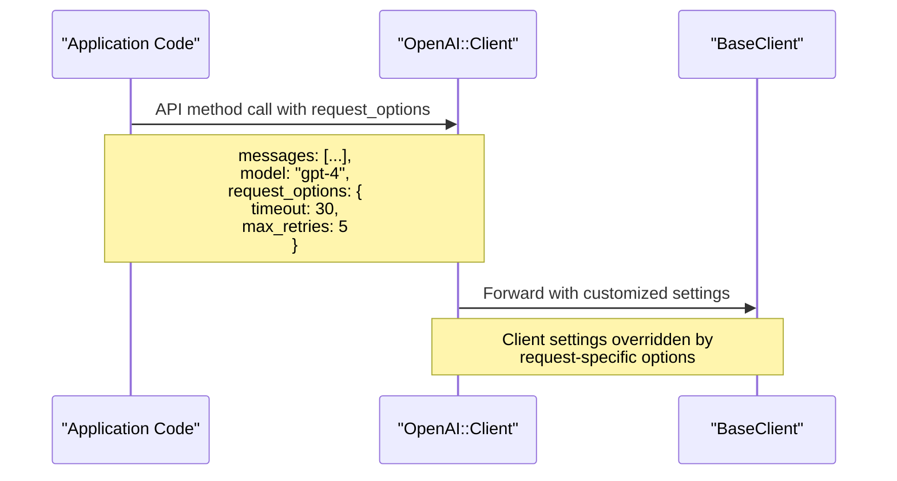
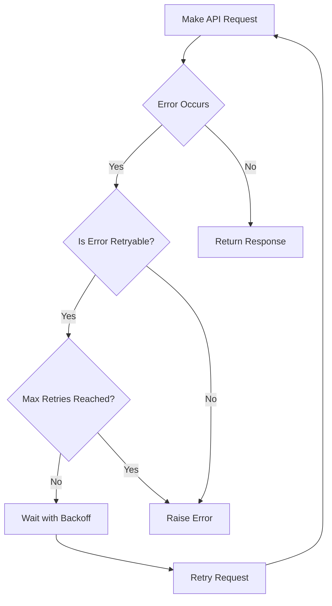
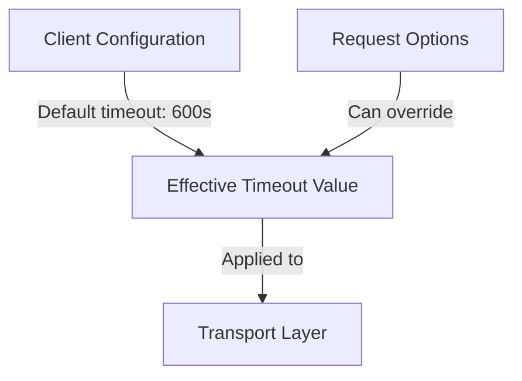
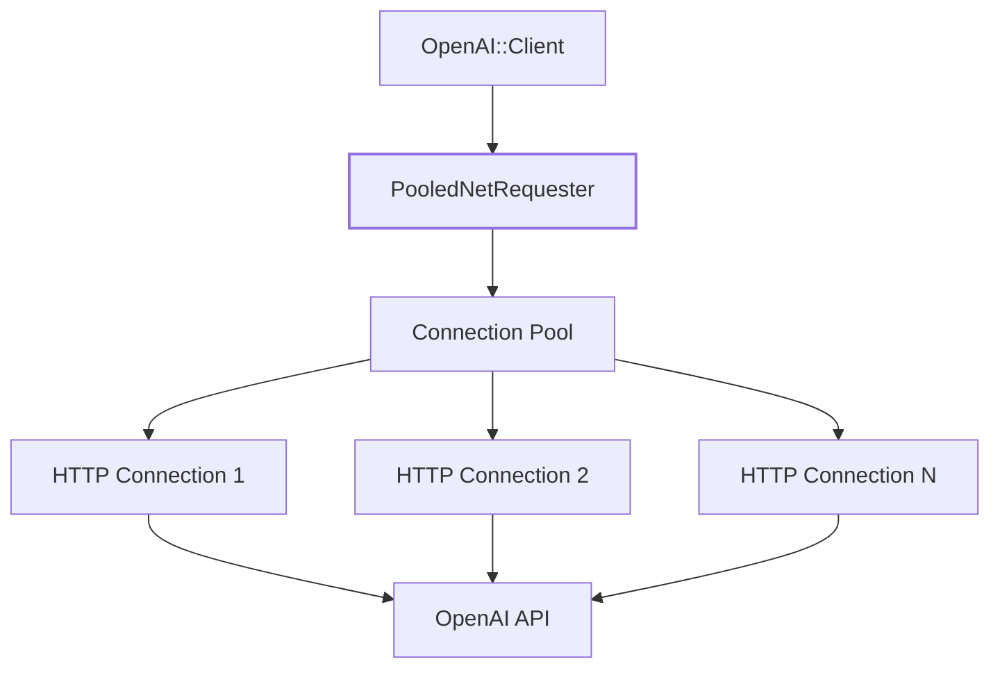

<!-- source: DeepWiki mcp.deepwiki.com · repo openai/openai-ruby · page 2.3 Configuration Options · fetched 2026-10-26 -->

# Configuration Options

<details>
<summary>Relevant source files</summary>

The following files were used as context for generating this wiki page:

- [.gitignore](.gitignore)
- [.ruby-version](.ruby-version)
- [.yardopts](.yardopts)
- [README.md](README.md)
- [lib/openai/client.rb](lib/openai/client.rb)
- [lib/openai/internal/transport/pooled_net_requester.rb](lib/openai/internal/transport/pooled_net_requester.rb)
- [openai.gemspec](openai.gemspec)
- [rbi/openai/internal/transport/pooled_net_requester.rbi](rbi/openai/internal/transport/pooled_net_requester.rbi)
- [scripts/bootstrap](scripts/bootstrap)
- [sig/openai/client.rbs](sig/openai/client.rbs)
- [sig/openai/internal/transport/pooled_net_requester.rbs](sig/openai/internal/transport/pooled_net_requester.rbs)

</details>


This document details all available configuration options for the OpenAI Ruby SDK client. It covers client initialization parameters, per-request configuration, timeout and retry behavior, connection pooling, and environment variables used for default settings.

## Client Initialization Options

The `OpenAI::Client` class accepts several configuration parameters during initialization that control its behavior throughout the lifecycle of the client.



Here are all the available client initialization options:

| Option | Default Value | Purpose |
|--------|---------------|---------|
| `api_key` | `ENV["OPENAI_API_KEY"]` | Authentication key for OpenAI API |
| `organization` | `ENV["OPENAI_ORG_ID"]` | Organization identifier for API requests |
| `project` | `ENV["OPENAI_PROJECT_ID"]` | Project identifier for API requests |
| `base_url` | `ENV["OPENAI_BASE_URL"]` or<br>"https://api.openai.com/v1" | Base URL for all API requests |
| `max_retries` | 2 | Maximum retry attempts for failed requests |
| `timeout` | 600.0 seconds | Request timeout in seconds |
| `initial_retry_delay` | 0.5 seconds | Initial delay before first retry |
| `max_retry_delay` | 8.0 seconds | Maximum delay between retries |

Example client initialization with custom configuration:

```ruby
openai = OpenAI::Client.new(
  api_key: "your-api-key", 
  organization: "your-org-id",
  max_retries: 3,
  timeout: 300
)
```

Sources: [lib/openai/client.rb:102-150](), [README.md:31-33]()

## Per-Request Configuration

In addition to client-level configuration, you can override certain settings on a per-request basis using the `request_options` parameter.



Available per-request configuration options:

| Option | Purpose |
|--------|---------|
| `max_retries` | Override the client's default retry limit for this request |
| `timeout` | Override the client's default timeout for this request |
| `extra_query` | Additional query parameters to include in the request URL |
| `extra_body` | Additional parameters to include in the request body |
| `extra_headers` | Additional HTTP headers to include with the request |

Example of per-request configuration:

```ruby
openai.chat.completions.create(
  messages: [{role: "user", content: "How can I get the name of the current day in JavaScript?"}],
  model: :"gpt-4.1",
  request_options: {
    timeout: 30,
    max_retries: 5,
    extra_headers: {"x-custom-header": "value"}
  }
)
```

Sources: [README.md:152-164](), [README.md:210-223]()

## Retry Behavior

The OpenAI Ruby SDK automatically retries certain types of failures with exponential backoff and jitter.



The following errors will trigger automatic retries:

- Connection errors (network connectivity issues)
- HTTP 408 Request Timeout responses
- HTTP 409 Conflict responses
- HTTP 429 Rate Limit responses
- HTTP 500+ Server Error responses
- Request timeouts

You can configure retry behavior through:

1. `max_retries` parameter when creating the client (default: 2)
2. `initial_retry_delay` parameter for controlling the starting delay (default: 0.5s)
3. `max_retry_delay` parameter for capping the maximum delay (default: 8.0s)
4. Per-request override with `request_options: {max_retries: n}`

Sources: [README.md:144-163](), [lib/openai/client.rb:11-16]()

## Timeout Configuration

The OpenAI SDK allows controlling timeout behavior at both client and per-request levels.



Timeout settings work as follows:

- Default client timeout is 600 seconds (10 minutes)
- Per-request timeouts override the client-level setting
- When a timeout occurs, `OpenAI::Errors::APITimeoutError` is raised
- Timeouts are retried according to the retry policy
- Timeout applies to the entire request lifecycle

Example of setting timeouts:

```ruby
# Client-level timeout (default: 600 seconds)
openai = OpenAI::Client.new(timeout: 120)

# Per-request timeout
openai.chat.completions.create(
  messages: [{role: "user", content: "Hello"}],
  model: "gpt-4",
  request_options: {timeout: 30}  # 30-second timeout for this request
)
```

Sources: [README.md:166-186](), [lib/openai/client.rb:9]()

## Connection Pooling

The OpenAI Ruby SDK uses connection pooling to improve performance by reusing HTTP connections.



Key connection pooling features:

- Each client instance maintains its own connection pool
- Default pool size is set to max(99, number_of_processors)
- Connections are reused to reduce latency and resource usage
- Connections have a 30-second keep-alive timeout
- When all connections are in use, new requests wait for one to become available

For best performance in multi-threaded applications, create a single client instance and share it across threads.

Sources: [README.md:243-251](), [lib/openai/internal/transport/pooled_net_requester.rb:12-14](), [lib/openai/internal/transport/pooled_net_requester.rb:189-193]()

## Environment Variables

The SDK supports configuration through environment variables, which is useful for keeping sensitive information out of your code:

| Environment Variable | Used For |
|----------------------|----------|
| `OPENAI_API_KEY` | Default API key if none is provided explicitly |
| `OPENAI_ORG_ID` | Default organization ID |
| `OPENAI_PROJECT_ID` | Default project ID | 
| `OPENAI_BASE_URL` | Default API base URL |

Example environment setup:

```bash
export OPENAI_API_KEY="sk-your-api-key"
export OPENAI_ORG_ID="org-your-organization-id"
export OPENAI_BASE_URL="https://api.openai.com/v1"
```

Sources: [lib/openai/client.rb:86-94](), [lib/openai/client.rb:103-106]()

## Error Handling

When the SDK encounters errors, it raises specific exception types that you can catch and handle:

| Error Type | Cause |
|------------|-------|
| `OpenAI::Errors::APIConnectionError` | Network connectivity issues |
| `OpenAI::Errors::APITimeoutError` | Request timeout |
| `OpenAI::Errors::RateLimitError` | HTTP 429 (Rate limit exceeded) |
| `OpenAI::Errors::AuthenticationError` | HTTP 401 (Invalid API key) |
| `OpenAI::Errors::PermissionDeniedError` | HTTP 403 (Insufficient permissions) |
| `OpenAI::Errors::NotFoundError` | HTTP 404 (Resource not found) |
| `OpenAI::Errors::BadRequestError` | HTTP 400 (Invalid request) |

Example of handling API errors:

```ruby
begin
  response = openai.chat.completions.create(
    messages: [{role: "user", content: "Hello"}],
    model: "gpt-4"
  )
rescue OpenAI::Errors::RateLimitError => e
  # Handle rate limit errors (wait and retry)
  puts "Rate limited: #{e.message}"
rescue OpenAI::Errors::APITimeoutError => e
  # Handle timeout errors
  puts "Request timed out: #{e.message}"
rescue OpenAI::Errors::APIError => e
  # Handle other API errors
  puts "API error: #{e.message}"
end
```

Sources: [README.md:110-142]()

For more information on the internal request and response handling, see [Request and Response Handling](#3.3). For details on the client architecture, see [Client Architecture](#3.1).

---

