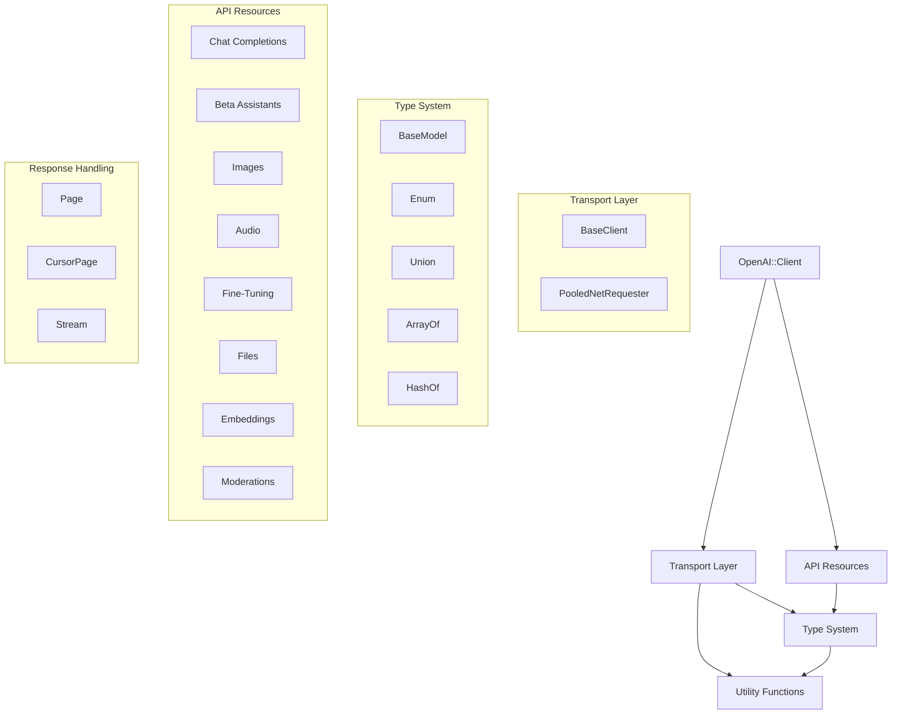
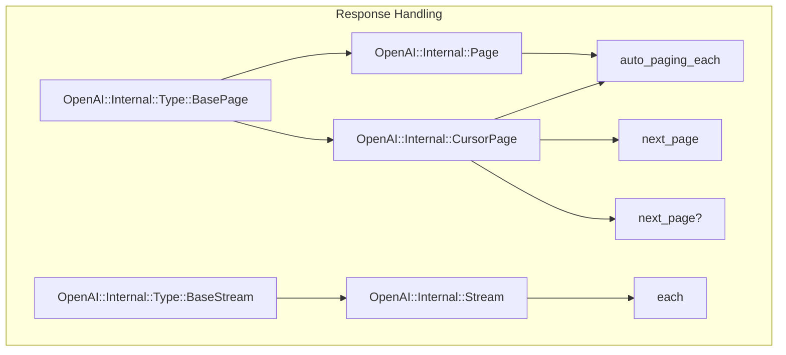
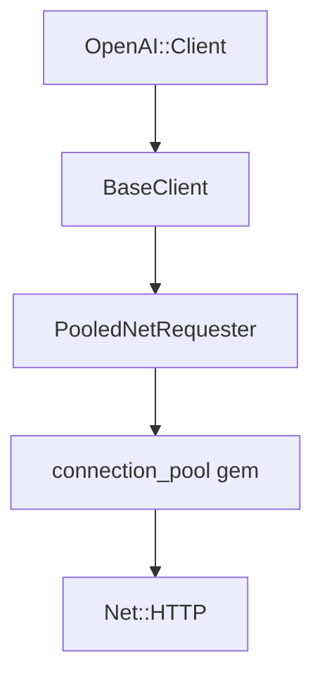

<!-- source: DeepWiki mcp.deepwiki.com · repo openai/openai-ruby · page 3 Core Architecture · fetched 2026-10-26 -->

# Core Architecture

<details>
<summary>Relevant source files</summary>

The following files were used as context for generating this wiki page:

- [.gitignore](.gitignore)
- [.rubocop.yml](.rubocop.yml)
- [.ruby-version](.ruby-version)
- [Gemfile](Gemfile)
- [README.md](README.md)
- [Rakefile](Rakefile)
- [lib/openai.rb](lib/openai.rb)
- [lib/openai/errors.rb](lib/openai/errors.rb)
- [lib/openai/internal/transport/base_client.rb](lib/openai/internal/transport/base_client.rb)
- [openai.gemspec](openai.gemspec)
- [rbi/openai/errors.rbi](rbi/openai/errors.rbi)
- [scripts/bootstrap](scripts/bootstrap)
- [sig/openai/internal/transport/base_client.rbs](sig/openai/internal/transport/base_client.rbs)
- [sig/openai/internal/type/array_of.rbs](sig/openai/internal/type/array_of.rbs)
- [sig/openai/internal/type/base_page.rbs](sig/openai/internal/type/base_page.rbs)
- [sig/openai/internal/type/hash_of.rbs](sig/openai/internal/type/hash_of.rbs)
- [test/openai/test_helper.rb](test/openai/test_helper.rb)

</details>


This document provides a comprehensive overview of the OpenAI Ruby SDK's internal architecture, explaining how the core components work together to provide a seamless interface to the OpenAI API. It covers the high-level design, key components, and system interactions.

For more detailed information on specific components:
- For client implementation details, see [Client Architecture](#3.1)
- For type system internals, see [Type System](#3.2)
- For request processing and response handling, see [Request and Response Handling](#3.3)
- For error handling mechanisms, see [Error Handling](#3.4)

## High-Level Architecture Overview

The OpenAI Ruby SDK is built with a layered architecture that separates concerns and provides clean interfaces between components.

### Architecture Diagram



Sources:
- [lib/openai.rb]()
- [lib/openai/client.rb]()
- [lib/openai/internal/transport/base_client.rb]()
- [lib/openai/internal/transport/pooled_net_requester.rb]()

## Key Components

The SDK architecture consists of several key components that work together:

### 1. Client Layer (`OpenAI::Client`)

The entry point for all API interactions. It provides access to various API resources and handles configuration.

### 2. Transport Layer

Responsible for HTTP communication with the OpenAI API:
- `BaseClient`: Builds and sends HTTP requests, processes responses, and handles retries
- `PooledNetRequester`: Manages a pool of HTTP connections for efficient communication

### 3. Type System

Ensures data validation and type safety:
- `BaseModel`: The foundation for all model objects
- `Converter`: Handles type conversion
- `Enum`, `Union`, `ArrayOf`, `HashOf`: Type wrappers for various data structures

### 4. API Resources

Classes that encapsulate specific API endpoints and operations.

### 5. Response Handling

Components for processing different API response formats:
- `Page` and `CursorPage`: Handle paginated responses
- `Stream`: Processes streaming responses

### 6. Error Handling

A comprehensive error system that categorizes errors and provides detailed information.

## Component Relationships

```mermaid
classDiagram
    class "OpenAI::Client" {
        +initialize(api_key, options)
        +chat
        +audio
        +images
        +embeddings
        +files
        +fine_tuning
        +moderations
        +beta
        +request(method, path, options)
    }
    
    class "OpenAI::Internal::Transport::BaseClient" {
        +request(method, path, options)
        -build_request(req, opts)
        -send_request(request)
        -retry_delay(headers, retry_count)
    }
    
    class "OpenAI::Internal::Transport::PooledNetRequester" {
        -connection_pool
        +execute(request)
    }
    
    class "OpenAI::Internal::Type::BaseModel" {
        +required(name, type, options)
        +optional(name, type, options)
        +coerce(value, state)
        +dump(value, state)
    }
    
    "OpenAI::Client" --> "OpenAI::Internal::Transport::BaseClient" : uses
    "OpenAI::Internal::Transport::BaseClient" --> "OpenAI::Internal::Transport::PooledNetRequester" : uses
    "OpenAI::Internal::Transport::BaseClient" --> "OpenAI::Internal::Type::BaseModel" : uses for type conversion
```

Sources:
- [lib/openai/client.rb]()
- [lib/openai/internal/transport/base_client.rb]()
- [lib/openai/internal/transport/pooled_net_requester.rb]()
- [lib/openai/internal/type/base_model.rb]()

## Request Flow

The following sequence diagram illustrates how a request flows through the system:

```mermaid
sequenceDiagram
    participant "Application" as App
    participant "OpenAI::Client" as Client
    participant "API Resource" as Resource
    participant "Type System" as TypeSystem
    participant "BaseClient" as BaseClient
    participant "PooledNetRequester" as PooledNetRequester
    participant "OpenAI API" as API

    App->>Client: Call method (e.g., chat.completions.create)
    Client->>Resource: Delegate to resource
    Resource->>TypeSystem: Validate parameters
    TypeSystem->>Resource: Return validated params
    Resource->>BaseClient: request(method, path, body, headers)
    BaseClient->>BaseClient: build_request
    BaseClient->>PooledNetRequester: execute(request)
    PooledNetRequester->>API: HTTP Request
    API->>PooledNetRequester: HTTP Response
    
    alt Successful response
        PooledNetRequester->>BaseClient: Return [status, response, body]
        BaseClient->>TypeSystem: Coerce response to appropriate type
        TypeSystem->>BaseClient: Return typed response
        BaseClient->>Resource: Return typed response
        Resource->>Client: Return result
        Client->>App: Return result
    else Error response
        PooledNetRequester->>BaseClient: Return error status
        BaseClient->>BaseClient: Create appropriate error
        BaseClient->>Resource: Raise error
        Resource->>Client: Propagate error
        Client->>App: Propagate error
    end
```

Sources:
- [lib/openai/internal/transport/base_client.rb:431-497]()
- [lib/openai/internal/transport/pooled_net_requester.rb]()

## Type System Architecture

The type system is central to the SDK's functionality, ensuring type safety and validation:

```mermaid
classDiagram
    class "OpenAI::Internal::Type::Converter" {
        +coerce(target, value, state)
        +dump(target, value, state)
        +type_info(key)
    }
    
    class "OpenAI::Internal::Type::BaseModel" {
        +required(name, type, options)
        +optional(name, type, options)
        +request_only()
        +response_only()
        +coerce(value, state)
        +dump(value, state)
    }
    
    class "OpenAI::Internal::Type::Enum" {
        +values()
        +coerce(value, state)
        +dump(value, state)
    }
    
    class "OpenAI::Internal::Type::Union" {
        +variants()
        +discriminator(property)
        +variant(key, spec)
        +coerce(value, state)
        +dump(value, state)
    }
    
    class "OpenAI::Internal::Type::ArrayOf" {
        +coerce(value, state)
        +dump(value, state)
    }
    
    class "OpenAI::Internal::Type::HashOf" {
        +coerce(value, state)
        +dump(value, state)
    }
    
    "OpenAI::Internal::Type::Converter" <|-- "OpenAI::Internal::Type::BaseModel" : includes
    "OpenAI::Internal::Type::Converter" <|-- "OpenAI::Internal::Type::Enum" : includes
    "OpenAI::Internal::Type::Converter" <|-- "OpenAI::Internal::Type::Union" : includes
    "OpenAI::Internal::Type::Converter" <|-- "OpenAI::Internal::Type::ArrayOf" : includes
    "OpenAI::Internal::Type::Converter" <|-- "OpenAI::Internal::Type::HashOf" : includes
```

Sources:
- [lib/openai/internal/type/converter.rb]()
- [lib/openai/internal/type/base_model.rb]()
- [lib/openai/internal/type/enum.rb]()
- [lib/openai/internal/type/union.rb]()
- [lib/openai/internal/type/array_of.rb]()
- [lib/openai/internal/type/hash_of.rb]()

## Error Handling System

The SDK implements a comprehensive error handling system:

```mermaid
classDiagram
    class "OpenAI::Errors::Error" {
        +cause: StandardError
    }
    
    class "OpenAI::Errors::ConversionError" {
    }
    
    class "OpenAI::Errors::APIError" {
        +url: URI::Generic
        +status: Integer
        +body: Object
        +code: String
        +param: String
        +type: String
    }
    
    class "OpenAI::Errors::APIConnectionError" {
    }
    
    class "OpenAI::Errors::APITimeoutError" {
    }
    
    class "OpenAI::Errors::APIStatusError" {
        +for(url, status, body): APIStatusError
    }
    
    class "OpenAI::Errors::BadRequestError" {
        HTTP_STATUS = 400
    }
    
    class "OpenAI::Errors::AuthenticationError" {
        HTTP_STATUS = 401
    }
    
    class "OpenAI::Errors::RateLimitError" {
        HTTP_STATUS = 429
    }
    
    "OpenAI::Errors::Error" <|-- "OpenAI::Errors::ConversionError"
    "OpenAI::Errors::Error" <|-- "OpenAI::Errors::APIError"
    "OpenAI::Errors::APIError" <|-- "OpenAI::Errors::APIConnectionError"
    "OpenAI::Errors::APIConnectionError" <|-- "OpenAI::Errors::APITimeoutError"
    "OpenAI::Errors::APIError" <|-- "OpenAI::Errors::APIStatusError"
    "OpenAI::Errors::APIStatusError" <|-- "OpenAI::Errors::BadRequestError"
    "OpenAI::Errors::APIStatusError" <|-- "OpenAI::Errors::AuthenticationError"
    "OpenAI::Errors::APIStatusError" <|-- "OpenAI::Errors::RateLimitError"
```

Sources:
- [lib/openai/errors.rb]()

## Response Handling

The SDK handles various types of API responses:



Sources:
- [lib/openai/internal/type/base_page.rb]()
- [lib/openai/internal/type/base_stream.rb]()
- [lib/openai/internal/page.rb]()
- [lib/openai/internal/cursor_page.rb]()
- [lib/openai/internal/stream.rb]()

## Key Design Principles

The OpenAI Ruby SDK follows several key design principles:

### 1. Type Safety

The SDK uses a comprehensive type system to validate request parameters and parse responses. This prevents runtime errors and provides clear error messages when types don't match expectations.

```ruby
# Example: Creating a chat completion
client.chat.completions.create(
  messages: [{role: "user", content: "Say this is a test"}],
  model: :"gpt-4.1"
)
```

The type system validates that:
- `messages` is an array of message objects with required fields
- `model` is a valid model identifier

### 2. Connection Pooling

The SDK maintains a pool of HTTP connections to improve performance by reusing connections when possible. This is implemented in the `PooledNetRequester` class:



Sources:
- [lib/openai/internal/transport/pooled_net_requester.rb]()

### 3. Retry Logic

The SDK automatically retries failed requests with an exponential backoff strategy. This is particularly useful for handling transient errors such as rate limits and network issues:

```ruby
# Configure retries for all requests
client = OpenAI::Client.new(
  max_retries: 5, # Default is 2
  initial_retry_delay: 0.5, # Default is lower
  max_retry_delay: 60.0 # Default is lower
)

# Configure retries for a specific request
client.chat.completions.create(
  messages: [{role: "user", content: "Hello"}],
  model: :"gpt-4.1",
  request_options: {max_retries: 10}
)
```

Sources:
- [lib/openai/internal/transport/base_client.rb:324-342]()
- [lib/openai/internal/transport/base_client.rb:400-427]()

### 4. Pagination Support

The SDK provides convenient methods for working with paginated API responses:

```ruby
# Example: List fine-tuning jobs
page = client.fine_tuning.jobs.list(limit: 20)

# Get a single item
job = page.data[0]

# Automatically fetch more pages as needed
page.auto_paging_each do |job|
  puts(job.id)
end

# Or manually control pagination
if page.next_page?
  new_page = page.next_page
  # Process new_page.data
end
```

Sources:
- [lib/openai/internal/type/base_page.rb]()
- [lib/openai/internal/page.rb]()
- [lib/openai/internal/cursor_page.rb]()

### 5. Streaming Support

The SDK supports streaming responses, allowing real-time processing of large responses:

```ruby
# Example: Stream chat completions
stream = client.chat.completions.stream_raw(
  messages: [{role: "user", content: "Say this is a test"}],
  model: :"gpt-4.1"
)

stream.each do |completion|
  puts(completion)
end
```

Sources:
- [lib/openai/internal/type/base_stream.rb]()
- [lib/openai/internal/stream.rb]()

## Conclusion

The OpenAI Ruby SDK is built with a clean, layered architecture that separates concerns and provides clear interfaces between components. This design makes the SDK both powerful and flexible, allowing it to handle the complexities of the OpenAI API while providing an intuitive interface for users.

The core components — Client, Transport Layer, Type System, API Resources, Response Handling, and Error Handling — work together seamlessly to provide a robust and developer-friendly experience.

For more detailed information on specific components, refer to the dedicated documentation pages linked at the beginning of this document.

---

