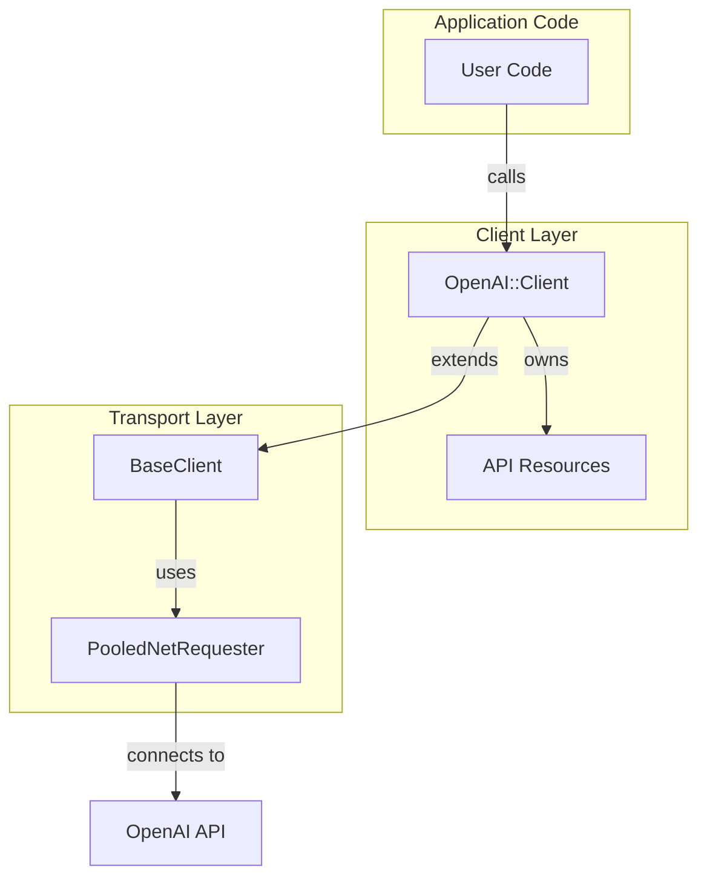
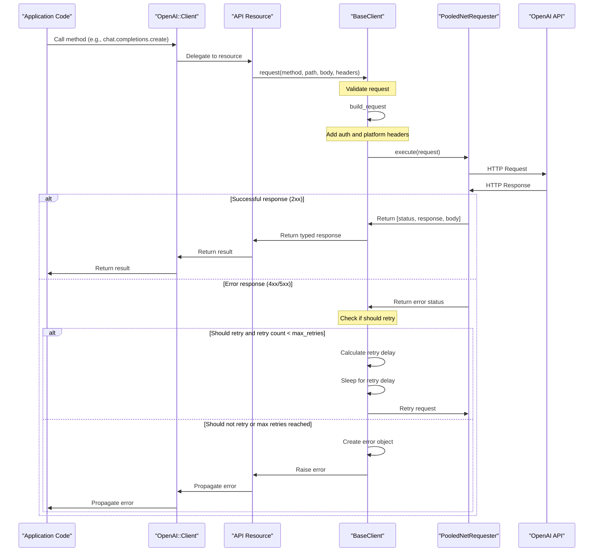
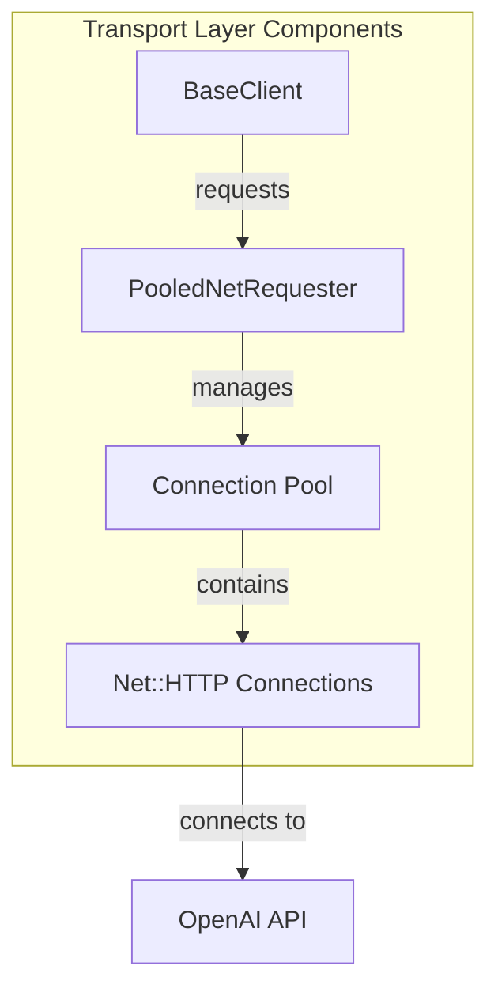

<!-- source: DeepWiki mcp.deepwiki.com · repo openai/openai-ruby · page 3.1 Client Architecture · fetched 2026-10-26 -->

# Client Architecture

<details>
<summary>Relevant source files</summary>

The following files were used as context for generating this wiki page:

- [.yardopts](.yardopts)
- [Gemfile](Gemfile)
- [lib/openai/client.rb](lib/openai/client.rb)
- [lib/openai/internal/transport/base_client.rb](lib/openai/internal/transport/base_client.rb)
- [lib/openai/internal/transport/pooled_net_requester.rb](lib/openai/internal/transport/pooled_net_requester.rb)
- [rbi/openai/internal/transport/pooled_net_requester.rbi](rbi/openai/internal/transport/pooled_net_requester.rbi)
- [sig/openai/client.rbs](sig/openai/client.rbs)
- [sig/openai/internal/transport/base_client.rbs](sig/openai/internal/transport/base_client.rbs)
- [sig/openai/internal/transport/pooled_net_requester.rbs](sig/openai/internal/transport/pooled_net_requester.rbs)
- [test/openai/test_helper.rb](test/openai/test_helper.rb)

</details>


This document details the architecture of the `OpenAI::Client` class, which serves as the primary entry point for interacting with the OpenAI API. It explains the client's structure, configuration options, request processing flow, and the underlying transport mechanisms.

For information about the type system used by the client, see [Type System](#3.2). For details on request and response handling, including pagination and streaming, see [Request and Response Handling](#3.3).

## Overview

The OpenAI Ruby SDK client architecture provides a layered approach to API interactions:



Sources: [lib/openai/client.rb:4-151](), [lib/openai/internal/transport/base_client.rb:9-556]()

## Client Hierarchy

The client hierarchy consists of two main classes:

1. `OpenAI::Client` - Extends `BaseClient` and provides the public interface
2. `OpenAI::Internal::Transport::BaseClient` - Handles the core transport functionality

```mermaid
classDiagram
    class BaseClient {
        +base_url: URI::Generic
        +timeout: Float
        +max_retries: Integer
        +initial_retry_delay: Float
        +max_retry_delay: Float
        +headers: Hash{String=>String}
        +request(req): Object
        -build_request(req, opts): Hash
        -send_request(request, redirect_count, retry_count, send_retry_header): Array
        -retry_delay(headers, retry_count): Float
    }
    
    class Client {
        +DEFAULT_MAX_RETRIES: Integer
        +DEFAULT_TIMEOUT_IN_SECONDS: Float
        +DEFAULT_INITIAL_RETRY_DELAY: Float
        +DEFAULT_MAX_RETRY_DELAY: Float
        +api_key: String
        +organization: String?
        +project: String?
        +chat: Chat
        +completions: Completions
        +embeddings: Embeddings
        +files: Files
        +images: Images
        +audio: Audio
        +moderations: Moderations
        +models: Models
        +fine_tuning: FineTuning
        +beta: Beta
        -auth_headers(): Hash{String=>String}
    }
    
    BaseClient <|-- Client
```

Sources: [lib/openai/client.rb:4-151](), [lib/openai/internal/transport/base_client.rb:9-556]()

## Client Configuration

The `OpenAI::Client` accepts the following configuration parameters during initialization:

| Parameter | Default | Description |
|-----------|---------|-------------|
| `api_key` | `ENV["OPENAI_API_KEY"]` | Authentication key for OpenAI API (required) |
| `organization` | `ENV["OPENAI_ORG_ID"]` | Organization ID for team accounts |
| `project` | `ENV["OPENAI_PROJECT_ID"]` | Project ID for resource allocation |
| `base_url` | `ENV["OPENAI_BASE_URL"]` or<br>`"https://api.openai.com/v1"` | Base URL for API requests |
| `max_retries` | `2` | Maximum number of retries for failed requests |
| `timeout` | `600.0` | Request timeout in seconds |
| `initial_retry_delay` | `0.5` | Initial delay between retries (seconds) |
| `max_retry_delay` | `8.0` | Maximum delay between retries (seconds) |

When initialized, the client creates instances of all API resource classes, which are accessible as properties:

```ruby
client = OpenAI::Client.new(api_key: "your-api-key")
client.chat.completions.create(...)  # Access the chat completions API
client.images.generate(...)          # Access the image generation API
```

Sources: [lib/openai/client.rb:102-149]()

## Request Processing Flow

The following sequence diagram illustrates how requests flow through the system:



Sources: [lib/openai/internal/transport/base_client.rb:470-497](), [lib/openai/internal/transport/base_client.rb:368-429]()

## Request Building Process

The `build_request` method in `BaseClient` transforms a high-level request specification into a concrete HTTP request:

1. Extracts the HTTP method and path from the request
2. Interpolates any path parameters
3. Merges query parameters
4. Combines headers from multiple sources:
   - Default platform headers (language, OS, SDK version)
   - Authentication headers
   - Request-specific headers
   - Extra headers from options
5. Adds idempotency and timeout headers if needed
6. Builds the complete URL with the base URL and path
7. Encodes the request body according to the content type

Sources: [lib/openai/internal/transport/base_client.rb:264-316]()

## Transport Layer

The transport layer handles the actual HTTP communication:



### PooledNetRequester

The `PooledNetRequester` class manages connection pooling and HTTP request execution:

- Maintains a pool of connections per origin (hostname+port)
- Default maximum connections: `[processor_count, 99].max`
- Keep-alive timeout: 30 seconds
- Handles socket timeout calibration based on deadline
- Creates and executes HTTP requests using `Net::HTTP`
- Manages request body streaming and response processing

Sources: [lib/openai/internal/transport/pooled_net_requester.rb:7-193]()

## Retry Mechanism

The client implements a robust retry mechanism:

1. Retry decisions are based on:
   - Explicit `x-should-retry` header
   - Status codes (408, 409, 429, 500+)
   - Maximum retry count not being exceeded

2. Retry delay is calculated from:
   - `Retry-After` or `Retry-After-MS` headers if present
   - Exponential backoff with jitter: `initial_delay * (retry_count^2) * jitter`
   - Capped at the configured maximum delay

3. Each retry increments a retry counter and adds an `x-stainless-retry-count` header

Sources: [lib/openai/internal/transport/base_client.rb:53-68](), [lib/openai/internal/transport/base_client.rb:324-342]()

## Redirect Handling

The client handles HTTP redirects according to the HTTP spec:

- Maximum redirects: 20
- Properly handles 301, 302, and 303 redirects
- Transforms POST requests to GET for 303 redirects
- Removes sensitive headers when redirecting to a different origin
- Prevents insecure downgrades (HTTPS to HTTP)

Sources: [lib/openai/internal/transport/base_client.rb:91-139]()

## Connection Management

Connection pooling improves performance through:

- Reusing connections to the same host
- Maintaining persistent connections with keep-alive
- Efficiently allocating connections based on processor count
- Proper connection cleanup after use
- Socket timeout calibration to prevent hanging requests

Sources: [lib/openai/internal/transport/pooled_net_requester.rb:99-110](), [lib/openai/internal/transport/pooled_net_requester.rb:127-184]()

## Platform Information

The client sends platform information with each request to help identify the client and its environment:

```
x-stainless-lang: ruby
x-stainless-package-version: [OpenAI::VERSION]
x-stainless-os: [detected OS]
x-stainless-arch: [detected architecture]
x-stainless-runtime: [RUBY_ENGINE]
x-stainless-runtime-version: [RUBY_ENGINE_VERSION]
```

This information helps with debugging and support.

Sources: [lib/openai/internal/transport/base_client.rb:16-24]()

---

