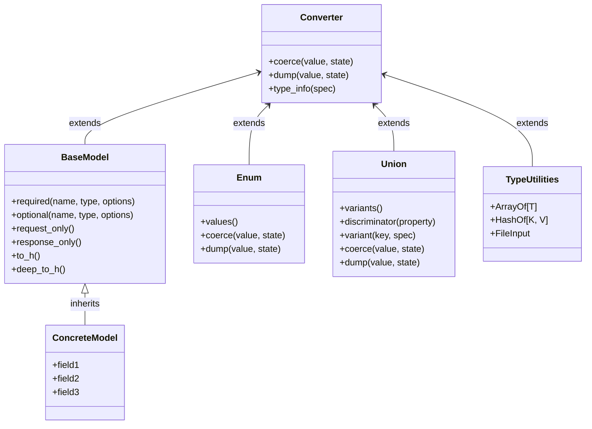
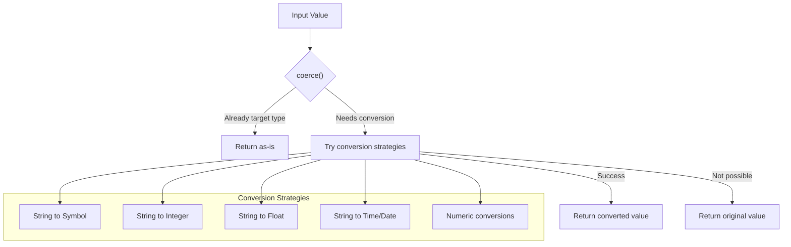
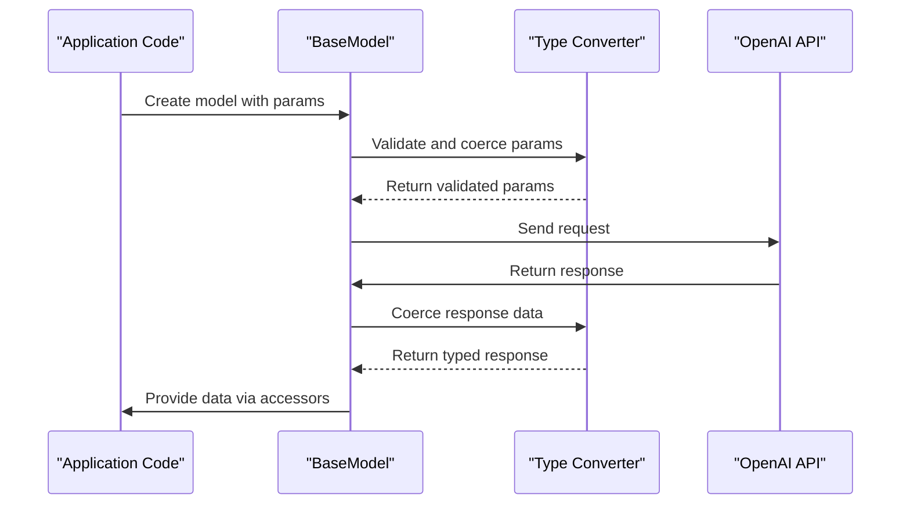
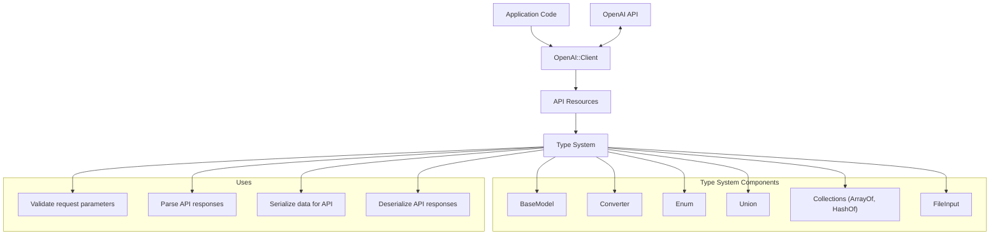

<!-- source: DeepWiki mcp.deepwiki.com · repo openai/openai-ruby · page 3.2 Type System · fetched 2026-10-26 -->

# Type System

<details>
<summary>Relevant source files</summary>

The following files were used as context for generating this wiki page:

- [lib/openai/file_part.rb](lib/openai/file_part.rb)
- [lib/openai/internal/type/base_model.rb](lib/openai/internal/type/base_model.rb)
- [lib/openai/internal/type/converter.rb](lib/openai/internal/type/converter.rb)
- [lib/openai/internal/type/enum.rb](lib/openai/internal/type/enum.rb)
- [lib/openai/internal/type/file_input.rb](lib/openai/internal/type/file_input.rb)
- [lib/openai/internal/type/union.rb](lib/openai/internal/type/union.rb)
- [rbi/openai/internal/type/base_model.rbi](rbi/openai/internal/type/base_model.rbi)
- [sig/openai/internal/type/base_model.rbs](sig/openai/internal/type/base_model.rbs)
- [test/openai/file_part_test.rb](test/openai/file_part_test.rb)
- [test/openai/internal/type/base_model_test.rb](test/openai/internal/type/base_model_test.rb)

</details>


The OpenAI Ruby SDK implements a sophisticated type system that provides data validation, conversion, and serialization capabilities throughout the codebase. This system ensures type safety when interacting with the OpenAI API by validating request parameters and coercing API responses into appropriate Ruby objects.

For information about request and response handling that builds on this type system, see [Request and Response Handling](#3.3).

## Core Components

The type system consists of several key components that work together to provide robust type validation and conversion:



Sources: [lib/openai/internal/type/base_model.rb:1-470](), [lib/openai/internal/type/converter.rb:1-293](), [lib/openai/internal/type/enum.rb:1-134](), [lib/openai/internal/type/union.rb:1-241]()

### Converter

The `Converter` module serves as the foundation of the type system, providing methods for converting values between different types. It defines two primary operations:

1. **Coercion** (`coerce`): Intelligently transforms input values to the target type when possible
2. **Dumping** (`dump`): Serializes values into formats suitable for API requests

```ruby
# Example of coercion behavior
Integer <- "123"     # Becomes 123
Float <- 42          # Becomes 42.0
Symbol <- "api_key"  # Becomes :api_key
```

Sources: [lib/openai/internal/type/converter.rb:7-293]()

### BaseModel

The `BaseModel` class provides the foundation for all structured data models in the SDK. Models inherit from this class and define their fields using the `required` and `optional` methods.

```ruby
class SomeModel < OpenAI::Internal::Type::BaseModel
  required :name, String
  optional :age, Integer
  
  # Fields that should only be included in requests
  request_only do
    required :api_key, String
  end
  
  # Fields that should only be expected in responses
  response_only do
    optional :created_at, Time
  end
end
```

Each field has metadata about whether it's required, what type it should be, whether it can be nil, and how it should be serialized/deserialized.

Sources: [lib/openai/internal/type/base_model.rb:7-467]()

### Enum

The `Enum` module provides support for enumerated values. It validates that values are one of a predefined set of options, and can coerce string values to their appropriate symbolic representation.

```ruby
module ModelEnum
  extend OpenAI::Internal::Type::Enum
  
  GPT_4 = :"gpt-4"
  GPT_35_TURBO = :"gpt-3.5-turbo"
end
```

Sources: [lib/openai/internal/type/enum.rb:43-130]()

### Union

The `Union` module supports polymorphic types - values that can be one of several possible types. It uses discriminators (special fields that indicate the concrete type) to determine the appropriate type for a given value.

```ruby
module ContentPart
  extend OpenAI::Internal::Type::Union
  discriminator :type
  
  variant :text, TextPart
  variant :image_url, ImagePart
end
```

Sources: [lib/openai/internal/type/union.rb:32-237]()

## Type Conversion Process

The type system employs a sophisticated process for converting values:



Sources: [lib/openai/internal/type/converter.rb:98-236]()

When coercing values, the type system follows these general rules:

1. If the value already matches the target type, return it as-is
2. For primitive types (Integer, Float, String, etc.), attempt conversion if reasonable
3. For collections, recursively apply the same rules to their elements
4. For models, apply coercion to each field
5. For unions, try each variant until one succeeds

The system tracks how well a value matches the target type using an "exactness" score, which helps with complex conversions like unions where multiple variants might be possible.

## Working with Models

Models form the backbone of the type system, providing structured data representations for API requests and responses:



Sources: [lib/openai/internal/type/base_model.rb:184-462]()

### Key Model Features

1. **Field Definitions**: Models define their structure using `required` and `optional` fields
2. **Attribute Accessors**: Fields are accessible through generated getter and setter methods
3. **Type Safety**: Attribute access performs type checking and coercion
4. **Raw Access**: The `[]` method allows accessing raw field values without type conversion
5. **Serialization**: Models can be serialized to JSON using `to_json` or to hashes using `to_h`
6. **Deep Inspection**: `deep_to_h` recursively converts nested models to hashes

## Special Types

Beyond the core components, the type system includes several special types:

### Collection Types

- **ArrayOf**: Typed arrays that validate and coerce each element
- **HashOf**: Typed dictionaries that validate and coerce keys and values

### File Handling

The `FileInput` type and `FilePart` class handle file data, supporting various input formats:

- Pathname (file paths)
- StringIO (in-memory data)
- IO (streams)
- Raw strings

They include special handling for IO streams that aren't rewindable, disabling retries in such cases.

Sources: [lib/openai/internal/type/file_input.rb:1-97](), [lib/openai/file_part.rb:1-56]()

## Type System in Context

The type system plays a crucial role throughout the SDK:



Sources: [lib/openai/internal/type/base_model.rb:1-470](), [lib/openai/internal/type/converter.rb:1-293](), [lib/openai/internal/type/enum.rb:1-134](), [lib/openai/internal/type/union.rb:1-241]()

## Practical Examples

### Defining a Simple Model

```ruby
class CompletionRequest < OpenAI::Internal::Type::BaseModel
  required :model, String
  required :prompt, String
  optional :max_tokens, Integer
  optional :temperature, Float
end

# Usage
request = CompletionRequest.new(
  model: "text-davinci-003",
  prompt: "Hello, world!",
  max_tokens: 100
)
```

### Working with Enums

```ruby
module ChatRole
  extend OpenAI::Internal::Type::Enum
  
  SYSTEM = :system
  USER = :user
  ASSISTANT = :assistant
end

# Usage in pattern matching
case message.role
when ChatRole::SYSTEM
  # Handle system message
when ChatRole::USER
  # Handle user message
end
```

### Using Unions and Discriminators

```ruby
# Different content types share a common interface
module MessageContent
  extend OpenAI::Internal::Type::Union
  discriminator :type
  
  variant :text, TextContent
  variant :image, ImageContent
end

# API automatically determines the correct type based on the 'type' field
content = client.parse_message_content(response_data)
```

## Error Handling

The type system raises specific exceptions for type conversion failures:

- `OpenAI::Errors::ConversionError`: Raised when a field value can't be converted to the expected type
- `TypeError` or `ArgumentError`: Raised by the underlying Ruby type system for invalid conversions

Error messages include context about what conversion was attempted and why it failed, making debugging easier.

Sources: [lib/openai/internal/type/base_model.rb:95-102]()

## Summary

The OpenAI Ruby SDK type system provides a robust foundation for type-safe API interactions, ensuring that:

1. Request parameters are properly validated before sending to the API
2. Response data is correctly parsed into appropriate Ruby objects
3. Type conversions happen automatically when possible
4. Errors are clearly reported when types don't match

By handling these concerns automatically, the type system makes it easier to work with the OpenAI API while maintaining type safety and providing informative error messages.

---

