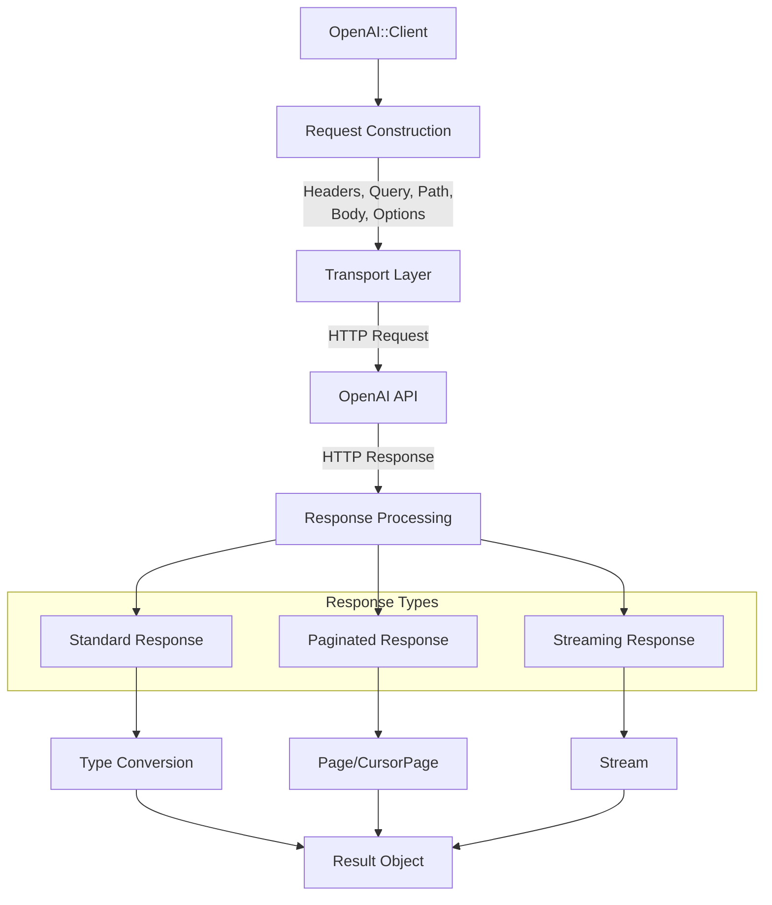
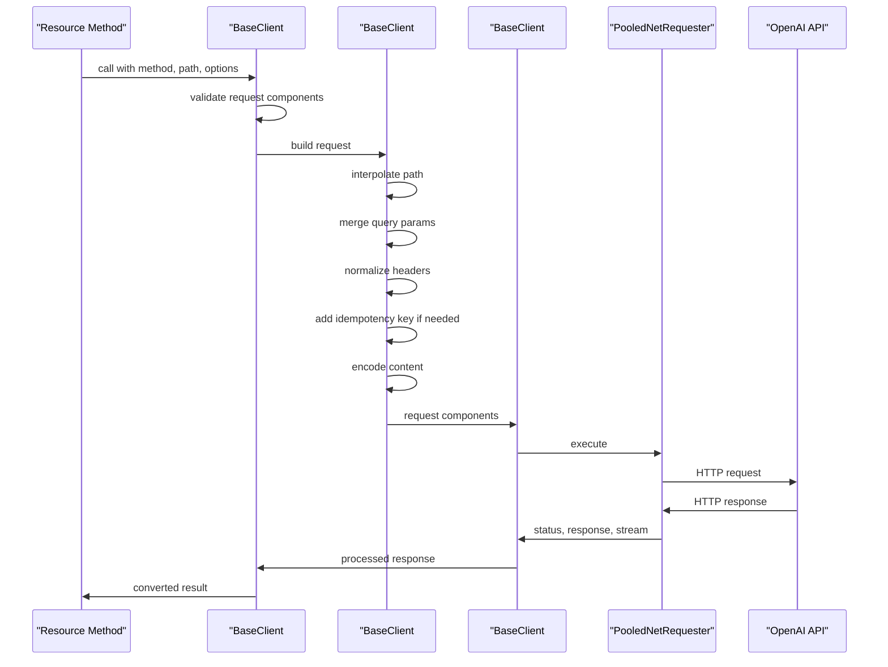
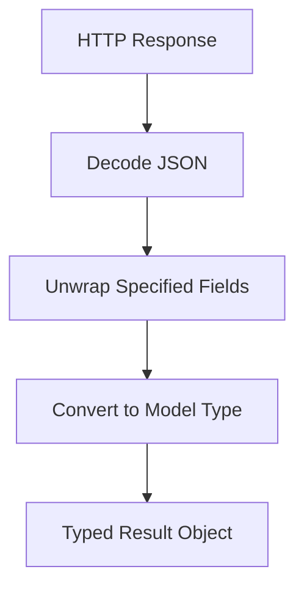
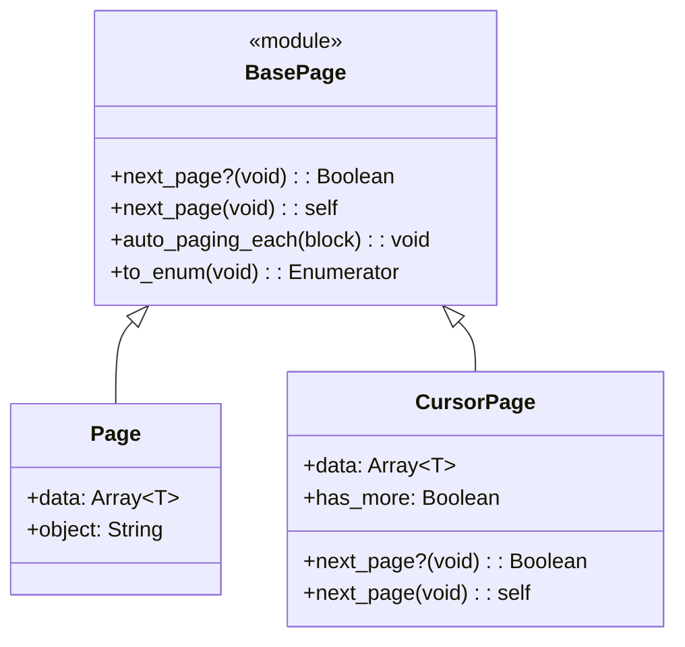
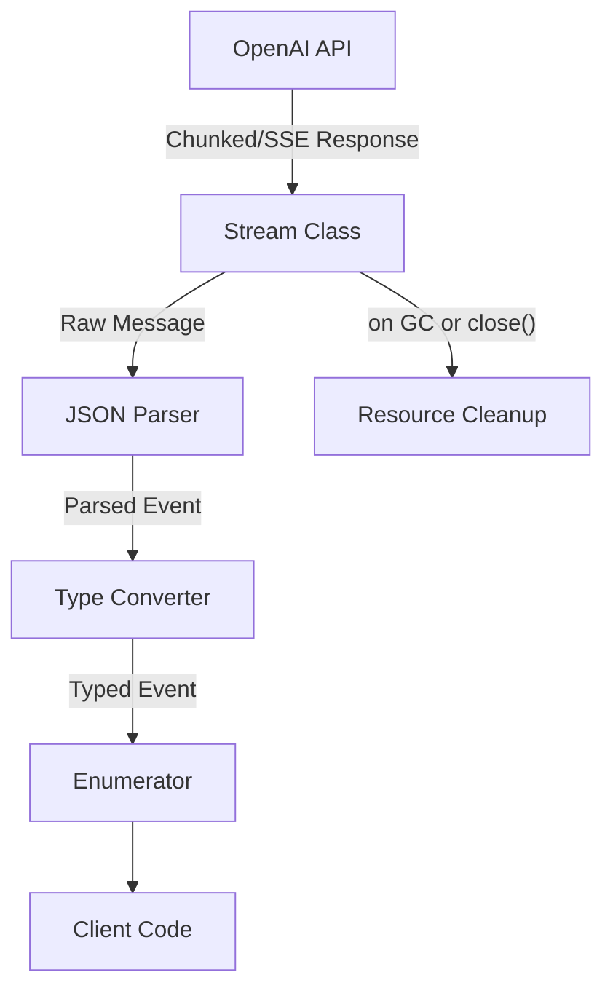
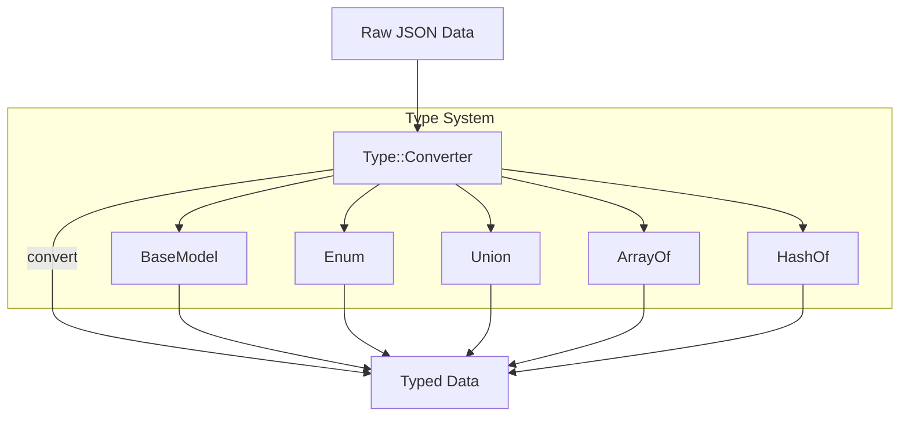

<!-- source: DeepWiki mcp.deepwiki.com · repo openai/openai-ruby · page 3.3 Request and Response Handling · fetched 2026-10-26 -->

# Request and Response Handling

<details>
<summary>Relevant source files</summary>

The following files were used as context for generating this wiki page:

- [Gemfile](Gemfile)
- [Steepfile](Steepfile)
- [lib/openai/internal/cursor_page.rb](lib/openai/internal/cursor_page.rb)
- [lib/openai/internal/page.rb](lib/openai/internal/page.rb)
- [lib/openai/internal/stream.rb](lib/openai/internal/stream.rb)
- [lib/openai/internal/transport/base_client.rb](lib/openai/internal/transport/base_client.rb)
- [lib/openai/internal/type/array_of.rb](lib/openai/internal/type/array_of.rb)
- [lib/openai/internal/type/base_page.rb](lib/openai/internal/type/base_page.rb)
- [lib/openai/internal/type/base_stream.rb](lib/openai/internal/type/base_stream.rb)
- [lib/openai/internal/type/hash_of.rb](lib/openai/internal/type/hash_of.rb)
- [sig/openai/internal.rbs](sig/openai/internal.rbs)
- [sig/openai/internal/transport/base_client.rbs](sig/openai/internal/transport/base_client.rbs)
- [sig/openai/internal/type/base_stream.rbs](sig/openai/internal/type/base_stream.rbs)
- [test/openai/test_helper.rb](test/openai/test_helper.rb)

</details>


This document details the architecture of the request and response handling system in the OpenAI Ruby SDK. It covers how API requests are constructed, sent, and how different types of responses (standard, paginated, and streaming) are processed. For information about error handling specifically, see [Error Handling](#3.4).

## Overview

The OpenAI Ruby SDK provides a robust system for handling API requests and responses. The system is designed to:

1. Construct properly formatted requests including paths, queries, headers, and bodies
2. Send requests with appropriate retry and timeout handling
3. Process different response types:
   - Standard responses (single object)
   - Paginated responses (collections of objects)
   - Streaming responses (real-time data streams)



Sources: [lib/openai/internal/transport/base_client.rb:430-497]()

## Request Construction and Sending

The request lifecycle starts with building a request and ends with sending it to the OpenAI API. The `BaseClient` class is responsible for this process.

### Request Components

A request in the OpenAI Ruby SDK consists of several components:

| Component | Description | Default |
|-----------|-------------|---------|
| `method` | HTTP method (GET, POST, etc.) | Required |
| `path` | API endpoint path | Required |
| `query` | URL query parameters | `{}` |
| `headers` | HTTP headers | Platform headers + content type |
| `body` | Request body | `nil` for GET/HEAD/OPTIONS/TRACE |
| `unwrap` | Path to extract from response | `nil` |
| `page` | Pagination handler class | `nil` |
| `stream` | Streaming handler class | `nil` |
| `model` | Type to convert response to | `OpenAI::Internal::Type::Unknown` |
| `options` | Additional request options | `{}` |

Sources: [lib/openai/internal/transport/base_client.rb:33-44](), [lib/openai/internal/transport/base_client.rb:434-467]()

### Request Building Process

The request building process involves:

1. Interpolating path parameters
2. Merging query parameters
3. Normalizing headers (including auth and platform-specific headers)
4. Adding idempotency keys for non-idempotent methods
5. Encoding the request body based on content type



Sources: [lib/openai/internal/transport/base_client.rb:264-316](), [lib/openai/internal/transport/base_client.rb:470-497]()

### Request Sending and Retry Logic

The SDK implements a sophisticated retry mechanism for handling transient failures:

1. Sends the initial request
2. For failures (4xx/5xx status codes or connection errors), determines if retry is appropriate:
   - Checks status code (retries on 408, 409, 429, 500+)
   - Honors `x-should-retry` header if present
3. Uses exponential backoff with jitter for retries
4. Respects `retry-after` headers when provided by the API

The retry delay calculation follows a strategy that combines:
- An initial delay that increases quadratically with retry count
- Random jitter to prevent thundering herd problems
- Respect for API-provided retry-after headers

Sources: [lib/openai/internal/transport/base_client.rb:53-68](), [lib/openai/internal/transport/base_client.rb:324-342](), [lib/openai/internal/transport/base_client.rb:368-428]()

## Response Processing

After receiving a response from the API, the SDK processes it based on the expected response type. There are three main types of responses:

1. **Standard responses**: Single objects or simple data structures
2. **Paginated responses**: Collections of objects with pagination controls
3. **Streaming responses**: Real-time data streams delivered incrementally

### Standard Response Handling

For standard responses, the SDK:

1. Decodes the response body (typically JSON)
2. Optionally extracts a nested value using the `unwrap` parameter
3. Converts the result to the specified model type



Sources: [lib/openai/internal/transport/base_client.rb:487-496]()

### Paginated Response Handling

The SDK supports two types of pagination:

1. **Standard pagination** (`Page`): A simple container for collections
2. **Cursor-based pagination** (`CursorPage`): Allows navigation through large collections

Both pagination types provide:

- Access to the current page of data
- Methods to check if more pages exist
- Methods to fetch the next page
- Automatic iteration through all pages with `auto_paging_each`



Sources: [lib/openai/internal/type/base_page.rb:1-55](), [lib/openai/internal/page.rb:1-80](), [lib/openai/internal/cursor_page.rb:1-86]()

#### Auto-Pagination Example

The `auto_paging_each` method simplifies iterating through all pages:

```ruby
# Automatically fetch and process all pages
client.assistants.list.auto_paging_each do |assistant|
  puts assistant.id
end
```

Behind the scenes, this method:
1. Processes items in the current page
2. Checks if more pages exist
3. Fetches the next page automatically
4. Repeats until all items are processed

Sources: [lib/openai/internal/cursor_page.rb:42-57](), [lib/openai/internal/page.rb:36-51]()

### Streaming Response Handling

The streaming system is designed to process real-time events from the API, like chat completions that arrive token by token. The `Stream` class provides:

- Enumerable interface for iterating through stream events
- Automatic parsing and type conversion of each event
- Proper resource cleanup



Sources: [lib/openai/internal/type/base_stream.rb:1-90](), [lib/openai/internal/stream.rb:1-60]()

#### Key Stream Features

1. **Enumerable Interface**: All streams implement Ruby's Enumerable interface, allowing iteration, mapping, filtering, etc.
2. **Automatic Cleanup**: Resources are cleaned up when the stream is garbage collected or explicitly closed
3. **Error Handling**: API errors in the stream are properly captured and raised

Sources: [lib/openai/internal/type/base_stream.rb:14-34](), [lib/openai/internal/stream.rb:17-57]()

## Type Conversion System

The SDK includes a robust type system to validate and convert data between the API and your Ruby code. Key components include:

### Collection Types

- **ArrayOf**: Handles arrays of items of a specified type
- **HashOf**: Handles hashes/dictionaries with values of a specified type

These containers ensure that collection elements are properly validated and converted.



Sources: [lib/openai/internal/type/array_of.rb:1-154](), [lib/openai/internal/type/hash_of.rb:1-174]()

### Type Conversion Process

When processing API responses, the SDK applies type conversion to ensure the data matches the expected model:

1. The raw response is decoded from JSON
2. The appropriate model type is identified
3. The data is coerced to the expected type (recursive for nested structures)
4. Collection elements are individually converted to their expected types

This process ensures that responses always match your expected types, making the API easier to work with in a statically-typed manner.

Sources: [lib/openai/internal/transport/base_client.rb:487-496]()

## Conclusion

The request and response handling system in the OpenAI Ruby SDK provides a robust foundation for interacting with the OpenAI API. It handles the complexities of HTTP communication, pagination, streaming, and type conversion, allowing you to focus on using the API rather than managing the details of HTTP requests and responses.

By understanding this system, you can effectively work with various response types and handle common scenarios like pagination and streaming efficiently.

---

