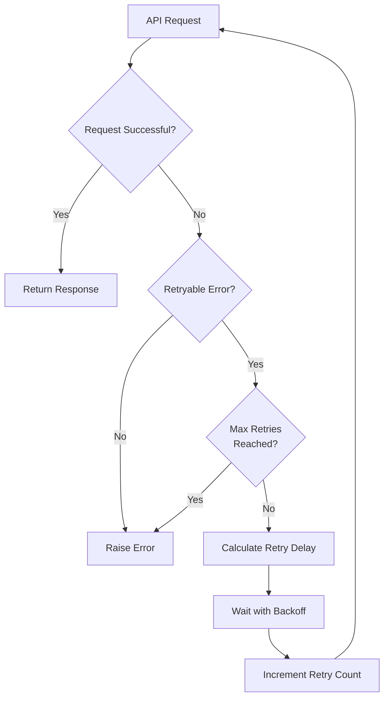
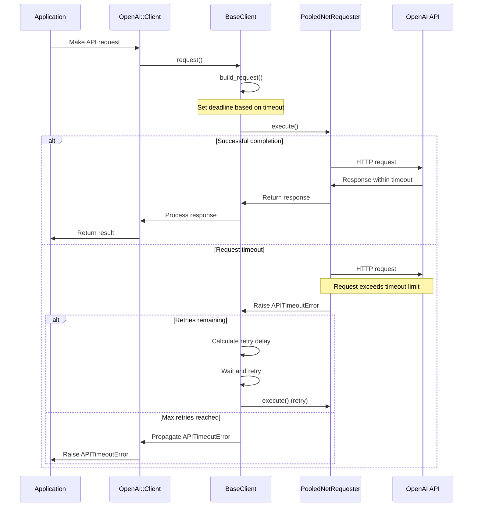

<!-- source: DeepWiki mcp.deepwiki.com · repo openai/openai-ruby · page 3.4 Error Handling · fetched 2026-10-26 -->

# Error Handling

<details>
<summary>Relevant source files</summary>

The following files were used as context for generating this wiki page:

- [.gitignore](.gitignore)
- [.ruby-version](.ruby-version)
- [Gemfile](Gemfile)
- [README.md](README.md)
- [lib/openai/internal/transport/base_client.rb](lib/openai/internal/transport/base_client.rb)
- [openai.gemspec](openai.gemspec)
- [scripts/bootstrap](scripts/bootstrap)
- [sig/openai/internal/transport/base_client.rbs](sig/openai/internal/transport/base_client.rbs)
- [test/openai/test_helper.rb](test/openai/test_helper.rb)

</details>


This document details how the OpenAI Ruby SDK handles errors during API requests, including error types, automatic retries, and timeout behaviors. For information about general request and response processing, see [Request and Response Handling](#3.3).

## Error Types and Hierarchy

When the OpenAI Ruby SDK encounters an error, it throws a subclass of `OpenAI::Errors::APIError`. These exceptions provide information about what went wrong and can be caught to implement custom error handling in your application.

```mermaid
classDiagram
    class "APIError" {
        +message
        +cause
    }
    class "APIConnectionError" {
        +url
        +response
    }
    class "APITimeoutError" {
        +url
        +response
    }
    class "APIStatusError" {
        +status
        +body
        +request
        +response
    }
    class "BadRequestError" {
    }
    class "AuthenticationError" {
    }
    class "PermissionDeniedError" {
    }
    class "NotFoundError" {
    }
    class "ConflictError" {
    }
    class "UnprocessableEntityError" {
    }
    class "RateLimitError" {
    }
    class "InternalServerError" {
    }
    
    "APIError" <|-- "APIConnectionError"
    "APIError" <|-- "APIStatusError"
    "APIConnectionError" <|-- "APITimeoutError"
    "APIStatusError" <|-- "BadRequestError"
    "APIStatusError" <|-- "AuthenticationError"
    "APIStatusError" <|-- "PermissionDeniedError"
    "APIStatusError" <|-- "NotFoundError"
    "APIStatusError" <|-- "ConflictError"
    "APIStatusError" <|-- "UnprocessableEntityError"
    "APIStatusError" <|-- "RateLimitError"
    "APIStatusError" <|-- "InternalServerError"
```

Sources: [README.md:110-143]()

The SDK provides specific error classes for different HTTP status codes:

| HTTP Status | Error Class | Description |
|-------------|-------------|-------------|
| HTTP 400 | `BadRequestError` | The request was malformed or had invalid parameters |
| HTTP 401 | `AuthenticationError` | Invalid API key or authentication token |
| HTTP 403 | `PermissionDeniedError` | Valid credentials but insufficient permissions |
| HTTP 404 | `NotFoundError` | Requested resource not found |
| HTTP 409 | `ConflictError` | Request couldn't be completed due to a conflict |
| HTTP 422 | `UnprocessableEntityError` | Request was well-formed but couldn't be processed |
| HTTP 429 | `RateLimitError` | Rate limit exceeded, need to back off |
| HTTP >= 500 | `InternalServerError` | Server-side error on the OpenAI side |
| Other HTTP error | `APIStatusError` | Other HTTP errors not covered above |
| Timeout | `APITimeoutError` | Request timed out |
| Network error | `APIConnectionError` | Network connectivity issues |

Sources: [README.md:128-143]()

## Error Handling Example

Here's an example of how to catch and handle different error types in your application:

```ruby
begin
  job = openai.fine_tuning.jobs.create(model: :"babbage-002", training_file: "file-abc123")
rescue OpenAI::Errors::APIConnectionError => e
  puts("The server could not be reached")
  puts(e.cause)  # an underlying Exception, likely raised within `net/http`
rescue OpenAI::Errors::RateLimitError => e
  puts("A 429 status code was received; we should back off a bit.")
rescue OpenAI::Errors::APIStatusError => e
  puts("Another non-200-range status code was received")
  puts(e.status)
end
```

Sources: [README.md:114-126]()

## Retry Mechanism

The OpenAI Ruby SDK implements an automatic retry mechanism for certain types of errors to increase reliability without requiring application-level retry logic.



Sources: [lib/openai/internal/transport/base_client.rb:368-429](), [README.md:145-164]()

### Retryable Errors

By default, the following errors are automatically retried:

- Connection errors (network connectivity issues)
- HTTP 408 Request Timeout
- HTTP 409 Conflict 
- HTTP 429 Rate Limit
- HTTP 500+ Server errors
- Request timeouts

The determination of whether to retry is implemented in the `should_retry?` method in `BaseClient`:

```ruby
# retry on:
# 408: timeouts
# 409: locks
# 429: rate limits
# 500+: unknown errors
```

Sources: [lib/openai/internal/transport/base_client.rb:53-68](), [README.md:148]()

### Retry Configuration

By default, the SDK will retry failed requests up to 2 times. You can configure this behavior globally when initializing the client:

```ruby
openai = OpenAI::Client.new(
  max_retries: 0 # disable retries
)
```

Or configure it per-request:

```ruby
openai.chat.completions.create(
  messages: [{role: "user", content: "How can I get the name of the current day in JavaScript?"}],
  model: :"gpt-4.1",
  request_options: {max_retries: 5}
)
```

Sources: [README.md:150-164]()

### Exponential Backoff Algorithm

The SDK implements exponential backoff with jitter for determining retry delays:

1. First, it checks for server-provided retry guidance:
   - Checks for a `retry-after-ms` header and converts to seconds
   - Checks for a `retry-after` header with either seconds or HTTP date format

2. If no server guidance is provided, it calculates a delay using:
   ```
   delay = (initial_retry_delay * retry_count² * jitter)
   ```
   where jitter is a random value between 0.75 and 1.0

3. The calculated delay is clamped to not exceed `max_retry_delay`

Sources: [lib/openai/internal/transport/base_client.rb:324-342]()

## Timeout Handling

By default, requests will time out after 600 seconds. When a request times out, an `OpenAI::Errors::APITimeoutError` is raised.



Sources: [README.md:166-186](), [lib/openai/internal/transport/base_client.rb:368-429]()

### Timeout Configuration

You can customize the timeout behavior globally:

```ruby
openai = OpenAI::Client.new(
  timeout: nil # default is 600 seconds, nil disables timeout
)
```

Or per-request:

```ruby
openai.chat.completions.create(
  messages: [{role: "user", content: "How can I list all files in a directory using Python?"}],
  model: :"gpt-4.1",
  request_options: {timeout: 5}
)
```

Sources: [README.md:170-182]()

## Error Handling Internal Flow

The following sequence diagram illustrates how errors are processed internally by the SDK:


Sources: [lib/openai/internal/transport/base_client.rb:368-429](), [lib/openai/internal/transport/base_client.rb:470-497]()

## Connection Management

The `BaseClient` class also handles cleaning up resources when errors occur. For certain error types, especially connection errors and server errors (500+), the SDK will "reap" the connection to prevent resource leaks:

```ruby
def reap_connection!(status, stream:)
  case status
  in (..199) | (300..499)
    stream&.each { next }
  in OpenAI::Errors::APIConnectionError | (500..)
    OpenAI::Internal::Util.close_fused!(stream)
  else
  end
end
```

This ensures that connections are properly closed, even when errors occur during streaming operations.

Sources: [lib/openai/internal/transport/base_client.rb:145-153]()

## Best Practices for Error Handling

1. **Be specific with error catching**: Catch specific error types rather than just the base `APIError` to handle different scenarios appropriately.

2. **Handle rate limits properly**: When encountering `RateLimitError`, consider implementing exponential backoff at the application level for persistent rate limiting.

3. **Set appropriate timeouts**: Use shorter timeouts for user-facing requests and longer timeouts for background tasks.

4. **Log errors with context**: Include error details, request parameters, and retry counts in your logs to facilitate debugging.

5. **For critical operations**: Consider implementing application-level retries with custom logic if the default retry mechanism is insufficient.

Sources: [README.md:110-186]()

---

