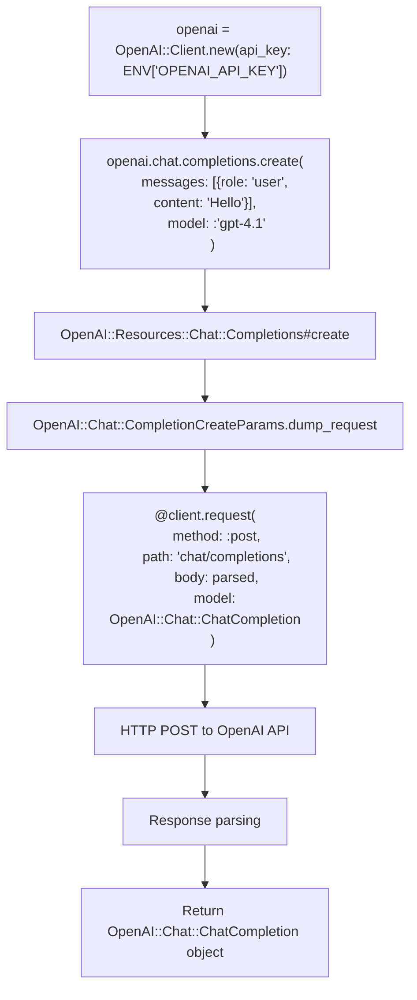
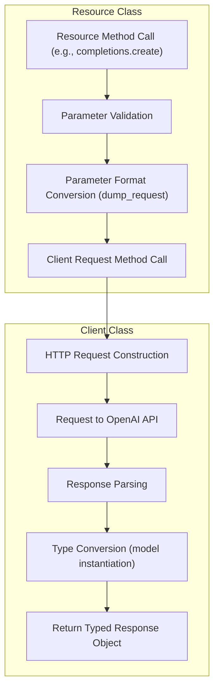
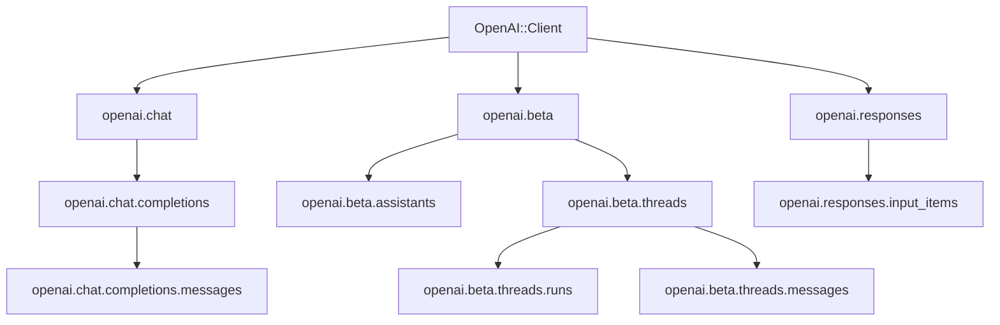

<!-- source: DeepWiki mcp.deepwiki.com · repo openai/openai-ruby · page 4 API Resources · fetched 2026-10-26 -->

# API Resources

<details>
<summary>Relevant source files</summary>

The following files were used as context for generating this wiki page:

- [.gitignore](.gitignore)
- [.ruby-version](.ruby-version)
- [README.md](README.md)
- [lib/openai/resources/beta/threads.rb](lib/openai/resources/beta/threads.rb)
- [lib/openai/resources/chat/completions.rb](lib/openai/resources/chat/completions.rb)
- [lib/openai/resources/responses.rb](lib/openai/resources/responses.rb)
- [openai.gemspec](openai.gemspec)
- [scripts/bootstrap](scripts/bootstrap)
- [test/openai/client_test.rb](test/openai/client_test.rb)

</details>


The OpenAI Ruby SDK provides a structured set of API resources that encapsulate the various endpoints of the OpenAI REST API. This page provides an overview of the available API resources, their structure, and how they're used to interact with OpenAI's services.

For information on how these resources fit into the overall SDK architecture, see [Core Architecture](#3). For details on specific resource configurations, see the relevant child pages: [Chat Completions](#4.1), [Assistants API (Beta)](#4.2), [Audio and Images](#4.3), and [Models and Fine-tuning](#4.4).

## API Resources Overview

API Resources in the OpenAI Ruby SDK represent the various services offered by the OpenAI API, such as Chat Completions, Assistants, Images, Audio, and more. Each resource provides methods for interacting with specific API endpoints, handling request/response formats, and implementing features like streaming and pagination.

```mermaid
classDiagram
    direction LR
    class "OpenAI::Client" {
        +chat
        +images
        +audio
        +files
        +models
        +fine_tuning
        +beta
        +embeddings
        +moderations
        +responses
    }
    
    "OpenAI::Client" --> "OpenAI::Resources::Chat"
    "OpenAI::Client" --> "OpenAI::Resources::Images"
    "OpenAI::Client" --> "OpenAI::Resources::Audio"
    "OpenAI::Client" --> "OpenAI::Resources::Files"
    "OpenAI::Client" --> "OpenAI::Resources::Models"
    "OpenAI::Client" --> "OpenAI::Resources::FineTuning"
    "OpenAI::Client" --> "OpenAI::Resources::Beta"
    "OpenAI::Client" --> "OpenAI::Resources::Embeddings"
    "OpenAI::Client" --> "OpenAI::Resources::Moderations"
    "OpenAI::Client" --> "OpenAI::Resources::Responses"

    class "OpenAI::Resources::Chat" {
        +completions
        +messages
    }

    class "OpenAI::Resources::Beta" {
        +assistants
        +threads
    }

    class "OpenAI::Resources::Beta::Threads" {
        +runs
        +messages
    }

    "OpenAI::Resources::Chat" --> "OpenAI::Resources::Chat::Completions"
    "OpenAI::Resources::Beta" --> "OpenAI::Resources::Beta::Assistants"
    "OpenAI::Resources::Beta" --> "OpenAI::Resources::Beta::Threads"
    "OpenAI::Resources::Beta::Threads" --> "OpenAI::Resources::Beta::Threads::Runs"
    "OpenAI::Resources::Beta::Threads" --> "OpenAI::Resources::Beta::Threads::Messages"
```

*API Resources Hierarchy Diagram - Shows the organization of resources in the OpenAI Ruby SDK*

Sources: [lib/openai/resources/chat/completions.rb](), [lib/openai/resources/beta/threads.rb](), [lib/openai/resources/responses.rb]()

## Resource Interaction Patterns

API Resources follow consistent interaction patterns, making them predictable to use across different endpoints. The primary operations include creating, retrieving, updating, listing, and deleting resources.

```mermaid
sequenceDiagram
    participant "Application Code" as App
    participant "OpenAI::Client" as Client
    participant "API Resource" as Resource
    participant "OpenAI API" as API

    App->>Client: Call method (e.g., chat.completions.create)
    Client->>Resource: Delegate to appropriate resource
    Resource->>Resource: Validate and format parameters
    Resource->>API: Make HTTP request to OpenAI API
    API->>Resource: Return response data
    Resource->>Resource: Parse response into typed objects
    Resource->>Client: Return typed response objects
    Client->>App: Return result
```

*Resource Interaction Flow - Shows how application code interacts with API resources*

Sources: [lib/openai/resources/chat/completions.rb:100-182](), [lib/openai/resources/beta/threads.rb:31-40](), [lib/openai/resources/responses.rb:69-82]()

## Available API Resources

The OpenAI Ruby SDK provides the following API resources:

| Resource | Description | Primary Operations |
|----------|-------------|-------------------|
| Chat Completions | Generate text responses in a conversational format | create, stream_raw, retrieve, update, list, delete |
| Beta Assistants | Create, manage and use AI assistants with specific capabilities | create, retrieve, update, delete, list |
| Beta Threads | Manage conversation threads for assistants | create, retrieve, update, delete, create_and_run, stream_raw |
| Images | Generate or edit images based on text prompts | create, edit, create_variation |
| Audio | Speech-to-text and text-to-speech capabilities | transcribe, translate, speech |
| Files | Manage files for use with various API features | create, retrieve, list, delete |
| Models | Access OpenAI's models | retrieve, list, delete |
| Fine-Tuning | Create and manage fine-tuned models | create, retrieve, list, cancel, list_events |
| Embeddings | Generate vector embeddings for text | create |
| Moderations | Check content against OpenAI's content policy | create |
| Responses | Newer, feature-rich alternative to Chat Completions | create, stream_raw, retrieve, delete |

Sources: [README.md:25-106](), [lib/openai/resources/chat/completions.rb](), [lib/openai/resources/beta/threads.rb](), [lib/openai/resources/responses.rb]()

## Resource Usage Example

The following diagram illustrates the code-to-API flow when using an API resource:



*Resource Usage Flow - Illustrates the flow from client code to API call*

Sources: [README.md:31-40](), [lib/openai/resources/chat/completions.rb:100-182]()

## Common Resource Patterns

### Create Operation

Most resources provide a `create` method to instantiate a new resource on the OpenAI API:

```ruby
# Creating a chat completion
chat_completion = openai.chat.completions.create(
  messages: [{role: "user", content: "Say this is a test"}],
  model: :"gpt-4.1"
)

# Creating a thread in the Assistants API
thread = openai.beta.threads.create(
  messages: [
    {role: "user", content: "Hello, how can you help me today?"}
  ]
)
```

Sources: [README.md:35-39](), [lib/openai/resources/chat/completions.rb:100-182](), [lib/openai/resources/beta/threads.rb:31-40]()

### Streaming Operations

Resources that support streaming responses provide a `stream_raw` method:

```ruby
# Streaming a chat completion
stream = openai.chat.completions.stream_raw(
  messages: [{role: "user", content: "Say this is a test"}],
  model: :"gpt-4.1"
)

stream.each do |completion|
  puts(completion)
end
```

Sources: [README.md:50-58](), [lib/openai/resources/chat/completions.rb:278-294](), [lib/openai/resources/beta/threads.rb:219-235]()

### Pagination

List operations in the OpenAI API are paginated. The SDK provides auto-paginating iterators:

```ruby
# Listing fine-tuning jobs with pagination
page = openai.fine_tuning.jobs.list(limit: 20)

# Auto-pagination
page.auto_paging_each do |job|
  puts(job.id)
end

# Manual pagination
if page.next_page?
  new_page = page.next_page
  puts(new_page.data[0].id)
end
```

Sources: [README.md:67-86](), [lib/openai/resources/chat/completions.rb:369-379]()

## Resource Implementation Architecture

```mermaid
classDiagram
    direction TB
    class "OpenAI::Resources::BaseResource" {
        -client
        +initialize(client:)
        +request(method, path, params)
    }
    
    class "OpenAI::Resources::Chat::Completions" {
        +messages
        +create(params)
        +stream_raw(params)
        +retrieve(completion_id, params)
        +update(completion_id, params)
        +list(params)
        +delete(completion_id, params)
    }
    
    class "OpenAI::Resources::Beta::Threads" {
        +runs
        +messages
        +create(params)
        +retrieve(thread_id, params)
        +update(thread_id, params)
        +delete(thread_id, params)
        +create_and_run(params)
        +stream_raw(params)
    }
    
    class "OpenAI::Resources::Responses" {
        +input_items
        +create(params)
        +stream_raw(params)
        +retrieve(response_id, params)
        +delete(response_id, params)
    }
    
    "OpenAI::Resources::BaseResource" <|-- "OpenAI::Resources::Chat::Completions"
    "OpenAI::Resources::BaseResource" <|-- "OpenAI::Resources::Beta::Threads"
    "OpenAI::Resources::BaseResource" <|-- "OpenAI::Resources::Responses"
```

*Resource Implementation Architecture - Shows the structure of resource implementation classes*

Sources: [lib/openai/resources/chat/completions.rb:402-408](), [lib/openai/resources/beta/threads.rb:237-245](), [lib/openai/resources/responses.rb:213-219]()

## Resource Request Flow



*Resource Request Flow - Illustrates the flow of a request through a resource*

Sources: [lib/openai/resources/chat/completions.rb:100-182](), [lib/openai/resources/beta/threads.rb:31-40](), [lib/openai/resources/responses.rb:69-82]()

## Response Types

API resources return different types of responses depending on the operation:

1. **Single resources** - Most creation and retrieval operations return a single resource object (e.g., `OpenAI::Chat::ChatCompletion`)

2. **Paginated lists** - List operations return paginated results wrapped in a `OpenAI::Internal::CursorPage` or `OpenAI::Internal::Page` object

3. **Streaming responses** - Streaming operations return an `OpenAI::Internal::Stream` object that yields events

4. **Deletion responses** - Deletion operations may return a deletion confirmation object (e.g., `OpenAI::Chat::ChatCompletionDeleted`) or `nil`

Sources: [lib/openai/resources/chat/completions.rb:97-108](), [lib/openai/resources/chat/completions.rb:275-278](), [lib/openai/resources/chat/completions.rb:366-369](), [lib/openai/resources/chat/completions.rb:390-393]()

## Common Resource Methods

Most API resources implement a consistent set of methods, though the specific methods available vary by resource:

| Method | Purpose | HTTP Method | Example |
|--------|---------|------------|---------|
| `create` | Create a new resource | POST | `openai.chat.completions.create(...)` |
| `retrieve` | Get a specific resource by ID | GET | `openai.chat.completions.retrieve(completion_id)` |
| `update` | Modify an existing resource | POST | `openai.chat.completions.update(completion_id, ...)` |
| `list` | List multiple resources | GET | `openai.chat.completions.list(...)` |
| `delete` | Delete a resource | DELETE | `openai.chat.completions.delete(completion_id)` |
| `stream_raw` | Stream a response | POST | `openai.chat.completions.stream_raw(...)` |

Sources: [lib/openai/resources/chat/completions.rb](), [lib/openai/resources/beta/threads.rb](), [lib/openai/resources/responses.rb]()

## Nested Resources

Some API resources contain nested resources, providing a hierarchical organization:



*Nested Resources Structure - Shows the hierarchy of nested resources*

Sources: [lib/openai/resources/chat/completions.rb:7-9](), [lib/openai/resources/beta/threads.rb:7-11](), [lib/openai/resources/responses.rb:6-7]()

## Parameter and Response Types

API resources use the Type System to validate parameters and parse responses:

1. Parameters are validated using parameter classes (e.g., `OpenAI::Chat::CompletionCreateParams`)
2. Responses are parsed into model classes (e.g., `OpenAI::Chat::ChatCompletion`)
3. Both use the `OpenAI::Internal::Type::BaseModel` for serialization and deserialization

Sources: [lib/openai/resources/chat/completions.rb:101-101](), [lib/openai/resources/chat/completions.rb:179-180](), [README.md:190-205]()

## Summary

The API Resources layer of the OpenAI Ruby SDK provides a structured and consistent interface to the OpenAI API. It handles parameter validation, request formatting, response parsing, and special features like streaming and pagination, making it easier to work with the OpenAI API in Ruby applications.

Each resource corresponds to a specific set of API endpoints and provides Ruby methods to interact with those endpoints in a type-safe manner. The consistent patterns across resources make the SDK predictable and easy to use, even as new features are added to the OpenAI API.

---

