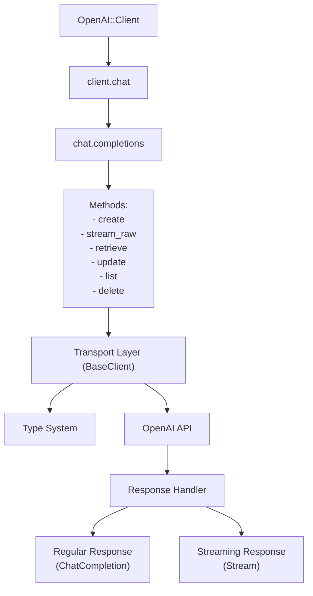
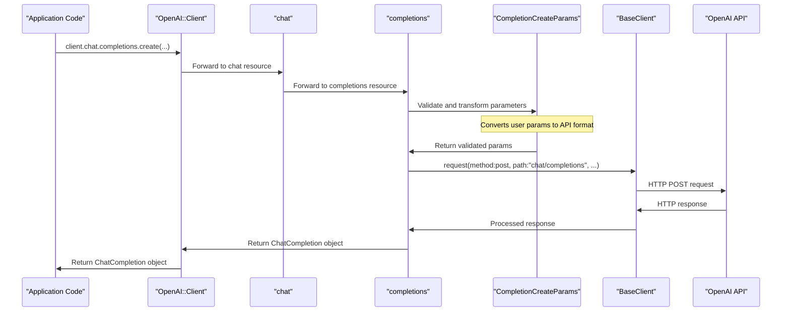
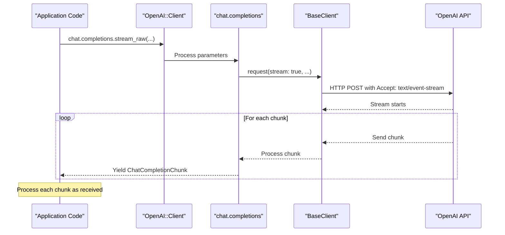
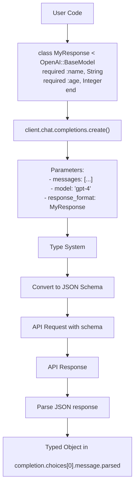
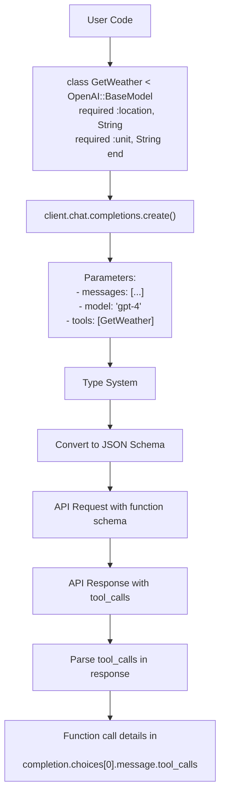

<!-- source: DeepWiki mcp.deepwiki.com · repo openai/openai-ruby · page 4.1 Chat Completions · fetched 2026-10-26 -->

# Chat Completions

<details>
<summary>Relevant source files</summary>

The following files were used as context for generating this wiki page:

- [.solargraph.yml](.solargraph.yml)
- [examples/advanced_streaming.rb](examples/advanced_streaming.rb)
- [examples/demo.rb](examples/demo.rb)
- [examples/demo_sorbet.rb](examples/demo_sorbet.rb)
- [examples/picture.rb](examples/picture.rb)
- [examples/streaming.rb](examples/streaming.rb)
- [examples/structured_outputs_chat_completions.rb](examples/structured_outputs_chat_completions.rb)
- [examples/structured_outputs_chat_completions_function_calling.rb](examples/structured_outputs_chat_completions_function_calling.rb)
- [lib/openai/helpers/structured_output.rb](lib/openai/helpers/structured_output.rb)
- [lib/openai/helpers/structured_output/array_of.rb](lib/openai/helpers/structured_output/array_of.rb)
- [lib/openai/helpers/structured_output/base_model.rb](lib/openai/helpers/structured_output/base_model.rb)
- [lib/openai/helpers/structured_output/boolean.rb](lib/openai/helpers/structured_output/boolean.rb)
- [lib/openai/helpers/structured_output/enum_of.rb](lib/openai/helpers/structured_output/enum_of.rb)
- [lib/openai/helpers/structured_output/json_schema_converter.rb](lib/openai/helpers/structured_output/json_schema_converter.rb)
- [lib/openai/helpers/structured_output/union_of.rb](lib/openai/helpers/structured_output/union_of.rb)
- [lib/openai/models/chat/chat_completion_message.rb](lib/openai/models/chat/chat_completion_message.rb)
- [lib/openai/resources/beta/threads.rb](lib/openai/resources/beta/threads.rb)
- [lib/openai/resources/chat/completions.rb](lib/openai/resources/chat/completions.rb)
- [lib/openai/resources/responses.rb](lib/openai/resources/responses.rb)
- [sorbet/config](sorbet/config)
- [test/openai/client_test.rb](test/openai/client_test.rb)

</details>


The Chat Completions API is a core component of the OpenAI Ruby SDK that enables interaction with OpenAI's language models in a conversational format. This page documents how to use the Chat Completions resource to create, stream, retrieve, update, list, and delete chat completions.

For information about the Assistants API, see [Assistants API (Beta)](#4.2). For information about the newer Responses API, which OpenAI recommends for new projects, see [API Resources](#4).

## Position in the SDK Architecture

The Chat Completions functionality is part of the Resources layer in the SDK, sitting between the Client layer and the Transport layer.



Sources: [lib/openai/resources/chat/completions.rb:1-412]()

## Request-Response Flow

When using Chat Completions, here's how a request flows through the system:



Sources: [lib/openai/resources/chat/completions.rb:174-181]()

## Basic Usage

### Creating a Chat Completion

The most basic use case involves creating a client and sending a chat completion request:

```ruby
client = OpenAI::Client.new

completion = client.chat.completions.create(
  model: "gpt-4",
  messages: [
    { role: "user", content: "Say this is a test" }
  ]
)

puts completion.choices.first.message.content
```

Sources: [examples/demo.rb:10-25]()

### Key Parameters

| Parameter | Type | Description |
|-----------|------|-------------|
| `messages` | Array | Required. Conversation history with roles and content |
| `model` | String/Symbol | Required. Model ID (e.g., "gpt-4", "gpt-4o") |
| `temperature` | Float | Controls randomness (0.0-2.0) |
| `max_tokens` | Integer | Maximum tokens to generate |
| `response_format` | Object | Controls output format (text or JSON) |
| `tools` | Array | Functions the model can call |
| `tool_choice` | Object | Controls which tool the model should use |
| `stream` | Boolean | Whether to stream the response |
| `n` | Integer | Number of chat completion choices to generate |

Sources: [lib/openai/resources/chat/completions.rb:32-95]()

### Response Structure

The response from a chat completion is a `ChatCompletion` object with the following structure:

```
ChatCompletion
├── id: String - Unique identifier for the completion
├── object: Symbol - Always :chat.completion
├── created: Integer - Unix timestamp of creation
├── model: String - Model used for completion
├── choices: Array<ChatCompletionChoice>
│   └── ChatCompletionChoice
│       ├── index: Integer - Position in the choices array
│       ├── message: ChatCompletionMessage
│       │   ├── role: Symbol - Always :assistant
│       │   ├── content: String - The model's response text (or null if using functions)
│       │   ├── tool_calls: Array<ChatCompletionMessageToolCall> - If the model called tools
│       │   └── parsed: Object - For structured outputs, the parsed object
│       └── finish_reason: Symbol - Why generation stopped (e.g., :stop, :length, :tool_calls)
└── usage: CompletionUsage
    ├── prompt_tokens: Integer - Tokens in the prompt
    ├── completion_tokens: Integer - Tokens in the completion
    └── total_tokens: Integer - Total tokens used
```

Sources: [lib/openai/models/chat/chat_completion_message.rb:6-178]()

## Streaming Responses

Streaming allows you to receive the model's response in chunks as they're generated, rather than waiting for the complete response.



Sources: [lib/openai/resources/chat/completions.rb:278-294]()

### Streaming Example

```ruby
stream = client.chat.completions.stream_raw(
  model: "gpt-4",
  messages: [
    { role: "user", content: "How do I output all files in a directory using Python?" }
  ]
)

stream.each do |chunk|
  next if chunk.choices.empty?
  print chunk.choices.first.delta.content
end
```

Sources: [examples/demo.rb:31-46](), [examples/streaming.rb:10-35]()

### Stream Handling Best Practices

1. Always consume the entire stream or explicitly call `stream.close` to release the connection
2. Streams implement Ruby's Enumerable interface, so you can use methods like `map`, `select`, etc.
3. Once a stream is consumed, it becomes empty and cannot be reused

```ruby
# Lazy processing of streams
stream = client.chat.completions.stream_raw(...)
stream_of_content = stream.lazy
  .select { |chunk| chunk.choices.any? }
  .map { |chunk| chunk.choices.first.delta.content }
  .reject(&:nil?)

stream_of_content.each do |content|
  puts content
end
```

Sources: [examples/advanced_streaming.rb:40-76](), [examples/streaming.rb:37-49]()

## Advanced Features

### Structured Outputs

The SDK provides a powerful type system to define structured outputs through JSON Schema:



Sources: [lib/openai/resources/chat/completions.rb:111-124](), [lib/openai/helpers/structured_output/base_model.rb:6-77]()

#### Structured Output Example

```ruby
class Participant < OpenAI::BaseModel
  required :first_name, String
  required :last_name, String, nil?: true  # Optional field
  required :status, OpenAI::EnumOf[:confirmed, :unconfirmed, :tentative]
end

class CalendarEvent < OpenAI::BaseModel
  required :name, String
  required :date, String
  required :participants, OpenAI::ArrayOf[Participant]
  required :is_virtual, OpenAI::Boolean
end

completion = client.chat.completions.create(
  model: "gpt-4o-2024-08-06",
  messages: [
    { role: "user", content: "Schedule a team meeting with Alice and Bob tomorrow" }
  ],
  response_format: CalendarEvent
)

# Access the structured data through the parsed property
event = completion.choices.first.message.parsed
puts "Event: #{event.name} on #{event.date}"
puts "Participants: #{event.participants.map(&:first_name).join(', ')}"
```

Sources: [examples/structured_outputs_chat_completions.rb:7-55]()

### Function/Tool Calling

The Chat Completions API supports tool calling, allowing the model to call functions defined by you:



Sources: [lib/openai/resources/chat/completions.rb:124-142]()

#### Function Calling Example

```ruby
class GetWeather < OpenAI::BaseModel
  required :location, String, doc: "City and country e.g. Bogotá, Colombia"
end

completion = client.chat.completions.create(
  model: "gpt-4o-2024-08-06",
  messages: [
    { role: "user", content: "What's the weather like in Paris today?" }
  ],
  tools: [GetWeather]
)

# Process tool calls
completion.choices.first.message.tool_calls.each do |tool_call|
  function = tool_call.function
  args = function.parsed
  puts "Function: #{function.name}"
  puts "Location: #{args.location}"
  
  # You would then call your weather API with these parameters
  # and add the response as a new message
end
```

Sources: [examples/structured_outputs_chat_completions_function_calling.rb:7-31]()

## API Reference

### Creating a Chat Completion

```ruby
client.chat.completions.create(
  messages: [{ role: "user", content: "Hello" }],
  model: "gpt-4",
  temperature: 0.7,
  # Other optional parameters...
)
```

Source: [lib/openai/resources/chat/completions.rb:100-182]()

### Streaming a Chat Completion

```ruby
stream = client.chat.completions.stream_raw(
  messages: [{ role: "user", content: "Hello" }],
  model: "gpt-4",
  # Other optional parameters (same as create)...
)
```

Source: [lib/openai/resources/chat/completions.rb:278-294]()

### Retrieving a Stored Chat Completion

```ruby
client.chat.completions.retrieve(completion_id)
```

Source: [lib/openai/resources/chat/completions.rb:308-315]()

### Updating a Chat Completion

```ruby
client.chat.completions.update(
  completion_id,
  metadata: { key: "value" }
)
```

Source: [lib/openai/resources/chat/completions.rb:335-344]()

### Listing Chat Completions

```ruby
client.chat.completions.list(
  limit: 10,
  order: :desc,
  model: "gpt-4"
)
```

Source: [lib/openai/resources/chat/completions.rb:369-379]()

### Deleting a Chat Completion

```ruby
client.chat.completions.delete(completion_id)
```

Source: [lib/openai/resources/chat/completions.rb:393-400]()

## Error Handling and Retries

The SDK includes built-in retry logic for transient errors. By default, it will retry 2 times, but this can be configured at both the client and request level:

```ruby
# Client-level configuration
client = OpenAI::Client.new(
  api_key: "your_api_key",
  max_retries: 3
)

# Request-level configuration
client.chat.completions.create(
  messages: [{ role: "user", content: "Hello" }],
  model: "gpt-4",
  request_options: { max_retries: 5 }
)
```

The SDK will automatically handle retry delays, including respecting `retry-after` headers from the API.

Sources: [test/openai/client_test.rb:37-144]()

---

