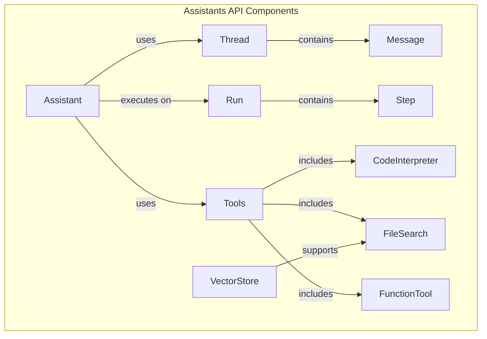
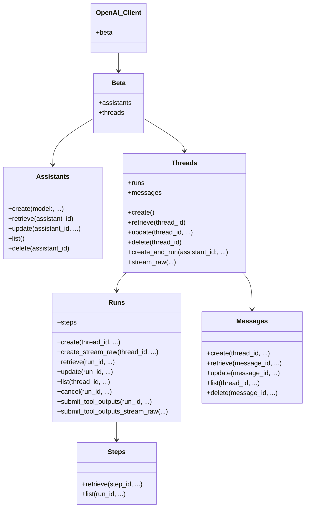
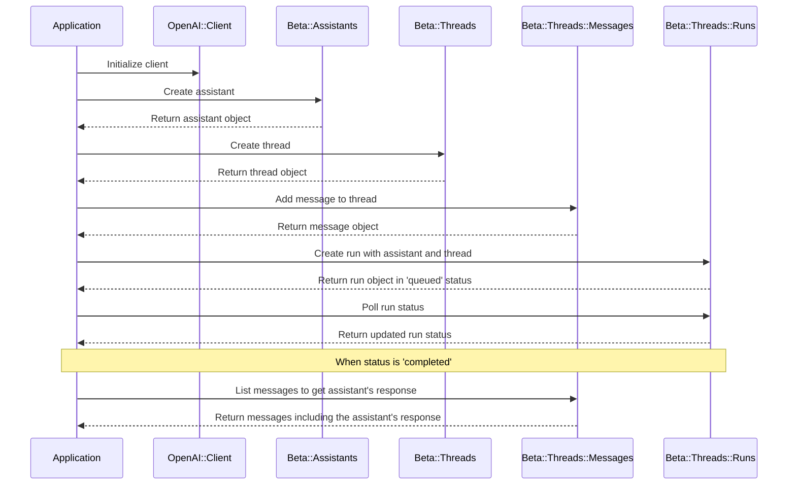
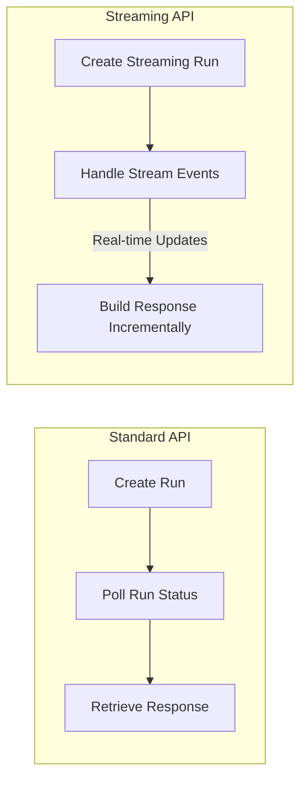
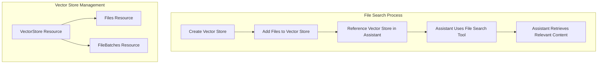

<!-- source: DeepWiki mcp.deepwiki.com · repo openai/openai-ruby · page 4.2 Assistants API (Beta) · fetched 2026-10-26 -->

# Assistants API (Beta)

<details>
<summary>Relevant source files</summary>

The following files were used as context for generating this wiki page:

- [.stats.yml](.stats.yml)
- [lib/openai/internal/type/request_parameters.rb](lib/openai/internal/type/request_parameters.rb)
- [lib/openai/models/beta/threads/run_submit_tool_outputs_params.rb](lib/openai/models/beta/threads/run_submit_tool_outputs_params.rb)
- [lib/openai/resources/beta/assistants.rb](lib/openai/resources/beta/assistants.rb)
- [lib/openai/resources/beta/threads.rb](lib/openai/resources/beta/threads.rb)
- [lib/openai/resources/beta/threads/messages.rb](lib/openai/resources/beta/threads/messages.rb)
- [lib/openai/resources/beta/threads/runs.rb](lib/openai/resources/beta/threads/runs.rb)
- [lib/openai/resources/beta/threads/runs/steps.rb](lib/openai/resources/beta/threads/runs/steps.rb)
- [lib/openai/resources/chat/completions.rb](lib/openai/resources/chat/completions.rb)
- [lib/openai/resources/responses.rb](lib/openai/resources/responses.rb)
- [lib/openai/resources/vector_stores.rb](lib/openai/resources/vector_stores.rb)
- [lib/openai/resources/vector_stores/file_batches.rb](lib/openai/resources/vector_stores/file_batches.rb)
- [lib/openai/resources/vector_stores/files.rb](lib/openai/resources/vector_stores/files.rb)
- [sig/openai/resources/beta/threads/runs.rbs](sig/openai/resources/beta/threads/runs.rbs)
- [test/openai/client_test.rb](test/openai/client_test.rb)
- [test/openai/resources/evals_test.rb](test/openai/resources/evals_test.rb)
- [test/openai/resources/fine_tuning/checkpoints/permissions_test.rb](test/openai/resources/fine_tuning/checkpoints/permissions_test.rb)

</details>


The Assistants API provides a high-level interface for building AI assistants within applications. This document covers the implementation and usage of the Assistants API in the OpenAI Ruby SDK, focusing on the beta version that includes Assistants, Threads, Messages, Runs, and related components. For information about the Chat Completions API, see [Chat Completions](#4.1).

## Overview

The Assistants API allows you to create AI assistants that can perform various tasks:
- Have multi-turn conversations with users
- Generate responses based on conversation history
- Use specialized tools (code interpreter, file search, function calling)
- Maintain stateful conversations across multiple interactions

The API is implemented as a collection of resources under the `OpenAI::Resources::Beta` namespace, with the primary components being Assistants, Threads, Messages, and Runs.



Sources: 
- [lib/openai/resources/beta/assistants.rb]()
- [lib/openai/resources/beta/threads.rb]()
- [lib/openai/resources/beta/threads/messages.rb]()
- [lib/openai/resources/beta/threads/runs.rb]()
- [lib/openai/resources/beta/threads/runs/steps.rb]()
- [lib/openai/resources/vector_stores.rb]()

## Client Architecture

The Assistants API is accessed through the OpenAI client, which provides structured access to all API resources:



Sources:
- [lib/openai/resources/beta/assistants.rb]()
- [lib/openai/resources/beta/threads.rb]()
- [lib/openai/resources/beta/threads/messages.rb]()
- [lib/openai/resources/beta/threads/runs.rb]()
- [lib/openai/resources/beta/threads/runs/steps.rb]()

## Creating and Using Assistants

### Creating an Assistant

An assistant is a specialized entity with specific capabilities defined by its configuration. Create an assistant using:

```ruby
assistant = client.beta.assistants.create(
  model: "gpt-4o",
  name: "Research Assistant",
  instructions: "You are a research assistant that provides accurate and well-sourced information.",
  tools: [{ type: "code_interpreter" }]
)
```

The basic workflow with the Assistants API follows these steps:



Sources:
- [lib/openai/resources/beta/assistants.rb:41-50]()
- [lib/openai/resources/beta/threads.rb:31-40]()
- [lib/openai/resources/beta/threads/messages.rb:30-39]()
- [lib/openai/resources/beta/threads/runs.rb:62-77]()

### Assistant Configuration Options

When creating an assistant, you can specify various parameters:

| Parameter | Type | Description |
|-----------|------|-------------|
| `model` | String | Required. The model to use (e.g., "gpt-4o") |
| `name` | String | Optional. Name of the assistant |
| `description` | String | Optional. Description of the assistant |
| `instructions` | String | Optional. System instructions for the assistant |
| `tools` | Array | Optional. List of tools the assistant can use |
| `metadata` | Hash | Optional. Key-value pairs for tracking |
| `response_format` | Object | Optional. Specifies required format for model outputs |
| `temperature` | Float | Optional. Controls randomness (0-2) |
| `top_p` | Float | Optional. Controls diversity via nucleus sampling |
| `reasoning_effort` | Symbol | Optional. For o-series models only |

Sources:
- [lib/openai/resources/beta/assistants.rb:7-48]()

### Available Assistant Tools

Assistants can use specialized tools to enhance their capabilities:

1. **Code Interpreter**: Enables running code in a sandboxed environment
2. **File Search**: Searches through specified files for information
3. **Function Calling**: Allows the assistant to call custom functions you define

```ruby
# Creating an assistant with multiple tools
assistant = client.beta.assistants.create(
  model: "gpt-4o",
  tools: [
    { type: "code_interpreter" },
    { type: "file_search" },
    {
      type: "function",
      function: {
        name: "get_weather",
        description: "Get current weather for a location",
        parameters: {
          type: "object",
          properties: {
            location: { type: "string", description: "City and state" }
          },
          required: ["location"]
        }
      }
    }
  ]
)
```

Sources:
- [lib/openai/resources/beta/assistants.rb:32-34]()

## Working with Threads

Threads represent conversation sessions. Each thread contains messages and can be executed by an assistant.

### Creating and Managing Threads

```ruby
# Create an empty thread
thread = client.beta.threads.create

# Create a thread with initial messages
thread = client.beta.threads.create(
  messages: [
    {
      role: "user",
      content: "I need help understanding quantum computing."
    }
  ]
)

# Retrieve a thread
thread = client.beta.threads.retrieve(thread_id)

# Update a thread's metadata
thread = client.beta.threads.update(
  thread_id,
  metadata: { user_id: "user_123" }
)

# Delete a thread
client.beta.threads.delete(thread_id)
```

### Creating and Running a Thread in One Step

For convenience, you can create a thread and immediately run an assistant on it:

```ruby
run = client.beta.threads.create_and_run(
  assistant_id: assistant_id,
  thread: {
    messages: [
      {
        role: "user",
        content: "Help me solve this equation: 3x + 11 = 14"
      }
    ]
  }
)
```

Sources:
- [lib/openai/resources/beta/threads.rb:13-109]()
- [lib/openai/resources/beta/threads.rb:111-235]()

## Managing Messages

Messages represent the content exchanged between users and assistants within a thread.

### Adding Messages to a Thread

```ruby
# Add a text message
message = client.beta.threads.messages.create(
  thread_id,
  role: "user",
  content: "Can you explain how neural networks work?"
)

# Add a message with an image attachment
message = client.beta.threads.messages.create(
  thread_id,
  role: "user",
  content: [
    {
      type: "text",
      text: "What's in this image?"
    },
    {
      type: "image_url",
      image_url: { url: "https://example.com/image.jpg" }
    }
  ]
)

# List messages in a thread
messages = client.beta.threads.messages.list(thread_id)

# Retrieve a specific message
message = client.beta.threads.messages.retrieve(message_id, thread_id: thread_id)
```

Sources:
- [lib/openai/resources/beta/threads/messages.rb:11-138]()

## Executing Runs

Runs represent the execution of an assistant on a thread.

### Run States and Lifecycle

A run progresses through various states during its lifecycle:

```mermaid
stateDiagram-v2
    [*] --> "queued"
    "queued" --> "in_progress"
    "in_progress" --> "completed"
    "in_progress" --> "requires_action"
    "in_progress" --> "expired"
    "in_progress" --> "failed"
    "in_progress" --> "cancelling"
    "cancelling" --> "cancelled"
    "requires_action" --> "in_progress"
    "completed" --> [*]
    "cancelled" --> [*]
    "expired" --> [*]
    "failed" --> [*]
```

Sources:
- [lib/openai/resources/beta/threads/runs.rb]()

### Creating and Managing Runs

```ruby
# Create a run
run = client.beta.threads.runs.create(
  thread_id,
  assistant_id: assistant_id
)

# Retrieve a run
run = client.beta.threads.runs.retrieve(run_id, thread_id: thread_id)

# List runs for a thread
runs = client.beta.threads.runs.list(thread_id)

# Cancel a run
client.beta.threads.runs.cancel(run_id, thread_id: thread_id)
```

Sources:
- [lib/openai/resources/beta/threads/runs.rb:11-272]()

### Handling Tool Calls

When a run requires action (`requires_action` status), you need to submit tool outputs:

```ruby
if run.status == "requires_action" && run.required_action.type == "submit_tool_outputs"
  tool_outputs = run.required_action.submit_tool_outputs.tool_calls.map do |tool_call|
    # Process the tool call and generate output
    output = process_tool_call(tool_call)
    
    {
      tool_call_id: tool_call.id,
      output: output
    }
  end
  
  # Submit tool outputs to continue the run
  run = client.beta.threads.runs.submit_tool_outputs(
    run_id,
    thread_id: thread_id,
    tool_outputs: tool_outputs
  )
end
```

Sources:
- [lib/openai/resources/beta/threads/runs.rb:274-315]()
- [lib/openai/models/beta/threads/run_submit_tool_outputs_params.rb:11-57]()

## Runs Steps

Run steps provide detailed information about each step taken during a run's execution.

```ruby
# Retrieve a specific step
step = client.beta.threads.runs.steps.retrieve(
  step_id,
  thread_id: thread_id,
  run_id: run_id
)

# List all steps for a run
steps = client.beta.threads.runs.steps.list(
  run_id,
  thread_id: thread_id
)
```

Sources:
- [lib/openai/resources/beta/threads/runs/steps.rb:9-88]()

## Streaming API

The Assistants API supports streaming for real-time updates during run execution.

### Standard vs Streaming Mode



### Using the Streaming API

```ruby
# Create a streaming run
stream = client.beta.threads.runs.create_stream_raw(
  thread_id,
  assistant_id: assistant_id,
  stream: true
)

# Process stream events
stream.each do |event|
  case event
  when OpenAI::Beta::AssistantStreamEvent::ThreadRunInProgress
    puts "Run in progress..."
  when OpenAI::Beta::AssistantStreamEvent::ThreadMessageCreated
    puts "Message created: #{event.data.id}"
  when OpenAI::Beta::AssistantStreamEvent::ThreadMessageDelta
    puts "Message delta: #{event.data.delta.content}"
  when OpenAI::Beta::AssistantStreamEvent::ThreadRunCompleted
    puts "Run completed!"
  end
end
```

Sources:
- [lib/openai/resources/beta/threads/runs.rb:78-148]()
- [lib/openai/resources/beta/threads.rb:170-235]()
- [lib/openai/resources/chat/completions.rb:183-294]() (for comparison with chat completions)

## Vector Stores and File Search

Vector stores enable efficient semantic search over files for use with the file search tool.



### Creating and Using Vector Stores

```ruby
# Create a vector store
vector_store = client.vector_stores.create(
  name: "Research Documents"
)

# Add a file to the vector store
file_result = client.vector_stores.files.create(
  vector_store_id,
  file_id: file_id
)

# Search the vector store
results = client.vector_stores.search(
  vector_store_id,
  query: "quantum computing applications"
)
```

Sources:
- [lib/openai/resources/vector_stores.rb:12-146]()
- [lib/openai/resources/vector_stores/files.rb:7-192]()
- [lib/openai/resources/vector_stores/file_batches.rb:7-141]()

## Error Handling

The SDK uses a consistent error handling pattern across all API calls:

```ruby
begin
  run = client.beta.threads.runs.create(thread_id, assistant_id: assistant_id)
rescue OpenAI::Errors::BadRequestError => e
  puts "Bad request: #{e.message}"
rescue OpenAI::Errors::APIError => e
  puts "API error: #{e.message}"
end
```

Sources:
- [test/openai/client_test.rb:25-47]()

## Best Practices

1. **Polling and Timeouts**: When checking run status, implement exponential backoff for polling.

   ```ruby
   run = client.beta.threads.runs.create(thread_id, assistant_id: assistant_id)
   
   # Poll with exponential backoff
   timeout = 300  # 5 minutes
   start_time = Time.now
   backoff = 1
   
   while run.status != "completed" && run.status != "failed" && (Time.now - start_time) < timeout
     sleep backoff
     backoff *= 1.5  # Exponential backoff
     run = client.beta.threads.runs.retrieve(run.id, thread_id: thread_id)
   end
   ```

2. **Handling Tool Calls**: Always check for tool calls and process them promptly.

3. **Streaming for Responsive UIs**: Use streaming for better user experience in interactive applications.

4. **Resource Cleanup**: Delete threads and assistants that are no longer needed.

5. **Pagination**: When listing resources, handle pagination for complete results:

   ```ruby
   all_messages = []
   messages_page = client.beta.threads.messages.list(thread_id)
   
   # Get all messages
   loop do
     all_messages.concat(messages_page.data)
     break unless messages_page.has_more?
     messages_page = messages_page.next_page
   end
   ```

Sources:
- [lib/openai/resources/beta/threads/runs.rb]()
- [lib/openai/resources/beta/threads/messages.rb]()
- [test/openai/client_test.rb:92-108]()

## Migration from Chat Completions

If you're migrating from Chat Completions to the Assistants API, here are the key differences:

| Chat Completions | Assistants API |
|------------------|----------------|
| Stateless conversations | Stateful threads |
| Manual history management | Automatic history in threads |
| Limited tool use | Rich tool ecosystem |
| Single-turn execution | Multi-step execution with runs |
| Limited file context | Robust file handling with vector stores |

Sources:
- [lib/openai/resources/chat/completions.rb:10-109]()
- [lib/openai/resources/beta/assistants.rb]()
- [lib/openai/resources/beta/threads.rb]()

---

