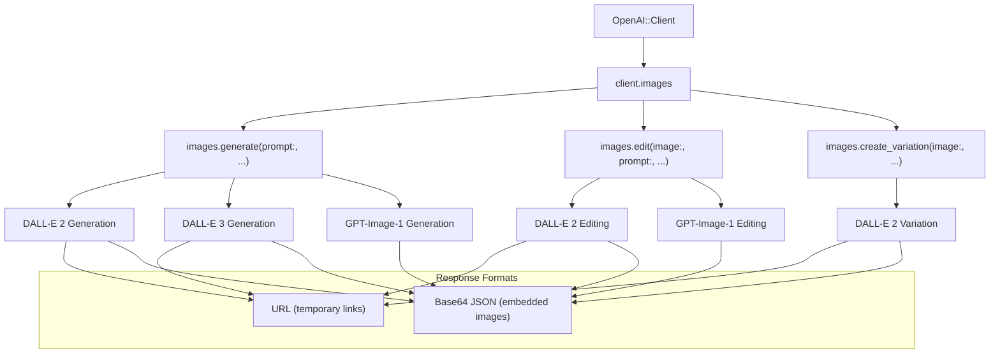
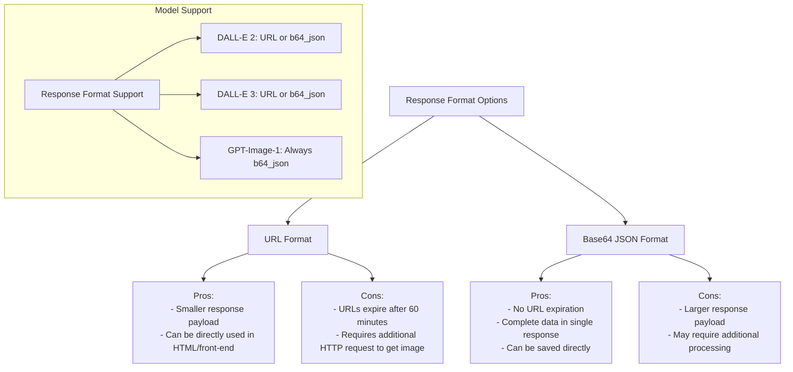
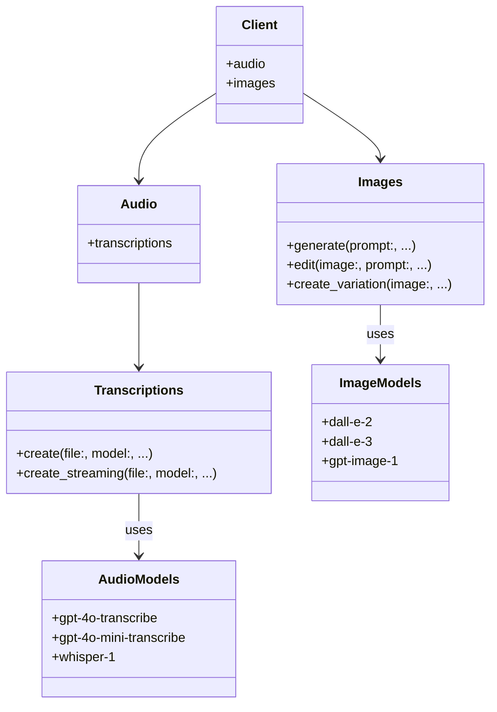

<!-- source: DeepWiki mcp.deepwiki.com · repo openai/openai-ruby · page 4.3 Audio and Images · fetched 2026-10-26 -->

# Audio and Images

<details>
<summary>Relevant source files</summary>

The following files were used as context for generating this wiki page:

- [lib/openai/models/audio/transcription_create_params.rb](lib/openai/models/audio/transcription_create_params.rb)
- [lib/openai/models/image_create_variation_params.rb](lib/openai/models/image_create_variation_params.rb)
- [lib/openai/models/image_edit_params.rb](lib/openai/models/image_edit_params.rb)
- [lib/openai/models/image_generate_params.rb](lib/openai/models/image_generate_params.rb)
- [lib/openai/resources/audio/transcriptions.rb](lib/openai/resources/audio/transcriptions.rb)
- [lib/openai/resources/completions.rb](lib/openai/resources/completions.rb)
- [sig/openai/models/image_create_variation_params.rbs](sig/openai/models/image_create_variation_params.rbs)
- [sig/openai/models/image_edit_params.rbs](sig/openai/models/image_edit_params.rbs)
- [sig/openai/models/image_generate_params.rbs](sig/openai/models/image_generate_params.rbs)
- [sig/openai/resources/audio/transcriptions.rbs](sig/openai/resources/audio/transcriptions.rbs)

</details>


This document details the OpenAI Ruby SDK's audio and image capabilities, including audio transcription, image generation, image editing, and image variation creation. These features allow developers to leverage OpenAI's powerful multimodal models for speech-to-text conversion and AI image creation through a simple Ruby interface.

## Contents Overview

- Audio Transcription - Converting speech to text
- Image Generation - Creating images from text prompts
- Image Editing - Modifying existing images based on prompts
- Image Variation - Creating variations of existing images

## Audio Functionality

The OpenAI Ruby SDK provides audio transcription capabilities through the Audio API, allowing developers to convert spoken audio into written text.

### Audio Transcription

The SDK offers both streaming and non-streaming methods for transcribing audio:

1. **Non-streaming Transcription**: Returns the complete transcription once processing is finished
2. **Streaming Transcription**: Delivers transcription results in real-time as they're processed

#### Basic Usage Example

```ruby
# Create a transcription from an audio file
transcription = client.audio.transcriptions.create(
  file: File.open("audio_sample.mp3", "rb"),
  model: "gpt-4o-transcribe"
)

# Create a streaming transcription
stream = client.audio.transcriptions.create_streaming(
  file: File.open("audio_sample.mp3", "rb"),
  model: "gpt-4o-transcribe"
)
stream.each do |event|
  puts event.text if event.is_a?(OpenAI::Audio::TranscriptionTextDeltaEvent)
end
```

#### Supported Audio Models

The SDK supports the following models for audio transcription:

| Model | Description |
|-------|-------------|
| `gpt-4o-transcribe` | Most capable GPT-4o-based transcription model |
| `gpt-4o-mini-transcribe` | Smaller, faster GPT-4o-based transcription model |
| `whisper-1` | Powered by OpenAI's open-source Whisper V2 model |

#### Key Transcription Parameters

| Parameter | Type | Description |
|-----------|------|-------------|
| `file` | File | Audio file in supported format (flac, mp3, mp4, mpeg, mpga, m4a, ogg, wav, webm) |
| `model` | String | Model ID to use for transcription |
| `language` | String | Optional ISO-639-1 language code of the input audio |
| `prompt` | String | Optional text to guide model's style or continue previous segment |
| `response_format` | Symbol | Format of output (json, text, srt, verbose_json, vtt) |
| `chunking_strategy` | Symbol/Object | Controls how audio is segmented for processing |

Sources: [lib/openai/resources/audio/transcriptions.rb:6-113](), [lib/openai/models/audio/transcription_create_params.rb:9-229]()

### Audio Transcription Process Flow

```mermaid
sequenceDiagram
    participant "Client" as client
    participant "Resources::Audio::Transcriptions" as transcriptions
    participant "TranscriptionCreateParams" as params
    participant "BaseClient" as baseclient
    participant "OpenAI API" as api

    client->>transcriptions: create(file:, model:, ...)
    transcriptions->>params: dump_request(params)
    params-->>transcriptions: parsed params, options
    transcriptions->>baseclient: request(method:, path:, body:, ...)
    baseclient->>api: HTTP POST to audio/transcriptions
    api-->>baseclient: Transcription response
    baseclient-->>transcriptions: Typed response
    transcriptions-->>client: Transcription object

    client->>transcriptions: create_streaming(file:, model:, ...)
    transcriptions->>params: dump_request(params)
    params-->>transcriptions: parsed params, options
    transcriptions->>transcriptions: Add stream: true
    transcriptions->>baseclient: request with stream: OpenAI::Internal::Stream
    baseclient->>api: HTTP POST with accept: text/event-stream
    api-->>baseclient: Stream of events
    baseclient-->>transcriptions: Stream object
    transcriptions-->>client: Stream of TranscriptionStreamEvent objects
```

Sources: [lib/openai/resources/audio/transcriptions.rb:40-54](), [lib/openai/resources/audio/transcriptions.rb:89-104]()

## Image Functionality

The OpenAI Ruby SDK provides three main operations for creating and modifying images: generation (creating images from text), editing (modifying existing images), and variation (creating variations of existing images).

### Image API Operations



Sources: [lib/openai/models/image_generate_params.rb:6-276](), [lib/openai/models/image_edit_params.rb:5-233](), [lib/openai/models/image_create_variation_params.rb:6-116]()

### Image Generation

The image generation feature creates images from text prompts using different AI models.

#### Supported Image Models

| Model | Description | Capabilities |
|-------|-------------|--------------|
| `dall-e-2` | Original DALL-E 2 model | Lower resolution, basic image creation |
| `dall-e-3` | Newer DALL-E 3 model | Higher quality, better prompt following |
| `gpt-image-1` | GPT-based image generation | Advanced capabilities, supports transparency |

#### Basic Image Generation Example

```ruby
# Generate an image using DALL-E 3
images = client.images.generate(
  prompt: "A photorealistic image of a cat astronaut",
  model: "dall-e-3",
  size: "1024x1024",
  quality: "hd"
)

# Generate an image with transparency using GPT-Image-1
images = client.images.generate(
  prompt: "A logo of a lion",
  model: "gpt-image-1",
  background: :transparent,
  output_format: :png
)
```

#### Key Generation Parameters

| Parameter | Type | Description |
|-----------|------|-------------|
| `prompt` | String | Text description of desired image(s) |
| `model` | String/Symbol | Model to use (dall-e-2, dall-e-3, gpt-image-1) |
| `size` | Symbol | Image dimensions (varies by model) |
| `quality` | Symbol | Image quality (standard, hd, low, medium, high, auto) |
| `style` | Symbol | For DALL-E 3: vivid or natural |
| `n` | Integer | Number of images to generate (DALL-E 3 only supports 1) |
| `background` | Symbol | For GPT-Image-1: transparent, opaque, or auto |

Sources: [lib/openai/models/image_generate_params.rb:10-274]()

### Image Editing

Image editing allows modification of existing images based on text prompts, with optional mask support.

#### Basic Image Editing Example

```ruby
# Edit an image with DALL-E 2
client.images.edit(
  image: File.open("image.png", "rb"),
  prompt: "Add a hat to this image",
  model: "dall-e-2",
  size: "1024x1024"
)

# Edit an image with a mask
client.images.edit(
  image: File.open("image.png", "rb"),
  mask: File.open("mask.png", "rb"),
  prompt: "Place a castle in the transparent area",
  model: "gpt-image-1"
)
```

#### Key Editing Parameters

| Parameter | Type | Description |
|-----------|------|-------------|
| `image` | File/Array | Image(s) to edit (single image for DALL-E 2, up to 16 for GPT-Image-1) |
| `prompt` | String | Text description of desired edits |
| `mask` | File | Optional PNG with transparent areas indicating edit regions |
| `model` | String/Symbol | Model to use (dall-e-2 or gpt-image-1) |
| `background` | Symbol | For GPT-Image-1: transparent, opaque, or auto |

Sources: [lib/openai/models/image_edit_params.rb:19-230]()

### Image Variation

Image variation creates alternative versions of an existing image, currently only supported by the DALL-E 2 model.

#### Basic Variation Example

```ruby
# Create variations of an image
client.images.create_variation(
  image: File.open("image.png", "rb"),
  n: 3,
  size: "1024x1024"
)
```

#### Key Variation Parameters

| Parameter | Type | Description |
|-----------|------|-------------|
| `image` | File | Image to create variations from (PNG file, square, <4MB) |
| `model` | String/Symbol | Model to use (currently only dall-e-2) |
| `n` | Integer | Number of variations to generate (1-10) |
| `size` | Symbol | Image dimensions (256x256, 512x512, or 1024x1024) |

Sources: [lib/openai/models/image_create_variation_params.rb:15-113]()

## Response Formats

### Image Response Format Options

Images can be returned in two formats:

1. **URL** (`response_format: :url`): Returns temporary URLs valid for 60 minutes
2. **Base64 JSON** (`response_format: :b64_json`): Returns base64-encoded image data

Note that GPT-Image-1 always returns base64-encoded images, regardless of the `response_format` parameter.

### Image Format Comparison



Sources: [lib/openai/models/image_generate_params.rb:227-239](), [lib/openai/models/image_edit_params.rb:201-213](), [lib/openai/models/image_create_variation_params.rb:92-100]()

## Model-Specific Features

Different image models support different features and parameter combinations:

### DALL-E 2

- Supports basic image generation, editing, and variation
- Available sizes: 256x256, 512x512, 1024x1024
- Only supports "standard" quality
- Can return URL or b64_json format

### DALL-E 3

- Higher quality image generation only (no editing or variation)
- Available sizes: 1024x1024, 1792x1024, 1024x1792
- Supports "standard" or "hd" quality
- Supports "vivid" or "natural" style
- Can only generate one image at a time (n=1)
- Can return URL or b64_json format

### GPT-Image-1

- Advanced image generation and editing (no variation)
- Available sizes: 1024x1024, 1536x1024, 1024x1536, or auto
- Supports "low", "medium", "high", or "auto" quality
- Unique features:
  - Supports transparency (background: transparent)
  - Custom output formats (png, jpeg, webp)
  - Multiple input images for editing (up to 16)
  - Always returns base64-encoded images
  - Content moderation control (moderation: low or auto)

Sources: [lib/openai/models/image_generate_params.rb:162-179](), [lib/openai/models/image_generate_params.rb:241-259](), [lib/openai/models/image_generate_params.rb:206-225]()

## Audio and Image API Relationship



Sources: [lib/openai/resources/audio/transcriptions.rb:6-113](), [lib/openai/models/image_generate_params.rb:6-276](), [lib/openai/models/image_edit_params.rb:5-233](), [lib/openai/models/image_create_variation_params.rb:6-116]()

## Handling File Uploads

Both audio and image operations require file uploads. The SDK supports multiple ways to provide files:

- File object (`File.open("file.mp3", "rb")`)
- StringIO object
- IO object
- OpenAI::FilePart

For image editing that requires multiple files (primary image and mask), make sure to provide both files in the correct format:

```ruby
client.images.edit(
  image: File.open("image.png", "rb"),
  mask: File.open("mask.png", "rb"),
  prompt: "Add a castle in the transparent area"
)
```

File size and format restrictions vary by endpoint and model:

- Audio files must be in one of these formats: flac, mp3, mp4, mpeg, mpga, m4a, ogg, wav, or webm
- For image editing:
  - DALL-E 2: Square PNG files less than 4MB
  - GPT-Image-1: PNG, WEBP, or JPG files less than 25MB (up to 16 images)
- For image variation: Square PNG files less than 4MB

Sources: [lib/openai/models/audio/transcription_create_params.rb:13-18](), [lib/openai/models/image_edit_params.rb:10-19](), [lib/openai/models/image_create_variation_params.rb:10-15]()

---

