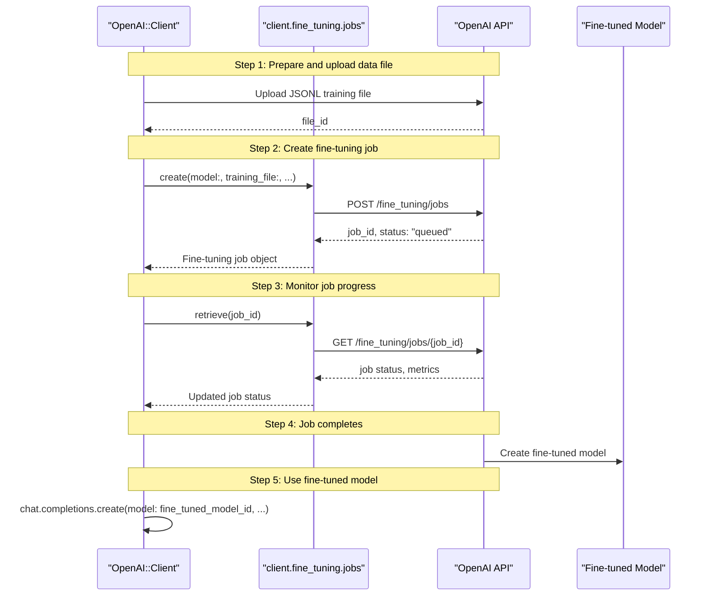
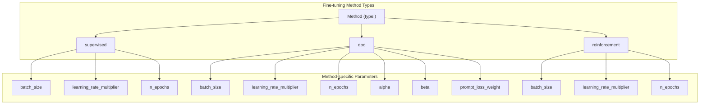

<!-- source: DeepWiki mcp.deepwiki.com · repo openai/openai-ruby · page 4.4 Models and Fine-tuning · fetched 2026-10-26 -->

# Models and Fine-tuning

<details>
<summary>Relevant source files</summary>

The following files were used as context for generating this wiki page:

- [lib/openai/models/all_models.rb](lib/openai/models/all_models.rb)
- [lib/openai/models/fine_tuning/job_create_params.rb](lib/openai/models/fine_tuning/job_create_params.rb)
- [lib/openai/models/responses_model.rb](lib/openai/models/responses_model.rb)
- [sig/openai/models/all_models.rbs](sig/openai/models/all_models.rbs)
- [sig/openai/models/beta/assistant_update_params.rbs](sig/openai/models/beta/assistant_update_params.rbs)
- [sig/openai/models/completion_create_params.rbs](sig/openai/models/completion_create_params.rbs)
- [sig/openai/models/fine_tuning/job_create_params.rbs](sig/openai/models/fine_tuning/job_create_params.rbs)
- [sig/openai/models/responses_model.rbs](sig/openai/models/responses_model.rbs)

</details>


This page documents how to work with OpenAI models and fine-tuning capabilities through the OpenAI Ruby SDK. It covers model types, model selection, and the process of creating and managing fine-tuning jobs. For information about using models with chat completions, see [Chat Completions](#4.1), and for details about assistants, see [Assistants API (Beta)](#4.2).

## Model Types and Structure

The OpenAI Ruby SDK provides several model type definitions that allow you to specify which models to use for different API operations. These model types are structured hierarchically and ensure type safety when making API requests.

```mermaid
classDiagram
    class "OpenAI::Models::all_models" {
        String
        OpenAI::Models::chat_model
        OpenAI::AllModels::responses_only_model
    }
    
    class "OpenAI::Models::responses_model" {
        String
        OpenAI::Models::chat_model
        OpenAI::ResponsesModel::responses_only_model
    }
    
    class "OpenAI::Models::FineTuning::JobCreateParams::model" {
        String
        Symbol:babbage-002
        Symbol:davinci-002
        Symbol:gpt-3.5-turbo
        Symbol:gpt-4o-mini
    }
    
    class "OpenAI::Models::CompletionCreateParams::model" {
        String
        Symbol:gpt-3.5-turbo-instruct
        Symbol:davinci-002
        Symbol:babbage-002
    }
    
    class "OpenAI::Models::Beta::AssistantUpdateParams::model" {
        String
        Symbol:gpt-4.1
        Symbol:gpt-4.1-mini
        Symbol:gpt-4o
        Symbol:gpt-3.5-turbo
        etc...
    }
    
    "OpenAI::Models::all_models" <|-- "OpenAI::Models::responses_model" : subset
    "OpenAI::Models::all_models" <|-- "OpenAI::Models::FineTuning::JobCreateParams::model" : subset
    "OpenAI::Models::all_models" <|-- "OpenAI::Models::CompletionCreateParams::model" : subset
    "OpenAI::Models::all_models" <|-- "OpenAI::Models::Beta::AssistantUpdateParams::model" : subset
```

Sources: 
- [sig/openai/models/all_models.rbs:1-31]()
- [lib/openai/models/all_models.rb:1-36]()
- [sig/openai/models/responses_model.rbs:1-31]()
- [lib/openai/models/responses_model.rb:1-40]()
- [sig/openai/models/fine_tuning/job_create_params.rbs:61-106]()
- [sig/openai/models/completion_create_params.rbs:86-97]()
- [sig/openai/models/beta/assistant_update_params.rbs:69-148]()

### Model Constants

The SDK defines constants for available models to make model selection more explicit and type-safe. These constants are organized in modules corresponding to their usage context:

```mermaid
graph TD
    subgraph "Model Constant Modules"
        AllModels["OpenAI::AllModels::ResponsesOnlyModel"]
        ResponsesModel["OpenAI::ResponsesModel::ResponsesOnlyModel"] 
        FineTuningModels["OpenAI::FineTuning::JobCreateParams::Model"]
        CompletionModels["OpenAI::Models::CompletionCreateParams::Model"]
        AssistantModels["OpenAI::Models::Beta::AssistantUpdateParams::Model"]
    end
    
    AllModels --> |contains| M1["O1_PRO"]
    AllModels --> |contains| M2["O1_PRO_2025_03_19"]
    AllModels --> |contains| M3["COMPUTER_USE_PREVIEW"]
    AllModels --> |contains| M4["COMPUTER_USE_PREVIEW_2025_03_11"]
    
    FineTuningModels --> |contains| FM1["BABBAGE_002"]
    FineTuningModels --> |contains| FM2["DAVINCI_002"]
    FineTuningModels --> |contains| FM3["GPT_3_5_TURBO"]
    FineTuningModels --> |contains| FM4["GPT_4O_MINI"]
    
    CompletionModels --> |contains| CM1["GPT_3_5_TURBO_INSTRUCT"]
    CompletionModels --> |contains| CM2["DAVINCI_002"]
    CompletionModels --> |contains| CM3["BABBAGE_002"]
```



Sources:
- [lib/openai/models/all_models.rb:14-24]()
- [sig/openai/models/all_models.rbs:17-26]()
- [lib/openai/models/responses_model.rb:14-24]()
- [sig/openai/models/responses_model.rbs:17-26]()
- [lib/openai/models/fine_tuning/job_create_params.rb:155-162]()
- [sig/openai/models/fine_tuning/job_create_params.rbs:73-77]()
- [sig/openai/models/completion_create_params.rbs:94-97]()

## Fine-tuning Overview

Fine-tuning allows you to customize OpenAI models for specific use cases by training them on your own data. The OpenAI Ruby SDK provides a structured way to create and manage fine-tuning jobs through the `FineTuning::Jobs` resource.



Sources:
- [lib/openai/models/fine_tuning/job_create_params.rb:1-388]()
- [sig/openai/models/fine_tuning/job_create_params.rbs:1-231]()

## Creating Fine-tuning Jobs

To create a fine-tuning job, you need to configure various parameters including the base model, training file, and fine-tuning method. The SDK provides the `JobCreateParams` class to structure these parameters.

### Basic Structure of JobCreateParams

```mermaid
classDiagram
    class "JobCreateParams" {
        +model: model
        +training_file: String
        +hyperparameters: Hyperparameters (deprecated)
        +integrations: Array~Integration~
        +metadata: Hash~Symbol, String~
        +method_: Method
        +seed: Integer
        +suffix: String
        +validation_file: String
    }
    
    class "Hyperparameters" {
        +batch_size: :auto|Integer
        +learning_rate_multiplier: :auto|Float
        +n_epochs: :auto|Integer
    }
    
    class "Method" {
        +type: :supervised|:dpo|:reinforcement
        +dpo: DpoMethod
        +reinforcement: ReinforcementMethod
        +supervised: SupervisedMethod
    }
    
    class "Integration" {
        +type: :wandb
        +wandb: Wandb
    }
    
    class "Wandb" {
        +project: String
        +entity: String
        +name: String
        +tags: Array~String~
    }
    
    JobCreateParams --> Hyperparameters
    JobCreateParams --> Method
    JobCreateParams --> "Array~Integration~"
    Integration --> Wandb
```

Sources:
- [lib/openai/models/fine_tuning/job_create_params.rb:7-385]()
- [sig/openai/models/fine_tuning/job_create_params.rbs:18-195]()

### Required Parameters

When creating a fine-tuning job, you must specify at minimum:

1. The base `model` to fine-tune - must be one of the supported models
2. The `training_file` - ID of an uploaded JSONL file containing training data

### Fine-tuning Methods

The SDK supports three fine-tuning methods, specified through the `method_` parameter:

1. **Supervised**: Standard fine-tuning where the model learns from examples
2. **DPO** (Direct Preference Optimization): Fine-tuning based on preference data
3. **Reinforcement**: Fine-tuning with reinforcement learning techniques

Each method has its own configuration options and data format requirements.



Sources:
- [lib/openai/models/fine_tuning/job_create_params.rb:335-384]()
- [sig/openai/models/fine_tuning/job_create_params.rbs:180-227]()

## Example Usage

Here's how to use the OpenAI Ruby SDK to create a fine-tuning job:

1. First, upload a training file in JSONL format
2. Create a fine-tuning job with the appropriate parameters
3. Monitor the job status until completion
4. Use the fine-tuned model

### Creating a fine-tuning job with supervised learning:

```ruby
client = OpenAI::Client.new(api_key: ENV["OPENAI_API_KEY"])

# Create the fine-tuning job
job = client.fine_tuning.jobs.create(
  model: OpenAI::FineTuning::JobCreateParams::Model::GPT_3_5_TURBO,
  training_file: "file-abc123",
  method_: {
    type: :supervised,
    supervised: {
      batch_size: :auto,
      learning_rate_multiplier: 0.1,
      n_epochs: 4
    }
  },
  suffix: "my-custom-model",
  validation_file: "file-xyz789"
)

# Check job status
job_status = client.fine_tuning.jobs.retrieve(job.id)

# Use the fine-tuned model once it's ready
if job_status.status == "succeeded"
  completion = client.chat.completions.create(
    model: job_status.fine_tuned_model,
    messages: [
      { role: "user", content: "Hello, fine-tuned model!" }
    ]
  )
  puts completion.choices[0].message.content
end
```

## Integration with Weights & Biases

The OpenAI Ruby SDK supports integration with Weights & Biases (W&B) for monitoring and visualizing fine-tuning jobs. This is configured through the `integrations` parameter:

```ruby
client.fine_tuning.jobs.create(
  model: OpenAI::FineTuning::JobCreateParams::Model::GPT_3_5_TURBO,
  training_file: "file-abc123",
  integrations: [
    {
      type: :wandb,
      wandb: {
        project: "my-fine-tuning-project",
        entity: "my-team",
        name: "gpt-3.5-custom-job",
        tags: ["production", "customer-service"]
      }
    }
  ]
)
```

Sources:
- [lib/openai/models/fine_tuning/job_create_params.rb:260-333]()
- [sig/openai/models/fine_tuning/job_create_params.rbs:136-194]()

## Supported Models for Fine-tuning

The SDK supports fine-tuning for the following base models:

| Model Name | Constant | Description |
|------------|----------|-------------|
| `babbage-002` | `BABBAGE_002` | Lightweight model suitable for classification tasks |
| `davinci-002` | `DAVINCI_002` | More capable model for complex tasks |
| `gpt-3.5-turbo` | `GPT_3_5_TURBO` | Powerful chat model |
| `gpt-4o-mini` | `GPT_4O_MINI` | Smaller version of GPT-4o |

These models are defined as constants in the `OpenAI::FineTuning::JobCreateParams::Model` module.

Sources:
- [lib/openai/models/fine_tuning/job_create_params.rb:135-162]()
- [sig/openai/models/fine_tuning/job_create_params.rbs:61-77]()

## Best Practices

1. **Data Quality**: Ensure your training data is high-quality and follows the format required by the model type and fine-tuning method.

2. **Validation File**: Include a validation file to monitor performance during training.

3. **Hyperparameters**: Start with default hyperparameters (`:auto`) and adjust based on validation results.

4. **Monitoring**: Use integrations like W&B to monitor training metrics.

5. **Model Selection**: Choose the appropriate base model for your use case:
   - For simpler tasks, use `babbage-002`
   - For more complex tasks, use `davinci-002` or `gpt-3.5-turbo`
   - For advanced tasks requiring more capabilities, use `gpt-4o-mini`

6. **Metadata**: Use the metadata field to add identifying information to your fine-tuning jobs for easier organization.

## Conclusion

The OpenAI Ruby SDK provides a comprehensive set of tools for working with models and creating fine-tuning jobs. The type system ensures that you provide valid parameters while the structured approach makes it easy to configure complex fine-tuning settings. By following the workflow outlined in this document, you can successfully create, monitor, and use fine-tuned models for your specific use cases.

---

