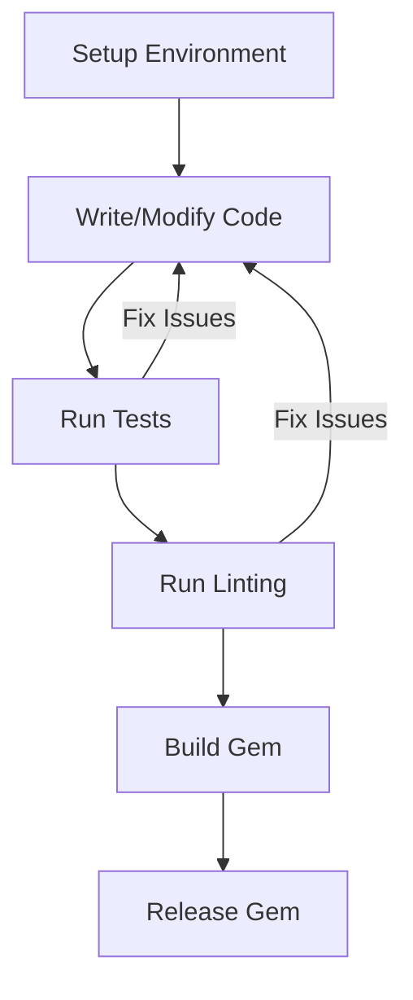
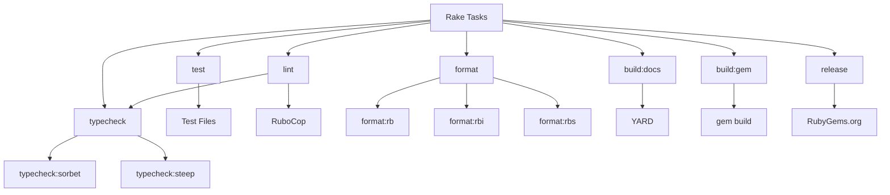
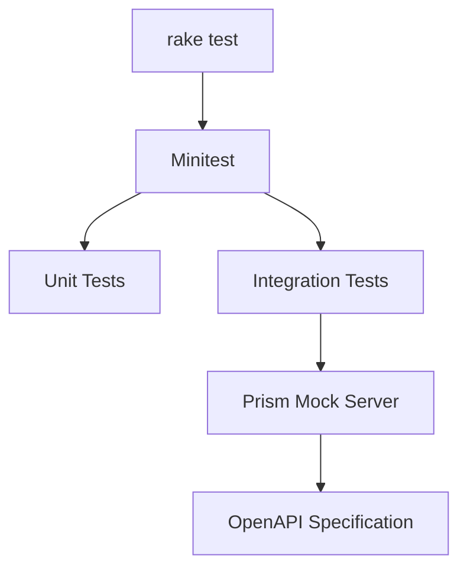
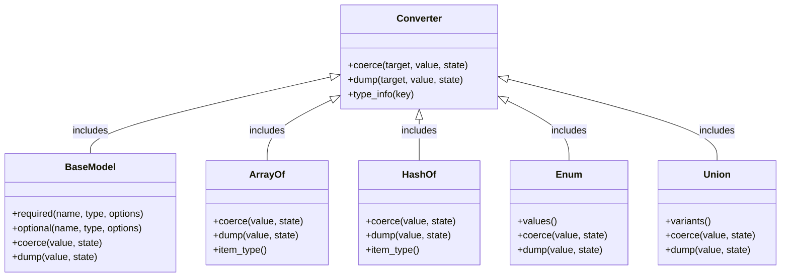
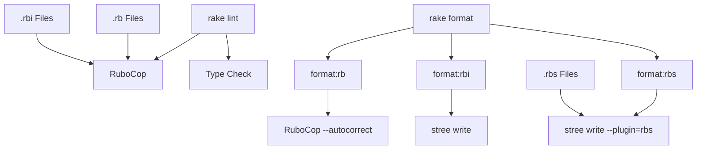
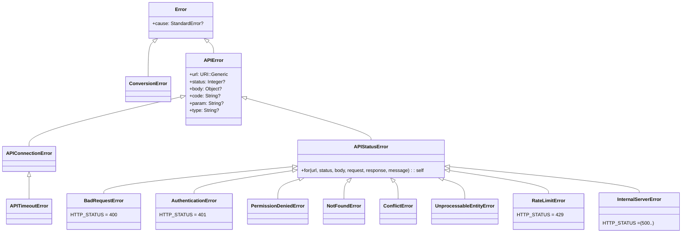

<!-- source: DeepWiki mcp.deepwiki.com · repo openai/openai-ruby · page 5 Development · fetched 2026-10-26 -->

# Development

<details>
<summary>Relevant source files</summary>

The following files were used as context for generating this wiki page:

- [.rubocop.yml](.rubocop.yml)
- [CONTRIBUTING.md](CONTRIBUTING.md)
- [Rakefile](Rakefile)
- [lib/openai.rb](lib/openai.rb)
- [lib/openai/errors.rb](lib/openai/errors.rb)
- [rbi/openai/errors.rbi](rbi/openai/errors.rbi)
- [scripts/format](scripts/format)
- [scripts/lint](scripts/lint)
- [scripts/test](scripts/test)
- [sig/openai/internal/type/array_of.rbs](sig/openai/internal/type/array_of.rbs)
- [sig/openai/internal/type/base_page.rbs](sig/openai/internal/type/base_page.rbs)
- [sig/openai/internal/type/hash_of.rbs](sig/openai/internal/type/hash_of.rbs)
- [sorbet/rbi/.gitignore](sorbet/rbi/.gitignore)

</details>


This page provides guidance for developers who want to contribute to the OpenAI Ruby SDK. It covers the development environment setup, workflow, build system, testing, and other essential aspects of working with the codebase. For specific details about the build system, testing, CI/CD pipeline, and utility functions, refer to their respective sub-pages.

## Setting Up the Development Environment

The OpenAI Ruby SDK requires a specific Ruby version as specified in the `.ruby-version` file. The repository supports both [rbenv](https://github.com/rbenv/rbenv) and [asdf](https://github.com/asdf-vm/asdf) with the Ruby plugin for managing Ruby versions.

To set up your development environment:

1. Install the required Ruby version using your preferred version manager
2. Clone the repository
3. Run the bootstrap script to install dependencies:

```bash
$ ./scripts/bootstrap
```

This script installs all the required gems and sets up the development environment.

Sources: [CONTRIBUTING.md:1-14]()

## Development Workflow

The diagram below illustrates the typical development workflow:



Most of the SDK is generated code. When making modifications:

- Changes to generated code will be preserved between generations but may cause merge conflicts
- The generator will never modify the contents of `lib/openai/helpers/` and `examples/` directories
- You can freely add or modify examples in the `examples/` directory

Sources: [CONTRIBUTING.md:15-37]()

### Using the Repository from Source

You can use the repository directly from source in two ways:

1. Install via git in your `Gemfile`:
```ruby
gem "openai", git: "https://www.github.com/openai/openai-ruby"
```

2. Reference a local copy:
```ruby
gem "openai", path: "<path-to-repo>"
```

Sources: [CONTRIBUTING.md:39-57]()

## Build System

The OpenAI Ruby SDK uses Rake as its build system. The `Rakefile` defines various tasks for development, testing, and releasing the gem.



To see all available Rake tasks, run:

```bash
$ bundle exec rake
```

For more detailed information about the build system, see [Build System](#5.1).

Sources: [Rakefile:3-157](), [CONTRIBUTING.md:59-65]()

## Running Commands

The main development tasks are executed using Rake commands. Here's a summary of the most common commands:

| Command | Description |
|---------|-------------|
| `rake test` | Run test suites |
| `rake lint` | Lint and typecheck code |
| `rake format` | Format all code files |
| `rake typecheck` | Run type checking |
| `rake build:docs` | Build documentation |
| `rake build:gem` | Build the Ruby gem |
| `rake release` | Release the gem to RubyGems.org |
| `rake docs:preview` | Preview documentation locally |

Sources: [Rakefile:19-157]()

## Testing

The OpenAI Ruby SDK uses Minitest for testing. Most tests require a mock server against the OpenAPI specification.



To run the tests:

1. Start the mock server:
```bash
$ npx prism mock path/to/your/openapi.yml
```

2. Run the tests:
```bash
$ bundle exec rake test
```

You can also use the provided script:
```bash
$ ./scripts/test
```

For more detailed information about testing, see [Testing](#5.2).

Sources: [CONTRIBUTING.md:67-79](), [scripts/test:1-57]()

## Type Checking System

The OpenAI Ruby SDK uses two type checking systems:

1. Sorbet for checking `.rbi` files
2. Steep for checking `.rbs` files



To typecheck your code:

```bash
$ bundle exec rake typecheck
```

This runs both Sorbet and Steep type checkers. You can also run them individually:

```bash
$ bundle exec rake typecheck:sorbet
$ bundle exec rake typecheck:steep
```

Key type system components:

- `OpenAI::Internal::Type::Converter` - Core type conversion functionality
- `OpenAI::Internal::Type::BaseModel` - Base class for model types
- `OpenAI::Internal::Type::ArrayOf` - Type for arrays of elements
- `OpenAI::Internal::Type::HashOf` - Type for hashes of elements
- `OpenAI::Internal::Type::Enum` - Type for enumeration values
- `OpenAI::Internal::Type::Union` - Type for union types

Sources: [sig/openai/internal/type/array_of.rbs:1-46](), [sig/openai/internal/type/hash_of.rbs:1-46](), [sig/openai/internal/type/base_page.rbs:1-25]()

## Linting and Formatting

The OpenAI Ruby SDK uses:

- RuboCop for linting and formatting `.rb` and `.rbi` files
- Syntax Tree for formatting `.rbs` files



To lint your code:

```bash
$ bundle exec rake lint
```

To format your code:

```bash
$ bundle exec rake format
```

You can also use the provided scripts:

```bash
$ ./scripts/lint
$ ./scripts/format
```

Sources: [.rubocop.yml:1-292](), [CONTRIBUTING.md:81-95](), [scripts/lint:1-10](), [scripts/format:1-10](), [Rakefile:40-113]()

## Error Handling System

Understanding the error handling system is essential when developing with the OpenAI Ruby SDK. The SDK provides a hierarchy of error classes for different types of errors that might occur during API interactions.



The error hierarchy includes:

- `OpenAI::Errors::Error` - Base error class
- `OpenAI::Errors::ConversionError` - For type conversion errors
- `OpenAI::Errors::APIError` - Base class for API-related errors
- `OpenAI::Errors::APIConnectionError` - For connection issues
- `OpenAI::Errors::APITimeoutError` - For timeout issues
- `OpenAI::Errors::APIStatusError` - For HTTP status-related errors
  - Specific status error classes: `BadRequestError`, `AuthenticationError`, etc.

Sources: [lib/openai/errors.rb:1-229](), [rbi/openai/errors.rbi:1-190]()

## Documentation

The OpenAI Ruby SDK uses YARD for documentation generation.

To build the documentation:

```bash
$ bundle exec rake build:docs
```

To preview the documentation:

```bash
$ bundle exec rake docs:preview [PORT=8808]
```

This starts a YARD server on port 8808 (or a custom port if specified) that automatically reloads when changes are detected.

Sources: [Rakefile:22-25](), [Rakefile:135-138](), [CONTRIBUTING.md:119-126]()

## Release Process

To release a new version of the OpenAI Ruby SDK:

1. Build the gem:
```bash
$ bundle exec rake build:gem
```

2. Release the gem:
```bash
$ bundle exec rake release
```

This builds the gem and pushes it to RubyGems.org.

Sources: [Rakefile:140-157]()

## Editor Support

For a better development experience, the SDK supports several editor integrations:

| Editor Integration | Strengths | Limitations |
|-------------------|-----------|------------|
| Ruby LSP | Good go-to-definition support | Limited auto-completion |
| Solargraph | Good auto-completion support | Limited go-to-definition |
| Sorbet | Works well when editing directly | Some issues with colocated `.rb` and `.rbi` files |

Sources: [CONTRIBUTING.md:97-118]()

## CI/CD Pipeline

The CI/CD pipeline automates testing, linting, and deployment processes. For detailed information, see [CI/CD Pipeline](#5.3).

---

