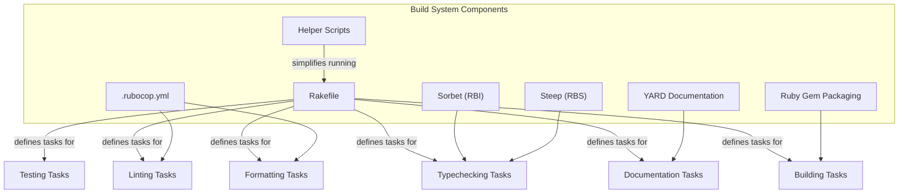
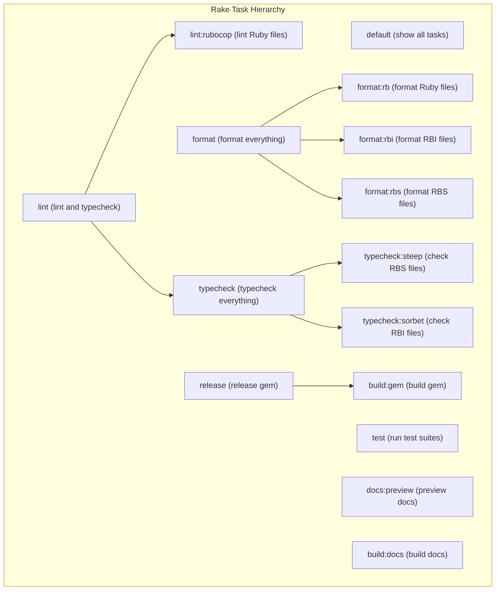
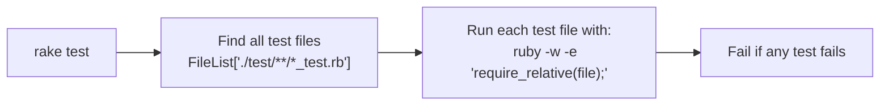
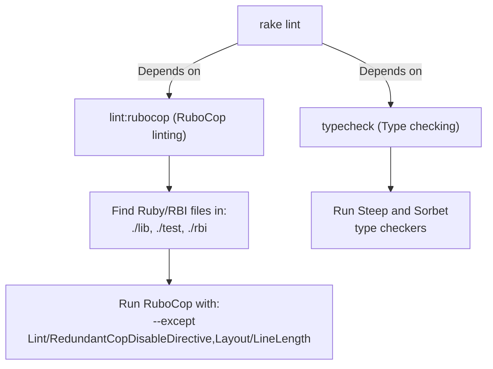
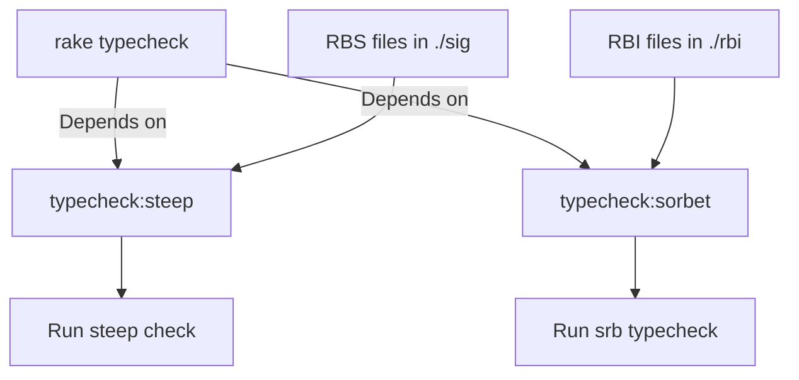
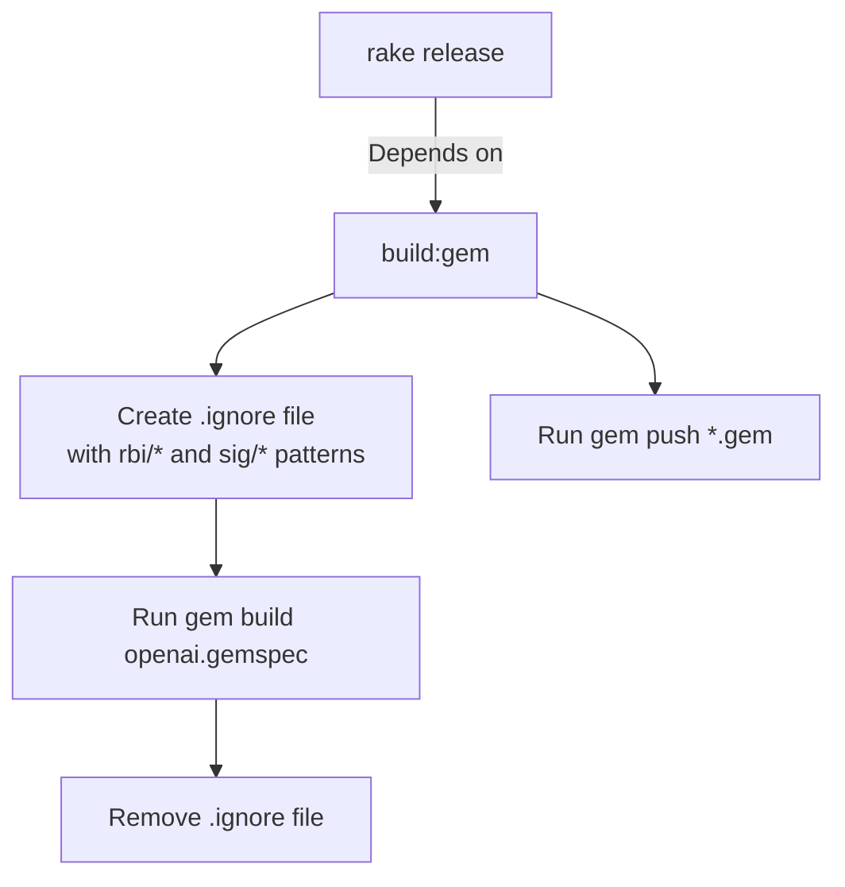

<!-- source: DeepWiki mcp.deepwiki.com · repo openai/openai-ruby · page 5.1 Build System · fetched 2026-10-26 -->

# Build System

<details>
<summary>Relevant source files</summary>

The following files were used as context for generating this wiki page:

- [.rubocop.yml](.rubocop.yml)
- [CONTRIBUTING.md](CONTRIBUTING.md)
- [Rakefile](Rakefile)
- [lib/openai.rb](lib/openai.rb)
- [lib/openai/errors.rb](lib/openai/errors.rb)
- [rbi/openai/errors.rbi](rbi/openai/errors.rbi)
- [scripts/format](scripts/format)
- [scripts/lint](scripts/lint)
- [scripts/test](scripts/test)
- [sig/openai/internal/type/array_of.rbs](sig/openai/internal/type/array_of.rbs)
- [sig/openai/internal/type/base_page.rbs](sig/openai/internal/type/base_page.rbs)
- [sig/openai/internal/type/hash_of.rbs](sig/openai/internal/type/hash_of.rbs)
- [sorbet/rbi/.gitignore](sorbet/rbi/.gitignore)

</details>


This document explains the build system used in the OpenAI Ruby SDK, focusing on the Rake tasks and scripts available for development, testing, and releasing the library. For information about the CI/CD pipeline and release process, see [CI/CD Pipeline](#5.3).

## Overview of the Build System

The OpenAI Ruby SDK uses a Rake-based build system with multitasking support to manage various development workflows such as testing, linting, formatting, typechecking, and releasing. The build system is designed to facilitate both local development and integration with CI/CD pipelines.



Sources: [Rakefile:1-158](), [.rubocop.yml:1-292](), [CONTRIBUTING.md:1-126]()

## Rake Tasks Overview

Running `rake` without arguments displays all available tasks. Here are the key task categories:

| Category | Tasks | Description |
|----------|-------|-------------|
| Testing | `test` | Runs test suites |
| Linting | `lint`, `lint:rubocop` | Performs code linting and typechecking |
| Formatting | `format`, `format:rb`, `format:rbi`, `format:rbs` | Formats code files |
| Typechecking | `typecheck`, `typecheck:steep`, `typecheck:sorbet` | Typechecks code files |
| Documentation | `docs:preview`, `build:docs` | Builds and previews documentation |
| Building | `build:gem` | Builds the Ruby gem package |
| Releasing | `release` | Releases the gem to RubyGems.org |



Sources: [Rakefile:11-157]()

## Testing System

The testing system runs test suites located in the `test` directory. Tests are written using Minitest and can be run using the `test` Rake task.

### Running Tests

```bash
# Run all tests
bundle exec rake test

# Run a specific test file
TEST=path/to/test.rb bundle exec rake test
```

The test task is defined in the Rakefile:



A helper script `scripts/test` is provided to simplify running tests. This script also sets up a mock server using Prism for testing API interactions.

Sources: [Rakefile:27-35](), [scripts/test:1-57]()

## Linting and Formatting

The SDK uses RuboCop for linting and formatting Ruby files and syntax_tree for formatting RBI and RBS files.

### Linting

The `lint` task runs both RuboCop linting and typechecking:

```bash
bundle exec rake lint
```

The linting process is:



### Formatting

The `format` task formats Ruby, RBI, and RBS files:

```bash
bundle exec rake format

# Format only Ruby files
bundle exec rake format:rb

# Format only RBI files
bundle exec rake format:rbi

# Format only RBS files
bundle exec rake format:rbs
```

Sources: [Rakefile:40-113](), [.rubocop.yml:1-292](), [scripts/lint:1-10](), [scripts/format:1-10]()

## Typechecking System

The SDK uses two type checking systems:
1. **Sorbet** for typechecking RBI files
2. **Steep** for typechecking RBS files

The `typecheck` task runs both type checkers:

```bash
bundle exec rake typecheck

# Run only Steep
bundle exec rake typecheck:steep

# Run only Sorbet
bundle exec rake typecheck:sorbet
```



Sources: [Rakefile:115-133](), [sig/openai/internal/type/array_of.rbs:1-46](), [sig/openai/internal/type/hash_of.rbs:1-46](), [sig/openai/internal/type/base_page.rbs:1-25](), [rbi/openai/errors.rbi:1-190]()

## Documentation System

The SDK uses YARD for generating documentation.

### Previewing Documentation

To preview the documentation with a local server:

```bash
bundle exec rake docs:preview

# Change the preview port
PORT=3000 bundle exec rake docs:preview
```

### Building Documentation

To build the documentation:

```bash
bundle exec rake build:docs
```

Sources: [Rakefile:22-25](), [Rakefile:136-138]()

## Building and Releasing

### Building the Gem

The `build:gem` task builds the Ruby gem package:

```bash
bundle exec rake build:gem
```

This task:
1. Creates an `.ignore` file to exclude `rbi/*` and `sig/*` from being indexed by tools
2. Runs `gem build -- openai.gemspec` to build the gem
3. Removes the `.ignore` file

### Releasing the Gem

The `release` task builds and then pushes the gem to RubyGems.org:

```bash
bundle exec rake release
```



Sources: [Rakefile:140-157]()

## Helper Scripts

Several helper scripts are available to simplify common development tasks:

| Script | Purpose | Equivalent Rake Command |
|--------|---------|-------------------------|
| `scripts/test` | Run tests with mock server setup | `rake test` |
| `scripts/lint` | Run linters | `rake lint` |
| `scripts/format` | Run formatters | `rake format` |

These scripts provide additional functionality, like setting up mock servers for testing, beyond what the Rake tasks offer directly.

Sources: [scripts/test:1-57](), [scripts/lint:1-10](), [scripts/format:1-10]()

## File Organization

The build system interacts with various file types across the repository:

| Directory | Contents | Tools |
|-----------|----------|-------|
| `lib/` | Ruby implementation files | RuboCop for linting & formatting |
| `test/` | Test files | Minitest for testing, RuboCop for linting |
| `rbi/` | Ruby interface files | Sorbet for typechecking, syntax_tree for formatting |
| `sig/` | Ruby signature files | Steep for typechecking, syntax_tree for formatting |

Sources: [Rakefile:40-67](), [sorbet/rbi/.gitignore:1-3]()

## Error Handling in the Build System

The build system includes comprehensive error handling for common issues:

- Test tasks fail if any test fails
- Linting tasks report all violations but don't automatically fix them
- Formatting tasks attempt to fix issues automatically
- Build and release tasks include error handling for common failures

Error types defined in `lib/openai/errors.rb` are available throughout the system for consistent error reporting.

Sources: [lib/openai/errors.rb:1-229](), [rbi/openai/errors.rbi:1-190]()

---

