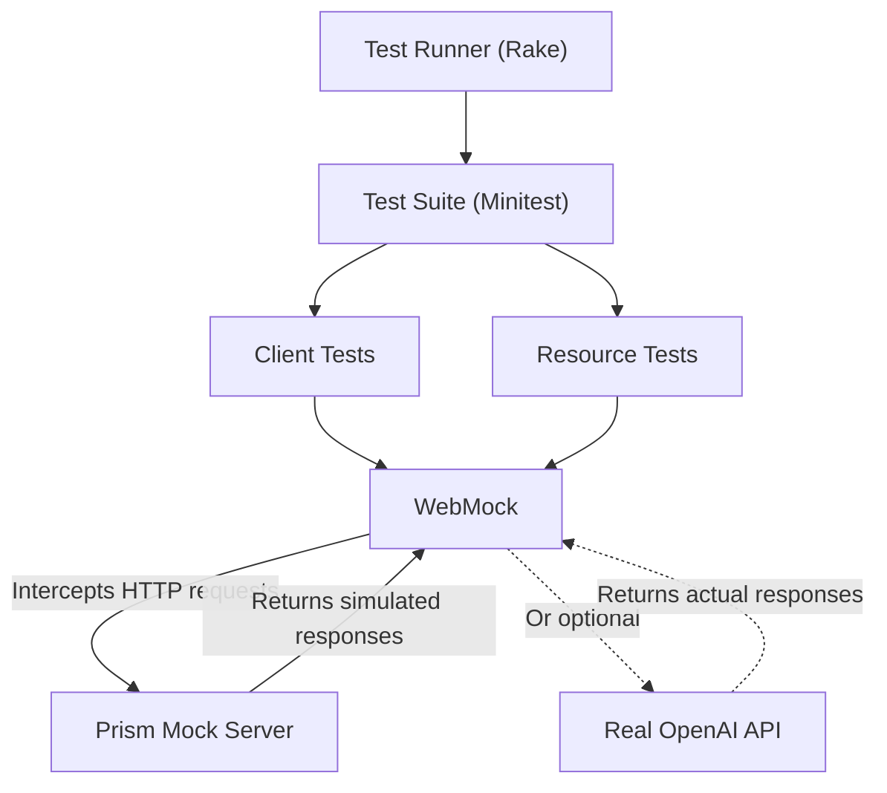
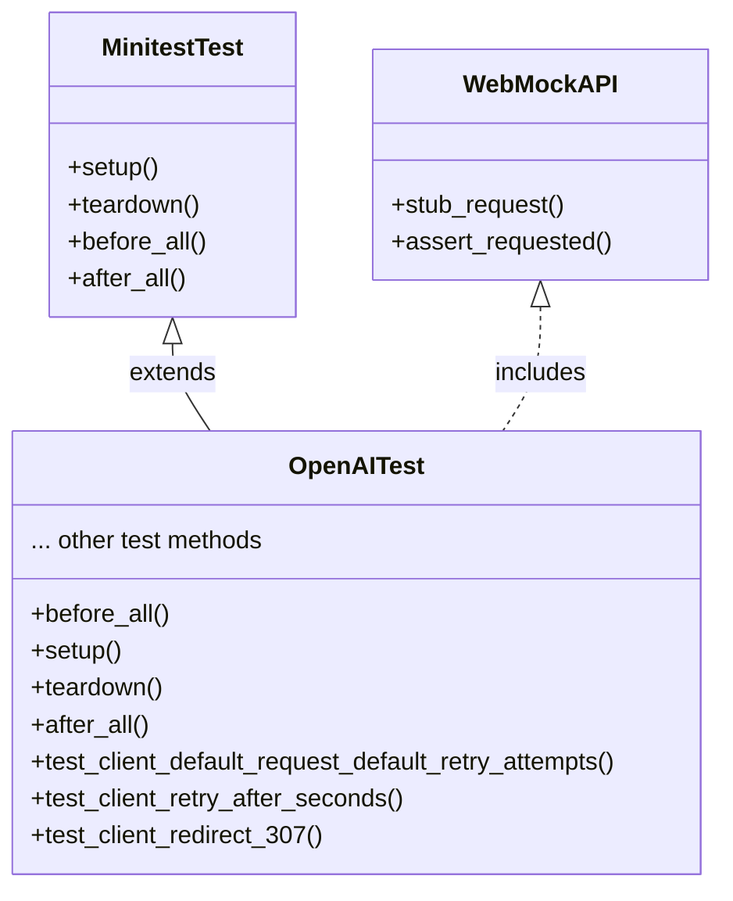
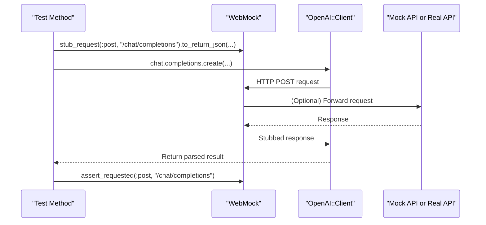

<!-- source: DeepWiki mcp.deepwiki.com · repo openai/openai-ruby · page 5.2 Testing · fetched 2026-10-26 -->

# Testing

<details>
<summary>Relevant source files</summary>

The following files were used as context for generating this wiki page:

- [CONTRIBUTING.md](CONTRIBUTING.md)
- [lib/openai/resources/beta/threads.rb](lib/openai/resources/beta/threads.rb)
- [lib/openai/resources/chat/completions.rb](lib/openai/resources/chat/completions.rb)
- [lib/openai/resources/responses.rb](lib/openai/resources/responses.rb)
- [scripts/format](scripts/format)
- [scripts/lint](scripts/lint)
- [scripts/test](scripts/test)
- [sorbet/rbi/.gitignore](sorbet/rbi/.gitignore)
- [test/openai/client_test.rb](test/openai/client_test.rb)

</details>


This document details the testing approach used in the OpenAI Ruby SDK, including test environment setup, test execution, and common testing patterns. For information about the build system and available Rake tasks, see [Build System](#5.1).

## Overview

The OpenAI Ruby SDK uses Minitest as its primary testing framework with WebMock for stubbing HTTP requests to the OpenAI API. Tests are designed to run against a mock server (Prism) that simulates the OpenAI API based on an OpenAPI specification.

### Test System Architecture



Sources: [CONTRIBUTING.md:69-77](), [scripts/test:12-52]()

## Setting Up the Test Environment

### Prerequisites

Before running tests, you need to set up a mock server using Prism:

```bash
$ npx prism mock path/to/your/openapi.yml
```

Alternatively, use the provided script which handles setting up the mock server automatically:

```bash
$ ./scripts/test
```

The mock server runs on port 4010 by default and simulates the OpenAI API responses based on the OpenAPI specification.

Sources: [CONTRIBUTING.md:69-77](), [scripts/test:12-52]()

### Environment Configuration

Tests can be configured to run against either the mock server or a real API endpoint by setting the `TEST_API_BASE_URL` environment variable:

```bash
$ TEST_API_BASE_URL="https://api.openai.com/v1" bundle exec rake test
```

Sources: [scripts/test:24-38]()

## Running Tests

To run all tests:

```bash
$ bundle exec rake test
```

Or use the convenience script:

```bash
$ ./scripts/test
```

Sources: [CONTRIBUTING.md:76-77](), [scripts/test:55-56]()

## Test Structure and Organization

### Test Class Hierarchy



Sources: [test/openai/client_test.rb:5-24]()

### Test Lifecycle

Each test follows this lifecycle:

1. **before_all**: Class-level setup run once before all tests (enables WebMock)
2. **setup**: Run before each test method (sets up thread variables)
3. [Test execution]
4. **teardown**: Run after each test method (resets WebMock)
5. **after_all**: Class-level cleanup (disables WebMock)

The test class typically looks like:

```ruby
class OpenAITest < Minitest::Test
  extend Minitest::Serial  # Ensures tests run in sequence
  include WebMock::API     # Provides HTTP stubbing capabilities

  def before_all
    super
    WebMock.enable!
  end

  def setup
    super
    Thread.current.thread_variable_set(:mock_sleep, [])
  end

  def teardown
    Thread.current.thread_variable_set(:mock_sleep, nil)
    WebMock.reset!
    super
  end

  def after_all
    WebMock.disable!
    super
  end

  # Test methods...
end
```

Sources: [test/openai/client_test.rb:5-28]()

## HTTP Request Mocking

The SDK uses WebMock to stub HTTP requests and verify they were made correctly.

### Request/Response Flow



Sources: [test/openai/client_test.rb:37-46]()

### Common Stubbing Patterns

```ruby
# Basic success response
stub_request(:post, "http://localhost/chat/completions")
  .to_return_json(status: 200, body: {})

# Error response
stub_request(:post, "http://localhost/chat/completions")
  .to_return_json(status: 500, body: {})

# Response with headers
stub_request(:post, "http://localhost/chat/completions")
  .to_return_json(
    status: 500,
    headers: {"retry-after" => "1.3"},
    body: {}
  )
```

Sources: [test/openai/client_test.rb:38-39](), [test/openai/client_test.rb:93-98]()

## Testing Key Behaviors

### Retry Logic

The SDK tests retry behavior by stubbing a failing endpoint and verifying that requests are retried the correct number of times:

```ruby
def test_client_given_request_default_retry_attempts
  # Stub endpoint to always return 500 error
  stub_request(:post, "http://localhost/chat/completions")
    .to_return_json(status: 500, body: {})

  openai = OpenAI::Client.new(
    base_url: "http://localhost", 
    api_key: "My API Key", 
    max_retries: 3
  )

  # Expect this to raise an error after all retries
  assert_raises(OpenAI::Errors::InternalServerError) do
    openai.chat.completions.create(
      messages: [{content: "string", role: :developer}], 
      model: :"gpt-4.1"
    )
  end

  # Verify 4 requests were made (1 original + 3 retries)
  assert_requested(:any, /./, times: 4)
end
```

Sources: [test/openai/client_test.rb:49-59]()

### Retry Timing

The SDK mocks the `sleep` method to test retry timing without actually waiting:

```ruby
def test_client_retry_after_seconds
  stub_request(:post, "http://localhost/chat/completions")
    .to_return_json(
      status: 500,
      headers: {"retry-after" => "1.3"},
      body: {}
    )

  openai = OpenAI::Client.new(
    base_url: "http://localhost", 
    api_key: "My API Key", 
    max_retries: 1
  )

  assert_raises(OpenAI::Errors::InternalServerError) do
    openai.chat.completions.create(
      messages: [{content: "string", role: :developer}], 
      model: :"gpt-4.1"
    )
  end

  assert_requested(:any, /./, times: 2)
  # Verify the retry sleep time was correctly calculated
  assert_equal(1.3, Thread.current.thread_variable_get(:mock_sleep).last)
end
```

Sources: [test/openai/client_test.rb:93-108]()

### HTTP Redirects

The SDK tests HTTP redirects and ensures that:
- Redirects are followed correctly
- Authentication headers are preserved for same-origin redirects 
- Authentication headers are stripped for cross-origin redirects

```ruby
def test_client_redirect_auth_strip_cross_origin
  # Initial request with cross-origin redirect
  stub_request(:post, "http://localhost/chat/completions")
    .to_return_json(
      status: 307,
      headers: {"location" => "https://example.com/redirected"},
      body: {}
    )
  
  # Redirected endpoint that continues redirecting
  stub_request(:any, "https://example.com/redirected")
    .to_return(
      status: 307,
      headers: {"location" => "https://example.com/redirected"}
    )

  openai = OpenAI::Client.new(base_url: "http://localhost", api_key: "My API Key")

  # Expected to fail after MAX_REDIRECTS
  assert_raises(OpenAI::Errors::APIConnectionError) do
    openai.chat.completions.create(
      messages: [{content: "string", role: :developer}],
      model: :"gpt-4.1",
      request_options: {extra_headers: {"authorization" => "Bearer xyz"}}
    )
  end

  # Verify auth header was removed for cross-origin request
  assert_requested(:any, "https://example.com/redirected") do
    headers = _1.headers.keys.map(&:downcase)
    refute_includes(headers, "authorization")
  end
end
```

Sources: [test/openai/client_test.rb:286-311]()

### Header Management

The SDK tests that request headers are properly managed:

```ruby
def test_retry_count_header
  stub_request(:post, "http://localhost/chat/completions")
    .to_return_json(status: 500, body: {})

  openai = OpenAI::Client.new(base_url: "http://localhost", api_key: "My API Key")

  assert_raises(OpenAI::Errors::InternalServerError) do
    openai.chat.completions.create(
      messages: [{content: "string", role: :developer}], 
      model: :"gpt-4.1"
    )
  end

  # Verify retry count header is incremented on each retry
  3.times do
    assert_requested(:any, /./, headers: {"x-stainless-retry-count" => _1})
  end
end
```

Sources: [test/openai/client_test.rb:146-158]()

## Testing API Resources

When testing API resources like `chat.completions`, `beta.threads`, or `responses`, follow the same pattern:

1. Stub the appropriate API endpoint
2. Call the resource method
3. Verify the request was made correctly
4. Verify the response is handled correctly

### Example: Testing Chat Completions

```ruby
def test_chat_completions_create
  stub_request(:post, "http://localhost/chat/completions")
    .to_return_json(status: 200, body: {
      id: "chatcmpl-123",
      choices: [{ message: { content: "Hello, world!" } }],
      model: "gpt-4"
    })

  openai = OpenAI::Client.new(base_url: "http://localhost", api_key: "My API Key")
  result = openai.chat.completions.create(
    messages: [{content: "Hi", role: :user}],
    model: "gpt-4"
  )

  assert_requested(:post, "http://localhost/chat/completions")
  assert_equal "chatcmpl-123", result.id
  assert_equal "Hello, world!", result.choices.first.message.content
end
```

Sources: [lib/openai/resources/chat/completions.rb:100-182]()

## Testing Streaming Responses

For streaming APIs, test both the streaming and non-streaming variants:

```ruby
def test_stream_raw
  # Set up WebMock to return SSE data
  stub_request(:post, "http://localhost/chat/completions")
    .with(headers: {"accept" => "text/event-stream"})
    .to_return(
      status: 200,
      headers: {"content-type" => "text/event-stream"},
      body: [
        "data: {\"id\":\"chatcmpl-123\",\"choices\":[{\"delta\":{\"content\":\"Hello\"}}]}\n\n",
        "data: {\"id\":\"chatcmpl-123\",\"choices\":[{\"delta\":{\"content\":\", \"}}]}\n\n",
        "data: {\"id\":\"chatcmpl-123\",\"choices\":[{\"delta\":{\"content\":\"world!\"}}]}\n\n",
        "data: [DONE]\n\n"
      ].join
    )

  openai = OpenAI::Client.new(base_url: "http://localhost", api_key: "My API Key")
  
  stream = openai.chat.completions.stream_raw(
    messages: [{content: "Hi", role: :user}],
    model: "gpt-4"
  )
  
  # Verify stream behavior
  chunks = []
  stream.each do |chunk|
    chunks << chunk
  end
  
  assert_equal 3, chunks.size
  assert_equal "Hello", chunks[0].choices[0].delta.content
  assert_equal ", ", chunks[1].choices[0].delta.content
  assert_equal "world!", chunks[2].choices[0].delta.content
end
```

Sources: [lib/openai/resources/chat/completions.rb:278-294](), [lib/openai/resources/beta/threads.rb:219-235](), [lib/openai/resources/responses.rb:148-164]()

## Best Practices for Writing Tests

1. **Mock all external requests**: Always use WebMock to stub HTTP requests.
2. **Test retry behavior**: Simulate failures and verify retry logic works correctly.
3. **Test edge cases**: Test various response types, error conditions, and edge cases.
4. **Verify request parameters**: Check that requests include the correct headers and body.
5. **Isolate tests**: Each test should be independent and not rely on state from other tests.
6. **Clean up after tests**: Use the `teardown` method to reset testing state.

## Running Tests During Development

During development, run tests frequently to ensure changes don't break existing functionality:

```bash
# Run all tests
$ bundle exec rake test

# Run specific test file
$ ruby test/openai/client_test.rb

# Run specific test method
$ ruby test/openai/client_test.rb -n test_client_retry_after_seconds
```

Sources: [CONTRIBUTING.md:76-77](), [scripts/test:55-56]()

---

