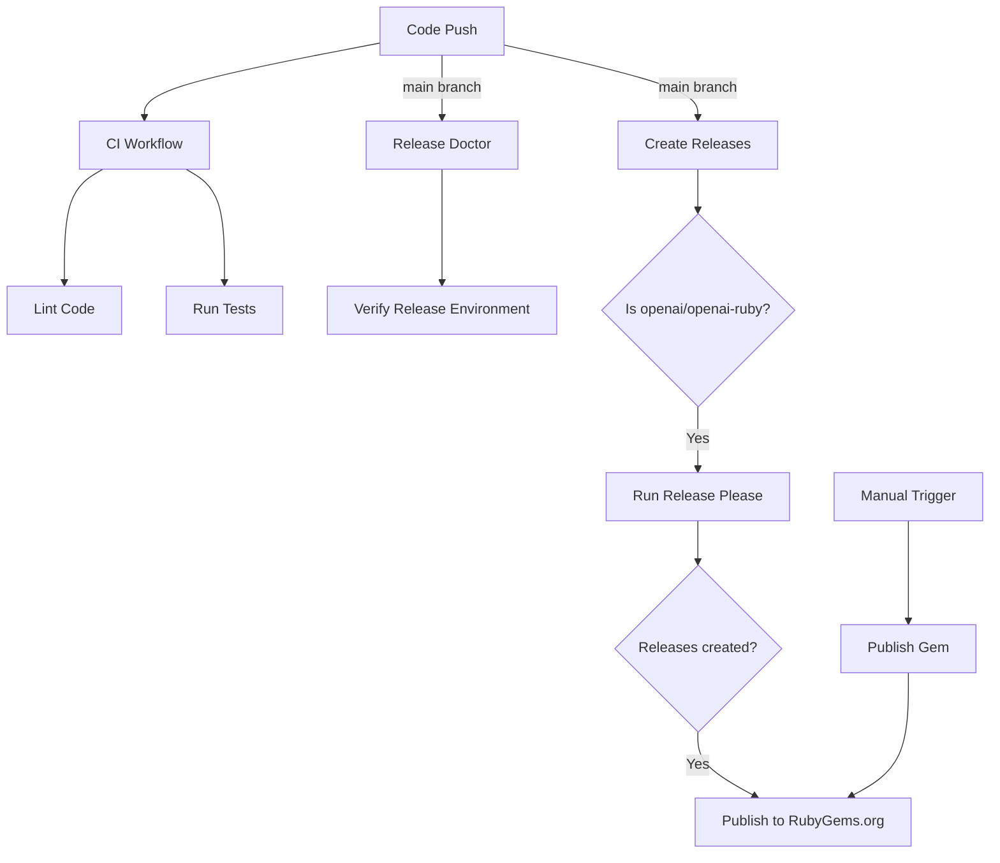
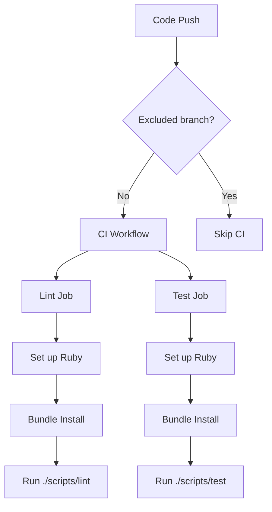
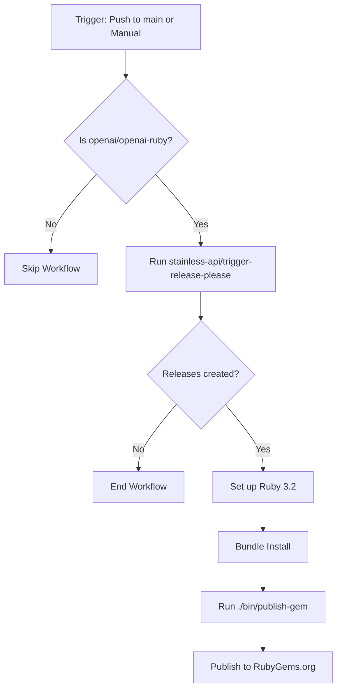
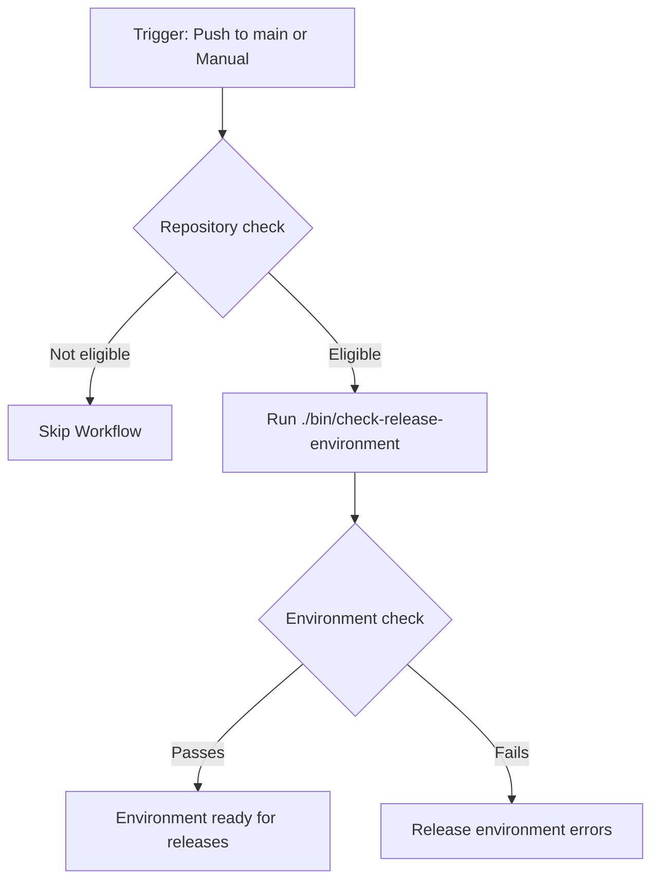
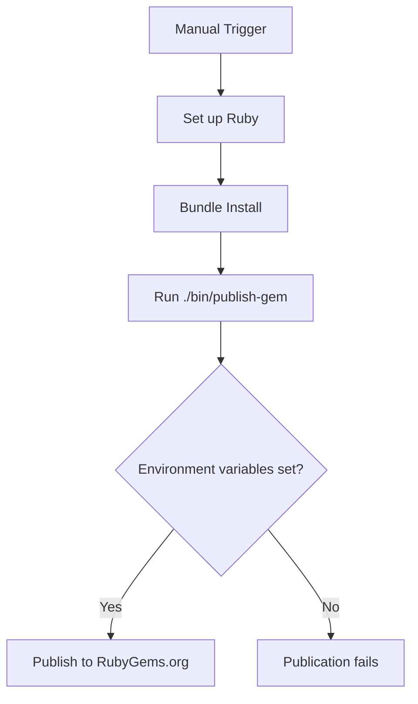
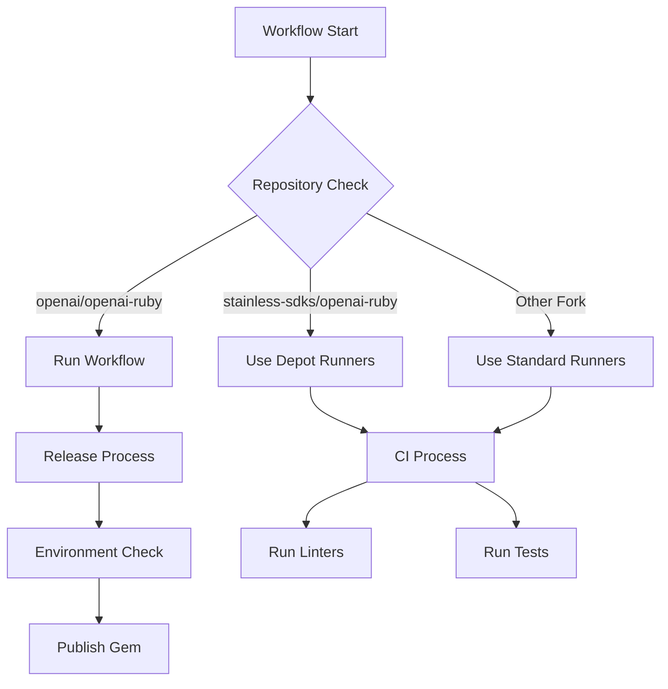

<!-- source: DeepWiki mcp.deepwiki.com · repo openai/openai-ruby · page 5.3 CI/CD Pipeline · fetched 2026-10-26 -->

# CI/CD Pipeline

<details>
<summary>Relevant source files</summary>

The following files were used as context for generating this wiki page:

- [.github/workflows/ci.yml](.github/workflows/ci.yml)
- [.github/workflows/create-releases.yml](.github/workflows/create-releases.yml)
- [.github/workflows/publish-gem.yml](.github/workflows/publish-gem.yml)
- [.github/workflows/release-doctor.yml](.github/workflows/release-doctor.yml)
- [.release-please-manifest.json](.release-please-manifest.json)
- [CHANGELOG.md](CHANGELOG.md)
- [Gemfile.lock](Gemfile.lock)
- [bin/check-release-environment](bin/check-release-environment)
- [lib/openai/version.rb](lib/openai/version.rb)
- [sig/openai/version.rbs](sig/openai/version.rbs)

</details>


This document explains the Continuous Integration (CI) and Continuous Deployment (CD) pipeline for the OpenAI Ruby SDK. It covers the automated processes that ensure code quality, verify builds, and manage the release and publication of the gem to RubyGems.org.

For information about the build system and development tasks, see [Build System](#5.1). For information about testing, see [Testing](#5.2).

## Overview

The OpenAI Ruby SDK utilizes GitHub Actions for its CI/CD pipeline. The pipeline consists of several workflows that handle:

1. Code quality checks and testing
2. Automated release management
3. Gem publishing to RubyGems.org
4. Release environment verification



Sources: [.github/workflows/ci.yml:1-42](), [.github/workflows/create-releases.yml:1-44](), [.github/workflows/publish-gem.yml:1-27](), [.github/workflows/release-doctor.yml:1-24]()

## CI Workflow

The CI workflow runs whenever code is pushed to the repository, except for specific branches that are excluded.



The CI workflow consists of two jobs:

| Job | Description | Script |
|-----|-------------|--------|
| `lint` | Runs linters to ensure code quality | `./scripts/lint` |
| `test` | Runs tests to verify functionality | `./scripts/test` |

Both jobs have a timeout of 10 minutes to prevent hanging builds.

Excluded branches from CI:
- 'generated'
- 'codegen/**'
- 'integrated/**'
- 'stl-preview-head/**'
- 'stl-preview-base/**'

Sources: [.github/workflows/ci.yml:1-42]()

## Release Process

The OpenAI Ruby SDK uses an automated release process based on the "Release Please" action from Google. This process handles versioning, changelog updates, and publishing.

### Create Releases Workflow

This workflow runs:
- On pushes to the main branch 
- When manually triggered via workflow dispatch



Important workflow details:
- Only runs on the `openai/openai-ruby` repository, not on forks
- Uses the `stainless-api/trigger-release-please` action to automate the release process
- If releases are created, sets up Ruby 3.2 and publishes the gem to RubyGems.org

Sources: [.github/workflows/create-releases.yml:1-44]()

### Release Doctor Workflow

The Release Doctor workflow verifies that the environment is correctly configured for releases.



This workflow checks:
- If the `GEM_HOST_API_KEY` secret is set, which is required for publishing to RubyGems.org

Sources: [.github/workflows/release-doctor.yml:1-24](), [bin/check-release-environment:1-22]()

## Manual Publishing

A manual publishing workflow is available in case the automated process fails.



This workflow:
- Can be triggered manually via the GitHub UI
- Runs the same `./bin/publish-gem` script as the automated process
- Requires the same environment variables (`GEM_HOST_API_KEY` and optionally `RUBYGEMS_HOST`)

Sources: [.github/workflows/publish-gem.yml:1-27]()

## Versioning

The OpenAI Ruby SDK follows semantic versioning with additional pre-release identifiers for alpha and beta versions.

### Version Management

The gem version is defined in `lib/openai/version.rb`:

```ruby
module OpenAI
  VERSION = "0.1.0.pre.beta.1"
end
```

This version is tracked in `.release-please-manifest.json` for the Release Please action:

```json
{
  ".": "0.1.0-beta.1"
}
```

Note the slight difference in formatting between the Ruby version string and the Release Please format.

Sources: [lib/openai/version.rb:1-6](), [.release-please-manifest.json:1-3]()

### Changelog Management

The `CHANGELOG.md` file is automatically updated by the Release Please action when creating new releases. It includes:

- Version number and release date
- Link to compare the changes with the previous version
- Categorized changes (Features, Bug Fixes, Chores, Documentation)
- Commit IDs, authors, and PR references

The changelog follows a structured format to maintain consistency across releases.

Sources: [CHANGELOG.md:1-317]()

## Dependencies

The CI/CD pipeline relies on several dependencies, as specified in the `Gemfile.lock`:

| Dependency | Purpose |
|------------|---------|
| `syntax_tree-rbs` | Ruby code formatting |
| `rubocop` | Ruby code linting |
| `minitest` | Testing framework |
| `rake` | Task automation |
| `sorbet` | Type checking |
| `steep` | Type checking |
| `yard` | Documentation generation |
| `webmock` | HTTP request mocking for tests |

Sources: [Gemfile.lock:1-212]()

## Integration with Stainless

The OpenAI Ruby SDK utilizes the Stainless infrastructure for its CI/CD pipeline, particularly for release management. The workflow checks if the repository is `stainless-sdks/openai-ruby` or `openai/openai-ruby` to determine whether to run certain steps.



This integration ensures consistent build environments and release processes across Stainless-maintained SDKs.

Sources: [.github/workflows/ci.yml:15-31](), [.github/workflows/create-releases.yml:11]()

---

