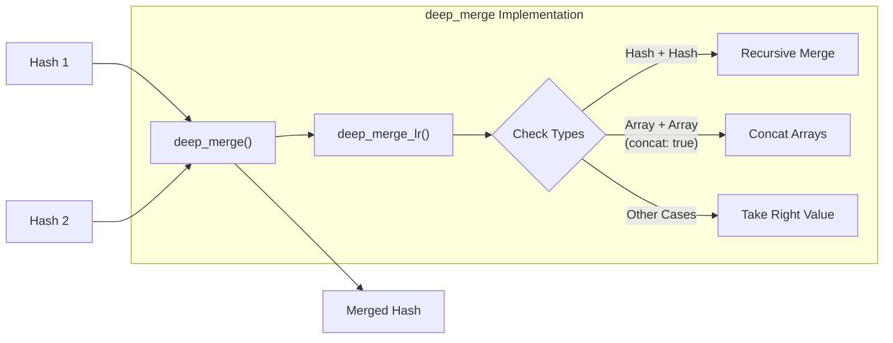
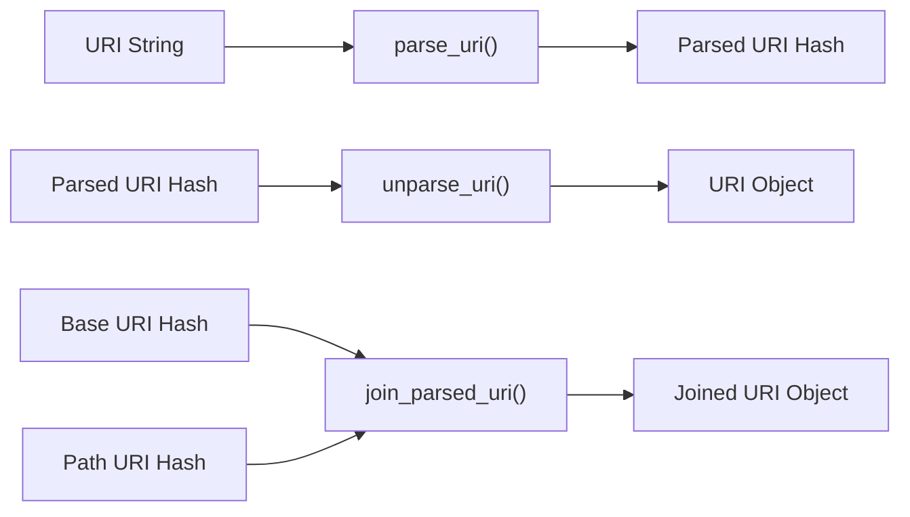
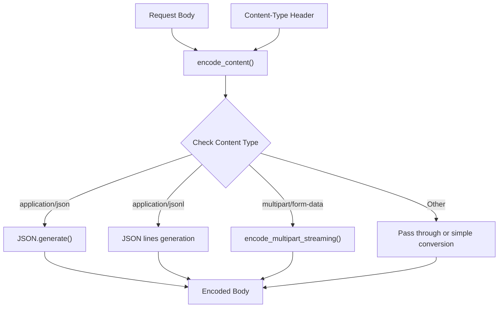
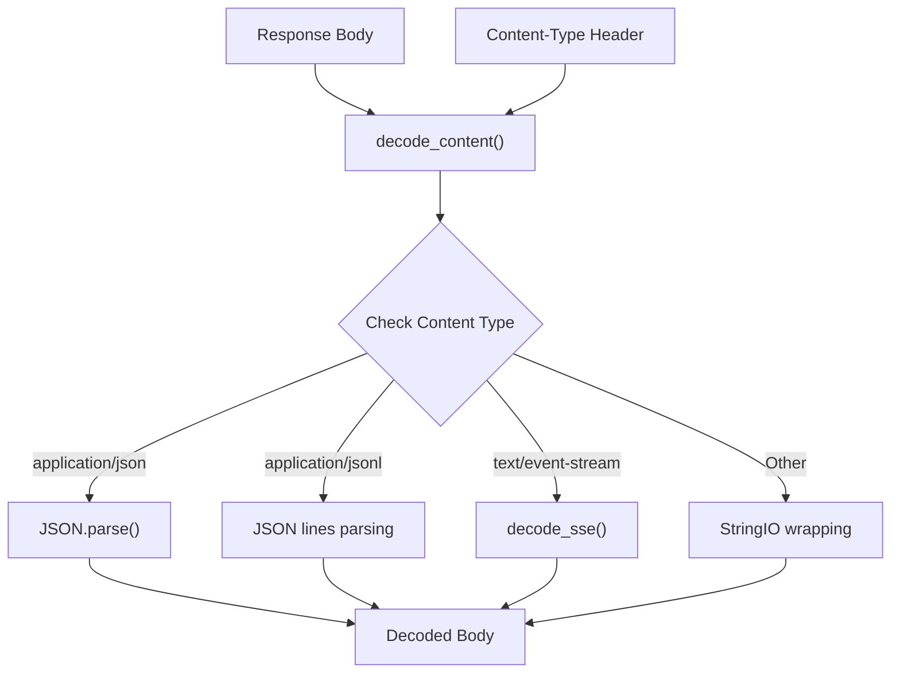
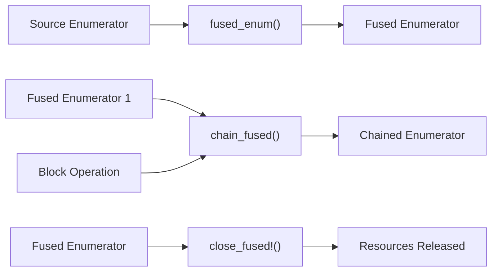
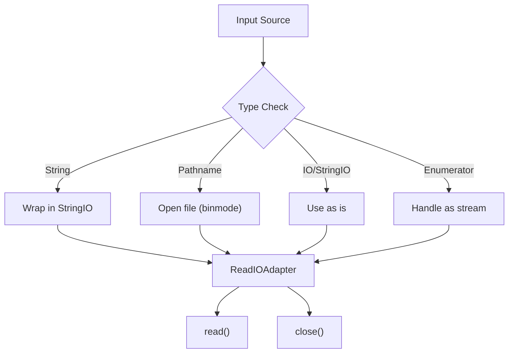
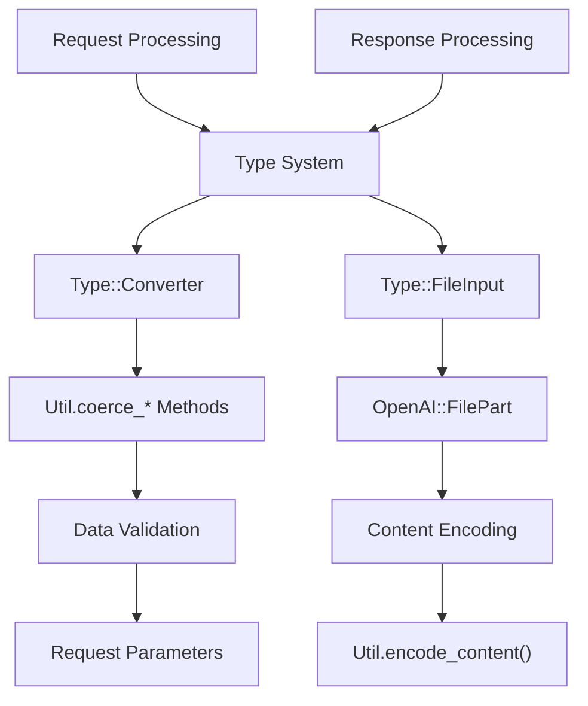
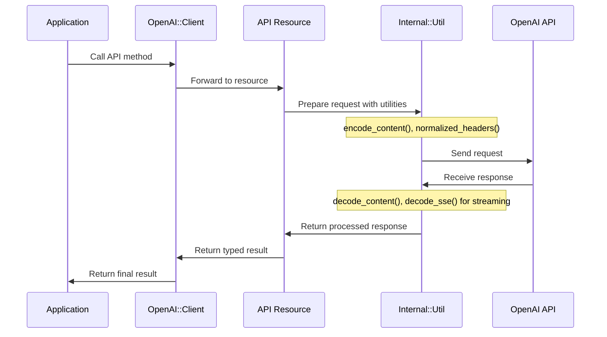

<!-- source: DeepWiki mcp.deepwiki.com · repo openai/openai-ruby · page 5.4 Utility Functions · fetched 2026-10-26 -->

# Utility Functions

<details>
<summary>Relevant source files</summary>

The following files were used as context for generating this wiki page:

- [lib/openai/file_part.rb](lib/openai/file_part.rb)
- [lib/openai/internal/type/converter.rb](lib/openai/internal/type/converter.rb)
- [lib/openai/internal/type/file_input.rb](lib/openai/internal/type/file_input.rb)
- [lib/openai/internal/util.rb](lib/openai/internal/util.rb)
- [rbi/openai/internal/util.rbi](rbi/openai/internal/util.rbi)
- [sig/openai/internal/util.rbs](sig/openai/internal/util.rbs)
- [test/openai/file_part_test.rb](test/openai/file_part_test.rb)
- [test/openai/internal/util_test.rb](test/openai/internal/util_test.rb)

</details>


The OpenAI Ruby SDK includes a comprehensive set of internal utility functions in the `OpenAI::Internal::Util` module that serve as the foundation for many operations within the library. These utilities handle common tasks such as data manipulation, URI handling, content encoding/decoding, streaming operations, and file handling. This document details these utility functions, their purposes, and how they work together.

## Overview

The utility functions are primarily used by internal components of the SDK and provide the essential infrastructure that enables different parts of the system to work together efficiently.

```mermaid
graph TD
    Util["OpenAI::Internal::Util"]
    
    Util --> DataManip["Data Manipulation"]
    Util --> URI["URI and HTTP Utilities"]
    Util --> Content["Content Handling"]
    Util --> Stream["Streaming"]
    Util --> File["File Handling"]
    Util --> SysInfo["System Information"]
    
    DataManip --> DeepMerge["deep_merge()"]
    DataManip --> Dig["dig()"]
    DataManip --> Coerce["Type Coercion Methods"]
    
    URI --> ParseURI["parse_uri()/unparse_uri()"]
    URI --> JoinURI["join_parsed_uri()"]
    URI --> Headers["normalized_headers()"]
    
    Content --> EncodeContent["encode_content()"]
    Content --> Multipart["Multipart Form Data"]
    Content --> Charset["force_charset!()"]
    Content --> DecodeContent["decode_content()"]
    
    Stream --> FusedEnum["fused_enum()"]
    Stream --> DecodeLines["decode_lines()"]
    Stream --> DecodeSse["decode_sse()"]
    
    File --> ReadIOAdapter["ReadIOAdapter"]
    File --> WritableEnum["writable_enum()"]
    
    SysInfo --> MonotonicSecs["monotonic_secs()"]
    SysInfo --> Arch["arch()"]
    SysInfo --> OS["os()"]
```



Sources: [lib/openai/internal/util.rb:3-862]()

## Data Manipulation Utilities

### Type Checking and Coercion

The module provides several methods for type checking and coercion:

- `primitive?` - Checks if a value is a primitive type (boolean, numeric, symbol, or string)
- `coerce_boolean`, `coerce_boolean!` - Convert string values to booleans
- `coerce_integer` - Convert string values to integers
- `coerce_float` - Convert string values to floats
- `coerce_hash`, `coerce_hash!` - Convert objects to hashes

```ruby
# Example code showing how these utilities work
OpenAI::Internal::Util.primitive?(123)       # => true
OpenAI::Internal::Util.primitive?({a: 1})    # => false
OpenAI::Internal::Util.coerce_boolean("true") # => true
OpenAI::Internal::Util.coerce_integer("123")  # => 123
```

Sources: [lib/openai/internal/util.rb:54-146]()

### Deep Merge

The `deep_merge` method recursively merges hashes and arrays, which is essential for handling configuration options and parameter merging throughout the SDK.



Sources: [lib/openai/internal/util.rb:149-189](), [test/openai/internal/util_test.rb:6-75]()

### Dig

The `dig` method provides a flexible way to extract values from nested data structures:

```ruby
# Example of the dig method in action
data = {a: {b: [1, 2, {c: 3}]}}
OpenAI::Internal::Util.dig(data, :a)           # => {b: [1, 2, {c: 3}]}
OpenAI::Internal::Util.dig(data, [:a, :b, 2])  # => {c: 3}
```

This utility is particularly useful for safely navigating complex response objects.

Sources: [lib/openai/internal/util.rb:190-221](), [test/openai/internal/util_test.rb:77-94]()

## URI and HTTP Utilities

### URI Handling

The module provides comprehensive utilities for URI manipulation:

- `uri_origin` - Extracts the origin (scheme://host:port) from a URI
- `interpolate_path` - Formats path segments with proper URL encoding
- `parse_uri`, `unparse_uri` - Convert between URIs and hash representations
- `join_parsed_uri` - Intelligently joins two parsed URIs, similar to URI.join



Sources: [lib/openai/internal/util.rb:223-346](), [test/openai/internal/util_test.rb:97-158]()

### HTTP Header Normalization

The `normalized_headers` method processes HTTP headers to ensure consistent formatting:

```ruby
headers = {"Content-Type" => "application/json", "X-Api-Key" => ["key1", "key2"]}
normalized = OpenAI::Internal::Util.normalized_headers(headers)
# => {"content-type" => "application/json", "x-api-key" => "key1, key2"}
```

Sources: [lib/openai/internal/util.rb:347-366]()

## Content Handling Utilities

### Content Type Detection

The module defines regular expressions for content type detection:

```ruby
JSON_CONTENT = %r{^application/(?:vnd(?:\.[^.]+)*\+)?json(?!l)}
JSONL_CONTENT = %r{^application/(:?x-(?:n|l)djson)|(:?(?:x-)?jsonl)}
```

These patterns determine how content is encoded and decoded.

Sources: [lib/openai/internal/util.rb:470-473](), [test/openai/internal/util_test.rb:161-191]()

### Content Encoding and Decoding

The `encode_content` method prepares request bodies based on content type:



The `decode_content` method processes response bodies:



Sources: [lib/openai/internal/util.rb:584-658]()

### Multipart Form Data Handling

For file uploads and multipart form data, the module provides:

- `encode_multipart_streaming` - Creates a streaming multipart request body
- `write_multipart_chunk` - Writes a single part of a multipart request
- `write_multipart_content` - Writes the content of a multipart part

This is particularly important for file uploads in API calls like those to the Files or Image APIs.

Sources: [lib/openai/internal/util.rb:476-577](), [test/openai/internal/util_test.rb:193-260]()

## Streaming and Enumeration Utilities

### Fused Enumerators

The module implements "fused enumerator" functionality inspired by Rust's FusedIterator trait:

- `fused_enum` - Creates an enumerator that can only be consumed once
- `close_fused!` - Safely closes a fused enumerator
- `chain_fused` - Chains multiple enumerators together with proper resource cleanup

These utilities ensure proper resource handling for streaming operations.



Sources: [lib/openai/internal/util.rb:662-717](), [test/openai/internal/util_test.rb:293-412]()

### Line and SSE Decoding

For handling streaming responses:

- `decode_lines` - Decodes a stream of bytes into lines, handling partial line fragments
- `decode_sse` - Decodes Server-Sent Events (SSE) from line streams according to the SSE spec

These are critical for features like chat completion streaming.

Sources: [lib/openai/internal/util.rb:718-803](), [test/openai/internal/util_test.rb:432-598]()

## File Handling Utilities

### ReadIOAdapter

The `ReadIOAdapter` class provides a consistent interface for various input sources:



This adapter is essential for IO streaming operations, particularly with file uploads.

Sources: [lib/openai/internal/util.rb:370-450](), [test/openai/internal/util_test.rb:263-290]()

### Writable Enumerators

The `writable_enum` method creates an enumerator that exposes a write interface:

```ruby
enum = OpenAI::Internal::Util.writable_enum do |y|
  y.write("Hello")
  y.write(" World")
end
# enum will yield "Hello" and " World"
```

This allows for adapting between IO and enumeration patterns.

Sources: [lib/openai/internal/util.rb:452-467]()

## FilePart

The `OpenAI::FilePart` class represents a file part in a multipart request:

```ruby
# Create a file part with a content type
file = OpenAI::FilePart.new(
  File.open("image.jpg"), 
  filename: "profile.jpg", 
  content_type: "image/jpeg"
)
```

Sources: [lib/openai/file_part.rb:1-55](), [test/openai/file_part_test.rb:1-13]()

## System Information Utilities

The module provides methods for retrieving system information:

- `monotonic_secs` - Returns monotonic clock time for precise timing measurements
- `arch` - Identifies the system architecture (arm64, x64, etc.)
- `os` - Identifies the operating system (Linux, MacOS, Windows, etc.)

This information is used for telemetry, debugging, and user-agent generation.

Sources: [lib/openai/internal/util.rb:7-52]()

## Integration with Type System

The Utility module integrates with the SDK's type system:



The utility functions support the type system by providing coercion methods and file handling capabilities that enable type-safe API interactions.

Sources: [lib/openai/internal/util.rb:54-147](), [lib/openai/internal/type/converter.rb:1-292](), [lib/openai/internal/type/file_input.rb:1-96]()

## Usage Flow

This diagram illustrates how utility functions participate in the request/response cycle:



Sources: [lib/openai/internal/util.rb:584-658](), [lib/openai/internal/util.rb:718-803]()

## Summary

The utility functions in the OpenAI Ruby SDK provide essential infrastructure that powers the library's core functionality. While most users will not interact with these utilities directly, they form the foundation that enables the higher-level API interfaces to work correctly and efficiently. Understanding these utilities is valuable for contributors to the SDK and for developers who need to debug complex issues or extend the library's capabilities.