# Page: Overview

# Overview

<details>
<summary>Relevant source files</summary>

The following files were used as context for generating this wiki page:

- [.gitignore](.gitignore)
- [.rubocop.yml](.rubocop.yml)
- [.ruby-version](.ruby-version)
- [README.md](README.md)
- [Rakefile](Rakefile)
- [lib/openai.rb](lib/openai.rb)
- [lib/openai/errors.rb](lib/openai/errors.rb)
- [openai.gemspec](openai.gemspec)
- [rbi/openai/errors.rbi](rbi/openai/errors.rbi)
- [scripts/bootstrap](scripts/bootstrap)
- [sig/openai/internal/type/array_of.rbs](sig/openai/internal/type/array_of.rbs)
- [sig/openai/internal/type/base_page.rbs](sig/openai/internal/type/base_page.rbs)
- [sig/openai/internal/type/hash_of.rbs](sig/openai/internal/type/hash_of.rbs)

</details>


The OpenAI Ruby SDK provides convenient and type-safe access to the OpenAI REST API from any Ruby 3.2.0+ application. This document introduces the SDK's purpose, core functionality, and general architecture.

For specific usage instructions, see [Getting Started](#2). For detailed architecture explanations, see [Core Architecture](#3).

## Purpose and Functionality

The OpenAI Ruby SDK serves as a client library for accessing OpenAI's API services including:

- Chat Completions
- Assistants API (Beta)
- Images generation and editing
- Audio transcription and translation
- Embeddings
- Fine-tuning
- Files management
- Moderations

The SDK provides a fully-typed interface to these services, with comprehensive documentation in YARD, RBS, and RBI formats for development support.

Sources: [README.md:1-9](), [openai.gemspec:5-15]()

## Core Components

The OpenAI Ruby SDK is structured around several core components that work together to provide a seamless interface to the OpenAI API.

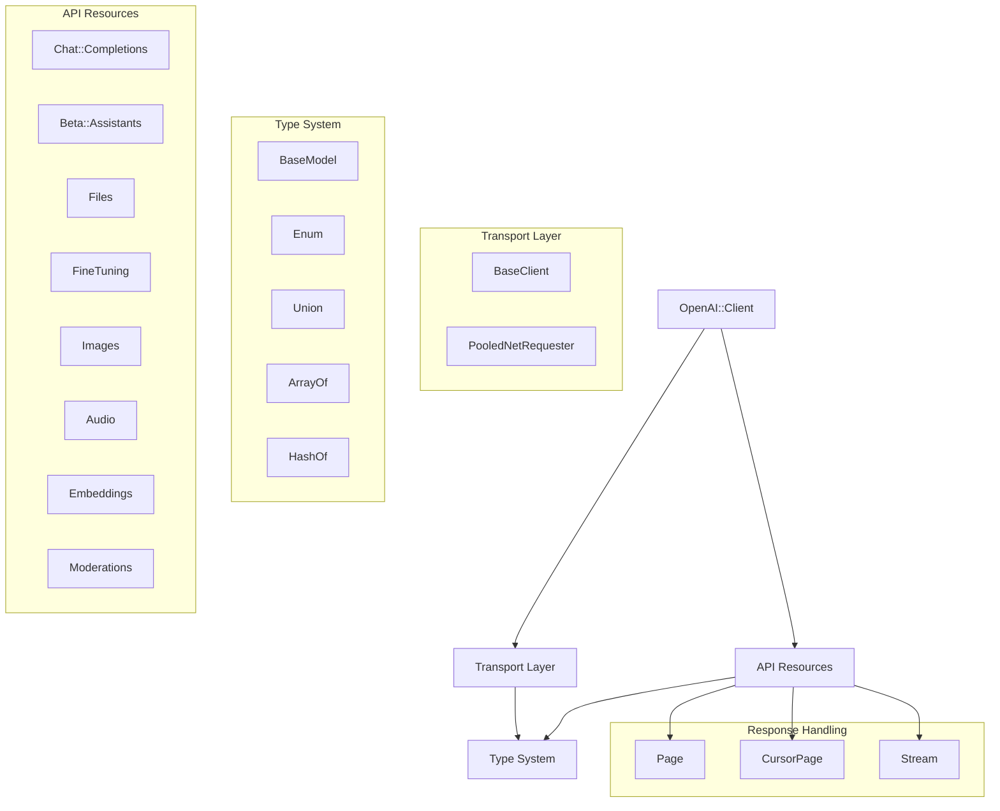

### Component Descriptions

1. **OpenAI::Client**: The primary entry point for all API interactions, orchestrating requests to specific resources.

2. **Transport Layer**: Manages HTTP communication with the OpenAI API, including:
   - **BaseClient**: Handles request building, execution, and response processing
   - **PooledNetRequester**: Manages connection pooling for efficient HTTP requests

3. **Type System**: Ensures data integrity and validation:
   - **BaseModel**: Base class for parameter and response objects
   - **Enum**: Provides type-safe enumeration values
   - **Union**: Supports polymorphic types
   - **ArrayOf/HashOf**: Collection type validators

4. **API Resources**: Resource-specific classes that encapsulate API endpoints
   
5. **Response Handling**: Components for working with different response formats:
   - **Page/CursorPage**: Handles paginated responses
   - **Stream**: Processes streaming responses

Sources: [lib/openai.rb:30-60](), [lib/openai/errors.rb:1-20](), [README.md:25-41]()

## Request Flow

The following sequence diagram illustrates how requests flow through the SDK:

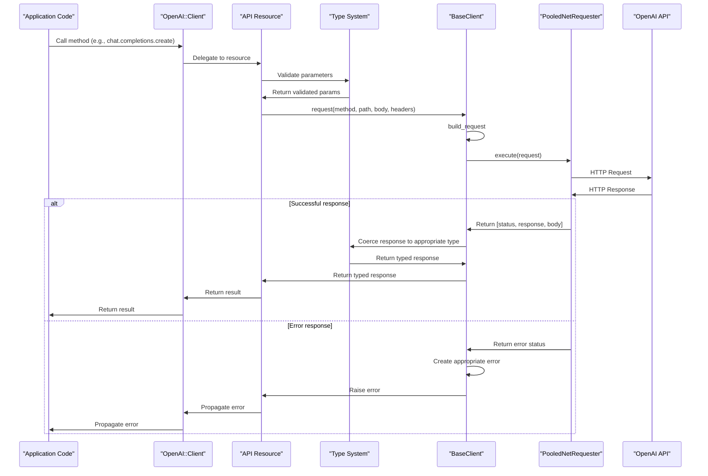

This flow demonstrates how the SDK handles validation, request execution, response processing, and error handling through its layered architecture.

Sources: [README.md:110-125](), [lib/openai/errors.rb:114-226]()

## Type System

The OpenAI Ruby SDK implements a robust type system that ensures data validity throughout API interactions:

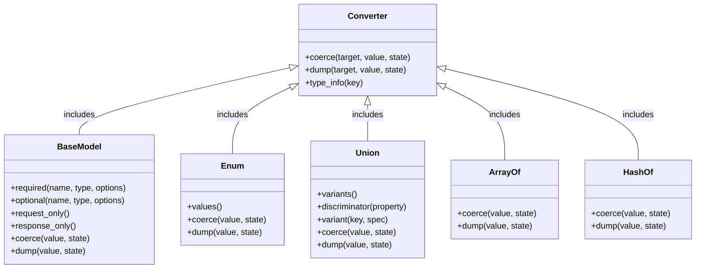

Key features of the type system include:

1. **Parameter Validation**: All API parameters are validated before sending requests
2. **Response Typing**: Response data is automatically converted to appropriate types
3. **Error Handling**: Type conversion errors are caught and reported
4. **Supporting Types**: Collection types (arrays, hashes), enums, and union types

The `BaseModel` class serves as the foundation for all parameter and response objects, providing utilities for data access, conversion, and serialization.

Sources: [lib/openai.rb:32-40](), [sig/openai/internal/type/array_of.rbs:1-45](), [sig/openai/internal/type/hash_of.rbs:1-45](), [README.md:190-200]()

## Response Handling

The SDK provides specialized handling for different response types from the OpenAI API:

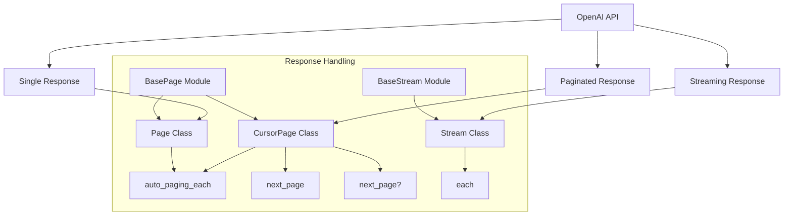

### Response Types

1. **Single Responses**: Standard API responses, wrapped in a `Page` object
2. **Paginated Responses**: List endpoints with multiple pages of results, handled via `CursorPage`
3. **Streaming Responses**: Real-time streaming data (like chat completions), processed through `Stream`

The SDK provides convenient methods like `auto_paging_each` for iterating through multi-page results and `each` for processing streaming responses.

Sources: [README.md:60-85](), [sig/openai/internal/type/base_page.rbs:1-24](), [lib/openai.rb:41-53]()

## Error Handling

The SDK implements a comprehensive error handling system for both API and SDK-level errors:

| Error Type | Description |
|------------|-------------|
| `APIConnectionError` | Network connectivity issues |
| `APITimeoutError` | Request timeouts |
| `APIStatusError` | Base class for HTTP status errors |
| `BadRequestError` | HTTP 400 responses |
| `AuthenticationError` | HTTP 401 responses |
| `PermissionDeniedError` | HTTP 403 responses |
| `NotFoundError` | HTTP 404 responses |
| `ConflictError` | HTTP 409 responses |
| `RateLimitError` | HTTP 429 responses |
| `InternalServerError` | HTTP 500+ responses |
| `ConversionError` | Type conversion issues |

The SDK also includes automatic retry functionality for transient errors (like network issues and rate limits), with configurable retry behavior.

Sources: [README.md:110-186](), [lib/openai/errors.rb:1-228](), [rbi/openai/errors.rbi:1-189]()

## Key Features

Beyond the core architecture, the SDK provides several important features for effective API interaction:

1. **Connection Pooling**: Efficient handling of HTTP connections using the `connection_pool` gem
2. **Automatic Retries**: Built-in retry logic for transient errors with configurable behavior
3. **Timeouts**: Configurable request timeouts to prevent long-running operations
4. **Custom Requests**: Support for undocumented endpoints and parameters
5. **File Uploads**: Convenient handling of file uploads with various input types
6. **Thread Safety**: `OpenAI::Client` instances are thread-safe with request pooling

The SDK is designed to be both developer-friendly and production-ready, with comprehensive type safety and documentation support.

Sources: [README.md:242-251](), [README.md:144-186](), [README.md:88-106]()

## Usage Patterns

The SDK follows a resource-based API design pattern where resources are organized hierarchically:

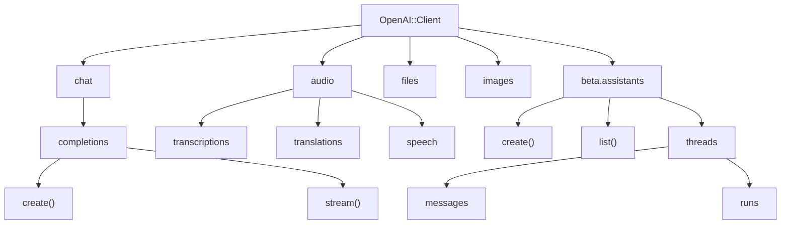

This hierarchical structure allows for intuitive navigation of the API surface, with common patterns like:

- `client.resource.create(...)` for creating objects
- `client.resource.list(...)` for retrieving lists
- `client.resource.retrieve(...)` for fetching specific objects
- `client.resource.child_resource` for accessing nested resources

Every resource follows consistent patterns, making the SDK predictable and easy to use once the basic concepts are understood.

Sources: [README.md:25-57](), [lib/openai.rb:455-494]()

---

# Page: Getting Started

# Getting Started

<details>
<summary>Relevant source files</summary>

The following files were used as context for generating this wiki page:

- [.gitignore](.gitignore)
- [.release-please-manifest.json](.release-please-manifest.json)
- [.ruby-version](.ruby-version)
- [CHANGELOG.md](CHANGELOG.md)
- [Gemfile.lock](Gemfile.lock)
- [README.md](README.md)
- [lib/openai/version.rb](lib/openai/version.rb)
- [openai.gemspec](openai.gemspec)
- [scripts/bootstrap](scripts/bootstrap)
- [sig/openai/version.rbs](sig/openai/version.rbs)

</details>


The OpenAI Ruby SDK provides a convenient interface for Ruby applications to interact with OpenAI's API services. This guide will help you install the SDK, configure it, and understand its basic usage patterns. For more detailed architectural information, see [Core Architecture](#3).

## Installation

The OpenAI Ruby SDK requires Ruby 3.2.0 or higher and can be installed via Bundler.

Add this line to your application's Gemfile:

```ruby
gem "openai", github: "openai/openai-ruby", branch: "main"
```

Then run:

```bash
bundle install
```

Sources: [README.md:11-23](), [openai.gemspec:15-15](), [.ruby-version:1-1]()

## Client Initialization

To start using the SDK, you need to initialize the client with your API key:

```ruby
require "openai"

# Initialize the client with your API key
openai = OpenAI::Client.new(
  api_key: ENV["OPENAI_API_KEY"] # This is the default and can be omitted
)
```

### Client Initialization Flow

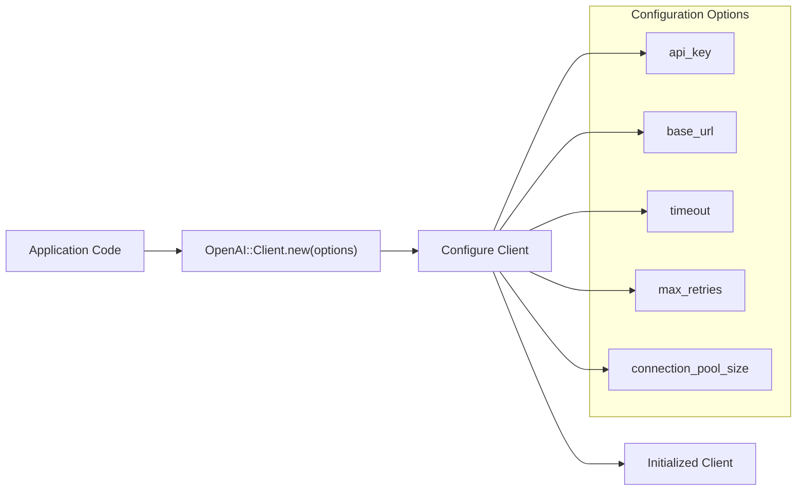

Sources: [README.md:25-41]()

## Basic Usage

Once you have an initialized client, you can start making API calls:

### Chat Completions

```ruby
chat_completion = openai.chat.completions.create(
  messages: [{role: "user", content: "Say this is a test"}],
  model: "gpt-4"
)

puts(chat_completion)
```

### Streaming Responses

```ruby
stream = openai.chat.completions.stream_raw(
  messages: [{role: "user", content: "Say this is a test"}],
  model: "gpt-4"
)

stream.each do |completion|
  puts(completion)
end
```

### Request-Response Flow

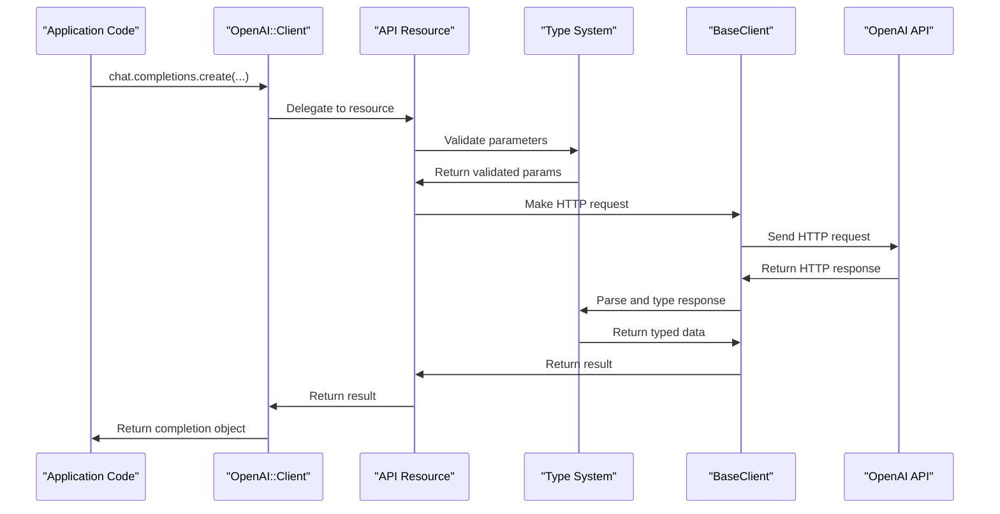

Sources: [README.md:25-58]()

## Working with Responses

The SDK provides different ways to work with API responses:

### Standard Responses

Standard responses are returned as typed objects with accessible properties:

```ruby
completion = openai.chat.completions.create(
  messages: [{role: "user", content: "Hello!"}],
  model: "gpt-4"
)

puts completion.choices[0].message.content
```

### Paginated Responses

List methods in the API return paginated results:

```ruby
page = openai.fine_tuning.jobs.list(limit: 20)

# Access the first item
job = page.data[0]
puts(job.id)

# Automatically fetch more pages as needed
page.auto_paging_each do |job|
  puts(job.id)
end

# Or manually navigate pages
if page.next_page?
  new_page = page.next_page
  puts(new_page.data[0].id)
end
```

Sources: [README.md:60-86]()

## File Uploads

The SDK supports several ways to upload files:

```ruby
# Using Pathname for large files
file_object = openai.files.create(file: Pathname("input.jsonl"), purpose: "fine-tune")

# Using file contents directly
file_object = openai.files.create(file: File.read("input.jsonl"), purpose: "fine-tune")

# With custom filename and content type
file = OpenAI::FilePart.new(
  File.read("input.jsonl"), 
  filename: "input.jsonl", 
  content_type: "application/json"
)
file_object = openai.files.create(file: file, purpose: "fine-tune")
```

**Note**: When using raw IO descriptors, retries are disabled as the library can't be sure if the descriptor is a file or pipe (which cannot be rewound).

Sources: [README.md:88-108]()

## Error Handling

The SDK raises appropriate exceptions when errors occur. Here's how to handle them:

```ruby
begin
  job = openai.fine_tuning.jobs.create(model: "babbage-002", training_file: "file-abc123")
rescue OpenAI::Errors::APIConnectionError => e
  puts("The server could not be reached")
  puts(e.cause)  # an underlying Exception, likely raised within `net/http`
rescue OpenAI::Errors::RateLimitError => e
  puts("A 429 status code was received; we should back off a bit.")
rescue OpenAI::Errors::APIStatusError => e
  puts("Another non-200-range status code was received")
  puts(e.status)
end
```

### Common Error Types

| Cause | Error Type |
| --- | --- |
| HTTP 400 | `BadRequestError` |
| HTTP 401 | `AuthenticationError` |
| HTTP 403 | `PermissionDeniedError` |
| HTTP 404 | `NotFoundError` |
| HTTP 409 | `ConflictError` |
| HTTP 422 | `UnprocessableEntityError` |
| HTTP 429 | `RateLimitError` |
| HTTP >= 500 | `InternalServerError` |
| Timeout | `APITimeoutError` |
| Network error | `APIConnectionError` |

Sources: [README.md:110-143]()

## Configuration Options

The client can be configured globally or per-request:

### Global Configuration

```ruby
openai = OpenAI::Client.new(
  api_key: "your-api-key-here",       # Default: ENV["OPENAI_API_KEY"]
  base_url: "https://custom-url.com", # Default: ENV["OPENAI_BASE_URL"] or OpenAI's API URL
  timeout: 60,                        # Default: 600 seconds
  max_retries: 5,                     # Default: 2
  connection_pool_size: 25            # Default: 99
)
```

### Per-Request Configuration

```ruby
openai.chat.completions.create(
  messages: [{role: "user", content: "How can I get the name of the current day in JavaScript?"}],
  model: "gpt-4",
  request_options: {
    timeout: 30,
    max_retries: 1,
    extra_query: {my_query_parameter: "value"},
    extra_body: {my_body_parameter: "value"},
    extra_headers: {"my-header": "value"}
  }
)
```

### Configuration Options Diagram

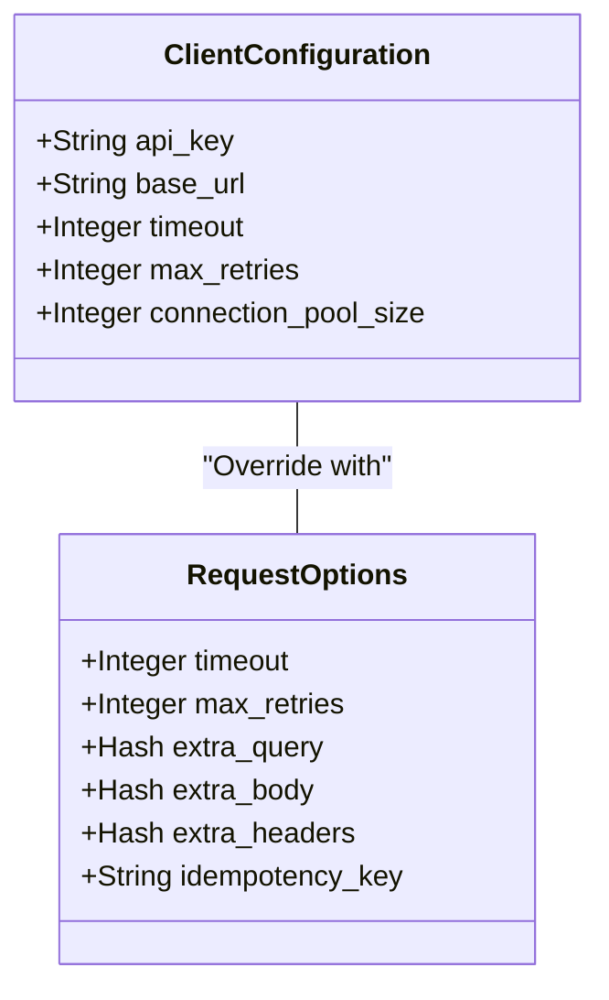

Sources: [README.md:144-186](), [README.md:207-227]()

## Retries

The SDK automatically retries certain types of errors:

- Connection errors (network issues)
- HTTP status codes: 408, 409, 429, 500+
- Timeouts

You can configure retry behavior:

```ruby
# Global configuration
openai = OpenAI::Client.new(
  max_retries: 0 # Disable retries (default is 2)
)

# Per-request configuration
openai.chat.completions.create(
  messages: [{role: "user", content: "How can I get the name of the current day in JavaScript?"}],
  model: "gpt-4",
  request_options: {max_retries: 5}
)
```

Sources: [README.md:144-164]()

## Advanced Usage

For more advanced usage patterns, including undocumented parameters and endpoints, see [Basic Usage](#2.2) and [Configuration Options](#2.3).

### Concurrency & Connection Pooling

The `OpenAI::Client` instances are threadsafe and maintain their own HTTP connection pool with a default size of 99 connections. It's recommended to instantiate the client once per application for optimal performance.

When all available connections from the pool are checked out, requests wait for a new connection to become available, with queue time counting towards the request timeout.

Sources: [README.md:243-252]()

---

# Page: Installation

# Installation

<details>
<summary>Relevant source files</summary>

The following files were used as context for generating this wiki page:

- [.gitignore](.gitignore)
- [.release-please-manifest.json](.release-please-manifest.json)
- [.ruby-version](.ruby-version)
- [CHANGELOG.md](CHANGELOG.md)
- [CONTRIBUTING.md](CONTRIBUTING.md)
- [Gemfile.lock](Gemfile.lock)
- [README.md](README.md)
- [lib/openai/version.rb](lib/openai/version.rb)
- [openai.gemspec](openai.gemspec)
- [scripts/bootstrap](scripts/bootstrap)
- [scripts/format](scripts/format)
- [scripts/lint](scripts/lint)
- [scripts/test](scripts/test)
- [sig/openai/version.rbs](sig/openai/version.rbs)
- [sorbet/rbi/.gitignore](sorbet/rbi/.gitignore)

</details>


This page provides detailed information about installing the OpenAI Ruby SDK in your application. The SDK offers convenient access to the OpenAI REST API from any Ruby application with comprehensive type support. For information about configuring the SDK after installation, see [Configuration Options](#2.3).

## System Requirements

Before installing the OpenAI Ruby SDK, ensure your system meets the following requirements:

- **Ruby**: Version 3.2.0 or higher
- **Bundler**: For dependency management

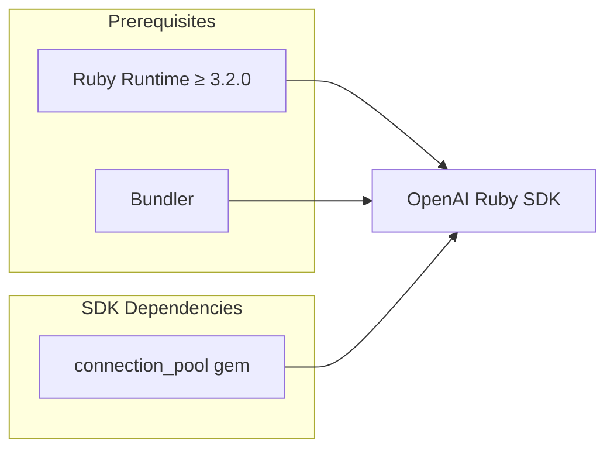

Sources: [README.md:3-3](), [README.md:316-316](), [.ruby-version:1-1](), [openai.gemspec:15-15]()

## Installation via Bundler

The OpenAI Ruby SDK is currently in beta and not yet available on RubyGems. To install the SDK, you need to add it to your application's `Gemfile`:

1. Add the following line to your application's `Gemfile`:

```ruby
gem "openai", github: "openai/openai-ruby", branch: "main"
```

2. Run bundler to install the gem:

```bash
bundle install
```

3. Require the gem in your application:

```ruby
require "openai"
```

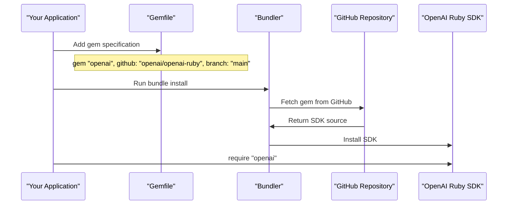

Sources: [README.md:13-21](), [README.md:28-29]()

## Installation from Source

For development purposes or to use the latest unreleased version, you can install the SDK directly from source:

### From GitHub Repository

Add this to your `Gemfile`:

```ruby
gem "openai", git: "https://www.github.com/openai/openai-ruby"
```

### From Local Clone

1. Clone the repository:

```bash
git clone https://www.github.com/openai/openai-ruby /path/to/local/repo
```

2. Reference the local repository in your `Gemfile`:

```ruby
gem "openai", path: "/path/to/local/repo"
```

3. Run bundler:

```bash
bundle install
```

Sources: [CONTRIBUTING.md:41-57]()

## Verification

After installation, you can verify that the SDK is correctly installed by creating a simple application that imports the SDK and checks the version:

```ruby
require "openai"
puts OpenAI::VERSION
```

If installed correctly, this will output the current version of the SDK, such as `0.1.0.pre.beta.1`.

Sources: [lib/openai/version.rb:4-4]()

## Architecture and Dependencies

The OpenAI Ruby SDK uses the standard library's `net/http` as the HTTP transport with connection pooling via the `connection_pool` gem. This architecture ensures efficient handling of API requests with proper resource management.

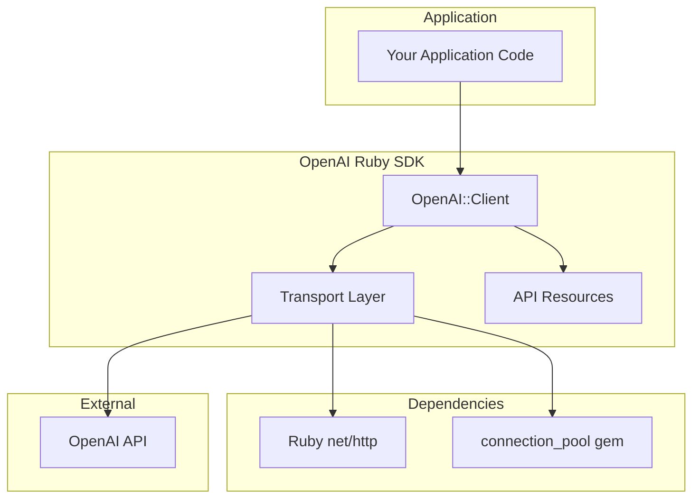

Sources: [README.md:3-3](), [openai.gemspec:27-27]()

## Connection Pooling

The SDK includes connection pooling for efficient resource management. Each instance of `OpenAI::Client` has its own HTTP connection pool with a default size of 99. For optimal performance, it's recommended to instantiate the client once per application.

| Setting | Default Value | Description |
|---------|---------------|-------------|
| Connection Pool Size | 99 | Maximum number of concurrent connections |
| Timeout | 600 seconds | Default request timeout |
| Max Retries | 2 | Default number of retry attempts |

Sources: [README.md:246-246](), [CHANGELOG.md:13-13](), [README.md:168-168](), [README.md:146-146]()

## Troubleshooting

### Ruby Version Issues

If you encounter errors related to Ruby version compatibility, ensure you're using Ruby 3.2.0 or higher:

```bash
ruby --version
```

If your Ruby version is below 3.2.0, consider using a version manager like `rbenv` or `asdf` to install and use a compatible version.

### Bundler Issues

If bundler fails to install the gem, ensure your bundler is up to date:

```bash
gem update bundler
```

### Using with Solargraph or Ruby LSP

For better development experience when using the SDK as a Git dependency, consider using IDE support tools:

- **Ruby LSP**: Good support for go-to-definition functionality
- **Solargraph**: Good support for auto-completion 

Both tools can be used simultaneously for the best experience.

Sources: [CONTRIBUTING.md:100-114]()

## Next Steps

After successfully installing the OpenAI Ruby SDK, you can proceed to basic usage and configuration:

- See [Basic Usage](#2.2) for examples of how to use the SDK
- See [Configuration Options](#2.3) for detailed information on configuring the client

---

# Page: Basic Usage

# Basic Usage

<details>
<summary>Relevant source files</summary>

The following files were used as context for generating this wiki page:

- [.gitignore](.gitignore)
- [.ruby-version](.ruby-version)
- [.solargraph.yml](.solargraph.yml)
- [README.md](README.md)
- [examples/advanced_streaming.rb](examples/advanced_streaming.rb)
- [examples/demo.rb](examples/demo.rb)
- [examples/demo_sorbet.rb](examples/demo_sorbet.rb)
- [examples/picture.rb](examples/picture.rb)
- [examples/streaming.rb](examples/streaming.rb)
- [lib/openai/resources/beta/threads.rb](lib/openai/resources/beta/threads.rb)
- [lib/openai/resources/chat/completions.rb](lib/openai/resources/chat/completions.rb)
- [lib/openai/resources/responses.rb](lib/openai/resources/responses.rb)
- [openai.gemspec](openai.gemspec)
- [scripts/bootstrap](scripts/bootstrap)
- [sorbet/config](sorbet/config)
- [test/openai/client_test.rb](test/openai/client_test.rb)

</details>


This page covers the fundamental usage patterns of the OpenAI Ruby SDK, including initializing the client, making API calls, and handling responses. For configuration details and advanced options, see [Configuration Options](#2.3).

## Client Initialization

The first step in using the OpenAI Ruby SDK is creating a client instance:

```ruby
require "openai"

# Initialize with API key from environment variable
client = OpenAI::Client.new

# Or explicitly provide an API key
client = OpenAI::Client.new(api_key: "your-api-key-here")
```

Sources: [README.md:28-33](), [examples/demo.rb:5-8]()

## Basic Request Flow

### Basic Request Flow Diagram

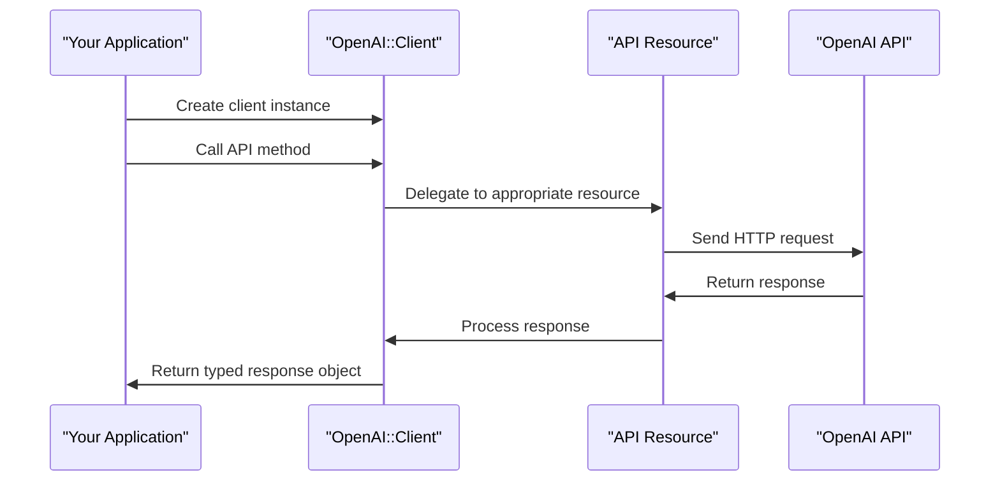

Sources: [lib/openai/resources/chat/completions.rb:100-182](), [README.md:35-40]()

## Making API Calls

### Chat Completions

The most common API call is creating a chat completion:

```ruby
completion = client.chat.completions.create(
  messages: [{role: "user", content: "Say this is a test"}],
  model: "gpt-4"
)

puts completion.choices.first.message.content
```

Sources: [README.md:35-40](), [examples/demo.rb:14-24]()

### Assistants API (Beta)

Create and run an assistant:

```ruby
thread = client.beta.threads.create

run = client.beta.threads.runs.create(
  thread_id: thread.id,
  assistant_id: "asst_abc123"
)
```

Sources: [lib/openai/resources/beta/threads.rb:31-40]()

### Image Generation

Generate images using the images API:

```ruby
response = client.images.generate(
  prompt: "An astronaut lounging in a tropical resort in space, pixel art"
)
```

Sources: [examples/picture.rb:10-14]()

## Client Architecture Diagram

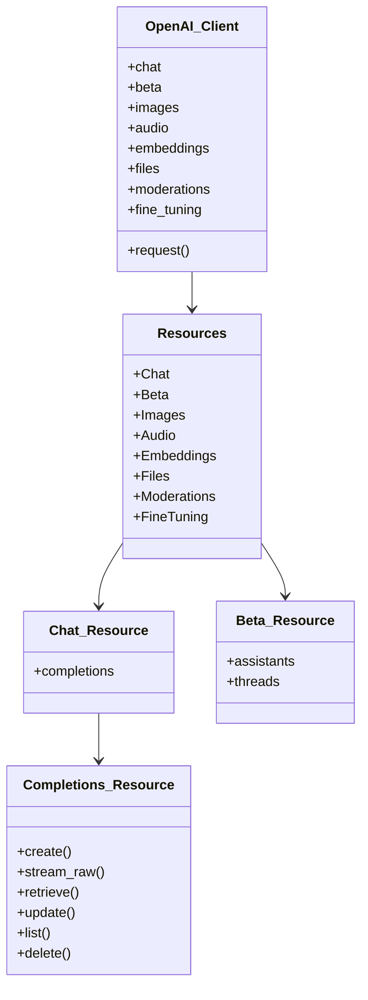

Sources: [lib/openai/resources/chat/completions.rb:1-412](), [lib/openai/resources/beta/threads.rb:1-248](), [lib/openai/resources/responses.rb:1-223]()

## Streaming Responses

For real-time responses, use streaming:

```ruby
stream = client.chat.completions.stream_raw(
  messages: [{role: "user", content: "How do I output all files in a directory using Python?"}],
  model: "gpt-4"
)

stream.each do |chunk|
  next if chunk.choices.empty?
  puts chunk.choices.first.delta.content
end
```

Streams implement the `Enumerable` interface, allowing you to use all Ruby collection methods:

```ruby
# Process all chunks at once
all_choices = stream
  .select { |completion| completion.object == :text_completion }
  .flat_map { |completion| completion.choices }

# Use lazy enumeration for more efficient processing
stream_of_choices = stream
  .lazy
  .select { |completion| completion.object == :text_completion }
  .flat_map { |completion| completion.choices }
```

Remember to close streams if they're not fully consumed:

```ruby
stream.close
```

Sources: [README.md:43-58](), [examples/demo.rb:27-46](), [examples/streaming.rb:10-49](), [examples/advanced_streaming.rb:10-76]()

### Streaming Diagram

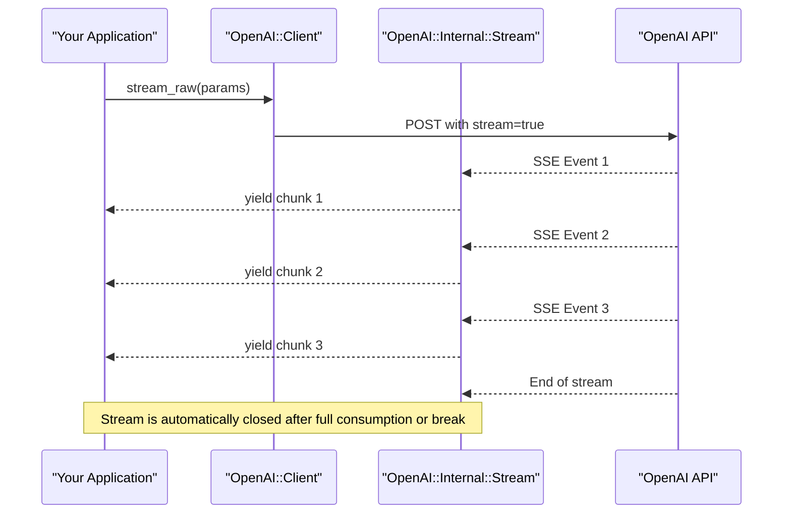

Sources: [lib/openai/resources/chat/completions.rb:278-294](), [README.md:43-58]()

## Pagination

List methods in the OpenAI API return paginated results. The SDK provides auto-paginating iterators:

```ruby
page = client.fine_tuning.jobs.list(limit: 20)

# Fetch single item from page
job = page.data[0]
puts job.id

# Automatically fetch more pages as needed
page.auto_paging_each do |job|
  puts job.id
end

# Or control pagination manually
if page.next_page?
  new_page = page.next_page
  puts new_page.data[0].id
end
```

Sources: [README.md:60-86](), [lib/openai/resources/chat/completions.rb:369-379]()

### Pagination Diagram

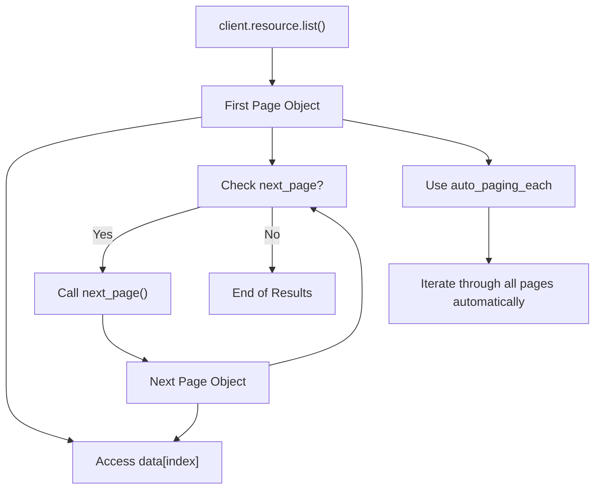

Sources: [README.md:60-86]()

## File Uploads

File parameters can be passed in several ways:

```ruby
# Using Pathname for large files (avoids loading entire file into memory)
file_object = client.files.create(
  file: Pathname("input.jsonl"), 
  purpose: "fine-tune"
)

# Passing file contents directly
file_object = client.files.create(
  file: File.read("input.jsonl"), 
  purpose: "fine-tune"
)

# With explicit filename and content type
file = OpenAI::FilePart.new(
  File.read("input.jsonl"), 
  filename: "input.jsonl", 
  content_type: "application/json"
)
file_object = client.files.create(
  file: file, 
  purpose: "fine-tune"
)
```

Note: Passing raw IO objects disables retries, as the library can't be sure if the descriptor is a file or pipe.

Sources: [README.md:88-108]()

## Error Handling

The SDK throws subclasses of `OpenAI::Errors::APIError` when API calls fail:

```ruby
begin
  job = client.fine_tuning.jobs.create(
    model: "babbage-002", 
    training_file: "file-abc123"
  )
rescue OpenAI::Errors::APIConnectionError => e
  puts "The server could not be reached"
  puts e.cause  # underlying Exception, likely from net/http
rescue OpenAI::Errors::RateLimitError => e
  puts "A 429 status code was received; we should back off"
rescue OpenAI::Errors::APIStatusError => e
  puts "Another non-200-range status code was received"
  puts e.status
end
```

Common error types include:

| HTTP Status | Error Type |
|-------------|------------|
| 400 | `BadRequestError` |
| 401 | `AuthenticationError` |
| 403 | `PermissionDeniedError` |
| 404 | `NotFoundError` |
| 409 | `ConflictError` |
| 422 | `UnprocessableEntityError` |
| 429 | `RateLimitError` |
| ≥500 | `InternalServerError` |
| Timeout | `APITimeoutError` |
| Network | `APIConnectionError` |

Sources: [README.md:110-143](), [test/openai/client_test.rb:30-46]()

### Error Handling Diagram

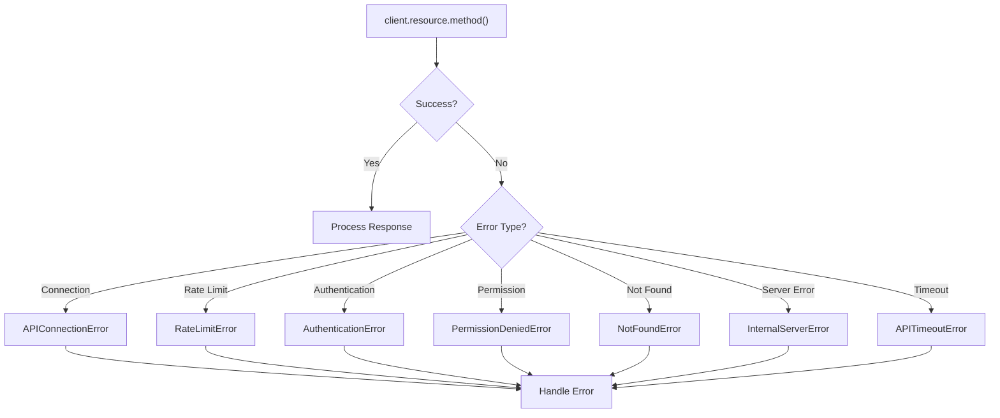

Sources: [README.md:110-143](), [test/openai/client_test.rb:30-46]()

## Retries and Timeouts

By default, certain errors (connection issues, timeouts, rate limits, server errors) are automatically retried 2 times with exponential backoff.

```ruby
# Configure default retries for all requests
client = OpenAI::Client.new(
  api_key: "your-api-key",
  max_retries: 5  # default is 2
)

# Or configure per-request
client.chat.completions.create(
  messages: [{role: "user", content: "Hello world"}],
  model: "gpt-4",
  request_options: {max_retries: 5}
)
```

Requests time out after 600 seconds by default:

```ruby
# Configure default timeout for all requests
client = OpenAI::Client.new(
  api_key: "your-api-key",
  timeout: 30  # default is 600 seconds
)

# Or configure per-request
client.chat.completions.create(
  messages: [{role: "user", content: "Hello world"}],
  model: "gpt-4",
  request_options: {timeout: 10}
)
```

On timeout, `OpenAI::Errors::APITimeoutError` is raised, and these errors are also retried by default.

Sources: [README.md:144-187](), [test/openai/client_test.rb:48-108]()

## Advanced Usage

For more advanced usage patterns, including:

- Working with undocumented properties
- Making custom API requests
- Type-safe requests with Sorbet
- Enum handling

See the [Core Architecture](#3) page.

Sources: [README.md:190-311](), [examples/demo_sorbet.rb:1-61]()

---

# Page: Configuration Options

# Configuration Options

<details>
<summary>Relevant source files</summary>

The following files were used as context for generating this wiki page:

- [.gitignore](.gitignore)
- [.ruby-version](.ruby-version)
- [.yardopts](.yardopts)
- [README.md](README.md)
- [lib/openai/client.rb](lib/openai/client.rb)
- [lib/openai/internal/transport/pooled_net_requester.rb](lib/openai/internal/transport/pooled_net_requester.rb)
- [openai.gemspec](openai.gemspec)
- [rbi/openai/internal/transport/pooled_net_requester.rbi](rbi/openai/internal/transport/pooled_net_requester.rbi)
- [scripts/bootstrap](scripts/bootstrap)
- [sig/openai/client.rbs](sig/openai/client.rbs)
- [sig/openai/internal/transport/pooled_net_requester.rbs](sig/openai/internal/transport/pooled_net_requester.rbs)

</details>


This document details all available configuration options for the OpenAI Ruby SDK client. It covers client initialization parameters, per-request configuration, timeout and retry behavior, connection pooling, and environment variables used for default settings.

## Client Initialization Options

The `OpenAI::Client` class accepts several configuration parameters during initialization that control its behavior throughout the lifecycle of the client.

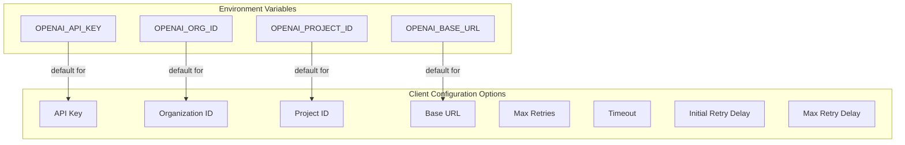

Here are all the available client initialization options:

| Option | Default Value | Purpose |
|--------|---------------|---------|
| `api_key` | `ENV["OPENAI_API_KEY"]` | Authentication key for OpenAI API |
| `organization` | `ENV["OPENAI_ORG_ID"]` | Organization identifier for API requests |
| `project` | `ENV["OPENAI_PROJECT_ID"]` | Project identifier for API requests |
| `base_url` | `ENV["OPENAI_BASE_URL"]` or<br>"https://api.openai.com/v1" | Base URL for all API requests |
| `max_retries` | 2 | Maximum retry attempts for failed requests |
| `timeout` | 600.0 seconds | Request timeout in seconds |
| `initial_retry_delay` | 0.5 seconds | Initial delay before first retry |
| `max_retry_delay` | 8.0 seconds | Maximum delay between retries |

Example client initialization with custom configuration:

```ruby
openai = OpenAI::Client.new(
  api_key: "your-api-key", 
  organization: "your-org-id",
  max_retries: 3,
  timeout: 300
)
```

Sources: [lib/openai/client.rb:102-150](), [README.md:31-33]()

## Per-Request Configuration

In addition to client-level configuration, you can override certain settings on a per-request basis using the `request_options` parameter.

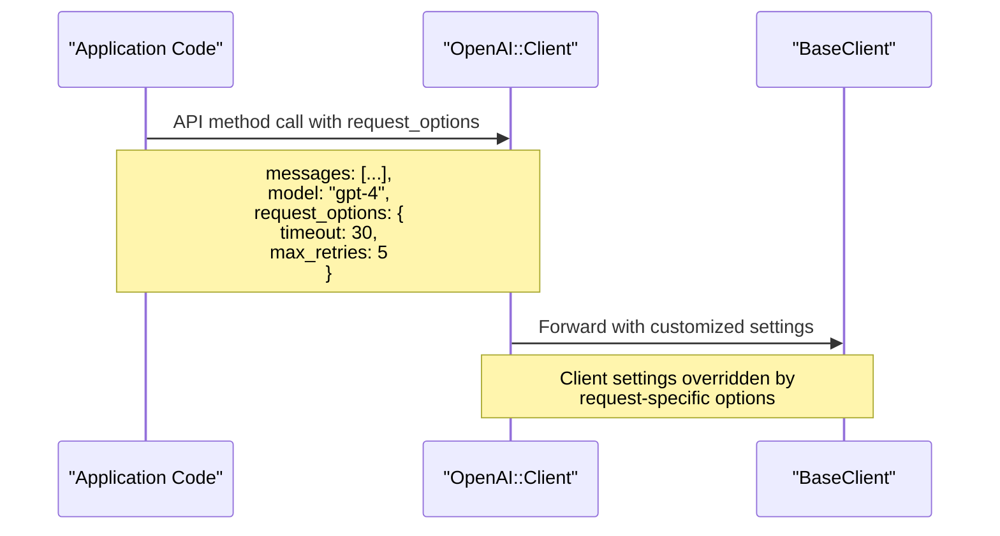

Available per-request configuration options:

| Option | Purpose |
|--------|---------|
| `max_retries` | Override the client's default retry limit for this request |
| `timeout` | Override the client's default timeout for this request |
| `extra_query` | Additional query parameters to include in the request URL |
| `extra_body` | Additional parameters to include in the request body |
| `extra_headers` | Additional HTTP headers to include with the request |

Example of per-request configuration:

```ruby
openai.chat.completions.create(
  messages: [{role: "user", content: "How can I get the name of the current day in JavaScript?"}],
  model: :"gpt-4.1",
  request_options: {
    timeout: 30,
    max_retries: 5,
    extra_headers: {"x-custom-header": "value"}
  }
)
```

Sources: [README.md:152-164](), [README.md:210-223]()

## Retry Behavior

The OpenAI Ruby SDK automatically retries certain types of failures with exponential backoff and jitter.

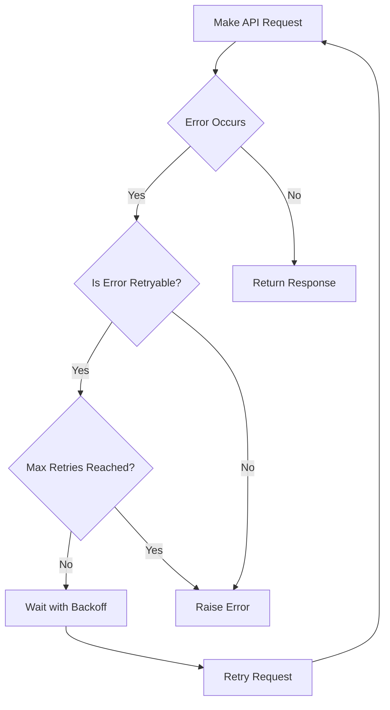

The following errors will trigger automatic retries:

- Connection errors (network connectivity issues)
- HTTP 408 Request Timeout responses
- HTTP 409 Conflict responses
- HTTP 429 Rate Limit responses
- HTTP 500+ Server Error responses
- Request timeouts

You can configure retry behavior through:

1. `max_retries` parameter when creating the client (default: 2)
2. `initial_retry_delay` parameter for controlling the starting delay (default: 0.5s)
3. `max_retry_delay` parameter for capping the maximum delay (default: 8.0s)
4. Per-request override with `request_options: {max_retries: n}`

Sources: [README.md:144-163](), [lib/openai/client.rb:11-16]()

## Timeout Configuration

The OpenAI SDK allows controlling timeout behavior at both client and per-request levels.

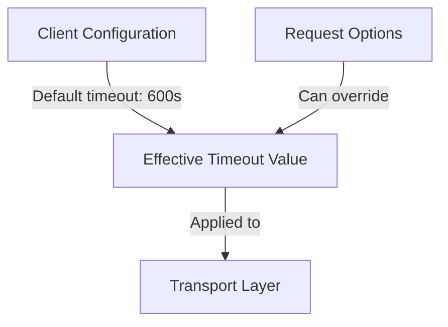

Timeout settings work as follows:

- Default client timeout is 600 seconds (10 minutes)
- Per-request timeouts override the client-level setting
- When a timeout occurs, `OpenAI::Errors::APITimeoutError` is raised
- Timeouts are retried according to the retry policy
- Timeout applies to the entire request lifecycle

Example of setting timeouts:

```ruby
# Client-level timeout (default: 600 seconds)
openai = OpenAI::Client.new(timeout: 120)

# Per-request timeout
openai.chat.completions.create(
  messages: [{role: "user", content: "Hello"}],
  model: "gpt-4",
  request_options: {timeout: 30}  # 30-second timeout for this request
)
```

Sources: [README.md:166-186](), [lib/openai/client.rb:9]()

## Connection Pooling

The OpenAI Ruby SDK uses connection pooling to improve performance by reusing HTTP connections.

```mermaid
graph TD
    Client["OpenAI::Client"]
    Requester["PooledNetRequester"]
    Pool["Connection Pool"]
    Conn1["HTTP Connection 1"]
    Conn2["HTTP Connection 2"]
    ConnN["HTTP Connection N"]
    API["OpenAI API"]
    
    Client --> Requester
    Requester --> Pool
    Pool --> Conn1
    Pool --> Conn2
    Pool --> ConnN
    Conn1 --> API
    Conn2 --> API
    ConnN --> API
    
    style Requester stroke-width:2px
```

Key connection pooling features:

- Each client instance maintains its own connection pool
- Default pool size is set to max(99, number_of_processors)
- Connections are reused to reduce latency and resource usage
- Connections have a 30-second keep-alive timeout
- When all connections are in use, new requests wait for one to become available

For best performance in multi-threaded applications, create a single client instance and share it across threads.

Sources: [README.md:243-251](), [lib/openai/internal/transport/pooled_net_requester.rb:12-14](), [lib/openai/internal/transport/pooled_net_requester.rb:189-193]()

## Environment Variables

The SDK supports configuration through environment variables, which is useful for keeping sensitive information out of your code:

| Environment Variable | Used For |
|----------------------|----------|
| `OPENAI_API_KEY` | Default API key if none is provided explicitly |
| `OPENAI_ORG_ID` | Default organization ID |
| `OPENAI_PROJECT_ID` | Default project ID | 
| `OPENAI_BASE_URL` | Default API base URL |

Example environment setup:

```bash
export OPENAI_API_KEY="sk-your-api-key"
export OPENAI_ORG_ID="org-your-organization-id"
export OPENAI_BASE_URL="https://api.openai.com/v1"
```

Sources: [lib/openai/client.rb:86-94](), [lib/openai/client.rb:103-106]()

## Error Handling

When the SDK encounters errors, it raises specific exception types that you can catch and handle:

| Error Type | Cause |
|------------|-------|
| `OpenAI::Errors::APIConnectionError` | Network connectivity issues |
| `OpenAI::Errors::APITimeoutError` | Request timeout |
| `OpenAI::Errors::RateLimitError` | HTTP 429 (Rate limit exceeded) |
| `OpenAI::Errors::AuthenticationError` | HTTP 401 (Invalid API key) |
| `OpenAI::Errors::PermissionDeniedError` | HTTP 403 (Insufficient permissions) |
| `OpenAI::Errors::NotFoundError` | HTTP 404 (Resource not found) |
| `OpenAI::Errors::BadRequestError` | HTTP 400 (Invalid request) |

Example of handling API errors:

```ruby
begin
  response = openai.chat.completions.create(
    messages: [{role: "user", content: "Hello"}],
    model: "gpt-4"
  )
rescue OpenAI::Errors::RateLimitError => e
  # Handle rate limit errors (wait and retry)
  puts "Rate limited: #{e.message}"
rescue OpenAI::Errors::APITimeoutError => e
  # Handle timeout errors
  puts "Request timed out: #{e.message}"
rescue OpenAI::Errors::APIError => e
  # Handle other API errors
  puts "API error: #{e.message}"
end
```

Sources: [README.md:110-142]()

For more information on the internal request and response handling, see [Request and Response Handling](#3.3). For details on the client architecture, see [Client Architecture](#3.1).

---

# Page: Core Architecture

# Core Architecture

<details>
<summary>Relevant source files</summary>

The following files were used as context for generating this wiki page:

- [.gitignore](.gitignore)
- [.rubocop.yml](.rubocop.yml)
- [.ruby-version](.ruby-version)
- [Gemfile](Gemfile)
- [README.md](README.md)
- [Rakefile](Rakefile)
- [lib/openai.rb](lib/openai.rb)
- [lib/openai/errors.rb](lib/openai/errors.rb)
- [lib/openai/internal/transport/base_client.rb](lib/openai/internal/transport/base_client.rb)
- [openai.gemspec](openai.gemspec)
- [rbi/openai/errors.rbi](rbi/openai/errors.rbi)
- [scripts/bootstrap](scripts/bootstrap)
- [sig/openai/internal/transport/base_client.rbs](sig/openai/internal/transport/base_client.rbs)
- [sig/openai/internal/type/array_of.rbs](sig/openai/internal/type/array_of.rbs)
- [sig/openai/internal/type/base_page.rbs](sig/openai/internal/type/base_page.rbs)
- [sig/openai/internal/type/hash_of.rbs](sig/openai/internal/type/hash_of.rbs)
- [test/openai/test_helper.rb](test/openai/test_helper.rb)

</details>


This document provides a comprehensive overview of the OpenAI Ruby SDK's internal architecture, explaining how the core components work together to provide a seamless interface to the OpenAI API. It covers the high-level design, key components, and system interactions.

For more detailed information on specific components:
- For client implementation details, see [Client Architecture](#3.1)
- For type system internals, see [Type System](#3.2)
- For request processing and response handling, see [Request and Response Handling](#3.3)
- For error handling mechanisms, see [Error Handling](#3.4)

## High-Level Architecture Overview

The OpenAI Ruby SDK is built with a layered architecture that separates concerns and provides clean interfaces between components.

### Architecture Diagram

```mermaid
graph TD
    Client["OpenAI::Client"] --> Transport["Transport Layer"]
    Client --> Resources["API Resources"]
    Transport --> TypeSystem["Type System"]
    Resources --> TypeSystem
    Transport --> Utilities["Utility Functions"]
    TypeSystem --> Utilities
    
    subgraph "Transport Layer"
        BaseClient["BaseClient"]
        PooledNetRequester["PooledNetRequester"]
    end
    
    subgraph "Type System"
        BaseModel["BaseModel"]
        Enum["Enum"]
        Union["Union"]
        ArrayOf["ArrayOf"]
        HashOf["HashOf"]
    end
    
    subgraph "API Resources"
        Chat["Chat Completions"]
        Assistants["Beta Assistants"]
        Images["Images"]
        Audio["Audio"]
        FineTuning["Fine-Tuning"]
        Files["Files"]
        Embeddings["Embeddings"]
        Moderations["Moderations"]
    end
    
    subgraph "Response Handling"
        Page["Page"]
        CursorPage["CursorPage"]
        Stream["Stream"]
    end
```

Sources:
- [lib/openai.rb]()
- [lib/openai/client.rb]()
- [lib/openai/internal/transport/base_client.rb]()
- [lib/openai/internal/transport/pooled_net_requester.rb]()

## Key Components

The SDK architecture consists of several key components that work together:

### 1. Client Layer (`OpenAI::Client`)

The entry point for all API interactions. It provides access to various API resources and handles configuration.

### 2. Transport Layer

Responsible for HTTP communication with the OpenAI API:
- `BaseClient`: Builds and sends HTTP requests, processes responses, and handles retries
- `PooledNetRequester`: Manages a pool of HTTP connections for efficient communication

### 3. Type System

Ensures data validation and type safety:
- `BaseModel`: The foundation for all model objects
- `Converter`: Handles type conversion
- `Enum`, `Union`, `ArrayOf`, `HashOf`: Type wrappers for various data structures

### 4. API Resources

Classes that encapsulate specific API endpoints and operations.

### 5. Response Handling

Components for processing different API response formats:
- `Page` and `CursorPage`: Handle paginated responses
- `Stream`: Processes streaming responses

### 6. Error Handling

A comprehensive error system that categorizes errors and provides detailed information.

## Component Relationships

```mermaid
classDiagram
    class "OpenAI::Client" {
        +initialize(api_key, options)
        +chat
        +audio
        +images
        +embeddings
        +files
        +fine_tuning
        +moderations
        +beta
        +request(method, path, options)
    }
    
    class "OpenAI::Internal::Transport::BaseClient" {
        +request(method, path, options)
        -build_request(req, opts)
        -send_request(request)
        -retry_delay(headers, retry_count)
    }
    
    class "OpenAI::Internal::Transport::PooledNetRequester" {
        -connection_pool
        +execute(request)
    }
    
    class "OpenAI::Internal::Type::BaseModel" {
        +required(name, type, options)
        +optional(name, type, options)
        +coerce(value, state)
        +dump(value, state)
    }
    
    "OpenAI::Client" --> "OpenAI::Internal::Transport::BaseClient" : uses
    "OpenAI::Internal::Transport::BaseClient" --> "OpenAI::Internal::Transport::PooledNetRequester" : uses
    "OpenAI::Internal::Transport::BaseClient" --> "OpenAI::Internal::Type::BaseModel" : uses for type conversion
```

Sources:
- [lib/openai/client.rb]()
- [lib/openai/internal/transport/base_client.rb]()
- [lib/openai/internal/transport/pooled_net_requester.rb]()
- [lib/openai/internal/type/base_model.rb]()

## Request Flow

The following sequence diagram illustrates how a request flows through the system:

```mermaid
sequenceDiagram
    participant "Application" as App
    participant "OpenAI::Client" as Client
    participant "API Resource" as Resource
    participant "Type System" as TypeSystem
    participant "BaseClient" as BaseClient
    participant "PooledNetRequester" as PooledNetRequester
    participant "OpenAI API" as API

    App->>Client: Call method (e.g., chat.completions.create)
    Client->>Resource: Delegate to resource
    Resource->>TypeSystem: Validate parameters
    TypeSystem->>Resource: Return validated params
    Resource->>BaseClient: request(method, path, body, headers)
    BaseClient->>BaseClient: build_request
    BaseClient->>PooledNetRequester: execute(request)
    PooledNetRequester->>API: HTTP Request
    API->>PooledNetRequester: HTTP Response
    
    alt Successful response
        PooledNetRequester->>BaseClient: Return [status, response, body]
        BaseClient->>TypeSystem: Coerce response to appropriate type
        TypeSystem->>BaseClient: Return typed response
        BaseClient->>Resource: Return typed response
        Resource->>Client: Return result
        Client->>App: Return result
    else Error response
        PooledNetRequester->>BaseClient: Return error status
        BaseClient->>BaseClient: Create appropriate error
        BaseClient->>Resource: Raise error
        Resource->>Client: Propagate error
        Client->>App: Propagate error
    end
```

Sources:
- [lib/openai/internal/transport/base_client.rb:431-497]()
- [lib/openai/internal/transport/pooled_net_requester.rb]()

## Type System Architecture

The type system is central to the SDK's functionality, ensuring type safety and validation:

```mermaid
classDiagram
    class "OpenAI::Internal::Type::Converter" {
        +coerce(target, value, state)
        +dump(target, value, state)
        +type_info(key)
    }
    
    class "OpenAI::Internal::Type::BaseModel" {
        +required(name, type, options)
        +optional(name, type, options)
        +request_only()
        +response_only()
        +coerce(value, state)
        +dump(value, state)
    }
    
    class "OpenAI::Internal::Type::Enum" {
        +values()
        +coerce(value, state)
        +dump(value, state)
    }
    
    class "OpenAI::Internal::Type::Union" {
        +variants()
        +discriminator(property)
        +variant(key, spec)
        +coerce(value, state)
        +dump(value, state)
    }
    
    class "OpenAI::Internal::Type::ArrayOf" {
        +coerce(value, state)
        +dump(value, state)
    }
    
    class "OpenAI::Internal::Type::HashOf" {
        +coerce(value, state)
        +dump(value, state)
    }
    
    "OpenAI::Internal::Type::Converter" <|-- "OpenAI::Internal::Type::BaseModel" : includes
    "OpenAI::Internal::Type::Converter" <|-- "OpenAI::Internal::Type::Enum" : includes
    "OpenAI::Internal::Type::Converter" <|-- "OpenAI::Internal::Type::Union" : includes
    "OpenAI::Internal::Type::Converter" <|-- "OpenAI::Internal::Type::ArrayOf" : includes
    "OpenAI::Internal::Type::Converter" <|-- "OpenAI::Internal::Type::HashOf" : includes
```

Sources:
- [lib/openai/internal/type/converter.rb]()
- [lib/openai/internal/type/base_model.rb]()
- [lib/openai/internal/type/enum.rb]()
- [lib/openai/internal/type/union.rb]()
- [lib/openai/internal/type/array_of.rb]()
- [lib/openai/internal/type/hash_of.rb]()

## Error Handling System

The SDK implements a comprehensive error handling system:

```mermaid
classDiagram
    class "OpenAI::Errors::Error" {
        +cause: StandardError
    }
    
    class "OpenAI::Errors::ConversionError" {
    }
    
    class "OpenAI::Errors::APIError" {
        +url: URI::Generic
        +status: Integer
        +body: Object
        +code: String
        +param: String
        +type: String
    }
    
    class "OpenAI::Errors::APIConnectionError" {
    }
    
    class "OpenAI::Errors::APITimeoutError" {
    }
    
    class "OpenAI::Errors::APIStatusError" {
        +for(url, status, body): APIStatusError
    }
    
    class "OpenAI::Errors::BadRequestError" {
        HTTP_STATUS = 400
    }
    
    class "OpenAI::Errors::AuthenticationError" {
        HTTP_STATUS = 401
    }
    
    class "OpenAI::Errors::RateLimitError" {
        HTTP_STATUS = 429
    }
    
    "OpenAI::Errors::Error" <|-- "OpenAI::Errors::ConversionError"
    "OpenAI::Errors::Error" <|-- "OpenAI::Errors::APIError"
    "OpenAI::Errors::APIError" <|-- "OpenAI::Errors::APIConnectionError"
    "OpenAI::Errors::APIConnectionError" <|-- "OpenAI::Errors::APITimeoutError"
    "OpenAI::Errors::APIError" <|-- "OpenAI::Errors::APIStatusError"
    "OpenAI::Errors::APIStatusError" <|-- "OpenAI::Errors::BadRequestError"
    "OpenAI::Errors::APIStatusError" <|-- "OpenAI::Errors::AuthenticationError"
    "OpenAI::Errors::APIStatusError" <|-- "OpenAI::Errors::RateLimitError"
```

Sources:
- [lib/openai/errors.rb]()

## Response Handling

The SDK handles various types of API responses:

```mermaid
graph TD
    subgraph "Response Handling"
        BasePage["OpenAI::Internal::Type::BasePage"]
        BaseStream["OpenAI::Internal::Type::BaseStream"]
        
        BasePage --> Page["OpenAI::Internal::Page"]
        BasePage --> CursorPage["OpenAI::Internal::CursorPage"]
        BaseStream --> Stream["OpenAI::Internal::Stream"]
        
        Page --> AutoPagingEach["auto_paging_each"]
        CursorPage --> NextPage["next_page"]
        CursorPage --> NextPageQ["next_page?"]
        CursorPage --> AutoPagingEach
        Stream --> Each["each"]
    end
```

Sources:
- [lib/openai/internal/type/base_page.rb]()
- [lib/openai/internal/type/base_stream.rb]()
- [lib/openai/internal/page.rb]()
- [lib/openai/internal/cursor_page.rb]()
- [lib/openai/internal/stream.rb]()

## Key Design Principles

The OpenAI Ruby SDK follows several key design principles:

### 1. Type Safety

The SDK uses a comprehensive type system to validate request parameters and parse responses. This prevents runtime errors and provides clear error messages when types don't match expectations.

```ruby
# Example: Creating a chat completion
client.chat.completions.create(
  messages: [{role: "user", content: "Say this is a test"}],
  model: :"gpt-4.1"
)
```

The type system validates that:
- `messages` is an array of message objects with required fields
- `model` is a valid model identifier

### 2. Connection Pooling

The SDK maintains a pool of HTTP connections to improve performance by reusing connections when possible. This is implemented in the `PooledNetRequester` class:

```mermaid
graph TD
    Client["OpenAI::Client"] --> BaseClient["BaseClient"]
    BaseClient --> PooledNetRequester["PooledNetRequester"]
    PooledNetRequester --> ConnectionPool["connection_pool gem"]
    ConnectionPool --> NetHTTP["Net::HTTP"]
```

Sources:
- [lib/openai/internal/transport/pooled_net_requester.rb]()

### 3. Retry Logic

The SDK automatically retries failed requests with an exponential backoff strategy. This is particularly useful for handling transient errors such as rate limits and network issues:

```ruby
# Configure retries for all requests
client = OpenAI::Client.new(
  max_retries: 5, # Default is 2
  initial_retry_delay: 0.5, # Default is lower
  max_retry_delay: 60.0 # Default is lower
)

# Configure retries for a specific request
client.chat.completions.create(
  messages: [{role: "user", content: "Hello"}],
  model: :"gpt-4.1",
  request_options: {max_retries: 10}
)
```

Sources:
- [lib/openai/internal/transport/base_client.rb:324-342]()
- [lib/openai/internal/transport/base_client.rb:400-427]()

### 4. Pagination Support

The SDK provides convenient methods for working with paginated API responses:

```ruby
# Example: List fine-tuning jobs
page = client.fine_tuning.jobs.list(limit: 20)

# Get a single item
job = page.data[0]

# Automatically fetch more pages as needed
page.auto_paging_each do |job|
  puts(job.id)
end

# Or manually control pagination
if page.next_page?
  new_page = page.next_page
  # Process new_page.data
end
```

Sources:
- [lib/openai/internal/type/base_page.rb]()
- [lib/openai/internal/page.rb]()
- [lib/openai/internal/cursor_page.rb]()

### 5. Streaming Support

The SDK supports streaming responses, allowing real-time processing of large responses:

```ruby
# Example: Stream chat completions
stream = client.chat.completions.stream_raw(
  messages: [{role: "user", content: "Say this is a test"}],
  model: :"gpt-4.1"
)

stream.each do |completion|
  puts(completion)
end
```

Sources:
- [lib/openai/internal/type/base_stream.rb]()
- [lib/openai/internal/stream.rb]()

## Conclusion

The OpenAI Ruby SDK is built with a clean, layered architecture that separates concerns and provides clear interfaces between components. This design makes the SDK both powerful and flexible, allowing it to handle the complexities of the OpenAI API while providing an intuitive interface for users.

The core components — Client, Transport Layer, Type System, API Resources, Response Handling, and Error Handling — work together seamlessly to provide a robust and developer-friendly experience.

For more detailed information on specific components, refer to the dedicated documentation pages linked at the beginning of this document.

---

# Page: Client Architecture

# Client Architecture

<details>
<summary>Relevant source files</summary>

The following files were used as context for generating this wiki page:

- [.yardopts](.yardopts)
- [Gemfile](Gemfile)
- [lib/openai/client.rb](lib/openai/client.rb)
- [lib/openai/internal/transport/base_client.rb](lib/openai/internal/transport/base_client.rb)
- [lib/openai/internal/transport/pooled_net_requester.rb](lib/openai/internal/transport/pooled_net_requester.rb)
- [rbi/openai/internal/transport/pooled_net_requester.rbi](rbi/openai/internal/transport/pooled_net_requester.rbi)
- [sig/openai/client.rbs](sig/openai/client.rbs)
- [sig/openai/internal/transport/base_client.rbs](sig/openai/internal/transport/base_client.rbs)
- [sig/openai/internal/transport/pooled_net_requester.rbs](sig/openai/internal/transport/pooled_net_requester.rbs)
- [test/openai/test_helper.rb](test/openai/test_helper.rb)

</details>


This document details the architecture of the `OpenAI::Client` class, which serves as the primary entry point for interacting with the OpenAI API. It explains the client's structure, configuration options, request processing flow, and the underlying transport mechanisms.

For information about the type system used by the client, see [Type System](#3.2). For details on request and response handling, including pagination and streaming, see [Request and Response Handling](#3.3).

## Overview

The OpenAI Ruby SDK client architecture provides a layered approach to API interactions:

```mermaid
graph TD
    subgraph "Application Code"
        AppCode["User Code"]
    end
    
    subgraph "Client Layer"
        Client["OpenAI::Client"]
        Resources["API Resources"]
    end
    
    subgraph "Transport Layer"
        BaseClient["BaseClient"]
        PooledNetRequester["PooledNetRequester"]
    end
    
    AppCode -->|"calls"| Client
    Client -->|"owns"| Resources
    Client -->|"extends"| BaseClient
    BaseClient -->|"uses"| PooledNetRequester
    PooledNetRequester -->|"connects to"| OpenAIAPI["OpenAI API"]
```

Sources: [lib/openai/client.rb:4-151](), [lib/openai/internal/transport/base_client.rb:9-556]()

## Client Hierarchy

The client hierarchy consists of two main classes:

1. `OpenAI::Client` - Extends `BaseClient` and provides the public interface
2. `OpenAI::Internal::Transport::BaseClient` - Handles the core transport functionality

```mermaid
classDiagram
    class BaseClient {
        +base_url: URI::Generic
        +timeout: Float
        +max_retries: Integer
        +initial_retry_delay: Float
        +max_retry_delay: Float
        +headers: Hash{String=>String}
        +request(req): Object
        -build_request(req, opts): Hash
        -send_request(request, redirect_count, retry_count, send_retry_header): Array
        -retry_delay(headers, retry_count): Float
    }
    
    class Client {
        +DEFAULT_MAX_RETRIES: Integer
        +DEFAULT_TIMEOUT_IN_SECONDS: Float
        +DEFAULT_INITIAL_RETRY_DELAY: Float
        +DEFAULT_MAX_RETRY_DELAY: Float
        +api_key: String
        +organization: String?
        +project: String?
        +chat: Chat
        +completions: Completions
        +embeddings: Embeddings
        +files: Files
        +images: Images
        +audio: Audio
        +moderations: Moderations
        +models: Models
        +fine_tuning: FineTuning
        +beta: Beta
        -auth_headers(): Hash{String=>String}
    }
    
    BaseClient <|-- Client
```

Sources: [lib/openai/client.rb:4-151](), [lib/openai/internal/transport/base_client.rb:9-556]()

## Client Configuration

The `OpenAI::Client` accepts the following configuration parameters during initialization:

| Parameter | Default | Description |
|-----------|---------|-------------|
| `api_key` | `ENV["OPENAI_API_KEY"]` | Authentication key for OpenAI API (required) |
| `organization` | `ENV["OPENAI_ORG_ID"]` | Organization ID for team accounts |
| `project` | `ENV["OPENAI_PROJECT_ID"]` | Project ID for resource allocation |
| `base_url` | `ENV["OPENAI_BASE_URL"]` or<br>`"https://api.openai.com/v1"` | Base URL for API requests |
| `max_retries` | `2` | Maximum number of retries for failed requests |
| `timeout` | `600.0` | Request timeout in seconds |
| `initial_retry_delay` | `0.5` | Initial delay between retries (seconds) |
| `max_retry_delay` | `8.0` | Maximum delay between retries (seconds) |

When initialized, the client creates instances of all API resource classes, which are accessible as properties:

```ruby
client = OpenAI::Client.new(api_key: "your-api-key")
client.chat.completions.create(...)  # Access the chat completions API
client.images.generate(...)          # Access the image generation API
```

Sources: [lib/openai/client.rb:102-149]()

## Request Processing Flow

The following sequence diagram illustrates how requests flow through the system:

```mermaid
sequenceDiagram
    participant App as "Application Code"
    participant Client as "OpenAI::Client"
    participant Resource as "API Resource"
    participant BaseClient as "BaseClient"
    participant Requester as "PooledNetRequester"
    participant API as "OpenAI API"

    App->>Client: Call method (e.g., chat.completions.create)
    Client->>Resource: Delegate to resource
    Resource->>BaseClient: request(method, path, body, headers)
    Note over BaseClient: Validate request
    BaseClient->>BaseClient: build_request
    Note over BaseClient: Add auth and platform headers
    BaseClient->>Requester: execute(request)
    Requester->>API: HTTP Request
    API->>Requester: HTTP Response
    
    alt Successful response (2xx)
        Requester->>BaseClient: Return [status, response, body]
        BaseClient->>Resource: Return typed response
        Resource->>Client: Return result
        Client->>App: Return result
    else Error response (4xx/5xx)
        Requester->>BaseClient: Return error status
        Note over BaseClient: Check if should retry
        alt Should retry and retry count < max_retries
            BaseClient->>BaseClient: Calculate retry delay
            BaseClient->>BaseClient: Sleep for retry delay
            BaseClient->>Requester: Retry request
        else Should not retry or max retries reached
            BaseClient->>BaseClient: Create error object
            BaseClient->>Resource: Raise error
            Resource->>Client: Propagate error
            Client->>App: Propagate error
        end
    end
```

Sources: [lib/openai/internal/transport/base_client.rb:470-497](), [lib/openai/internal/transport/base_client.rb:368-429]()

## Request Building Process

The `build_request` method in `BaseClient` transforms a high-level request specification into a concrete HTTP request:

1. Extracts the HTTP method and path from the request
2. Interpolates any path parameters
3. Merges query parameters
4. Combines headers from multiple sources:
   - Default platform headers (language, OS, SDK version)
   - Authentication headers
   - Request-specific headers
   - Extra headers from options
5. Adds idempotency and timeout headers if needed
6. Builds the complete URL with the base URL and path
7. Encodes the request body according to the content type

Sources: [lib/openai/internal/transport/base_client.rb:264-316]()

## Transport Layer

The transport layer handles the actual HTTP communication:

```mermaid
graph TD
    subgraph "Transport Layer Components"
        BaseClient["BaseClient"]
        PooledNetRequester["PooledNetRequester"]
        ConnectionPool["Connection Pool"]
        NetHTTP["Net::HTTP Connections"]
    end
    
    BaseClient -->|"requests"| PooledNetRequester
    PooledNetRequester -->|"manages"| ConnectionPool
    ConnectionPool -->|"contains"| NetHTTP
    NetHTTP -->|"connects to"| OpenAIAPI["OpenAI API"]
```

### PooledNetRequester

The `PooledNetRequester` class manages connection pooling and HTTP request execution:

- Maintains a pool of connections per origin (hostname+port)
- Default maximum connections: `[processor_count, 99].max`
- Keep-alive timeout: 30 seconds
- Handles socket timeout calibration based on deadline
- Creates and executes HTTP requests using `Net::HTTP`
- Manages request body streaming and response processing

Sources: [lib/openai/internal/transport/pooled_net_requester.rb:7-193]()

## Retry Mechanism

The client implements a robust retry mechanism:

1. Retry decisions are based on:
   - Explicit `x-should-retry` header
   - Status codes (408, 409, 429, 500+)
   - Maximum retry count not being exceeded

2. Retry delay is calculated from:
   - `Retry-After` or `Retry-After-MS` headers if present
   - Exponential backoff with jitter: `initial_delay * (retry_count^2) * jitter`
   - Capped at the configured maximum delay

3. Each retry increments a retry counter and adds an `x-stainless-retry-count` header

Sources: [lib/openai/internal/transport/base_client.rb:53-68](), [lib/openai/internal/transport/base_client.rb:324-342]()

## Redirect Handling

The client handles HTTP redirects according to the HTTP spec:

- Maximum redirects: 20
- Properly handles 301, 302, and 303 redirects
- Transforms POST requests to GET for 303 redirects
- Removes sensitive headers when redirecting to a different origin
- Prevents insecure downgrades (HTTPS to HTTP)

Sources: [lib/openai/internal/transport/base_client.rb:91-139]()

## Connection Management

Connection pooling improves performance through:

- Reusing connections to the same host
- Maintaining persistent connections with keep-alive
- Efficiently allocating connections based on processor count
- Proper connection cleanup after use
- Socket timeout calibration to prevent hanging requests

Sources: [lib/openai/internal/transport/pooled_net_requester.rb:99-110](), [lib/openai/internal/transport/pooled_net_requester.rb:127-184]()

## Platform Information

The client sends platform information with each request to help identify the client and its environment:

```
x-stainless-lang: ruby
x-stainless-package-version: [OpenAI::VERSION]
x-stainless-os: [detected OS]
x-stainless-arch: [detected architecture]
x-stainless-runtime: [RUBY_ENGINE]
x-stainless-runtime-version: [RUBY_ENGINE_VERSION]
```

This information helps with debugging and support.

Sources: [lib/openai/internal/transport/base_client.rb:16-24]()

---

# Page: Type System

# Type System

<details>
<summary>Relevant source files</summary>

The following files were used as context for generating this wiki page:

- [lib/openai/file_part.rb](lib/openai/file_part.rb)
- [lib/openai/internal/type/base_model.rb](lib/openai/internal/type/base_model.rb)
- [lib/openai/internal/type/converter.rb](lib/openai/internal/type/converter.rb)
- [lib/openai/internal/type/enum.rb](lib/openai/internal/type/enum.rb)
- [lib/openai/internal/type/file_input.rb](lib/openai/internal/type/file_input.rb)
- [lib/openai/internal/type/union.rb](lib/openai/internal/type/union.rb)
- [rbi/openai/internal/type/base_model.rbi](rbi/openai/internal/type/base_model.rbi)
- [sig/openai/internal/type/base_model.rbs](sig/openai/internal/type/base_model.rbs)
- [test/openai/file_part_test.rb](test/openai/file_part_test.rb)
- [test/openai/internal/type/base_model_test.rb](test/openai/internal/type/base_model_test.rb)

</details>


The OpenAI Ruby SDK implements a sophisticated type system that provides data validation, conversion, and serialization capabilities throughout the codebase. This system ensures type safety when interacting with the OpenAI API by validating request parameters and coercing API responses into appropriate Ruby objects.

For information about request and response handling that builds on this type system, see [Request and Response Handling](#3.3).

## Core Components

The type system consists of several key components that work together to provide robust type validation and conversion:

```mermaid
classDiagram
    class Converter {
        +coerce(value, state)
        +dump(value, state)
        +type_info(spec)
    }
    
    class BaseModel {
        +required(name, type, options)
        +optional(name, type, options)
        +request_only()
        +response_only()
        +to_h()
        +deep_to_h()
    }
    
    class Enum {
        +values()
        +coerce(value, state)
        +dump(value, state)
    }
    
    class Union {
        +variants()
        +discriminator(property)
        +variant(key, spec)
        +coerce(value, state)
        +dump(value, state)
    }
    
    class TypeUtilities {
        +ArrayOf[T]
        +HashOf[K, V]
        +FileInput
    }
    
    Converter <-- BaseModel : extends
    Converter <-- Enum : extends
    Converter <-- Union : extends
    Converter <-- TypeUtilities : extends
    
    class ConcreteModel {
        +field1
        +field2
        +field3
    }
    
    BaseModel <|-- ConcreteModel : inherits
```

Sources: [lib/openai/internal/type/base_model.rb:1-470](), [lib/openai/internal/type/converter.rb:1-293](), [lib/openai/internal/type/enum.rb:1-134](), [lib/openai/internal/type/union.rb:1-241]()

### Converter

The `Converter` module serves as the foundation of the type system, providing methods for converting values between different types. It defines two primary operations:

1. **Coercion** (`coerce`): Intelligently transforms input values to the target type when possible
2. **Dumping** (`dump`): Serializes values into formats suitable for API requests

```ruby
# Example of coercion behavior
Integer <- "123"     # Becomes 123
Float <- 42          # Becomes 42.0
Symbol <- "api_key"  # Becomes :api_key
```

Sources: [lib/openai/internal/type/converter.rb:7-293]()

### BaseModel

The `BaseModel` class provides the foundation for all structured data models in the SDK. Models inherit from this class and define their fields using the `required` and `optional` methods.

```ruby
class SomeModel < OpenAI::Internal::Type::BaseModel
  required :name, String
  optional :age, Integer
  
  # Fields that should only be included in requests
  request_only do
    required :api_key, String
  end
  
  # Fields that should only be expected in responses
  response_only do
    optional :created_at, Time
  end
end
```

Each field has metadata about whether it's required, what type it should be, whether it can be nil, and how it should be serialized/deserialized.

Sources: [lib/openai/internal/type/base_model.rb:7-467]()

### Enum

The `Enum` module provides support for enumerated values. It validates that values are one of a predefined set of options, and can coerce string values to their appropriate symbolic representation.

```ruby
module ModelEnum
  extend OpenAI::Internal::Type::Enum
  
  GPT_4 = :"gpt-4"
  GPT_35_TURBO = :"gpt-3.5-turbo"
end
```

Sources: [lib/openai/internal/type/enum.rb:43-130]()

### Union

The `Union` module supports polymorphic types - values that can be one of several possible types. It uses discriminators (special fields that indicate the concrete type) to determine the appropriate type for a given value.

```ruby
module ContentPart
  extend OpenAI::Internal::Type::Union
  discriminator :type
  
  variant :text, TextPart
  variant :image_url, ImagePart
end
```

Sources: [lib/openai/internal/type/union.rb:32-237]()

## Type Conversion Process

The type system employs a sophisticated process for converting values:

```mermaid
flowchart TD
    Input["Input Value"] --> Coerce{"coerce()"}
    Coerce -->|"Already target type"| Return["Return as-is"]
    Coerce -->|"Needs conversion"| TryConvert["Try conversion strategies"]
    TryConvert -->|"Success"| Converted["Return converted value"]
    TryConvert -->|"Not possible"| Original["Return original value"]
    
    subgraph "Conversion Strategies"
        String2Symbol["String to Symbol"]
        String2Int["String to Integer"]
        String2Float["String to Float"]
        String2Time["String to Time/Date"]
        Numeric2Other["Numeric conversions"]
    end
    
    TryConvert --> String2Symbol
    TryConvert --> String2Int
    TryConvert --> String2Float
    TryConvert --> String2Time
    TryConvert --> Numeric2Other
```

Sources: [lib/openai/internal/type/converter.rb:98-236]()

When coercing values, the type system follows these general rules:

1. If the value already matches the target type, return it as-is
2. For primitive types (Integer, Float, String, etc.), attempt conversion if reasonable
3. For collections, recursively apply the same rules to their elements
4. For models, apply coercion to each field
5. For unions, try each variant until one succeeds

The system tracks how well a value matches the target type using an "exactness" score, which helps with complex conversions like unions where multiple variants might be possible.

## Working with Models

Models form the backbone of the type system, providing structured data representations for API requests and responses:

```mermaid
sequenceDiagram
    participant App as "Application Code"
    participant Model as "BaseModel"
    participant Converter as "Type Converter"
    participant API as "OpenAI API"
    
    App->>Model: Create model with params
    Model->>Converter: Validate and coerce params
    Converter-->>Model: Return validated params
    Model->>API: Send request
    API->>Model: Return response
    Model->>Converter: Coerce response data
    Converter-->>Model: Return typed response
    Model->>App: Provide data via accessors
```

Sources: [lib/openai/internal/type/base_model.rb:184-462]()

### Key Model Features

1. **Field Definitions**: Models define their structure using `required` and `optional` fields
2. **Attribute Accessors**: Fields are accessible through generated getter and setter methods
3. **Type Safety**: Attribute access performs type checking and coercion
4. **Raw Access**: The `[]` method allows accessing raw field values without type conversion
5. **Serialization**: Models can be serialized to JSON using `to_json` or to hashes using `to_h`
6. **Deep Inspection**: `deep_to_h` recursively converts nested models to hashes

## Special Types

Beyond the core components, the type system includes several special types:

### Collection Types

- **ArrayOf**: Typed arrays that validate and coerce each element
- **HashOf**: Typed dictionaries that validate and coerce keys and values

### File Handling

The `FileInput` type and `FilePart` class handle file data, supporting various input formats:

- Pathname (file paths)
- StringIO (in-memory data)
- IO (streams)
- Raw strings

They include special handling for IO streams that aren't rewindable, disabling retries in such cases.

Sources: [lib/openai/internal/type/file_input.rb:1-97](), [lib/openai/file_part.rb:1-56]()

## Type System in Context

The type system plays a crucial role throughout the SDK:

```mermaid
flowchart TD
    Client["OpenAI::Client"] --> Resources["API Resources"]
    Resources --> TypeSystem["Type System"]
    
    subgraph "Type System Components"
        BaseModel["BaseModel"]
        Converter["Converter"]
        Enum["Enum"]
        Union["Union"]
        Collections["Collections (ArrayOf, HashOf)"]
        FileInput["FileInput"]
    end
    
    TypeSystem --> BaseModel
    TypeSystem --> Converter
    TypeSystem --> Enum
    TypeSystem --> Union
    TypeSystem --> Collections
    TypeSystem --> FileInput
    
    subgraph "Uses"
        ValidateRequests["Validate request parameters"]
        ParseResponses["Parse API responses"]
        SerializeData["Serialize data for API"]
        DeserializeData["Deserialize API responses"]
    end
    
    TypeSystem --> ValidateRequests
    TypeSystem --> ParseResponses
    TypeSystem --> SerializeData
    TypeSystem --> DeserializeData
    
    User["Application Code"] --> Client
    API["OpenAI API"] <--> Client
```

Sources: [lib/openai/internal/type/base_model.rb:1-470](), [lib/openai/internal/type/converter.rb:1-293](), [lib/openai/internal/type/enum.rb:1-134](), [lib/openai/internal/type/union.rb:1-241]()

## Practical Examples

### Defining a Simple Model

```ruby
class CompletionRequest < OpenAI::Internal::Type::BaseModel
  required :model, String
  required :prompt, String
  optional :max_tokens, Integer
  optional :temperature, Float
end

# Usage
request = CompletionRequest.new(
  model: "text-davinci-003",
  prompt: "Hello, world!",
  max_tokens: 100
)
```

### Working with Enums

```ruby
module ChatRole
  extend OpenAI::Internal::Type::Enum
  
  SYSTEM = :system
  USER = :user
  ASSISTANT = :assistant
end

# Usage in pattern matching
case message.role
when ChatRole::SYSTEM
  # Handle system message
when ChatRole::USER
  # Handle user message
end
```

### Using Unions and Discriminators

```ruby
# Different content types share a common interface
module MessageContent
  extend OpenAI::Internal::Type::Union
  discriminator :type
  
  variant :text, TextContent
  variant :image, ImageContent
end

# API automatically determines the correct type based on the 'type' field
content = client.parse_message_content(response_data)
```

## Error Handling

The type system raises specific exceptions for type conversion failures:

- `OpenAI::Errors::ConversionError`: Raised when a field value can't be converted to the expected type
- `TypeError` or `ArgumentError`: Raised by the underlying Ruby type system for invalid conversions

Error messages include context about what conversion was attempted and why it failed, making debugging easier.

Sources: [lib/openai/internal/type/base_model.rb:95-102]()

## Summary

The OpenAI Ruby SDK type system provides a robust foundation for type-safe API interactions, ensuring that:

1. Request parameters are properly validated before sending to the API
2. Response data is correctly parsed into appropriate Ruby objects
3. Type conversions happen automatically when possible
4. Errors are clearly reported when types don't match

By handling these concerns automatically, the type system makes it easier to work with the OpenAI API while maintaining type safety and providing informative error messages.

---

# Page: Request and Response Handling

# Request and Response Handling

<details>
<summary>Relevant source files</summary>

The following files were used as context for generating this wiki page:

- [Gemfile](Gemfile)
- [Steepfile](Steepfile)
- [lib/openai/internal/cursor_page.rb](lib/openai/internal/cursor_page.rb)
- [lib/openai/internal/page.rb](lib/openai/internal/page.rb)
- [lib/openai/internal/stream.rb](lib/openai/internal/stream.rb)
- [lib/openai/internal/transport/base_client.rb](lib/openai/internal/transport/base_client.rb)
- [lib/openai/internal/type/array_of.rb](lib/openai/internal/type/array_of.rb)
- [lib/openai/internal/type/base_page.rb](lib/openai/internal/type/base_page.rb)
- [lib/openai/internal/type/base_stream.rb](lib/openai/internal/type/base_stream.rb)
- [lib/openai/internal/type/hash_of.rb](lib/openai/internal/type/hash_of.rb)
- [sig/openai/internal.rbs](sig/openai/internal.rbs)
- [sig/openai/internal/transport/base_client.rbs](sig/openai/internal/transport/base_client.rbs)
- [sig/openai/internal/type/base_stream.rbs](sig/openai/internal/type/base_stream.rbs)
- [test/openai/test_helper.rb](test/openai/test_helper.rb)

</details>


This document details the architecture of the request and response handling system in the OpenAI Ruby SDK. It covers how API requests are constructed, sent, and how different types of responses (standard, paginated, and streaming) are processed. For information about error handling specifically, see [Error Handling](#3.4).

## Overview

The OpenAI Ruby SDK provides a robust system for handling API requests and responses. The system is designed to:

1. Construct properly formatted requests including paths, queries, headers, and bodies
2. Send requests with appropriate retry and timeout handling
3. Process different response types:
   - Standard responses (single object)
   - Paginated responses (collections of objects)
   - Streaming responses (real-time data streams)

```mermaid
flowchart TD
    Client["OpenAI::Client"] --> Request["Request Construction"]
    Request --> |"Headers, Query, Path,\nBody, Options"| Transport["Transport Layer"]
    Transport --> |"HTTP Request"| API["OpenAI API"]
    API --> |"HTTP Response"| ResponseProcessing["Response Processing"]
    
    subgraph "Response Types"
        StandardResponse["Standard Response"]
        PaginatedResponse["Paginated Response"]
        StreamingResponse["Streaming Response"]
    end
    
    ResponseProcessing --> StandardResponse
    ResponseProcessing --> PaginatedResponse
    ResponseProcessing --> StreamingResponse
    
    StandardResponse --> TypeConversion["Type Conversion"]
    PaginatedResponse --> Page["Page/CursorPage"]
    StreamingResponse --> Stream["Stream"]
    
    TypeConversion --> Result["Result Object"]
    Page --> Result
    Stream --> Result
```

Sources: [lib/openai/internal/transport/base_client.rb:430-497]()

## Request Construction and Sending

The request lifecycle starts with building a request and ends with sending it to the OpenAI API. The `BaseClient` class is responsible for this process.

### Request Components

A request in the OpenAI Ruby SDK consists of several components:

| Component | Description | Default |
|-----------|-------------|---------|
| `method` | HTTP method (GET, POST, etc.) | Required |
| `path` | API endpoint path | Required |
| `query` | URL query parameters | `{}` |
| `headers` | HTTP headers | Platform headers + content type |
| `body` | Request body | `nil` for GET/HEAD/OPTIONS/TRACE |
| `unwrap` | Path to extract from response | `nil` |
| `page` | Pagination handler class | `nil` |
| `stream` | Streaming handler class | `nil` |
| `model` | Type to convert response to | `OpenAI::Internal::Type::Unknown` |
| `options` | Additional request options | `{}` |

Sources: [lib/openai/internal/transport/base_client.rb:33-44](), [lib/openai/internal/transport/base_client.rb:434-467]()

### Request Building Process

The request building process involves:

1. Interpolating path parameters
2. Merging query parameters
3. Normalizing headers (including auth and platform-specific headers)
4. Adding idempotency keys for non-idempotent methods
5. Encoding the request body based on content type

```mermaid
sequenceDiagram
    participant ResourceMethod as "Resource Method"
    participant BaseClient as "BaseClient#request"
    participant BuildRequest as "BaseClient#build_request"
    participant SendRequest as "BaseClient#send_request"
    participant Requester as "PooledNetRequester"
    participant API as "OpenAI API"
    
    ResourceMethod->>BaseClient: call with method, path, options
    BaseClient->>BaseClient: validate request components
    BaseClient->>BuildRequest: build request
    BuildRequest->>BuildRequest: interpolate path
    BuildRequest->>BuildRequest: merge query params
    BuildRequest->>BuildRequest: normalize headers
    BuildRequest->>BuildRequest: add idempotency key if needed
    BuildRequest->>BuildRequest: encode content
    BuildRequest->>SendRequest: request components
    SendRequest->>Requester: execute
    Requester->>API: HTTP request
    API->>Requester: HTTP response
    Requester->>SendRequest: status, response, stream
    SendRequest->>BaseClient: processed response
    BaseClient->>ResourceMethod: converted result
```

Sources: [lib/openai/internal/transport/base_client.rb:264-316](), [lib/openai/internal/transport/base_client.rb:470-497]()

### Request Sending and Retry Logic

The SDK implements a sophisticated retry mechanism for handling transient failures:

1. Sends the initial request
2. For failures (4xx/5xx status codes or connection errors), determines if retry is appropriate:
   - Checks status code (retries on 408, 409, 429, 500+)
   - Honors `x-should-retry` header if present
3. Uses exponential backoff with jitter for retries
4. Respects `retry-after` headers when provided by the API

The retry delay calculation follows a strategy that combines:
- An initial delay that increases quadratically with retry count
- Random jitter to prevent thundering herd problems
- Respect for API-provided retry-after headers

Sources: [lib/openai/internal/transport/base_client.rb:53-68](), [lib/openai/internal/transport/base_client.rb:324-342](), [lib/openai/internal/transport/base_client.rb:368-428]()

## Response Processing

After receiving a response from the API, the SDK processes it based on the expected response type. There are three main types of responses:

1. **Standard responses**: Single objects or simple data structures
2. **Paginated responses**: Collections of objects with pagination controls
3. **Streaming responses**: Real-time data streams delivered incrementally

### Standard Response Handling

For standard responses, the SDK:

1. Decodes the response body (typically JSON)
2. Optionally extracts a nested value using the `unwrap` parameter
3. Converts the result to the specified model type

```mermaid
flowchart TD
    Response["HTTP Response"] --> Decode["Decode JSON"]
    Decode --> Unwrap["Unwrap Specified Fields"]
    Unwrap --> TypeConversion["Convert to Model Type"]
    TypeConversion --> Result["Typed Result Object"]
```

Sources: [lib/openai/internal/transport/base_client.rb:487-496]()

### Paginated Response Handling

The SDK supports two types of pagination:

1. **Standard pagination** (`Page`): A simple container for collections
2. **Cursor-based pagination** (`CursorPage`): Allows navigation through large collections

Both pagination types provide:

- Access to the current page of data
- Methods to check if more pages exist
- Methods to fetch the next page
- Automatic iteration through all pages with `auto_paging_each`

```mermaid
classDiagram
    class BasePage {
        <<module>>
        +next_page?(void): Boolean
        +next_page(void): self
        +auto_paging_each(block): void
        +to_enum(void): Enumerator
    }
    
    class Page {
        +data: Array~T~
        +object: String
    }
    
    class CursorPage {
        +data: Array~T~
        +has_more: Boolean
        +next_page?(void): Boolean
        +next_page(void): self
    }
    
    BasePage <|-- Page
    BasePage <|-- CursorPage
```

Sources: [lib/openai/internal/type/base_page.rb:1-55](), [lib/openai/internal/page.rb:1-80](), [lib/openai/internal/cursor_page.rb:1-86]()

#### Auto-Pagination Example

The `auto_paging_each` method simplifies iterating through all pages:

```ruby
# Automatically fetch and process all pages
client.assistants.list.auto_paging_each do |assistant|
  puts assistant.id
end
```

Behind the scenes, this method:
1. Processes items in the current page
2. Checks if more pages exist
3. Fetches the next page automatically
4. Repeats until all items are processed

Sources: [lib/openai/internal/cursor_page.rb:42-57](), [lib/openai/internal/page.rb:36-51]()

### Streaming Response Handling

The streaming system is designed to process real-time events from the API, like chat completions that arrive token by token. The `Stream` class provides:

- Enumerable interface for iterating through stream events
- Automatic parsing and type conversion of each event
- Proper resource cleanup

```mermaid
flowchart TD
    API["OpenAI API"] --> |"Chunked/SSE Response"| Stream["Stream Class"]
    Stream --> |"Raw Message"| Parser["JSON Parser"]
    Parser --> |"Parsed Event"| TypeConverter["Type Converter"]
    TypeConverter --> |"Typed Event"| Iterator["Enumerator"]
    Iterator --> Client["Client Code"]
    
    Stream --> |"on GC or close()"| Cleanup["Resource Cleanup"]
```

Sources: [lib/openai/internal/type/base_stream.rb:1-90](), [lib/openai/internal/stream.rb:1-60]()

#### Key Stream Features

1. **Enumerable Interface**: All streams implement Ruby's Enumerable interface, allowing iteration, mapping, filtering, etc.
2. **Automatic Cleanup**: Resources are cleaned up when the stream is garbage collected or explicitly closed
3. **Error Handling**: API errors in the stream are properly captured and raised

Sources: [lib/openai/internal/type/base_stream.rb:14-34](), [lib/openai/internal/stream.rb:17-57]()

## Type Conversion System

The SDK includes a robust type system to validate and convert data between the API and your Ruby code. Key components include:

### Collection Types

- **ArrayOf**: Handles arrays of items of a specified type
- **HashOf**: Handles hashes/dictionaries with values of a specified type

These containers ensure that collection elements are properly validated and converted.

```mermaid
flowchart TD
    subgraph "Type System"
        Converter["Type::Converter"]
        BaseModel["BaseModel"]
        Enum["Enum"]
        Union["Union"]
        ArrayOf["ArrayOf"]
        HashOf["HashOf"]
    end
    
    RawData["Raw JSON Data"] --> Converter
    Converter --> |"convert"| TypedData["Typed Data"]
    
    Converter --> BaseModel
    Converter --> Enum
    Converter --> Union
    Converter --> ArrayOf
    Converter --> HashOf
    
    BaseModel --> TypedData
    Enum --> TypedData
    Union --> TypedData
    ArrayOf --> TypedData
    HashOf --> TypedData
```

Sources: [lib/openai/internal/type/array_of.rb:1-154](), [lib/openai/internal/type/hash_of.rb:1-174]()

### Type Conversion Process

When processing API responses, the SDK applies type conversion to ensure the data matches the expected model:

1. The raw response is decoded from JSON
2. The appropriate model type is identified
3. The data is coerced to the expected type (recursive for nested structures)
4. Collection elements are individually converted to their expected types

This process ensures that responses always match your expected types, making the API easier to work with in a statically-typed manner.

Sources: [lib/openai/internal/transport/base_client.rb:487-496]()

## Conclusion

The request and response handling system in the OpenAI Ruby SDK provides a robust foundation for interacting with the OpenAI API. It handles the complexities of HTTP communication, pagination, streaming, and type conversion, allowing you to focus on using the API rather than managing the details of HTTP requests and responses.

By understanding this system, you can effectively work with various response types and handle common scenarios like pagination and streaming efficiently.

---

# Page: Error Handling

# Error Handling

<details>
<summary>Relevant source files</summary>

The following files were used as context for generating this wiki page:

- [.gitignore](.gitignore)
- [.ruby-version](.ruby-version)
- [Gemfile](Gemfile)
- [README.md](README.md)
- [lib/openai/internal/transport/base_client.rb](lib/openai/internal/transport/base_client.rb)
- [openai.gemspec](openai.gemspec)
- [scripts/bootstrap](scripts/bootstrap)
- [sig/openai/internal/transport/base_client.rbs](sig/openai/internal/transport/base_client.rbs)
- [test/openai/test_helper.rb](test/openai/test_helper.rb)

</details>


This document details how the OpenAI Ruby SDK handles errors during API requests, including error types, automatic retries, and timeout behaviors. For information about general request and response processing, see [Request and Response Handling](#3.3).

## Error Types and Hierarchy

When the OpenAI Ruby SDK encounters an error, it throws a subclass of `OpenAI::Errors::APIError`. These exceptions provide information about what went wrong and can be caught to implement custom error handling in your application.

```mermaid
classDiagram
    class "APIError" {
        +message
        +cause
    }
    class "APIConnectionError" {
        +url
        +response
    }
    class "APITimeoutError" {
        +url
        +response
    }
    class "APIStatusError" {
        +status
        +body
        +request
        +response
    }
    class "BadRequestError" {
    }
    class "AuthenticationError" {
    }
    class "PermissionDeniedError" {
    }
    class "NotFoundError" {
    }
    class "ConflictError" {
    }
    class "UnprocessableEntityError" {
    }
    class "RateLimitError" {
    }
    class "InternalServerError" {
    }
    
    "APIError" <|-- "APIConnectionError"
    "APIError" <|-- "APIStatusError"
    "APIConnectionError" <|-- "APITimeoutError"
    "APIStatusError" <|-- "BadRequestError"
    "APIStatusError" <|-- "AuthenticationError"
    "APIStatusError" <|-- "PermissionDeniedError"
    "APIStatusError" <|-- "NotFoundError"
    "APIStatusError" <|-- "ConflictError"
    "APIStatusError" <|-- "UnprocessableEntityError"
    "APIStatusError" <|-- "RateLimitError"
    "APIStatusError" <|-- "InternalServerError"
```

Sources: [README.md:110-143]()

The SDK provides specific error classes for different HTTP status codes:

| HTTP Status | Error Class | Description |
|-------------|-------------|-------------|
| HTTP 400 | `BadRequestError` | The request was malformed or had invalid parameters |
| HTTP 401 | `AuthenticationError` | Invalid API key or authentication token |
| HTTP 403 | `PermissionDeniedError` | Valid credentials but insufficient permissions |
| HTTP 404 | `NotFoundError` | Requested resource not found |
| HTTP 409 | `ConflictError` | Request couldn't be completed due to a conflict |
| HTTP 422 | `UnprocessableEntityError` | Request was well-formed but couldn't be processed |
| HTTP 429 | `RateLimitError` | Rate limit exceeded, need to back off |
| HTTP >= 500 | `InternalServerError` | Server-side error on the OpenAI side |
| Other HTTP error | `APIStatusError` | Other HTTP errors not covered above |
| Timeout | `APITimeoutError` | Request timed out |
| Network error | `APIConnectionError` | Network connectivity issues |

Sources: [README.md:128-143]()

## Error Handling Example

Here's an example of how to catch and handle different error types in your application:

```ruby
begin
  job = openai.fine_tuning.jobs.create(model: :"babbage-002", training_file: "file-abc123")
rescue OpenAI::Errors::APIConnectionError => e
  puts("The server could not be reached")
  puts(e.cause)  # an underlying Exception, likely raised within `net/http`
rescue OpenAI::Errors::RateLimitError => e
  puts("A 429 status code was received; we should back off a bit.")
rescue OpenAI::Errors::APIStatusError => e
  puts("Another non-200-range status code was received")
  puts(e.status)
end
```

Sources: [README.md:114-126]()

## Retry Mechanism

The OpenAI Ruby SDK implements an automatic retry mechanism for certain types of errors to increase reliability without requiring application-level retry logic.

```mermaid
flowchart TD
    A["API Request"] --> B{"Request Successful?"}
    B -->|"Yes"| C["Return Response"]
    B -->|"No"| D{"Retryable Error?"}
    D -->|"No"| E["Raise Error"]
    D -->|"Yes"| F{"Max Retries\nReached?"}
    F -->|"Yes"| E
    F -->|"No"| G["Calculate Retry Delay"]
    G --> H["Wait with Backoff"]
    H --> I["Increment Retry Count"]
    I --> A
```

Sources: [lib/openai/internal/transport/base_client.rb:368-429](), [README.md:145-164]()

### Retryable Errors

By default, the following errors are automatically retried:

- Connection errors (network connectivity issues)
- HTTP 408 Request Timeout
- HTTP 409 Conflict 
- HTTP 429 Rate Limit
- HTTP 500+ Server errors
- Request timeouts

The determination of whether to retry is implemented in the `should_retry?` method in `BaseClient`:

```ruby
# retry on:
# 408: timeouts
# 409: locks
# 429: rate limits
# 500+: unknown errors
```

Sources: [lib/openai/internal/transport/base_client.rb:53-68](), [README.md:148]()

### Retry Configuration

By default, the SDK will retry failed requests up to 2 times. You can configure this behavior globally when initializing the client:

```ruby
openai = OpenAI::Client.new(
  max_retries: 0 # disable retries
)
```

Or configure it per-request:

```ruby
openai.chat.completions.create(
  messages: [{role: "user", content: "How can I get the name of the current day in JavaScript?"}],
  model: :"gpt-4.1",
  request_options: {max_retries: 5}
)
```

Sources: [README.md:150-164]()

### Exponential Backoff Algorithm

The SDK implements exponential backoff with jitter for determining retry delays:

1. First, it checks for server-provided retry guidance:
   - Checks for a `retry-after-ms` header and converts to seconds
   - Checks for a `retry-after` header with either seconds or HTTP date format

2. If no server guidance is provided, it calculates a delay using:
   ```
   delay = (initial_retry_delay * retry_count² * jitter)
   ```
   where jitter is a random value between 0.75 and 1.0

3. The calculated delay is clamped to not exceed `max_retry_delay`

Sources: [lib/openai/internal/transport/base_client.rb:324-342]()

## Timeout Handling

By default, requests will time out after 600 seconds. When a request times out, an `OpenAI::Errors::APITimeoutError` is raised.

```mermaid
sequenceDiagram
    participant App as Application
    participant Client as OpenAI::Client
    participant BaseClient as BaseClient
    participant Requester as PooledNetRequester
    participant API as OpenAI API

    App->>Client: Make API request
    Client->>BaseClient: request()
    BaseClient->>BaseClient: build_request()
    Note over BaseClient: Set deadline based on timeout
    BaseClient->>Requester: execute()
    
    alt Successful completion
        Requester->>API: HTTP request
        API->>Requester: Response within timeout
        Requester->>BaseClient: Return response
        BaseClient->>Client: Process response
        Client->>App: Return result
    else Request timeout
        Requester->>API: HTTP request
        Note over Requester,API: Request exceeds timeout limit
        Requester->>BaseClient: Raise APITimeoutError
        
        alt Retries remaining
            BaseClient->>BaseClient: Calculate retry delay
            BaseClient->>BaseClient: Wait and retry
            BaseClient->>Requester: execute() (retry)
        else Max retries reached
            BaseClient->>Client: Propagate APITimeoutError
            Client->>App: Raise APITimeoutError
        end
    end
```

Sources: [README.md:166-186](), [lib/openai/internal/transport/base_client.rb:368-429]()

### Timeout Configuration

You can customize the timeout behavior globally:

```ruby
openai = OpenAI::Client.new(
  timeout: nil # default is 600 seconds, nil disables timeout
)
```

Or per-request:

```ruby
openai.chat.completions.create(
  messages: [{role: "user", content: "How can I list all files in a directory using Python?"}],
  model: :"gpt-4.1",
  request_options: {timeout: 5}
)
```

Sources: [README.md:170-182]()

## Error Handling Internal Flow

The following sequence diagram illustrates how errors are processed internally by the SDK:

```mermaid
sequenceDiagram
    participant App as Application Code
    participant Client as OpenAI::Client
    participant Resource as API Resource
    participant BaseClient as BaseClient
    participant Requester as PooledNetRequester
    participant API as OpenAI API

    App->>Client: Call method
    Client->>Resource: Delegate to resource
    Resource->>BaseClient: request(method, path, ...)
    BaseClient->>BaseClient: build_request()
    BaseClient->>BaseClient: send_request()
    BaseClient->>Requester: execute()
    
    alt Success (Status 200-299)
        Requester->>API: HTTP Request
        API->>Requester: HTTP Response (200-299)
        Requester->>BaseClient: Return [status, response, body]
        BaseClient->>Resource: Return processed response
        Resource->>Client: Return result
        Client->>App: Return result
        
    else Redirect (Status 300-399)
        Requester->>API: HTTP Request
        API->>Requester: HTTP Response (300-399)
        Requester->>BaseClient: Return [status, response, body]
        BaseClient->>BaseClient: follow_redirect()
        BaseClient->>Requester: execute() (with new URL)
        
    else Network Error
        Requester->>BaseClient: Raise APIConnectionError
        
        alt Retries Remaining
            BaseClient->>BaseClient: Calculate retry delay
            BaseClient->>BaseClient: Sleep (backoff)
            BaseClient->>Requester: execute() (retry)
        else Max Retries Reached
            BaseClient->>Resource: Raise APIConnectionError
            Resource->>Client: Propagate error
            Client->>App: Propagate error
        end
        
    else Error Status (Status 400+)
        Requester->>API: HTTP Request
        API->>Requester: HTTP Response (400+)
        Requester->>BaseClient: Return [status, response, body]
        
        alt Should Retry (408/409/429/500+)
            BaseClient->>BaseClient: Calculate retry delay
            BaseClient->>BaseClient: Sleep (backoff)
            BaseClient->>Requester: execute() (retry)
        else Non-Retriable Error
            BaseClient->>BaseClient: Create appropriate APIStatusError
            BaseClient->>Resource: Raise error
            Resource->>Client: Propagate error
            Client->>App: Propagate error
        end
    end
```

Sources: [lib/openai/internal/transport/base_client.rb:368-429](), [lib/openai/internal/transport/base_client.rb:470-497]()

## Connection Management

The `BaseClient` class also handles cleaning up resources when errors occur. For certain error types, especially connection errors and server errors (500+), the SDK will "reap" the connection to prevent resource leaks:

```ruby
def reap_connection!(status, stream:)
  case status
  in (..199) | (300..499)
    stream&.each { next }
  in OpenAI::Errors::APIConnectionError | (500..)
    OpenAI::Internal::Util.close_fused!(stream)
  else
  end
end
```

This ensures that connections are properly closed, even when errors occur during streaming operations.

Sources: [lib/openai/internal/transport/base_client.rb:145-153]()

## Best Practices for Error Handling

1. **Be specific with error catching**: Catch specific error types rather than just the base `APIError` to handle different scenarios appropriately.

2. **Handle rate limits properly**: When encountering `RateLimitError`, consider implementing exponential backoff at the application level for persistent rate limiting.

3. **Set appropriate timeouts**: Use shorter timeouts for user-facing requests and longer timeouts for background tasks.

4. **Log errors with context**: Include error details, request parameters, and retry counts in your logs to facilitate debugging.

5. **For critical operations**: Consider implementing application-level retries with custom logic if the default retry mechanism is insufficient.

Sources: [README.md:110-186]()

---

# Page: API Resources

# API Resources

<details>
<summary>Relevant source files</summary>

The following files were used as context for generating this wiki page:

- [.gitignore](.gitignore)
- [.ruby-version](.ruby-version)
- [README.md](README.md)
- [lib/openai/resources/beta/threads.rb](lib/openai/resources/beta/threads.rb)
- [lib/openai/resources/chat/completions.rb](lib/openai/resources/chat/completions.rb)
- [lib/openai/resources/responses.rb](lib/openai/resources/responses.rb)
- [openai.gemspec](openai.gemspec)
- [scripts/bootstrap](scripts/bootstrap)
- [test/openai/client_test.rb](test/openai/client_test.rb)

</details>


The OpenAI Ruby SDK provides a structured set of API resources that encapsulate the various endpoints of the OpenAI REST API. This page provides an overview of the available API resources, their structure, and how they're used to interact with OpenAI's services.

For information on how these resources fit into the overall SDK architecture, see [Core Architecture](#3). For details on specific resource configurations, see the relevant child pages: [Chat Completions](#4.1), [Assistants API (Beta)](#4.2), [Audio and Images](#4.3), and [Models and Fine-tuning](#4.4).

## API Resources Overview

API Resources in the OpenAI Ruby SDK represent the various services offered by the OpenAI API, such as Chat Completions, Assistants, Images, Audio, and more. Each resource provides methods for interacting with specific API endpoints, handling request/response formats, and implementing features like streaming and pagination.

```mermaid
classDiagram
    direction LR
    class "OpenAI::Client" {
        +chat
        +images
        +audio
        +files
        +models
        +fine_tuning
        +beta
        +embeddings
        +moderations
        +responses
    }
    
    "OpenAI::Client" --> "OpenAI::Resources::Chat"
    "OpenAI::Client" --> "OpenAI::Resources::Images"
    "OpenAI::Client" --> "OpenAI::Resources::Audio"
    "OpenAI::Client" --> "OpenAI::Resources::Files"
    "OpenAI::Client" --> "OpenAI::Resources::Models"
    "OpenAI::Client" --> "OpenAI::Resources::FineTuning"
    "OpenAI::Client" --> "OpenAI::Resources::Beta"
    "OpenAI::Client" --> "OpenAI::Resources::Embeddings"
    "OpenAI::Client" --> "OpenAI::Resources::Moderations"
    "OpenAI::Client" --> "OpenAI::Resources::Responses"

    class "OpenAI::Resources::Chat" {
        +completions
        +messages
    }

    class "OpenAI::Resources::Beta" {
        +assistants
        +threads
    }

    class "OpenAI::Resources::Beta::Threads" {
        +runs
        +messages
    }

    "OpenAI::Resources::Chat" --> "OpenAI::Resources::Chat::Completions"
    "OpenAI::Resources::Beta" --> "OpenAI::Resources::Beta::Assistants"
    "OpenAI::Resources::Beta" --> "OpenAI::Resources::Beta::Threads"
    "OpenAI::Resources::Beta::Threads" --> "OpenAI::Resources::Beta::Threads::Runs"
    "OpenAI::Resources::Beta::Threads" --> "OpenAI::Resources::Beta::Threads::Messages"
```

*API Resources Hierarchy Diagram - Shows the organization of resources in the OpenAI Ruby SDK*

Sources: [lib/openai/resources/chat/completions.rb](), [lib/openai/resources/beta/threads.rb](), [lib/openai/resources/responses.rb]()

## Resource Interaction Patterns

API Resources follow consistent interaction patterns, making them predictable to use across different endpoints. The primary operations include creating, retrieving, updating, listing, and deleting resources.

```mermaid
sequenceDiagram
    participant "Application Code" as App
    participant "OpenAI::Client" as Client
    participant "API Resource" as Resource
    participant "OpenAI API" as API

    App->>Client: Call method (e.g., chat.completions.create)
    Client->>Resource: Delegate to appropriate resource
    Resource->>Resource: Validate and format parameters
    Resource->>API: Make HTTP request to OpenAI API
    API->>Resource: Return response data
    Resource->>Resource: Parse response into typed objects
    Resource->>Client: Return typed response objects
    Client->>App: Return result
```

*Resource Interaction Flow - Shows how application code interacts with API resources*

Sources: [lib/openai/resources/chat/completions.rb:100-182](), [lib/openai/resources/beta/threads.rb:31-40](), [lib/openai/resources/responses.rb:69-82]()

## Available API Resources

The OpenAI Ruby SDK provides the following API resources:

| Resource | Description | Primary Operations |
|----------|-------------|-------------------|
| Chat Completions | Generate text responses in a conversational format | create, stream_raw, retrieve, update, list, delete |
| Beta Assistants | Create, manage and use AI assistants with specific capabilities | create, retrieve, update, delete, list |
| Beta Threads | Manage conversation threads for assistants | create, retrieve, update, delete, create_and_run, stream_raw |
| Images | Generate or edit images based on text prompts | create, edit, create_variation |
| Audio | Speech-to-text and text-to-speech capabilities | transcribe, translate, speech |
| Files | Manage files for use with various API features | create, retrieve, list, delete |
| Models | Access OpenAI's models | retrieve, list, delete |
| Fine-Tuning | Create and manage fine-tuned models | create, retrieve, list, cancel, list_events |
| Embeddings | Generate vector embeddings for text | create |
| Moderations | Check content against OpenAI's content policy | create |
| Responses | Newer, feature-rich alternative to Chat Completions | create, stream_raw, retrieve, delete |

Sources: [README.md:25-106](), [lib/openai/resources/chat/completions.rb](), [lib/openai/resources/beta/threads.rb](), [lib/openai/resources/responses.rb]()

## Resource Usage Example

The following diagram illustrates the code-to-API flow when using an API resource:

```mermaid
flowchart TD
    A["openai = OpenAI::Client.new(api_key: ENV['OPENAI_API_KEY'])"] --> B["openai.chat.completions.create(
      messages: [{role: 'user', content: 'Hello'}],
      model: :'gpt-4.1'
    )"]
    
    B --> C["OpenAI::Resources::Chat::Completions#create"]
    C --> D["OpenAI::Chat::CompletionCreateParams.dump_request"]
    D --> E["@client.request(
      method: :post,
      path: 'chat/completions',
      body: parsed,
      model: OpenAI::Chat::ChatCompletion
    )"]
    
    E --> F["HTTP POST to OpenAI API"]
    F --> G["Response parsing"]
    G --> H["Return OpenAI::Chat::ChatCompletion object"]
```

*Resource Usage Flow - Illustrates the flow from client code to API call*

Sources: [README.md:31-40](), [lib/openai/resources/chat/completions.rb:100-182]()

## Common Resource Patterns

### Create Operation

Most resources provide a `create` method to instantiate a new resource on the OpenAI API:

```ruby
# Creating a chat completion
chat_completion = openai.chat.completions.create(
  messages: [{role: "user", content: "Say this is a test"}],
  model: :"gpt-4.1"
)

# Creating a thread in the Assistants API
thread = openai.beta.threads.create(
  messages: [
    {role: "user", content: "Hello, how can you help me today?"}
  ]
)
```

Sources: [README.md:35-39](), [lib/openai/resources/chat/completions.rb:100-182](), [lib/openai/resources/beta/threads.rb:31-40]()

### Streaming Operations

Resources that support streaming responses provide a `stream_raw` method:

```ruby
# Streaming a chat completion
stream = openai.chat.completions.stream_raw(
  messages: [{role: "user", content: "Say this is a test"}],
  model: :"gpt-4.1"
)

stream.each do |completion|
  puts(completion)
end
```

Sources: [README.md:50-58](), [lib/openai/resources/chat/completions.rb:278-294](), [lib/openai/resources/beta/threads.rb:219-235]()

### Pagination

List operations in the OpenAI API are paginated. The SDK provides auto-paginating iterators:

```ruby
# Listing fine-tuning jobs with pagination
page = openai.fine_tuning.jobs.list(limit: 20)

# Auto-pagination
page.auto_paging_each do |job|
  puts(job.id)
end

# Manual pagination
if page.next_page?
  new_page = page.next_page
  puts(new_page.data[0].id)
end
```

Sources: [README.md:67-86](), [lib/openai/resources/chat/completions.rb:369-379]()

## Resource Implementation Architecture

```mermaid
classDiagram
    direction TB
    class "OpenAI::Resources::BaseResource" {
        -client
        +initialize(client:)
        +request(method, path, params)
    }
    
    class "OpenAI::Resources::Chat::Completions" {
        +messages
        +create(params)
        +stream_raw(params)
        +retrieve(completion_id, params)
        +update(completion_id, params)
        +list(params)
        +delete(completion_id, params)
    }
    
    class "OpenAI::Resources::Beta::Threads" {
        +runs
        +messages
        +create(params)
        +retrieve(thread_id, params)
        +update(thread_id, params)
        +delete(thread_id, params)
        +create_and_run(params)
        +stream_raw(params)
    }
    
    class "OpenAI::Resources::Responses" {
        +input_items
        +create(params)
        +stream_raw(params)
        +retrieve(response_id, params)
        +delete(response_id, params)
    }
    
    "OpenAI::Resources::BaseResource" <|-- "OpenAI::Resources::Chat::Completions"
    "OpenAI::Resources::BaseResource" <|-- "OpenAI::Resources::Beta::Threads"
    "OpenAI::Resources::BaseResource" <|-- "OpenAI::Resources::Responses"
```

*Resource Implementation Architecture - Shows the structure of resource implementation classes*

Sources: [lib/openai/resources/chat/completions.rb:402-408](), [lib/openai/resources/beta/threads.rb:237-245](), [lib/openai/resources/responses.rb:213-219]()

## Resource Request Flow

```mermaid
flowchart TD
    A["Resource Method Call (e.g., completions.create)"] --> B["Parameter Validation"]
    B --> C["Parameter Format Conversion (dump_request)"]
    C --> D["Client Request Method Call"]
    D --> E["HTTP Request Construction"]
    E --> F["Request to OpenAI API"]
    F --> G["Response Parsing"]
    G --> H["Type Conversion (model instantiation)"]
    H --> I["Return Typed Response Object"]
    
    subgraph "Resource Class"
        A
        B
        C
        D
    end
    
    subgraph "Client Class"
        E
        F
        G
        H
        I
    end
```

*Resource Request Flow - Illustrates the flow of a request through a resource*

Sources: [lib/openai/resources/chat/completions.rb:100-182](), [lib/openai/resources/beta/threads.rb:31-40](), [lib/openai/resources/responses.rb:69-82]()

## Response Types

API resources return different types of responses depending on the operation:

1. **Single resources** - Most creation and retrieval operations return a single resource object (e.g., `OpenAI::Chat::ChatCompletion`)

2. **Paginated lists** - List operations return paginated results wrapped in a `OpenAI::Internal::CursorPage` or `OpenAI::Internal::Page` object

3. **Streaming responses** - Streaming operations return an `OpenAI::Internal::Stream` object that yields events

4. **Deletion responses** - Deletion operations may return a deletion confirmation object (e.g., `OpenAI::Chat::ChatCompletionDeleted`) or `nil`

Sources: [lib/openai/resources/chat/completions.rb:97-108](), [lib/openai/resources/chat/completions.rb:275-278](), [lib/openai/resources/chat/completions.rb:366-369](), [lib/openai/resources/chat/completions.rb:390-393]()

## Common Resource Methods

Most API resources implement a consistent set of methods, though the specific methods available vary by resource:

| Method | Purpose | HTTP Method | Example |
|--------|---------|------------|---------|
| `create` | Create a new resource | POST | `openai.chat.completions.create(...)` |
| `retrieve` | Get a specific resource by ID | GET | `openai.chat.completions.retrieve(completion_id)` |
| `update` | Modify an existing resource | POST | `openai.chat.completions.update(completion_id, ...)` |
| `list` | List multiple resources | GET | `openai.chat.completions.list(...)` |
| `delete` | Delete a resource | DELETE | `openai.chat.completions.delete(completion_id)` |
| `stream_raw` | Stream a response | POST | `openai.chat.completions.stream_raw(...)` |

Sources: [lib/openai/resources/chat/completions.rb](), [lib/openai/resources/beta/threads.rb](), [lib/openai/resources/responses.rb]()

## Nested Resources

Some API resources contain nested resources, providing a hierarchical organization:

```mermaid
flowchart TB
    Client["OpenAI::Client"] --> Chat["openai.chat"]
    Client --> Beta["openai.beta"]
    Client --> Responses["openai.responses"]
    
    Chat --> ChatCompletions["openai.chat.completions"]
    ChatCompletions --> ChatCompletionsMessages["openai.chat.completions.messages"]
    
    Beta --> BetaAssistants["openai.beta.assistants"]
    Beta --> BetaThreads["openai.beta.threads"]
    
    BetaThreads --> BetaThreadsRuns["openai.beta.threads.runs"]
    BetaThreads --> BetaThreadsMessages["openai.beta.threads.messages"]
    
    Responses --> ResponsesInputItems["openai.responses.input_items"]
```

*Nested Resources Structure - Shows the hierarchy of nested resources*

Sources: [lib/openai/resources/chat/completions.rb:7-9](), [lib/openai/resources/beta/threads.rb:7-11](), [lib/openai/resources/responses.rb:6-7]()

## Parameter and Response Types

API resources use the Type System to validate parameters and parse responses:

1. Parameters are validated using parameter classes (e.g., `OpenAI::Chat::CompletionCreateParams`)
2. Responses are parsed into model classes (e.g., `OpenAI::Chat::ChatCompletion`)
3. Both use the `OpenAI::Internal::Type::BaseModel` for serialization and deserialization

Sources: [lib/openai/resources/chat/completions.rb:101-101](), [lib/openai/resources/chat/completions.rb:179-180](), [README.md:190-205]()

## Summary

The API Resources layer of the OpenAI Ruby SDK provides a structured and consistent interface to the OpenAI API. It handles parameter validation, request formatting, response parsing, and special features like streaming and pagination, making it easier to work with the OpenAI API in Ruby applications.

Each resource corresponds to a specific set of API endpoints and provides Ruby methods to interact with those endpoints in a type-safe manner. The consistent patterns across resources make the SDK predictable and easy to use, even as new features are added to the OpenAI API.

---

# Page: Chat Completions

# Chat Completions

<details>
<summary>Relevant source files</summary>

The following files were used as context for generating this wiki page:

- [.solargraph.yml](.solargraph.yml)
- [examples/advanced_streaming.rb](examples/advanced_streaming.rb)
- [examples/demo.rb](examples/demo.rb)
- [examples/demo_sorbet.rb](examples/demo_sorbet.rb)
- [examples/picture.rb](examples/picture.rb)
- [examples/streaming.rb](examples/streaming.rb)
- [examples/structured_outputs_chat_completions.rb](examples/structured_outputs_chat_completions.rb)
- [examples/structured_outputs_chat_completions_function_calling.rb](examples/structured_outputs_chat_completions_function_calling.rb)
- [lib/openai/helpers/structured_output.rb](lib/openai/helpers/structured_output.rb)
- [lib/openai/helpers/structured_output/array_of.rb](lib/openai/helpers/structured_output/array_of.rb)
- [lib/openai/helpers/structured_output/base_model.rb](lib/openai/helpers/structured_output/base_model.rb)
- [lib/openai/helpers/structured_output/boolean.rb](lib/openai/helpers/structured_output/boolean.rb)
- [lib/openai/helpers/structured_output/enum_of.rb](lib/openai/helpers/structured_output/enum_of.rb)
- [lib/openai/helpers/structured_output/json_schema_converter.rb](lib/openai/helpers/structured_output/json_schema_converter.rb)
- [lib/openai/helpers/structured_output/union_of.rb](lib/openai/helpers/structured_output/union_of.rb)
- [lib/openai/models/chat/chat_completion_message.rb](lib/openai/models/chat/chat_completion_message.rb)
- [lib/openai/resources/beta/threads.rb](lib/openai/resources/beta/threads.rb)
- [lib/openai/resources/chat/completions.rb](lib/openai/resources/chat/completions.rb)
- [lib/openai/resources/responses.rb](lib/openai/resources/responses.rb)
- [sorbet/config](sorbet/config)
- [test/openai/client_test.rb](test/openai/client_test.rb)

</details>


The Chat Completions API is a core component of the OpenAI Ruby SDK that enables interaction with OpenAI's language models in a conversational format. This page documents how to use the Chat Completions resource to create, stream, retrieve, update, list, and delete chat completions.

For information about the Assistants API, see [Assistants API (Beta)](#4.2). For information about the newer Responses API, which OpenAI recommends for new projects, see [API Resources](#4).

## Position in the SDK Architecture

The Chat Completions functionality is part of the Resources layer in the SDK, sitting between the Client layer and the Transport layer.

```mermaid
graph TD
    Client["OpenAI::Client"] --> Chat["client.chat"]
    Chat --> Completions["chat.completions"]
    
    Completions --> Methods["Methods:
    - create
    - stream_raw
    - retrieve
    - update
    - list
    - delete"]
    
    Methods --> TransportLayer["Transport Layer (BaseClient)"]
    TransportLayer --> TypeSystem["Type System"]
    TransportLayer --> API["OpenAI API"]
    
    API --> ResponseHandler["Response Handler"]
    ResponseHandler --> RegularResponse["Regular Response
    (ChatCompletion)"]
    ResponseHandler --> StreamingResponse["Streaming Response
    (Stream<ChatCompletionChunk>)"]
```

Sources: [lib/openai/resources/chat/completions.rb:1-412]()

## Request-Response Flow

When using Chat Completions, here's how a request flows through the system:

```mermaid
sequenceDiagram
    participant App as "Application Code"
    participant Client as "OpenAI::Client"
    participant Chat as "chat"
    participant Completions as "completions"
    participant Validator as "CompletionCreateParams"
    participant Transport as "BaseClient"
    participant API as "OpenAI API"
    
    App->>Client: client.chat.completions.create(...)
    Client->>Chat: Forward to chat resource
    Chat->>Completions: Forward to completions resource
    Completions->>Validator: Validate and transform parameters
    Note over Validator: Converts user params to API format
    Validator->>Completions: Return validated params
    Completions->>Transport: request(method:post, path:"chat/completions", ...)
    Transport->>API: HTTP POST request
    API->>Transport: HTTP response
    Transport->>Completions: Processed response
    Completions->>Client: Return ChatCompletion object
    Client->>App: Return ChatCompletion object
```

Sources: [lib/openai/resources/chat/completions.rb:174-181]()

## Basic Usage

### Creating a Chat Completion

The most basic use case involves creating a client and sending a chat completion request:

```ruby
client = OpenAI::Client.new

completion = client.chat.completions.create(
  model: "gpt-4",
  messages: [
    { role: "user", content: "Say this is a test" }
  ]
)

puts completion.choices.first.message.content
```

Sources: [examples/demo.rb:10-25]()

### Key Parameters

| Parameter | Type | Description |
|-----------|------|-------------|
| `messages` | Array | Required. Conversation history with roles and content |
| `model` | String/Symbol | Required. Model ID (e.g., "gpt-4", "gpt-4o") |
| `temperature` | Float | Controls randomness (0.0-2.0) |
| `max_tokens` | Integer | Maximum tokens to generate |
| `response_format` | Object | Controls output format (text or JSON) |
| `tools` | Array | Functions the model can call |
| `tool_choice` | Object | Controls which tool the model should use |
| `stream` | Boolean | Whether to stream the response |
| `n` | Integer | Number of chat completion choices to generate |

Sources: [lib/openai/resources/chat/completions.rb:32-95]()

### Response Structure

The response from a chat completion is a `ChatCompletion` object with the following structure:

```
ChatCompletion
├── id: String - Unique identifier for the completion
├── object: Symbol - Always :chat.completion
├── created: Integer - Unix timestamp of creation
├── model: String - Model used for completion
├── choices: Array<ChatCompletionChoice>
│   └── ChatCompletionChoice
│       ├── index: Integer - Position in the choices array
│       ├── message: ChatCompletionMessage
│       │   ├── role: Symbol - Always :assistant
│       │   ├── content: String - The model's response text (or null if using functions)
│       │   ├── tool_calls: Array<ChatCompletionMessageToolCall> - If the model called tools
│       │   └── parsed: Object - For structured outputs, the parsed object
│       └── finish_reason: Symbol - Why generation stopped (e.g., :stop, :length, :tool_calls)
└── usage: CompletionUsage
    ├── prompt_tokens: Integer - Tokens in the prompt
    ├── completion_tokens: Integer - Tokens in the completion
    └── total_tokens: Integer - Total tokens used
```

Sources: [lib/openai/models/chat/chat_completion_message.rb:6-178]()

## Streaming Responses

Streaming allows you to receive the model's response in chunks as they're generated, rather than waiting for the complete response.

```mermaid
sequenceDiagram
    participant App as "Application Code"
    participant Client as "OpenAI::Client"
    participant Completions as "chat.completions"
    participant Transport as "BaseClient"
    participant API as "OpenAI API"
    
    App->>Client: chat.completions.stream_raw(...)
    Client->>Completions: Process parameters
    Completions->>Transport: request(stream: true, ...)
    Transport->>API: HTTP POST with Accept: text/event-stream
    API-->>Transport: Stream starts
    loop For each chunk
        API-->>Transport: Send chunk
        Transport-->>Completions: Process chunk
        Completions-->>App: Yield ChatCompletionChunk
    end
    Note over App: Process each chunk as received
```

Sources: [lib/openai/resources/chat/completions.rb:278-294]()

### Streaming Example

```ruby
stream = client.chat.completions.stream_raw(
  model: "gpt-4",
  messages: [
    { role: "user", content: "How do I output all files in a directory using Python?" }
  ]
)

stream.each do |chunk|
  next if chunk.choices.empty?
  print chunk.choices.first.delta.content
end
```

Sources: [examples/demo.rb:31-46](), [examples/streaming.rb:10-35]()

### Stream Handling Best Practices

1. Always consume the entire stream or explicitly call `stream.close` to release the connection
2. Streams implement Ruby's Enumerable interface, so you can use methods like `map`, `select`, etc.
3. Once a stream is consumed, it becomes empty and cannot be reused

```ruby
# Lazy processing of streams
stream = client.chat.completions.stream_raw(...)
stream_of_content = stream.lazy
  .select { |chunk| chunk.choices.any? }
  .map { |chunk| chunk.choices.first.delta.content }
  .reject(&:nil?)

stream_of_content.each do |content|
  puts content
end
```

Sources: [examples/advanced_streaming.rb:40-76](), [examples/streaming.rb:37-49]()

## Advanced Features

### Structured Outputs

The SDK provides a powerful type system to define structured outputs through JSON Schema:

```mermaid
graph TD
    UserCode["User Code"] --> StructuredModel["Define Structured Model"]
    StructuredModel["class MyResponse < OpenAI::BaseModel
      required :name, String
      required :age, Integer
    end"] --> ClientRequest["client.chat.completions.create()"]
    
    ClientRequest --> Parameters["Parameters:
    - messages: [...]
    - model: 'gpt-4'
    - response_format: MyResponse"]
    
    Parameters --> TypeSystem["Type System"]
    TypeSystem --> JsonSchema["Convert to JSON Schema"]
    
    JsonSchema --> RequestToAPI["API Request with schema"]
    RequestToAPI --> APIResponse["API Response"]
    
    APIResponse --> ParseResponse["Parse JSON response"]
    ParseResponse --> TypedObject["Typed Object in 
    completion.choices[0].message.parsed"]
```

Sources: [lib/openai/resources/chat/completions.rb:111-124](), [lib/openai/helpers/structured_output/base_model.rb:6-77]()

#### Structured Output Example

```ruby
class Participant < OpenAI::BaseModel
  required :first_name, String
  required :last_name, String, nil?: true  # Optional field
  required :status, OpenAI::EnumOf[:confirmed, :unconfirmed, :tentative]
end

class CalendarEvent < OpenAI::BaseModel
  required :name, String
  required :date, String
  required :participants, OpenAI::ArrayOf[Participant]
  required :is_virtual, OpenAI::Boolean
end

completion = client.chat.completions.create(
  model: "gpt-4o-2024-08-06",
  messages: [
    { role: "user", content: "Schedule a team meeting with Alice and Bob tomorrow" }
  ],
  response_format: CalendarEvent
)

# Access the structured data through the parsed property
event = completion.choices.first.message.parsed
puts "Event: #{event.name} on #{event.date}"
puts "Participants: #{event.participants.map(&:first_name).join(', ')}"
```

Sources: [examples/structured_outputs_chat_completions.rb:7-55]()

### Function/Tool Calling

The Chat Completions API supports tool calling, allowing the model to call functions defined by you:

```mermaid
graph TD
    UserCode["User Code"] --> FunctionDefinition["Define Function"]
    FunctionDefinition["class GetWeather < OpenAI::BaseModel
      required :location, String
      required :unit, String
    end"] --> ClientRequest["client.chat.completions.create()"]
    
    ClientRequest --> Parameters["Parameters:
    - messages: [...]
    - model: 'gpt-4'
    - tools: [GetWeather]"]
    
    Parameters --> TypeSystem["Type System"]
    TypeSystem --> JsonSchema["Convert to JSON Schema"]
    
    JsonSchema --> RequestToAPI["API Request with function schema"]
    RequestToAPI --> APIResponse["API Response with tool_calls"]
    
    APIResponse --> ParseResponse["Parse tool_calls in response"]
    ParseResponse --> ToolCall["Function call details in
    completion.choices[0].message.tool_calls"]
```

Sources: [lib/openai/resources/chat/completions.rb:124-142]()

#### Function Calling Example

```ruby
class GetWeather < OpenAI::BaseModel
  required :location, String, doc: "City and country e.g. Bogotá, Colombia"
end

completion = client.chat.completions.create(
  model: "gpt-4o-2024-08-06",
  messages: [
    { role: "user", content: "What's the weather like in Paris today?" }
  ],
  tools: [GetWeather]
)

# Process tool calls
completion.choices.first.message.tool_calls.each do |tool_call|
  function = tool_call.function
  args = function.parsed
  puts "Function: #{function.name}"
  puts "Location: #{args.location}"
  
  # You would then call your weather API with these parameters
  # and add the response as a new message
end
```

Sources: [examples/structured_outputs_chat_completions_function_calling.rb:7-31]()

## API Reference

### Creating a Chat Completion

```ruby
client.chat.completions.create(
  messages: [{ role: "user", content: "Hello" }],
  model: "gpt-4",
  temperature: 0.7,
  # Other optional parameters...
)
```

Source: [lib/openai/resources/chat/completions.rb:100-182]()

### Streaming a Chat Completion

```ruby
stream = client.chat.completions.stream_raw(
  messages: [{ role: "user", content: "Hello" }],
  model: "gpt-4",
  # Other optional parameters (same as create)...
)
```

Source: [lib/openai/resources/chat/completions.rb:278-294]()

### Retrieving a Stored Chat Completion

```ruby
client.chat.completions.retrieve(completion_id)
```

Source: [lib/openai/resources/chat/completions.rb:308-315]()

### Updating a Chat Completion

```ruby
client.chat.completions.update(
  completion_id,
  metadata: { key: "value" }
)
```

Source: [lib/openai/resources/chat/completions.rb:335-344]()

### Listing Chat Completions

```ruby
client.chat.completions.list(
  limit: 10,
  order: :desc,
  model: "gpt-4"
)
```

Source: [lib/openai/resources/chat/completions.rb:369-379]()

### Deleting a Chat Completion

```ruby
client.chat.completions.delete(completion_id)
```

Source: [lib/openai/resources/chat/completions.rb:393-400]()

## Error Handling and Retries

The SDK includes built-in retry logic for transient errors. By default, it will retry 2 times, but this can be configured at both the client and request level:

```ruby
# Client-level configuration
client = OpenAI::Client.new(
  api_key: "your_api_key",
  max_retries: 3
)

# Request-level configuration
client.chat.completions.create(
  messages: [{ role: "user", content: "Hello" }],
  model: "gpt-4",
  request_options: { max_retries: 5 }
)
```

The SDK will automatically handle retry delays, including respecting `retry-after` headers from the API.

Sources: [test/openai/client_test.rb:37-144]()

---

# Page: Assistants API (Beta)

# Assistants API (Beta)

<details>
<summary>Relevant source files</summary>

The following files were used as context for generating this wiki page:

- [.stats.yml](.stats.yml)
- [lib/openai/internal/type/request_parameters.rb](lib/openai/internal/type/request_parameters.rb)
- [lib/openai/models/beta/threads/run_submit_tool_outputs_params.rb](lib/openai/models/beta/threads/run_submit_tool_outputs_params.rb)
- [lib/openai/resources/beta/assistants.rb](lib/openai/resources/beta/assistants.rb)
- [lib/openai/resources/beta/threads.rb](lib/openai/resources/beta/threads.rb)
- [lib/openai/resources/beta/threads/messages.rb](lib/openai/resources/beta/threads/messages.rb)
- [lib/openai/resources/beta/threads/runs.rb](lib/openai/resources/beta/threads/runs.rb)
- [lib/openai/resources/beta/threads/runs/steps.rb](lib/openai/resources/beta/threads/runs/steps.rb)
- [lib/openai/resources/chat/completions.rb](lib/openai/resources/chat/completions.rb)
- [lib/openai/resources/responses.rb](lib/openai/resources/responses.rb)
- [lib/openai/resources/vector_stores.rb](lib/openai/resources/vector_stores.rb)
- [lib/openai/resources/vector_stores/file_batches.rb](lib/openai/resources/vector_stores/file_batches.rb)
- [lib/openai/resources/vector_stores/files.rb](lib/openai/resources/vector_stores/files.rb)
- [sig/openai/resources/beta/threads/runs.rbs](sig/openai/resources/beta/threads/runs.rbs)
- [test/openai/client_test.rb](test/openai/client_test.rb)
- [test/openai/resources/evals_test.rb](test/openai/resources/evals_test.rb)
- [test/openai/resources/fine_tuning/checkpoints/permissions_test.rb](test/openai/resources/fine_tuning/checkpoints/permissions_test.rb)

</details>


The Assistants API provides a high-level interface for building AI assistants within applications. This document covers the implementation and usage of the Assistants API in the OpenAI Ruby SDK, focusing on the beta version that includes Assistants, Threads, Messages, Runs, and related components. For information about the Chat Completions API, see [Chat Completions](#4.1).

## Overview

The Assistants API allows you to create AI assistants that can perform various tasks:
- Have multi-turn conversations with users
- Generate responses based on conversation history
- Use specialized tools (code interpreter, file search, function calling)
- Maintain stateful conversations across multiple interactions

The API is implemented as a collection of resources under the `OpenAI::Resources::Beta` namespace, with the primary components being Assistants, Threads, Messages, and Runs.

```mermaid
flowchart TD
    subgraph "Assistants API Components"
        A["Assistant"] -- "uses" --> T["Thread"]
        T -- "contains" --> M["Message"]
        A -- "executes on" --> R["Run"]
        R -- "contains" --> S["Step"]
        A -- "uses" --> TL["Tools"]
        TL -- "includes" --> CI["CodeInterpreter"]
        TL -- "includes" --> FS["FileSearch"]
        TL -- "includes" --> FC["FunctionTool"]
        VS["VectorStore"] -- "supports" --> FS
    end
```

Sources: 
- [lib/openai/resources/beta/assistants.rb]()
- [lib/openai/resources/beta/threads.rb]()
- [lib/openai/resources/beta/threads/messages.rb]()
- [lib/openai/resources/beta/threads/runs.rb]()
- [lib/openai/resources/beta/threads/runs/steps.rb]()
- [lib/openai/resources/vector_stores.rb]()

## Client Architecture

The Assistants API is accessed through the OpenAI client, which provides structured access to all API resources:

```mermaid
classDiagram
    class OpenAI_Client {
        +beta
    }
    
    class Beta {
        +assistants
        +threads
    }
    
    class Assistants {
        +create(model:, ...)
        +retrieve(assistant_id)
        +update(assistant_id, ...)
        +list()
        +delete(assistant_id)
    }
    
    class Threads {
        +create()
        +retrieve(thread_id)
        +update(thread_id, ...)
        +delete(thread_id)
        +create_and_run(assistant_id:, ...)
        +stream_raw(...)
        +runs
        +messages
    }
    
    class Runs {
        +create(thread_id, ...)
        +create_stream_raw(thread_id, ...)
        +retrieve(run_id, ...)
        +update(run_id, ...)
        +list(thread_id, ...)
        +cancel(run_id, ...)
        +submit_tool_outputs(run_id, ...)
        +submit_tool_outputs_stream_raw(...)
        +steps
    }
    
    class Messages {
        +create(thread_id, ...)
        +retrieve(message_id, ...)
        +update(message_id, ...)
        +list(thread_id, ...)
        +delete(message_id, ...)
    }
    
    class Steps {
        +retrieve(step_id, ...)
        +list(run_id, ...)
    }
    
    OpenAI_Client --> Beta
    Beta --> Assistants
    Beta --> Threads
    Threads --> Runs
    Threads --> Messages
    Runs --> Steps
```

Sources:
- [lib/openai/resources/beta/assistants.rb]()
- [lib/openai/resources/beta/threads.rb]()
- [lib/openai/resources/beta/threads/messages.rb]()
- [lib/openai/resources/beta/threads/runs.rb]()
- [lib/openai/resources/beta/threads/runs/steps.rb]()

## Creating and Using Assistants

### Creating an Assistant

An assistant is a specialized entity with specific capabilities defined by its configuration. Create an assistant using:

```ruby
assistant = client.beta.assistants.create(
  model: "gpt-4o",
  name: "Research Assistant",
  instructions: "You are a research assistant that provides accurate and well-sourced information.",
  tools: [{ type: "code_interpreter" }]
)
```

The basic workflow with the Assistants API follows these steps:

```mermaid
sequenceDiagram
    participant App as Application
    participant Client as OpenAI::Client
    participant Assistant as Beta::Assistants
    participant Thread as Beta::Threads
    participant Messages as Beta::Threads::Messages
    participant Run as Beta::Threads::Runs
    
    App->>Client: Initialize client
    App->>Assistant: Create assistant
    Assistant-->>App: Return assistant object
    
    App->>Thread: Create thread
    Thread-->>App: Return thread object
    
    App->>Messages: Add message to thread
    Messages-->>App: Return message object
    
    App->>Run: Create run with assistant and thread
    Run-->>App: Return run object in 'queued' status
    
    App->>Run: Poll run status
    Run-->>App: Return updated run status
    
    Note over App,Run: When status is 'completed'
    
    App->>Messages: List messages to get assistant's response
    Messages-->>App: Return messages including the assistant's response
```

Sources:
- [lib/openai/resources/beta/assistants.rb:41-50]()
- [lib/openai/resources/beta/threads.rb:31-40]()
- [lib/openai/resources/beta/threads/messages.rb:30-39]()
- [lib/openai/resources/beta/threads/runs.rb:62-77]()

### Assistant Configuration Options

When creating an assistant, you can specify various parameters:

| Parameter | Type | Description |
|-----------|------|-------------|
| `model` | String | Required. The model to use (e.g., "gpt-4o") |
| `name` | String | Optional. Name of the assistant |
| `description` | String | Optional. Description of the assistant |
| `instructions` | String | Optional. System instructions for the assistant |
| `tools` | Array | Optional. List of tools the assistant can use |
| `metadata` | Hash | Optional. Key-value pairs for tracking |
| `response_format` | Object | Optional. Specifies required format for model outputs |
| `temperature` | Float | Optional. Controls randomness (0-2) |
| `top_p` | Float | Optional. Controls diversity via nucleus sampling |
| `reasoning_effort` | Symbol | Optional. For o-series models only |

Sources:
- [lib/openai/resources/beta/assistants.rb:7-48]()

### Available Assistant Tools

Assistants can use specialized tools to enhance their capabilities:

1. **Code Interpreter**: Enables running code in a sandboxed environment
2. **File Search**: Searches through specified files for information
3. **Function Calling**: Allows the assistant to call custom functions you define

```ruby
# Creating an assistant with multiple tools
assistant = client.beta.assistants.create(
  model: "gpt-4o",
  tools: [
    { type: "code_interpreter" },
    { type: "file_search" },
    {
      type: "function",
      function: {
        name: "get_weather",
        description: "Get current weather for a location",
        parameters: {
          type: "object",
          properties: {
            location: { type: "string", description: "City and state" }
          },
          required: ["location"]
        }
      }
    }
  ]
)
```

Sources:
- [lib/openai/resources/beta/assistants.rb:32-34]()

## Working with Threads

Threads represent conversation sessions. Each thread contains messages and can be executed by an assistant.

### Creating and Managing Threads

```ruby
# Create an empty thread
thread = client.beta.threads.create

# Create a thread with initial messages
thread = client.beta.threads.create(
  messages: [
    {
      role: "user",
      content: "I need help understanding quantum computing."
    }
  ]
)

# Retrieve a thread
thread = client.beta.threads.retrieve(thread_id)

# Update a thread's metadata
thread = client.beta.threads.update(
  thread_id,
  metadata: { user_id: "user_123" }
)

# Delete a thread
client.beta.threads.delete(thread_id)
```

### Creating and Running a Thread in One Step

For convenience, you can create a thread and immediately run an assistant on it:

```ruby
run = client.beta.threads.create_and_run(
  assistant_id: assistant_id,
  thread: {
    messages: [
      {
        role: "user",
        content: "Help me solve this equation: 3x + 11 = 14"
      }
    ]
  }
)
```

Sources:
- [lib/openai/resources/beta/threads.rb:13-109]()
- [lib/openai/resources/beta/threads.rb:111-235]()

## Managing Messages

Messages represent the content exchanged between users and assistants within a thread.

### Adding Messages to a Thread

```ruby
# Add a text message
message = client.beta.threads.messages.create(
  thread_id,
  role: "user",
  content: "Can you explain how neural networks work?"
)

# Add a message with an image attachment
message = client.beta.threads.messages.create(
  thread_id,
  role: "user",
  content: [
    {
      type: "text",
      text: "What's in this image?"
    },
    {
      type: "image_url",
      image_url: { url: "https://example.com/image.jpg" }
    }
  ]
)

# List messages in a thread
messages = client.beta.threads.messages.list(thread_id)

# Retrieve a specific message
message = client.beta.threads.messages.retrieve(message_id, thread_id: thread_id)
```

Sources:
- [lib/openai/resources/beta/threads/messages.rb:11-138]()

## Executing Runs

Runs represent the execution of an assistant on a thread.

### Run States and Lifecycle

A run progresses through various states during its lifecycle:

```mermaid
stateDiagram-v2
    [*] --> "queued"
    "queued" --> "in_progress"
    "in_progress" --> "completed"
    "in_progress" --> "requires_action"
    "in_progress" --> "expired"
    "in_progress" --> "failed"
    "in_progress" --> "cancelling"
    "cancelling" --> "cancelled"
    "requires_action" --> "in_progress"
    "completed" --> [*]
    "cancelled" --> [*]
    "expired" --> [*]
    "failed" --> [*]
```

Sources:
- [lib/openai/resources/beta/threads/runs.rb]()

### Creating and Managing Runs

```ruby
# Create a run
run = client.beta.threads.runs.create(
  thread_id,
  assistant_id: assistant_id
)

# Retrieve a run
run = client.beta.threads.runs.retrieve(run_id, thread_id: thread_id)

# List runs for a thread
runs = client.beta.threads.runs.list(thread_id)

# Cancel a run
client.beta.threads.runs.cancel(run_id, thread_id: thread_id)
```

Sources:
- [lib/openai/resources/beta/threads/runs.rb:11-272]()

### Handling Tool Calls

When a run requires action (`requires_action` status), you need to submit tool outputs:

```ruby
if run.status == "requires_action" && run.required_action.type == "submit_tool_outputs"
  tool_outputs = run.required_action.submit_tool_outputs.tool_calls.map do |tool_call|
    # Process the tool call and generate output
    output = process_tool_call(tool_call)
    
    {
      tool_call_id: tool_call.id,
      output: output
    }
  end
  
  # Submit tool outputs to continue the run
  run = client.beta.threads.runs.submit_tool_outputs(
    run_id,
    thread_id: thread_id,
    tool_outputs: tool_outputs
  )
end
```

Sources:
- [lib/openai/resources/beta/threads/runs.rb:274-315]()
- [lib/openai/models/beta/threads/run_submit_tool_outputs_params.rb:11-57]()

## Runs Steps

Run steps provide detailed information about each step taken during a run's execution.

```ruby
# Retrieve a specific step
step = client.beta.threads.runs.steps.retrieve(
  step_id,
  thread_id: thread_id,
  run_id: run_id
)

# List all steps for a run
steps = client.beta.threads.runs.steps.list(
  run_id,
  thread_id: thread_id
)
```

Sources:
- [lib/openai/resources/beta/threads/runs/steps.rb:9-88]()

## Streaming API

The Assistants API supports streaming for real-time updates during run execution.

### Standard vs Streaming Mode

```mermaid
flowchart LR
    subgraph "Standard API"
        A1["Create Run"] --> B1["Poll Run Status"]
        B1 --> C1["Retrieve Response"]
    end
    
    subgraph "Streaming API"
        A2["Create Streaming Run"] --> B2["Handle Stream Events"]
        B2 -- "Real-time Updates" --> C2["Build Response Incrementally"]
    end
```

### Using the Streaming API

```ruby
# Create a streaming run
stream = client.beta.threads.runs.create_stream_raw(
  thread_id,
  assistant_id: assistant_id,
  stream: true
)

# Process stream events
stream.each do |event|
  case event
  when OpenAI::Beta::AssistantStreamEvent::ThreadRunInProgress
    puts "Run in progress..."
  when OpenAI::Beta::AssistantStreamEvent::ThreadMessageCreated
    puts "Message created: #{event.data.id}"
  when OpenAI::Beta::AssistantStreamEvent::ThreadMessageDelta
    puts "Message delta: #{event.data.delta.content}"
  when OpenAI::Beta::AssistantStreamEvent::ThreadRunCompleted
    puts "Run completed!"
  end
end
```

Sources:
- [lib/openai/resources/beta/threads/runs.rb:78-148]()
- [lib/openai/resources/beta/threads.rb:170-235]()
- [lib/openai/resources/chat/completions.rb:183-294]() (for comparison with chat completions)

## Vector Stores and File Search

Vector stores enable efficient semantic search over files for use with the file search tool.

```mermaid
flowchart TD
    subgraph "File Search Process"
        A["Create Vector Store"] --> B["Add Files to Vector Store"]
        B --> C["Reference Vector Store in Assistant"]
        C --> D["Assistant Uses File Search Tool"]
        D --> E["Assistant Retrieves Relevant Content"]
    end
    
    subgraph "Vector Store Management"
        VS["VectorStore Resource"] --> VSFiles["Files Resource"]
        VS --> VSFileBatches["FileBatches Resource"] 
    end
```

### Creating and Using Vector Stores

```ruby
# Create a vector store
vector_store = client.vector_stores.create(
  name: "Research Documents"
)

# Add a file to the vector store
file_result = client.vector_stores.files.create(
  vector_store_id,
  file_id: file_id
)

# Search the vector store
results = client.vector_stores.search(
  vector_store_id,
  query: "quantum computing applications"
)
```

Sources:
- [lib/openai/resources/vector_stores.rb:12-146]()
- [lib/openai/resources/vector_stores/files.rb:7-192]()
- [lib/openai/resources/vector_stores/file_batches.rb:7-141]()

## Error Handling

The SDK uses a consistent error handling pattern across all API calls:

```ruby
begin
  run = client.beta.threads.runs.create(thread_id, assistant_id: assistant_id)
rescue OpenAI::Errors::BadRequestError => e
  puts "Bad request: #{e.message}"
rescue OpenAI::Errors::APIError => e
  puts "API error: #{e.message}"
end
```

Sources:
- [test/openai/client_test.rb:25-47]()

## Best Practices

1. **Polling and Timeouts**: When checking run status, implement exponential backoff for polling.

   ```ruby
   run = client.beta.threads.runs.create(thread_id, assistant_id: assistant_id)
   
   # Poll with exponential backoff
   timeout = 300  # 5 minutes
   start_time = Time.now
   backoff = 1
   
   while run.status != "completed" && run.status != "failed" && (Time.now - start_time) < timeout
     sleep backoff
     backoff *= 1.5  # Exponential backoff
     run = client.beta.threads.runs.retrieve(run.id, thread_id: thread_id)
   end
   ```

2. **Handling Tool Calls**: Always check for tool calls and process them promptly.

3. **Streaming for Responsive UIs**: Use streaming for better user experience in interactive applications.

4. **Resource Cleanup**: Delete threads and assistants that are no longer needed.

5. **Pagination**: When listing resources, handle pagination for complete results:

   ```ruby
   all_messages = []
   messages_page = client.beta.threads.messages.list(thread_id)
   
   # Get all messages
   loop do
     all_messages.concat(messages_page.data)
     break unless messages_page.has_more?
     messages_page = messages_page.next_page
   end
   ```

Sources:
- [lib/openai/resources/beta/threads/runs.rb]()
- [lib/openai/resources/beta/threads/messages.rb]()
- [test/openai/client_test.rb:92-108]()

## Migration from Chat Completions

If you're migrating from Chat Completions to the Assistants API, here are the key differences:

| Chat Completions | Assistants API |
|------------------|----------------|
| Stateless conversations | Stateful threads |
| Manual history management | Automatic history in threads |
| Limited tool use | Rich tool ecosystem |
| Single-turn execution | Multi-step execution with runs |
| Limited file context | Robust file handling with vector stores |

Sources:
- [lib/openai/resources/chat/completions.rb:10-109]()
- [lib/openai/resources/beta/assistants.rb]()
- [lib/openai/resources/beta/threads.rb]()

---

# Page: Audio and Images

# Audio and Images

<details>
<summary>Relevant source files</summary>

The following files were used as context for generating this wiki page:

- [lib/openai/models/audio/transcription_create_params.rb](lib/openai/models/audio/transcription_create_params.rb)
- [lib/openai/models/image_create_variation_params.rb](lib/openai/models/image_create_variation_params.rb)
- [lib/openai/models/image_edit_params.rb](lib/openai/models/image_edit_params.rb)
- [lib/openai/models/image_generate_params.rb](lib/openai/models/image_generate_params.rb)
- [lib/openai/resources/audio/transcriptions.rb](lib/openai/resources/audio/transcriptions.rb)
- [lib/openai/resources/completions.rb](lib/openai/resources/completions.rb)
- [sig/openai/models/image_create_variation_params.rbs](sig/openai/models/image_create_variation_params.rbs)
- [sig/openai/models/image_edit_params.rbs](sig/openai/models/image_edit_params.rbs)
- [sig/openai/models/image_generate_params.rbs](sig/openai/models/image_generate_params.rbs)
- [sig/openai/resources/audio/transcriptions.rbs](sig/openai/resources/audio/transcriptions.rbs)

</details>


This document details the OpenAI Ruby SDK's audio and image capabilities, including audio transcription, image generation, image editing, and image variation creation. These features allow developers to leverage OpenAI's powerful multimodal models for speech-to-text conversion and AI image creation through a simple Ruby interface.

## Contents Overview

- Audio Transcription - Converting speech to text
- Image Generation - Creating images from text prompts
- Image Editing - Modifying existing images based on prompts
- Image Variation - Creating variations of existing images

## Audio Functionality

The OpenAI Ruby SDK provides audio transcription capabilities through the Audio API, allowing developers to convert spoken audio into written text.

### Audio Transcription

The SDK offers both streaming and non-streaming methods for transcribing audio:

1. **Non-streaming Transcription**: Returns the complete transcription once processing is finished
2. **Streaming Transcription**: Delivers transcription results in real-time as they're processed

#### Basic Usage Example

```ruby
# Create a transcription from an audio file
transcription = client.audio.transcriptions.create(
  file: File.open("audio_sample.mp3", "rb"),
  model: "gpt-4o-transcribe"
)

# Create a streaming transcription
stream = client.audio.transcriptions.create_streaming(
  file: File.open("audio_sample.mp3", "rb"),
  model: "gpt-4o-transcribe"
)
stream.each do |event|
  puts event.text if event.is_a?(OpenAI::Audio::TranscriptionTextDeltaEvent)
end
```

#### Supported Audio Models

The SDK supports the following models for audio transcription:

| Model | Description |
|-------|-------------|
| `gpt-4o-transcribe` | Most capable GPT-4o-based transcription model |
| `gpt-4o-mini-transcribe` | Smaller, faster GPT-4o-based transcription model |
| `whisper-1` | Powered by OpenAI's open-source Whisper V2 model |

#### Key Transcription Parameters

| Parameter | Type | Description |
|-----------|------|-------------|
| `file` | File | Audio file in supported format (flac, mp3, mp4, mpeg, mpga, m4a, ogg, wav, webm) |
| `model` | String | Model ID to use for transcription |
| `language` | String | Optional ISO-639-1 language code of the input audio |
| `prompt` | String | Optional text to guide model's style or continue previous segment |
| `response_format` | Symbol | Format of output (json, text, srt, verbose_json, vtt) |
| `chunking_strategy` | Symbol/Object | Controls how audio is segmented for processing |

Sources: [lib/openai/resources/audio/transcriptions.rb:6-113](), [lib/openai/models/audio/transcription_create_params.rb:9-229]()

### Audio Transcription Process Flow

```mermaid
sequenceDiagram
    participant "Client" as client
    participant "Resources::Audio::Transcriptions" as transcriptions
    participant "TranscriptionCreateParams" as params
    participant "BaseClient" as baseclient
    participant "OpenAI API" as api

    client->>transcriptions: create(file:, model:, ...)
    transcriptions->>params: dump_request(params)
    params-->>transcriptions: parsed params, options
    transcriptions->>baseclient: request(method:, path:, body:, ...)
    baseclient->>api: HTTP POST to audio/transcriptions
    api-->>baseclient: Transcription response
    baseclient-->>transcriptions: Typed response
    transcriptions-->>client: Transcription object

    client->>transcriptions: create_streaming(file:, model:, ...)
    transcriptions->>params: dump_request(params)
    params-->>transcriptions: parsed params, options
    transcriptions->>transcriptions: Add stream: true
    transcriptions->>baseclient: request with stream: OpenAI::Internal::Stream
    baseclient->>api: HTTP POST with accept: text/event-stream
    api-->>baseclient: Stream of events
    baseclient-->>transcriptions: Stream object
    transcriptions-->>client: Stream of TranscriptionStreamEvent objects
```

Sources: [lib/openai/resources/audio/transcriptions.rb:40-54](), [lib/openai/resources/audio/transcriptions.rb:89-104]()

## Image Functionality

The OpenAI Ruby SDK provides three main operations for creating and modifying images: generation (creating images from text), editing (modifying existing images), and variation (creating variations of existing images).

### Image API Operations

```mermaid
graph TD
    Client["OpenAI::Client"]
    Images["client.images"]
    
    Client --> Images
    
    Images --> Generation["images.generate(prompt:, ...)"]
    Images --> Editing["images.edit(image:, prompt:, ...)"]
    Images --> Variation["images.create_variation(image:, ...)"]
    
    Generation --> DALLE2Gen["DALL-E 2 Generation"]
    Generation --> DALLE3Gen["DALL-E 3 Generation"]
    Generation --> GPTImageGen["GPT-Image-1 Generation"]
    
    Editing --> DALLE2Edit["DALL-E 2 Editing"]
    Editing --> GPTImageEdit["GPT-Image-1 Editing"]
    
    Variation --> DALLE2Var["DALL-E 2 Variation"]
    
    subgraph "Response Formats"
        URLFormat["URL (temporary links)"]
        B64Format["Base64 JSON (embedded images)"]
    end
    
    DALLE2Gen --> URLFormat
    DALLE2Gen --> B64Format
    DALLE3Gen --> URLFormat
    DALLE3Gen --> B64Format
    GPTImageGen --> B64Format
    
    DALLE2Edit --> URLFormat
    DALLE2Edit --> B64Format
    GPTImageEdit --> B64Format
    
    DALLE2Var --> URLFormat
    DALLE2Var --> B64Format
```

Sources: [lib/openai/models/image_generate_params.rb:6-276](), [lib/openai/models/image_edit_params.rb:5-233](), [lib/openai/models/image_create_variation_params.rb:6-116]()

### Image Generation

The image generation feature creates images from text prompts using different AI models.

#### Supported Image Models

| Model | Description | Capabilities |
|-------|-------------|--------------|
| `dall-e-2` | Original DALL-E 2 model | Lower resolution, basic image creation |
| `dall-e-3` | Newer DALL-E 3 model | Higher quality, better prompt following |
| `gpt-image-1` | GPT-based image generation | Advanced capabilities, supports transparency |

#### Basic Image Generation Example

```ruby
# Generate an image using DALL-E 3
images = client.images.generate(
  prompt: "A photorealistic image of a cat astronaut",
  model: "dall-e-3",
  size: "1024x1024",
  quality: "hd"
)

# Generate an image with transparency using GPT-Image-1
images = client.images.generate(
  prompt: "A logo of a lion",
  model: "gpt-image-1",
  background: :transparent,
  output_format: :png
)
```

#### Key Generation Parameters

| Parameter | Type | Description |
|-----------|------|-------------|
| `prompt` | String | Text description of desired image(s) |
| `model` | String/Symbol | Model to use (dall-e-2, dall-e-3, gpt-image-1) |
| `size` | Symbol | Image dimensions (varies by model) |
| `quality` | Symbol | Image quality (standard, hd, low, medium, high, auto) |
| `style` | Symbol | For DALL-E 3: vivid or natural |
| `n` | Integer | Number of images to generate (DALL-E 3 only supports 1) |
| `background` | Symbol | For GPT-Image-1: transparent, opaque, or auto |

Sources: [lib/openai/models/image_generate_params.rb:10-274]()

### Image Editing

Image editing allows modification of existing images based on text prompts, with optional mask support.

#### Basic Image Editing Example

```ruby
# Edit an image with DALL-E 2
client.images.edit(
  image: File.open("image.png", "rb"),
  prompt: "Add a hat to this image",
  model: "dall-e-2",
  size: "1024x1024"
)

# Edit an image with a mask
client.images.edit(
  image: File.open("image.png", "rb"),
  mask: File.open("mask.png", "rb"),
  prompt: "Place a castle in the transparent area",
  model: "gpt-image-1"
)
```

#### Key Editing Parameters

| Parameter | Type | Description |
|-----------|------|-------------|
| `image` | File/Array | Image(s) to edit (single image for DALL-E 2, up to 16 for GPT-Image-1) |
| `prompt` | String | Text description of desired edits |
| `mask` | File | Optional PNG with transparent areas indicating edit regions |
| `model` | String/Symbol | Model to use (dall-e-2 or gpt-image-1) |
| `background` | Symbol | For GPT-Image-1: transparent, opaque, or auto |

Sources: [lib/openai/models/image_edit_params.rb:19-230]()

### Image Variation

Image variation creates alternative versions of an existing image, currently only supported by the DALL-E 2 model.

#### Basic Variation Example

```ruby
# Create variations of an image
client.images.create_variation(
  image: File.open("image.png", "rb"),
  n: 3,
  size: "1024x1024"
)
```

#### Key Variation Parameters

| Parameter | Type | Description |
|-----------|------|-------------|
| `image` | File | Image to create variations from (PNG file, square, <4MB) |
| `model` | String/Symbol | Model to use (currently only dall-e-2) |
| `n` | Integer | Number of variations to generate (1-10) |
| `size` | Symbol | Image dimensions (256x256, 512x512, or 1024x1024) |

Sources: [lib/openai/models/image_create_variation_params.rb:15-113]()

## Response Formats

### Image Response Format Options

Images can be returned in two formats:

1. **URL** (`response_format: :url`): Returns temporary URLs valid for 60 minutes
2. **Base64 JSON** (`response_format: :b64_json`): Returns base64-encoded image data

Note that GPT-Image-1 always returns base64-encoded images, regardless of the `response_format` parameter.

### Image Format Comparison

```mermaid
graph TD
    ResponseFormat["Response Format Options"]
    
    ResponseFormat --> URL["URL Format"]
    ResponseFormat --> Base64["Base64 JSON Format"]
    
    URL --> URLPros["Pros:
    - Smaller response payload
    - Can be directly used in HTML/front-end"]
    
    URL --> URLCons["Cons:
    - URLs expire after 60 minutes
    - Requires additional HTTP request to get image"]
    
    Base64 --> Base64Pros["Pros:
    - No URL expiration
    - Complete data in single response
    - Can be saved directly"]
    
    Base64 --> Base64Cons["Cons:
    - Larger response payload
    - May require additional processing"]
    
    subgraph "Model Support"
        Models["Response Format Support"]
        Models --> DALLE2Support["DALL-E 2: URL or b64_json"]
        Models --> DALLE3Support["DALL-E 3: URL or b64_json"]
        Models --> GPTImageSupport["GPT-Image-1: Always b64_json"]
    end
```

Sources: [lib/openai/models/image_generate_params.rb:227-239](), [lib/openai/models/image_edit_params.rb:201-213](), [lib/openai/models/image_create_variation_params.rb:92-100]()

## Model-Specific Features

Different image models support different features and parameter combinations:

### DALL-E 2

- Supports basic image generation, editing, and variation
- Available sizes: 256x256, 512x512, 1024x1024
- Only supports "standard" quality
- Can return URL or b64_json format

### DALL-E 3

- Higher quality image generation only (no editing or variation)
- Available sizes: 1024x1024, 1792x1024, 1024x1792
- Supports "standard" or "hd" quality
- Supports "vivid" or "natural" style
- Can only generate one image at a time (n=1)
- Can return URL or b64_json format

### GPT-Image-1

- Advanced image generation and editing (no variation)
- Available sizes: 1024x1024, 1536x1024, 1024x1536, or auto
- Supports "low", "medium", "high", or "auto" quality
- Unique features:
  - Supports transparency (background: transparent)
  - Custom output formats (png, jpeg, webp)
  - Multiple input images for editing (up to 16)
  - Always returns base64-encoded images
  - Content moderation control (moderation: low or auto)

Sources: [lib/openai/models/image_generate_params.rb:162-179](), [lib/openai/models/image_generate_params.rb:241-259](), [lib/openai/models/image_generate_params.rb:206-225]()

## Audio and Image API Relationship

```mermaid
classDiagram
    class Client {
        +audio
        +images
    }
    
    class Audio {
        +transcriptions
    }
    
    class Images {
        +generate(prompt:, ...)
        +edit(image:, prompt:, ...)
        +create_variation(image:, ...)
    }
    
    class Transcriptions {
        +create(file:, model:, ...)
        +create_streaming(file:, model:, ...)
    }
    
    Client --> Audio
    Client --> Images
    Audio --> Transcriptions
    
    class AudioModels {
        +gpt-4o-transcribe
        +gpt-4o-mini-transcribe
        +whisper-1
    }
    
    class ImageModels {
        +dall-e-2
        +dall-e-3
        +gpt-image-1
    }
    
    Transcriptions --> AudioModels : uses
    Images --> ImageModels : uses
```

Sources: [lib/openai/resources/audio/transcriptions.rb:6-113](), [lib/openai/models/image_generate_params.rb:6-276](), [lib/openai/models/image_edit_params.rb:5-233](), [lib/openai/models/image_create_variation_params.rb:6-116]()

## Handling File Uploads

Both audio and image operations require file uploads. The SDK supports multiple ways to provide files:

- File object (`File.open("file.mp3", "rb")`)
- StringIO object
- IO object
- OpenAI::FilePart

For image editing that requires multiple files (primary image and mask), make sure to provide both files in the correct format:

```ruby
client.images.edit(
  image: File.open("image.png", "rb"),
  mask: File.open("mask.png", "rb"),
  prompt: "Add a castle in the transparent area"
)
```

File size and format restrictions vary by endpoint and model:

- Audio files must be in one of these formats: flac, mp3, mp4, mpeg, mpga, m4a, ogg, wav, or webm
- For image editing:
  - DALL-E 2: Square PNG files less than 4MB
  - GPT-Image-1: PNG, WEBP, or JPG files less than 25MB (up to 16 images)
- For image variation: Square PNG files less than 4MB

Sources: [lib/openai/models/audio/transcription_create_params.rb:13-18](), [lib/openai/models/image_edit_params.rb:10-19](), [lib/openai/models/image_create_variation_params.rb:10-15]()

---

# Page: Models and Fine-tuning

# Models and Fine-tuning

<details>
<summary>Relevant source files</summary>

The following files were used as context for generating this wiki page:

- [lib/openai/models/all_models.rb](lib/openai/models/all_models.rb)
- [lib/openai/models/fine_tuning/job_create_params.rb](lib/openai/models/fine_tuning/job_create_params.rb)
- [lib/openai/models/responses_model.rb](lib/openai/models/responses_model.rb)
- [sig/openai/models/all_models.rbs](sig/openai/models/all_models.rbs)
- [sig/openai/models/beta/assistant_update_params.rbs](sig/openai/models/beta/assistant_update_params.rbs)
- [sig/openai/models/completion_create_params.rbs](sig/openai/models/completion_create_params.rbs)
- [sig/openai/models/fine_tuning/job_create_params.rbs](sig/openai/models/fine_tuning/job_create_params.rbs)
- [sig/openai/models/responses_model.rbs](sig/openai/models/responses_model.rbs)

</details>


This page documents how to work with OpenAI models and fine-tuning capabilities through the OpenAI Ruby SDK. It covers model types, model selection, and the process of creating and managing fine-tuning jobs. For information about using models with chat completions, see [Chat Completions](#4.1), and for details about assistants, see [Assistants API (Beta)](#4.2).

## Model Types and Structure

The OpenAI Ruby SDK provides several model type definitions that allow you to specify which models to use for different API operations. These model types are structured hierarchically and ensure type safety when making API requests.

```mermaid
classDiagram
    class "OpenAI::Models::all_models" {
        String
        OpenAI::Models::chat_model
        OpenAI::AllModels::responses_only_model
    }
    
    class "OpenAI::Models::responses_model" {
        String
        OpenAI::Models::chat_model
        OpenAI::ResponsesModel::responses_only_model
    }
    
    class "OpenAI::Models::FineTuning::JobCreateParams::model" {
        String
        Symbol:babbage-002
        Symbol:davinci-002
        Symbol:gpt-3.5-turbo
        Symbol:gpt-4o-mini
    }
    
    class "OpenAI::Models::CompletionCreateParams::model" {
        String
        Symbol:gpt-3.5-turbo-instruct
        Symbol:davinci-002
        Symbol:babbage-002
    }
    
    class "OpenAI::Models::Beta::AssistantUpdateParams::model" {
        String
        Symbol:gpt-4.1
        Symbol:gpt-4.1-mini
        Symbol:gpt-4o
        Symbol:gpt-3.5-turbo
        etc...
    }
    
    "OpenAI::Models::all_models" <|-- "OpenAI::Models::responses_model" : subset
    "OpenAI::Models::all_models" <|-- "OpenAI::Models::FineTuning::JobCreateParams::model" : subset
    "OpenAI::Models::all_models" <|-- "OpenAI::Models::CompletionCreateParams::model" : subset
    "OpenAI::Models::all_models" <|-- "OpenAI::Models::Beta::AssistantUpdateParams::model" : subset
```

Sources: 
- [sig/openai/models/all_models.rbs:1-31]()
- [lib/openai/models/all_models.rb:1-36]()
- [sig/openai/models/responses_model.rbs:1-31]()
- [lib/openai/models/responses_model.rb:1-40]()
- [sig/openai/models/fine_tuning/job_create_params.rbs:61-106]()
- [sig/openai/models/completion_create_params.rbs:86-97]()
- [sig/openai/models/beta/assistant_update_params.rbs:69-148]()

### Model Constants

The SDK defines constants for available models to make model selection more explicit and type-safe. These constants are organized in modules corresponding to their usage context:

```mermaid
graph TD
    subgraph "Model Constant Modules"
        AllModels["OpenAI::AllModels::ResponsesOnlyModel"]
        ResponsesModel["OpenAI::ResponsesModel::ResponsesOnlyModel"] 
        FineTuningModels["OpenAI::FineTuning::JobCreateParams::Model"]
        CompletionModels["OpenAI::Models::CompletionCreateParams::Model"]
        AssistantModels["OpenAI::Models::Beta::AssistantUpdateParams::Model"]
    end
    
    AllModels --> |contains| M1["O1_PRO"]
    AllModels --> |contains| M2["O1_PRO_2025_03_19"]
    AllModels --> |contains| M3["COMPUTER_USE_PREVIEW"]
    AllModels --> |contains| M4["COMPUTER_USE_PREVIEW_2025_03_11"]
    
    FineTuningModels --> |contains| FM1["BABBAGE_002"]
    FineTuningModels --> |contains| FM2["DAVINCI_002"]
    FineTuningModels --> |contains| FM3["GPT_3_5_TURBO"]
    FineTuningModels --> |contains| FM4["GPT_4O_MINI"]
    
    CompletionModels --> |contains| CM1["GPT_3_5_TURBO_INSTRUCT"]
    CompletionModels --> |contains| CM2["DAVINCI_002"]
    CompletionModels --> |contains| CM3["BABBAGE_002"]
```

Sources:
- [lib/openai/models/all_models.rb:14-24]()
- [sig/openai/models/all_models.rbs:17-26]()
- [lib/openai/models/responses_model.rb:14-24]()
- [sig/openai/models/responses_model.rbs:17-26]()
- [lib/openai/models/fine_tuning/job_create_params.rb:155-162]()
- [sig/openai/models/fine_tuning/job_create_params.rbs:73-77]()
- [sig/openai/models/completion_create_params.rbs:94-97]()

## Fine-tuning Overview

Fine-tuning allows you to customize OpenAI models for specific use cases by training them on your own data. The OpenAI Ruby SDK provides a structured way to create and manage fine-tuning jobs through the `FineTuning::Jobs` resource.

```mermaid
sequenceDiagram
    participant Client as "OpenAI::Client"
    participant FineTuningAPI as "client.fine_tuning.jobs"
    participant API as "OpenAI API"
    participant StoredModel as "Fine-tuned Model"
    
    Note over Client, API: Step 1: Prepare and upload data file
    Client->>API: Upload JSONL training file
    API-->>Client: file_id
    
    Note over Client, API: Step 2: Create fine-tuning job
    Client->>FineTuningAPI: create(model:, training_file:, ...)
    FineTuningAPI->>API: POST /fine_tuning/jobs
    API-->>FineTuningAPI: job_id, status: "queued"
    FineTuningAPI-->>Client: Fine-tuning job object
    
    Note over Client, API: Step 3: Monitor job progress
    Client->>FineTuningAPI: retrieve(job_id)
    FineTuningAPI->>API: GET /fine_tuning/jobs/{job_id}
    API-->>FineTuningAPI: job status, metrics
    FineTuningAPI-->>Client: Updated job status
    
    Note over Client, API: Step 4: Job completes
    API->>StoredModel: Create fine-tuned model
    
    Note over Client, API: Step 5: Use fine-tuned model
    Client->>Client: chat.completions.create(model: fine_tuned_model_id, ...)
```

Sources:
- [lib/openai/models/fine_tuning/job_create_params.rb:1-388]()
- [sig/openai/models/fine_tuning/job_create_params.rbs:1-231]()

## Creating Fine-tuning Jobs

To create a fine-tuning job, you need to configure various parameters including the base model, training file, and fine-tuning method. The SDK provides the `JobCreateParams` class to structure these parameters.

### Basic Structure of JobCreateParams

```mermaid
classDiagram
    class "JobCreateParams" {
        +model: model
        +training_file: String
        +hyperparameters: Hyperparameters (deprecated)
        +integrations: Array~Integration~
        +metadata: Hash~Symbol, String~
        +method_: Method
        +seed: Integer
        +suffix: String
        +validation_file: String
    }
    
    class "Hyperparameters" {
        +batch_size: :auto|Integer
        +learning_rate_multiplier: :auto|Float
        +n_epochs: :auto|Integer
    }
    
    class "Method" {
        +type: :supervised|:dpo|:reinforcement
        +dpo: DpoMethod
        +reinforcement: ReinforcementMethod
        +supervised: SupervisedMethod
    }
    
    class "Integration" {
        +type: :wandb
        +wandb: Wandb
    }
    
    class "Wandb" {
        +project: String
        +entity: String
        +name: String
        +tags: Array~String~
    }
    
    JobCreateParams --> Hyperparameters
    JobCreateParams --> Method
    JobCreateParams --> "Array~Integration~"
    Integration --> Wandb
```

Sources:
- [lib/openai/models/fine_tuning/job_create_params.rb:7-385]()
- [sig/openai/models/fine_tuning/job_create_params.rbs:18-195]()

### Required Parameters

When creating a fine-tuning job, you must specify at minimum:

1. The base `model` to fine-tune - must be one of the supported models
2. The `training_file` - ID of an uploaded JSONL file containing training data

### Fine-tuning Methods

The SDK supports three fine-tuning methods, specified through the `method_` parameter:

1. **Supervised**: Standard fine-tuning where the model learns from examples
2. **DPO** (Direct Preference Optimization): Fine-tuning based on preference data
3. **Reinforcement**: Fine-tuning with reinforcement learning techniques

Each method has its own configuration options and data format requirements.

```mermaid
graph TD
    subgraph "Fine-tuning Method Types"
        Method["Method (type:)"] --> Supervised["supervised"]
        Method --> DPO["dpo"]
        Method --> Reinforcement["reinforcement"]
    end
    
    subgraph "Method-specific Parameters"
        Supervised --> S1["batch_size"]
        Supervised --> S2["learning_rate_multiplier"]
        Supervised --> S3["n_epochs"]
        
        DPO --> D1["batch_size"]
        DPO --> D2["learning_rate_multiplier"]
        DPO --> D3["n_epochs"]
        DPO --> D4["alpha"]
        DPO --> D5["beta"]
        DPO --> D6["prompt_loss_weight"]
        
        Reinforcement --> R1["batch_size"]
        Reinforcement --> R2["learning_rate_multiplier"]
        Reinforcement --> R3["n_epochs"]
    end
```

Sources:
- [lib/openai/models/fine_tuning/job_create_params.rb:335-384]()
- [sig/openai/models/fine_tuning/job_create_params.rbs:180-227]()

## Example Usage

Here's how to use the OpenAI Ruby SDK to create a fine-tuning job:

1. First, upload a training file in JSONL format
2. Create a fine-tuning job with the appropriate parameters
3. Monitor the job status until completion
4. Use the fine-tuned model

### Creating a fine-tuning job with supervised learning:

```ruby
client = OpenAI::Client.new(api_key: ENV["OPENAI_API_KEY"])

# Create the fine-tuning job
job = client.fine_tuning.jobs.create(
  model: OpenAI::FineTuning::JobCreateParams::Model::GPT_3_5_TURBO,
  training_file: "file-abc123",
  method_: {
    type: :supervised,
    supervised: {
      batch_size: :auto,
      learning_rate_multiplier: 0.1,
      n_epochs: 4
    }
  },
  suffix: "my-custom-model",
  validation_file: "file-xyz789"
)

# Check job status
job_status = client.fine_tuning.jobs.retrieve(job.id)

# Use the fine-tuned model once it's ready
if job_status.status == "succeeded"
  completion = client.chat.completions.create(
    model: job_status.fine_tuned_model,
    messages: [
      { role: "user", content: "Hello, fine-tuned model!" }
    ]
  )
  puts completion.choices[0].message.content
end
```

## Integration with Weights & Biases

The OpenAI Ruby SDK supports integration with Weights & Biases (W&B) for monitoring and visualizing fine-tuning jobs. This is configured through the `integrations` parameter:

```ruby
client.fine_tuning.jobs.create(
  model: OpenAI::FineTuning::JobCreateParams::Model::GPT_3_5_TURBO,
  training_file: "file-abc123",
  integrations: [
    {
      type: :wandb,
      wandb: {
        project: "my-fine-tuning-project",
        entity: "my-team",
        name: "gpt-3.5-custom-job",
        tags: ["production", "customer-service"]
      }
    }
  ]
)
```

Sources:
- [lib/openai/models/fine_tuning/job_create_params.rb:260-333]()
- [sig/openai/models/fine_tuning/job_create_params.rbs:136-194]()

## Supported Models for Fine-tuning

The SDK supports fine-tuning for the following base models:

| Model Name | Constant | Description |
|------------|----------|-------------|
| `babbage-002` | `BABBAGE_002` | Lightweight model suitable for classification tasks |
| `davinci-002` | `DAVINCI_002` | More capable model for complex tasks |
| `gpt-3.5-turbo` | `GPT_3_5_TURBO` | Powerful chat model |
| `gpt-4o-mini` | `GPT_4O_MINI` | Smaller version of GPT-4o |

These models are defined as constants in the `OpenAI::FineTuning::JobCreateParams::Model` module.

Sources:
- [lib/openai/models/fine_tuning/job_create_params.rb:135-162]()
- [sig/openai/models/fine_tuning/job_create_params.rbs:61-77]()

## Best Practices

1. **Data Quality**: Ensure your training data is high-quality and follows the format required by the model type and fine-tuning method.

2. **Validation File**: Include a validation file to monitor performance during training.

3. **Hyperparameters**: Start with default hyperparameters (`:auto`) and adjust based on validation results.

4. **Monitoring**: Use integrations like W&B to monitor training metrics.

5. **Model Selection**: Choose the appropriate base model for your use case:
   - For simpler tasks, use `babbage-002`
   - For more complex tasks, use `davinci-002` or `gpt-3.5-turbo`
   - For advanced tasks requiring more capabilities, use `gpt-4o-mini`

6. **Metadata**: Use the metadata field to add identifying information to your fine-tuning jobs for easier organization.

## Conclusion

The OpenAI Ruby SDK provides a comprehensive set of tools for working with models and creating fine-tuning jobs. The type system ensures that you provide valid parameters while the structured approach makes it easy to configure complex fine-tuning settings. By following the workflow outlined in this document, you can successfully create, monitor, and use fine-tuned models for your specific use cases.

---

# Page: Development

# Development

<details>
<summary>Relevant source files</summary>

The following files were used as context for generating this wiki page:

- [.rubocop.yml](.rubocop.yml)
- [CONTRIBUTING.md](CONTRIBUTING.md)
- [Rakefile](Rakefile)
- [lib/openai.rb](lib/openai.rb)
- [lib/openai/errors.rb](lib/openai/errors.rb)
- [rbi/openai/errors.rbi](rbi/openai/errors.rbi)
- [scripts/format](scripts/format)
- [scripts/lint](scripts/lint)
- [scripts/test](scripts/test)
- [sig/openai/internal/type/array_of.rbs](sig/openai/internal/type/array_of.rbs)
- [sig/openai/internal/type/base_page.rbs](sig/openai/internal/type/base_page.rbs)
- [sig/openai/internal/type/hash_of.rbs](sig/openai/internal/type/hash_of.rbs)
- [sorbet/rbi/.gitignore](sorbet/rbi/.gitignore)

</details>


This page provides guidance for developers who want to contribute to the OpenAI Ruby SDK. It covers the development environment setup, workflow, build system, testing, and other essential aspects of working with the codebase. For specific details about the build system, testing, CI/CD pipeline, and utility functions, refer to their respective sub-pages.

## Setting Up the Development Environment

The OpenAI Ruby SDK requires a specific Ruby version as specified in the `.ruby-version` file. The repository supports both [rbenv](https://github.com/rbenv/rbenv) and [asdf](https://github.com/asdf-vm/asdf) with the Ruby plugin for managing Ruby versions.

To set up your development environment:

1. Install the required Ruby version using your preferred version manager
2. Clone the repository
3. Run the bootstrap script to install dependencies:

```bash
$ ./scripts/bootstrap
```

This script installs all the required gems and sets up the development environment.

Sources: [CONTRIBUTING.md:1-14]()

## Development Workflow

The diagram below illustrates the typical development workflow:

```mermaid
flowchart TD
    Setup["Setup Environment"] --> Code["Write/Modify Code"]
    Code --> Test["Run Tests"]
    Test --> Lint["Run Linting"]
    Lint --> Build["Build Gem"]
    Build --> Release["Release Gem"]
    
    Test -- "Fix Issues" --> Code
    Lint -- "Fix Issues" --> Code
```

Most of the SDK is generated code. When making modifications:

- Changes to generated code will be preserved between generations but may cause merge conflicts
- The generator will never modify the contents of `lib/openai/helpers/` and `examples/` directories
- You can freely add or modify examples in the `examples/` directory

Sources: [CONTRIBUTING.md:15-37]()

### Using the Repository from Source

You can use the repository directly from source in two ways:

1. Install via git in your `Gemfile`:
```ruby
gem "openai", git: "https://www.github.com/openai/openai-ruby"
```

2. Reference a local copy:
```ruby
gem "openai", path: "<path-to-repo>"
```

Sources: [CONTRIBUTING.md:39-57]()

## Build System

The OpenAI Ruby SDK uses Rake as its build system. The `Rakefile` defines various tasks for development, testing, and releasing the gem.

```mermaid
flowchart TD
    Rake["Rake Tasks"] --> Test["test"]
    Rake --> Lint["lint"]
    Rake --> Format["format"]
    Rake --> Typecheck["typecheck"]
    Rake --> BuildDocs["build:docs"]
    Rake --> BuildGem["build:gem"]
    Rake --> Release["release"]
    
    Test --> TestFiles["Test Files"]
    Lint --> RuboCop["RuboCop"]
    Lint --> Typecheck
    Format --> FormatRB["format:rb"]
    Format --> FormatRBI["format:rbi"]
    Format --> FormatRBS["format:rbs"]
    Typecheck --> SorbetCheck["typecheck:sorbet"]
    Typecheck --> SteepCheck["typecheck:steep"]
    BuildDocs --> Yard["YARD"]
    BuildGem --> GemBuild["gem build"]
    Release --> RubyGems["RubyGems.org"]
```

To see all available Rake tasks, run:

```bash
$ bundle exec rake
```

For more detailed information about the build system, see [Build System](#5.1).

Sources: [Rakefile:3-157](), [CONTRIBUTING.md:59-65]()

## Running Commands

The main development tasks are executed using Rake commands. Here's a summary of the most common commands:

| Command | Description |
|---------|-------------|
| `rake test` | Run test suites |
| `rake lint` | Lint and typecheck code |
| `rake format` | Format all code files |
| `rake typecheck` | Run type checking |
| `rake build:docs` | Build documentation |
| `rake build:gem` | Build the Ruby gem |
| `rake release` | Release the gem to RubyGems.org |
| `rake docs:preview` | Preview documentation locally |

Sources: [Rakefile:19-157]()

## Testing

The OpenAI Ruby SDK uses Minitest for testing. Most tests require a mock server against the OpenAPI specification.

```mermaid
flowchart TD
    TestCommand["rake test"] --> Minitest["Minitest"]
    Minitest --> UnitTests["Unit Tests"]
    Minitest --> IntegrationTests["Integration Tests"]
    
    IntegrationTests --> MockServer["Prism Mock Server"]
    MockServer --> OpenAPISpec["OpenAPI Specification"]
```

To run the tests:

1. Start the mock server:
```bash
$ npx prism mock path/to/your/openapi.yml
```

2. Run the tests:
```bash
$ bundle exec rake test
```

You can also use the provided script:
```bash
$ ./scripts/test
```

For more detailed information about testing, see [Testing](#5.2).

Sources: [CONTRIBUTING.md:67-79](), [scripts/test:1-57]()

## Type Checking System

The OpenAI Ruby SDK uses two type checking systems:

1. Sorbet for checking `.rbi` files
2. Steep for checking `.rbs` files

```mermaid
classDiagram
    class Converter {
        +coerce(target, value, state)
        +dump(target, value, state)
        +type_info(key)
    }
    
    class BaseModel {
        +required(name, type, options)
        +optional(name, type, options)
        +coerce(value, state)
        +dump(value, state)
    }
    
    class ArrayOf {
        +coerce(value, state)
        +dump(value, state)
        +item_type()
    }
    
    class HashOf {
        +coerce(value, state)
        +dump(value, state)
        +item_type()
    }
    
    class Enum {
        +values()
        +coerce(value, state)
        +dump(value, state)
    }
    
    class Union {
        +variants()
        +coerce(value, state)
        +dump(value, state)
    }
    
    Converter <|-- BaseModel : includes
    Converter <|-- ArrayOf : includes
    Converter <|-- HashOf : includes
    Converter <|-- Enum : includes
    Converter <|-- Union : includes
```

To typecheck your code:

```bash
$ bundle exec rake typecheck
```

This runs both Sorbet and Steep type checkers. You can also run them individually:

```bash
$ bundle exec rake typecheck:sorbet
$ bundle exec rake typecheck:steep
```

Key type system components:

- `OpenAI::Internal::Type::Converter` - Core type conversion functionality
- `OpenAI::Internal::Type::BaseModel` - Base class for model types
- `OpenAI::Internal::Type::ArrayOf` - Type for arrays of elements
- `OpenAI::Internal::Type::HashOf` - Type for hashes of elements
- `OpenAI::Internal::Type::Enum` - Type for enumeration values
- `OpenAI::Internal::Type::Union` - Type for union types

Sources: [sig/openai/internal/type/array_of.rbs:1-46](), [sig/openai/internal/type/hash_of.rbs:1-46](), [sig/openai/internal/type/base_page.rbs:1-25]()

## Linting and Formatting

The OpenAI Ruby SDK uses:

- RuboCop for linting and formatting `.rb` and `.rbi` files
- Syntax Tree for formatting `.rbs` files

```mermaid
flowchart TD
    LintCommand["rake lint"] --> RuboCop["RuboCop"]
    LintCommand --> Typecheck["Type Check"]
    
    FormatCommand["rake format"] --> FormatRB["format:rb"]
    FormatCommand --> FormatRBI["format:rbi"]
    FormatCommand --> FormatRBS["format:rbs"]
    
    FormatRB --> RuboCopFormat["RuboCop --autocorrect"]
    FormatRBI --> STreeRBI["stree write"]
    FormatRBS --> STreeRBS["stree write --plugin=rbs"]
    
    RubyFiles[".rb Files"] --> RuboCop
    RBIFiles[".rbi Files"] --> RuboCop
    RBSFiles[".rbs Files"] --> STreeRBS
```

To lint your code:

```bash
$ bundle exec rake lint
```

To format your code:

```bash
$ bundle exec rake format
```

You can also use the provided scripts:

```bash
$ ./scripts/lint
$ ./scripts/format
```

Sources: [.rubocop.yml:1-292](), [CONTRIBUTING.md:81-95](), [scripts/lint:1-10](), [scripts/format:1-10](), [Rakefile:40-113]()

## Error Handling System

Understanding the error handling system is essential when developing with the OpenAI Ruby SDK. The SDK provides a hierarchy of error classes for different types of errors that might occur during API interactions.

```mermaid
classDiagram
    Error <|-- ConversionError
    Error <|-- APIError
    APIError <|-- APIConnectionError
    APIConnectionError <|-- APITimeoutError
    APIError <|-- APIStatusError
    APIStatusError <|-- BadRequestError
    APIStatusError <|-- AuthenticationError
    APIStatusError <|-- PermissionDeniedError
    APIStatusError <|-- NotFoundError
    APIStatusError <|-- ConflictError
    APIStatusError <|-- UnprocessableEntityError
    APIStatusError <|-- RateLimitError
    APIStatusError <|-- InternalServerError
    
    class Error {
        +cause: StandardError?
    }
    class APIError {
        +url: URI::Generic
        +status: Integer?
        +body: Object?
        +code: String?
        +param: String?
        +type: String?
    }
    class APIStatusError {
        +for(url, status, body, request, response, message): self
    }
    class BadRequestError {
        HTTP_STATUS = 400
    }
    class AuthenticationError {
        HTTP_STATUS = 401
    }
    class RateLimitError {
        HTTP_STATUS = 429
    }
    class InternalServerError {
        HTTP_STATUS = (500..)
    }
```

The error hierarchy includes:

- `OpenAI::Errors::Error` - Base error class
- `OpenAI::Errors::ConversionError` - For type conversion errors
- `OpenAI::Errors::APIError` - Base class for API-related errors
- `OpenAI::Errors::APIConnectionError` - For connection issues
- `OpenAI::Errors::APITimeoutError` - For timeout issues
- `OpenAI::Errors::APIStatusError` - For HTTP status-related errors
  - Specific status error classes: `BadRequestError`, `AuthenticationError`, etc.

Sources: [lib/openai/errors.rb:1-229](), [rbi/openai/errors.rbi:1-190]()

## Documentation

The OpenAI Ruby SDK uses YARD for documentation generation.

To build the documentation:

```bash
$ bundle exec rake build:docs
```

To preview the documentation:

```bash
$ bundle exec rake docs:preview [PORT=8808]
```

This starts a YARD server on port 8808 (or a custom port if specified) that automatically reloads when changes are detected.

Sources: [Rakefile:22-25](), [Rakefile:135-138](), [CONTRIBUTING.md:119-126]()

## Release Process

To release a new version of the OpenAI Ruby SDK:

1. Build the gem:
```bash
$ bundle exec rake build:gem
```

2. Release the gem:
```bash
$ bundle exec rake release
```

This builds the gem and pushes it to RubyGems.org.

Sources: [Rakefile:140-157]()

## Editor Support

For a better development experience, the SDK supports several editor integrations:

| Editor Integration | Strengths | Limitations |
|-------------------|-----------|------------|
| Ruby LSP | Good go-to-definition support | Limited auto-completion |
| Solargraph | Good auto-completion support | Limited go-to-definition |
| Sorbet | Works well when editing directly | Some issues with colocated `.rb` and `.rbi` files |

Sources: [CONTRIBUTING.md:97-118]()

## CI/CD Pipeline

The CI/CD pipeline automates testing, linting, and deployment processes. For detailed information, see [CI/CD Pipeline](#5.3).

---

# Page: Build System

# Build System

<details>
<summary>Relevant source files</summary>

The following files were used as context for generating this wiki page:

- [.rubocop.yml](.rubocop.yml)
- [CONTRIBUTING.md](CONTRIBUTING.md)
- [Rakefile](Rakefile)
- [lib/openai.rb](lib/openai.rb)
- [lib/openai/errors.rb](lib/openai/errors.rb)
- [rbi/openai/errors.rbi](rbi/openai/errors.rbi)
- [scripts/format](scripts/format)
- [scripts/lint](scripts/lint)
- [scripts/test](scripts/test)
- [sig/openai/internal/type/array_of.rbs](sig/openai/internal/type/array_of.rbs)
- [sig/openai/internal/type/base_page.rbs](sig/openai/internal/type/base_page.rbs)
- [sig/openai/internal/type/hash_of.rbs](sig/openai/internal/type/hash_of.rbs)
- [sorbet/rbi/.gitignore](sorbet/rbi/.gitignore)

</details>


This document explains the build system used in the OpenAI Ruby SDK, focusing on the Rake tasks and scripts available for development, testing, and releasing the library. For information about the CI/CD pipeline and release process, see [CI/CD Pipeline](#5.3).

## Overview of the Build System

The OpenAI Ruby SDK uses a Rake-based build system with multitasking support to manage various development workflows such as testing, linting, formatting, typechecking, and releasing. The build system is designed to facilitate both local development and integration with CI/CD pipelines.

```mermaid
flowchart TD
    subgraph "Build System Components"
        Rake["Rakefile"]
        Scripts["Helper Scripts"]
        RuboCop[".rubocop.yml"]
        Sorbet["Sorbet (RBI)"]
        Steep["Steep (RBS)"]
        YARD["YARD Documentation"]
        Gem["Ruby Gem Packaging"]
    end

    Rake --> |"defines tasks for"| Testing["Testing Tasks"]
    Rake --> |"defines tasks for"| Linting["Linting Tasks"]
    Rake --> |"defines tasks for"| Formatting["Formatting Tasks"]
    Rake --> |"defines tasks for"| Typechecking["Typechecking Tasks"]
    Rake --> |"defines tasks for"| Documentation["Documentation Tasks"]
    Rake --> |"defines tasks for"| Building["Building Tasks"]
    
    Scripts --> |"simplifies running"| Rake
    
    RuboCop --> Linting
    RuboCop --> Formatting
    Sorbet --> Typechecking
    Steep --> Typechecking
    YARD --> Documentation
    Gem --> Building
```

Sources: [Rakefile:1-158](), [.rubocop.yml:1-292](), [CONTRIBUTING.md:1-126]()

## Rake Tasks Overview

Running `rake` without arguments displays all available tasks. Here are the key task categories:

| Category | Tasks | Description |
|----------|-------|-------------|
| Testing | `test` | Runs test suites |
| Linting | `lint`, `lint:rubocop` | Performs code linting and typechecking |
| Formatting | `format`, `format:rb`, `format:rbi`, `format:rbs` | Formats code files |
| Typechecking | `typecheck`, `typecheck:steep`, `typecheck:sorbet` | Typechecks code files |
| Documentation | `docs:preview`, `build:docs` | Builds and previews documentation |
| Building | `build:gem` | Builds the Ruby gem package |
| Releasing | `release` | Releases the gem to RubyGems.org |

```mermaid
flowchart TD
    subgraph "Rake Task Hierarchy"
        Default["default (show all tasks)"]
        
        Test["test (run test suites)"]
        
        LintMain["lint (lint and typecheck)"]
        LintRubocop["lint:rubocop (lint Ruby files)"]
        
        FormatMain["format (format everything)"]
        FormatRb["format:rb (format Ruby files)"]
        FormatRbi["format:rbi (format RBI files)"]
        FormatRbs["format:rbs (format RBS files)"]
        
        TypecheckMain["typecheck (typecheck everything)"]
        TypecheckSteep["typecheck:steep (check RBS files)"]
        TypecheckSorbet["typecheck:sorbet (check RBI files)"]
        
        DocsPreview["docs:preview (preview docs)"]
        BuildDocs["build:docs (build docs)"]
        
        BuildGem["build:gem (build gem)"]
        
        Release["release (release gem)"]
    end
    
    LintMain --> LintRubocop
    LintMain --> TypecheckMain
    
    FormatMain --> FormatRb
    FormatMain --> FormatRbi
    FormatMain --> FormatRbs
    
    TypecheckMain --> TypecheckSteep
    TypecheckMain --> TypecheckSorbet
    
    Release --> BuildGem
```

Sources: [Rakefile:11-157]()

## Testing System

The testing system runs test suites located in the `test` directory. Tests are written using Minitest and can be run using the `test` Rake task.

### Running Tests

```bash
# Run all tests
bundle exec rake test

# Run a specific test file
TEST=path/to/test.rb bundle exec rake test
```

The test task is defined in the Rakefile:

```mermaid
flowchart LR
    Start["rake test"] --> FindTests["Find all test files
    FileList['./test/**/*_test.rb']"]
    FindTests --> RunRuby["Run each test file with:
    ruby -w -e 'require_relative(file);'"]
    RunRuby --> FailOnError["Fail if any test fails"]
```

A helper script `scripts/test` is provided to simplify running tests. This script also sets up a mock server using Prism for testing API interactions.

Sources: [Rakefile:27-35](), [scripts/test:1-57]()

## Linting and Formatting

The SDK uses RuboCop for linting and formatting Ruby files and syntax_tree for formatting RBI and RBS files.

### Linting

The `lint` task runs both RuboCop linting and typechecking:

```bash
bundle exec rake lint
```

The linting process is:

```mermaid
flowchart TD
    Start["rake lint"] -->|"Depends on"| RuboCop["lint:rubocop (RuboCop linting)"]
    Start -->|"Depends on"| TypeCheck["typecheck (Type checking)"]
    
    RuboCop --> FindRubyFiles["Find Ruby/RBI files in:
    ./lib, ./test, ./rbi"]
    FindRubyFiles --> RunRuboCop["Run RuboCop with:
    --except Lint/RedundantCopDisableDirective,Layout/LineLength"]
    
    TypeCheck --> RunTypeCheckers["Run Steep and Sorbet
    type checkers"]
```

### Formatting

The `format` task formats Ruby, RBI, and RBS files:

```bash
bundle exec rake format

# Format only Ruby files
bundle exec rake format:rb

# Format only RBI files
bundle exec rake format:rbi

# Format only RBS files
bundle exec rake format:rbs
```

Sources: [Rakefile:40-113](), [.rubocop.yml:1-292](), [scripts/lint:1-10](), [scripts/format:1-10]()

## Typechecking System

The SDK uses two type checking systems:
1. **Sorbet** for typechecking RBI files
2. **Steep** for typechecking RBS files

The `typecheck` task runs both type checkers:

```bash
bundle exec rake typecheck

# Run only Steep
bundle exec rake typecheck:steep

# Run only Sorbet
bundle exec rake typecheck:sorbet
```

```mermaid
flowchart TD
    Start["rake typecheck"] -->|"Depends on"| Steep["typecheck:steep"]
    Start -->|"Depends on"| Sorbet["typecheck:sorbet"]
    
    Steep --> RunSteep["Run steep check"]
    Sorbet --> RunSorbet["Run srb typecheck"]
    
    SorbetFiles["RBI files in ./rbi"] --> Sorbet
    SteepFiles["RBS files in ./sig"] --> Steep
```

Sources: [Rakefile:115-133](), [sig/openai/internal/type/array_of.rbs:1-46](), [sig/openai/internal/type/hash_of.rbs:1-46](), [sig/openai/internal/type/base_page.rbs:1-25](), [rbi/openai/errors.rbi:1-190]()

## Documentation System

The SDK uses YARD for generating documentation.

### Previewing Documentation

To preview the documentation with a local server:

```bash
bundle exec rake docs:preview

# Change the preview port
PORT=3000 bundle exec rake docs:preview
```

### Building Documentation

To build the documentation:

```bash
bundle exec rake build:docs
```

Sources: [Rakefile:22-25](), [Rakefile:136-138]()

## Building and Releasing

### Building the Gem

The `build:gem` task builds the Ruby gem package:

```bash
bundle exec rake build:gem
```

This task:
1. Creates an `.ignore` file to exclude `rbi/*` and `sig/*` from being indexed by tools
2. Runs `gem build -- openai.gemspec` to build the gem
3. Removes the `.ignore` file

### Releasing the Gem

The `release` task builds and then pushes the gem to RubyGems.org:

```bash
bundle exec rake release
```

```mermaid
flowchart TD
    Start["rake release"] -->|"Depends on"| BuildGem["build:gem"]
    BuildGem --> CreateIgnoreFile["Create .ignore file
    with rbi/* and sig/* patterns"]
    CreateIgnoreFile --> RunGemBuild["Run gem build openai.gemspec"]
    RunGemBuild --> RemoveIgnoreFile["Remove .ignore file"]
    
    BuildGem --> GemPush["Run gem push *.gem"]
```

Sources: [Rakefile:140-157]()

## Helper Scripts

Several helper scripts are available to simplify common development tasks:

| Script | Purpose | Equivalent Rake Command |
|--------|---------|-------------------------|
| `scripts/test` | Run tests with mock server setup | `rake test` |
| `scripts/lint` | Run linters | `rake lint` |
| `scripts/format` | Run formatters | `rake format` |

These scripts provide additional functionality, like setting up mock servers for testing, beyond what the Rake tasks offer directly.

Sources: [scripts/test:1-57](), [scripts/lint:1-10](), [scripts/format:1-10]()

## File Organization

The build system interacts with various file types across the repository:

| Directory | Contents | Tools |
|-----------|----------|-------|
| `lib/` | Ruby implementation files | RuboCop for linting & formatting |
| `test/` | Test files | Minitest for testing, RuboCop for linting |
| `rbi/` | Ruby interface files | Sorbet for typechecking, syntax_tree for formatting |
| `sig/` | Ruby signature files | Steep for typechecking, syntax_tree for formatting |

Sources: [Rakefile:40-67](), [sorbet/rbi/.gitignore:1-3]()

## Error Handling in the Build System

The build system includes comprehensive error handling for common issues:

- Test tasks fail if any test fails
- Linting tasks report all violations but don't automatically fix them
- Formatting tasks attempt to fix issues automatically
- Build and release tasks include error handling for common failures

Error types defined in `lib/openai/errors.rb` are available throughout the system for consistent error reporting.

Sources: [lib/openai/errors.rb:1-229](), [rbi/openai/errors.rbi:1-190]()

---

# Page: Testing

# Testing

<details>
<summary>Relevant source files</summary>

The following files were used as context for generating this wiki page:

- [CONTRIBUTING.md](CONTRIBUTING.md)
- [lib/openai/resources/beta/threads.rb](lib/openai/resources/beta/threads.rb)
- [lib/openai/resources/chat/completions.rb](lib/openai/resources/chat/completions.rb)
- [lib/openai/resources/responses.rb](lib/openai/resources/responses.rb)
- [scripts/format](scripts/format)
- [scripts/lint](scripts/lint)
- [scripts/test](scripts/test)
- [sorbet/rbi/.gitignore](sorbet/rbi/.gitignore)
- [test/openai/client_test.rb](test/openai/client_test.rb)

</details>


This document details the testing approach used in the OpenAI Ruby SDK, including test environment setup, test execution, and common testing patterns. For information about the build system and available Rake tasks, see [Build System](#5.1).

## Overview

The OpenAI Ruby SDK uses Minitest as its primary testing framework with WebMock for stubbing HTTP requests to the OpenAI API. Tests are designed to run against a mock server (Prism) that simulates the OpenAI API based on an OpenAPI specification.

### Test System Architecture

```mermaid
flowchart TD
    TestRunner["Test Runner (Rake)"] --> TestSuite["Test Suite (Minitest)"]
    TestSuite --> ClientTests["Client Tests"]
    TestSuite --> ResourceTests["Resource Tests"]
    
    ClientTests --> WebMock["WebMock"]
    ResourceTests --> WebMock
    
    WebMock --> |"Intercepts HTTP requests"| MockServer["Prism Mock Server"]
    MockServer --> |"Returns simulated responses"| WebMock
    
    WebMock -.-> |"Or optional"| RealAPI["Real OpenAI API"]
    RealAPI -.-> |"Returns actual responses"| WebMock
```

Sources: [CONTRIBUTING.md:69-77](), [scripts/test:12-52]()

## Setting Up the Test Environment

### Prerequisites

Before running tests, you need to set up a mock server using Prism:

```bash
$ npx prism mock path/to/your/openapi.yml
```

Alternatively, use the provided script which handles setting up the mock server automatically:

```bash
$ ./scripts/test
```

The mock server runs on port 4010 by default and simulates the OpenAI API responses based on the OpenAPI specification.

Sources: [CONTRIBUTING.md:69-77](), [scripts/test:12-52]()

### Environment Configuration

Tests can be configured to run against either the mock server or a real API endpoint by setting the `TEST_API_BASE_URL` environment variable:

```bash
$ TEST_API_BASE_URL="https://api.openai.com/v1" bundle exec rake test
```

Sources: [scripts/test:24-38]()

## Running Tests

To run all tests:

```bash
$ bundle exec rake test
```

Or use the convenience script:

```bash
$ ./scripts/test
```

Sources: [CONTRIBUTING.md:76-77](), [scripts/test:55-56]()

## Test Structure and Organization

### Test Class Hierarchy

```mermaid
classDiagram
    class MinitestTest {
        +setup()
        +teardown()
        +before_all()
        +after_all()
    }
    
    class WebMockAPI {
        +stub_request()
        +assert_requested()
    }
    
    class OpenAITest {
        +before_all()
        +setup()
        +teardown()
        +after_all()
        +test_client_default_request_default_retry_attempts()
        +test_client_retry_after_seconds()
        +test_client_redirect_307()
        ... other test methods
    }
    
    MinitestTest <|-- OpenAITest : extends
    WebMockAPI <|.. OpenAITest : includes
```

Sources: [test/openai/client_test.rb:5-24]()

### Test Lifecycle

Each test follows this lifecycle:

1. **before_all**: Class-level setup run once before all tests (enables WebMock)
2. **setup**: Run before each test method (sets up thread variables)
3. [Test execution]
4. **teardown**: Run after each test method (resets WebMock)
5. **after_all**: Class-level cleanup (disables WebMock)

The test class typically looks like:

```ruby
class OpenAITest < Minitest::Test
  extend Minitest::Serial  # Ensures tests run in sequence
  include WebMock::API     # Provides HTTP stubbing capabilities

  def before_all
    super
    WebMock.enable!
  end

  def setup
    super
    Thread.current.thread_variable_set(:mock_sleep, [])
  end

  def teardown
    Thread.current.thread_variable_set(:mock_sleep, nil)
    WebMock.reset!
    super
  end

  def after_all
    WebMock.disable!
    super
  end

  # Test methods...
end
```

Sources: [test/openai/client_test.rb:5-28]()

## HTTP Request Mocking

The SDK uses WebMock to stub HTTP requests and verify they were made correctly.

### Request/Response Flow

```mermaid
sequenceDiagram
    participant Test as "Test Method"
    participant WebMock as "WebMock"
    participant Client as "OpenAI::Client"
    participant API as "Mock API or Real API"
    
    Test->>WebMock: stub_request(:post, "/chat/completions").to_return_json(...)
    Test->>Client: chat.completions.create(...)
    Client->>WebMock: HTTP POST request
    WebMock->>API: (Optional) Forward request
    API-->>WebMock: Response
    WebMock-->>Client: Stubbed response
    Client-->>Test: Return parsed result
    Test->>WebMock: assert_requested(:post, "/chat/completions")
```

Sources: [test/openai/client_test.rb:37-46]()

### Common Stubbing Patterns

```ruby
# Basic success response
stub_request(:post, "http://localhost/chat/completions")
  .to_return_json(status: 200, body: {})

# Error response
stub_request(:post, "http://localhost/chat/completions")
  .to_return_json(status: 500, body: {})

# Response with headers
stub_request(:post, "http://localhost/chat/completions")
  .to_return_json(
    status: 500,
    headers: {"retry-after" => "1.3"},
    body: {}
  )
```

Sources: [test/openai/client_test.rb:38-39](), [test/openai/client_test.rb:93-98]()

## Testing Key Behaviors

### Retry Logic

The SDK tests retry behavior by stubbing a failing endpoint and verifying that requests are retried the correct number of times:

```ruby
def test_client_given_request_default_retry_attempts
  # Stub endpoint to always return 500 error
  stub_request(:post, "http://localhost/chat/completions")
    .to_return_json(status: 500, body: {})

  openai = OpenAI::Client.new(
    base_url: "http://localhost", 
    api_key: "My API Key", 
    max_retries: 3
  )

  # Expect this to raise an error after all retries
  assert_raises(OpenAI::Errors::InternalServerError) do
    openai.chat.completions.create(
      messages: [{content: "string", role: :developer}], 
      model: :"gpt-4.1"
    )
  end

  # Verify 4 requests were made (1 original + 3 retries)
  assert_requested(:any, /./, times: 4)
end
```

Sources: [test/openai/client_test.rb:49-59]()

### Retry Timing

The SDK mocks the `sleep` method to test retry timing without actually waiting:

```ruby
def test_client_retry_after_seconds
  stub_request(:post, "http://localhost/chat/completions")
    .to_return_json(
      status: 500,
      headers: {"retry-after" => "1.3"},
      body: {}
    )

  openai = OpenAI::Client.new(
    base_url: "http://localhost", 
    api_key: "My API Key", 
    max_retries: 1
  )

  assert_raises(OpenAI::Errors::InternalServerError) do
    openai.chat.completions.create(
      messages: [{content: "string", role: :developer}], 
      model: :"gpt-4.1"
    )
  end

  assert_requested(:any, /./, times: 2)
  # Verify the retry sleep time was correctly calculated
  assert_equal(1.3, Thread.current.thread_variable_get(:mock_sleep).last)
end
```

Sources: [test/openai/client_test.rb:93-108]()

### HTTP Redirects

The SDK tests HTTP redirects and ensures that:
- Redirects are followed correctly
- Authentication headers are preserved for same-origin redirects 
- Authentication headers are stripped for cross-origin redirects

```ruby
def test_client_redirect_auth_strip_cross_origin
  # Initial request with cross-origin redirect
  stub_request(:post, "http://localhost/chat/completions")
    .to_return_json(
      status: 307,
      headers: {"location" => "https://example.com/redirected"},
      body: {}
    )
  
  # Redirected endpoint that continues redirecting
  stub_request(:any, "https://example.com/redirected")
    .to_return(
      status: 307,
      headers: {"location" => "https://example.com/redirected"}
    )

  openai = OpenAI::Client.new(base_url: "http://localhost", api_key: "My API Key")

  # Expected to fail after MAX_REDIRECTS
  assert_raises(OpenAI::Errors::APIConnectionError) do
    openai.chat.completions.create(
      messages: [{content: "string", role: :developer}],
      model: :"gpt-4.1",
      request_options: {extra_headers: {"authorization" => "Bearer xyz"}}
    )
  end

  # Verify auth header was removed for cross-origin request
  assert_requested(:any, "https://example.com/redirected") do
    headers = _1.headers.keys.map(&:downcase)
    refute_includes(headers, "authorization")
  end
end
```

Sources: [test/openai/client_test.rb:286-311]()

### Header Management

The SDK tests that request headers are properly managed:

```ruby
def test_retry_count_header
  stub_request(:post, "http://localhost/chat/completions")
    .to_return_json(status: 500, body: {})

  openai = OpenAI::Client.new(base_url: "http://localhost", api_key: "My API Key")

  assert_raises(OpenAI::Errors::InternalServerError) do
    openai.chat.completions.create(
      messages: [{content: "string", role: :developer}], 
      model: :"gpt-4.1"
    )
  end

  # Verify retry count header is incremented on each retry
  3.times do
    assert_requested(:any, /./, headers: {"x-stainless-retry-count" => _1})
  end
end
```

Sources: [test/openai/client_test.rb:146-158]()

## Testing API Resources

When testing API resources like `chat.completions`, `beta.threads`, or `responses`, follow the same pattern:

1. Stub the appropriate API endpoint
2. Call the resource method
3. Verify the request was made correctly
4. Verify the response is handled correctly

### Example: Testing Chat Completions

```ruby
def test_chat_completions_create
  stub_request(:post, "http://localhost/chat/completions")
    .to_return_json(status: 200, body: {
      id: "chatcmpl-123",
      choices: [{ message: { content: "Hello, world!" } }],
      model: "gpt-4"
    })

  openai = OpenAI::Client.new(base_url: "http://localhost", api_key: "My API Key")
  result = openai.chat.completions.create(
    messages: [{content: "Hi", role: :user}],
    model: "gpt-4"
  )

  assert_requested(:post, "http://localhost/chat/completions")
  assert_equal "chatcmpl-123", result.id
  assert_equal "Hello, world!", result.choices.first.message.content
end
```

Sources: [lib/openai/resources/chat/completions.rb:100-182]()

## Testing Streaming Responses

For streaming APIs, test both the streaming and non-streaming variants:

```ruby
def test_stream_raw
  # Set up WebMock to return SSE data
  stub_request(:post, "http://localhost/chat/completions")
    .with(headers: {"accept" => "text/event-stream"})
    .to_return(
      status: 200,
      headers: {"content-type" => "text/event-stream"},
      body: [
        "data: {\"id\":\"chatcmpl-123\",\"choices\":[{\"delta\":{\"content\":\"Hello\"}}]}\n\n",
        "data: {\"id\":\"chatcmpl-123\",\"choices\":[{\"delta\":{\"content\":\", \"}}]}\n\n",
        "data: {\"id\":\"chatcmpl-123\",\"choices\":[{\"delta\":{\"content\":\"world!\"}}]}\n\n",
        "data: [DONE]\n\n"
      ].join
    )

  openai = OpenAI::Client.new(base_url: "http://localhost", api_key: "My API Key")
  
  stream = openai.chat.completions.stream_raw(
    messages: [{content: "Hi", role: :user}],
    model: "gpt-4"
  )
  
  # Verify stream behavior
  chunks = []
  stream.each do |chunk|
    chunks << chunk
  end
  
  assert_equal 3, chunks.size
  assert_equal "Hello", chunks[0].choices[0].delta.content
  assert_equal ", ", chunks[1].choices[0].delta.content
  assert_equal "world!", chunks[2].choices[0].delta.content
end
```

Sources: [lib/openai/resources/chat/completions.rb:278-294](), [lib/openai/resources/beta/threads.rb:219-235](), [lib/openai/resources/responses.rb:148-164]()

## Best Practices for Writing Tests

1. **Mock all external requests**: Always use WebMock to stub HTTP requests.
2. **Test retry behavior**: Simulate failures and verify retry logic works correctly.
3. **Test edge cases**: Test various response types, error conditions, and edge cases.
4. **Verify request parameters**: Check that requests include the correct headers and body.
5. **Isolate tests**: Each test should be independent and not rely on state from other tests.
6. **Clean up after tests**: Use the `teardown` method to reset testing state.

## Running Tests During Development

During development, run tests frequently to ensure changes don't break existing functionality:

```bash
# Run all tests
$ bundle exec rake test

# Run specific test file
$ ruby test/openai/client_test.rb

# Run specific test method
$ ruby test/openai/client_test.rb -n test_client_retry_after_seconds
```

Sources: [CONTRIBUTING.md:76-77](), [scripts/test:55-56]()

---

# Page: CI/CD Pipeline

# CI/CD Pipeline

<details>
<summary>Relevant source files</summary>

The following files were used as context for generating this wiki page:

- [.github/workflows/ci.yml](.github/workflows/ci.yml)
- [.github/workflows/create-releases.yml](.github/workflows/create-releases.yml)
- [.github/workflows/publish-gem.yml](.github/workflows/publish-gem.yml)
- [.github/workflows/release-doctor.yml](.github/workflows/release-doctor.yml)
- [.release-please-manifest.json](.release-please-manifest.json)
- [CHANGELOG.md](CHANGELOG.md)
- [Gemfile.lock](Gemfile.lock)
- [bin/check-release-environment](bin/check-release-environment)
- [lib/openai/version.rb](lib/openai/version.rb)
- [sig/openai/version.rbs](sig/openai/version.rbs)

</details>


This document explains the Continuous Integration (CI) and Continuous Deployment (CD) pipeline for the OpenAI Ruby SDK. It covers the automated processes that ensure code quality, verify builds, and manage the release and publication of the gem to RubyGems.org.

For information about the build system and development tasks, see [Build System](#5.1). For information about testing, see [Testing](#5.2).

## Overview

The OpenAI Ruby SDK utilizes GitHub Actions for its CI/CD pipeline. The pipeline consists of several workflows that handle:

1. Code quality checks and testing
2. Automated release management
3. Gem publishing to RubyGems.org
4. Release environment verification

```mermaid
flowchart TD
    Push["Code Push"] --> CI["CI Workflow"]
    Push --> |"main branch"| ReleaseDr["Release Doctor"]
    Push --> |"main branch"| CreateRel["Create Releases"]
    Manual["Manual Trigger"] --> PublishGem["Publish Gem"]
    
    CI --> Lint["Lint Code"]
    CI --> Test["Run Tests"]
    
    ReleaseDr --> CheckEnv["Verify Release Environment"]
    
    CreateRel --> CheckRepo{"Is openai/openai-ruby?"}
    CheckRepo --> |"Yes"| TriggerRelease["Run Release Please"]
    TriggerRelease --> ReleasesCreated{"Releases created?"}
    ReleasesCreated --> |"Yes"| Publish["Publish to RubyGems.org"]
    
    PublishGem --> Publish
```

Sources: [.github/workflows/ci.yml:1-42](), [.github/workflows/create-releases.yml:1-44](), [.github/workflows/publish-gem.yml:1-27](), [.github/workflows/release-doctor.yml:1-24]()

## CI Workflow

The CI workflow runs whenever code is pushed to the repository, except for specific branches that are excluded.

```mermaid
flowchart TD
    Push["Code Push"] --> BranchCheck{"Excluded branch?"}
    BranchCheck -->|"No"| CI["CI Workflow"]
    BranchCheck -->|"Yes"| Skip["Skip CI"]
    
    CI --> Lint["Lint Job"]
    CI --> Test["Test Job"]
    
    Lint --> Setup["Set up Ruby"]
    Setup --> BundleInstall["Bundle Install"]
    BundleInstall --> RunLints["Run ./scripts/lint"]
    
    Test --> SetupTest["Set up Ruby"]
    SetupTest --> BundleInstallTest["Bundle Install"]
    BundleInstallTest --> RunTests["Run ./scripts/test"]
```

The CI workflow consists of two jobs:

| Job | Description | Script |
|-----|-------------|--------|
| `lint` | Runs linters to ensure code quality | `./scripts/lint` |
| `test` | Runs tests to verify functionality | `./scripts/test` |

Both jobs have a timeout of 10 minutes to prevent hanging builds.

Excluded branches from CI:
- 'generated'
- 'codegen/**'
- 'integrated/**'
- 'stl-preview-head/**'
- 'stl-preview-base/**'

Sources: [.github/workflows/ci.yml:1-42]()

## Release Process

The OpenAI Ruby SDK uses an automated release process based on the "Release Please" action from Google. This process handles versioning, changelog updates, and publishing.

### Create Releases Workflow

This workflow runs:
- On pushes to the main branch 
- When manually triggered via workflow dispatch

```mermaid
flowchart TD
    Start["Trigger: Push to main or Manual"] --> RepoCheck{"Is openai/openai-ruby?"}
    RepoCheck -->|"No"| Skip["Skip Workflow"]
    RepoCheck -->|"Yes"| TriggerRelease["Run stainless-api/trigger-release-please"]
    TriggerRelease --> ReleasesCreated{"Releases created?"}
    ReleasesCreated -->|"No"| End["End Workflow"]
    ReleasesCreated -->|"Yes"| SetupRuby["Set up Ruby 3.2"]
    SetupRuby --> BundleInstall["Bundle Install"]
    BundleInstall --> PublishGem["Run ./bin/publish-gem"]
    PublishGem --> Rubygems["Publish to RubyGems.org"]
```

Important workflow details:
- Only runs on the `openai/openai-ruby` repository, not on forks
- Uses the `stainless-api/trigger-release-please` action to automate the release process
- If releases are created, sets up Ruby 3.2 and publishes the gem to RubyGems.org

Sources: [.github/workflows/create-releases.yml:1-44]()

### Release Doctor Workflow

The Release Doctor workflow verifies that the environment is correctly configured for releases.

```mermaid
flowchart TD
    Start["Trigger: Push to main or Manual"] --> RepoCheck{"Repository check"}
    RepoCheck -->|"Not eligible"| Skip["Skip Workflow"]
    RepoCheck -->|"Eligible"| CheckEnv["Run ./bin/check-release-environment"]
    CheckEnv --> EnvCheck{"Environment check"}
    EnvCheck -->|"Passes"| Success["Environment ready for releases"]
    EnvCheck -->|"Fails"| Failure["Release environment errors"]
```

This workflow checks:
- If the `GEM_HOST_API_KEY` secret is set, which is required for publishing to RubyGems.org

Sources: [.github/workflows/release-doctor.yml:1-24](), [bin/check-release-environment:1-22]()

## Manual Publishing

A manual publishing workflow is available in case the automated process fails.

```mermaid
flowchart TD
    Start["Manual Trigger"] --> SetupRuby["Set up Ruby"]
    SetupRuby --> BundleInstall["Bundle Install"]
    BundleInstall --> PublishGem["Run ./bin/publish-gem"]
    PublishGem --> CheckEnv{"Environment variables set?"}
    CheckEnv -->|"Yes"| Publish["Publish to RubyGems.org"]
    CheckEnv -->|"No"| Failure["Publication fails"]
```

This workflow:
- Can be triggered manually via the GitHub UI
- Runs the same `./bin/publish-gem` script as the automated process
- Requires the same environment variables (`GEM_HOST_API_KEY` and optionally `RUBYGEMS_HOST`)

Sources: [.github/workflows/publish-gem.yml:1-27]()

## Versioning

The OpenAI Ruby SDK follows semantic versioning with additional pre-release identifiers for alpha and beta versions.

### Version Management

The gem version is defined in `lib/openai/version.rb`:

```ruby
module OpenAI
  VERSION = "0.1.0.pre.beta.1"
end
```

This version is tracked in `.release-please-manifest.json` for the Release Please action:

```json
{
  ".": "0.1.0-beta.1"
}
```

Note the slight difference in formatting between the Ruby version string and the Release Please format.

Sources: [lib/openai/version.rb:1-6](), [.release-please-manifest.json:1-3]()

### Changelog Management

The `CHANGELOG.md` file is automatically updated by the Release Please action when creating new releases. It includes:

- Version number and release date
- Link to compare the changes with the previous version
- Categorized changes (Features, Bug Fixes, Chores, Documentation)
- Commit IDs, authors, and PR references

The changelog follows a structured format to maintain consistency across releases.

Sources: [CHANGELOG.md:1-317]()

## Dependencies

The CI/CD pipeline relies on several dependencies, as specified in the `Gemfile.lock`:

| Dependency | Purpose |
|------------|---------|
| `syntax_tree-rbs` | Ruby code formatting |
| `rubocop` | Ruby code linting |
| `minitest` | Testing framework |
| `rake` | Task automation |
| `sorbet` | Type checking |
| `steep` | Type checking |
| `yard` | Documentation generation |
| `webmock` | HTTP request mocking for tests |

Sources: [Gemfile.lock:1-212]()

## Integration with Stainless

The OpenAI Ruby SDK utilizes the Stainless infrastructure for its CI/CD pipeline, particularly for release management. The workflow checks if the repository is `stainless-sdks/openai-ruby` or `openai/openai-ruby` to determine whether to run certain steps.

```mermaid
flowchart TD
    Start["Workflow Start"] --> RepoCheck{"Repository Check"}
    RepoCheck -->|"openai/openai-ruby"| RunWorkflow["Run Workflow"]
    RepoCheck -->|"stainless-sdks/openai-ruby"| UseDepot["Use Depot Runners"]
    RepoCheck -->|"Other Fork"| StandardRunner["Use Standard Runners"]
    
    RunWorkflow --> Release["Release Process"]
    UseDepot --> CI["CI Process"]
    StandardRunner --> CI
    
    Release --> CheckEnv["Environment Check"]
    CheckEnv --> PublishGem["Publish Gem"]
    
    CI --> Lint["Run Linters"]
    CI --> Test["Run Tests"]
```

This integration ensures consistent build environments and release processes across Stainless-maintained SDKs.

Sources: [.github/workflows/ci.yml:15-31](), [.github/workflows/create-releases.yml:11]()

---

# Page: Utility Functions

# Utility Functions

<details>
<summary>Relevant source files</summary>

The following files were used as context for generating this wiki page:

- [lib/openai/file_part.rb](lib/openai/file_part.rb)
- [lib/openai/internal/type/converter.rb](lib/openai/internal/type/converter.rb)
- [lib/openai/internal/type/file_input.rb](lib/openai/internal/type/file_input.rb)
- [lib/openai/internal/util.rb](lib/openai/internal/util.rb)
- [rbi/openai/internal/util.rbi](rbi/openai/internal/util.rbi)
- [sig/openai/internal/util.rbs](sig/openai/internal/util.rbs)
- [test/openai/file_part_test.rb](test/openai/file_part_test.rb)
- [test/openai/internal/util_test.rb](test/openai/internal/util_test.rb)

</details>


The OpenAI Ruby SDK includes a comprehensive set of internal utility functions in the `OpenAI::Internal::Util` module that serve as the foundation for many operations within the library. These utilities handle common tasks such as data manipulation, URI handling, content encoding/decoding, streaming operations, and file handling. This document details these utility functions, their purposes, and how they work together.

## Overview

The utility functions are primarily used by internal components of the SDK and provide the essential infrastructure that enables different parts of the system to work together efficiently.

```mermaid
graph TD
    Util["OpenAI::Internal::Util"]
    
    Util --> DataManip["Data Manipulation"]
    Util --> URI["URI and HTTP Utilities"]
    Util --> Content["Content Handling"]
    Util --> Stream["Streaming"]
    Util --> File["File Handling"]
    Util --> SysInfo["System Information"]
    
    DataManip --> DeepMerge["deep_merge()"]
    DataManip --> Dig["dig()"]
    DataManip --> Coerce["Type Coercion Methods"]
    
    URI --> ParseURI["parse_uri()/unparse_uri()"]
    URI --> JoinURI["join_parsed_uri()"]
    URI --> Headers["normalized_headers()"]
    
    Content --> EncodeContent["encode_content()"]
    Content --> Multipart["Multipart Form Data"]
    Content --> Charset["force_charset!()"]
    Content --> DecodeContent["decode_content()"]
    
    Stream --> FusedEnum["fused_enum()"]
    Stream --> DecodeLines["decode_lines()"]
    Stream --> DecodeSse["decode_sse()"]
    
    File --> ReadIOAdapter["ReadIOAdapter"]
    File --> WritableEnum["writable_enum()"]
    
    SysInfo --> MonotonicSecs["monotonic_secs()"]
    SysInfo --> Arch["arch()"]
    SysInfo --> OS["os()"]
```

Sources: [lib/openai/internal/util.rb:3-862]()

## Data Manipulation Utilities

### Type Checking and Coercion

The module provides several methods for type checking and coercion:

- `primitive?` - Checks if a value is a primitive type (boolean, numeric, symbol, or string)
- `coerce_boolean`, `coerce_boolean!` - Convert string values to booleans
- `coerce_integer` - Convert string values to integers
- `coerce_float` - Convert string values to floats
- `coerce_hash`, `coerce_hash!` - Convert objects to hashes

```ruby
# Example code showing how these utilities work
OpenAI::Internal::Util.primitive?(123)       # => true
OpenAI::Internal::Util.primitive?({a: 1})    # => false
OpenAI::Internal::Util.coerce_boolean("true") # => true
OpenAI::Internal::Util.coerce_integer("123")  # => 123
```

Sources: [lib/openai/internal/util.rb:54-146]()

### Deep Merge

The `deep_merge` method recursively merges hashes and arrays, which is essential for handling configuration options and parameter merging throughout the SDK.

```mermaid
flowchart LR
    A["Hash 1"] --> DM["deep_merge()"]
    B["Hash 2"] --> DM
    DM --> C["Merged Hash"]
    
    subgraph "deep_merge Implementation"
    DM --> DMR["deep_merge_lr()"]
    DMR --> CheckTypes{"Check Types"}
    CheckTypes -->|"Hash + Hash"| RecursiveMerge["Recursive Merge"]
    CheckTypes -->|"Array + Array\n(concat: true)"| ConcatArrays["Concat Arrays"]
    CheckTypes -->|"Other Cases"| TakeRight["Take Right Value"]
    end
```

Sources: [lib/openai/internal/util.rb:149-189](), [test/openai/internal/util_test.rb:6-75]()

### Dig

The `dig` method provides a flexible way to extract values from nested data structures:

```ruby
# Example of the dig method in action
data = {a: {b: [1, 2, {c: 3}]}}
OpenAI::Internal::Util.dig(data, :a)           # => {b: [1, 2, {c: 3}]}
OpenAI::Internal::Util.dig(data, [:a, :b, 2])  # => {c: 3}
```

This utility is particularly useful for safely navigating complex response objects.

Sources: [lib/openai/internal/util.rb:190-221](), [test/openai/internal/util_test.rb:77-94]()

## URI and HTTP Utilities

### URI Handling

The module provides comprehensive utilities for URI manipulation:

- `uri_origin` - Extracts the origin (scheme://host:port) from a URI
- `interpolate_path` - Formats path segments with proper URL encoding
- `parse_uri`, `unparse_uri` - Convert between URIs and hash representations
- `join_parsed_uri` - Intelligently joins two parsed URIs, similar to URI.join

```mermaid
flowchart LR
    A["URI String"] --> ParseURI["parse_uri()"]
    ParseURI --> B["Parsed URI Hash"]
    
    C["Parsed URI Hash"] --> UnparseURI["unparse_uri()"]
    UnparseURI --> D["URI Object"]
    
    E["Base URI Hash"] --> JoinURI["join_parsed_uri()"]
    F["Path URI Hash"] --> JoinURI
    JoinURI --> G["Joined URI Object"]
```

Sources: [lib/openai/internal/util.rb:223-346](), [test/openai/internal/util_test.rb:97-158]()

### HTTP Header Normalization

The `normalized_headers` method processes HTTP headers to ensure consistent formatting:

```ruby
headers = {"Content-Type" => "application/json", "X-Api-Key" => ["key1", "key2"]}
normalized = OpenAI::Internal::Util.normalized_headers(headers)
# => {"content-type" => "application/json", "x-api-key" => "key1, key2"}
```

Sources: [lib/openai/internal/util.rb:347-366]()

## Content Handling Utilities

### Content Type Detection

The module defines regular expressions for content type detection:

```ruby
JSON_CONTENT = %r{^application/(?:vnd(?:\.[^.]+)*\+)?json(?!l)}
JSONL_CONTENT = %r{^application/(:?x-(?:n|l)djson)|(:?(?:x-)?jsonl)}
```

These patterns determine how content is encoded and decoded.

Sources: [lib/openai/internal/util.rb:470-473](), [test/openai/internal/util_test.rb:161-191]()

### Content Encoding and Decoding

The `encode_content` method prepares request bodies based on content type:

```mermaid
flowchart TD
    Input["Request Body"] --> EncodeContent["encode_content()"]
    ContentType["Content-Type Header"] --> EncodeContent
    
    EncodeContent --> CheckType{"Check Content Type"}
    CheckType -->|"application/json"| JSONGen["JSON.generate()"]
    CheckType -->|"application/jsonl"| JSONLines["JSON lines generation"]
    CheckType -->|"multipart/form-data"| MultipartEnc["encode_multipart_streaming()"]
    CheckType -->|"Other"| PassThrough["Pass through or simple conversion"]
    
    JSONGen --> EncodedBody["Encoded Body"]
    JSONLines --> EncodedBody
    MultipartEnc --> EncodedBody
    PassThrough --> EncodedBody
```

The `decode_content` method processes response bodies:

```mermaid
flowchart TD
    Response["Response Body"] --> DecodeContent["decode_content()"]
    ContentType["Content-Type Header"] --> DecodeContent
    
    DecodeContent --> CheckType{"Check Content Type"}
    CheckType -->|"application/json"| JSONParse["JSON.parse()"]
    CheckType -->|"application/jsonl"| JSONLinesUnpack["JSON lines parsing"]
    CheckType -->|"text/event-stream"| SSEDecode["decode_sse()"]
    CheckType -->|"Other"| StringIOWrap["StringIO wrapping"]
    
    JSONParse --> DecodedBody["Decoded Body"]
    JSONLinesUnpack --> DecodedBody
    SSEDecode --> DecodedBody
    StringIOWrap --> DecodedBody
```

Sources: [lib/openai/internal/util.rb:584-658]()

### Multipart Form Data Handling

For file uploads and multipart form data, the module provides:

- `encode_multipart_streaming` - Creates a streaming multipart request body
- `write_multipart_chunk` - Writes a single part of a multipart request
- `write_multipart_content` - Writes the content of a multipart part

This is particularly important for file uploads in API calls like those to the Files or Image APIs.

Sources: [lib/openai/internal/util.rb:476-577](), [test/openai/internal/util_test.rb:193-260]()

## Streaming and Enumeration Utilities

### Fused Enumerators

The module implements "fused enumerator" functionality inspired by Rust's FusedIterator trait:

- `fused_enum` - Creates an enumerator that can only be consumed once
- `close_fused!` - Safely closes a fused enumerator
- `chain_fused` - Chains multiple enumerators together with proper resource cleanup

These utilities ensure proper resource handling for streaming operations.

```mermaid
flowchart LR
    A["Source Enumerator"] --> FusedEnum["fused_enum()"]
    FusedEnum --> B["Fused Enumerator"]
    
    C["Fused Enumerator 1"] --> ChainFused["chain_fused()"]
    D["Block Operation"] --> ChainFused
    ChainFused --> E["Chained Enumerator"]
    
    F["Fused Enumerator"] --> CloseFused["close_fused!()"]
    CloseFused --> G["Resources Released"]
```

Sources: [lib/openai/internal/util.rb:662-717](), [test/openai/internal/util_test.rb:293-412]()

### Line and SSE Decoding

For handling streaming responses:

- `decode_lines` - Decodes a stream of bytes into lines, handling partial line fragments
- `decode_sse` - Decodes Server-Sent Events (SSE) from line streams according to the SSE spec

These are critical for features like chat completion streaming.

Sources: [lib/openai/internal/util.rb:718-803](), [test/openai/internal/util_test.rb:432-598]()

## File Handling Utilities

### ReadIOAdapter

The `ReadIOAdapter` class provides a consistent interface for various input sources:

```mermaid
flowchart TD
    Input["Input Source"] --> TypeCheck{"Type Check"}
    TypeCheck -->|"String"| StringIOWrap["Wrap in StringIO"]
    TypeCheck -->|"Pathname"| FileOpen["Open file (binmode)"]
    TypeCheck -->|"IO/StringIO"| UseAsIs["Use as is"]
    TypeCheck -->|"Enumerator"| EnumHandle["Handle as stream"]
    
    StringIOWrap --> Adapter["ReadIOAdapter"]
    FileOpen --> Adapter
    UseAsIs --> Adapter
    EnumHandle --> Adapter
    
    Adapter --> ReadMethod["read()"]
    Adapter --> CloseMethod["close()"]
```

This adapter is essential for IO streaming operations, particularly with file uploads.

Sources: [lib/openai/internal/util.rb:370-450](), [test/openai/internal/util_test.rb:263-290]()

### Writable Enumerators

The `writable_enum` method creates an enumerator that exposes a write interface:

```ruby
enum = OpenAI::Internal::Util.writable_enum do |y|
  y.write("Hello")
  y.write(" World")
end
# enum will yield "Hello" and " World"
```

This allows for adapting between IO and enumeration patterns.

Sources: [lib/openai/internal/util.rb:452-467]()

## FilePart

The `OpenAI::FilePart` class represents a file part in a multipart request:

```ruby
# Create a file part with a content type
file = OpenAI::FilePart.new(
  File.open("image.jpg"), 
  filename: "profile.jpg", 
  content_type: "image/jpeg"
)
```

Sources: [lib/openai/file_part.rb:1-55](), [test/openai/file_part_test.rb:1-13]()

## System Information Utilities

The module provides methods for retrieving system information:

- `monotonic_secs` - Returns monotonic clock time for precise timing measurements
- `arch` - Identifies the system architecture (arm64, x64, etc.)
- `os` - Identifies the operating system (Linux, MacOS, Windows, etc.)

This information is used for telemetry, debugging, and user-agent generation.

Sources: [lib/openai/internal/util.rb:7-52]()

## Integration with Type System

The Utility module integrates with the SDK's type system:

```mermaid
flowchart TD
    Request["Request Processing"] --> TypeSystem["Type System"]
    Response["Response Processing"] --> TypeSystem
    
    TypeSystem --> Converter["Type::Converter"]
    TypeSystem --> FileInput["Type::FileInput"]
    
    Converter --> UtilCoerce["Util.coerce_* Methods"]
    FileInput --> FilePart["OpenAI::FilePart"]
    
    UtilCoerce --> DataValidation["Data Validation"]
    FilePart --> ContentEncoding["Content Encoding"]
    
    ContentEncoding --> UtilEncode["Util.encode_content()"]
    DataValidation --> RequestParams["Request Parameters"]
```

The utility functions support the type system by providing coercion methods and file handling capabilities that enable type-safe API interactions.

Sources: [lib/openai/internal/util.rb:54-147](), [lib/openai/internal/type/converter.rb:1-292](), [lib/openai/internal/type/file_input.rb:1-96]()

## Usage Flow

This diagram illustrates how utility functions participate in the request/response cycle:

```mermaid
sequenceDiagram
    participant App as Application
    participant Client as OpenAI::Client
    participant Resource as API Resource
    participant Util as Internal::Util
    participant API as OpenAI API

    App->>Client: Call API method
    Client->>Resource: Forward to resource
    Resource->>Util: Prepare request with utilities
    Note over Util: encode_content(), normalized_headers()
    Util->>API: Send request
    API->>Util: Receive response
    Note over Util: decode_content(), decode_sse() for streaming
    Util->>Resource: Return processed response
    Resource->>Client: Return typed result
    Client->>App: Return final result
```

Sources: [lib/openai/internal/util.rb:584-658](), [lib/openai/internal/util.rb:718-803]()

## Summary

The utility functions in the OpenAI Ruby SDK provide essential infrastructure that powers the library's core functionality. While most users will not interact with these utilities directly, they form the foundation that enables the higher-level API interfaces to work correctly and efficiently. Understanding these utilities is valuable for contributors to the SDK and for developers who need to debug complex issues or extend the library's capabilities.