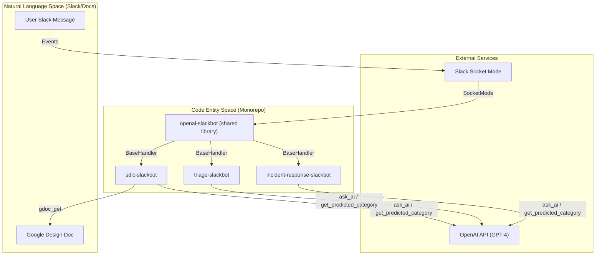
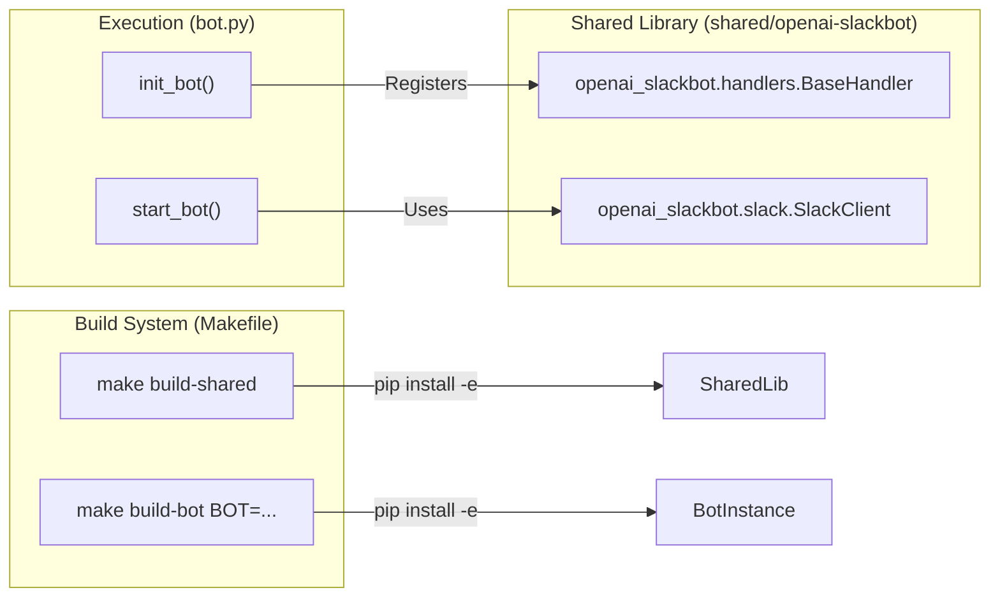

<!-- source: DeepWiki mcp.deepwiki.com · repo openai/openai-security-bots · page 1 Overview · fetched 2026-10-26 -->

# Overview

<details>
<summary>Relevant source files</summary>

The following files were used as context for generating this wiki page:

- [.gitignore](.gitignore)
- [CODEOWNERS](CODEOWNERS)
- [LICENSE](LICENSE)
- [Makefile](Makefile)
- [README.md](README.md)
- [SECURITY.md](SECURITY.md)

</details>


## Purpose and Scope

The `openai-security-bots` repository is a suite of AI-powered Slack applications designed to automate and streamline security operations workflows at OpenAI. By leveraging OpenAI's LLMs and the Slack Bolt framework, these bots handle complex tasks such as project security reviews, incident triage, and request categorization.

The repository is structured as a monorepo, containing a shared core library and three specialized bot implementations.

## Monorepo Layout

The project structure separates reusable logic from bot-specific implementations:

| Directory | Description |
|:---|:---|
| `shared/openai-slackbot/` | The core library providing base classes for handlers, Slack client wrappers, and OpenAI integration utilities. |
| `bots/sdlc-slackbot/` | Automates the Software Development Life Cycle (SDLC) security review process, including risk assessment and document analysis. |
| `bots/incident-response-slackbot/` | Manages automated incident triage, user awareness checks, and alert feed management. |
| `bots/triage-slackbot/` | Uses LLM function calling to categorize and route inbound security requests to the appropriate on-call teams. |

Sources: [README.md:7-14](), [Makefile:16-25]()

## System Architecture

The architecture relies on a "Shared Library" pattern where each bot inherits from a common framework to ensure consistency in event handling and API communication.

### High-Level Component Interaction



Sources: [README.md:1-14](), [Makefile:16-25]()

### Code Entity Mapping: Bot Initialization

The following diagram illustrates how the build system bridges the shared library to the specific bot implementations.



Sources: [Makefile:16-27](), [README.md:8-14]()

## Getting Started

The repository uses a centralized `Makefile` to manage dependencies and execution across the monorepo.

### Prerequisites
1.  **Python 3.8+**: Ensure a compatible Python environment is active.
2.  **Pre-commit**: The project uses `pre-commit` for code quality (TruffleHog, Black, isort).
    -   `pip install pre-commit && pre-commit install` [README.md:19-23]()

### Build and Run
To set up and run a specific bot (e.g., `triage-slackbot`):

1.  **Build the shared library and bot**:
    ```bash
    make build-bot BOT=triage-slackbot
    ```
    This command installs the shared library in editable mode and then installs the specific bot's dependencies. [Makefile:20-21]()

2.  **Run the bot**:
    ```bash
    make run-bot BOT=triage-slackbot
    ```
    This executes the entry point located at `bots/triage-slackbot/triage_slackbot/bot.py`. [Makefile:24-25]()

3.  **Testing**:
    Run the full test suite across the shared library and all bots:
    ```bash
    make test-all
    ```
    [Makefile:36-39]()

## Development Summary

| Feature | Implementation |
|:---|:---|
| **Language** | Python |
| **Orchestration** | `Makefile` for monorepo management |
| **Shared Logic** | `shared/openai-slackbot` (installed as a local package) |
| **Deployment** | Slack Socket Mode (no public endpoint required) |
| **AI Integration** | OpenAI Chat Completions and Function Calling |

Sources: [README.md:1-24](), [Makefile:1-39]()

---

