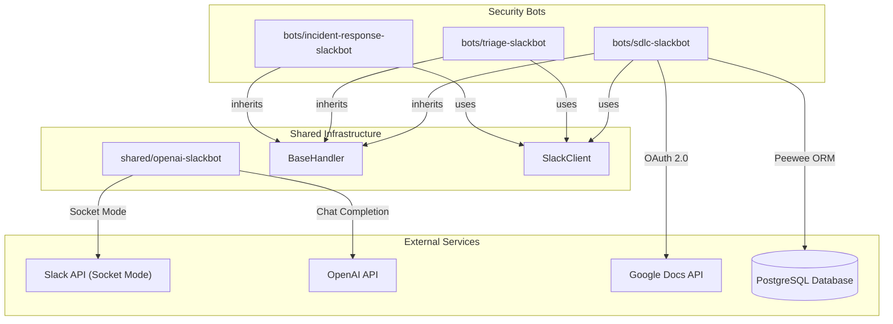
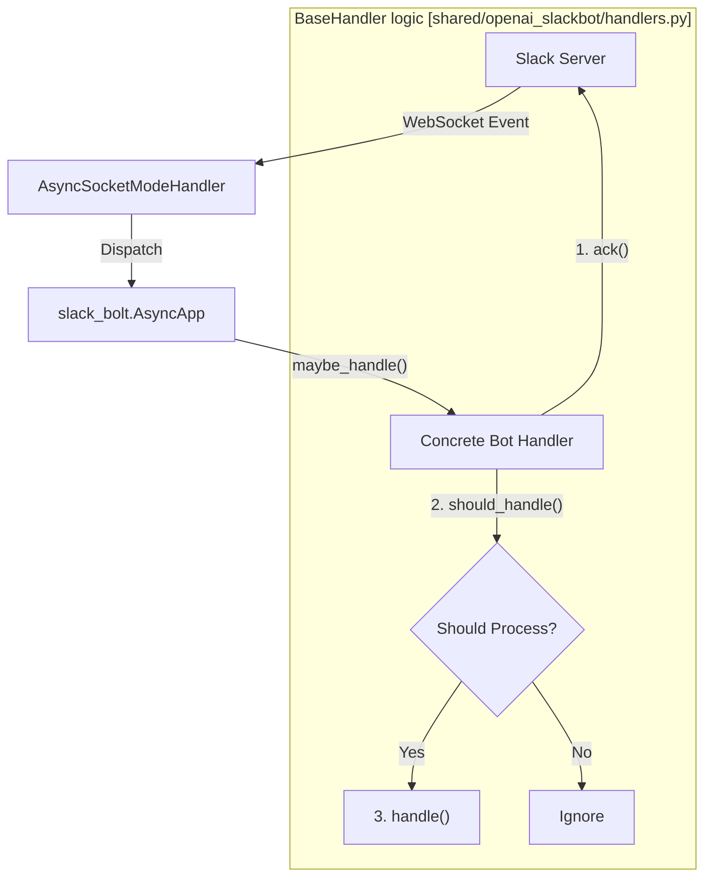
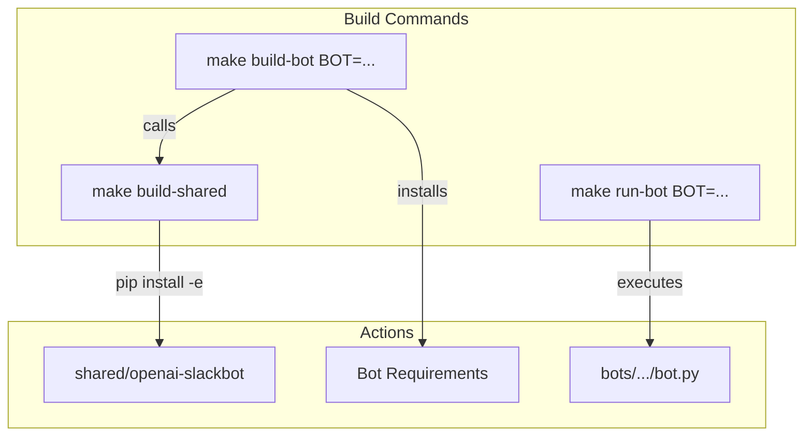

<!-- source: DeepWiki mcp.deepwiki.com · repo openai/openai-security-bots · page 2 System Architecture · fetched 2026-10-26 -->

# System Architecture

Relevant source files

The following files were used as context for generating this wiki page:

- [Makefile](Makefile)
- [README.md](README.md)
- [shared/openai-slackbot/openai_slackbot/bot.py](shared/openai-slackbot/openai_slackbot/bot.py)
- [shared/openai-slackbot/openai_slackbot/handlers.py](shared/openai-slackbot/openai_slackbot/handlers.py)

This document provides a high-level overview of the OpenAI security bots system architecture, including how the three specialized security bots work together and their shared infrastructure. It covers the monorepo structure, shared library dependencies, the Slack Socket Mode communication pattern, and the OpenAI integration model.

## System Overview

The OpenAI security bots repository contains three specialized Slack bots that leverage OpenAI's APIs to automate different aspects of security workflows:

- **SDLC Slackbot**: Security review triage and project assessment.
- **Incident Response Slackbot**: Automated incident triage and user interaction.
- **Triage Slackbot**: Request categorization and routing.

All bots share common infrastructure through the `openai-slackbot` library located in the `shared/` directory [README.md:8-14]().

## High-Level System Architecture

The following diagram illustrates the relationship between the bots, the shared library, and external service dependencies.

Sources: [README.md:1-14](), [shared/openai-slackbot/openai_slackbot/bot.py:5-9](), [shared/openai-slackbot/openai_slackbot/handlers.py:10-12]()

## Monorepo Structure and Dependency Management

The project is organized as a monorepo. Shared logic is decoupled into a local library that bots install during their build process.

- **`shared/openai-slackbot/`**: A shared Python package providing the core bot framework, base handler classes, and a Slack client wrapper [shared/openai-slackbot/openai_slackbot/bot.py:5-9]().
- **`bots/`**: Contains individual bot implementations. Each bot is a standalone application but depends on the `shared` library.
- **`Makefile`**: Manages the build lifecycle, including virtual environment creation and cross-package installation [Makefile:1-39]().

### Dependency Flow
The `Makefile` at the root handles the installation of the shared library into the bot's environment using `pip install -e ./shared/openai-slackbot` [Makefile:16-17](). This allows for live development where changes in the shared library are immediately reflected in the bots.

Sources: [README.md:7-14](), [Makefile:16-22]()

## Slack Socket Mode and Event Dispatching

The system utilizes Slack's **Socket Mode**, allowing the bots to reside behind a firewall without requiring public HTTP endpoints. The `openai_slackbot` library abstracts the boilerplate for initializing this connection.

### Bot Initialization Pattern
The `init_bot` function in the shared library performs the following [shared/openai-slackbot/openai_slackbot/bot.py:30-54]():
1. Loads credentials (`SLACK_BOT_TOKEN`, `OPENAI_API_KEY`).
2. Initializes the `AsyncApp` from `slack_bolt`.
3. Registers bot-specific handlers using `register_app_handlers`.

### Event Handling Pipeline
All bots implement handlers by subclassing `BaseMessageHandler` or `BaseActionHandler` [shared/openai-slackbot/openai_slackbot/handlers.py:42-53]().

Sources: [shared/openai-slackbot/openai_slackbot/bot.py:57-60](), [shared/openai-slackbot/openai_slackbot/handlers.py:14-25]()

## OpenAI Integration Model

The bots use OpenAI's APIs for intelligent decision-making and text generation. The shared library initializes the global `openai` configuration [shared/openai-slackbot/openai_slackbot/bot.py:40-42](), while individual bots implement their specific AI logic.

### AI Implementation Details
- **SDLC Bot**: Uses OpenAI for risk assessment and summarizing project documentation.
- **Incident Response Bot**: Uses function calling for deterministic output (e.g., determining user awareness) and generating greetings.
- **Triage Bot**: Uses function calling to categorize inbound requests into predefined buckets based on a configuration schema.

| Feature | Code Entity | Purpose |
| :--- | :--- | :--- |
| **Authentication** | `init_bot` | Sets `openai.api_key` and `openai.organization` [shared/openai-slackbot/openai_slackbot/bot.py:41-42]() |
| **Action Dispatch** | `BaseActionHandler` | Maps Slack `action_id` to code logic [shared/openai-slackbot/openai_slackbot/handlers.py:50-53]() |
| **Message Dispatch** | `BaseMessageHandler` | Filters and processes channel messages [shared/openai-slackbot/openai_slackbot/handlers.py:42-47]() |

## Build and Deployment Architecture

The system uses a unified build system managed through a root `Makefile`.

Sources: [Makefile:16-25]()

---

