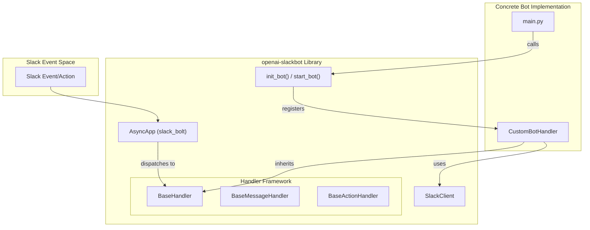
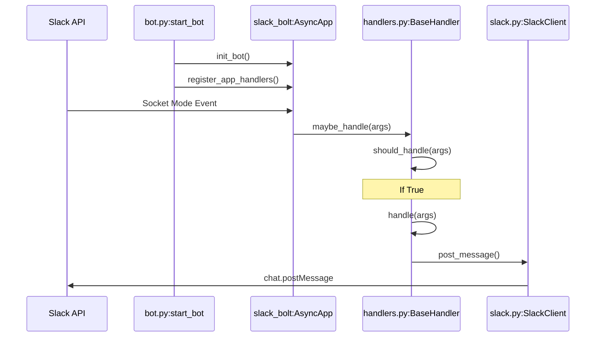

<!-- source: DeepWiki mcp.deepwiki.com · repo openai/openai-security-bots · page 3 Shared Components · fetched 2026-10-26 -->

# Shared Components

Relevant source files

The following files were used as context for generating this wiki page:

- [shared/openai-slackbot/openai_slackbot/bot.py](shared/openai-slackbot/openai_slackbot/bot.py)
- [shared/openai-slackbot/openai_slackbot/clients/slack.py](shared/openai-slackbot/openai_slackbot/clients/slack.py)
- [shared/openai-slackbot/openai_slackbot/handlers.py](shared/openai-slackbot/openai_slackbot/handlers.py)
- [shared/openai-slackbot/openai_slackbot/utils/slack.py](shared/openai-slackbot/openai_slackbot/utils/slack.py)
- [shared/openai-slackbot/pyproject.toml](shared/openai-slackbot/pyproject.toml)
- [shared/openai-slackbot/setup.cfg](shared/openai-slackbot/setup.cfg)

## Purpose and Scope

The shared components provide common functionality used across all security bots in the repository through the `openai-slackbot` Python package. This shared library abstracts core integrations with Slack and OpenAI APIs, eliminating code duplication and ensuring consistent behavior across the SDLC Slackbot, Incident Response Slackbot, and Triage Slackbot.

The library provides the base classes for event handling, a wrapped Slack client with Jinja2 templating support, and utility functions for parsing Slack message blocks.

For detailed documentation of individual bot implementations that use these shared components, see [SDLC Slackbot](#4), [Incident Response Slackbot](#5), and [Triage Slackbot](#6).

## Library Architecture

The `openai-slackbot` package serves as the foundation layer. It is organized into three primary modules: `bot.py` for lifecycle management, `clients/` for external API wrappers, and `handlers.py` for the event dispatch framework.

### Component Relationship Diagram

The following diagram illustrates how the shared library entities bridge the gap between Slack events and bot logic.

Sources: [shared/openai-slackbot/openai_slackbot/bot.py:30-54](), [shared/openai-slackbot/openai_slackbot/handlers.py:10-42](), [shared/openai-slackbot/openai_slackbot/clients/slack.py:33-43]()

## Core Modules

The shared library is divided into the following functional areas:

### 3.1 Bot Framework and Handler Base Classes
This module provides the standardized entry points for initializing and starting bots using Slack's Socket Mode. It defines the `BaseHandler` abstract class, which implements a "check-then-act" pattern via `should_handle` and `handle` methods. This ensures that every bot follows a consistent logging and error handling strategy.

For details, see [Bot Framework and Handler Base Classes](#3.1).

### 3.2 Slack Client and Utilities
The `SlackClient` class wraps the `slack_sdk` `AsyncWebClient` to provide high-level methods like `post_message` and `get_thread_messages`. A key feature is the integration with **Jinja2**, allowing bots to render complex Slack Block Kit UI components from templates stored in the filesystem. It also includes `utils/slack.py` for common tasks like extracting text from nested block structures and formatting Slack mentions.

For details, see [Slack Client and Utilities](#3.2).

### 3.3 Shared Library Tests
The library includes a robust test suite using `pytest` and `pytest-asyncio`. These tests validate the handler dispatch logic, the Slack client's interaction with the Web API, and the environment variable loading mechanisms.

For details, see [Shared Library Tests](#3.3).

## Technology Stack and Dependencies

The shared package defines core dependencies that all security bots inherit. These dependencies provide essential functionality for Slack integration, AI processing, and data validation.

| Dependency | Purpose |
|------------|---------|
| `slack-bolt` | Primary Slack app framework for event handling [shared/openai-slackbot/pyproject.toml:11]() |
| `slack-sdk` | Low-level Slack API client [shared/openai-slackbot/pyproject.toml:12]() |
| `openai` | OpenAI API integration for AI-powered features [shared/openai-slackbot/pyproject.toml:8]() |
| `Jinja2` | Template engine for message formatting [shared/openai-slackbot/pyproject.toml:7]() |
| `pydantic` | Data validation and parsing [shared/openai-slackbot/pyproject.toml:9]() |

### Data Flow: Event to Handler

This diagram maps the code entities involved when a Slack message reaches a bot.

Sources: [shared/openai-slackbot/openai_slackbot/bot.py:14-28](), [shared/openai-slackbot/openai_slackbot/handlers.py:14-25](), [shared/openai-slackbot/openai_slackbot/clients/slack.py:60-66]()

## Build System Integration

The shared components integrate with the repository's build system through a multi-stage process. The root `Makefile` manages the installation of this library into the virtual environments of the individual bots.

### Installation Pattern
1. **Build Shared**: The library is installed in editable mode (`pip install -e`) to ensure changes are immediately reflected across all bots during development.
2. **Environment Injection**: The `pyproject.toml` in the shared directory includes `pytest-env` configuration to provide mock tokens (`SLACK_BOT_TOKEN`, `OPENAI_API_KEY`) for local testing.

Sources: [shared/openai-slackbot/pyproject.toml:23-29](), [shared/openai-slackbot/pyproject.toml:1-5]()

---

