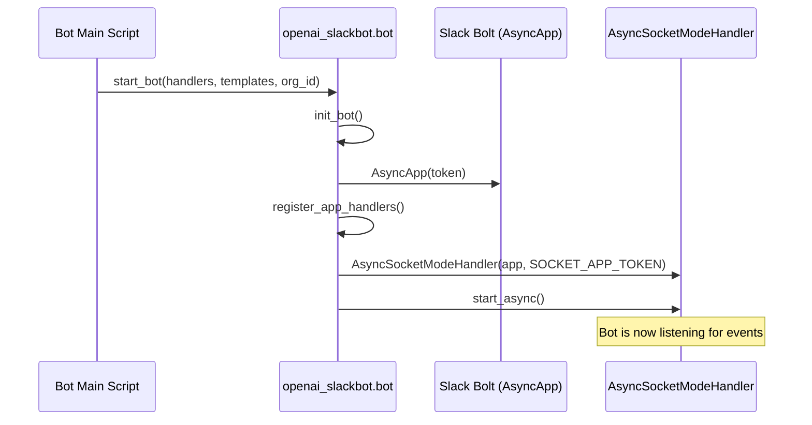
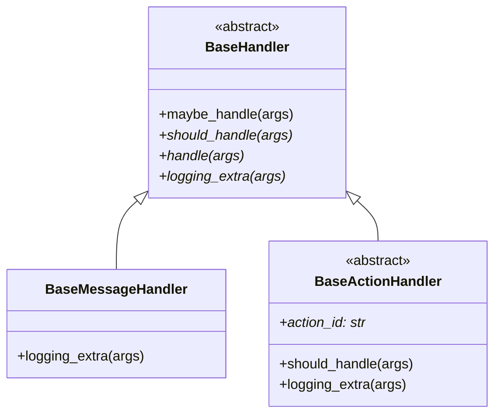
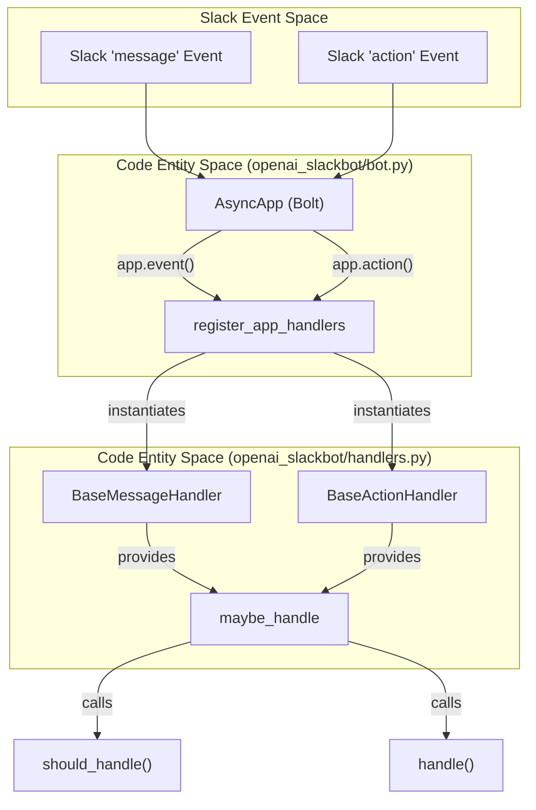

<!-- source: DeepWiki mcp.deepwiki.com · repo openai/openai-security-bots · page 3.1 Bot Framework and Handler Base Classes · fetched 2026-10-26 -->

# Bot Framework and Handler Base Classes

Relevant source files

The following files were used as context for generating this wiki page:

- [shared/openai-slackbot/openai_slackbot/__init__.py](shared/openai-slackbot/openai_slackbot/__init__.py)
- [shared/openai-slackbot/openai_slackbot/bot.py](shared/openai-slackbot/openai_slackbot/bot.py)
- [shared/openai-slackbot/openai_slackbot/handlers.py](shared/openai-slackbot/openai_slackbot/handlers.py)

This page provides a deep dive into the core abstractions of the shared `openai_slackbot` library. This library provides the foundation for all security bots in the repository, offering standardized entry points for initialization and a structured framework for handling Slack events and actions.

## Bot Lifecycle and Entrypoints

The framework provides two primary entrypoints for managing a bot's lifecycle: `init_bot` and `start_bot`. These functions abstract away the complexities of configuring the OpenAI SDK, initializing the Slack `AsyncApp`, and registering event handlers.

### Initialization Flow

The `init_bot` function serves as the setup phase for the bot's infrastructure.

1.  **Credential Loading**: It retrieves `SLACK_BOT_TOKEN` and `OPENAI_API_KEY` from the environment using the `string` utility [[shared/openai-slackbot/openai_slackbot/bot.py:37-38]]().
2.  **OpenAI Configuration**: It configures the global `openai` library with the provided organization ID and API key [[shared/openai-slackbot/openai_slackbot/bot.py:41-42]]().
3.  **Slack Client Setup**: It instantiates an `AsyncApp` (from Slack Bolt) and wraps the Bolt client in a custom `SlackClient` that supports Jinja2 templating [[shared/openai-slackbot/openai_slackbot/bot.py:45-46]]().
4.  **Handler Registration**: It calls `register_app_handlers` to bind message and action handlers to the Slack app [[shared/openai-slackbot/openai_slackbot/bot.py:47-52]]().

### Execution Flow

The `start_bot` function is the high-level entrypoint that both initializes and runs the bot in Socket Mode [[shared/openai-slackbot/openai_slackbot/bot.py:63-78]]().

**Bot Startup Sequence**

Sources: [[shared/openai-slackbot/openai_slackbot/bot.py:30-78]]()

---

## Handler Base Classes

The framework uses an object-oriented approach to handle Slack interactions, defined in `handlers.py`. This ensures consistency in how events are acknowledged, logged, and processed.

### BaseHandler Abstraction

All handlers inherit from `BaseHandler`, which defines the `maybe_handle` dispatch pattern. This pattern ensures that every event is acknowledged (`ack()`) immediately to prevent Slack from retrying the event while the bot is still processing [[shared/openai-slackbot/openai_slackbot/handlers.py:14-15]]().

| Method | Type | Description |
| :--- | :--- | :--- |
| `maybe_handle(args)` | `async` | The entrypoint called by Bolt. Orchestrates `ack`, `should_handle`, and `handle` [[shared/openai-slackbot/openai_slackbot/handlers.py:14-25]](). |
| `should_handle(args)` | `abstract` | Returns a boolean indicating if the handler should process this specific event [[shared/openai-slackbot/openai_slackbot/handlers.py:29-31]](). |
| `handle(args)` | `abstract` | Contains the core business logic for the handler [[shared/openai-slackbot/openai_slackbot/handlers.py:33-35]](). |
| `logging_extra(args)` | `abstract` | Returns a dictionary of context-specific metadata for structured logging [[shared/openai-slackbot/openai_slackbot/handlers.py:37-39]](). |

### Specialized Handlers

The framework provides two specialized base classes for common Slack interaction types:

1.  **`BaseMessageHandler`**: Used for processing `message` events. It implements a default `logging_extra` that extracts `type`, `subtype`, `channel`, and `ts` from the Slack event [[shared/openai-slackbot/openai_slackbot/handlers.py:42-47]]().
2.  **`BaseActionHandler`**: Used for processing interactive components (like button clicks). It requires an `action_id` property and defaults `should_handle` to `True` [[shared/openai-slackbot/openai_slackbot/handlers.py:50-56]]().

**Handler Class Hierarchy**

Sources: [[shared/openai-slackbot/openai_slackbot/handlers.py:10-63]]()

---

## Dispatch Pattern and Registration

Handlers are registered to the `AsyncApp` via the `register_app_handlers` function. This function acts as the bridge between the high-level handler classes and the Slack Bolt event listeners.

### The `maybe_handle` Dispatch Logic

When an event arrives, the framework follows this internal logic:
1.  **Acknowledge**: Call `args.ack()` immediately [[shared/openai-slackbot/openai_slackbot/handlers.py:15]]().
2.  **Evaluate**: Call `should_handle(args)`. If it returns `False`, the handler exits [[shared/openai-slackbot/openai_slackbot/handlers.py:19-24]]().
3.  **Execute**: If evaluated as true, call `handle(args)`. Any exceptions during this phase are caught and logged using the metadata from `logging_extra` [[shared/openai-slackbot/openai_slackbot/handlers.py:25-27]]().

### Handler Registration

Individual bots pass their handler classes to `init_bot`, which then performs the registration:

*   **Messages**: Registered using `app.event("message")` [[shared/openai-slackbot/openai_slackbot/bot.py:22]]().
*   **Actions**: Registered using `app.action(handler.action_id)` [[shared/openai-slackbot/openai_slackbot/bot.py:27]]().

**Entity Mapping: Registration to Dispatch**

Sources: [[shared/openai-slackbot/openai_slackbot/bot.py:14-28]](), [[shared/openai-slackbot/openai_slackbot/handlers.py:14-35]]()

---

