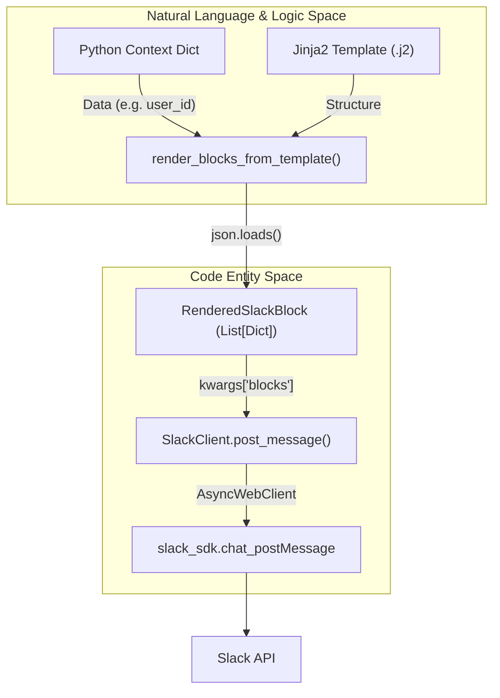
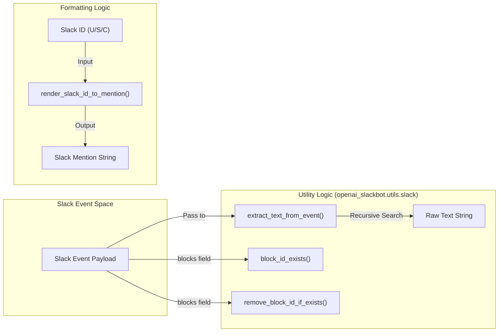

<!-- source: DeepWiki mcp.deepwiki.com · repo openai/openai-security-bots · page 3.2 Slack Client and Utilities · fetched 2026-10-26 -->

# Slack Client and Utilities

Relevant source files

The following files were used as context for generating this wiki page:

- [shared/openai-slackbot/openai_slackbot/clients/__init__.py](shared/openai-slackbot/openai_slackbot/clients/__init__.py)
- [shared/openai-slackbot/openai_slackbot/clients/slack.py](shared/openai-slackbot/openai_slackbot/clients/slack.py)
- [shared/openai-slackbot/openai_slackbot/utils/__init__.py](shared/openai-slackbot/openai_slackbot/utils/__init__.py)
- [shared/openai-slackbot/openai_slackbot/utils/envvars.py](shared/openai-slackbot/openai_slackbot/utils/envvars.py)
- [shared/openai-slackbot/openai_slackbot/utils/slack.py](shared/openai-slackbot/openai_slackbot/utils/slack.py)

This page documents the communication layer and utility functions within the `openai-slackbot` shared library. It covers the `SlackClient` wrapper, the Jinja2-based block templating system, and helper utilities for Slack event parsing and environment management.

## SlackClient Wrapper

The `SlackClient` class acts as a high-level wrapper around the `slack_sdk.web.async_client.AsyncWebClient` [shared/openai-slackbot/openai_slackbot/clients/slack.py:9-33](). It simplifies common Slack operations and integrates the Jinja2 template engine for generating complex UI blocks.

### Core Implementation

The client is initialized with an instance of `AsyncWebClient` and a path to the directory containing Jinja2 templates [shared/openai-slackbot/openai_slackbot/clients/slack.py:40-42]().

#### Message Management
The class provides several asynchronous methods for interacting with Slack messages:
*   **`post_message`**: Sends a message to a channel. It validates the response and returns a `CreateSlackMessageResponse` Pydantic model [shared/openai-slackbot/openai_slackbot/clients/slack.py:60-66]().
*   **`update_message`**: Updates an existing message based on its timestamp (`ts`) [shared/openai-slackbot/openai_slackbot/clients/slack.py:68-74]().
*   **`get_message`**: Retrieves a single message from history using the `conversations_history` API [shared/openai-slackbot/openai_slackbot/clients/slack.py:50-58]().
*   **`get_thread_messages`**: Fetches all replies in a thread using `conversations_replies` [shared/openai-slackbot/openai_slackbot/clients/slack.py:87-93]().
*   **`get_original_blocks`**: Specifically extracts the `blocks` array from the root message of a thread [shared/openai-slackbot/openai_slackbot/clients/slack.py:101-116]().

#### UI and Identity
*   **`add_reaction`**: Adds an emoji reaction to a message. It includes built-in error handling for `already_reacted` cases to prevent unnecessary exceptions [shared/openai-slackbot/openai_slackbot/clients/slack.py:76-85]().
*   **`get_user_display_name`**: Resolves a Slack User ID to a human-readable display name [shared/openai-slackbot/openai_slackbot/clients/slack.py:95-99]().

### Template Rendering System

The `SlackClient` utilizes Jinja2 to render Slack Block Kit JSON templates. This allows for dynamic UI generation where variables (like user names or incident IDs) are injected into the JSON structure before being sent to Slack.

*   **Initialization**: The `_init_jinja` method sets up a `FileSystemLoader` pointing to the bot's specific template directory [shared/openai-slackbot/openai_slackbot/clients/slack.py:122-124]().
*   **Rendering**: `render_blocks_from_template` takes a filename and a context dictionary, renders the template, and parses the resulting string back into a Python object (list of blocks) using `json.loads` [shared/openai-slackbot/openai_slackbot/clients/slack.py:118-120]().

**Data Flow: From Template to Slack**

Title: Slack Block Rendering Pipeline

Sources: [shared/openai-slackbot/openai_slackbot/clients/slack.py:60-66](), [shared/openai-slackbot/openai_slackbot/clients/slack.py:118-120](), [shared/openai-slackbot/openai_slackbot/utils/slack.py:3]()

---

## Slack Utilities

The `utils/slack.py` module contains helper functions for manipulating Slack block structures and parsing event data.

### Block Manipulation
These functions help manage the state of interactive messages by finding or removing specific UI elements:

| Function | Purpose | Implementation Detail |
| :--- | :--- | :--- |
| `block_id_exists` | Checks if a specific `block_id` is present in a list of blocks. | Uses a list comprehension with `any()` [shared/openai-slackbot/openai_slackbot/utils/slack.py:6-7](). |
| `remove_block_id_if_exists` | Returns a new list of blocks excluding the one with the specified ID. | Uses list comprehension filter [shared/openai-slackbot/openai_slackbot/utils/slack.py:10-11](). |
| `get_block_by_id` | Retrieves a specific block dictionary by its ID. | Iterates through blocks and returns the match [shared/openai-slackbot/openai_slackbot/utils/slack.py:14-18](). |

### Content Extraction
The `extract_text_from_event` function is critical for handling the variety of ways text can be delivered in Slack events (direct text vs. complex block attachments). It traverses nested structures: `attachments` -> `message_blocks` -> `elements` to find and join text snippets [shared/openai-slackbot/openai_slackbot/utils/slack.py:21-44]().

### ID Formatting
The `render_slack_id_to_mention` function converts raw Slack IDs into the specific syntax required for mentions [shared/openai-slackbot/openai_slackbot/utils/slack.py:47-59]():
*   `U...` (User) -> `<@ID>`
*   `S...` (Subteam/Usergroup) -> `<!subteam|ID>`
*   `C...` (Channel) -> `<#ID>`

**Code Entity Relationship: Event Processing**

Title: Slack Event Parsing and Utility Mapping

Sources: [shared/openai-slackbot/openai_slackbot/utils/slack.py:6-11](), [shared/openai-slackbot/openai_slackbot/utils/slack.py:21-44](), [shared/openai-slackbot/openai_slackbot/utils/slack.py:47-59]()

---

## Environment Variable Utilities

The `openai_slackbot.utils.envvars` module provides a strictly typed way to load configuration from the environment.

### `string(key, default)`
This utility ensures that required environment variables are present before the bot starts.
*   If the variable is found, it returns the string [shared/openai-slackbot/openai_slackbot/utils/envvars.py:6-11]().
*   If not found and no `default` is provided, it raises a `ValueError` [shared/openai-slackbot/openai_slackbot/utils/envvars.py:8-9]().
*   This is used extensively in bot initialization to validate credentials like `SLACK_BOT_TOKEN` or `OPENAI_API_KEY`.

Sources: [shared/openai-slackbot/openai_slackbot/utils/envvars.py:5-11]()

---

