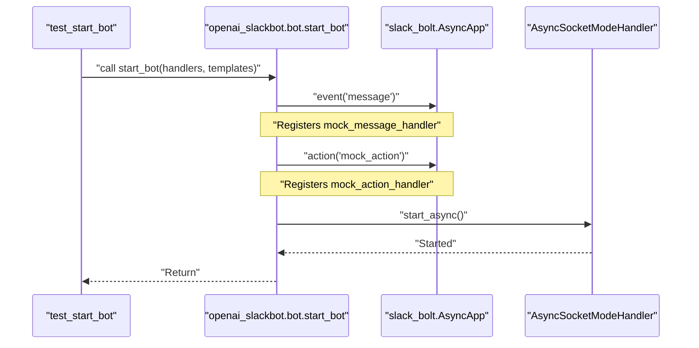
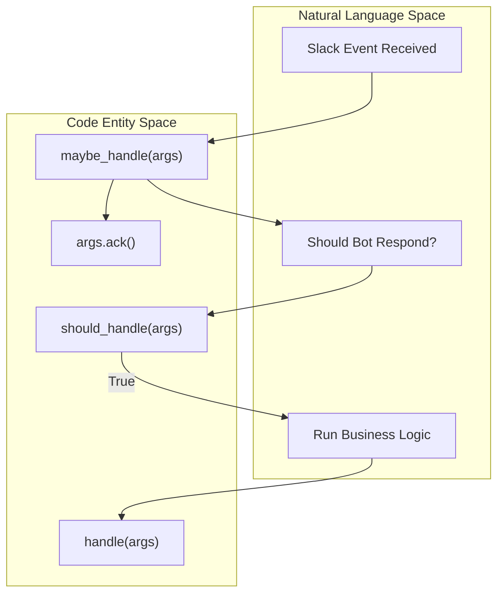
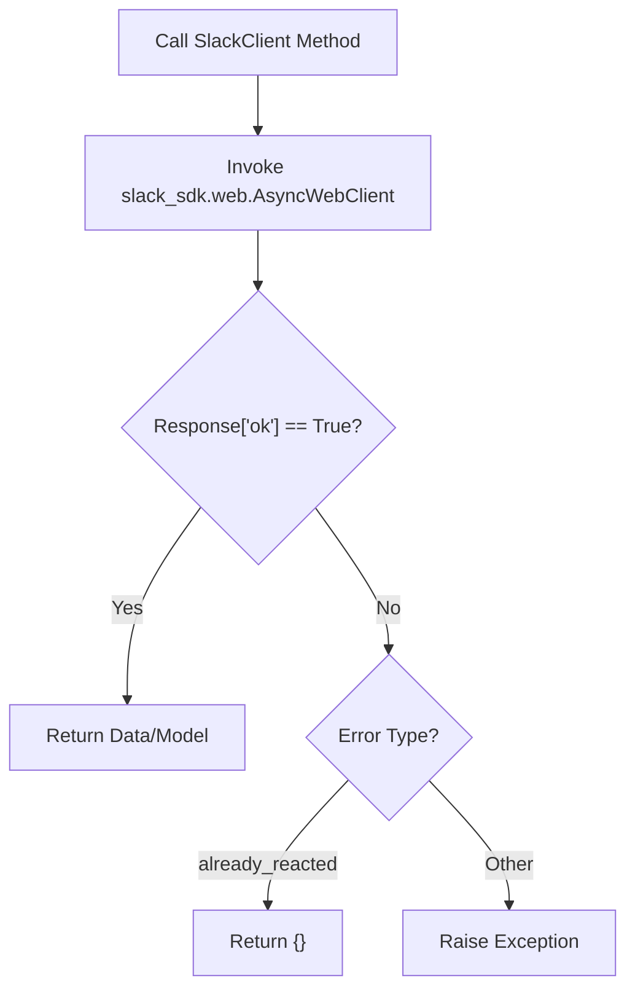

<!-- source: DeepWiki mcp.deepwiki.com · repo openai/openai-security-bots · page 3.3 Shared Library Tests · fetched 2026-10-26 -->

# Shared Library Tests

Relevant source files

The following files were used as context for generating this wiki page:

- [shared/openai-slackbot/tests/__init__.py](shared/openai-slackbot/tests/__init__.py)
- [shared/openai-slackbot/tests/clients/__init__.py](shared/openai-slackbot/tests/clients/__init__.py)
- [shared/openai-slackbot/tests/clients/test_slack.py](shared/openai-slackbot/tests/clients/test_slack.py)
- [shared/openai-slackbot/tests/conftest.py](shared/openai-slackbot/tests/conftest.py)
- [shared/openai-slackbot/tests/test_bot.py](shared/openai-slackbot/tests/test_bot.py)
- [shared/openai-slackbot/tests/test_handlers.py](shared/openai-slackbot/tests/test_handlers.py)

The `openai-slackbot` shared library includes a comprehensive test suite designed to validate the core framework abstractions, the Slack client wrapper, and the event dispatch mechanism used by all bots in the repository. The suite utilizes `pytest` along with `unittest.mock` to simulate Slack API interactions and OpenAI configurations without requiring live network connections.

## Test Infrastructure and Fixtures

The test suite relies on a central `conftest.py` file to provide reusable fixtures that mock external dependencies like the Slack Bolt framework, the Slack Web Client, and OpenAI modules.

### Mock Entities

| Fixture Name | Mocked Entity | Purpose |
| :--- | :--- | :--- |
| `mock_slack_app` | `slack_bolt.app.async_app.AsyncApp` | Simulates the main Bolt application instance for event registration [shared/openai-slackbot/tests/conftest.py:9-11](). |
| `mock_socket_mode_handler` | `slack_bolt.adapter.socket_mode.async_handler.AsyncSocketModeHandler` | Simulates the Socket Mode connection handler and its start loop [shared/openai-slackbot/tests/conftest.py:15-21](). |
| `mock_openai` | `openai` module | Patches the system modules to prevent real OpenAI calls [shared/openai-slackbot/tests/conftest.py:25-28](). |
| `mock_slack_asyncwebclient` | `slack_sdk.web.async_client.AsyncWebClient` | Provides a mock for the underlying Slack SDK client [shared/openai-slackbot/tests/conftest.py:32-34](). |
| `mock_slack_client` | `openai_slackbot.clients.slack.SlackClient` | An instance of the shared library's Slack wrapper initialized with a mock web client [shared/openai-slackbot/tests/conftest.py:38-39](). |

### Concrete Test Handlers
Because `BaseMessageHandler` and `BaseActionHandler` are abstract, `conftest.py` defines `MockMessageHandler` and `MockActionHandler` to test the dispatch logic [shared/openai-slackbot/tests/conftest.py:52-75]().

**Sources:**
- [shared/openai-slackbot/tests/conftest.py:1-75]()

## Bot Initialization Tests

The `test_bot.py` file validates that the `start_bot` entry point correctly wires together the Slack application, registers the provided handlers, and initiates the Socket Mode connection.

### Initialization Sequence Diagram

This diagram illustrates how `start_bot` interacts with the mocked entities during the setup phase.

"Bot Initialization Data Flow"

The test asserts that `mock_slack_app.event` is called with "message" and `mock_slack_app.action` is called with the specific `action_id` defined in the mock handler [shared/openai-slackbot/tests/test_bot.py:16-18]().

**Sources:**
- [shared/openai-slackbot/tests/test_bot.py:4-19]()
- [shared/openai-slackbot/tests/conftest.py:52-75]()

## Handler Dispatch Tests

Tests in `test_handlers.py` focus on the `maybe_handle` method logic, which is responsible for acknowledging Slack events and determining if the specific handler should execute based on the event payload.

### Message Handler Dispatch
The `test_message_handler` uses a parameterization strategy to verify that the bot only responds to valid subtypes. For example, it confirms that the handler executes for standard "message" types but ignores "bot_message" subtypes to prevent infinite loops [shared/openai-slackbot/tests/test_handlers.py:6-19]().

### Action Handler Dispatch
The `test_action_handler` ensures that when a Slack block action (like a button click) occurs, the library correctly extracts the action data, acknowledges the request (`ack`), and invokes the concrete `handle` implementation [shared/openai-slackbot/tests/test_handlers.py:28-44]().

### Code Entity Mapping: Handler Logic

"Handler Dispatch Logic Mapping"

**Sources:**
- [shared/openai-slackbot/tests/test_handlers.py:6-45]()
- [shared/openai-slackbot/tests/conftest.py:57-61]()

## Slack Client Tests

The `test_slack.py` suite validates the `SlackClient` wrapper, ensuring it correctly parses Slack API responses and handles errors gracefully.

### Tested Functionalities

| Function | Scenario | Verification |
| :--- | :--- | :--- |
| `get_message_link` | Success | Verifies that the permalink URL is correctly extracted from the `chat_getPermalink` response [shared/openai-slackbot/tests/clients/test_slack.py:8-21](). |
| `post_message` | Success | Ensures the response is correctly cast into a `CreateSlackMessageResponse` object [shared/openai-slackbot/tests/clients/test_slack.py:34-55](). |
| `add_reaction` | Already Reacted | Validates that if Slack returns an `already_reacted` error, the client suppresses the exception and returns an empty dict [shared/openai-slackbot/tests/clients/test_slack.py:108-116](). |
| `update_message` | Failure | Confirms that a non-OK response from Slack triggers a Python `Exception` [shared/openai-slackbot/tests/clients/test_slack.py:91-97](). |

### Slack Client Error Handling Pattern

"SlackClient Error Handling"

**Sources:**
- [shared/openai-slackbot/tests/clients/test_slack.py:1-126]()
- [shared/openai-slackbot/tests/conftest.py:38-39]()

---

