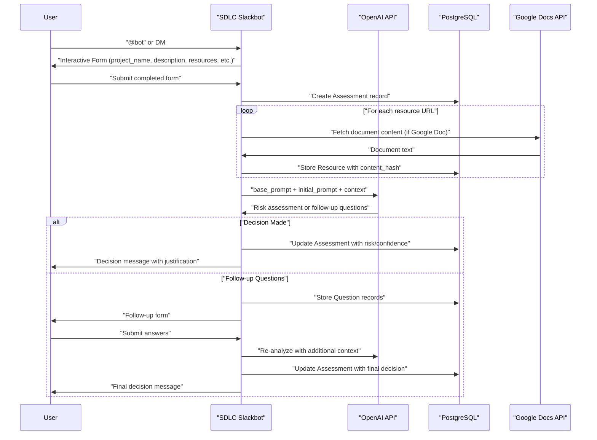
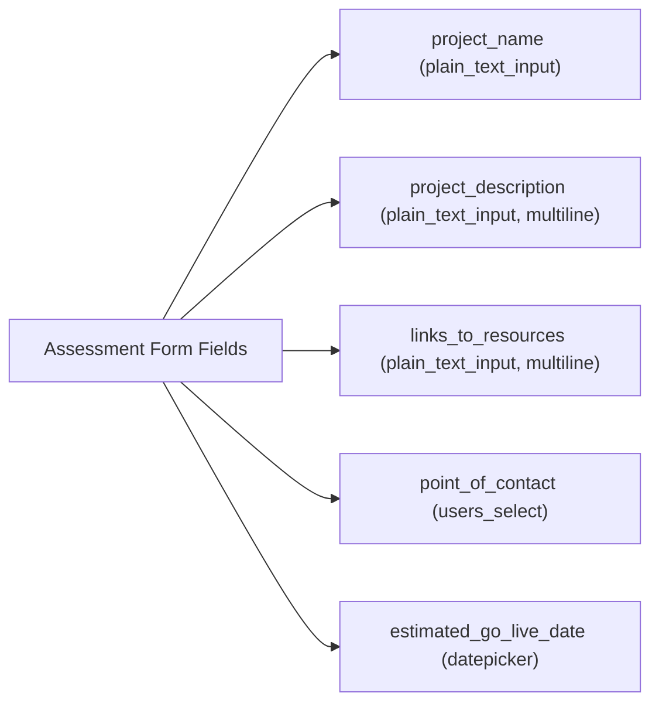
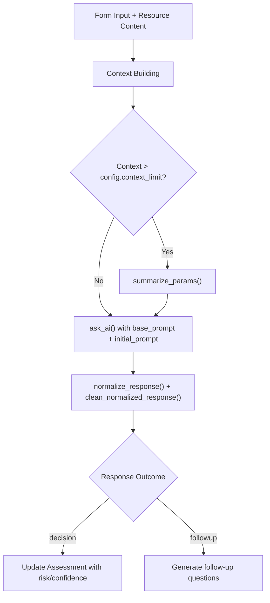
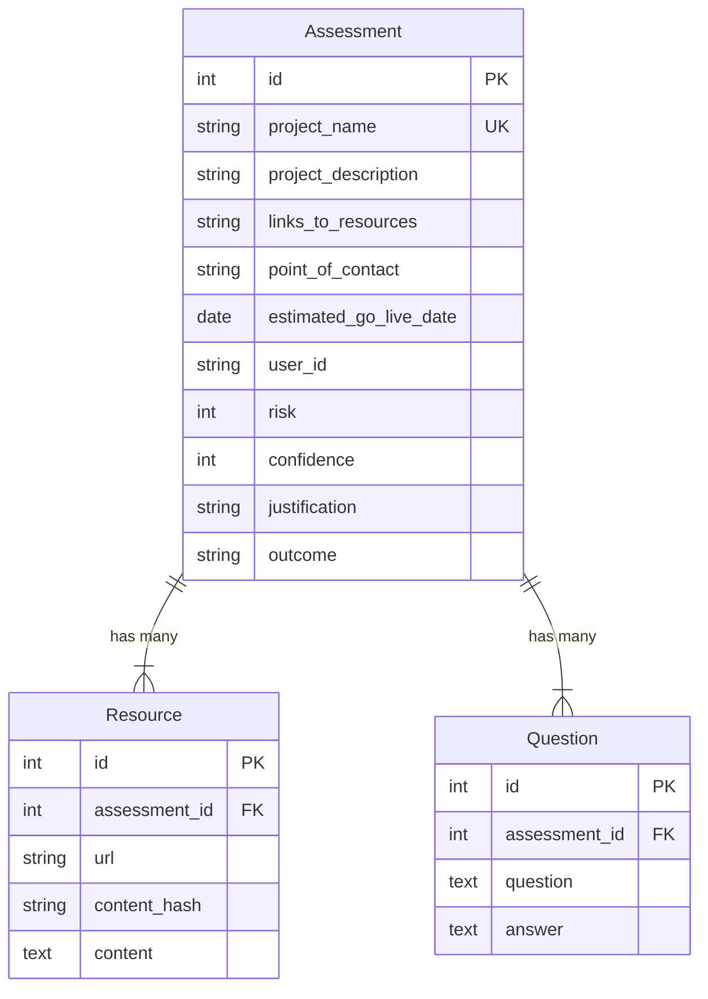
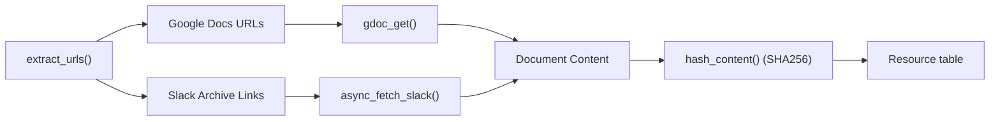
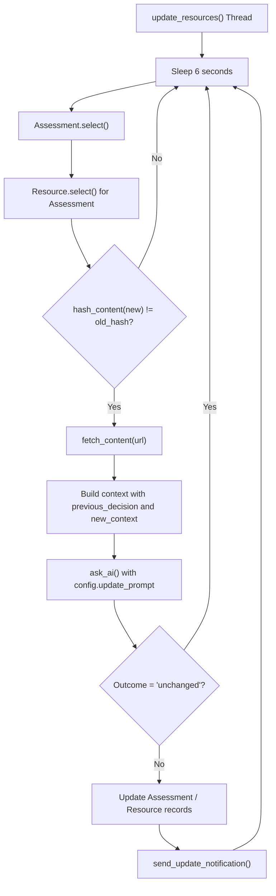

<!-- source: DeepWiki mcp.deepwiki.com · repo openai/openai-security-bots · page 4 SDLC Slackbot · fetched 2026-10-26 -->

# SDLC Slackbot

<details>
<summary>Relevant source files</summary>

The following files were used as context for generating this wiki page:

- [bots/sdlc-slackbot/README.md](bots/sdlc-slackbot/README.md)
- [bots/sdlc-slackbot/sdlc_slackbot/bot.py](bots/sdlc-slackbot/sdlc_slackbot/bot.py)

</details>


The SDLC Slackbot is an AI-powered Slack bot that automates security review triage by evaluating project submissions and determining whether they require formal security review. The bot collects project information through interactive Slack forms, analyzes the content using OpenAI's GPT models, and provides risk assessments with confidence scores.

This document covers the bot's architecture, core workflows, AI integration, and database schema. For information about shared infrastructure components used across all bots, see [Shared Components](#3). For setup and configuration details, see [Setup and Configuration](#4.1).

## Architecture Overview

The SDLC Slackbot follows an event-driven architecture with form-based user interactions, AI-powered analysis, and persistent data storage.

### System Components

```mermaid
graph TB
    subgraph "User Interface Layer"
        SlackForms["Slack Interactive Forms"]
        SlackEvents["Slack Events (app_mention, message)"]
    end
    
    subgraph "Core Bot Logic"
        BotMain["bot.py - Main Event Loop"]
        EventHandlers["handle_app_mention_events / handle_message_events"]
        FormHandlers["submit_form / submit_followup_questions"]
    end
    
    subgraph "Business Logic Layer"
        Utils["utils.py - Form Processing"]
        Validation["validate.py - Input Validation"]
        AIIntegration["ask_ai() / get_response_with_retry()"]
    end
    
    subgraph "Data Layer"
        DatabaseModels["database.py Models"]
        Assessment["Assessment Model"]
        Resource["Resource Model"] 
        Question["Question Model"]
    end
    
    subgraph "External Integrations"
        GoogleDocs["gdoc.py - gdoc_get()"]
        SlackAPI["Slack WebClient / async_fetch_slack()"]
        OpenAIAPI["OpenAI API"]
        PostgreSQL["PostgreSQL Database (DATABASE_URL)"]
    end
    
    subgraph "Background Services"
        Monitor["update_resources() Thread"]
    end
    
    SlackEvents --> EventHandlers
    SlackForms --> FormHandlers
    EventHandlers --> Utils
    FormHandlers --> Utils
    Utils --> Validation
    Utils --> AIIntegration
    Utils --> DatabaseModels
    DatabaseModels --> Assessment
    DatabaseModels --> Resource
    DatabaseModels --> Question
    AIIntegration --> OpenAIAPI
    Utils --> GoogleDocs
    Utils --> SlackAPI
    GoogleDocs --> "Google Docs API"
    DatabaseModels --> PostgreSQL
    Monitor --> DatabaseModels
    Monitor --> AIIntegration
```

Sources: [bots/sdlc-slackbot/sdlc_slackbot/bot.py:1-472](), [bots/sdlc-slackbot/README.md:1-78](), [bots/sdlc-slackbot/sdlc_slackbot/database.py:1-60]()

### Core Workflow



Sources: [bots/sdlc-slackbot/sdlc_slackbot/bot.py:239-322](), [bots/sdlc-slackbot/sdlc_slackbot/bot.py:324-373]()

## Event Handling System

The bot's core event handling is built on the Slack Bolt framework with async support.

### Primary Event Handlers

| Handler Function | Event Type | Purpose |
|------------------|------------|---------|
| `handle_app_mention_events` | `app_mention` | Responds to @mentions with assessment form [bots/sdlc-slackbot/sdlc_slackbot/bot.py:187-190]() |
| `handle_message_events` | `message` (DM only) | Responds to direct messages with assessment form [bots/sdlc-slackbot/sdlc_slackbot/bot.py:192-196]() |
| `submit_form` | `submit_form` action | Processes initial project assessment [bots/sdlc-slackbot/sdlc_slackbot/bot.py:239-322]() |
| `submit_followup_questions` | `submit_followup_questions_*` action | Processes follow-up question responses [bots/sdlc-slackbot/sdlc_slackbot/bot.py:324-373]() |

### Form Structure

The initial assessment form is defined as a list of Slack blocks in `bot.py` [bots/sdlc-slackbot/sdlc_slackbot/bot.py:88-111]():



Sources: [bots/sdlc-slackbot/sdlc_slackbot/bot.py:88-111](), [bots/sdlc-slackbot/sdlc_slackbot/bot.py:187-196](), [bots/sdlc-slackbot/sdlc_slackbot/bot.py:461-465]()

## AI Integration and Decision Engine

The bot uses OpenAI's GPT models to analyze project contexts and make risk assessments.

### AI Processing Pipeline



### Risk Assessment Output

The AI generates structured responses with:

- **Risk Score**: 1-10 scale (mapped to strings like "medium-high risk") [bots/sdlc-slackbot/sdlc_slackbot/bot.py:116-123]()
- **Confidence Score**: 1-10 scale (mapped to strings like "extreme confidence") [bots/sdlc-slackbot/sdlc_slackbot/bot.py:125-132]()  
- **Justification**: Text explanation of the decision
- **Outcome**: Either "decision" (final) or "followup" (needs more info)

The `risk_and_confidence_to_string()` function maps numeric scores to human-readable descriptions using lookup tables [bots/sdlc-slackbot/sdlc_slackbot/bot.py:114-145]().

Sources: [bots/sdlc-slackbot/sdlc_slackbot/bot.py:174-184](), [bots/sdlc-slackbot/sdlc_slackbot/bot.py:198-219](), [bots/sdlc-slackbot/sdlc_slackbot/bot.py:114-154](), [bots/sdlc-slackbot/sdlc_slackbot/bot.py:288-301]()

## Database Schema

The bot uses three main database models built with the Peewee ORM in `database.py`.

### Entity Relationship Model



### Key Database Operations

- **Assessment Creation**: `Assessment.create(**params, user_id=body["user"]["id"])` with unique constraint on `project_name` [bots/sdlc-slackbot/sdlc_slackbot/bot.py:259-261]()
- **Resource Storage**: Bulk insert with `Resource.insert_many(resources).execute()` [bots/sdlc-slackbot/sdlc_slackbot/bot.py:275]()
- **Content Monitoring**: Resources tracked by `content_hash` (SHA256) for change detection [bots/sdlc-slackbot/sdlc_slackbot/bot.py:44-45]()
- **Question Management**: Follow-up questions stored and retrieved for multi-step assessments [bots/sdlc-slackbot/sdlc_slackbot/bot.py:300-301]()

Sources: [bots/sdlc-slackbot/sdlc_slackbot/database.py:1-60](), [bots/sdlc-slackbot/sdlc_slackbot/bot.py:259-275](), [bots/sdlc-slackbot/sdlc_slackbot/bot.py:300-301]()

## Resource Integration System

The bot can fetch and analyze content from external resources to inform its risk assessments.

### Supported Resource Types



### Content Fetching Logic

The `content_fetchers` list defines URL pattern matching and corresponding fetch functions [bots/sdlc-slackbot/sdlc_slackbot/bot.py:70-76]():

```python
content_fetchers = [
    (
        lambda u: u.startswith(("https://docs.google.com/document", "docs.google.com/document")),
        gdoc_get,
    ),
    (lambda u: "slack.com/archives" in u, async_fetch_slack),
]
```

Sources: [bots/sdlc-slackbot/sdlc_slackbot/bot.py:48-86](), [bots/sdlc-slackbot/sdlc_slackbot/bot.py:70-76](), [bots/sdlc-slackbot/sdlc_slackbot/bot.py:264-275]()

## Background Monitoring System

A dedicated thread `update_resources` continuously monitors stored resources for changes and triggers re-assessment when updates are detected [bots/sdlc-slackbot/sdlc_slackbot/bot.py:375-435]().

### Monitoring Workflow



The monitoring system uses a structured context format containing the original resource content, the previous decision, and the updated content to determine if the risk profile has changed [bots/sdlc-slackbot/sdlc_slackbot/bot.py:406-412]().

Sources: [bots/sdlc-slackbot/sdlc_slackbot/bot.py:375-435](), [bots/sdlc-slackbot/sdlc_slackbot/bot.py:467-468](), [bots/sdlc-slackbot/sdlc_slackbot/bot.py:30-42]()

## Configuration and Prompts

The bot's behavior is controlled through a `config.toml` file that defines AI prompts, context limits, and operational parameters. The configuration is loaded using the `load_config()` and `get_config()` functions from the config module [bots/sdlc-slackbot/sdlc_slackbot/bot.py:20]().

### Key Configuration Elements

| Setting | Purpose |
|---------|---------|
| `base_prompt` | Core system prompt for AI interactions |
| `initial_prompt` | Prompt for initial risk assessment |
| `update_prompt` | Prompt for re-assessment when resources change |
| `summary_prompt` | Prompt for content summarization when context too long |
| `context_limit` | Maximum context length before summarization [bots/sdlc-slackbot/sdlc_slackbot/bot.py:179]() |
| `openai_organization_id` | OpenAI API organization identifier |
| `notification_channel_id` | Slack channel for update notifications [bots/sdlc-slackbot/sdlc_slackbot/bot.py:41]() |

Sources: [bots/sdlc-slackbot/sdlc_slackbot/bot.py:440-445](), [bots/sdlc-slackbot/README.md:58-59](), [bots/sdlc-slackbot/sdlc_slackbot/config.py:1-40]()

---

