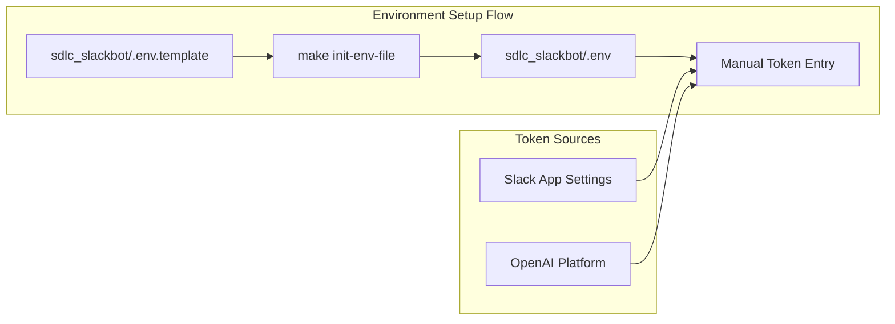
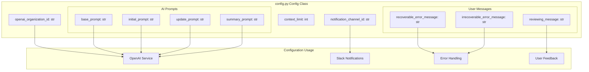
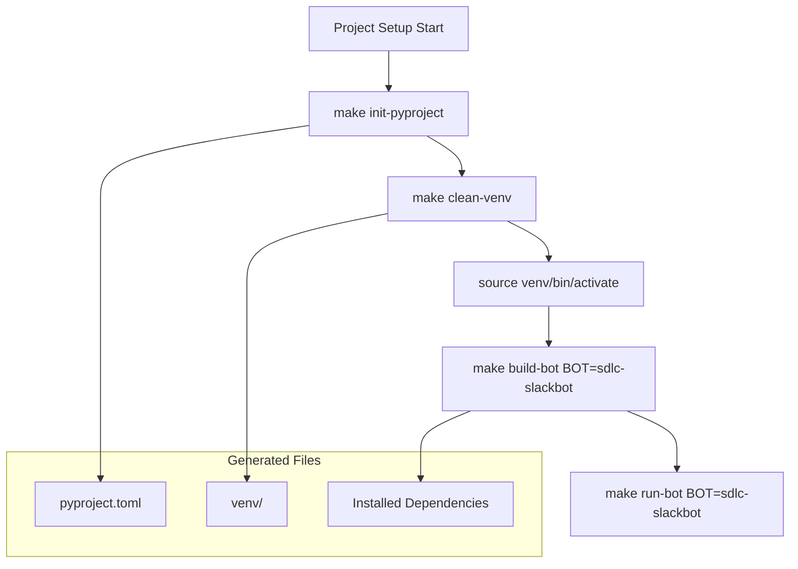
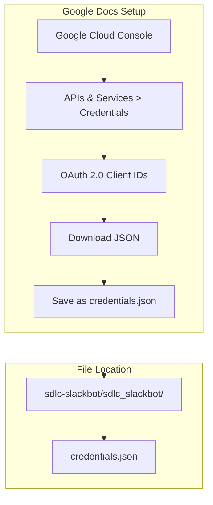

<!-- source: DeepWiki mcp.deepwiki.com · repo openai/openai-security-bots · page 4.1 Setup and Configuration · fetched 2026-10-26 -->

# Setup and Configuration

<details>
<summary>Relevant source files</summary>

The following files were used as context for generating this wiki page:

- [bots/sdlc-slackbot/Makefile](bots/sdlc-slackbot/Makefile)
- [bots/sdlc-slackbot/README.md](bots/sdlc-slackbot/README.md)
- [bots/sdlc-slackbot/sdlc_slackbot/.env.template](bots/sdlc-slackbot/sdlc_slackbot/.env.template)
- [bots/sdlc-slackbot/sdlc_slackbot/config.py](bots/sdlc-slackbot/sdlc_slackbot/config.py)
- [bots/sdlc-slackbot/sdlc_slackbot/config.toml](bots/sdlc-slackbot/sdlc_slackbot/config.toml)

</details>


This document covers the setup and configuration process for the SDLC Slackbot, including environment variables, configuration files, build system, and required integrations. This page focuses specifically on getting the bot operational in your environment.

For information about the bot's core logic and event handling, see [Core Logic and Event Handling](#4.2). For details about the AI integration and prompt configuration, see [AI Integration and Prompts](#4.3).

## Prerequisites and Dependencies

The SDLC Slackbot requires several external services and configurations before it can be deployed:

```mermaid
graph TB
    subgraph "External Requirements"
        SlackApp["Slack Application"]
        SocketMode["Socket Mode Enabled"]
        OpenAIKey["OpenAI API Key"]
        PostgresDB["PostgreSQL Database"]
        GoogleCreds["Google Docs Credentials (Optional)"]
    end
    
    subgraph "Slack App Configuration"
        AppToken["SOCKET_APP_TOKEN"]
        BotToken["SLACK_BOT_TOKEN"]
        Scopes["Required OAuth Scopes"]
    end
    
    subgraph "Required Scopes"
        AppMentions["app_mentions:read"]
        ChannelJoin["channels:join"]
        ChannelRead["channels:read"]
        ChannelHistory["channels:history"]
        ChatWrite["chat:write"]
        GroupsHistory["groups:history"]
        GroupsRead["groups:read"]
        GroupsWrite["groups:write"]
        UserGroupsRead["usergroups:read"]
        UsersRead["users:read"]
        UsersEmail["users:read.email"]
    end
    
    SlackApp --> SocketMode
    SlackApp --> AppToken
    SlackApp --> BotToken
    SlackApp --> Scopes
    
    Scopes --> AppMentions
    Scopes --> ChannelJoin
    Scopes --> ChannelRead
    Scopes --> ChannelHistory
    Scopes --> ChatWrite
    Scopes --> GroupsHistory
    Scopes --> GroupsRead
    Scopes --> GroupsWrite
    Scopes --> UserGroupsRead
    Scopes --> UsersRead
    Scopes --> UsersEmail
```



**Sources:** [bots/sdlc-slackbot/README.md:11-40]()

## Environment Configuration

### Environment Variables Setup

The bot uses a `.env` file for sensitive configuration data. Initialize the environment file using the provided template:

```bash
make init-env-file
```

This copies the template from `sdlc_slackbot/.env.template` to `sdlc_slackbot/.env`:

| Variable | Purpose | Source |
|----------|---------|--------|
| `SLACK_BOT_TOKEN` | Bot User OAuth Token (`xoxb-`) | [bots/sdlc-slackbot/sdlc_slackbot/.env.template:1-1]() |
| `SOCKET_APP_TOKEN` | App-Level Token with `connections:write` scope (`xapp-`) | [bots/sdlc-slackbot/sdlc_slackbot/.env.template:2-2]() |
| `OPENAI_API_KEY` | OpenAI API authentication | [bots/sdlc-slackbot/sdlc_slackbot/.env.template:3-3]() |



**Sources:** [bots/sdlc-slackbot/Makefile:5-6](), [bots/sdlc-slackbot/sdlc_slackbot/.env.template:1-4]()

## TOML Configuration Structure

The primary configuration is managed through `config.toml`, which is validated by the `Config` class in `config.py` using Pydantic.

### Core Configuration Parameters

The `Config` Pydantic model ensures that all required fields are present and valid, such as verifying that `notification_channel_id` starts with a 'C' via the `validate_channel` function.



### Critical Configuration Values

| Parameter | Description | Example | Required |
|-----------|-------------|---------|----------|
| `openai_organization_id` | OpenAI organization identifier | `"org-abc123"` | Yes |
| `notification_channel_id` | Slack channel for notifications (must start with 'C') | `"C1234567890"` | Yes |
| `context_limit` | Token limit for AI context | `31500` | Yes |

**Sources:** [bots/sdlc-slackbot/sdlc_slackbot/config.toml:1-68](), [bots/sdlc-slackbot/sdlc_slackbot/config.py:12-36]()

## Build and Initialization Process

### Project Initialization

The build system uses a combination of `Makefile` commands and Python package management. The `load_config` function in `config.py` initializes the configuration by loading environment variables and parsing the TOML file.



### Build Commands

Execute these commands in sequence:

1. **Initialize project structure** (from bot directory):
   ```bash
   make init-pyproject
   ```
   This command uses `sed` to replace `$REPO_ROOT` in the template with the actual absolute path.

2. **Set up virtual environment** (from repo root):
   ```bash
   make clean-venv
   source venv/bin/activate
   ```

3. **Build and install bot** (from repo root):
   ```bash
   make build-bot BOT=sdlc-slackbot
   ```

**Sources:** [bots/sdlc-slackbot/README.md:44-54](), [bots/sdlc-slackbot/Makefile:8-10](), [bots/sdlc-slackbot/sdlc_slackbot/config.py:38-47]()

## Optional Google Docs Integration

For enhanced project analysis, the bot can integrate with Google Docs to fetch documentation content.

### Setup Steps

1. Navigate to **Google Cloud Console**.
2. Select your project and navigate to **APIs & Services > Credentials**.
3. Under **OAuth 2.0 Client IDs**, find your client ID and download the JSON file.
4. Save it as `credentials.json` in the `sdlc-slackbot/sdlc_slackbot` directory.



**Sources:** [bots/sdlc-slackbot/README.md:61-67]()

## Channel Permissions and Deployment

### Required Channel Access

The bot must be explicitly added to channels where it needs to operate. It requires access to:
- The `notification_channel_id` specified in `config.toml`.
- Any channel where it is mentioned for project reviews.

### Deployment Verification

After configuration, run the bot from the repo root with:

```bash
make run-bot BOT=sdlc-slackbot
```

Verify the bot is properly configured by checking:
- Bot appears online in Slack.
- Bot responds to mentions in configured channels.
- `load_config` in `config.py` completes without validation errors.
- OpenAI API calls succeed using the provided `openai_organization_id`.

**Sources:** [bots/sdlc-slackbot/README.md:70-76](), [bots/sdlc-slackbot/sdlc_slackbot/config.py:50-54]()

---

