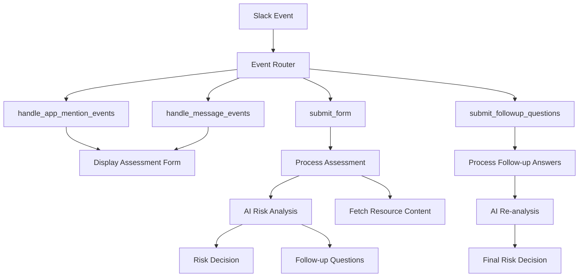
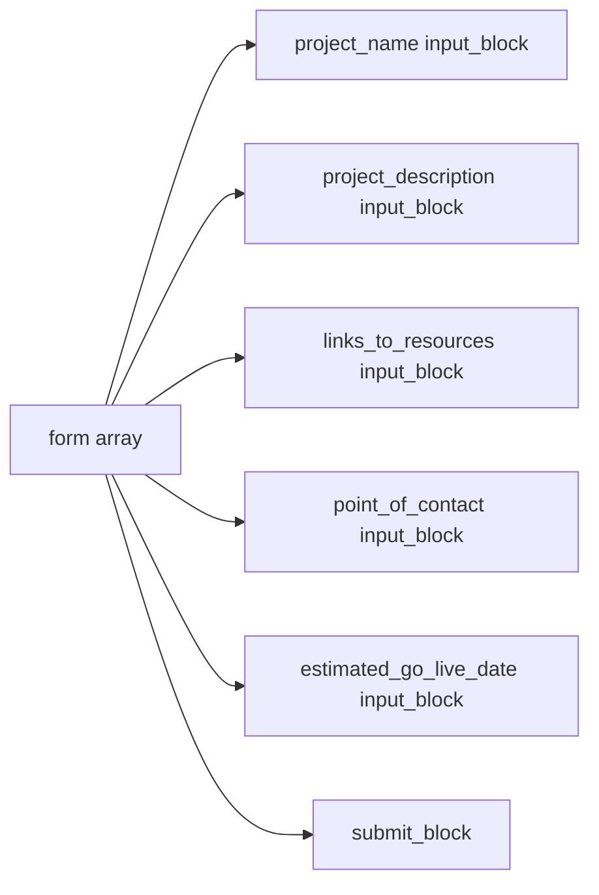
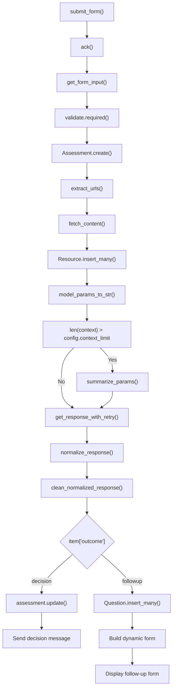
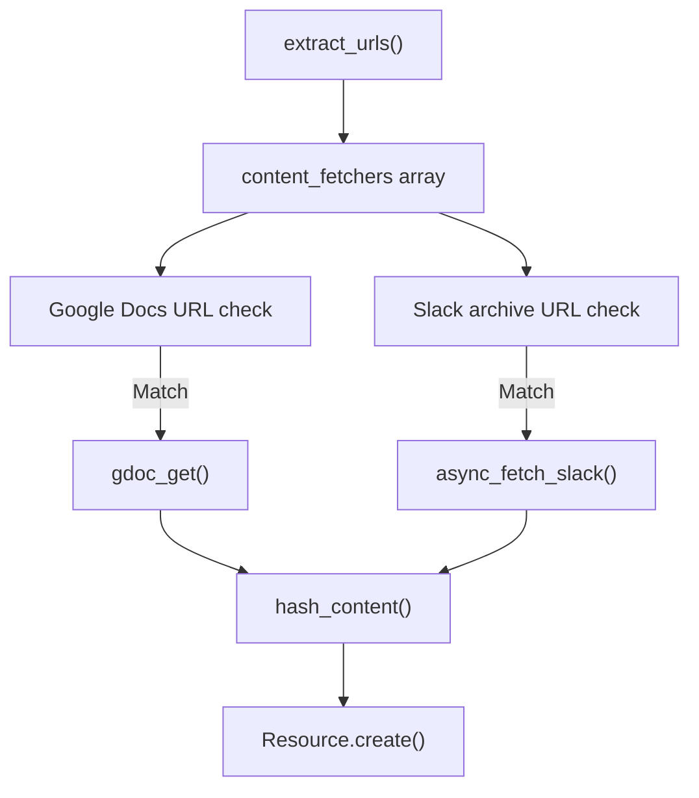
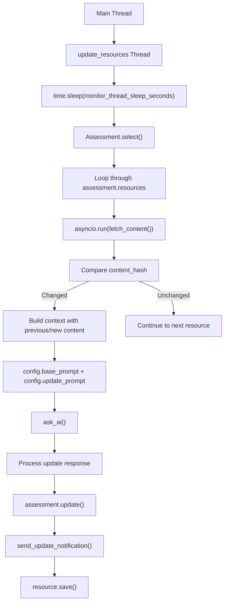
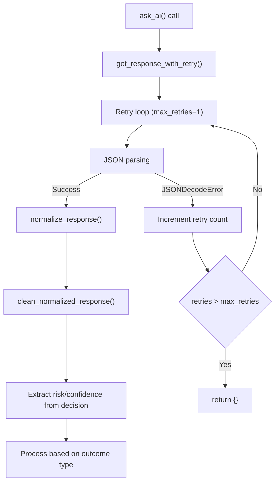
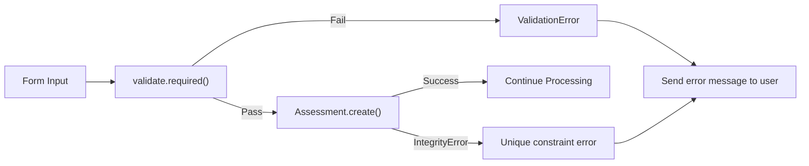
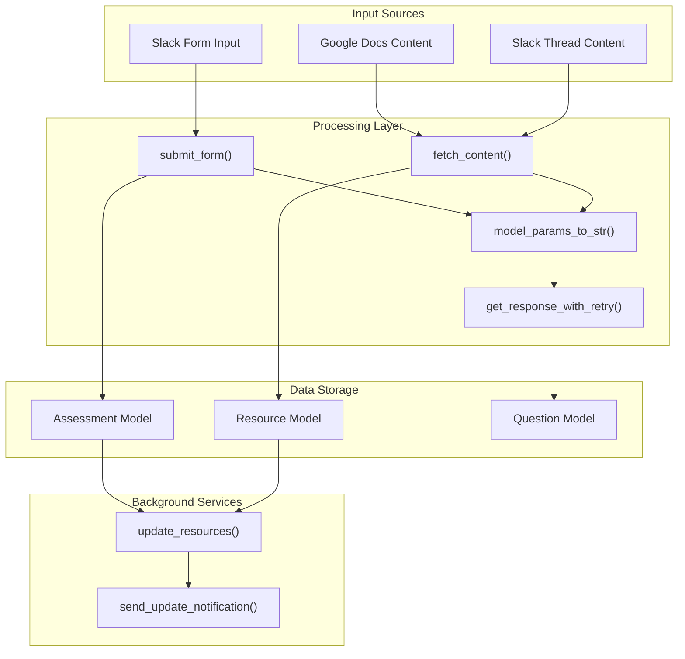

<!-- source: DeepWiki mcp.deepwiki.com · repo openai/openai-security-bots · page 4.2 Core Logic and Event Handling · fetched 2026-10-26 -->

# Core Logic and Event Handling

Relevant source files

The following files were used as context for generating this wiki page:

- [bots/sdlc-slackbot/sdlc_slackbot/bot.py](bots/sdlc-slackbot/sdlc_slackbot/bot.py)
- [bots/sdlc-slackbot/sdlc_slackbot/validate.py](bots/sdlc-slackbot/sdlc_slackbot/validate.py)

This document covers the core event handling logic and main workflow orchestration of the SDLC Slackbot. It explains how the bot processes Slack events, manages form submissions, handles AI-powered assessments, and monitors resource changes in the background.

For information about AI integration and prompt engineering, see [AI Integration and Prompts](#4.3). For database schema details, see [Database Schema and Data Models](#4.4). For Google Docs integration specifics, see [Google Docs Integration](#4.5).

## Event Handling Architecture

The SDLC Slackbot uses Slack's Socket Mode to handle real-time events. The main event handlers are registered during bot initialization and respond to user interactions.

**Sources:** [bots/sdlc-slackbot/sdlc_slackbot/bot.py:187-197](), [bots/sdlc-slackbot/sdlc_slackbot/bot.py:459-465]()

### Event Handler Functions

| Handler Function | Trigger | Purpose |
|------------------|---------|---------|
| `handle_app_mention_events` | App mention in channel | Display assessment form in thread [bots/sdlc-slackbot/sdlc_slackbot/bot.py:187-190]() |
| `handle_message_events` | Direct message to bot | Display assessment form in DM [bots/sdlc-slackbot/sdlc_slackbot/bot.py:192-197]() |
| `submit_form` | Initial form submission | Process project assessment [bots/sdlc-slackbot/sdlc_slackbot/bot.py:239-322]() |
| `submit_followup_questions` | Follow-up form submission | Process additional answers [bots/sdlc-slackbot/sdlc_slackbot/bot.py:324-373]() |

**Sources:** [bots/sdlc-slackbot/sdlc_slackbot/bot.py:187-197](), [bots/sdlc-slackbot/sdlc_slackbot/bot.py:239-322](), [bots/sdlc-slackbot/sdlc_slackbot/bot.py:324-373]()

## Form Workflow and Processing

The bot presents users with a structured assessment form and processes responses through a multi-stage workflow.

### Initial Assessment Form

The assessment form is defined as a static structure with input blocks for project information:

**Sources:** [bots/sdlc-slackbot/sdlc_slackbot/bot.py:88-111]()

### Form Processing Pipeline

When a user submits the initial assessment form, the `submit_form` function orchestrates a complex processing pipeline:

**Sources:** [bots/sdlc-slackbot/sdlc_slackbot/bot.py:239-322](), [bots/sdlc-slackbot/sdlc_slackbot/bot.py:169-172](), [bots/sdlc-slackbot/sdlc_slackbot/bot.py:174-184]()

### Content Fetching System

The bot can fetch content from multiple sources based on URL patterns:

**Sources:** [bots/sdlc-slackbot/sdlc_slackbot/bot.py:53-86](), [bots/sdlc-slackbot/sdlc_slackbot/bot.py:70-76]()

## Background Resource Monitoring

The bot runs a continuous background thread `update_resources` that monitors resources for changes and triggers re-assessment when updates are detected.

### Monitoring Thread Architecture

**Sources:** [bots/sdlc-slackbot/sdlc_slackbot/bot.py:375-434](), [bots/sdlc-slackbot/sdlc_slackbot/bot.py:467-468]()

### Update Context Structure

The monitoring system creates a structured context for AI analysis when resources change:

| Field | Description |
|-------|-------------|
| `previous_context` | Original resource content [bots/sdlc-slackbot/sdlc_slackbot/bot.py:408]() |
| `previous_decision` | Risk, confidence, and justification from initial assessment [bots/sdlc-slackbot/sdlc_slackbot/bot.py:409]() |
| `new_context` | Updated resource content [bots/sdlc-slackbot/sdlc_slackbot/bot.py:410]() |

**Sources:** [bots/sdlc-slackbot/sdlc_slackbot/bot.py:405-416]()

## AI Integration Points

The bot integrates with OpenAI at multiple stages of the workflow, with retry logic and response normalization.

### AI Response Processing Pipeline

**Sources:** [bots/sdlc-slackbot/sdlc_slackbot/bot.py:198-236]()

### Risk and Confidence Mapping

The bot converts numeric AI responses to human-readable risk and confidence levels via `risk_and_confidence_to_string`:

| Risk Range | Description | Confidence Range | Description |
|------------|-------------|------------------|-------------|
| 1-2 | extremely low risk | 1-2 | extremely low confidence |
| 3 | low risk | 3 | low confidence |
| 4-5 | medium risk | 4-5 | medium confidence |
| 6-7 | medium-high risk | 6-7 | medium-high confidence |
| 8-9 | high risk | 8-9 | high confidence |
| 10 | critical risk | 10 | extreme confidence |

**Sources:** [bots/sdlc-slackbot/sdlc_slackbot/bot.py:114-145]()

## Error Handling and Validation

The bot implements comprehensive error handling at multiple levels to ensure graceful degradation.

### Validation Pipeline

The `validate.required()` function checks for the presence of required fields:

- `project_name`
- `project_description` 
- `point_of_contact`

**Sources:** [bots/sdlc-slackbot/sdlc_slackbot/validate.py:8-13](), [bots/sdlc-slackbot/sdlc_slackbot/bot.py:254-261]()

### Exception Handling Strategy

| Exception Type | Handler Location | Recovery Action |
|----------------|------------------|----------------|
| `ValidationError` | Form submission handlers | Send field-specific error message [bots/sdlc-slackbot/sdlc_slackbot/bot.py:315-317]() |
| `IntegrityError` | Database operations | Convert to validation error [bots/sdlc-slackbot/sdlc_slackbot/bot.py:254-261]() |
| `JSONDecodeError` | AI response parsing | Retry via `get_response_with_retry` [bots/sdlc-slackbot/sdlc_slackbot/bot.py:205-209]() |
| `General Exception` | All handlers | Send generic error message and log traceback [bots/sdlc-slackbot/sdlc_slackbot/bot.py:318-321]() |

**Sources:** [bots/sdlc-slackbot/sdlc_slackbot/bot.py:315-321](), [bots/sdlc-slackbot/sdlc_slackbot/bot.py:370-372](), [bots/sdlc-slackbot/sdlc_slackbot/bot.py:432-434](), [bots/sdlc-slackbot/sdlc_slackbot/bot.py:205-209]()

## Data Flow Integration

The core logic coordinates between multiple data sources and processing stages:

**Sources:** [bots/sdlc-slackbot/sdlc_slackbot/bot.py:239-322](), [bots/sdlc-slackbot/sdlc_slackbot/bot.py:375-434]()

---

