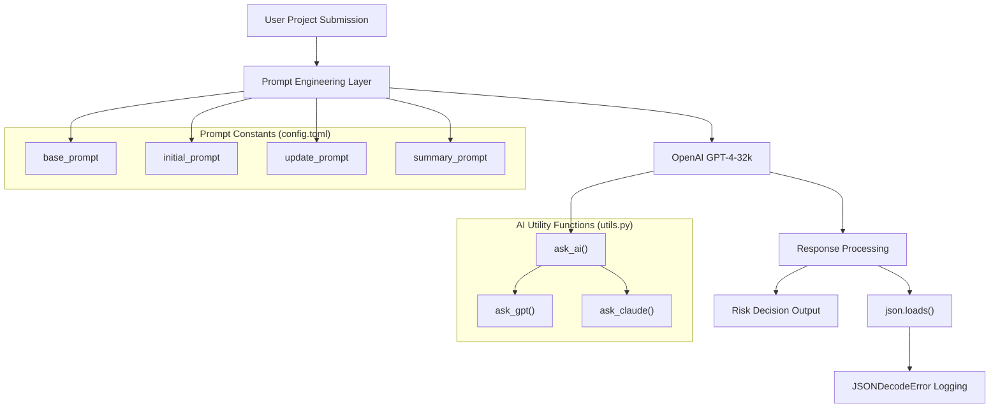
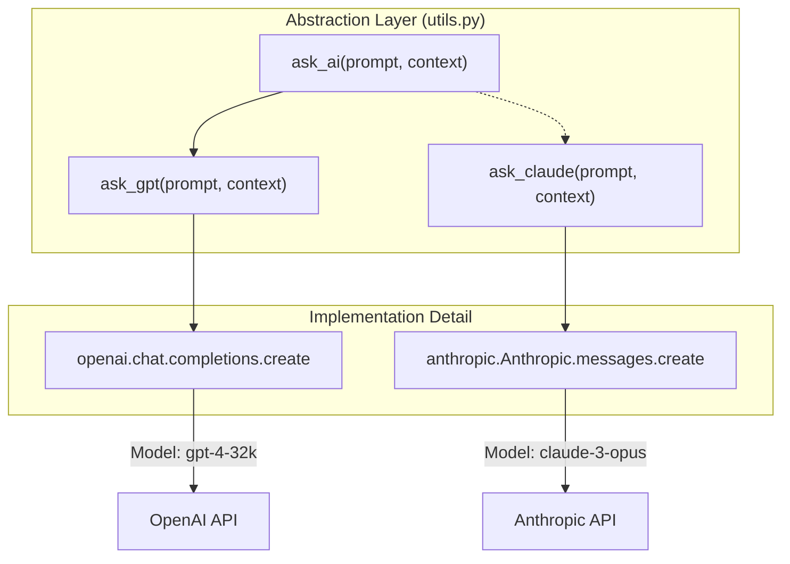

<!-- source: DeepWiki mcp.deepwiki.com · repo openai/openai-security-bots · page 4.3 AI Integration and Prompts · fetched 2026-10-26 -->

# AI Integration and Prompts

Relevant source files

The following files were used as context for generating this wiki page:

- [bots/sdlc-slackbot/sdlc_slackbot/config.toml](bots/sdlc-slackbot/sdlc_slackbot/config.toml)
- [bots/sdlc-slackbot/sdlc_slackbot/utils.py](bots/sdlc-slackbot/sdlc_slackbot/utils.py)

## Purpose and Scope

This document covers how the SDLC Slackbot integrates with OpenAI's GPT-4 model to perform automated security risk assessment and project triage. It details the prompt engineering strategy, response processing mechanisms, and AI model configuration used to evaluate development projects for security review requirements.

For information about the overall SDLC bot architecture, see [Core Logic and Event Handling](4.2). For database storage of AI assessment results, see [Database Schema and Data Models](4.4).

## AI Integration Architecture

The SDLC bot's AI integration follows a structured approach where user-provided project information is processed through carefully engineered prompts to produce standardized risk assessments.

### Code-to-Logic Mapping
The following diagram maps the logical flow of AI integration to specific code entities in the `sdlc_slackbot` module.

**Sources:** [bots/sdlc-slackbot/sdlc_slackbot/config.toml:1-61](), [bots/sdlc-slackbot/sdlc_slackbot/utils.py:60-104]()

## Prompt Engineering Strategy

The SDLC bot employs a multi-prompt strategy designed to handle different phases of the security assessment workflow. Each prompt is defined as a string in the configuration file.

### Risk Assessment Prompt (`base_prompt`)

The core risk assessment prompt establishes the AI as a security analyst with specific organizational context and decision-making criteria. It enforces a 1-10 scale for risk and confidence.

| Prompt Component | Purpose | Key Elements |
|------------------|---------|--------------|
| Role Definition | Establishes AI persona | "Highly skilled security analyst" [bots/sdlc-slackbot/sdlc_slackbot/config.toml:9-9]() |
| Organizational Context | Sets resource constraints | "Small company with limited security team" [bots/sdlc-slackbot/sdlc_slackbot/config.toml:10-12]() |
| Risk Factors | Defines evaluation criteria | Model weights, customer data, internet exposure [bots/sdlc-slackbot/sdlc_slackbot/config.toml:14-19]() |
| Decision Format | Standardizes output | Risk score (1-10), confidence score (1-10) [bots/sdlc-slackbot/sdlc_slackbot/config.toml:25-31]() |
| Response Structure | Ensures parseable JSON | `{"outcome": "decision", "decision": {...}, "justification": "..."}` [bots/sdlc-slackbot/sdlc_slackbot/config.toml:35-35]() |

The prompt specifically prioritizes:
- **Data Protection**: Model weights and customer data access.
- **Attack Surface**: Internet-accessible components.
- **Security-Critical Systems**: Authentication, authorization, encryption.

**Sources:** [bots/sdlc-slackbot/sdlc_slackbot/config.toml:8-39]()

### Follow-up Question Prompt (`initial_prompt`)

When the AI determines that additional information is needed, this prompt guides the generation of clarifying questions. It instructs the AI to use the `outcome: followup` state.

**Sources:** [bots/sdlc-slackbot/sdlc_slackbot/config.toml:42-47]()

### Update Assessment Prompt (`update_prompt`)

This prompt handles reassessment when project information changes. It provides the AI with `previous_context` and `new_context` to detect changes affecting security components. If the change is negligible, the AI returns `outcome: unchanged`.

**Sources:** [bots/sdlc-slackbot/sdlc_slackbot/config.toml:49-54]()

### Document Summary Prompt (`summary_prompt`)

Used for analyzing and summarizing security-relevant content from project documentation fetched via Google Docs or Slack links.

**Sources:** [bots/sdlc-slackbot/sdlc_slackbot/config.toml:56-61]()

## AI Model Integration

The bot primarily uses OpenAI's GPT-4-32k model through the `ask_ai()` abstraction.

### AI Abstraction Layer
The bot uses a tiered abstraction for calling AI models, allowing for easy switching between providers.

### Model Configuration

The bot is configured with specific parameters for optimal performance:

| Parameter | Value | Purpose |
|-----------|--------|---------|
| Model | `gpt-4-32k` | Large context window for complex assessments [bots/sdlc-slackbot/sdlc_slackbot/utils.py:87-87]() |
| Context Limit | `31,500` tokens | Maximum input size for processing [bots/sdlc-slackbot/sdlc_slackbot/config.toml:6-6]() |
| Organization ID | `openai_organization_id` | OpenAI organization association [bots/sdlc-slackbot/sdlc_slackbot/config.toml:2-2]() |

**Sources:** [bots/sdlc-slackbot/sdlc_slackbot/config.toml:1-6](), [bots/sdlc-slackbot/sdlc_slackbot/utils.py:85-94]()

## Response Processing Pipeline

The `ask_ai` function implements a sanitization pipeline to ensure the raw string returned by the LLM can be reliably parsed into a Python dictionary.

### Response Cleanup Logic

The `ask_ai()` function performs the following transformations on the `clean_response` string:

1.  **Stripping**: Removes leading/trailing backticks and whitespace using `.strip("` \n ")` [bots/sdlc-slackbot/sdlc_slackbot/utils.py:65-65]().
2.  **Markdown Removal**: Detects and removes the `json` prefix often added by LLMs in markdown code blocks [bots/sdlc-slackbot/sdlc_slackbot/utils.py:68-69]().
3.  **Brace Correction**: Handles a specific edge case where models might append an extra closing brace `}}` [bots/sdlc-slackbot/sdlc_slackbot/utils.py:72-73]().
4.  **JSON Parsing**: Executes `json.loads(clean_response)` and catches `json.JSONDecodeError` [bots/sdlc-slackbot/sdlc_slackbot/utils.py:78-82]().

**Sources:** [bots/sdlc-slackbot/sdlc_slackbot/utils.py:60-83]()

## Outcome State Machine

The AI integration drives the lifecycle of an assessment through the `outcome` field in the JSON response.

| Outcome | Description | Resulting Action |
|---------|-------------|------------------|
| `decision` | AI has enough info to score risk. | Bot posts risk/confidence scores and justification. |
| `followup` | AI needs more information. | Bot posts the list of `questions` to the thread. |
| `unchanged` | Project update doesn't change risk. | Bot acknowledges update but keeps previous decision. |

**Sources:** [bots/sdlc-slackbot/sdlc_slackbot/config.toml:35-52]()

## Error Handling and Fallbacks

### User-Facing Error Messages
The bot uses standardized strings from `config.toml` when the AI integration fails or encounters errors.

- **`recoverable_error_message`**: Used for transient failures where a new conversation might work [bots/sdlc-slackbot/sdlc_slackbot/config.toml:65-65]().
- **`irrecoverable_error_message`**: Used for persistent issues, directing users to the `#security` channel [bots/sdlc-slackbot/sdlc_slackbot/config.toml:67-67]().

**Sources:** [bots/sdlc-slackbot/sdlc_slackbot/config.toml:63-68](), [bots/sdlc-slackbot/sdlc_slackbot/utils.py:81-82]()

---

