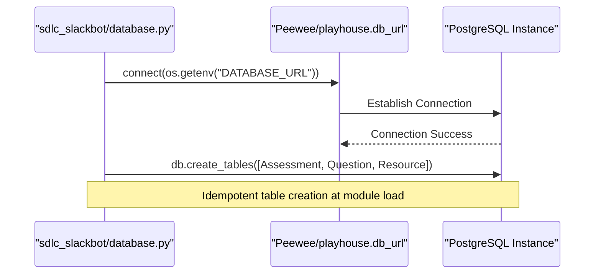
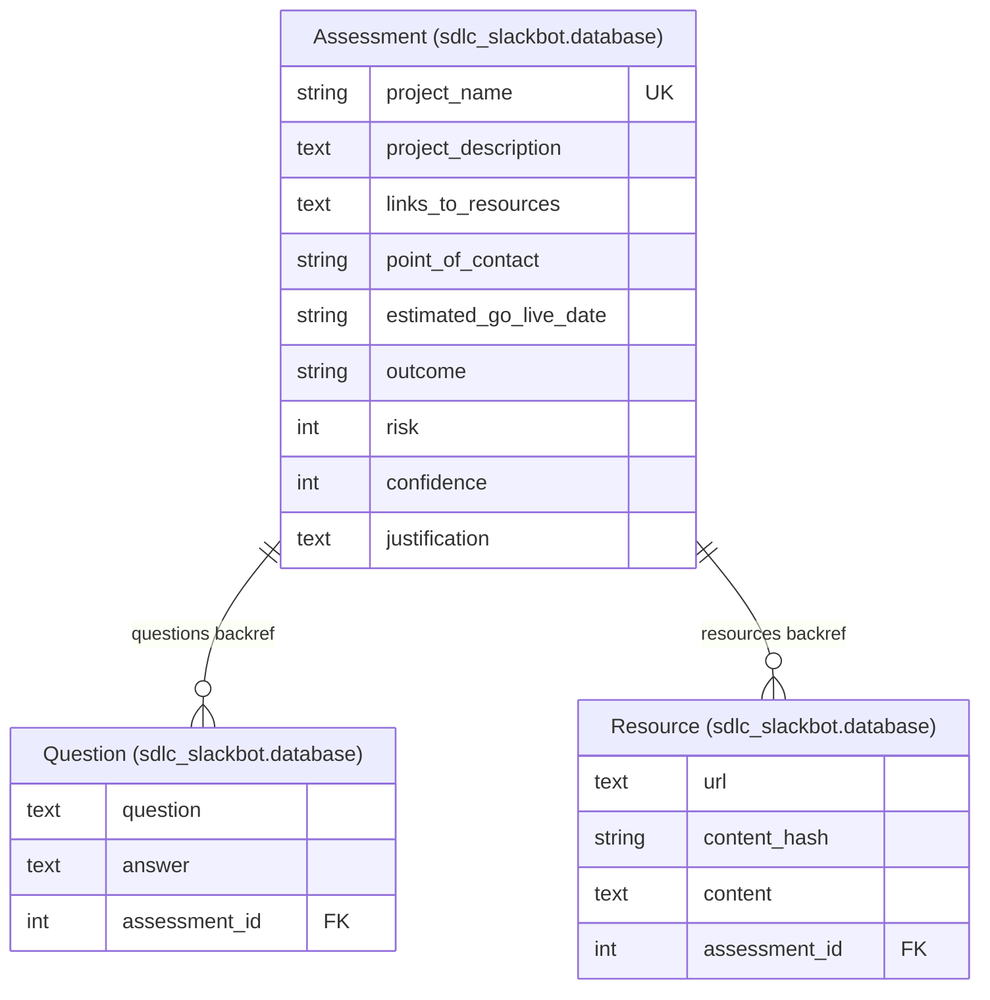
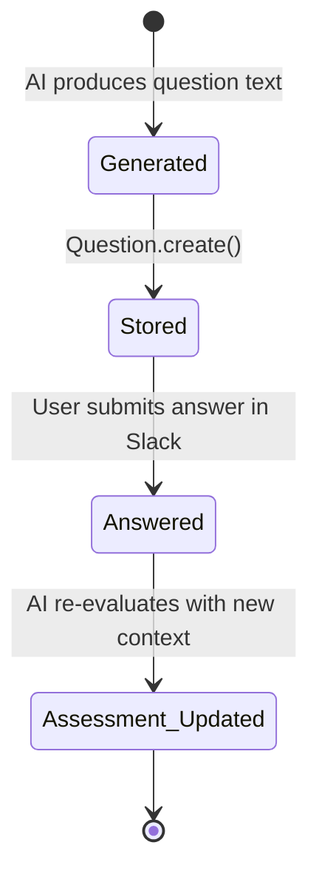

<!-- source: DeepWiki mcp.deepwiki.com · repo openai/openai-security-bots · page 4.4 Database Schema and Data Models · fetched 2026-10-26 -->

# Database Schema and Data Models

<details>
<summary>Relevant source files</summary>

The following files were used as context for generating this wiki page:

- [bots/sdlc-slackbot/sdlc_slackbot/database.py](bots/sdlc-slackbot/sdlc_slackbot/database.py)

</details>


This document covers the database schema and data models used by the SDLC Slackbot to persist project assessments, follow-up questions, and associated resources. The database implementation uses PostgreSQL with the Peewee ORM to manage project security review data throughout the assessment workflow.

For information about how these models are used in the core assessment logic, see [Core Logic and Event Handling](4.2). For AI integration patterns that analyze this stored data, see [AI Integration and Prompts](4.3).

## Database Connection and Configuration

The SDLC Slackbot connects to a PostgreSQL database using a configurable connection URL. The database connection is established through the `DATABASE_URL` environment variable with a localhost fallback for development environments [bots/sdlc-slackbot/sdlc_slackbot/database.py:6-7]().

```mermaid
graph TB
    subgraph "Database Connection Setup"
        [EnvVar] -- "DATABASE_URL" --> [Connection]
        [DefaultURL] -- "postgres://.../postgres" --> [Connection]
        [Connection] -- "Peewee connect()" --> [BaseModel]
    end
    
    [BaseModel] -- "Inheritance" --> [Assessment]
    [BaseModel] -- "Inheritance" --> [Resource]
    [db] -- "Explicit Meta" --> [Question]
```

**Database Connection Flow**


Sources: [bots/sdlc-slackbot/sdlc_slackbot/database.py:1-7](), [bots/sdlc-slackbot/sdlc_slackbot/database.py:44-45]()

## Data Models Overview

The database schema consists of three primary models that represent the core entities in the security assessment workflow: `Assessment`, `Question`, and `Resource`. These models form a hierarchical relationship where questions and resources are associated with specific assessments via `ForeignKeyField` [bots/sdlc-slackbot/sdlc_slackbot/database.py:30-41]().

**Entity Relationship Diagram**


Sources: [bots/sdlc-slackbot/sdlc_slackbot/database.py:15-42]()

## Assessment Model

The `Assessment` model represents the core project assessment record containing all project details and AI-generated analysis results. Each assessment is uniquely identified by the `project_name` [bots/sdlc-slackbot/sdlc_slackbot/database.py:16]().

| Field | Type | Constraints | Purpose |
|-------|------|-------------|---------|
| `project_name` | `CharField` | `unique=True` | Unique project identifier |
| `project_description` | `TextField` | Required | Detailed project description |
| `links_to_resources` | `TextField` | `null=True` | User-provided resource URLs |
| `point_of_contact` | `CharField` | Required | Project contact person |
| `estimated_go_live_date` | `CharField` | `null=True` | Project timeline |
| `outcome` | `CharField` | `null=True` | AI-generated assessment result (e.g., "decision", "followup") |
| `risk` | `IntegerField` | `null=True` | AI-generated risk score (1-10) |
| `confidence` | `IntegerField` | `null=True` | AI confidence in assessment (1-10) |
| `justification` | `TextField` | `null=True` | AI-generated risk justification |

**Assessment Data Flow**
```mermaid
flowchart TD
    [Slack_UI] -- "submit_form" --> [Assessment_Model]
    [OpenAI_Integration] -- "ask_ai results" --> [Assessment_Model]
    
    subgraph "Model State"
        [Assessment_Model] -- "Relationship" --> [Question_Model]
        [Assessment_Model] -- "Relationship" --> [Resource_Model]
    end
```

Sources: [bots/sdlc-slackbot/sdlc_slackbot/database.py:15-25]()

## Question Model

The `Question` model stores follow-up questions generated by the AI system and their corresponding answers. Questions are linked to specific assessments and use a compound unique index to prevent duplicate questions within the same assessment [bots/sdlc-slackbot/sdlc_slackbot/database.py:34]().

| Field | Type | Constraints | Purpose |
|-------|------|-------------|---------|
| `question` | `TextField` | Required | AI-generated follow-up question |
| `answer` | `TextField` | `null=True` | User's response to the question |
| `assessment` | `ForeignKeyField` | Required | Link to parent `Assessment` via `backref="questions"` |

**Question Lifecycle**


Sources: [bots/sdlc-slackbot/sdlc_slackbot/database.py:27-35]()

## Resource Model

The `Resource` model tracks external resources (primarily Google Docs URLs) associated with project assessments. It stores both the resource URL and fetched content with a `content_hash` for change detection [bots/sdlc-slackbot/sdlc_slackbot/database.py:39-40]().

| Field | Type | Constraints | Purpose |
|-------|------|-------------|---------|
| `url` | `TextField` | Required | Resource URL (typically Google Docs) |
| `content_hash` | `CharField` | Required | Hash of fetched content for change detection |
| `content` | `TextField` | `null=True` | Fetched and processed resource content |
| `assessment` | `ForeignKeyField` | Required | Link to parent `Assessment` via `backref="resources"` |

**Resource Processing Pipeline**
```mermaid
flowchart LR
    [URL_Input] --> [GDoc_Fetch]
    [GDoc_Fetch] --> [Hash_Generation]
    [Hash_Generation] --> [Resource_Update]
    [Resource_Update] --> [AI_Reassessment]
```

Sources: [bots/sdlc-slackbot/sdlc_slackbot/database.py:37-42]()

## Database Relationships and Indexes

The database schema implements a one-to-many relationship pattern where each `Assessment` can have multiple associated `Question` and `Resource` records.

### Relationships
- `Assessment.questions`: Access all questions via the `backref` on the `Question.assessment` field [bots/sdlc-slackbot/sdlc_slackbot/database.py:30]().
- `Assessment.resources`: Access all resources via the `backref` on the `Resource.assessment` field [bots/sdlc-slackbot/sdlc_slackbot/database.py:41]().

### Constraints and Indexes
- **Uniqueness**: `Assessment.project_name` is unique [bots/sdlc-slackbot/sdlc_slackbot/database.py:16]().
- **Compound Index**: `Question` model enforces uniqueness on the combination of `question` text and `assessment` ID to prevent duplicate follow-ups [bots/sdlc-slackbot/sdlc_slackbot/database.py:34]().
- **Nullability**: Lifecycle fields like `outcome`, `risk`, `confidence`, and `answer` are nullable to support the incremental nature of the assessment process [bots/sdlc-slackbot/sdlc_slackbot/database.py:21-29]().

## Database Initialization

The module follows a self-initializing pattern. When `database.py` is imported, it immediately establishes a connection and ensures the tables exist [bots/sdlc-slackbot/sdlc_slackbot/database.py:44-45]().

```python
db.connect()
db.create_tables([Assessment, Question, Resource])
```

This pattern ensures that any component importing the models (like the Slack event handlers) has a guaranteed database schema available without explicit setup steps in the main application entry point.

Sources: [bots/sdlc-slackbot/sdlc_slackbot/database.py:44-46]()

---

